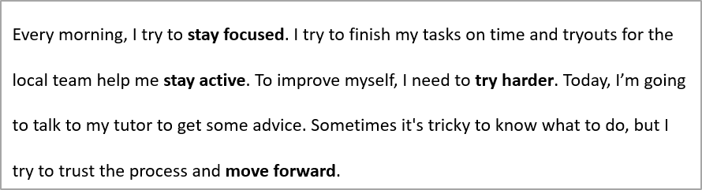

## **Áttekintés**

Ez a cikk bemutatja, hogyan lehet formázni a szöveget PowerPoint és OpenDocument bemutatókban az Aspose.Slides for Node.js Java-n keresztül használva. Kitér a háttérszínekre, átlátszóságra, karakterközökre, betűtípus‑tulajdonságokra, forgatásra, bekezdés‑térközre, az automatikus illesztés viselkedésére, a szöveg‑helymeghatározásra, tabulátorokra és a nyelvi beállításokra.

Ha nincs másként jelölve, a példák a [sample.pptx](sample.pptx) fájlt használják. Az első dián lévő első alakzat egy szövegdoboz, és az első bekezdése a lent látható szöveget tartalmazza. A diák és az alakzat indexei nullától indulnak. Az olyan példák, amelyek félkövér részeket választanak, hatékony formázást használnak, beleértve az örökölt félkövér formázást:


A szó szerinti szöveg vagy reguláris‑kifejezés egyezések megtalálásához és kiemeléséhez lásd a [Szöveg keresése és cseréje](/slides/hu/nodejs-java/search-and-replace-text/).

## **Szöveg háttérszínének beállítása**

Használja a [ParagraphFormat.getDefaultPortionFormat](https://reference.aspose.com/slides/nodejs-java/aspose.slides/paragraphformat/#getDefaultPortionFormat) metódust a bekezdés alapértelmezett kiemelés színének beállításához, vagy a [BasePortionFormat.getHighlightColor](https://reference.aspose.com/slides/nodejs-java/aspose.slides/baseportionformat/#getHighlightColor) metódust egyedi szövegrészekhez.

Az alábbi példa világosszürke kiemelést állít be alapértelmezettként az első bekezdéshez. Az egyes részekre alkalmazott kifejezett kiemelési színek felülbírálják ezt az alapértelmezést:

```javascript
const aspose = { slides: require("aspose.slides.via.java") };
const java = require("java");

const presentation = new aspose.slides.Presentation("sample.pptx");
try {
    const slide = presentation.getSlides().get_Item(0);

    const autoShape = slide.getShapes().get_Item(0);
    const paragraph = autoShape.getTextFrame().getParagraphs().get_Item(0);

    // Állítsa be a kiemelés színét a teljes bekezdéshez.
    paragraph.getParagraphFormat().getDefaultPortionFormat().getHighlightColor().setColor(java.getStaticFieldValue("java.awt.Color", "LIGHT_GRAY"));

    presentation.save("gray_paragraph.pptx", aspose.slides.SaveFormat.Pptx);
} finally {
    presentation.dispose();
}
```

Az eredmény:


Az alábbi kódrészlet bemutatja, hogyan állítható be a háttérszín **félkövér betűtípussal rendelkező szövegrészek** számára:

```javascript
const aspose = { slides: require("aspose.slides.via.java") };
const java = require("java");

const presentation = new aspose.slides.Presentation("sample.pptx");
try {
    const slide = presentation.getSlides().get_Item(0);

    const autoShape = slide.getShapes().get_Item(0);
    const paragraph = autoShape.getTextFrame().getParagraphs().get_Item(0);
    const portions = paragraph.getPortions();
    const portionCount = portions.getCount();

    for (let portionIndex = 0; portionIndex < portionCount; portionIndex++) {
        const portion = portions.get_Item(portionIndex);
        if (portion.getPortionFormat().getEffective().getFontBold()) {
            // Állítsa be a kiemelés színét a szövegrészhez.
            portion.getPortionFormat().getHighlightColor().setColor(java.getStaticFieldValue("java.awt.Color", "LIGHT_GRAY"));
        }
    }

    presentation.save("gray_text_portions.pptx", aspose.slides.SaveFormat.Pptx);
} finally {
    presentation.dispose();
}
```

Az eredmény:


## **Szöveg bekezdések igazítása**

Használja a [ParagraphFormat.setAlignment](https://reference.aspose.com/slides/nodejs-java/aspose.slides/paragraphformat/#setAlignment) metódust a bekezdés igazításának beállításához egy szövegkeretben. Az érték lehet középre, balra, jobbra, sorkizárt stb.

Az alábbi kódrészlet bemutatja, hogyan igazítható a bekezdés **középre**:

```javascript
const aspose = { slides: require("aspose.slides.via.java") };

const presentation = new aspose.slides.Presentation("sample.pptx");
try {
    const slide = presentation.getSlides().get_Item(0);

    const autoShape = slide.getShapes().get_Item(0);
    const paragraph = autoShape.getTextFrame().getParagraphs().get_Item(0);

    // Állítsa be a bekezdés igazítását középre.
    paragraph.getParagraphFormat().setAlignment(aspose.slides.TextAlignment.Center);

    presentation.save("aligned_paragraph.pptx", aspose.slides.SaveFormat.Pptx);
} finally {
    presentation.dispose();
}
```

Az eredmény:


## **Betűk igazítása egy soron belül**

Használja a [ParagraphFormat.setFontAlignment](https://reference.aspose.com/slides/nodejs-java/aspose.slides/paragraphformat/#setFontAlignment) metódust a soron belül különböző betűméretű szövegrészek függőleges igazításához. Ez a beállítás az egész bekezdésre vonatkozik, és szabályozza az egyes sorok igazítását.

Az alábbi önálló példa négy címkézett szövegdobozt hoz létre egy dián. Minden bekezdés ugyanazt a szöveget tartalmazza 18, 36 és 54 pont méretben, eltérő betűigazítással. Arial betűtípust használ, kikapcsolja az automatikus illesztést és a tördelést, és a szövegkereteket elég nagyra állítja egy sorhoz.

```javascript
const aspose = { slides: require("aspose.slides.via.java") };
const java = require("java");

const presentation = new aspose.slides.Presentation();
try {
    const slide = presentation.getSlides().get_Item(0);

    const alignments = [aspose.slides.FontAlignment.Baseline, aspose.slides.FontAlignment.Top, aspose.slides.FontAlignment.Center, aspose.slides.FontAlignment.Bottom];
    const alignmentNames = ["Baseline", "Top", "Center", "Bottom"];
    const fontSizes = [18, 36, 54];

    for (let i = 0; i < alignments.length; i++) {
        const shape = slide.getShapes().addAutoShape(aspose.slides.ShapeType.Rectangle, 30, 20 + i * 130, 660, 120);
        shape.getFillFormat().setFillType(java.newByte(aspose.slides.FillType.NoFill));
        shape.getLineFormat().getFillFormat().setFillType(java.newByte(aspose.slides.FillType.NoFill));

        const textFrame = shape.getTextFrame();
        textFrame.getTextFrameFormat().setAnchoringType(java.newByte(aspose.slides.TextAnchorType.Top));
        textFrame.getTextFrameFormat().setAutofitType(java.newByte(aspose.slides.TextAutofitType.None));
        textFrame.getTextFrameFormat().setWrapText(java.newByte(aspose.slides.NullableBool.False));

        const label = textFrame.getParagraphs().get_Item(0);
        label.setText(alignmentNames[i]);
        label.getParagraphFormat().setAlignment(aspose.slides.TextAlignment.Left);
        label.getParagraphFormat().getDefaultPortionFormat().setFontHeight(14);
        label.getParagraphFormat().getDefaultPortionFormat().setLatinFont(new aspose.slides.FontData("Arial"));
        label.getParagraphFormat().getDefaultPortionFormat().getFillFormat().setFillType(java.newByte(aspose.slides.FillType.Solid));
        label.getParagraphFormat().getDefaultPortionFormat().getFillFormat().getSolidFillColor().setColor(java.getStaticFieldValue("java.awt.Color", "GRAY"));

        const paragraph = new aspose.slides.Paragraph();
        paragraph.getParagraphFormat().setFontAlignment(alignments[i]);
        paragraph.getParagraphFormat().setAlignment(aspose.slides.TextAlignment.Left);
        paragraph.getParagraphFormat().getDefaultPortionFormat().setLatinFont(new aspose.slides.FontData("Arial"));
        paragraph.getParagraphFormat().getDefaultPortionFormat().getFillFormat().setFillType(java.newByte(aspose.slides.FillType.Solid));
        paragraph.getParagraphFormat().getDefaultPortionFormat().getFillFormat().getSolidFillColor().setColor(java.getStaticFieldValue("java.awt.Color", "BLACK"));

        for (const fontSize of fontSizes) {
            const portion = new aspose.slides.Portion("Ag ");
            portion.getPortionFormat().setFontHeight(fontSize);
            paragraph.getPortions().add(portion);
        }

        textFrame.getParagraphs().add(paragraph);
    }

    presentation.save("font_alignment.pptx", aspose.slides.SaveFormat.Pptx);
} finally {
    presentation.dispose();
}
```

Az eredmény:


A betűigazítás betűmetrikákat használ, ezért az egyes betűk látható szélei nem feltétlenül illeszkednek pontosan egymáshoz. A példában szerepel egy nagybetű és egy leszálló karakter is, hogy megmutassa a baseline és a bottom igazítás közti különbséget. Betűkészlet elérhetősége és helyettesítése, a használt karakterek, valamint a betűméretek közti különbség befolyásolja az eredményt. A keret méretei, margók, sortávolság, tördelés és az automatikus illesztés szintén hat a megjelenésre; a módok összehasonlításakor használja ugyanazt a betűtípust és elrendezési beállításokat.

Ez a beállítás eltér a [ParagraphFormat.setAlignment](https://reference.aspose.com/slides/nodejs-java/aspose.slides/paragraphformat/#setAlignment) beállítástól, amely a bekezdés vízszintes igazítását szabályozza, és a [TextFrameFormat.setAnchoringType](https://reference.aspose.com/slides/nodejs-java/aspose.slides/textframeformat/#setAnchoringType) beállítástól, amely a szöveges blokk függőleges elhelyezkedését határozza meg az alakzat belsejében. A felső- és alsóindex formázás a [BasePortionFormat.setEscapement](https://reference.aspose.com/slides/nodejs-java/aspose.slides/baseportionformat/#setEscapement) segítségével az egyes részeket a baseline-hoz képest eltolja, ahelyett, hogy a bekezdés soraihoz beállítaná a betűigazítást.

## **Szöveg átlátszóságának beállítása**

A szöveg átlátszóságát a [BasePortionFormat.getFillFormat](https://reference.aspose.com/slides/nodejs-java/aspose.slides/baseportionformat/#getFillFormat)‑nek rendelt szín alfa komponensével szabályozzák. Az alábbi példákban az `alpha = 50` egy ARGB alfa-csatorna érték a 0–255 skálán, nem átlátszósági százalék.

Az alábbi kódrészlet bemutatja, hogyan alkalmazható átlátszóság a **teljes bekezdésre**:

```javascript
const aspose = { slides: require("aspose.slides.via.java") };
const java = require("java");

const alpha = 50;
const transparentBlack = java.newInstanceSync("java.awt.Color", 0, 0, 0, alpha);
const presentation = new aspose.slides.Presentation("sample.pptx");
try {
    const slide = presentation.getSlides().get_Item(0);

    const autoShape = slide.getShapes().get_Item(0);
    const paragraph = autoShape.getTextFrame().getParagraphs().get_Item(0);
    const fillFormat = paragraph.getParagraphFormat().getDefaultPortionFormat().getFillFormat();

    // Állítsa be a szöveg kitöltőszínét átlátszó színre.
    fillFormat.setFillType(java.newByte(aspose.slides.FillType.Solid));
    fillFormat.getSolidFillColor().setColor(transparentBlack);

    presentation.save("transparent_paragraph.pptx", aspose.slides.SaveFormat.Pptx);
} finally {
    presentation.dispose();
}
```

Az eredmény:


A következő kódrészlet bemutatja, hogyan alkalmazható átlátszóság **félkövér betűtípussal rendelkező szövegrészek** esetén:

```javascript
const aspose = { slides: require("aspose.slides.via.java") };
const java = require("java");

const alpha = 50;
const transparentBlack = java.newInstanceSync("java.awt.Color", 0, 0, 0, alpha);
const presentation = new aspose.slides.Presentation("sample.pptx");
try {
    const slide = presentation.getSlides().get_Item(0);

    const autoShape = slide.getShapes().get_Item(0);
    const paragraph = autoShape.getTextFrame().getParagraphs().get_Item(0);
    const portions = paragraph.getPortions();
    const portionCount = portions.getCount();

    for (let portionIndex = 0; portionIndex < portionCount; portionIndex++) {
        const portion = portions.get_Item(portionIndex);
        if (portion.getPortionFormat().getEffective().getFontBold()) {
            const fillFormat = portion.getPortionFormat().getFillFormat();

            // Állítsa be a szövegrész átlátszóságát.
            fillFormat.setFillType(java.newByte(aspose.slides.FillType.Solid));
            fillFormat.getSolidFillColor().setColor(transparentBlack);
        }
    }

    presentation.save("transparent_text_portions.pptx", aspose.slides.SaveFormat.Pptx);
} finally {
    presentation.dispose();
}
```

Az eredmény:


## **Karakterköz beállítása a szöveghez**

Használja a [BasePortionFormat.setSpacing](https://reference.aspose.com/slides/nodejs-java/aspose.slides/baseportionformat/#setSpacing) metódust a karakterek közötti távolság növelésére vagy csökkentésére egy szövegdobozban. A példák 3 pont távolságot adnak hozzá; a negatív értékek sűrítik a szöveget.

Az alábbi JavaScript kód bemutatja, hogyan növelhető a karakterköz a **teljes bekezdésben**:

```javascript
const aspose = { slides: require("aspose.slides.via.java") };

const presentation = new aspose.slides.Presentation("sample.pptx");
try {
    const slide = presentation.getSlides().get_Item(0);

    const autoShape = slide.getShapes().get_Item(0);
    const paragraph = autoShape.getTextFrame().getParagraphs().get_Item(0);

    // Megjegyzés: negatív értékek használata a karakterköz összenyomásához.
    paragraph.getParagraphFormat().getDefaultPortionFormat().setSpacing(3); // Karakterköz növelése.

    presentation.save("character_spacing_in_paragraph.pptx", aspose.slides.SaveFormat.Pptx);
} finally {
    presentation.dispose();
}
```

Az eredmény:


Az alábbi kódrészlet bemutatja, hogyan növelhető a karakterköz **félkövér betűtípussal rendelkező szövegrészek** esetén:

```javascript
const aspose = { slides: require("aspose.slides.via.java") };

const presentation = new aspose.slides.Presentation("sample.pptx");
try {
    const slide = presentation.getSlides().get_Item(0);

    const autoShape = slide.getShapes().get_Item(0);
    const paragraph = autoShape.getTextFrame().getParagraphs().get_Item(0);
    const portions = paragraph.getPortions();
    const portionCount = portions.getCount();

    for (let portionIndex = 0; portionIndex < portionCount; portionIndex++) {
        const portion = portions.get_Item(portionIndex);
        if (portion.getPortionFormat().getEffective().getFontBold()) {
            // Megjegyzés: negatív értékek használata a karakterköz összenyomásához.
            portion.getPortionFormat().setSpacing(3); // Karakterköz növelése.
        }
    }

    presentation.save("character_spacing_in_text_portions.pptx", aspose.slides.SaveFormat.Pptx);
} finally {
    presentation.dispose();
}
```

Az eredmény:


### **Kerning letiltása bizonyos betűtípusoknál**

Bizonyos esetekben az Aspose.Slides által megjelenített szöveg kissé szorosabb lehet, mint a PowerPoint-ban megjelenő ugyanaz a szöveg. Ez akkor fordulhat elő, amikor a PowerPoint egyes betűtípusok kerning adatait figyelmen kívül hagyja, még akkor is, ha a betűtípus tartalmaz érvényes kerning információt, és a kerning engedélyezve van a PowerPoint beállításaiban.

Az ilyen esetekben a megjelenített kimenet PowerPoint‑hoz való közelebb hozásához letilthatja a kerninget azoknál a szövegrészeknél, amelyek az érintett betűtípust használják. Állítsa a [BasePortionFormat.setKerningMinimalSize](https://reference.aspose.com/slides/nodejs-java/aspose.slides/baseportionformat/#setKerningMinimalSize) értékét a tényleges betűméretnél nagyobbra. Ez a példa a "presentation.pptx" fájlt igényli, amelynek első alakzata egy szövegdoboz az első dián. Ellenőrzi a hatékony betűneveket, beleértve az örökölt betűtípusokat, és 100 pontos küszöböt állít be a Roboto‑t használó részeknél. Ez letiltja a kerninget az olyan részeknél, amelyek betűmérete 100 pont alatti:

```javascript
const aspose = { slides: require("aspose.slides.via.java") };

const presentation = new aspose.slides.Presentation("presentation.pptx");
try {
    const slide = presentation.getSlides().get_Item(0);

    const autoShape = slide.getShapes().get_Item(0);
    const paragraphs = autoShape.getTextFrame().getParagraphs();
    const paragraphCount = paragraphs.getCount();
    const targetFont = "Roboto";

    for (let paragraphIndex = 0; paragraphIndex < paragraphCount; paragraphIndex++) {
        const portions = paragraphs.get_Item(paragraphIndex).getPortions();
        const portionCount = portions.getCount();

        for (let portionIndex = 0; portionIndex < portionCount; portionIndex++) {
            const portion = portions.get_Item(portionIndex);
            const portionFormat = portion.getPortionFormat().getEffective();
            const latinFont = portionFormat.getLatinFont();
            const eastAsianFont = portionFormat.getEastAsianFont();
            const complexScriptFont = portionFormat.getComplexScriptFont();

            if ((latinFont !== null && latinFont.getFontName() === targetFont) ||
                (eastAsianFont !== null && eastAsianFont.getFontName() === targetFont) ||
                (complexScriptFont !== null && complexScriptFont.getFontName() === targetFont)) {
                portion.getPortionFormat().setKerningMinimalSize(100);
            }
        }
    }

    presentation.save("output.pptx", aspose.slides.SaveFormat.Pptx);
} finally {
    presentation.dispose();
}
```

A küszöbnél alacsonyabb szöveg esetén ez a beállítás megakadályozza a kerninget, és segíthet az Aspose.Slides megjelenítésének összhangba hozásában a PowerPoint vizuális kimenetével azoknál a betűtípusoknál, amelyeket ez a PowerPoint‑specifikus viselkedés érint.

## **Szöveg betűtípus‑tulajdonságainak kezelése**

A betűtípus‑tulajdonságok beállíthatók bekezdés szinten a [ParagraphFormat.getDefaultPortionFormat](https://reference.aspose.com/slides/nodejs-java/aspose.slides/paragraphformat/#getDefaultPortionFormat) segítségével, vagy egyedi részekre a [PortionFormat](https://reference.aspose.com/slides/nodejs-java/aspose.slides/portionformat/) használatával.

A következő példa az első bekezdés alapértelmezett betűtípusát 12 pontos Times New Roman‑ra állítja félkövér, dőlt és pontozott aláhúzással. Az egyes részekre kifejezett formázás felülbírálja ezeket az alapértelmezéseket:

```javascript
const aspose = { slides: require("aspose.slides.via.java") };
const java = require("java");

const presentation = new aspose.slides.Presentation("sample.pptx");
try {
    const slide = presentation.getSlides().get_Item(0);

    const autoShape = slide.getShapes().get_Item(0);
    const paragraph = autoShape.getTextFrame().getParagraphs().get_Item(0);
    const defaultPortionFormat = paragraph.getParagraphFormat().getDefaultPortionFormat();

    // Állítsa be a bekezdés betűtulajdonságait.
    defaultPortionFormat.setFontHeight(12);
    defaultPortionFormat.setFontBold(java.newByte(aspose.slides.NullableBool.True));
    defaultPortionFormat.setFontItalic(java.newByte(aspose.slides.NullableBool.True));
    defaultPortionFormat.setFontUnderline(java.newByte(aspose.slides.TextUnderlineType.Dotted));
    defaultPortionFormat.setLatinFont(new aspose.slides.FontData("Times New Roman"));

    presentation.save("font_properties_for_paragraph.pptx", aspose.slides.SaveFormat.Pptx);
} finally {
    presentation.dispose();
}
```

Az eredmény:


A következő példa 13 pontos Times New Roman‑t, dőlt formázást és pontozott aláhúzást alkalmaz azokra a részekre, amelyek hatékony formázása félkövér:

```javascript
const aspose = { slides: require("aspose.slides.via.java") };
const java = require("java");

const presentation = new aspose.slides.Presentation("sample.pptx");
try {
    const slide = presentation.getSlides().get_Item(0);

    const autoShape = slide.getShapes().get_Item(0);
    const paragraph = autoShape.getTextFrame().getParagraphs().get_Item(0);
    const portions = paragraph.getPortions();
    const portionCount = portions.getCount();

    for (let portionIndex = 0; portionIndex < portionCount; portionIndex++) {
        const portion = portions.get_Item(portionIndex);
        if (portion.getPortionFormat().getEffective().getFontBold()) {
            const portionFormat = portion.getPortionFormat();

            // Állítsa be a szövegrész betűtulajdonságait.
            portionFormat.setFontHeight(13);
            portionFormat.setFontItalic(java.newByte(aspose.slides.NullableBool.True));
            portionFormat.setFontUnderline(java.newByte(aspose.slides.TextUnderlineType.Dotted));
            portionFormat.setLatinFont(new aspose.slides.FontData("Times New Roman"));
        }
    }

    presentation.save("font_properties_for_text_portions.pptx", aspose.slides.SaveFormat.Pptx);
} finally {
    presentation.dispose();
}
```

Az eredmény:


## **Szövegmagasság normalizálásának vezérlése**

Használja a [BasePortionFormat.setNormaliseHeight](https://reference.aspose.com/slides/nodejs-java/aspose.slides/baseportionformat/#setNormaliseHeight) metódust sablon tipográfia reprodukálásánál vagy a karaktermagasság különbségeinek vizsgálatakor. PowerPointban a normalizálás engedélyezése függőlegesen nyújtja vagy összenyomja az egyes karaktereket, hogy egységes látható magasságot kapjanak a szövegrészben. Nem garantálja, hogy a különböző betűtípusoknál a szövegek magassága egyenlő lesz.

Állítsa a tulajdonságot [NullableBool.True vagy False](https://reference.aspose.com/slides/nodejs-java/aspose.slides/nullablebool/) értékre, hogy kifejezetten engedélyezze vagy letiltsa a normalizálást. A `NullableBool.NotDefined` helyi beállítást nem határozza meg, így a rész örökölheti az értéket, például a bekezdés [getDefaultPortionFormat](https://reference.aspose.com/slides/nodejs-java/aspose.slides/paragraphformat/#getDefaultPortionFormat)‑ből. Ez nem jelenti a `False`‑t. Használja a [PortionFormat.getEffective](https://reference.aspose.com/slides/nodejs-java/aspose.slides/portionformat/#getEffective)‑t, és olvassa a [IBasePortionFormatEffectiveData.getNormaliseHeight](https://reference.aspose.com/slides/java/com.aspose.slides/ibaseportionformateffectivedata/#getNormaliseHeight--)‑t, hogy megkapja a feloldott logikai értéket.

Az alábbi önálló példa **Arial** telepítését igényli. Két szövegegységet hoz létre, amelyek ugyanazokat a nagybetűket, kisbetűket, leszálló karaktereket és ékezetes karaktereket tartalmazzák 54 pont méretben. Mindkét bekezdés alapértelmezés szerint engedélyezi a normalizálást. A felső rész kifejezetten letiltja; az alsó rész örökli. A keretméretek, margók és a bekezdés távolságok azonosak, a tördelés és az automatikus illesztés le van tiltva a konzisztens összehasonlítás érdekében. A példa kiírja a `False: false` és `NotDefined: true` értékeket, majd elmenti a "text_height_normalization.pptx" fájlt.

```javascript
const aspose = { slides: require("aspose.slides.via.java") };
const java = require("java");

const presentation = new aspose.slides.Presentation();
try {
    const slide = presentation.getSlides().get_Item(0);

    const settings = [aspose.slides.NullableBool.False, aspose.slides.NullableBool.NotDefined];
    const settingNames = ["False", "NotDefined"];

    for (let i = 0; i < settings.length; i++) {
        const shape = slide.getShapes().addAutoShape(aspose.slides.ShapeType.Rectangle, 30, 60 + i * 200, 660, 150);
        shape.getFillFormat().setFillType(java.newByte(aspose.slides.FillType.NoFill));
        shape.getLineFormat().getFillFormat().setFillType(java.newByte(aspose.slides.FillType.NoFill));

        const textFrame = shape.getTextFrame();
        textFrame.setText("Hxgjpq ÅÉ 0123");
        textFrame.getTextFrameFormat().setAutofitType(java.newByte(aspose.slides.TextAutofitType.None));
        textFrame.getTextFrameFormat().setWrapText(java.newByte(aspose.slides.NullableBool.False));
        textFrame.getTextFrameFormat().setAnchoringType(java.newByte(aspose.slides.TextAnchorType.Top));
        textFrame.getTextFrameFormat().setMarginTop(0);
        textFrame.getTextFrameFormat().setMarginLeft(0);

        const paragraph = textFrame.getParagraphs().get_Item(0);
        paragraph.getParagraphFormat().setAlignment(aspose.slides.TextAlignment.Left);
        paragraph.getParagraphFormat().setSpaceBefore(0);
        paragraph.getParagraphFormat().setSpaceAfter(0);
        paragraph.getParagraphFormat().setSpaceWithin(100);
        paragraph.getParagraphFormat().getDefaultPortionFormat().setNormaliseHeight(java.newByte(aspose.slides.NullableBool.True));

        const portion = paragraph.getPortions().get_Item(0);
        const font = new aspose.slides.FontData("Arial");
        portion.getPortionFormat().setLatinFont(font);
        portion.getPortionFormat().setFontHeight(54);
        portion.getPortionFormat().getFillFormat().setFillType(java.newByte(aspose.slides.FillType.Solid));
        const textColor = java.getStaticFieldValue("java.awt.Color", "BLACK");
        portion.getPortionFormat().getFillFormat().getSolidFillColor().setColor(textColor);
        portion.getPortionFormat().setNormaliseHeight(java.newByte(settings[i]));

        console.log(settingNames[i] + ": " + portion.getPortionFormat().getEffective().getNormaliseHeight());
    }

    presentation.save("text_height_normalization.pptx", aspose.slides.SaveFormat.Pptx);
} finally {
    presentation.dispose();
}
```

Az alábbi összehasonlítás a mentett prezentációból lett exportálva. A felső sorban a normalizálás le van tiltva (`False`); az alsó sor az engedélyezett beállítást örökli (`NotDefined` → `True`). A megjelenés reprodukálásához tartsa telepítve az Arial‑t.


A normalizálás megváltoztatja a karaktermagasságot anélkül, hogy módosítaná a hozzárendelt [getFontHeight](https://reference.aspose.com/slides/nodejs-java/aspose.slides/baseportionformat/#getFontHeight) értéket, amely pontban adja meg a betűméretet. A bekezdés [setSpaceWithin](https://reference.aspose.com/slides/nodejs-java/aspose.slides/paragraphformat/#setSpaceWithin) szabályozza a sortávolságot, míg a szövegkeret [setAutofitType](https://reference.aspose.com/slides/nodejs-java/aspose.slides/textframeformat/#setAutofitType) szabályozza, hogyan igazítja a szöveg vagy a konténer a méretét. Ezek a beállítások különböző célokat szolgálnak, és függetlenül befolyásolhatják a teljes elrendezést. További információért a bekezdés formázásáról és öröklődéséről, lásd a [Manage Paragraph](/slides/hu/nodejs-java/manage-paragraph/).

## **Áthúzás alkalmazása és eltávolítása**

Használja a [BasePortionFormat.setStrikethroughType](https://reference.aspose.com/slides/nodejs-java/aspose.slides/baseportionformat/#setStrikethroughType) metódust egy szövegrésznél, hogy javításokat, törölt kifejezéseket vagy korábbi árakat jelenítsen meg az eredeti szöveg törlése nélkül. Állítsa a [TextStrikethroughType.Single vagy Double](https://reference.aspose.com/slides/nodejs-java/aspose.slides/textstrikethroughtype/) értékre egy vagy két vonal megjelenítéséhez a szövegben.

Az áthúzás eltávolításához adja át a [TextStrikethroughType.None](https://reference.aspose.com/slides/nodejs-java/aspose.slides/textstrikethroughtype/#None) értéket. Ez kifejezetten letiltja a hatást, még ha a környező formázás áthúzást is meghatározna. Ezzel szemben a [TextStrikethroughType.NotDefined](https://reference.aspose.com/slides/nodejs-java/aspose.slides/textstrikethroughtype/#NotDefined) helyi beállítást meghatározatlanul hagyja, lehetővé téve a rész számára, hogy örökölje a formázást, például a bekezdéstől. Nem garantálja, hogy az áthúzás eltávolításra kerül. Használja a [PortionFormat.getEffective](https://reference.aspose.com/slides/nodejs-java/aspose.slides/portionformat/#getEffective)‑t a kapott formázás, beleértve az örökölt értékek, olvasásához.

Az alábbi önálló példa három ár-összehasonlítást hoz létre. Minden bekezdés külön részeket tartalmaz a címkéhez, a korábbi árhoz és a jelenlegi árhoz, így csak a korábbi ár érintett. Az első sor alkalmazza, majd eltávolítja az áthúzást; a többi sor megtartja az egy‑ és kétszeri áthúzást. Ennek a beállításnak a módosítása megőrzi a szöveget és egyéb formázását, beleértve a félkövér korábbi árat.

```javascript
const aspose = { slides: require("aspose.slides.via.java") };
const java = require("java");

const presentation = new aspose.slides.Presentation();
try {
    const slide = presentation.getSlides().get_Item(0);

    const shape = slide.getShapes().addAutoShape(aspose.slides.ShapeType.Rectangle, 50, 50, 620, 220);
    shape.getFillFormat().setFillType(java.newByte(aspose.slides.FillType.NoFill));
    shape.getLineFormat().getFillFormat().setFillType(java.newByte(aspose.slides.FillType.NoFill));
    shape.getTextFrame().getParagraphs().clear();

    const labels = ["None: ", "Single: ", "Double: "];

    for (const label of labels) {
        const paragraph = new aspose.slides.Paragraph();
        paragraph.getParagraphFormat().setAlignment(aspose.slides.TextAlignment.Left);
        paragraph.getParagraphFormat().setSpaceAfter(20);

        const format = paragraph.getParagraphFormat().getDefaultPortionFormat();
        format.setFontHeight(28);
        const font = new aspose.slides.FontData("Arial");
        format.setLatinFont(font);
        format.getFillFormat().setFillType(java.newByte(aspose.slides.FillType.Solid));
        const textColor = java.getStaticFieldValue("java.awt.Color", "BLACK");
        format.getFillFormat().getSolidFillColor().setColor(textColor);

        const labelPortion = new aspose.slides.Portion(label);
        paragraph.getPortions().add(labelPortion);

        const previousPrice = new aspose.slides.Portion("$100");
        previousPrice.getPortionFormat().setFontBold(java.newByte(aspose.slides.NullableBool.True));
        paragraph.getPortions().add(previousPrice);
        const currentPrice = new aspose.slides.Portion(" → $80");
        paragraph.getPortions().add(currentPrice);

        shape.getTextFrame().getParagraphs().add(paragraph);
    }

    const paragraphs = shape.getTextFrame().getParagraphs();

    // Alkalmazza az áthúzást, majd kifejezetten eltávolítja azt az első előző árból.
    paragraphs.get_Item(0).getPortions().get_Item(1).getPortionFormat().setStrikethroughType(java.newByte(aspose.slides.TextStrikethroughType.Single));
    paragraphs.get_Item(0).getPortions().get_Item(1).getPortionFormat().setStrikethroughType(java.newByte(aspose.slides.TextStrikethroughType.None));

    paragraphs.get_Item(1).getPortions().get_Item(1).getPortionFormat().setStrikethroughType(java.newByte(aspose.slides.TextStrikethroughType.Single));
    paragraphs.get_Item(2).getPortions().get_Item(1).getPortionFormat().setStrikethroughType(java.newByte(aspose.slides.TextStrikethroughType.Double));

    presentation.save("strikethrough.pptx", aspose.slides.SaveFormat.Pptx);
} finally {
    presentation.dispose();
}
```

Az eredmény felülről lefelé: nincs áthúzás, egyes áthúzás, és kétszeri áthúzás.


## **Szöveg forgatásának beállítása**

Használja a [TextFrameFormat.setTextVerticalType](https://reference.aspose.com/slides/nodejs-java/aspose.slides/textframeformat/#setTextVerticalType) metódust előre definiált szövegorientáció beállításához egy alakzaton belül.

Az alábbi kódrészlet a szövegorientációt az alakzatban a [TextVerticalType.Vertical270](https://reference.aspose.com/slides/nodejs-java/aspose.slides/textverticaltype/) értékre állítja, ami a szöveget **90 fokkal balra** forgatja:

```javascript
const aspose = { slides: require("aspose.slides.via.java") };
const java = require("java");

const presentation = new aspose.slides.Presentation("sample.pptx");
try {
    const slide = presentation.getSlides().get_Item(0);

    const autoShape = slide.getShapes().get_Item(0);
    autoShape.getTextFrame().getTextFrameFormat().setTextVerticalType(java.newByte(aspose.slides.TextVerticalType.Vertical270));

    presentation.save("text_rotation.pptx", aspose.slides.SaveFormat.Pptx);
} finally {
    presentation.dispose();
}
```

Az eredmény:


## **Egyéni forgatás beállítása szövegkeretekhez**

Használja a [TextFrameFormat.setRotationAngle](https://reference.aspose.com/slides/nodejs-java/aspose.slides/textframeformat/#setRotationAngle) metódust, hogy egyéni forgatási szöget állítson be egy [TextFrame](https://reference.aspose.com/slides/nodejs-java/aspose.slides/textframe/) számára.

Az alábbi kódrészlet a szövegkeretet 3 fokkal óramutató irányában forgatja az alakzaton belül:

```javascript
const aspose = { slides: require("aspose.slides.via.java") };

const presentation = new aspose.slides.Presentation("sample.pptx");
try {
    const slide = presentation.getSlides().get_Item(0);

    const autoShape = slide.getShapes().get_Item(0);
    autoShape.getTextFrame().getTextFrameFormat().setRotationAngle(3);

    presentation.save("custom_text_rotation.pptx", aspose.slides.SaveFormat.Pptx);
} finally {
    presentation.dispose();
}
```

Az eredmény:


## **Bekezdés sormagasságának beállítása**

Az Aspose.Slides a [ParagraphFormat.setSpaceAfter](https://reference.aspose.com/slides/nodejs-java/aspose.slides/paragraphformat/#setSpaceAfter), [ParagraphFormat.setSpaceBefore](https://reference.aspose.com/slides/nodejs-java/aspose.slides/paragraphformat/#setSpaceBefore) és a [ParagraphFormat.setSpaceWithin](https://reference.aspose.com/slides/nodejs-java/aspose.slides/paragraphformat/#setSpaceWithin) metódusokkal biztosítja a bekezdés távolságának szabályozását. Ezeket a tulajdonságokat a következőképpen használják:

* Pozitív érték megadása esetén a sormagasságot a sor magasságának százalékában adja meg.
* Negatív érték megadása esetén a sormagasság pontban van megadva.

Az alábbi példa az első bekezdésen belül a távolságot a sor magasságának 200%-ára (dupla sormagasság) állítja:

```javascript
const aspose = { slides: require("aspose.slides.via.java") };

const presentation = new aspose.slides.Presentation("sample.pptx");
try {
    const slide = presentation.getSlides().get_Item(0);

    const autoShape = slide.getShapes().get_Item(0);

    const paragraph = autoShape.getTextFrame().getParagraphs().get_Item(0);
    paragraph.getParagraphFormat().setSpaceWithin(200);

    presentation.save("line_spacing.pptx", aspose.slides.SaveFormat.Pptx);
} finally {
    presentation.dispose();
}
```

Az eredmény:



## **Sortörés szabályozása**

A bekezdés sortörés szabályai szűk szövegblokkok és latin és kelet-ázsiai szöveget keverő bemutatók esetén hasznosak. A következő metódusok a [ParagraphFormat](https://reference.aspose.com/slides/nodejs-java/aspose.slides/paragraphformat/) részei, így egy egész bekezdésre vonatkoznak:

- A [setLatinLineBreak](https://reference.aspose.com/slides/nodejs-java/aspose.slides/paragraphformat/#setLatinLineBreak) a latin sortörés szabályait szabályozza. Vegyes szövegben a módosítása megváltoztathatja a szomszédos kelet-ázsiai szöveg és írásjelek tördelésének helyét.
- A [setEastAsianLineBreak](https://reference.aspose.com/slides/nodejs-java/aspose.slides/paragraphformat/#setEastAsianLineBreak) a kelet-ázsiai sortörés szabályait irányítja, beleértve a sor elején és végén lévő karakterek korlátozását.

Ezek a szabályok nem helyettesítik a [TextFrameFormat.setWrapText](https://reference.aspose.com/slides/nodejs-java/aspose.slides/textframeformat/#setWrapText) metódust, amely automatikus tördelést engedélyez a szövegkeretben. A layoutot befolyásolják, amikor a tördelés megtörténik; nem szúrnak be sortörés karaktert. Egy explicit sortörés új sort kényszerít a bekezdésben, függetlenül az elérhető szélességtől.

Az alábbi önálló példa egy szűk szövegblokkot hoz létre, amely kínai és latin szöveget tartalmaz. Mindkét sortörési opciót expliciten beállítja, és elmenti a "line_breaking.pptx"‑t. Az egyes szabályok kipróbálásához változtassa meg a megfelelő értéket, miközben a többi beállítást változatlanul hagyja. A példa 24 pontos Arial és SimSun betűket használ, 160 pont széles kerettel és nulla vízszintes margóval. A [TextFrameFormat.setAutofitType](https://reference.aspose.com/slides/nodejs-java/aspose.slides/textframeformat/#setAutofitType) metódust a [TextAutofitType.None](https://reference.aspose.com/slides/nodejs-java/aspose.slides/textautofittype/) értékkel hívják, így a szöveg mérete és a keret méretei rögzítve maradnak.

```javascript
const aspose = { slides: require("aspose.slides.via.java") };
const java = require("java");

const presentation = new aspose.slides.Presentation();
try {
    const slide = presentation.getSlides().get_Item(0);

    const shape = slide.getShapes().addAutoShape(aspose.slides.ShapeType.Rectangle, 50, 50, 160, 300);
    shape.getFillFormat().setFillType(java.newByte(aspose.slides.FillType.NoFill));

    const textFrame = shape.getTextFrame();
    textFrame.getTextFrameFormat().setWrapText(java.newByte(aspose.slides.NullableBool.True));
    textFrame.getTextFrameFormat().setAutofitType(java.newByte(aspose.slides.TextAutofitType.None));
    textFrame.getTextFrameFormat().setMarginLeft(0);
    textFrame.getTextFrameFormat().setMarginRight(0);

    const paragraph = textFrame.getParagraphs().get_Item(0);
    paragraph.setText("中文排版测试，PowerPoint 中文演示。");

    const format = paragraph.getParagraphFormat();
    format.setAlignment(aspose.slides.TextAlignment.Left);
    format.getDefaultPortionFormat().setFontHeight(24);
    const latinFont = new aspose.slides.FontData("Arial");
    format.getDefaultPortionFormat().setLatinFont(latinFont);
    const eastAsianFont = new aspose.slides.FontData("SimSun");
    format.getDefaultPortionFormat().setEastAsianFont(eastAsianFont);
    format.getDefaultPortionFormat().getFillFormat().setFillType(java.newByte(aspose.slides.FillType.Solid));
    const textColor = java.getStaticFieldValue("java.awt.Color", "BLACK");
    format.getDefaultPortionFormat().getFillFormat().getSolidFillColor().setColor(textColor);
    format.setLatinLineBreak(java.newByte(aspose.slides.NullableBool.False));
    format.setEastAsianLineBreak(java.newByte(aspose.slides.NullableBool.True));

    presentation.save("line_breaking.pptx", aspose.slides.SaveFormat.Pptx);
} finally {
    presentation.dispose();
}
```

## **Hanging interpunkció szabályozása**

A [ParagraphFormat.setHangingPunctuation](https://reference.aspose.com/slides/nodejs-java/aspose.slides/paragraphformat/#setHangingPunctuation) lehetővé teszi, hogy az alkalmas írásjelek a szövegsor jobb szélén túl nyúljanak ahelyett, hogy a következő sorban foglalnák el őket. Az egész bekezdésre vonatkozik, és különbözik a függőleges behúzástól.

Az alábbi önálló példa a 100 pont széles szövegkeretben engedélyezi a hanging interpunkciót, és elmenti a "hanging_punctuation.pptx" fájlt. 24 pontos Arial-rel és nulla vízszintes margóval a végpont (.) a "sentence" után marad, és a jobb szövegszegélyen túl nyúl. Állítsa a tulajdonságot [NullableBool.False](https://reference.aspose.com/slides/nodejs-java/aspose.slides/nullablebool/) értékre összehasonlításhoz: ebben az esetben a pont egy külön sorban helyezkedik el. A tördelés engedélyezett, az automatikus illesztés le van tiltva, hogy a rendelkezésre álló szélesség rögzített maradjon.

```javascript
const aspose = { slides: require("aspose.slides.via.java") };
const java = require("java");

const presentation = new aspose.slides.Presentation();
try {
    const slide = presentation.getSlides().get_Item(0);

    const shape = slide.getShapes().addAutoShape(aspose.slides.ShapeType.Rectangle, 50, 50, 100, 200);
    shape.getFillFormat().setFillType(java.newByte(aspose.slides.FillType.NoFill));

    const textFrame = shape.getTextFrame();
    textFrame.getTextFrameFormat().setWrapText(java.newByte(aspose.slides.NullableBool.True));
    textFrame.getTextFrameFormat().setAutofitType(java.newByte(aspose.slides.TextAutofitType.None));
    textFrame.getTextFrameFormat().setMarginLeft(0);
    textFrame.getTextFrameFormat().setMarginRight(0);

    const paragraph = textFrame.getParagraphs().get_Item(0);
    paragraph.setText("Simple text, next sentence.");

    const format = paragraph.getParagraphFormat();
    format.setAlignment(aspose.slides.TextAlignment.Left);
    format.getDefaultPortionFormat().setFontHeight(24);
    const latinFont = new aspose.slides.FontData("Arial");
    format.getDefaultPortionFormat().setLatinFont(latinFont);
    format.getDefaultPortionFormat().getFillFormat().setFillType(java.newByte(aspose.slides.FillType.Solid));
    const textColor = java.getStaticFieldValue("java.awt.Color", "BLACK");
    format.getDefaultPortionFormat().getFillFormat().getSolidFillColor().setColor(textColor);
    format.setHangingPunctuation(java.newByte(aspose.slides.NullableBool.True));

    presentation.save("hanging_punctuation.pptx", aspose.slides.SaveFormat.Pptx);
} finally {
    presentation.dispose();
}
```

Nem minden írásjel függhet. A fenti [betűtípus és elrendezési feltételek](#control-line-breaking) erre az összehasonlításra is érvényesek: a betűtípus, a rendelkezésre álló szélesség, a margók vagy az automatikus illesztés beállításainak módosítása eltüntetheti a látható különbséget.

## **Automatikus illesztés típusának beállítása szövegkeretekhez**

A [TextFrameFormat.setAutofitType](https://reference.aspose.com/slides/nodejs-java/aspose.slides/textframeformat/#setAutofitType) meghatározza, hogy a szöveg hogyan viselkedik, ha túllépi a tároló határait. Használja a szöveg zsugorodásának, kiáramlásának vagy az alakzat automatikus átméretezésének irányításához. Az alábbi példa úgy konfigurálja az alakzatot, hogy a szöveghez igazodva átméreteződjön, majd elmenti az eredményt a "autofit_type.pptx" fájlba.

```javascript
const aspose = { slides: require("aspose.slides.via.java") };
const java = require("java");

const presentation = new aspose.slides.Presentation("sample.pptx");
try {
    const slide = presentation.getSlides().get_Item(0);

    const autoShape = slide.getShapes().get_Item(0);
    autoShape.getTextFrame().getTextFrameFormat().setAutofitType(java.newByte(aspose.slides.TextAutofitType.Shape));

    presentation.save("autofit_type.pptx", aspose.slides.SaveFormat.Pptx);
} finally {
    presentation.dispose();
}
```

A sorok számolásához automatikus tördelés után, és hogy a szöveg vagy az alakzat szélessége hogyan változtatja az eredményt, lásd a [Count Rendered Lines](/slides/hu/nodejs-java/manage-paragraph/). A sorok száma önmagában nem mutatja, hogy a szöveg túllépi-e a tárolót.

## **Szövegkeretek rögzítésének beállítása**

A [TextFrameFormat.setAnchoringType](https://reference.aspose.com/slides/nodejs-java/aspose.slides/textframeformat/#setAnchoringType) meghatározza, hogy a szöveg függőlegesen hogyan helyezkedjen el egy alakzaton belül, például a tetején, közepén vagy alján. Az alábbi példa a szöveget az első alakzat aljára rögzíti, és elmenti az eredményt a "text_anchor.pptx" fájlba.

```javascript
const aspose = { slides: require("aspose.slides.via.java") };
const java = require("java");

const presentation = new aspose.slides.Presentation("sample.pptx");
try {
    const slide = presentation.getSlides().get_Item(0);

    const autoShape = slide.getShapes().get_Item(0);
    autoShape.getTextFrame().getTextFrameFormat().setAnchoringType(java.newByte(aspose.slides.TextAnchorType.Bottom));

    presentation.save("text_anchor.pptx", aspose.slides.SaveFormat.Pptx);
} finally {
    presentation.dispose();
}
```

## **Szöveg tabulációjának beállítása**

Használja a [ParagraphFormat.setDefaultTabSize](https://reference.aspose.com/slides/nodejs-java/aspose.slides/paragraphformat/#setDefaultTabSize) és a [ParagraphFormat.getTabs](https://reference.aspose.com/slides/nodejs-java/aspose.slides/paragraphformat/#getTabs) metódusokat a bekezdés tabulátorállásainak konfigurálásához. Az alábbi példa az alapértelmezett tabulátorintervallumot 100 pontra állítja, és egy balra igazított tabulátorállást ad hozzá 30 pontnál. Ezek a beállítások a tabulátor karaktereket tartalmazó szöveget érintik.

```javascript
const aspose = { slides: require("aspose.slides.via.java") };
const java = require("java");

const presentation = new aspose.slides.Presentation("sample.pptx");
try {
    const slide = presentation.getSlides().get_Item(0);

    const autoShape = slide.getShapes().get_Item(0);

    const paragraph = autoShape.getTextFrame().getParagraphs().get_Item(0);
    paragraph.getParagraphFormat().setDefaultTabSize(100);
    paragraph.getParagraphFormat().getTabs().add(30, java.newByte(aspose.slides.TabAlignment.Left));

    presentation.save("paragraph_tabs.pptx", aspose.slides.SaveFormat.Pptx);
} finally {
    presentation.dispose();
}
```

Az eredmény:


## **Ellenőrző nyelv beállítása**

Az Aspose.Slides a [BasePortionFormat.setLanguageId](https://reference.aspose.com/slides/nodejs-java/aspose.slides/baseportionformat/#setLanguageId) metódust kínálja, amely lehetővé teszi a szövegrész ellenőrző nyelvének beállítását. Az ellenőrző nyelv határozza meg a PowerPoint helyesírás- és nyelvtani ellenőrzéséhez használt nyelvet.

A következő példa a "presentation.pptx" fájlt igényli, amelynek első alakzata egy szövegdoboz az első dián, és legalább egy bekezdést tartalmaz. Lecseréli az első bekezdés tartalmát "1。"‑re, a betűtípust SimSun-ra állítja, és a Simplified Chinese (Egyszerűsített kínai) ellenőrző nyelvet (`zh-CN`) rendeli hozzá. Az eredményt a "proofing_language.pptx" fájlba menti:

```javascript
const aspose = { slides: require("aspose.slides.via.java") };

const presentation = new aspose.slides.Presentation("presentation.pptx");
try {
    const slide = presentation.getSlides().get_Item(0);

    const autoShape = slide.getShapes().get_Item(0);

    const paragraph = autoShape.getTextFrame().getParagraphs().get_Item(0);
    paragraph.getPortions().clear();

    const font = new aspose.slides.FontData("SimSun");
    const textPortion = new aspose.slides.Portion();
    textPortion.getPortionFormat().setComplexScriptFont(font);
    textPortion.getPortionFormat().setEastAsianFont(font);
    textPortion.getPortionFormat().setLatinFont(font);

    // Állítsa be a helyesírási nyelv azonosítóját.
    textPortion.getPortionFormat().setLanguageId("zh-CN");

    textPortion.setText("1。");
    paragraph.getPortions().add(textPortion);

    presentation.save("proofing_language.pptx", aspose.slides.SaveFormat.Pptx);
} finally {
    presentation.dispose();
}
```

### **Nyelvi metaadat másolása**

Többnyelvű szöveg sablonból történő másolásakor őrizze meg mind a [BasePortionFormat.getLanguageId](https://reference.aspose.com/slides/nodejs-java/aspose.slides/baseportionformat/#getLanguageId) és a [BasePortionFormat.getAlternativeLanguageId](https://reference.aspose.com/slides/nodejs-java/aspose.slides/baseportionformat/#getAlternativeLanguageId) értékeket. Az alábbi önálló példa egy forrásrészt hoz létre, amelynek nyelve az amerikai angol, alternatív nyelve a francia, és a szöveget valamint az azonosítókat egy új prezentációban lévő részre másolja.

```javascript
const aspose = { slides: require("aspose.slides.via.java") };

const source = new aspose.slides.Portion("Hello! Bonjour!");
source.getPortionFormat().setLanguageId("en-US");
source.getPortionFormat().setAlternativeLanguageId("fr-FR");

const presentation = new aspose.slides.Presentation();
try {
    const slide = presentation.getSlides().get_Item(0);

    const shape = slide.getShapes().addAutoShape(aspose.slides.ShapeType.Rectangle, 20, 20, 400, 80);
    const paragraph = shape.getTextFrame().getParagraphs().get_Item(0);
    paragraph.getPortions().clear();

    const destination = new aspose.slides.Portion();
    destination.setText(source.getText());
    destination.getPortionFormat().setLanguageId(source.getPortionFormat().getLanguageId());
    // Ha a forrásnak nincs alternatív nyelve, a null törli a cél értékét.
    destination.getPortionFormat().setAlternativeLanguageId(source.getPortionFormat().getAlternativeLanguageId());
    paragraph.getPortions().add(destination);

    presentation.save("copied_language_metadata.pptx", aspose.slides.SaveFormat.Pptx);
} finally {
    presentation.dispose();
}
```

Ha a forrásnak nincs alternatív nyelve, hagyja ki a `"fr-FR"` hozzárendelését. Az alternatív azonosító ekkor `null`, és ugyanaz a másolási utasítás megőrzi a hiányát anélkül, hogy alapértelmezett értéket vezetne be, még ha a célpont korábban alternatív nyelvet tartalmazott is.

Ezek az azonosítók a nyelvi metaadatként vannak tárolva. Megőrzésük nem határozza meg, hogy a PowerPoint melyik szótárt használja a helyesírás- vagy nyelvtani ellenőrzéshez.

## **Alapértelmezett nyelv beállítása**

Használja a [LoadOptions.setDefaultTextLanguage](https://reference.aspose.com/slides/nodejs-java/aspose.slides/loadoptions/#setDefaultTextLanguage) metódust az alapértelmezett nyelv meghatározásához a prezentáció betöltése vagy létrehozása közben létrehozott szöveghez. A következő példa egy prezentációt hoz létre az amerikai angol alapértelmezett szövegnyelvvel, hozzáad egy szövegdobozt, és kiírja az `en-US` értéket az első szövegrészhez.

```javascript
const aspose = { slides: require("aspose.slides.via.java") };

const loadOptions = new aspose.slides.LoadOptions();
loadOptions.setDefaultTextLanguage("en-US");

const presentation = new aspose.slides.Presentation(loadOptions);
try {
    const slide = presentation.getSlides().get_Item(0);

    // Adjon hozzá egy új téglalap alakzatot szöveggel.
    const shape = slide.getShapes().addAutoShape(aspose.slides.ShapeType.Rectangle, 20, 20, 150, 50);
    shape.getTextFrame().setText("Sample text");

    // Ellenőrizze az első szövegrész nyelvét.
    const portion = shape.getTextFrame().getParagraphs().get_Item(0).getPortions().get_Item(0);
    console.log(portion.getPortionFormat().getLanguageId());
} finally {
    presentation.dispose();
}
```

## **Alapértelmezett szövegstílus beállítása**

Alapértelmezett szövegformázás alkalmazásához a prezentáció szintjén, használja a [Presentation.getDefaultTextStyle](https://reference.aspose.com/slides/nodejs-java/aspose.slides/presentation/#getDefaultTextStyle) metódust.

A következő példa egy 14 pontos félkövér betűtípust állít be alapértelmezettként a felső szintű bekezdésekhez egy új prezentációban, és elmenti a "default_text_style.pptx" fájlba. A szöveg örökölheti ezeket az alapértelmezéseket, hacsak egy specifikusabb formázás nem írja felül őket.

```javascript
const aspose = { slides: require("aspose.slides.via.java") };
const java = require("java");

const presentation = new aspose.slides.Presentation();
try {
    // Szerezze meg a legfelső szintű bekezdés formátumát.
    const paragraphFormat = presentation.getDefaultTextStyle().getLevel(0);

    if (paragraphFormat !== null) {
        paragraphFormat.getDefaultPortionFormat().setFontHeight(14);
        paragraphFormat.getDefaultPortionFormat().setFontBold(java.newByte(aspose.slides.NullableBool.True));
    }

    presentation.save("default_text_style.pptx", aspose.slides.SaveFormat.Pptx);
} finally {
    presentation.dispose();
}
```

## **Szöveg kinyerése All‑Caps hatással**

PowerPointban az **All Caps** (nagybetű) betűhatás alkalmazása a szöveget nagybetűvel jeleníti meg a dián, még ha eredetileg kisbetűkkel írták is. Ha egy ilyen szövegrészt Az Aspose.Slides‑szal lekérdez, a könyvtár pontosan úgy adja vissza a szöveget, ahogy beírták. A megjelenített szöveghez való igazításhoz ellenőrizze a [TextCapType](https://reference.aspose.com/slides/nodejs-java/aspose.slides/textcaptype/) értékét, és alakítsa a visszakapott karakterláncot nagybetűvé, ha az érték `All`.

Ez a példa a "sample2.pptx" fájlt igényli, amelynek első alakzata egy szövegdoboz az első dián. Az első bekezdés első része tartalmazza a "Hello, Aspose!" szöveget All Caps hatással, ahogy az alább látható.


Az alábbi kódrészlet bemutatja, hogyan nyerhető ki a szöveg az **All Caps** hatással:

```javascript
const aspose = { slides: require("aspose.slides.via.java") };

const presentation = new aspose.slides.Presentation("sample2.pptx");
try {
    const slide = presentation.getSlides().get_Item(0);
    
    const autoShape = slide.getShapes().get_Item(0);
    const textPortion = autoShape.getTextFrame().getParagraphs().get_Item(0).getPortions().get_Item(0);

    console.log("Original text: " + textPortion.getText());

    const textFormat = textPortion.getPortionFormat().getEffective();
    if (textFormat.getTextCapType() === aspose.slides.TextCapType.All) {
        const text = textPortion.getText().toUpperCase();
        console.log("All-Caps effect: " + text);
    }
} finally {
    presentation.dispose();
}
```

Kimenet:

```text
Original text: Hello, Aspose!
All-Caps effect: HELLO, ASPOSE!
```

## **GYIK**

**Hogyan módosíthatok szöveget egy dián lévő táblázatban?**

A dián lévő táblázat szövegének módosításához használja a [Table](https://reference.aspose.com/slides/nodejs-java/aspose.slides/table/) elemet. Iteráljon a cellákon, és frissítse az egyes cellákat a [Cell.getTextFrame](https://reference.aspose.com/slides/nodejs-java/aspose.slides/cell/#getTextFrame) és a bekezdés formázását a [Paragraph.getParagraphFormat](https://reference.aspose.com/slides/nodejs-java/aspose.slides/paragraph/#getParagraphFormat) segítségével.

**Hogyan alkalmazhatok színátmenetes színt a szövegre egy PowerPoint dián?**

Színátmenetes szín alkalmazásához a szövegre, használja a [BasePortionFormat.getFillFormat](https://reference.aspose.com/slides/nodejs-java/aspose.slides/baseportionformat/#getFillFormat) metódust. Állítsa a [FillFormat.setFillType](https://reference.aspose.com/slides/nodejs-java/aspose.slides/fillformat/#setFillType) értékét [FillType.Gradient](https://reference.aspose.com/slides/nodejs-java/aspose.slides/filltype/)‑ra, és konfigurálja a színátmenet megállításait, irányát és átlátszóságát.