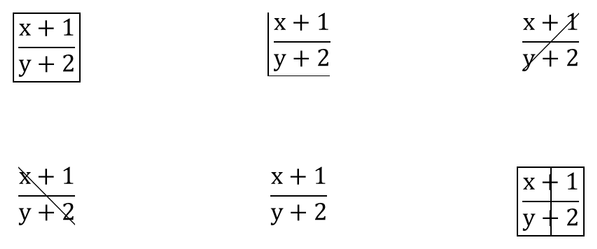

## **Áttekintés**

A PowerPoint egyenleteket az Office Math Markup Language (OMML) formátumban tárolja. Az Aspose.Slides for Node.js via Java segítségével programozott módon hozhat létre ugyanolyan típusú matematikai tartalmakat: törtöket, gyököket, függvényeket, határokat, N-ari operátorokat, mátrixokat, tömböket és formázott matematikai blokkokat.

A PowerPointban a felhasználók általában az **Insert > Equation** menüből adnak hozzá egyenleteket:


Az eredmény egy szerkeszthető matematikai szöveg a dián:


Az Aspose.Slides három fő objektumon keresztül építi fel ezt a matematikai szöveget:

- A matematikai alakzat, amelyet az [addMathShape](https://reference.aspose.com/slides/nodejs-java/aspose.slides/shapecollection/#addMathShape) hoz létre, az az alakzat, amely az egyenletet tartalmazza.
- [MathPortion](https://reference.aspose.com/slides/nodejs-java/aspose.slides/mathportion/) tárolja a matematikai tartalmat az alakzat szövegkeretében.
- [MathParagraph](https://reference.aspose.com/slides/nodejs-java/aspose.slides/mathparagraph/) egy vagy több [MathBlock](https://reference.aspose.com/slides/nodejs-java/aspose.slides/mathblock/) objektumot tartalmaz.

Az alábbi legtöbb példában a [MathematicalText](https://reference.aspose.com/slides/nodejs-java/aspose.slides/mathematicaltext/) és a [MathElementBase](https://reference.aspose.com/slides/nodejs-java/aspose.slides/mathelementbase/) folyékony metódusait használjuk, hogy a kód rövid és olvasható legyen.

MathML export esetén tekintse meg a [Export Math Equations from Presentations in Node.js via Java](/slides/hu/nodejs-java/exporting-math-equations/).

## **Egyenlet létrehozása**

Ez a példa az [addMathShape](https://reference.aspose.com/slides/nodejs-java/aspose.slides/shapecollection/#addMathShape) használja egy matematikai alakzat létrehozásához, és hozzáadja a Pitagorasz-tételt:


```javascript
var aspose = aspose || {};
aspose.slides = require("aspose.slides.via.java");

let presentation = new aspose.slides.Presentation();
try {
    let slide = presentation.getSlides().get_Item(0);

    let mathShape = slide.getShapes().addMathShape(20, 20, 700, 120);
    let mathParagraph = mathShape.getTextFrame().getParagraphs()
            .get_Item(0).getPortions().get_Item(0).getMathParagraph();

    let equation = new aspose.slides.MathematicalText("c")
            .setSuperscript("2")
            .join("=")
            .join(new aspose.slides.MathematicalText("a").setSuperscript("2"))
            .join("+")
            .join(new aspose.slides.MathematicalText("b").setSuperscript("2"));

    mathParagraph.add(equation);

    presentation.save("pythagorean-theorem.pptx", aspose.slides.SaveFormat.Pptx);
} finally {
    presentation.dispose();
}
```

{}
[addMathShape](https://reference.aspose.com/slides/nodejs-java/aspose.slides/shapecollection/#addMathShape) egy olyan alakzatot hoz létre, amely már tartalmaz egy matematikai bekezdést. Hozzáfér az első [MathPortion](https://reference.aspose.com/slides/nodejs-java/aspose.slides/mathportion/), meghívja a [getMathParagraph](https://reference.aspose.com/slides/nodejs-java/aspose.slides/mathportion/#getMathParagraph), és hozzáadja a matematikai blokkokat vagy elemeket.
{}

## **Törtek hozzáadása**

A [divide](https://reference.aspose.com/slides/nodejs-java/aspose.slides/mathelementbase/#divide) segítségével hozhat létre egy törtet. A [MathFractionTypes](https://reference.aspose.com/slides/nodejs-java/aspose.slides/mathfractiontypes/) használatával választhat törttípust.


```javascript
var aspose = aspose || {};
aspose.slides = require("aspose.slides.via.java");

let presentation = new aspose.slides.Presentation();
try {
    let slide = presentation.getSlides().get_Item(0);

    let mathShape = slide.getShapes().addMathShape(20, 20, 700, 100);
    let mathParagraph = mathShape.getTextFrame().getParagraphs()
            .get_Item(0).getPortions().get_Item(0).getMathParagraph();

    let fraction = new aspose.slides.MathematicalText("1")
            .divide("x", aspose.slides.MathFractionTypes.Skewed);

    mathParagraph.add(new aspose.slides.MathBlock(fraction));

    presentation.save("fraction.pptx", aspose.slides.SaveFormat.Pptx);
} finally {
    presentation.dispose();
}
```

Egymásra rakott tört esetén használja a [MathFractionTypes.Bar](https://reference.aspose.com/slides/nodejs-java/aspose.slides/mathfractiontypes/#Bar)-t:

```javascript
var aspose = aspose || {};
aspose.slides = require("aspose.slides.via.java");

let stackedFraction = new aspose.slides.MathematicalText("x + 1").divide("y - 1", aspose.slides.MathFractionTypes.Bar);
```

## **Gyökök hozzáadása**

A [radical](https://reference.aspose.com/slides/nodejs-java/aspose.slides/mathelementbase/#radical) segítségével hozhat létre négyzetgyököt, köbgyököt vagy egyéb gyököt. Az aktuális elem lesz az alap, az argumentum pedig a kitevő.


```javascript
var aspose = aspose || {};
aspose.slides = require("aspose.slides.via.java");

let presentation = new aspose.slides.Presentation();
try {
    let slide = presentation.getSlides().get_Item(0);

    let mathShape = slide.getShapes().addMathShape(20, 20, 700, 100);
    let mathParagraph = mathShape.getTextFrame().getParagraphs()
            .get_Item(0).getPortions().get_Item(0).getMathParagraph();

    let radical = new aspose.slides.MathematicalText("x")
            .radical("n");

    mathParagraph.add(new aspose.slides.MathBlock(radical));

    presentation.save("radical.pptx", aspose.slides.SaveFormat.Pptx);
} finally {
    presentation.dispose();
}
```

### **A négyzetgyök kitevőjének megjelenítése vagy elrejtése**

A négyzetgyök megjeleníthet egy explicite 2-t vagy a szokásos √x jelölést használhatja. A [MathRadical](https://reference.aspose.com/slides/nodejs-java/aspose.slides/mathradical/) [setHideDegree](https://reference.aspose.com/slides/nodejs-java/aspose.slides/mathradical/#setHideDegree) metódusa szabályozza, melyik forma jelenik meg. Mindkét forma megtartja a 2 kitevőt és az x radikált a szerkeszthető egyenletben.


A példa kétszer menti el ugyanazt a négyzetgyököt. A `visible-degree.pptx` fájlban a 2 látható. A `hidden-degree.pptx` fájlban rejtve van.

```javascript
var aspose = aspose || {};
aspose.slides = require("aspose.slides.via.java");

let presentation = new aspose.slides.Presentation();
try {
    let slide = presentation.getSlides().get_Item(0);

    let radical = new aspose.slides.MathematicalText("x").radical("2");
    
    let shape = slide.getShapes().addMathShape(20, 20, 200, 100);
    let portion = shape.getTextFrame().getParagraphs().get_Item(0).getPortions().get_Item(0);
    portion.getMathParagraph().add(new aspose.slides.MathBlock(radical));

    radical.setHideDegree(false);
    presentation.save("visible-degree.pptx", aspose.slides.SaveFormat.Pptx);

    radical.setHideDegree(true);
    presentation.save("hidden-degree.pptx", aspose.slides.SaveFormat.Pptx);
} finally {
    presentation.dispose();
}
```

## **Függvények és határok hozzáadása**

A [asArgumentOfFunction](https://reference.aspose.com/slides/nodejs-java/aspose.slides/mathelementbase/#asArgumentOfFunction) vagy [function](https://reference.aspose.com/slides/nodejs-java/aspose.slides/mathelementbase/#function) használható olyan függvényekhez, mint `sin(x)`, `log(x)`, vagy egyedi függvénynevek. Határokhoz helyezze a `lim`-et egy [MathLimit](https://reference.aspose.com/slides/nodejs-java/aspose.slides/mathlimit/) szárába, vagy használja a [setLowerLimit](https://reference.aspose.com/slides/nodejs-java/aspose.slides/mathelementbase/#setLowerLimit) metódust.


```javascript
var aspose = aspose || {};
aspose.slides = require("aspose.slides.via.java");

let presentation = new aspose.slides.Presentation();
try {
    let slide = presentation.getSlides().get_Item(0);

    let mathShape = slide.getShapes().addMathShape(20, 20, 700, 100);
    let mathParagraph = mathShape.getTextFrame().getParagraphs()
            .get_Item(0).getPortions().get_Item(0).getMathParagraph();

    let limit = new aspose.slides.MathematicalText("lim")
            .setLowerLimit("x\u2192\u221E")
            .function("x");

    mathParagraph.add(new aspose.slides.MathBlock(limit));

    presentation.save("functions-and-limits.pptx", aspose.slides.SaveFormat.Pptx);
} finally {
    presentation.dispose();
}
```

Egyedi függvénynévhez tegye a függvénynevet az aktuális elemként, és hívja a [function](https://reference.aspose.com/slides/nodejs-java/aspose.slides/mathelementbase/#function) metódust az argumentummal:

```javascript
var aspose = aspose || {};
aspose.slides = require("aspose.slides.via.java");

let customFunction = new aspose.slides.MathematicalText("f").function("x + 1");
```

## **N-ari operátorok és integrálok hozzáadása**

A [nary](https://reference.aspose.com/slides/nodejs-java/aspose.slides/mathelementbase/#nary) használható összegekre, uniókra, metszetekre és más nagy operátorokra. Az [integral](https://reference.aspose.com/slides/nodejs-java/aspose.slides/mathelementbase/#integral) integrálokhoz. Mindkét metódus lehetővé teszi az alsó és felső határ beállítását.


```javascript
var aspose = aspose || {};
aspose.slides = require("aspose.slides.via.java");

let presentation = new aspose.slides.Presentation();
try {
    let slide = presentation.getSlides().get_Item(0);

    let mathShape = slide.getShapes().addMathShape(20, 20, 700, 120);
    let mathParagraph = mathShape.getTextFrame().getParagraphs()
            .get_Item(0).getPortions().get_Item(0).getMathParagraph();

    let summationBase = new aspose.slides.MathematicalText("x")
            .setSuperscript("k")
            .join(new aspose.slides.MathematicalText("a").setSuperscript("n-k"));

    let summation = summationBase.nary(aspose.slides.MathNaryOperatorTypes.Summation, "k=0", "n");

    mathParagraph.add(new aspose.slides.MathBlock(summation));

    presentation.save("nary-operators.pptx", aspose.slides.SaveFormat.Pptx);
} finally {
    presentation.dispose();
}
```

Az N-ari operátorok nagy operátorok opcionális határokkal. Az egyszerű operátorok, mint a `+`, `-`, és `=` általában [MathematicalText](https://reference.aspose.com/slides/nodejs-java/aspose.slides/mathematicaltext/) segítségével kerülnek a kifejezésbe.

Integrálhoz használja a [integral](https://reference.aspose.com/slides/nodejs-java/aspose.slides/mathelementbase/#integral) metódust:

```javascript
var aspose = aspose || {};
aspose.slides = require("aspose.slides.via.java");

let integralBase = new aspose.slides.MathematicalText("x").join(new aspose.slides.MathematicalText("dx").toBox());
let integral = integralBase.integral(aspose.slides.MathIntegralTypes.Simple, "0", "1");
```

## **Mátrixok hozzáadása**

A [MathMatrix](https://reference.aspose.com/slides/nodejs-java/aspose.slides/mathmatrix/) használható sorok és oszlopokhoz. A mátrixok alapértelmezés szerint nem tartalmaznak zárójeleket, ezért szükség esetén zárja körül zárójelek, szögletes vagy kapcsos zárójelek segítségével.


```javascript
var aspose = aspose || {};
aspose.slides = require("aspose.slides.via.java");

let presentation = new aspose.slides.Presentation();
try {
    let slide = presentation.getSlides().get_Item(0);

    let mathShape = slide.getShapes().addMathShape(20, 20, 700, 120);
    let mathParagraph = mathShape.getTextFrame().getParagraphs()
            .get_Item(0).getPortions().get_Item(0).getMathParagraph();

    let matrix = new aspose.slides.MathMatrix(2, 3);
    matrix.set_Item(0, 0, new aspose.slides.MathematicalText("1"));
    matrix.set_Item(0, 1, new aspose.slides.MathematicalText("x"));
    matrix.set_Item(1, 0, new aspose.slides.MathematicalText("x"));
    matrix.set_Item(1, 1, new aspose.slides.MathematicalText("2"));
    matrix.set_Item(1, 2, new aspose.slides.MathematicalText("y"));

    mathParagraph.add(new aspose.slides.MathBlock(matrix));

    presentation.save("matrix.pptx", aspose.slides.SaveFormat.Pptx);
} finally {
    presentation.dispose();
}
```

## **Egyenlet tömbök hozzáadása**

Használja a [toMathArray](https://reference.aspose.com/slides/nodejs-java/aspose.slides/mathelementbase/#toMathArray) metódust, ha igazított egyenletekre vagy függőleges kifejezésstackre van szükség.


```javascript
var aspose = aspose || {};
aspose.slides = require("aspose.slides.via.java");

let presentation = new aspose.slides.Presentation();
try {
    let slide = presentation.getSlides().get_Item(0);

    let mathShape = slide.getShapes().addMathShape(20, 20, 700, 140);
    let mathParagraph = mathShape.getTextFrame().getParagraphs()
            .get_Item(0).getPortions().get_Item(0).getMathParagraph();

    let equationArray = new aspose.slides.MathematicalText("x")
            .join("y")
            .toMathArray();

    mathParagraph.add(new aspose.slides.MathBlock(equationArray));

    presentation.save("equation-array.pptx", aspose.slides.SaveFormat.Pptx);
} finally {
    presentation.dispose();
}
```

### **Tömb igazítása a környező elemekkel**

A [setBaseJustification](https://reference.aspose.com/slides/nodejs-java/aspose.slides/matharray/#setBaseJustification) szabályozza a tömb függőleges igazítását a mellette lévő matematikai elemekhez képest. Az alábbi példa összehasonlítja az igazítást az első sor, a tömb középső része és az utolsó sor esetén.

A következő példa három azonos tömböt hoz létre, mindegyik három sorral és a szomszédos elemekkel `A=` és `=B`. Minden matematikai szöveg Cambria Math betűkészlettel, 24 pontban van. Csak a tömb igazítása változik.

```javascript
const slides = require("aspose.slides.via.java");
const java = require("java");

function createText(value) {
    const text = new slides.MathematicalText(value);
    text.getFormat().setFontHeight(24);
    text.getFormat().setLatinFont(new slides.FontData("Cambria Math"));
    return text;
}

const presentation = new slides.Presentation();
try {
    presentation.getSlideSize().setSize(780, 200, slides.SlideSizeScaleType.DoNotScale);
    const slide = presentation.getSlides().get_Item(0);

    const alignments = [slides.MathVerticalAlignment.Top, slides.MathVerticalAlignment.Center, slides.MathVerticalAlignment.Bottom];
    const alignmentNames = ["Top", "Center", "Bottom"];

    for (let i = 0; i < alignments.length; i++) {
        const label = slide.getShapes().addAutoShape(slides.ShapeType.Rectangle, 20 + i * 260, 10, 240, 30);
        label.getFillFormat().setFillType(java.newByte(slides.FillType.NoFill));
        label.getLineFormat().getFillFormat().setFillType(java.newByte(slides.FillType.NoFill));
        label.getTextFrame().setText(alignmentNames[i]);
        const labelFormat = label.getTextFrame().getParagraphs().get_Item(0).getPortions().get_Item(0).getPortionFormat();
        labelFormat.setFontHeight(16);
        labelFormat.getFillFormat().setFillType(java.newByte(slides.FillType.Solid));
        labelFormat.getFillFormat().getSolidFillColor().setColor(java.getStaticFieldValue("java.awt.Color", "BLACK"));

        const mathShape = slide.getShapes().addMathShape(20 + i * 260, 60, 240, 130);
        mathShape.getTextFrame().getTextFrameFormat().setAnchoringType(java.newByte(slides.TextAnchorType.Top));
        const mathParagraph = mathShape.getTextFrame().getParagraphs().get_Item(0).getPortions().get_Item(0).getMathParagraph();
        mathParagraph.setJustification(slides.MathJustification.LeftJustified);

        const rows = [createText("x+y=3"), createText("x-y=1"), createText("x=2")];
        const equationArray = new slides.MathArray(rows[0]);
        equationArray.getArguments().add(rows[1]);
        equationArray.getArguments().add(rows[2]);
        equationArray.setBaseJustification(alignments[i]);
        const leftText = createText("A=");
        const rightText = createText("=B");
        const equation = new slides.MathBlock(leftText).join(equationArray).join(rightText);
        mathParagraph.add(equation);
    }

    presentation.save("equation-array-alignment.pptx", slides.SaveFormat.Pptx);
} finally {
    presentation.dispose();
}
```

Az alábbi összehasonlítás a PowerPointban mentett bemutatót mutatja. Figyelje meg a `A=` és `=B` elhelyezkedését minden tömb mellett.


### **Sorok távolságának beállítása**

A [setRowSpacingRule](https://reference.aspose.com/slides/nodejs-java/aspose.slides/matharray/#setRowSpacingRule) kiválasztja a sorok távolságát szabályozó szabályt a tömbön belül. A [setRowSpacing](https://reference.aspose.com/slides/nodejs-java/aspose.slides/matharray/#setRowSpacing) numerikus értéket ad meg egy explicite szabálynál, a preset szabályok ezt figyelmen kívül hagyják.

Pontos távolság esetén az értéket pontban mérik. Arányos távolság esetén fél sorban: a példában a `3` érték 1,5 sort jelent. Mindkét tulajdonságot állítsa be explicite érték megadásakor; csak a numerikus érték módosítása nem választ szabályt.

Az alábbi példa öt bemutatót ment el azonos egyenletekkel, igazítással és betűtípus-beállításokkal. Az első három presetet használ, az utolsó két explicit értéket mutat.

```javascript
const slides = require("aspose.slides.via.java");
const java = require("java");

function createText(value) {
    const text = new slides.MathematicalText(value);
    text.getFormat().setFontHeight(24);
    text.getFormat().setLatinFont(new slides.FontData("Cambria Math"));
    return text;
}

const rules = [slides.MathRowSpacingRule.SingleLineGap, slides.MathRowSpacingRule.OneAndAHalfLineGap, slides.MathRowSpacingRule.TwoLineGap, slides.MathRowSpacingRule.Exactly, slides.MathRowSpacingRule.Multiple];
const spacingValues = [0, 0, 0, 20, 3];
const ruleNames = ["SingleLineGap", "OneAndAHalfLineGap", "TwoLineGap", "Exactly", "Multiple"];

for (let i = 0; i < rules.length; i++) {
    const fileName = "equation-array-" + ruleNames[i] + ".pptx";
    const presentation = new slides.Presentation();
    try {
        const mathShape = presentation.getSlides().get_Item(0).getShapes().addMathShape(20, 20, 600, 300);
        const paragraph = mathShape.getTextFrame().getParagraphs().get_Item(0);
        paragraph.getParagraphFormat().setSpaceBefore(0);
        paragraph.getParagraphFormat().setSpaceAfter(0);
        const mathParagraph = paragraph.getPortions().get_Item(0).getMathParagraph();
        mathParagraph.setJustification(slides.MathJustification.LeftJustified);

        const rows = [createText("x+y=3"), createText("x-y=1"), createText("x=2")];
        const equationArray = new slides.MathArray(rows[0]);
        equationArray.getArguments().add(rows[1]);
        equationArray.getArguments().add(rows[2]);
        equationArray.setBaseJustification(slides.MathVerticalAlignment.Center);
        equationArray.setRowSpacingRule(rules[i]);
        equationArray.setRowSpacing(java.newLong(spacingValues[i]));
        const leftText = createText("A=");
        const rightText = createText("=B");
        const equation = new slides.MathBlock(leftText).join(equationArray).join(rightText);
        mathParagraph.add(equation);

        presentation.save(fileName, slides.SaveFormat.Pptx);
    } finally {
        presentation.dispose();
    }
}
```

A tömb sorok távolsága különálló a bekezdés távolságtól. A [setSpaceBefore](https://reference.aspose.com/slides/nodejs-java/aspose.slides/paragraphformat/#setSpaceBefore) és a [setSpaceAfter](https://reference.aspose.com/slides/nodejs-java/aspose.slides/paragraphformat/#setSpaceAfter) a tartalmazó bekezdés körül adnak helyet, nem a tömb sorok között. Hasonlóképpen a [MathParagraph.setJustification](https://reference.aspose.com/slides/nodejs-java/aspose.slides/mathparagraph/#setJustification) a teljes matematikai bekezdést helyezi el vízszintesen; nem felülírja a tömb függőleges igazítási beállítását.

## **Trigonometrikus függvények hozzáadása**

A [asArgumentOfFunction](https://reference.aspose.com/slides/nodejs-java/aspose.slides/mathelementbase/#asArgumentOfFunction) akkor használható, ha az argumentum az aktuális elem és a függvény neve ismert.


```javascript
var aspose = aspose || {};
aspose.slides = require("aspose.slides.via.java");

let presentation = new aspose.slides.Presentation();
try {
    let slide = presentation.getSlides().get_Item(0);

    let mathShape = slide.getShapes().addMathShape(20, 20, 700, 100);
    let mathParagraph = mathShape.getTextFrame().getParagraphs()
            .get_Item(0).getPortions().get_Item(0).getMathParagraph();

    let cosine = new aspose.slides.MathematicalText("2x")
            .asArgumentOfFunction(aspose.slides.MathFunctionsOfOneArgument.Cos);

    mathParagraph.add(new aspose.slides.MathBlock(cosine));

    presentation.save("trigonometric-function.pptx", aspose.slides.SaveFormat.Pptx);
} finally {
    presentation.dispose();
}
```

## **Alsó és felső indexek hozzáadása**

Az alsó és felső index segédfüggvényeit használja indexekhez és hatványokhoz. Ha az indexeknek bal oldalon kell megjelenniük az alapon, használja a [setSubSuperscriptOnTheLeft](https://reference.aspose.com/slides/nodejs-java/aspose.slides/mathelementbase/#setSubSuperscriptOnTheLeft) metódust.


```javascript
var aspose = aspose || {};
aspose.slides = require("aspose.slides.via.java");

let presentation = new aspose.slides.Presentation();
try {
    let slide = presentation.getSlides().get_Item(0);

    let mathShape = slide.getShapes().addMathShape(20, 20, 700, 100);
    let mathParagraph = mathShape.getTextFrame().getParagraphs()
            .get_Item(0).getPortions().get_Item(0).getMathParagraph();

    let scripts = new aspose.slides.MathematicalText("Y")
            .setSubSuperscriptOnTheLeft("1", "n");

    mathParagraph.add(new aspose.slides.MathBlock(scripts));

    presentation.save("subscript-superscript.pptx", aspose.slides.SaveFormat.Pptx);
} finally {
    presentation.dispose();
}
```

## **Határolók hozzáadása**

A [enclose](https://reference.aspose.com/slides/nodejs-java/aspose.slides/mathelementbase/#enclose) segítségével helyezhet kifejezést határolók közé. Több elemet tartalmazó határolók esetén beállíthat elválasztó karaktert is.


```javascript
var aspose = aspose || {};
aspose.slides = require("aspose.slides.via.java");
const java = require("java");

let presentation = new aspose.slides.Presentation();
try {
    let slide = presentation.getSlides().get_Item(0);

    let mathShape = slide.getShapes().addMathShape(20, 20, 700, 100);
    let mathParagraph = mathShape.getTextFrame().getParagraphs()
            .get_Item(0).getPortions().get_Item(0).getMathParagraph();

    let delimiter = new aspose.slides.MathematicalText("x")
            .join("y")
            .join("z")
            .enclose(java.newChar('<'), java.newChar('>'));
    delimiter.setSeparatorCharacter(java.newChar('|'));

    mathParagraph.add(new aspose.slides.MathBlock(delimiter));

    presentation.save("delimiters.pptx", aspose.slides.SaveFormat.Pptx);
} finally {
    presentation.dispose();
}
```

### **A határolók mérete és igazítása**

Adja meg a `true` értéket a [setGrowToMatchOperandHeight](https://reference.aspose.com/slides/nodejs-java/aspose.slides/mathdelimiter/#setGrowToMatchOperandHeight) metódusnak, hogy a zárójelek a magas operandus köré növekedjenek, vagy a `false` értékkel hagyja őket normál méretűnek. Használja a [setDelimiterShape](https://reference.aspose.com/slides/nodejs-java/aspose.slides/mathdelimiter/#setDelimiterShape) egyik [MathDelimiterShape](https://reference.aspose.com/slides/nodejs-java/aspose.slides/mathdelimitershape/) értékével. A `Centered` a zárójeleket a matematikai tengely középpontjába helyezi, amely a egyenlőségjel közepén halad. A `Match` a tartalomhoz igazítja őket. Mindkét beállítás csak a határolókra vonatkozik, a kifejezés belseje változatlan marad.

A példa egy törtet helyez az `x` hatványába, így a kifejezés magasabban nyúlik a vonalatól, mint alul. Mind a négy egyenlet ugyanazt a zárójelet és betűtípust használja.

```javascript
const slides = require("aspose.slides.via.java");
const java = require("java");

const presentation = new slides.Presentation();
try {
    const slide = presentation.getSlides().get_Item(0);
    for (let row = 0; row < 2; row++) {
        for (let column = 0; column < 2; column++) {
            const fraction = new slides.MathematicalText("a + b").divide("c + d");
            const power = new slides.MathematicalText("x").setSuperscript(fraction);
            const delimiter = power.enclose(java.newChar('('), java.newChar(')'));
            delimiter.setGrowToMatchOperandHeight(row === 0);
            delimiter.setDelimiterShape(column === 0 ? slides.MathDelimiterShape.Centered : slides.MathDelimiterShape.Match);

            const mathShape = slide.getShapes().addMathShape(20 + 330 * column, 20 + 120 * row, 300, 100);
            const portion = mathShape.getTextFrame().getParagraphs().get_Item(0).getPortions().get_Item(0);
            portion.getPortionFormat().setFontHeight(32);
            const equation = new slides.MathematicalText("y = ").join(delimiter);
            portion.getMathParagraph().add(equation);
        }
    }
    presentation.save("delimiter-sizing.pptx", slides.SaveFormat.Pptx);
} finally {
    presentation.dispose();
}
```

PowerPointban hasonlítsa össze a sorokat a növekedés hatásának megtekintéséhez. A felső sorban a zárójelek nőnek, hogy befogadják a hatványt, és mindkét alakzat egyformán néz ki. Az alsó sorban a növekedés ki van kapcsolva. A bal oldalon a kisebb zárójelek (`Centered`) az egyenlőségjellel igazodnak, míg a jobb oldalon a `Match` magasabban helyezkednek el a kifejezés körül.


## **Határoló keret hozzáadása**

Hívja meg a [toBorderBox](https://reference.aspose.com/slides/nodejs-java/aspose.slides/mathelementbase/#toBorderBox) metódust egy törtön, hogy a teljes kifejezést keretbe helyezze. A visszakapott [MathBorderBox](https://reference.aspose.com/slides/nodejs-java/aspose.slides/mathborderbox/) alapértelmezés szerint négy oldalt mutat. A [setHideTop](https://reference.aspose.com/slides/nodejs-java/aspose.slides/mathborderbox/#setHideTop), [setHideBottom](https://reference.aspose.com/slides/nodejs-java/aspose.slides/mathborderbox/#setHideBottom), [setHideLeft](https://reference.aspose.com/slides/nodejs-java/aspose.slides/mathborderbox/#setHideLeft) és a [setHideRight](https://reference.aspose.com/slides/nodejs-java/aspose.slides/mathborderbox/#setHideRight) egyes oldalak elrejtésére szolgálnak.

A példa ugyanazt a törtet hat példányban helyezi egy diára. A törlés megjelenítéséhez rejtse el mind a négy oldalt, és a [setStrikethroughBottomLeftToTopRight](https://reference.aspose.com/slides/nodejs-java/aspose.slides/mathborderbox/#setStrikethroughBottomLeftToTopRight) metódusra `true` értékkel állítsa be a feljebb emelkedő átlót (↗), vagy a [setStrikethroughTopLeftToBottomRight](https://reference.aspose.com/slides/nodejs-java/aspose.slides/mathborderbox/#setStrikethroughTopLeftToBottomRight) metódusra a leereszkedő átlót (↘). A [setStrikethroughHorizontal](https://reference.aspose.com/slides/nodejs-java/aspose.slides/mathborderbox/#setStrikethroughHorizontal) vagy a [setStrikethroughVertical](https://reference.aspose.com/slides/nodejs-java/aspose.slides/mathborderbox/#setStrikethroughVertical) tetszőleges kombinációval is használható a látható oldalakkal együtt.

```javascript
const slides = require("aspose.slides.via.java");

const presentation = new slides.Presentation();
try {
    presentation.getSlideSize().setSize(540, 220, slides.SlideSizeScaleType.DoNotScale);
    const slide = presentation.getSlides().get_Item(0);

    function addFraction(x, y, hideBorder) {
        const fraction = new slides.MathematicalText("x+1").divide("y+2");
        const box = fraction.toBorderBox();
        box.setHideTop(hideBorder);
        box.setHideBottom(hideBorder);
        box.setHideLeft(hideBorder);
        box.setHideRight(hideBorder);

        const shape = slide.getShapes().addMathShape(x, y, 160, 90);
        const portion = shape.getTextFrame().getParagraphs().get_Item(0).getPortions().get_Item(0);
        portion.getPortionFormat().setFontHeight(28);
        const block = new slides.MathBlock(box);
        portion.getMathParagraph().add(block);
        return box;
    }

    addFraction(10, 10, false);

    const partial = addFraction(190, 10, false);
    partial.setHideTop(true);
    partial.setHideRight(true);

    addFraction(370, 10, true).setStrikethroughBottomLeftToTopRight(true);
    addFraction(10, 120, true).setStrikethroughTopLeftToBottomRight(true);
    addFraction(190, 120, true).setStrikethroughHorizontal(true);
    addFraction(370, 120, false).setStrikethroughVertical(true);

    presentation.save("border-box.pptx", slides.SaveFormat.Pptx);
} finally {
    presentation.dispose();
}
```



Ezen törtön a vízszintes átló átfedi a törtvonalat. A függőleges átló keresztezi a számlálót és a nevezőt, míg a körülvevő keret látható marad. Ezek a vonalak a teljes kifejezést díszítik. A hagyományos szövegáthúzás csak a szöveg futás karaktereire vonatkozik. A PowerPointban a bemutató újbóli megnyitása után továbbra is külön szerkeszthető a számláló és a nevező.

## **A láthatóság és elrendezés szabályozása Phantom elemekkel**

Egy kifejezést a [MathPhantom](https://reference.aspose.com/slides/nodejs-java/aspose.slides/mathphantom/) segítségével tehet láthatatlanná, vagy a helyét befolyásolhatja az egyenletben anélkül, hogy a többi elemre hatna. A [MathPhantom](https://reference.aspose.com/slides/nodejs-java/aspose.slides/mathphantom/) metódusai a következőket szabályozzák:

| Módszer | Hatás |
| --- | --- |
| [setShow](https://reference.aspose.com/slides/nodejs-java/aspose.slides/mathphantom/#setShow) | `false` értékkel elrejtheti a kifejezést. Méretei továbbra is hozzájárulnak az elrendezéshez, hacsak az alább felsorolt megfelelő metódusok nem kapnak `true` értéket. |
| [setZeroWidth](https://reference.aspose.com/slides/nodejs-java/aspose.slides/mathphantom/#setZeroWidth) | A kifejezés vízszintes szélességét nullának tekinti, lehetővé téve a szomszédos elemek közelebbi elhelyezkedését. |
| [setZeroAsc](https://reference.aspose.com/slides/nodejs-java/aspose.slides/mathphantom/#setZeroAsc) | Az emelkedését, a vonal alatti magasságot nullának tekinti. Ez csökkentheti a szomszédos elemek felett fenntartott helyet. |
| [setZeroDesc](https://reference.aspose.com/slides/nodejs-java/aspose.slides/mathphantom/#setZeroDesc) | A süllyedését, a vonal alatti mélységet nullának tekinti. Ez a törtvonal vagy más alatti tartalmat közelebb hozhat a szomszédos elemekhez. |

A baseline a referencia vonal, amelyen a szokásos matematikai betűk helyezkednek el. A tartalom elrejtése nem távolítja el a méreteket, a méret nullának tekintése pedig nem törli a kifejezést. A mögöttes kifejezés továbbra is elérhető a [getBase](https://reference.aspose.com/slides/nodejs-java/aspose.slides/mathphantom/#getBase) segítségével. A [setShow](https://reference.aspose.com/slides/nodejs-java/aspose.slides/mathphantom/#setShow) `true` értékkel való meghívásával megjelenítheti újra, a dimenzióbeállítások változatlanok maradnak.

```javascript
const slides = require("aspose.slides.via.java");
const java = require("java");

function createText(value) {
    const text = new slides.MathematicalText(value);
    text.getFormat().setFontHeight(24);
    text.getFormat().setLatinFont(new slides.FontData("Cambria Math"));
    return text;
}

const presentation = new slides.Presentation();
try {
    presentation.getSlideSize().setSize(1000, 180, slides.SlideSizeScaleType.DoNotScale);
    const slide = presentation.getSlides().get_Item(0);

    const labels = [ "Visible", "Hidden: reserves space", "Hidden: ZeroWidth", "Hidden: ZeroAsc", "Hidden: ZeroDesc" ];

    const guide = slide.getShapes().addAutoShape(slides.ShapeType.Line, 10, 60, 980, 0);
    guide.getLineFormat().getFillFormat().setFillType(java.newByte(slides.FillType.Solid));
    guide.getLineFormat().getFillFormat().getSolidFillColor().setColor(java.getStaticFieldValue("java.awt.Color", "LIGHT_GRAY"));

    for (let i = 0; i < labels.length; i++) {
        const left = 10 + i * 200;

        const label = slide.getShapes().addAutoShape(slides.ShapeType.Rectangle, left, 10, 190, 30);
        label.getFillFormat().setFillType(java.newByte(slides.FillType.NoFill));
        label.getLineFormat().getFillFormat().setFillType(java.newByte(slides.FillType.NoFill));
        label.getTextFrame().setText(labels[i]);

        const labelFormat = label.getTextFrame().getParagraphs().get_Item(0).getPortions().get_Item(0).getPortionFormat();
        labelFormat.setFontHeight(14);
        labelFormat.getFillFormat().setFillType(java.newByte(slides.FillType.Solid));
        labelFormat.getFillFormat().getSolidFillColor().setColor(java.getStaticFieldValue("java.awt.Color", "BLACK"));

        const fractionNumerator = createText("a+b");
        const fractionDenominator = createText("c+d");
        const fraction = new slides.MathFraction(fractionNumerator, fractionDenominator);
        const phantom = new slides.MathPhantom(fraction);
        phantom.setShow(i === 0);
        phantom.setZeroWidth(i === 2);
        phantom.setZeroAsc(i === 3);
        phantom.setZeroDesc(i === 4);

        const leftText = createText("x+");
        const rightText = createText("+y");
        const numerator = new slides.MathBlock(leftText).join(phantom).join(rightText);
        const denominator = createText("z");
        const equation = new slides.MathFraction(numerator, denominator);

        const shape = slide.getShapes().addMathShape(left, 60, 190, 100);
        shape.getTextFrame().getTextFrameFormat().setAnchoringType(java.newByte(slides.TextAnchorType.Top));

        const mathPortion = shape.getTextFrame().getParagraphs().get_Item(0).getPortions().get_Item(0);
        const mathParagraph = mathPortion.getMathParagraph();
        mathParagraph.add(new slides.MathBlock(equation));
    }

    presentation.save("math-phantom.pptx", slides.SaveFormat.Pptx);
} finally {
    presentation.dispose();
}
```


## **Kifejezések csoportosítása**

A [group](https://reference.aspose.com/slides/nodejs-java/aspose.slides/mathelementbase/#group) segítségével egy csoportoló karaktert helyezhet egy kifejezés fölé vagy alá. A csoportolt kifejezések felcímkézéséhez adjon hozzá egy határt.


```javascript
var aspose = aspose || {};
aspose.slides = require("aspose.slides.via.java");
const java = require("java");

let presentation = new aspose.slides.Presentation();
try {
    let slide = presentation.getSlides().get_Item(0);

    let mathShape = slide.getShapes().addMathShape(20, 20, 700, 120);
    let mathParagraph = mathShape.getTextFrame().getParagraphs()
            .get_Item(0).getPortions().get_Item(0).getMathParagraph();

    let grouped = new aspose.slides.MathematicalText("x + y")
            .group(java.newChar('\u23DF'), aspose.slides.MathTopBotPositions.Bottom, aspose.slides.MathTopBotPositions.Top)
            .setLowerLimit("any text");

    mathParagraph.add(new aspose.slides.MathBlock(grouped));

    presentation.save("grouped-terms.pptx", aspose.slides.SaveFormat.Pptx);
} finally {
    presentation.dispose();
}
```

## **Matematikai elemek formázása**

Csak ott használjon formázó segédfüggvényeket, ahol azok tisztázzák a képletet. Például a [overbar](https://reference.aspose.com/slides/nodejs-java/aspose.slides/mathelementbase/#overbar) egy vonalat tesz egy matematikai elem fölé.


```javascript
var aspose = aspose || {};
aspose.slides = require("aspose.slides.via.java");

let presentation = new aspose.slides.Presentation();
try {
    let slide = presentation.getSlides().get_Item(0);

    let mathShape = slide.getShapes().addMathShape(20, 20, 700, 100);
    let mathParagraph = mathShape.getTextFrame().getParagraphs()
            .get_Item(0).getPortions().get_Item(0).getMathParagraph();

    let overbar = new aspose.slides.MathematicalText("ABC").overbar();

    mathParagraph.add(new aspose.slides.MathBlock(overbar));

    presentation.save("overbar.pptx", aspose.slides.SaveFormat.Pptx);
} finally {
    presentation.dispose();
}
```

### **Szöveg formázása meglévő egyenletben**

A meglévő egyenlet szövegének formázásához járja be a matematikai blokk minden elemfáját. A [MathElementBase.getChildren](https://reference.aspose.com/slides/nodejs-java/aspose.slides/mathelementbase/#getChildren) csak a közvetlen gyermekeket adja vissza, ezért rekurzívan hívja meg, hogy elérje a törtök, indexek, gyökök és egyéb beágyazott struktúrák szövegét. Ellenőrizze az aktuális elemet és annak gyermekeit is, hogy a [MathematicalText](https://reference.aspose.com/slides/nodejs-java/aspose.slides/mathematicaltext/) kezdőelemet is belevegye.

Ez a példa azt feltételezi, hogy az `input.pptx` egy olyan egyenletet tartalmaz, mint `z = xᵢ / ∛y`, ahol a tört számlálójában alsó index, a nevezőjében pedig gyök található. Ha csak a blokk felső szintű elemeit dolgozza fel, a törtben lévő szöveget kihagyja. A példa matematikai részeket keres a diák szövegkereteiben, a blokkokat a [MathPortion.getMathParagraph](https://reference.aspose.com/slides/nodejs-java/aspose.slides/mathportion/#getMathParagraph) segítségével éri el, és a [setFontHeight](https://reference.aspose.com/slides/nodejs-java/aspose.slides/baseportionformat/#setFontHeight) metódussal 28 pont méretre állítja a betűmagasságot minden szövegelemen keresztül a [getFormat](https://reference.aspose.com/slides/nodejs-java/aspose.slides/mathematicaltext/#getFormat) metódus segítségével.

```javascript
var aspose = aspose || {};
aspose.slides = require("aspose.slides.via.java");
const java = require("java");

function formatMathText(element) {
    if (java.instanceOf(element, "com.aspose.slides.MathematicalText")) {
        element.getFormat().setFontHeight(28);
    }

    let children = element.getChildren();
    for (let i = 0; i < children.length; i++) {
        formatMathText(children[i]);
    }
}

let presentation = new aspose.slides.Presentation("input.pptx");
try {
    for (let i = 0; i < presentation.getSlides().size(); i++) {
        let slide = presentation.getSlides().get_Item(i);
        for (let j = 0; j < slide.getShapes().size(); j++) {
            let shape = slide.getShapes().get_Item(j);
            if (!java.instanceOf(shape, "com.aspose.slides.IAutoShape")) {
                continue;
            }

            let textFrame = shape.getTextFrame();
            if (textFrame == null) {
                continue;
            }

            for (let k = 0; k < textFrame.getParagraphs().getCount(); k++) {
                let paragraph = textFrame.getParagraphs().get_Item(k);
                for (let l = 0; l < paragraph.getPortions().getCount(); l++) {
                    let portion = paragraph.getPortions().get_Item(l);
                    if (java.instanceOf(portion, "com.aspose.slides.IMathPortion")) {
                        let mathParagraph = portion.getMathParagraph();
                        for (let m = 0; m < mathParagraph.getCount(); m++) {
                            formatMathText(mathParagraph.get_Item(m));
                        }
                    }
                }
            }
        }
    }

    presentation.save("formatted-equations.pptx", aspose.slides.SaveFormat.Pptx);
} finally {
    presentation.dispose();
}
```

A mentett bemutató minden szinten frissített szövegformázást tartalmaz a feldolgozott egyenleteken, miközben megőrzi a szöveg tartalmát és a matematikai struktúrát.

## **Gyors referencia**

| Feladat | Fő API |
| --- | --- |
| Matematikai szöveg létrehozása | [MathematicalText](https://reference.aspose.com/slides/nodejs-java/aspose.slides/mathematicaltext/) |
| Elemek kombinálása | [join](https://reference.aspose.com/slides/nodejs-java/aspose.slides/mathelementbase/) |
| Törtök létrehozása | [divide](https://reference.aspose.com/slides/nodejs-java/aspose.slides/mathelementbase/) |
| Felső vagy alsó index hozzáadása | [setSuperscript](https://reference.aspose.com/slides/nodejs-java/aspose.slides/mathelementbase/), [setSubscript](https://reference.aspose.com/slides/nodejs-java/aspose.slides/mathelementbase/) |
| Függvények hozzáadása | [function](https://reference.aspose.com/slides/nodejs-java/aspose.slides/mathelementbase/), [asArgumentOfFunction](https://reference.aspose.com/slides/nodejs-java/aspose.slides/mathelementbase/) |
| Gyökök hozzáadása | [radical](https://reference.aspose.com/slides/nodejs-java/aspose.slides/mathelementbase/) |
| Határok hozzáadása | [setLowerLimit](https://reference.aspose.com/slides/nodejs-java/aspose.slides/mathelementbase/), [setUpperLimit](https://reference.aspose.com/slides/nodejs-java/aspose.slides/mathelementbase/) |
| Baloldali indexek hozzáadása | [setSubSuperscriptOnTheLeft](https://reference.aspose.com/slides/nodejs-java/aspose.slides/mathelementbase/) |
| Összegzések és integrálok hozzáadása | [nary](https://reference.aspose.com/slides/nodejs-java/aspose.slides/mathelementbase/), [integral](https://reference.aspose.com/slides/nodejs-java/aspose.slides/mathelementbase/) |
| Mátrixok hozzáadása | [MathMatrix](https://reference.aspose.com/slides/nodejs-java/aspose.slides/mathmatrix/) |
| Egyenlet tömbök hozzáadása | [toMathArray](https://reference.aspose.com/slides/nodejs-java/aspose.slides/mathelementbase/) |
| Határolók hozzáadása | [enclose](https://reference.aspose.com/slides/nodejs-java/aspose.slides/mathelementbase/) |
| Vonalak és keretek hozzáadása | [overbar](https://reference.aspose.com/slides/nodejs-java/aspose.slides/mathelementbase/), [toBorderBox](https://reference.aspose.com/slides/nodejs-java/aspose.slides/mathelementbase/) |
| Kifejezések csoportosítása | [group](https://reference.aspose.com/slides/nodejs-java/aspose.slides/mathelementbase/) |

## **FAQ**

**Szerkeszthetek meglévő PowerPoint egyenletet?**

Igen. Nyissa meg a bemutatót, keresse meg azt az alakzatot, amely [MathPortion](https://reference.aspose.com/slides/nodejs-java/aspose.slides/mathportion/) tartalmaz, hívja meg a [getMathParagraph](https://reference.aspose.com/slides/nodejs-java/aspose.slides/mathportion/#getMathParagraph) metódust, és frissítse a bekezdésben lévő matematikai blokkokat.

**Az egyenletek szerkeszthető PowerPoint matematikaként vannak mentve?**

Igen. PPTX formátumba mentéskor az Aspose.Slides az egyenletet szerkeszthető Office math tartalomként írja ki.

**Exportálhatom az egyenleteket LaTeX-be?**

Igen. Szerezze be az egyenlet [MathParagraph](https://reference.aspose.com/slides/nodejs-java/aspose.slides/mathparagraph/) objektumát a [MathPortion](https://reference.aspose.com/slides/nodejs-java/aspose.slides/mathportion/) segítségével, majd hívja meg a [MathParagraph.toLatex](https://reference.aspose.com/slides/nodejs-java/aspose.slides/mathparagraph/#toLatex) metódust az exportáláshoz. Teljes példa a [Export Math Equations from Presentations in Node.js via Java](/slides/hu/nodejs-java/exporting-math-equations/#export-math-equations-to-latex) oldalon.