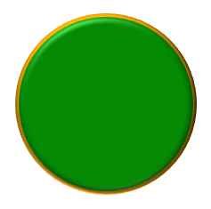

## **Bevezetés**

Formázza a PowerPoint alakzatokat a körvonalak, kitöltések és hatások módosításával. Az Aspose.Slides for Node.js via Java lehetővé teszi ezen beállítások programozott vezérlését, beleértve az átlátszóságot, forgást és a 3D formázást.


Az Aspose.Slides for Node.js via Java osztályokat és metódusokat biztosít, amelyek lehetővé teszik az alakzatok formázását a PowerPointban elérhető ugyanazokkal az opciókkal.

## **Formázza a vonalakat**

Use [Shape.getLineFormat](https://reference.aspose.com/slides/nodejs-java/aspose.slides/shape/#getLineFormat) to control a shape’s outline. Ez a példa egy kitöltés nélküli téglalapot hoz létre kék, szaggatott körvonallal. [LineFormat.setStyle](https://reference.aspose.com/slides/nodejs-java/aspose.slides/lineformat/#setStyle) selects a thick-thin compound line, while [LineFormat.setWidth](https://reference.aspose.com/slides/nodejs-java/aspose.slides/lineformat/#setWidth) sets its width to 7 points and [LineFormat.setDashStyle](https://reference.aspose.com/slides/nodejs-java/aspose.slides/lineformat/#setDashStyle) selects the dash pattern.

```javascript
const aspose = { slides: require("aspose.slides.via.java") };
const java = require("java");

let presentation = new aspose.slides.Presentation();
try {
    let slide = presentation.getSlides().get_Item(0);

    let shape = slide.getShapes().addAutoShape(aspose.slides.ShapeType.Rectangle, 50, 50, 150, 75);
    shape.getFillFormat().setFillType(java.newByte(aspose.slides.FillType.NoFill));
    shape.getLineFormat().setStyle(java.newByte(aspose.slides.LineStyle.ThickThin));
    shape.getLineFormat().setWidth(7);
    shape.getLineFormat().setDashStyle(java.newByte(aspose.slides.LineDashStyle.Dash));
    shape.getLineFormat().getFillFormat().setFillType(java.newByte(aspose.slides.FillType.Solid));
    shape.getLineFormat().getFillFormat().getSolidFillColor().setColor(java.getStaticFieldValue("java.awt.Color", "BLUE"));

    presentation.save("formatted_lines.pptx", aspose.slides.SaveFormat.Pptx);
} finally {
    presentation.dispose();
}
```

Az eredmény:


### **Egyéni vonal szaggatási minták beállítása**

Use [LineFormat.setCustomDashPattern](https://reference.aspose.com/slides/nodejs-java/aspose.slides/lineformat/#setCustomDashPattern) when predefined line styles do not provide the dash lengths and gaps you need, for example for branded outlines or technical diagrams. Assigning a pattern automatically changes the line dash style to [LineDashStyle.Custom](https://reference.aspose.com/slides/nodejs-java/aspose.slides/linedashstyle/).

A tömb elemei váltakoznak a vonal- és a hézaghossz között, a vonallal kezdve. Minden érték a vonalvastagság többszöröse: `[4, 2]` 3 pont szélességnél 12 pont hosszú vonalat és 6 pont hézagot eredményez. Használjon véges, nemnegatív értékpárokat a teljes vonal‑hézag szegmensek definiálásához. A példa pozitív értékeket használ, hogy minden vonal és hézag látható legyen.

Ez a példa öt kék vonalat hoz létre azonos hosszúsággal és lapos végekkel. Az első három a mintákat 3 pont szélességnél hasonlítja össze. A negyedik duplázza az első mintát a szélesség kétszeresére, így a vonal‑ és hézaghosszak is duplázódnak. Az ötödik a saját mintáról szilárd vonalra vált.

```javascript
const aspose = { slides: require("aspose.slides.via.java") };
const java = require("java");

let presentation = new aspose.slides.Presentation();
try {
    presentation.getSlideSize().setSize(600, 300, aspose.slides.SlideSizeScaleType.DoNotScale);
    let slide = presentation.getSlides().get_Item(0);

    let patterns = [
        [4, 2],
        [1, 2],
        [6, 2, 1, 2],
        [4, 2],
        [4, 2]
    ];

    for (let i = 0; i < patterns.length; i++) {
        let line = slide.getShapes().addAutoShape(aspose.slides.ShapeType.Line, 50, 50 + i * 50, 500, 0);
        line.getLineFormat().setWidth(i == 3 ? 6 : 3);
        line.getLineFormat().getFillFormat().setFillType(java.newByte(aspose.slides.FillType.Solid));
        line.getLineFormat().getFillFormat().getSolidFillColor().setColor(java.newInstanceSync("java.awt.Color", 0, 0, 139));
        line.getLineFormat().setCapStyle(java.newByte(aspose.slides.LineCapStyle.Flat));
        line.getLineFormat().setBeginArrowheadStyle(java.newByte(aspose.slides.LineArrowheadStyle.None));
        line.getLineFormat().setEndArrowheadStyle(java.newByte(aspose.slides.LineArrowheadStyle.None));
        let pattern = java.newArray("float", patterns[i]);
        line.getLineFormat().setCustomDashPattern(pattern);
    }

    // Visszaállítja az utolsó vonalat szilárd stílusra.
    slide.getShapes().get_Item(4).getLineFormat().setDashStyle(java.newByte(aspose.slides.LineDashStyle.Solid));

    presentation.save("custom_dash_patterns.pptx", aspose.slides.SaveFormat.Pptx);
} finally {
    presentation.dispose();
}
```

Ahelyett, hogy előre meghatározott szaggatott stílusra térne vissza, adja meg a [LineDashStyle.Dash](https://reference.aspose.com/slides/nodejs-java/aspose.slides/linedashstyle/) értéket a [LineFormat.setDashStyle](https://reference.aspose.com/slides/nodejs-java/aspose.slides/lineformat/#setDashStyle) metódusnak. A kiválasztott stílus szabályozza a vonal megjelenését.

Az eredmény a PowerPointban, felülről lefelé: **{4, 2}, 3 pt**; **{1, 2}, 3 pt**; **{6, 2, 1, 2}, 3 pt**; **{4, 2}, 6 pt**; és **Solid, 3 pt**.


### **Vonalvégek beállítása**

Use [LineFormat.setCapStyle](https://reference.aspose.com/slides/nodejs-java/aspose.slides/lineformat/#setCapStyle) to set the ends of an open line. The [LineCapStyle](https://reference.aspose.com/slides/nodejs-java/aspose.slides/linecapstyle/) class provides three explicit cap styles:

- `Flat`: A vonal a végpontnál megáll.
- `Round`: Egy félkörívű vége a végponton túlnyúlik a vonal szélességének felével.
- `Square`: Egy négyzetes vége a végponton túlnyúlik a vonal szélességének felével.

A class also includes `NotDefined`, which means that no cap style is explicitly assigned.

Caps are different from arrowheads, which add symbols to line ends, and joins, which control corners between line segments. This example disables arrowheads through [LineFormat.setBeginArrowheadStyle](https://reference.aspose.com/slides/nodejs-java/aspose.slides/lineformat/#setBeginArrowheadStyle) and [LineFormat.setEndArrowheadStyle](https://reference.aspose.com/slides/nodejs-java/aspose.slides/lineformat/#setEndArrowheadStyle) so that only the cap shapes are compared.

The following example creates three otherwise identical horizontal lines, 20 points wide. From top to bottom, they use flat, round, and square caps. Their endpoints have the same horizontal coordinates; the round and square caps extend 10 points beyond each endpoint.

```javascript
const aspose = { slides: require("aspose.slides.via.java") };
const java = require("java");

let presentation = new aspose.slides.Presentation();
try {
    presentation.getSlideSize().setSize(500, 240, aspose.slides.SlideSizeScaleType.DoNotScale);
    let slide = presentation.getSlides().get_Item(0);

    let capStyles = [aspose.slides.LineCapStyle.Flat, aspose.slides.LineCapStyle.Round, aspose.slides.LineCapStyle.Square];

    for (let i = 0; i < capStyles.length; i++) {
        let line = slide.getShapes().addAutoShape(aspose.slides.ShapeType.Line, 100, 50 + i * 70, 300, 0);
        line.getLineFormat().setWidth(20);
        line.getLineFormat().getFillFormat().setFillType(java.newByte(aspose.slides.FillType.Solid));
        line.getLineFormat().getFillFormat().getSolidFillColor().setColor(java.newInstanceSync("java.awt.Color", 0, 0, 139));
        line.getLineFormat().setDashStyle(java.newByte(aspose.slides.LineDashStyle.Solid));
        line.getLineFormat().setCapStyle(java.newByte(capStyles[i]));
        line.getLineFormat().setBeginArrowheadStyle(java.newByte(aspose.slides.LineArrowheadStyle.None));
        line.getLineFormat().setEndArrowheadStyle(java.newByte(aspose.slides.LineArrowheadStyle.None));
    }

    presentation.save("line_caps.pptx", aspose.slides.SaveFormat.Pptx);
} finally {
    presentation.dispose();
}
```

Az eredmény a PowerPointban, felülről lefelé: **Flat**, **Round**, és **Square**.


## **Vázlat hatások alkalmazása alakzati vonalakra**

A vázlat hatás egy alakzat vonalát kézzel rajzoltá teszi. Use [Shape.getLineFormat](https://reference.aspose.com/slides/nodejs-java/aspose.slides/shape/#getLineFormat) to access the line settings, [LineFormat.getSketchFormat](https://reference.aspose.com/slides/nodejs-java/aspose.slides/lineformat/#getSketchFormat) to access the sketch settings, and [SketchFormat.setSketchType](https://reference.aspose.com/slides/nodejs-java/aspose.slides/sketchformat/#setSketchType) to select a value from the [LineSketchType](https://reference.aspose.com/slides/nodejs-java/aspose.slides/linesketchtype/) class.

The following JavaScript code shows how to apply a [LineSketchType.Curved](https://reference.aspose.com/slides/nodejs-java/aspose.slides/linesketchtype/) effect, read the explicitly assigned value, and remove the effect with [LineSketchType.None](https://reference.aspose.com/slides/nodejs-java/aspose.slides/linesketchtype/):

```javascript
const aspose = { slides: require("aspose.slides.via.java") };

let presentation = new aspose.slides.Presentation();
try {
    let slide = presentation.getSlides().get_Item(0);

    let shape = slide.getShapes().addAutoShape(aspose.slides.ShapeType.Rectangle, 50, 50, 200, 100);

    let sketchFormat = shape.getLineFormat().getSketchFormat();
    sketchFormat.setSketchType(aspose.slides.LineSketchType.Curved);
    let explicitSketchType = sketchFormat.getSketchType();
    console.log("Explicit sketch type: " + explicitSketchType);
    sketchFormat.setSketchType(aspose.slides.LineSketchType.None);
} finally {
    presentation.dispose();
}
```

The value returned by [SketchFormat.getSketchType](https://reference.aspose.com/slides/nodejs-java/aspose.slides/sketchformat/#getSketchType) represents the setting assigned directly to the shape. If the line formatting can be inherited from a theme, master slide, or layout slide, use [LineFormat.getEffective](https://reference.aspose.com/slides/nodejs-java/aspose.slides/lineformat/#getEffective), call `getSketchFormat` on the returned object, and then call its `getSketchType` method. The effective value reflects the formatting that is actually applied after inheritance is resolved. This example requires an existing presentation with at least one shape on its first slide and prints both values:

```javascript
const aspose = { slides: require("aspose.slides.via.java") };

let presentation = new aspose.slides.Presentation("presentation.pptx");
try {
    let shape = presentation.getSlides().get_Item(0).getShapes().get_Item(0);

    let lineFormat = shape.getLineFormat();
    let explicitSketchType = lineFormat.getSketchFormat().getSketchType();
    let effectiveLineFormat = lineFormat.getEffective();
    let effectiveSketchType = effectiveLineFormat.getSketchFormat().getSketchType();

    console.log("Explicit sketch type: " + explicitSketchType);
    console.log("Effective sketch type: " + effectiveSketchType);
} finally {
    presentation.dispose();
}
```

## **Csatlakozási stílusok formázása**

Here are the three join type options:

* Round
* Miter
* Bevel

The join style controls how two outline segments meet at a corner. Use **Round** for rounded corners, **Miter** for sharp corners, or **Bevel** for flattened corners.


This example creates three black rectangles with blue outlines 15 points wide. It uses [LineFormat.setJoinStyle](https://reference.aspose.com/slides/nodejs-java/aspose.slides/lineformat/#setJoinStyle) to apply the miter, bevel, and round values of [LineJoinStyle](https://reference.aspose.com/slides/nodejs-java/aspose.slides/linejoinstyle/), respectively, to compare how the corners are drawn.

```javascript
const aspose = { slides: require("aspose.slides.via.java") };
const java = require("java");

let presentation = new aspose.slides.Presentation();
try {
    let slide = presentation.getSlides().get_Item(0);

    let miterShape = slide.getShapes().addAutoShape(aspose.slides.ShapeType.Rectangle, 20, 20, 150, 75);
    let bevelShape = slide.getShapes().addAutoShape(aspose.slides.ShapeType.Rectangle, 210, 20, 150, 75);
    let roundShape = slide.getShapes().addAutoShape(aspose.slides.ShapeType.Rectangle, 20, 135, 150, 75);

    miterShape.getFillFormat().setFillType(java.newByte(aspose.slides.FillType.Solid));
    miterShape.getFillFormat().getSolidFillColor().setColor(java.getStaticFieldValue("java.awt.Color", "BLACK"));
    bevelShape.getFillFormat().setFillType(java.newByte(aspose.slides.FillType.Solid));
    bevelShape.getFillFormat().getSolidFillColor().setColor(java.getStaticFieldValue("java.awt.Color", "BLACK"));
    roundShape.getFillFormat().setFillType(java.newByte(aspose.slides.FillType.Solid));
    roundShape.getFillFormat().getSolidFillColor().setColor(java.getStaticFieldValue("java.awt.Color", "BLACK"));

    miterShape.getLineFormat().setWidth(15);
    bevelShape.getLineFormat().setWidth(15);
    roundShape.getLineFormat().setWidth(15);

    miterShape.getLineFormat().getFillFormat().setFillType(java.newByte(aspose.slides.FillType.Solid));
    miterShape.getLineFormat().getFillFormat().getSolidFillColor().setColor(java.getStaticFieldValue("java.awt.Color", "BLUE"));
    bevelShape.getLineFormat().getFillFormat().setFillType(java.newByte(aspose.slides.FillType.Solid));
    bevelShape.getLineFormat().getFillFormat().getSolidFillColor().setColor(java.getStaticFieldValue("java.awt.Color", "BLUE"));
    roundShape.getLineFormat().getFillFormat().setFillType(java.newByte(aspose.slides.FillType.Solid));
    roundShape.getLineFormat().getFillFormat().getSolidFillColor().setColor(java.getStaticFieldValue("java.awt.Color", "BLUE"));

    miterShape.getLineFormat().setJoinStyle(java.newByte(aspose.slides.LineJoinStyle.Miter));
    bevelShape.getLineFormat().setJoinStyle(java.newByte(aspose.slides.LineJoinStyle.Bevel));
    roundShape.getLineFormat().setJoinStyle(java.newByte(aspose.slides.LineJoinStyle.Round));

    miterShape.getTextFrame().setText("Miter Join Style");
    bevelShape.getTextFrame().setText("Bevel Join Style");
    roundShape.getTextFrame().setText("Round Join Style");

    presentation.save("join_styles.pptx", aspose.slides.SaveFormat.Pptx);
} finally {
    presentation.dispose();
}
```

### **Miter csatlakozások korlátozása éles sarkoknál**

Use [LineFormat.setMiterLimit](https://reference.aspose.com/slides/nodejs-java/aspose.slides/lineformat/#setMiterLimit) with [LineFormat.setJoinStyle](https://reference.aspose.com/slides/nodejs-java/aspose.slides/lineformat/#setJoinStyle) set to [LineJoinStyle.Miter](https://reference.aspose.com/slides/nodejs-java/aspose.slides/linejoinstyle/) to limit how far a sharp corner can extend.

The limit is a ratio of the distance between the inner and outer corners of the join to the line width. For example, a value of `8` permits a miter length of up to eight times the line width; it is not a measurement in points. If the corner would exceed the limit, PowerPoint uses a beveled join at that corner. A larger limit allows sharper points. The setting affects miter joins only, and changing it has no visible effect when the corner remains within both limits.

This example creates two identical, unfilled triangles with outlines 20 points wide. The left triangle uses a limit of `2`, and the right uses `8`. Each triangle is 80 points wide and 160 points high, giving its top corner a miter-length-to-line-width ratio of approximately `4.12`. Consequently, PowerPoint bevels the left apex and preserves the right apex.

```javascript
const aspose = { slides: require("aspose.slides.via.java") };
const java = require("java");

let presentation = new aspose.slides.Presentation();
try {
    presentation.getSlideSize().setSize(500, 320, aspose.slides.SlideSizeScaleType.DoNotScale);
    let slide = presentation.getSlides().get_Item(0);

    let miterLimits = [2, 8];

    for (let i = 0; i < miterLimits.length; i++) {
        let triangle = slide.getShapes().addAutoShape(aspose.slides.ShapeType.Triangle, 90 + i * 240, 110, 80, 160);
        triangle.getFillFormat().setFillType(java.newByte(aspose.slides.FillType.NoFill));
        triangle.getLineFormat().setWidth(20);
        triangle.getLineFormat().getFillFormat().setFillType(java.newByte(aspose.slides.FillType.Solid));
        triangle.getLineFormat().getFillFormat().getSolidFillColor().setColor(java.newInstanceSync("java.awt.Color", 0, 0, 139));
        triangle.getLineFormat().setJoinStyle(java.newByte(aspose.slides.LineJoinStyle.Miter));
        triangle.getLineFormat().setMiterLimit(java.newFloat(miterLimits[i]));
    }

    presentation.save("miter_limits.pptx", aspose.slides.SaveFormat.Pptx);
} finally {
    presentation.dispose();
}
```

Az eredmény a PowerPointban: **Miter limit 2** bal oldalon és **miter limit 8** jobb oldalon.


## **Áttűnéses kitöltés**

A gradient fill blends colors across a shape. This example fills an ellipse with a linear gradient at a 45-degree angle from red to purple using [FillFormat.getGradientFormat](https://reference.aspose.com/slides/nodejs-java/aspose.slides/fillformat/#getGradientFormat). The [GradientStopCollection.addPresetColor](https://reference.aspose.com/slides/nodejs-java/aspose.slides/gradientstopcollection/#addPresetColor) method places the color stops at 0 and 1, the beginning and end of the gradient. Clearing the existing stops ensures that only these two colors are used.

```javascript
const aspose = { slides: require("aspose.slides.via.java") };
const java = require("java");

let presentation = new aspose.slides.Presentation();
try {
    let slide = presentation.getSlides().get_Item(0);

    let shape = slide.getShapes().addAutoShape(aspose.slides.ShapeType.Ellipse, 50, 50, 150, 75);
    shape.getFillFormat().setFillType(java.newByte(aspose.slides.FillType.Gradient));
    shape.getFillFormat().getGradientFormat().setGradientShape(java.newByte(aspose.slides.GradientShape.Linear));
    shape.getFillFormat().getGradientFormat().setLinearGradientAngle(45);
    shape.getFillFormat().getGradientFormat().getGradientStops().clear();
    shape.getFillFormat().getGradientFormat().getGradientStops().addPresetColor(1.0, aspose.slides.PresetColor.Purple);
    shape.getFillFormat().getGradientFormat().getGradientStops().addPresetColor(0.0, aspose.slides.PresetColor.Red);

    presentation.save("gradient_fill.pptx", aspose.slides.SaveFormat.Pptx);
} finally {
    presentation.dispose();
}
```

Az eredmény:


If a gradient looks different in an exported image than it does in PowerPoint, see [Choose a Gradient Rendering Style](/slides/hu/nodejs-java/convert-powerpoint-to-png/#choose-a-gradient-rendering-style). You can select a rendering style without changing the gradient fill stored in the presentation.

### **Lineáris átmeneti szög beállítása**

Use [GradientFormat.setLinearGradientAngle](https://reference.aspose.com/slides/nodejs-java/aspose.slides/gradientformat/#setLinearGradientAngle) to control the orientation of a [GradientShape.Linear](https://reference.aspose.com/slides/nodejs-java/aspose.slides/gradientshape/) fill. The angle is measured in degrees and increases clockwise: `0` runs from left to right, `90` from top to bottom, `180` from right to left, and `270` from bottom to top. Fractional angles are supported. Finite angles outside `[0, 360)` are normalized to one revolution; for example, `-45` becomes `315` and `360` becomes `0`.

This example creates six rectangles with identical red, green, and blue stops at positions `0`, `0.5`, and `1`. Scaling is disabled so that the angle can be compared independently of the rectangles' proportions. The angles, from left to right, are `0`, `45`, and `90` in the first row, and `135`, `180`, and `270` in the second row.

```javascript
const aspose = { slides: require("aspose.slides.via.java") };
const java = require("java");

let presentation = new aspose.slides.Presentation();
try {
    presentation.getSlideSize().setSize(720, 400, aspose.slides.SlideSizeScaleType.DoNotScale);
    let slide = presentation.getSlides().get_Item(0);

    let angles = [0, 45, 90, 135, 180, 270];

    for (let i = 0; i < angles.length; i++) {
        let x = 30 + (i % 3) * 230;
        let y = 30 + Math.floor(i / 3) * 190;

        let shape = slide.getShapes().addAutoShape(aspose.slides.ShapeType.Rectangle, x, y, 200, 150);
        shape.getLineFormat().getFillFormat().setFillType(java.newByte(aspose.slides.FillType.NoFill));
        shape.getFillFormat().setFillType(java.newByte(aspose.slides.FillType.Gradient));

        let gradient = shape.getFillFormat().getGradientFormat();
        gradient.setGradientShape(java.newByte(aspose.slides.GradientShape.Linear));
        gradient.getGradientStops().clear();
        gradient.getGradientStops().add(0, java.getStaticFieldValue("java.awt.Color", "RED"));
        gradient.getGradientStops().add(java.newFloat(0.5), java.getStaticFieldValue("java.awt.Color", "GREEN"));
        gradient.getGradientStops().add(1, java.getStaticFieldValue("java.awt.Color", "BLUE"));
        gradient.setLinearGradientScaled(java.newByte(aspose.slides.NullableBool.False));
        gradient.setLinearGradientAngle(angles[i]);
    }

    presentation.save("linear_gradient_angles.pptx", aspose.slides.SaveFormat.Pptx);
} finally {
    presentation.dispose();
}
```

Az eredmény a PowerPointban:


### **Lineáris átmenet méretezése az alakzattal**

[GradientFormat.setLinearGradientScaled](https://reference.aspose.com/slides/nodejs-java/aspose.slides/gradientformat/#setLinearGradientScaled) accepts a [NullableBool](https://reference.aspose.com/slides/nodejs-java/aspose.slides/nullablebool/) value. Set it explicitly to `False` to keep the geometric gradient angle as the shape's proportions change, or to `True` to scale the gradient with the shape's width and height. With scaling enabled, the visible angle can differ from the assigned angle on a non-square shape.

The following example uses a `45`-degree angle and the same color stops as the angle comparison. The left column uses `False`; the right column uses `True`. Each column contains a wide rectangle above a tall rectangle. Both start with the same wide dimensions; changing the second rectangle's width and height demonstrates how the fill responds to resizing without changing its gradient settings.

```javascript
const aspose = { slides: require("aspose.slides.via.java") };
const java = require("java");

let presentation = new aspose.slides.Presentation();
try {
    presentation.getSlideSize().setSize(720, 460, aspose.slides.SlideSizeScaleType.DoNotScale);
    let slide = presentation.getSlides().get_Item(0);

    let scalingOptions = [aspose.slides.NullableBool.False, aspose.slides.NullableBool.True];

    for (let column = 0; column < scalingOptions.length; column++) {
        for (let row = 0; row < 2; row++) {
            let x = 30 + column * 360;
            let y = row == 0 ? 30 : 150;

            let shape = slide.getShapes().addAutoShape(aspose.slides.ShapeType.Rectangle, x, y, 300, 90);
            shape.getLineFormat().getFillFormat().setFillType(java.newByte(aspose.slides.FillType.NoFill));
            shape.getFillFormat().setFillType(java.newByte(aspose.slides.FillType.Gradient));

            let gradient = shape.getFillFormat().getGradientFormat();
            gradient.setGradientShape(java.newByte(aspose.slides.GradientShape.Linear));
            gradient.getGradientStops().clear();
            gradient.getGradientStops().add(0, java.getStaticFieldValue("java.awt.Color", "RED"));
            gradient.getGradientStops().add(java.newFloat(0.5), java.getStaticFieldValue("java.awt.Color", "GREEN"));
            gradient.getGradientStops().add(1, java.getStaticFieldValue("java.awt.Color", "BLUE"));
            gradient.setLinearGradientAngle(45);
            gradient.setLinearGradientScaled(java.newByte(scalingOptions[column]));

            if (row == 1) {
                shape.setWidth(90);
                shape.setHeight(280);
            }
        }
    }

    presentation.save("linear_gradient_scaling.pptx", aspose.slides.SaveFormat.Pptx);
} finally {
    presentation.dispose();
}
```

Az eredmény a PowerPointban, baloldalon a méretezés letiltva, jobboldalon engedélyezve:


With scaling disabled, the diagonal color bands keep the same orientation in both rectangles. With scaling enabled, the bands stretch with the shape's proportions. This helps reproduce a template's gradient when adapting a shape to a different size. On a square, enabling scaling does not change the appearance of this `45`-degree gradient.

Both the angle and scaling settings apply to linear gradients. They do not control [GradientShape.Radial or GradientShape.Rectangle](https://reference.aspose.com/slides/nodejs-java/aspose.slides/gradientshape/) fills.

### **A szög kombinálása a gradient irányával**

[GradientFormat.setGradientDirection](https://reference.aspose.com/slides/nodejs-java/aspose.slides/gradientformat/#setGradientDirection) selects a gradient style from the [GradientDirection](https://reference.aspose.com/slides/nodejs-java/aspose.slides/gradientdirection/) class; it is not a substitute for a numeric angle. For a linear gradient, the corner styles can change the area over which the colors are distributed without changing the angle assigned through [setLinearGradientAngle](https://reference.aspose.com/slides/nodejs-java/aspose.slides/gradientformat/#setLinearGradientAngle). Keep the direction unchanged when comparing angles or scaling.

The following example applies the same settings in opposite orders. The two rectangles have the same appearance: assigning the direction before or after the angle does not change the result.

```javascript
const aspose = { slides: require("aspose.slides.via.java") };
const java = require("java");

let presentation = new aspose.slides.Presentation();
try {
    let slide = presentation.getSlides().get_Item(0);

    for (let i = 0; i < 2; i++) {
        let shape = slide.getShapes().addAutoShape(aspose.slides.ShapeType.Rectangle, 30, 30 + i * 140, 320, 100);
        shape.getLineFormat().getFillFormat().setFillType(java.newByte(aspose.slides.FillType.NoFill));
        shape.getFillFormat().setFillType(java.newByte(aspose.slides.FillType.Gradient));

        let gradient = shape.getFillFormat().getGradientFormat();
        gradient.setGradientShape(java.newByte(aspose.slides.GradientShape.Linear));
        gradient.getGradientStops().clear();
        gradient.getGradientStops().add(0, java.getStaticFieldValue("java.awt.Color", "RED"));
        gradient.getGradientStops().add(java.newFloat(0.5), java.getStaticFieldValue("java.awt.Color", "GREEN"));
        gradient.getGradientStops().add(1, java.getStaticFieldValue("java.awt.Color", "BLUE"));
        gradient.setLinearGradientScaled(java.newByte(aspose.slides.NullableBool.True));

        if (i == 0) {
            gradient.setGradientDirection(aspose.slides.GradientDirection.FromCorner1);
            gradient.setLinearGradientAngle(30);
        } else {
            gradient.setLinearGradientAngle(30);
            gradient.setGradientDirection(aspose.slides.GradientDirection.FromCorner1);
        }
    }

    presentation.save("linear_gradient_direction.pptx", aspose.slides.SaveFormat.Pptx);
} finally {
    presentation.dispose();
}
```

## **Minta kitöltés**

A pattern fill applies a two-color design, such as dots, stripes, or checks. This example uses [PatternFormat.setPatternStyle](https://reference.aspose.com/slides/nodejs-java/aspose.slides/patternformat/#setPatternStyle) to select a trellis pattern. [PatternFormat.getBackColor](https://reference.aspose.com/slides/nodejs-java/aspose.slides/patternformat/#getBackColor) supplies the light gray background, and [PatternFormat.getForeColor](https://reference.aspose.com/slides/nodejs-java/aspose.slides/patternformat/#getForeColor) supplies the yellow pattern color.

```javascript
const aspose = { slides: require("aspose.slides.via.java") };
const java = require("java");

let presentation = new aspose.slides.Presentation();
try {
    let slide = presentation.getSlides().get_Item(0);

    let shape = slide.getShapes().addAutoShape(aspose.slides.ShapeType.Rectangle, 50, 50, 150, 75);
    shape.getFillFormat().setFillType(java.newByte(aspose.slides.FillType.Pattern));
    shape.getFillFormat().getPatternFormat().setPatternStyle(java.newByte(aspose.slides.PatternStyle.Trellis));
    shape.getFillFormat().getPatternFormat().getBackColor().setColor(java.getStaticFieldValue("java.awt.Color", "LIGHT_GRAY"));
    shape.getFillFormat().getPatternFormat().getForeColor().setColor(java.getStaticFieldValue("java.awt.Color", "YELLOW"));

    presentation.save("pattern_fill.pptx", aspose.slides.SaveFormat.Pptx);
} finally {
    presentation.dispose();
}
```

Az eredmény:


## **Kép kitöltés**

A picture fill uses an image inside a shape. This example requires a local image and uses [Images.fromFile](https://reference.aspose.com/slides/nodejs-java/aspose.slides/images/#fromFile) to load it into the presentation’s image collection. Setting [PictureFillFormat.setPictureFillMode](https://reference.aspose.com/slides/nodejs-java/aspose.slides/picturefillformat/#setPictureFillMode) to the tiled mode repeats the image within the rectangle. The source image used here is shown below:


```javascript
const aspose = { slides: require("aspose.slides.via.java") };
const java = require("java");

let presentation = new aspose.slides.Presentation();
try {
    let slide = presentation.getSlides().get_Item(0);

    let shape = slide.getShapes().addAutoShape(aspose.slides.ShapeType.Rectangle, 50, 50, 255, 130);
    shape.getFillFormat().setFillType(java.newByte(aspose.slides.FillType.Picture));
    shape.getFillFormat().getPictureFillFormat().setPictureFillMode(aspose.slides.PictureFillMode.Tile);

    let image = aspose.slides.Images.fromFile("lotus.png");
    let picture;
    try {
        picture = presentation.getImages().addImage(image);
    } finally {
        image.dispose();
    }
    shape.getFillFormat().getPictureFillFormat().getPicture().setImage(picture);

    presentation.save("picture_fill.pptx", aspose.slides.SaveFormat.Pptx);
} finally {
    presentation.dispose();
}
```

Az eredmény:


### **Kép csempézése textúraként**

If you want to set a tiled picture as a texture and customize the tiling behavior, you can use the following methods of the [PictureFillFormat](https://reference.aspose.com/slides/nodejs-java/aspose.slides/picturefillformat/) class:

- [setPictureFillMode](https://reference.aspose.com/slides/nodejs-java/aspose.slides/picturefillformat/#setPictureFillMode): Beállítja a képkitöltés módját – `Tile` vagy `Stretch`.
- [setTileAlignment](https://reference.aspose.com/slides/nodejs-java/aspose.slides/picturefillformat/#setTileAlignment): Meghatározza a csempék igazítását az alakzaton belül.
- [setTileFlip](https://reference.aspose.com/slides/nodejs-java/aspose.slides/picturefillformat/#setTileFlip): Szabályozza, hogy a csempe vízszintesen, függőlegesen vagy mindkettővel legyen tükrözve.
- [setTileOffsetX](https://reference.aspose.com/slides/nodejs-java/aspose.slides/picturefillformat/#setTileOffsetX): Beállítja a csempe vízszintes eltolását (pontban) az alakzat kiindulási pontjától.
- [setTileOffsetY](https://reference.aspose.com/slides/nodejs-java/aspose.slides/picturefillformat/#setTileOffsetY): Beállítja a csempe függőleges eltolását (pontban) az alakzat kiindulási pontjától.
- [setTileScaleX](https://reference.aspose.com/slides/nodejs-java/aspose.slides/picturefillformat/#setTileScaleX): Meghatározza a csempe vízszintes méretezését százalékban.
- [setTileScaleY](https://reference.aspose.com/slides/nodejs-java/aspose.slides/picturefillformat/#setTileScaleY): Meghatározza a csempe függőleges méretezését százalékban.

This example requires a local image and configures [PictureFillFormat](https://reference.aspose.com/slides/nodejs-java/aspose.slides/picturefillformat/) to repeat it at 50% of its original size. Offsets of −32 points shift the tiles horizontally and vertically; bottom-right alignment and flipping in both directions determine how the repeated texture is arranged.

```javascript
const aspose = { slides: require("aspose.slides.via.java") };
const java = require("java");

let presentation = new aspose.slides.Presentation();
try {
    let firstSlide = presentation.getSlides().get_Item(0);

    let shape = firstSlide.getShapes().addAutoShape(aspose.slides.ShapeType.Rectangle, 50, 50, 190, 95);
    shape.getFillFormat().setFillType(java.newByte(aspose.slides.FillType.Picture));

    let sourceImage = aspose.slides.Images.fromFile("lotus.png");
    let presentationImage;
    try {
        presentationImage = presentation.getImages().addImage(sourceImage);
    } finally {
        sourceImage.dispose();
    }

    let pictureFillFormat = shape.getFillFormat().getPictureFillFormat();
    pictureFillFormat.getPicture().setImage(presentationImage);
    pictureFillFormat.setPictureFillMode(aspose.slides.PictureFillMode.Tile);
    pictureFillFormat.setTileOffsetX(-32);
    pictureFillFormat.setTileOffsetY(-32);
    pictureFillFormat.setTileScaleX(50);
    pictureFillFormat.setTileScaleY(50);
    pictureFillFormat.setTileAlignment(java.newByte(aspose.slides.RectangleAlignment.BottomRight));
    pictureFillFormat.setTileFlip(aspose.slides.TileFlip.FlipBoth);

    presentation.save("tile.pptx", aspose.slides.SaveFormat.Pptx);
} finally {
    presentation.dispose();
}
```

Az eredmény:


## **Tömör színű kitöltés**

A solid fill gives a shape a single, uniform color. This example uses [FillFormat.setFillType](https://reference.aspose.com/slides/nodejs-java/aspose.slides/fillformat/#setFillType) to select the solid fill mode and assigns yellow through [FillFormat.getSolidFillColor](https://reference.aspose.com/slides/nodejs-java/aspose.slides/fillformat/#getSolidFillColor), then saves the rectangle in a presentation.

```javascript
const aspose = { slides: require("aspose.slides.via.java") };
const java = require("java");

let presentation = new aspose.slides.Presentation();
try {
    let slide = presentation.getSlides().get_Item(0);

    let shape = slide.getShapes().addAutoShape(aspose.slides.ShapeType.Rectangle, 50, 50, 150, 75);
    shape.getFillFormat().setFillType(java.newByte(aspose.slides.FillType.Solid));
    shape.getFillFormat().getSolidFillColor().setColor(java.getStaticFieldValue("java.awt.Color", "YELLOW"));

    presentation.save("solid_color_fill.pptx", aspose.slides.SaveFormat.Pptx);
} finally {
    presentation.dispose();
}
```

Az eredmény:


### **Színek másolása a téma hivatkozások megőrzésével**

Use [ColorFormat.copyFrom](https://reference.aspose.com/slides/nodejs-java/aspose.slides/colorformat/#copyFrom) to copy a color definition, including its color type, theme reference, and transformations. This is useful when transferring a fill color between shapes that should continue to follow the presentation theme. The method copies only the color: it does not copy the fill type, outline, or other shape formatting. Set the destination's fill type explicitly with [FillFormat.setFillType](https://reference.aspose.com/slides/nodejs-java/aspose.slides/fillformat/#setFillType).

This example creates three rectangles, from left to right: the source, a theme-aware copy, and a fixed RGB copy. The source uses [ColorFormat.setSchemeColor](https://reference.aspose.com/slides/nodejs-java/aspose.slides/colorformat/#setSchemeColor) to reference the first accent color and adds a tint through [ColorOperationCollection.add](https://reference.aspose.com/slides/nodejs-java/aspose.slides/coloroperationcollection/#add). The RGB copy uses the source's effective fill color so all three initially look identical. Calling [ColorFormat.setColor](https://reference.aspose.com/slides/nodejs-java/aspose.slides/colorformat/#setColor) sets a fixed RGB value and clears any existing color transformations.

```javascript
const aspose = { slides: require("aspose.slides.via.java") };
const java = require("java");

let presentation = new aspose.slides.Presentation();
try {
    presentation.getSlideSize().setSize(660, 220, aspose.slides.SlideSizeScaleType.DoNotScale);
    let slide = presentation.getSlides().get_Item(0);

    presentation.getMasterTheme().getColorScheme().getAccent1().setColor(java.newInstanceSync("java.awt.Color", 65, 105, 225));

    let source = slide.getShapes().addAutoShape(aspose.slides.ShapeType.Rectangle, 30, 40, 180, 140);
    let themeCopy = slide.getShapes().addAutoShape(aspose.slides.ShapeType.Rectangle, 240, 40, 180, 140);
    let rgbCopy = slide.getShapes().addAutoShape(aspose.slides.ShapeType.Rectangle, 450, 40, 180, 140);

    for (let shape of [source, themeCopy, rgbCopy]) {
        shape.getFillFormat().setFillType(java.newByte(aspose.slides.FillType.Solid));
        shape.getLineFormat().getFillFormat().setFillType(java.newByte(aspose.slides.FillType.NoFill));
    }

    let sourceColor = source.getFillFormat().getSolidFillColor();
    sourceColor.setSchemeColor(aspose.slides.SchemeColor.Accent1);
    sourceColor.getColorTransform().add(aspose.slides.ColorTransformOperation.Tint, java.newFloat(0.75));

    themeCopy.getFillFormat().getSolidFillColor().copyFrom(sourceColor);
    rgbCopy.getFillFormat().getSolidFillColor().setColor(source.getFillFormat().getEffective().getSolidFillColor());

    let before = slide.getImage(1, 1);
    try {
        before.save("color-copy-before.png", aspose.slides.ImageFormat.Png);
    } finally {
        before.dispose();
    }

    // A téma hivatkozások követik az új hangsúlyszínt; a fix RGB érték nem.
    presentation.getMasterTheme().getColorScheme().getAccent1().setColor(java.newInstanceSync("java.awt.Color", 255, 69, 0));

    let after = slide.getImage(1, 1);
    try {
        after.save("color-copy-after.png", aspose.slides.ImageFormat.Png);
    } finally {
        after.dispose();
    }
    presentation.save("copied_colors.pptx", aspose.slides.SaveFormat.Pptx);
} finally {
    presentation.dispose();
}
```

A téma változtatása előtt mindhárom kitöltés egyezett:


A téma változtatása után a forrás és a téma‑tudatos másolat az új hangsúlyszínt követi, és megtartja a színárnyalatot. A fix RGB másolat továbbra is kék marad:


A másolt definíció független a forrástól. A forrás téma‑hivatkozásának, egy másik színnek vagy a transzformációk hozzáadásának/eltávolításának későbbi módosítása nem változtatja meg a célt. A téma‑változás mindkét alakzatot érinti, mert mindkettő önállóan a ugyanarra a téma‑színre hivatkozik.

Saving and reopening the PPTX preserves the copied color's type returned by [ColorFormat.getColorType](https://reference.aspose.com/slides/nodejs-java/aspose.slides/colorformat/#getColorType), theme reference, and transformation collection returned by [ColorFormat.getColorTransform](https://reference.aspose.com/slides/nodejs-java/aspose.slides/colorformat/#getColorTransform); it does not flatten the definition to RGB.

When copying between different theme contexts, such as presentations with different accent palettes, the copied reference resolves against the destination's theme. The same reference and transformations can therefore produce a different visible color. See [Presentation Theme](/slides/hu/nodejs-java/presentation-theme/) for more about configuring theme colors.

## **A dia háttér használata alakzat kitöltésként**

Use [AutoShape.setUseBackgroundFill](https://reference.aspose.com/slides/nodejs-java/aspose.slides/autoshape/#setUseBackgroundFill) when a shape should match the slide background, for example in a presentation template. Set the fill type with [FillFormat.setFillType](https://reference.aspose.com/slides/nodejs-java/aspose.slides/fillformat/#setFillType) to [FillType.NotDefined](https://reference.aspose.com/slides/nodejs-java/aspose.slides/filltype/) first to remove any explicit fill. With this combination, the shape uses the slide background instead of its style fill. Enabling the flag alone does not remove an existing explicit fill.

This differs from [FillType.NoFill](https://reference.aspose.com/slides/nodejs-java/aspose.slides/filltype/): background fill covers objects behind the shape with the corresponding area of the slide background, while no fill leaves those objects visible. A gradient remains aligned with the slide rather than restarting inside each shape.

The following example creates a master background inherited by the slide and places a magenta band behind three rectangles. The left rectangle uses the background, the middle rectangle has no fill, and the right rectangle switches from background fill to an explicit orange fill.

```javascript
const aspose = { slides: require("aspose.slides.via.java") };
const java = require("java");

let presentation = new aspose.slides.Presentation();
try {
    presentation.getSlideSize().setSize(720, 400, aspose.slides.SlideSizeScaleType.DoNotScale);
    let slide = presentation.getSlides().get_Item(0);

    // Örökölje a gradientet a masterből.
    slide.getBackground().setType(java.newByte(aspose.slides.BackgroundType.NotDefined));
    slide.getLayoutSlide().getBackground().setType(java.newByte(aspose.slides.BackgroundType.NotDefined));
    let background = slide.getLayoutSlide().getMasterSlide().getBackground();
    background.setType(java.newByte(aspose.slides.BackgroundType.OwnBackground));
    background.getFillFormat().setFillType(java.newByte(aspose.slides.FillType.Gradient));
    let gradient = background.getFillFormat().getGradientFormat();
    gradient.setGradientShape(java.newByte(aspose.slides.GradientShape.Linear));
    gradient.setLinearGradientAngle(0);
    gradient.getGradientStops().clear();
    gradient.getGradientStops().add(0, java.newInstanceSync("java.awt.Color", 0, 0, 139));
    gradient.getGradientStops().add(1, java.newInstanceSync("java.awt.Color", 135, 206, 250));

    // Adja hozzá ezt az objektumot először, hogy a téglalapok mögé kerüljön.
    let band = slide.getShapes().addAutoShape(aspose.slides.ShapeType.Rectangle, 25, 150, 670, 100);
    band.getFillFormat().setFillType(java.newByte(aspose.slides.FillType.Solid));
    band.getFillFormat().getSolidFillColor().setColor(java.getStaticFieldValue("java.awt.Color", "MAGENTA"));
    band.getLineFormat().getFillFormat().setFillType(java.newByte(aspose.slides.FillType.NoFill));

    let backgroundShape = slide.getShapes().addAutoShape(aspose.slides.ShapeType.Rectangle, 50, 100, 160, 200);
    backgroundShape.getFillFormat().setFillType(java.newByte(aspose.slides.FillType.NotDefined));
    backgroundShape.setUseBackgroundFill(true);

    let noFillShape = slide.getShapes().addAutoShape(aspose.slides.ShapeType.Rectangle, 280, 100, 160, 200);
    noFillShape.getFillFormat().setFillType(java.newByte(aspose.slides.FillType.NoFill));

    let explicitShape = slide.getShapes().addAutoShape(aspose.slides.ShapeType.Rectangle, 510, 100, 160, 200);
    explicitShape.getFillFormat().setFillType(java.newByte(aspose.slides.FillType.NotDefined));
    explicitShape.setUseBackgroundFill(true);

    // Tiltsa le a háttérkitöltést, mielőtt explicit kitöltést alkalmazna.
    explicitShape.setUseBackgroundFill(false);
    explicitShape.getFillFormat().setFillType(java.newByte(aspose.slides.FillType.Solid));
    explicitShape.getFillFormat().getSolidFillColor().setColor(java.newInstanceSync("java.awt.Color", 255, 165, 0));

    presentation.save("background_fill.pptx", aspose.slides.SaveFormat.Pptx);
} finally {
    presentation.dispose();
}
```

Az eredmény, balról jobbra: **background fill**, **no fill**, és **explicit fill**. A magenta sáv a bal és jobb téglalap mögött rejtve van, de a középsőn keresztül látható marad.


The same behavior applies to a background defined directly on the slide or inherited from a layout. The shape uses the slide's resolved background; the example leaves both the slide and layout backgrounds undefined so the master supplies it.

## **Átlátszóság beállítása**

For a solid fill, the color’s alpha component controls opacity: 0 is fully transparent and 255 is fully opaque. This example uses an alpha value of 128 for a yellow rectangle, making it approximately 50% transparent so the rectangle underneath remains visible. The color is assigned through [FillFormat.getSolidFillColor](https://reference.aspose.com/slides/nodejs-java/aspose.slides/fillformat/#getSolidFillColor).

```javascript
const aspose = { slides: require("aspose.slides.via.java") };
const java = require("java");

let presentation = new aspose.slides.Presentation();
try {
    let slide = presentation.getSlides().get_Item(0);

    let solidShape = slide.getShapes().addAutoShape(aspose.slides.ShapeType.Rectangle, 50, 50, 150, 75);

    let transparentShape = slide.getShapes().addAutoShape(aspose.slides.ShapeType.Rectangle, 80, 80, 150, 75);
    transparentShape.getFillFormat().setFillType(java.newByte(aspose.slides.FillType.Solid));
    transparentShape.getFillFormat().getSolidFillColor().setColor(java.newInstanceSync("java.awt.Color", 255, 255, 0, 128));

    presentation.save("shape_transparency.pptx", aspose.slides.SaveFormat.Pptx);
} finally {
    presentation.dispose();
}
```

Az eredmény:


## **Alakzatok forgatása**

Use [Shape.setRotation](https://reference.aspose.com/slides/nodejs-java/aspose.slides/shape/#setRotation) to rotate a shape in the slide plane. The angle is measured in degrees; this example rotates a rectangle 5 degrees clockwise and saves the presentation.

```javascript
const aspose = { slides: require("aspose.slides.via.java") };

let presentation = new aspose.slides.Presentation();
try {
    let slide = presentation.getSlides().get_Item(0);

    let shape = slide.getShapes().addAutoShape(aspose.slides.ShapeType.Rectangle, 50, 50, 150, 75);
    shape.setRotation(5);

    presentation.save("shape_rotation.pptx", aspose.slides.SaveFormat.Pptx);
} finally {
    presentation.dispose();
}
```

Az eredmény:


## **3D lekerekítési hatások hozzáadása**

Use [Shape.getThreeDFormat](https://reference.aspose.com/slides/nodejs-java/aspose.slides/shape/#getThreeDFormat) to give a shape depth and beveled edges. This example creates a green ellipse with an orange outline, uses [ThreeDFormat.setDepth](https://reference.aspose.com/slides/nodejs-java/aspose.slides/threedformat/#setDepth) to set the depth to 4 points, and applies a circular top bevel with a width and height of 6 points through [ThreeDFormat.getBevelTop](https://reference.aspose.com/slides/nodejs-java/aspose.slides/threedformat/#getBevelTop). A front-facing orthographic camera and three-point lighting make the bevel visible.

```javascript
const aspose = { slides: require("aspose.slides.via.java") };
const java = require("java");

let presentation = new aspose.slides.Presentation();
try {
    let slide = presentation.getSlides().get_Item(0);

    let shape = slide.getShapes().addAutoShape(aspose.slides.ShapeType.Ellipse, 50, 50, 100, 100);
    shape.getFillFormat().setFillType(java.newByte(aspose.slides.FillType.Solid));
    shape.getFillFormat().getSolidFillColor().setColor(java.newInstanceSync("java.awt.Color", 0, 128, 0));
    shape.getLineFormat().getFillFormat().setFillType(java.newByte(aspose.slides.FillType.Solid));
    shape.getLineFormat().getFillFormat().getSolidFillColor().setColor(java.newInstanceSync("java.awt.Color", 255, 165, 0));
    shape.getLineFormat().setWidth(2.0);
    shape.getThreeDFormat().setDepth(4);
    shape.getThreeDFormat().getBevelTop().setBevelType(aspose.slides.BevelPresetType.Circle);
    shape.getThreeDFormat().getBevelTop().setHeight(6);
    shape.getThreeDFormat().getBevelTop().setWidth(6);
    shape.getThreeDFormat().getCamera().setCameraType(aspose.slides.CameraPresetType.OrthographicFront);
    shape.getThreeDFormat().getLightRig().setLightType(aspose.slides.LightRigPresetType.ThreePt);
    shape.getThreeDFormat().getLightRig().setDirection(aspose.slides.LightingDirection.Top);

    presentation.save("3D_bevel_effect.pptx", aspose.slides.SaveFormat.Pptx);
} finally {
    presentation.dispose();
}
```

Az eredmény:



## **3D forgatási hatások hozzáadása**

A shape’s 3D view is controlled by its camera settings. This example uses [Camera.setRotation](https://reference.aspose.com/slides/nodejs-java/aspose.slides/camera/#setRotation) with latitude, longitude, and revolution angles of 40, 35, and 20 degrees, respectively. It selects an isometric camera through [Camera.setCameraType](https://reference.aspose.com/slides/nodejs-java/aspose.slides/camera/#setCameraType) and balanced lighting through [LightRig.setLightType](https://reference.aspose.com/slides/nodejs-java/aspose.slides/lightrig/#setLightType), then saves the formatted rectangle.

```javascript
const aspose = { slides: require("aspose.slides.via.java") };

let presentation = new aspose.slides.Presentation();
try {
    let slide = presentation.getSlides().get_Item(0);

    let autoShape = slide.getShapes().addAutoShape(aspose.slides.ShapeType.Rectangle, 50, 50, 150, 75);
    autoShape.getTextFrame().setText("Hello, Aspose!");
    autoShape.getThreeDFormat().getCamera().setCameraType(aspose.slides.CameraPresetType.IsometricLeftUp);
    autoShape.getThreeDFormat().getCamera().setRotation(40, 35, 20);
    autoShape.getThreeDFormat().getLightRig().setLightType(aspose.slides.LightRigPresetType.Balanced);

    presentation.save("3D_rotation_effect.pptx", aspose.slides.SaveFormat.Pptx);
} finally {
    presentation.dispose();
}
```

Az eredmény:


## **Fekete-fehér megjelenítés vezérlése alakzatokhoz**

The [Shape.setBlackWhiteMode](https://reference.aspose.com/slides/nodejs-java/aspose.slides/shape/#setBlackWhiteMode) method specifies how an individual shape is rendered when a presentation is viewed or processed in black-and-white mode. It does not enable black-and-white display by itself, and it does not change the shape's fill, line, or other formatting in normal color mode.

Use a value from the [BlackWhiteMode](https://reference.aspose.com/slides/nodejs-java/aspose.slides/blackwhitemode/) class to select the desired behavior. For example, `Automatic` lets the rendering application choose the conversion, `Gray` and `LightGray` use gray coloring, `BlackWhite` uses only black and white, `Black` and `White` force a single color, `Color` preserves normal coloring, and `Hidden` omits the shape in black-and-white mode. `NotDefined` means that no shape-level mode is assigned.

This example creates an orange rectangle and uses [Shape.setBlackWhiteMode](https://reference.aspose.com/slides/nodejs-java/aspose.slides/shape/#setBlackWhiteMode) to select gray coloring. The saved shape retains its orange fill for normal color display and requests gray coloring from applications that honor black-and-white display settings:

```javascript
const aspose = { slides: require("aspose.slides.via.java") };
const java = require("java");

let presentation = new aspose.slides.Presentation();
try {
    let slide = presentation.getSlides().get_Item(0);

    let shape = slide.getShapes().addAutoShape(aspose.slides.ShapeType.Rectangle, 50, 50, 200, 100);
    shape.getFillFormat().setFillType(java.newByte(aspose.slides.FillType.Solid));
    shape.getFillFormat().getSolidFillColor().setColor(java.newInstanceSync("java.awt.Color", 255, 165, 0));
    shape.setBlackWhiteMode(java.newByte(aspose.slides.BlackWhiteMode.Gray));

    presentation.save("shape_black_white_mode.pptx", aspose.slides.SaveFormat.Pptx);
} finally {
    presentation.dispose();
}
```

Normál színmódban a téglalap megtartja narancssárga kitöltését. Fekete‑fehér megjelenítési munkafolyamatban szürke színt használ, mert módja `Gray`‑re van állítva. Ez lehetővé teszi a teljes színű dia megőrzését, miközben különböző megjelenést definiál nyomtatáshoz, előnézethez vagy egyéb, a prezentáció fekete‑fehér beállításait figyelembe vevő munkafolyamatokhoz.

## **Formázás visszaállítása**

Use [Slide.reset](https://reference.aspose.com/slides/nodejs-java/aspose.slides/slide/#reset) to restore the position, size, and formatting of slide placeholders from their corresponding layout placeholders. This example requires an existing presentation with layout-linked placeholders and resets every slide before saving. Shapes without corresponding layout placeholders are not reset.

```javascript
const aspose = { slides: require("aspose.slides.via.java") };

let presentation = new aspose.slides.Presentation("sample.pptx");
try {
    for (let i = 0; i < presentation.getSlides().size(); i++) {
        let slide = presentation.getSlides().get_Item(i);
        slide.reset();
    }

    presentation.save("reset_formatting.pptx", aspose.slides.SaveFormat.Pptx);
} finally {
    presentation.dispose();
}
```

## **GYIK**

**A formázott alakzatok befolyásolják a végleges prezentáció fájlméretét?**  
A színek, vonalstílusok és hatásbeállítások általában kevesebb adatot adnak hozzá, mint a beágyazott képek és média. A kép‑kitöltések növelhetik a fájlméretet, mivel a képek a prezentációban tárolódnak.

**Hogyan tudom azonos formázású alakzatokat észlelni egy dián, hogy csoportosíthassam őket?**  
Használja össze az egyes alakzatok kulcsfontosságú formázási tulajdonságait – kitöltés, vonal és hatásbeállítások. Ha minden érték megegyezik, a stílusokat azonosnak tekintheti, és logikusan csoportosíthatja az alakzatokat, ami egyszerűsíti a későbbi stíluskezelést.

**Menthetek egy egyéni alakzatstílus készletet egy külön fájlba, hogy más prezentációkban újrahasználjam?**  
Igen. Tároljon mintaalakzatokat a kívánt stílusokkal egy sablon‑diakönyvben vagy .POTX sablonfájlban. Új prezentáció létrehozásakor nyissa meg a sablont, klónozza a szükséges stílusú alakzatokat, és alkalmazza a formázásukat a megfelelő helyeken.