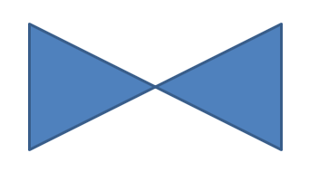

## **Áttekintés**

Ez a cikk bemutatja, hogyan lehet testreszabni a prezentáció alakzatokat az Aspose.Slides-ban a forma geometria szerkesztésével, szerkesztőpontok és geometriai utak használatával. Megmutatja, hogyan dolgozhat a [GeometryPath](https://reference.aspose.com/slides/nodejs-java/aspose.slides/geometrypath/) segítségével meglévő alakzatok módosítására, alapvető út szerkesztési műveletek végrehajtására, pontok hozzáadására vagy eltávolítására, és az frissített geometria visszaalkalmazására egy alakzatra.

A cikk azt is bemutatja, hogyan hozhatunk létre egyéni és összetett alakzatokat, alakzatokat görbe sarkokkal, hogyan határozható meg, hogy egy alakzat geometria zárt-e, az alakzat elemeinek ellenőrzése, valamint a Java AWT szövegvonalak konvertálása geometriai utakba.

## **Alakzat módosítása szerkesztőpontokkal**

* Egy sarkot kifelé vagy befelé mozgathat.
* Egy pont görbületét állíthatja.
* Új pontokat adhat hozzá.

A pontok szerkesztése lehetővé teszi az alakzat körvonalának módosítását, vagy egy meglévő alakzat felhasználását új alapként.

## **Alakzat szerkesztési tippek**


Amikor PowerPoint-alakzatokat szerkeszti, tartsa szem előtt a következőket:

* Egy alakzat (vagy annak útja) lehet zárt vagy nyílt.
* Az alakzat útja horgonypontokból áll, amelyek szegmensekkel vannak összekötve.
* Egy szegmens lehet egyenes vagy görbe. A horgonypontok és a vezérlőkarok határozzák annak alakját.
* A horgonypontok lehetnek sarokpontok, egyenes pontok vagy sima pontok:
  * Sarokpontnál a szomszédos szegmensek szöggel találkozhatnak.
  * Sima pontnál a két vezérlőkar egy vonalban van, és egyenlő távolságra van a horgonyponttól.
  * Egyenes pontnál a két vezérlőkar egy vonalban van, de eltérő távolságra lehetnek a horgonyponttól.
* A horgonypontok mozgatása vagy a karjaik állítása megváltoztatja az alakzat körvonalát.

A PowerPoint-alakzatok szerkesztőpontokkal való szerkesztéséhez az **Aspose.Slides** a [GeometryPath](https://reference.aspose.com/slides/nodejs-java/aspose.slides/geometrypath/) osztályt biztosítja.

* Egy [GeometryPath](https://reference.aspose.com/slides/nodejs-java/aspose.slides/geometrypath/) példány a [GeometryShape](https://reference.aspose.com/slides/nodejs-java/aspose.slides/geometryshape/) objektum geometriai útját képviseli.
* A [GeometryPath](https://reference.aspose.com/slides/nodejs-java/aspose.slides/geometrypath/) lekéréséhez a [GeometryShape](https://reference.aspose.com/slides/nodejs-java/aspose.slides/geometryshape/) példányból használhatja a [GeometryShape.getGeometryPaths](https://reference.aspose.com/slides/nodejs-java/aspose.slides/geometryshape/#getGeometryPaths) metódust.
* Egy alakzat [GeometryPath](https://reference.aspose.com/slides/nodejs-java/aspose.slides/geometrypath/) beállításához használhatja ezeket a metódusokat: a [GeometryShape.setGeometryPath](https://reference.aspose.com/slides/nodejs-java/aspose.slides/geometryshape/#setGeometryPath) egyetlen úttal rendelkező alakzatokhoz és a [GeometryShape.setGeometryPaths](https://reference.aspose.com/slides/nodejs-java/aspose.slides/geometryshape/#setGeometryPaths) több úttal rendelkező alakzatokhoz.
* Szegmensek hozzáadásához használhatja a [GeometryPath](https://reference.aspose.com/slides/nodejs-java/aspose.slides/geometrypath/) alatti metódusokat.
* A [GeometryPath.setStroke](https://reference.aspose.com/slides/nodejs-java/aspose.slides/geometrypath/#setStroke) és a [GeometryPath.setFillMode](https://reference.aspose.com/slides/nodejs-java/aspose.slides/geometrypath/#setFillMode) metódusok segítségével beállíthatja egy geometriai út megjelenését.
* A [GeometryPath.getPathData](https://reference.aspose.com/slides/nodejs-java/aspose.slides/geometrypath/#getPathData) metódus segítségével lekérheti egy [GeometryShape](https://reference.aspose.com/slides/nodejs-java/aspose.slides/geometryshape/) geometriai útját út-szegmensek tömbjeként.
* További alakzat geometria testreszabási lehetőségek eléréséhez olvashat egy [java.awt.Shape](https://docs.oracle.com/javase/8/docs/api/java/awt/Shape.html) objektumot a [PathIterator](https://docs.oracle.com/javase/8/docs/api/java/awt/geom/PathIterator.html) segítségével, és újrajátszhatja a szegmenseket egy [GeometryPath](https://reference.aspose.com/slides/nodejs-java/aspose.slides/geometrypath/)‑on.

## **Egyszerű szerkesztési műveletek**

Az alábbi metódusokkal szerkesztheti a geometriai utat. Az indexet elfogadó túlterhelések egy szegmenst illesztenek be a nulláról induló pozíción a út szegmens tömbjében.

| Művelet | Metódus |
| --- | --- |
| Egyenes vonal hozzáfűzése vagy beszúrása. | [GeometryPath.lineTo](https://reference.aspose.com/slides/nodejs-java/aspose.slides/geometrypath/#lineTo) |
| Köbös Bézier-görbe hozzáfűzése vagy beszúrása két vezérlőponttal és egy végponttal. | [GeometryPath.cubicBezierTo](https://reference.aspose.com/slides/nodejs-java/aspose.slides/geometrypath/#cubicBezierTo) |
| Kvadratikus Bézier-görbe hozzáfűzése vagy beszúrása egy vezérlőponttal és egy végponttal. | [GeometryPath.quadraticBezierTo](https://reference.aspose.com/slides/nodejs-java/aspose.slides/geometrypath/#quadraticBezierTo) |
| Ellipszis ív hozzáfűzése a megadott méretekkel és fokban megadott szögekkel. | [GeometryPath.arcTo](https://reference.aspose.com/slides/nodejs-java/aspose.slides/geometrypath/#arcTo) |
| Az aktuális alakzat lezárása azzal, hogy a végpontját összekapcsolja a kiindulási ponttal. | [GeometryPath.closeFigure](https://reference.aspose.com/slides/nodejs-java/aspose.slides/geometrypath/#closeFigure) |
| Az alakzat kezdőpontjának beállítása. | [GeometryPath.moveTo](https://reference.aspose.com/slides/nodejs-java/aspose.slides/geometrypath/#moveTo) |
| Egy szegmens eltávolítása a nulláról induló indexnél. | [GeometryPath.removeAt](https://reference.aspose.com/slides/nodejs-java/aspose.slides/geometrypath/#removeAt) |

## **Egyéni pontok hozzáadása egy alakzathoz**

Ez a példa két pontot szúr be egy téglalap alakzatba a [GeometryPath.lineTo](https://reference.aspose.com/slides/nodejs-java/aspose.slides/geometrypath/#lineTo) használatával, és az szerkesztett utat a [GeometryShape.setGeometryPath](https://reference.aspose.com/slides/nodejs-java/aspose.slides/geometryshape/#setGeometryPath) alkalmazza. A koordináták az alakzatra vonatkoznak: mindkét új pont a középpontjában van, 100 pontbalra a bal szélről és 50 pontbalra a tetejéről. Az 1 és 4 szegmensindexek a pontokat a felső és alsó élre helyezik, így ezeket az éleket befelé húzva.

```javascript
const slides = require("aspose.slides.via.java");

const presentation = new slides.Presentation();
try {
    const slide = presentation.getSlides().get_Item(0);

    const shape = slide.getShapes().addAutoShape(slides.ShapeType.Rectangle, 100, 100, 200, 100);

    const geometryPath = shape.getGeometryPaths()[0];
    geometryPath.lineTo(100, 50, 1);
    geometryPath.lineTo(100, 50, 4);

    shape.setGeometryPath(geometryPath);
} finally {
    presentation.dispose();
}
```



## **Pontok eltávolítása egy alakzatból**

Ez a példa a szív alakú kontúr módosítását mutatja, a 2‑es (nulláról induló) indexű szegmens eltávolításával a [GeometryPath.removeAt](https://reference.aspose.com/slides/nodejs-java/aspose.slides/geometrypath/#removeAt) segítségével. A módosított út alkalmazása a [GeometryShape.setGeometryPath](https://reference.aspose.com/slides/nodejs-java/aspose.slides/geometryshape/#setGeometryPath)‑val frissíti az alakzat körvonalát.

```javascript
const slides = require("aspose.slides.via.java");

const presentation = new slides.Presentation();
try {
    const slide = presentation.getSlides().get_Item(0);

    const shape = slide.getShapes().addAutoShape(slides.ShapeType.Heart, 100, 100, 300, 300);

    const path = shape.getGeometryPaths()[0];
    path.removeAt(2);

    shape.setGeometryPath(path);
} finally {
    presentation.dispose();
}
```


## **Egyéni alakzat létrehozása**

Ez a példa egy ötpontos csillagot épít fel a [GeometryPath](https://reference.aspose.com/slides/nodejs-java/aspose.slides/geometrypath/) segítségével. A 100 és 50 pontos külső és belső sugarak váltakozva határozzák meg a csúcsokat és a benyúlásokat; egy 72 fokos lépés egyenletesen elosztja az öt csúcsot. Az út a [GeometryPath.closeFigure](https://reference.aspose.com/slides/nodejs-java/aspose.slides/geometrypath/#closeFigure)‑val záródik, és egy téglalap alakzatra a [GeometryShape.setGeometryPath](https://reference.aspose.com/slides/nodejs-java/aspose.slides/geometryshape/#setGeometryPath) alkalmazásával kerül, felülírva annak körvonalát.

```javascript
const slides = require("aspose.slides.via.java");
const java = require("java");

const points = [];
const outerRadius = 100;
const innerRadius = 50;
const angleStep = 72;

for (let angle = -90; angle < 270; angle += angleStep) {
    let radians = angle * Math.PI / 180;
    points.push({ x: outerRadius * Math.cos(radians) + outerRadius, y: outerRadius * Math.sin(radians) + outerRadius });
    radians = (angle + angleStep / 2) * Math.PI / 180;
    points.push({ x: innerRadius * Math.cos(radians) + outerRadius, y: innerRadius * Math.sin(radians) + outerRadius });
}

const starPath = new slides.GeometryPath();
starPath.moveTo(java.newFloat(points[0].x), java.newFloat(points[0].y));
for (let i = 1; i < points.length; i++) {
    starPath.lineTo(java.newFloat(points[i].x), java.newFloat(points[i].y));
}
starPath.closeFigure();

const presentation = new slides.Presentation();
try {
    const slide = presentation.getSlides().get_Item(0);

    const shape = slide.getShapes().addAutoShape(slides.ShapeType.Rectangle, 100, 100, outerRadius * 2, outerRadius * 2);
    shape.setGeometryPath(starPath);
} finally {
    presentation.dispose();
}
```


## **Összetett egyéni alakzat létrehozása**

Ez a példa két zárt [GeometryPath](https://reference.aspose.com/slides/nodejs-java/aspose.slides/geometrypath/) objektumot definiál egy alakzat felső és alsó harmadjára. Mindkét út alkalmazása a [GeometryShape.setGeometryPaths](https://reference.aspose.com/slides/nodejs-java/aspose.slides/geometryshape/#setGeometryPaths) segítségével egyetlen összetett alakzatot hoz létre, amelynek középső harmadában egy rés van.

```javascript
const slides = require("aspose.slides.via.java");
const java = require("java");

const presentation = new slides.Presentation();
try {
    const slide = presentation.getSlides().get_Item(0);

    const shape = slide.getShapes().addAutoShape(slides.ShapeType.Rectangle, 100, 100, 200, 100);

    const topPath = new slides.GeometryPath();
    topPath.moveTo(0, 0);
    topPath.lineTo(shape.getWidth(), 0);
    topPath.lineTo(shape.getWidth(), java.newFloat(shape.getHeight() / 3));
    topPath.lineTo(0, java.newFloat(shape.getHeight() / 3));
    topPath.closeFigure();

    const bottomPath = new slides.GeometryPath();
    bottomPath.moveTo(0, java.newFloat(shape.getHeight() / 3 * 2));
    bottomPath.lineTo(shape.getWidth(), java.newFloat(shape.getHeight() / 3 * 2));
    bottomPath.lineTo(shape.getWidth(), shape.getHeight());
    bottomPath.lineTo(0, shape.getHeight());
    bottomPath.closeFigure();

    const paths = java.newArray("com.aspose.slides.GeometryPath", [topPath, bottomPath]);
    shape.setGeometryPaths(paths);
} finally {
    presentation.dispose();
}
```


## **Egyéni alakzat görbe sarkokkal**

Ez a példa egyenes szegmenseket kombinál a [GeometryPath.arcTo](https://reference.aspose.com/slides/nodejs-java/aspose.slides/geometrypath/#arcTo) használatával, hogy egy belsőre görbülő sarkokkal rendelkező alakzatot hozzon létre. Minden sarokméret beállítja az ív szélességét és magasságát pontban, a -90 fokos ív pedig egy óramutatóval ellentétes négyszögletű ellipszist rajzol. A befejezett út a [GeometryShape.setGeometryPath](https://reference.aspose.com/slides/nodejs-java/aspose.slides/geometryshape/#setGeometryPath)‑val kerül alkalmazásra, és a bemutató PPTX formátumban mentődik.

```javascript
const slides = require("aspose.slides.via.java");

const shapeX = 20;
const shapeY = 20;
const shapeWidth = 300;
const shapeHeight = 200;

const leftTopSize = 50;
const rightTopSize = 20;
const rightBottomSize = 40;
const leftBottomSize = 10;

const presentation = new slides.Presentation();
try {
    const slide = presentation.getSlides().get_Item(0);

    const shape = slide.getShapes().addAutoShape(slides.ShapeType.Custom, shapeX, shapeY, shapeWidth, shapeHeight);

    const geometryPath = new slides.GeometryPath();
    geometryPath.moveTo(leftTopSize, 0);
    geometryPath.lineTo(shapeWidth - rightTopSize, 0);
    geometryPath.arcTo(rightTopSize, rightTopSize, 180, -90);
    geometryPath.lineTo(shapeWidth, shapeHeight - rightBottomSize);
    geometryPath.arcTo(rightBottomSize, rightBottomSize, -90, -90);
    geometryPath.lineTo(leftBottomSize, shapeHeight);
    geometryPath.arcTo(leftBottomSize, leftBottomSize, 0, -90);
    geometryPath.lineTo(0, leftTopSize);
    geometryPath.arcTo(leftTopSize, leftTopSize, 90, -90);
    geometryPath.closeFigure();

    shape.setGeometryPath(geometryPath);

    presentation.save("output.pptx", slides.SaveFormat.Pptx);
} finally {
    presentation.dispose();
}
```

## **Kiderítés, hogy egy alakzat geometria zárt-e**

Az alábbi segédprogram ellenőrzi, hogy minden nem üres geometriai út záró szegmenssel végződik-e. A [GeometryPath.getPathData](https://reference.aspose.com/slides/nodejs-java/aspose.slides/geometrypath/#getPathData) olvas, és az utolsó szegmens [PathSegment.getPathCommand](https://reference.aspose.com/slides/nodejs-java/aspose.slides/pathsegment/#getPathCommand) értékét összehasonlítja a [PathCommandType.Close](https://reference.aspose.com/slides/nodejs-java/aspose.slides/pathcommandtype/) értékkel. Hamis értéket ad vissza, ha nincs nem üres út. Ez minden út végső parancsát vizsgálja; nem ellenőriz minden alalakzatot az úton belül. A példa `true`‑t nyomtat egy téglalap esetén.

```javascript
const slides = require("aspose.slides.via.java");

function isGeometryClosed(geometryShape) {
    let hasNonemptyPath = false;
    for (const geometryPath of geometryShape.getGeometryPaths()) {
        const segments = geometryPath.getPathData();
        if (segments.length === 0) {
            continue;
        }
        hasNonemptyPath = true;
        const lastSegment = segments[segments.length - 1];
        if (lastSegment.getPathCommand() !== slides.PathCommandType.Close) {
            return false;
        }
    }
    return hasNonemptyPath;
}

const presentation = new slides.Presentation();
try {
    const slide = presentation.getSlides().get_Item(0);

    const shape = slide.getShapes().addAutoShape(slides.ShapeType.Rectangle, 100, 100, 200, 100);

    const closed = isGeometryClosed(shape);
    console.log(closed);
} finally {
    presentation.dispose();
}
```

## **Geometriai út parancsainak ellenőrzése**

Töltse le a [contour.pptx](contour.pptx) fájlt, és helyezze el az alkalmazás munkakönyvtárában. Az első dián az első alakzatnak van egy egyenes felső él, egy köbös Bézier-görbe, és egy egyenes záró él. A [getGeometryPaths](https://reference.aspose.com/slides/nodejs-java/aspose.slides/geometryshape/#getGeometryPaths) használatával beolvashatja az alakzat útjait, és a [getPathData](https://reference.aspose.com/slides/nodejs-java/aspose.slides/geometrypath/#getPathData) beolvassa minden út szegmenseit rajzolási sorrendben. Minden szegmensnél a [getPathCommand](https://reference.aspose.com/slides/nodejs-java/aspose.slides/pathsegment/#getPathCommand) azonosítja a parancsot, és meghatározza, hogyan kell értelmezni a [getSegmentData](https://reference.aspose.com/slides/nodejs-java/aspose.slides/pathsegment/#getSegmentData) által visszaadott értékeket.

```javascript
const slides = require("aspose.slides.via.java");

const presentation = new slides.Presentation("contour.pptx");
try {
    const shape = presentation.getSlides().get_Item(0).getShapes().get_Item(0);
    const paths = shape.getGeometryPaths();
    for (const [i, path] of paths.entries()) {
        const segments = path.getPathData();
        for (const [j, segment] of segments.entries()) {
            const command = segment.getPathCommand();
            const data = segment.getSegmentData();
            let detail;
            switch (command) {
                case slides.PathCommandType.MoveTo:
                case slides.PathCommandType.LineTo:
                    const name = command === slides.PathCommandType.MoveTo ? "MoveTo" : "LineTo";
                    detail = `${name} destination=(${data[0]}, ${data[1]})`;
                    break;
                case slides.PathCommandType.CubicBezierTo:
                    detail = `CubicBezierTo control1=(${data[0]}, ${data[1]}) control2=(${data[2]}, ${data[3]}) end=(${data[4]}, ${data[5]})`;
                    break;
                case slides.PathCommandType.Close:
                    detail = "Close no coordinates";
                    break;
                default:
                    detail = `command=${command} raw=[${data.join(", ")}]`;
            }
            console.log(`Path ${i}, segment ${j}: ${detail}`);
        }
    }
} finally {
    presentation.dispose();
}
```

Az alakzat a dián (200, 100) pont pozícióban helyezkedik el. A jelentett koordináták az alakzatra vonatkoznak, ahol (0, 0) a bal felső sarok, az x jobbra, a y lefelé növekszik. A záró szegmens anélkül tér vissza a kiindulási pontra, hogy további koordinátákat adna meg.

```text
Path 0, segment 0: MoveTo destination=(0, 0)
Path 0, segment 1: LineTo destination=(80, 0)
Path 0, segment 2: CubicBezierTo control1=(70, 15) control2=(30, 45) end=(0, 60)
Path 0, segment 3: Close no coordinates
```


## **Alakzat elemek kinyerése és ellenőrzése**

Használja a [GeometryShape.createShapeElements](https://reference.aspose.com/slides/nodejs-java/aspose.slides/geometryshape/#createShapeElements) metódust, hogy megvizsgálja a meglévő alakzatot elemekként, amelyek útpontokat és ponttípusokat tartalmaznak. Minden visszaadott [ShapeElement](https://reference.aspose.com/slides/nodejs-java/aspose.slides/shapeelement/) segítségével a [getPathPoints](https://reference.aspose.com/slides/nodejs-java/aspose.slides/shapeelement/#getPathPoints) és a [getPathTypes](https://reference.aspose.com/slides/nodejs-java/aspose.slides/shapeelement/#getPathTypes) metódusokkal nyerheti ki a pont- és típus tömböket. Ez a reprezentáció hasznos a kontúr elemzéshez vagy a geometria átadásához egyedi rajzoló eszközöknek.

A példa megnyitja az input.pptx‑t, megtalálja az első geometriai alakzatot közvetlenül az első dián, és kiírja annak út szegmenseit. Használjon egy bemutatót, amely egy alakzatot tartalmaz egyenes és görbe szegmensekkel, hogy mindkét típusú kimenetet lássa. Nem keres csoportokon belül.

```javascript
const slides = require("aspose.slides.via.java");
const java = require("java");

const presentation = new slides.Presentation("input.pptx");
try {
    const slide = presentation.getSlides().get_Item(0);

    let shape = null;
    for (let index = 0; index < slide.getShapes().size(); index++) {
        const candidate = slide.getShapes().get_Item(index);
        if (java.instanceOf(candidate, "com.aspose.slides.GeometryShape")) {
            shape = candidate;
            break;
        }
    }

    if (shape == null) {
        console.log("No geometry shape found on the first slide.");
    } else {
        for (const shapeElement of shape.createShapeElements()) {
            const points = shapeElement.getPathPoints();
            const types = shapeElement.getPathTypes();
            console.log("Shape element:");

            for (let i = 0; i < points.length; i++) {
                const pointType = types[i] & 0x07; // Megtartja a szegmens típusát, a jelzők nélkül.
                switch (pointType) {
                    case 0:
                        console.log("Start figure at " + points[i]);
                        break;
                    case 1:
                        console.log("Line to " + points[i]);
                        break;
                    case 3:
                        console.log("Cubic Bezier: controls " + points[i] + ", " + points[i + 1] + "; end " + points[i + 2]);
                        i += 2; // Fogyasztja mindkét vezérlőpontot és a végpontot.
                        break;
                }

                if ((types[i] & 0x80) != 0) {
                    console.log("Close subpath back to its starting point.");
                }
            }
        }
    }
} finally {
    presentation.dispose();
}
```

A tömbök index szerint egyeznek: a `points[i]` egy pont, a `types[i]` pedig annak szerepét írja le. A `0` típus egy alakzatot indít, az `1` típus egy vonalat rajzol az előző pontból a jelenlegi pontba. Egy köbös Bézier szegmens az előző végpontnál kezdődik, és három egymást követő `3` típusú bejegyzést használ: két vezérlőpontot, majd az új végpontot. A ciklus egyszerre fogyasztja ezeket a három bejegyzést, és ellenőrzi a végpont zártságát.

A ponttípusok további jelzőket is tartalmaznak. A `0x07` maszkkal azonosítható a szegmens típusa, a `0x80` külön tesztelhető egy zárt alútvonal felismeréséhez. Például a `129` (`0x81`) egy vonal végpontot jelent, amely egy alútvonalat zár, a `131` (`0x83`) pedig egy Bézier végpontot, amely zár egyet. A Java ezeket a jelzőket előjeles bájtokban tárolja; a maszkolás megőrzi a kívánt bitértékeket. Ha csak a nyers értéket hasonlítjuk `1` vagy `3`‑hoz, ezeket az eseteket figyelmen kívül hagyjuk. Más jelzők, mint a szaggatott (`0x10`) és a marker (`0x20`), nem változtatják meg az alapszegmens típust.

**Koordináták és transzformációk.** A pontok pontban (1/72 hüvelyk) vannak mérve, az X jobbra, a Y lefelé növekszik. Egy nem csoportosított alakzatnál a kinyert koordináták már tartalmazzák a [getX](https://reference.aspose.com/slides/nodejs-java/aspose.slides/shape/#getX) és [getY](https://reference.aspose.com/slides/nodejs-java/aspose.slides/shape/#getY) által visszaadott pozíciót, és tükrözik a jelenlegi szélességet és magasságot. Például egy nem elforgatott téglalap `(100, 200)` helyen, `120 × 80` mérettel, a kontúr határa `(100, 200)`–`(220, 280)`. Ne adja hozzá újra az alakzat pozícióját. Vonja le az X-et és Y-t a koordinátákhoz, hogy az elforgatás nélküli kerethez viszonyítva kapja meg őket.

Az kinyert pontok nem alkalmazzák az alakzat [getRotation](https://reference.aspose.com/slides/nodejs-java/aspose.slides/shape/#getRotation), vagy a vízszintes és függőleges tükrözéseket. A megjelenített kontúr reprodukálásához alkalmazza ezeket a transzformációkat az alakzat középpontja körül. Csoportosított alakzatoknál vegye figyelembe a csoport koordinátatérképét és transzformációkat; ne vegye azt, hogy a kinyert pontok a végleges megjelenített diakoordináták, vagy ne alkalmazza kétszer a transzlációt vagy skálát, ha már a gyermek keretben tükröződik.

**Ellenőrzés vs. szerkesztés.** A kinyert tömbök a kontúrt írják le; azok módosítása nem frissíti az eredeti alakzatot. Ezt a megközelítést válassza, ha az elemzési vagy rajzoló kód pont/típus tömböket igényel. Használja a [getGeometryPaths](https://reference.aspose.com/slides/nodejs-java/aspose.slides/geometryshape/#getGeometryPaths)‑t, ha a geometriai parancsokra van szüksége az alakzat helyi koordináta rendszerében, vagy ha szeretné szerkeszteni a geometria. Alkalmazza a szerkesztett utakat a [setGeometryPath](https://reference.aspose.com/slides/nodejs-java/aspose.slides/geometryshape/#setGeometryPath) vagy a [setGeometryPaths](https://reference.aspose.com/slides/nodejs-java/aspose.slides/geometryshape/#setGeometryPaths) segítségével.

## **Java AWT Shape konvertálása GeometryPath-re**

Ez a példa egy téglalap körvonalat kombinál a geometriává konvertált szöveggel. A körvonal [setFillMode](https://reference.aspose.com/slides/nodejs-java/aspose.slides/geometrypath/#setFillMode) metódusa letiltja a kitöltést. Egy [GlyphVector](https://docs.oracle.com/javase/8/docs/api/java/awt/font/GlyphVector.html) létrehozza a szöveg kontúrt egy [java.awt.Shape](https://docs.oracle.com/javase/8/docs/api/java/awt/Shape.html) objektumban. A [PathIterator](https://docs.oracle.com/javase/8/docs/api/java/awt/geom/PathIterator.html) mozgás-, vonal-, kvadratikus-, köbös- és záró szegmenseket ad, amelyeket a példa újrajátszik egy [GeometryPath](https://reference.aspose.com/slides/nodejs-java/aspose.slides/geometrypath/).

A Java-híd expliciten float és byte értékeket használ a megfelelő Java paraméterekhez. Az iterátor a koordinátákat egy Java float tömbbe írja; a reflexió visszaolvassa az új értékeket JavaScript-be. A szöveg 40 pontos Arial betűtípust használ. A körvonal vízszintesen 20 ponttal el van tolva és a vizuális teteje 10 ponttal a alakzat felső élétől helyezkedik el. A szöveg útja ki van töltve, míg az eredeti téglalap csak körvonal marad. Mindkét út alkalmazása a [GeometryShape.setGeometryPaths](https://reference.aspose.com/slides/nodejs-java/aspose.slides/geometryshape/#setGeometryPaths) segítségével egyetlen alakzatot hoz létre, amely tartalmazza a téglalapot és a szöveget.

```javascript
const slides = require("aspose.slides.via.java");
const java = require("java");

const presentation = new slides.Presentation();
try {
    const slide = presentation.getSlides().get_Item(0);

    const shape = slide.getShapes().addAutoShape(slides.ShapeType.Rectangle, 100, 100, 300, 100);
    
    const originalPath = shape.getGeometryPaths()[0];
    originalPath.setFillMode(java.newByte(slides.PathFillModeType.None));

    const font = java.newInstanceSync("java.awt.Font", "Arial", java.getStaticFieldValue("java.awt.Font", "PLAIN"), 40);
    const image = java.newInstanceSync("java.awt.image.BufferedImage", 100, 100, java.getStaticFieldValue("java.awt.image.BufferedImage", "TYPE_INT_ARGB"));
    const graphics = image.createGraphics();
    let graphicsPath;
    try {
        const fontContext = graphics.getFontRenderContext();
        const glyphVector = font.createGlyphVector(fontContext, "Text in shape");
        const textBounds = glyphVector.getVisualBounds();
        const baseline = java.newFloat(-textBounds.getY() + 10);
        graphicsPath = glyphVector.getOutline(java.newFloat(20), baseline);
    } finally {
        graphics.dispose();
    }

    const textPath = new slides.GeometryPath();
    const pathIterator = graphicsPath.getPathIterator(null);
    const coordinates = java.newArray("float", [0, 0, 0, 0, 0, 0]);

    while (!pathIterator.isDone()) {
        const segmentType = pathIterator.currentSegment(coordinates);
        const points = [];
        for (let i = 0; i < 6; i++) {
            const coordinate = java.callStaticMethodSync("java.lang.reflect.Array", "getFloat", coordinates, i);
            points.push(java.newFloat(coordinate));
        }
        switch (segmentType) {
            case 0: // Áthelyezés.
                textPath.moveTo(points[0], points[1]);
                break;
            case 1: // Vonal ide.
                textPath.lineTo(points[0], points[1]);
                break;
            case 2: // Kvadratikus Bézier-görbe.
                textPath.quadraticBezierTo(points[0], points[1], points[2], points[3]);
                break;
            case 3: // Köbös Bézier-görbe.
                textPath.cubicBezierTo(points[0], points[1], points[2], points[3], points[4], points[5]);
                break;
            case 4: // Alakzat lezárása.
                textPath.closeFigure();
                break;
        }
        pathIterator.next();
    }
    textPath.setFillMode(java.newByte(slides.PathFillModeType.Normal));
    const paths = java.newArray("com.aspose.slides.GeometryPath", [originalPath, textPath]);
    shape.setGeometryPaths(paths);
} finally {
    presentation.dispose();
}
```


## **GYIK**

**Mi történik a kitöltéssel és a körvonallal a geometria cseréje után?**

A stílus az alakzaton marad; csak a körvonal változik. A kitöltés és a körvonal automatikusan az új geometriára kerül.

**Hogyan forgathatom helyesen egy egyéni alakzatot a geometriájával együtt?**

Használja az alakzat [setRotation](https://reference.aspose.com/slides/nodejs-java/aspose.slides/shape/#setRotation) metódusát; a geometria az alakzattal együtt forog, mivel az az alakzat saját koordináta rendszeréhez van kötve.

**Átkonvertálhatom egy egyéni alakzatot képre a végeredmény „lezárásához”?**

Igen. Exportálja a szükséges [slide](/slides/hu/nodejs-java/convert-powerpoint-to-png/) területet vagy magát a [shape](/slides/hu/nodejs-java/create-shape-thumbnails/) elemet raster formátumba; ez egyszerűsíti a további munkát a komplex geometriákkal.