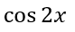

## **Áttekintés**

A PowerPoint az egyenleteket Office Math Markup Language (OMML) formátumban tárolja. Az Aspose.Slides for PHP via Java segítségével programozottan hozhat létre hasonló matematikai tartalmakat: törtek, gyökök, függvények, határértékek, N-árnyú operátorok, mátrixok, tömbök és formázott matematikai blokkok.

A PowerPointban a felhasználók általában a **Beszúrás > Egyenlet** menüből adnak hozzá egyenleteket:


Az eredmény egy szerkeszthető matematikai szöveg a dián:


Az Aspose.Slides a matematikai szöveget három fő objektumon keresztül építi fel:

- Egy matematikai alakzat, amelyet a [addMathShape](https://reference.aspose.com/slides/php-java/aspose.slides/shapecollection/#addMathShape) hoz létre, az az alakzat, amely a képletet tartalmazza.
- A [MathPortion](https://reference.aspose.com/slides/php-java/aspose.slides/mathportion/) tárolja a matematikai tartalmat az alakzat szövegdobozában.
- A [MathParagraph](https://reference.aspose.com/slides/php-java/aspose.slides/mathparagraph/) egy vagy több [MathBlock](https://reference.aspose.com/slides/php-java/aspose.slides/mathblock/) objektumot tartalmaz.

A lenti példák nagy része a [MathematicalText](https://reference.aspose.com/slides/php-java/aspose.slides/mathematicaltext/) és a [MathElementBase](https://reference.aspose.com/slides/php-java/aspose.slides/mathelementbase/) folyékony metódusait használja, hogy a kód rövid és olvasható legyen.

MathML exportálási forgatókönyveknél lásd a [Export Math Equations from Presentations in PHP via Java](/slides/hu/php-java/exporting-math-equations/).

## **Képlet létrehozása**

Ez a példa a [addMathShape](https://reference.aspose.com/slides/php-java/aspose.slides/shapecollection/#addMathShape) segítségével hoz létre egy matematikai alakzatot, és hozzáadja a Püthagorasz-tételt:


```php
$presentation = new Presentation();
try {
    $slide = $presentation->getSlides()->get_Item(0);

    $mathShape = $slide->getShapes()->addMathShape(20, 20, 700, 120);
    $mathParagraph = $mathShape->getTextFrame()->getParagraphs()
        - >get_Item(0)->getPortions()->get_Item(0)->getMathParagraph();

    $equation = (new MathematicalText("c"))
        - >setSuperscript("2")
        - >join("=")
        - >join((new MathematicalText("a"))->setSuperscript("2"))
        - >join("+")
        - >join((new MathematicalText("b"))->setSuperscript("2"));

    $mathParagraph->add($equation);

    $presentation->save("pythagorean-theorem.pptx", SaveFormat::Pptx);
} finally {
    if (!java_is_null($presentation)) {
        $presentation->dispose();
    }
}
```

{}
[addMathShape](https://reference.aspose.com/slides/php-java/aspose.slides/shapecollection/#addMathShape) olyan alakzatot hoz létre, amely már tartalmaz egy matematikai bekezdést. Érje el az első [MathPortion](https://reference.aspose.com/slides/php-java/aspose.slides/mathportion/), hívja meg a [getMathParagraph](https://reference.aspose.com/slides/php-java/aspose.slides/mathportion/#getMathParagraph) metódust, és adjon hozzá matematikai blokkokat vagy elemeket.
{}

### **Matematikai blokkok egyesítése**

Amikor egy egyenlet részei függetlenül, [MathBlock](https://reference.aspose.com/slides/php-java/aspose.slides/mathblock/) objektumokként épülnek fel, a [joinBlock](https://reference.aspose.com/slides/php-java/aspose.slides/mathblock/#joinBlock) segítségével egyesíthetők. A példa a `c² =` elemet a bal blokkban, az `a² + b²` elemet a jobb blokkban építi fel. A [setSuperscript](https://reference.aspose.com/slides/php-java/aspose.slides/mathelementbase/#setSuperscript) szerkeszthető matematikai felső indexeket hoz létre mindhárom hatványhoz.

```php
use aspose\slides\MathBlock;
use aspose\slides\MathematicalText;
use aspose\slides\Presentation;
use aspose\slides\SaveFormat;

$presentation = new Presentation();
try {
    $slide = $presentation->getSlides()->get_Item(0);

    $shape = $slide->getShapes()->addMathShape(20, 20, 600, 100);
    $mathPortion = $shape->getTextFrame()->getParagraphs()->get_Item(0)->getPortions()->get_Item(0);
    $mathParagraph = $mathPortion->getMathParagraph();

    $leftBlock = new MathBlock();
    $leftBlock->add((new MathematicalText("c"))->setSuperscript("2"));
    $leftBlock->add(new MathematicalText("="));

    $rightBlock = new MathBlock();
    $rightBlock->add((new MathematicalText("a"))->setSuperscript("2"));
    $rightBlock->add(new MathematicalText("+"));
    $rightBlock->add((new MathematicalText("b"))->setSuperscript("2"));

    $combinedBlock = $leftBlock->joinBlock($rightBlock);
    $mathParagraph->add($combinedBlock);

    $presentation->save("equation.pptx", SaveFormat::Pptx);
} finally {
    $presentation->dispose();
}
```

[joinBlock](https://reference.aspose.com/slides/php-java/aspose.slides/mathblock/#joinBlock) a `$leftBlock`-ot adja vissza, amely most már mindkét részt sorrendben tartalmaz, míg a `$rightBlock` üres marad. A kombinált blokkot egyszer kell hozzáadni a [MathParagraph](https://reference.aspose.com/slides/php-java/aspose.slides/mathparagraph/)-hez. A `equation.pptx` újranyitása után a bekezdés egyetlen blokkot tartalmaz, amely a `c² = a² + b²` kifejezést jelenti, a három hatvány matematikai felső indexeként megőrizve.

A [add](https://reference.aspose.com/slides/php-java/aspose.slides/mathblock/#add) meghívása `$leftBlock->add($rightBlock)` helyett megpróbálja egy blokkot közvetlenül egy másikba ágyazni, és `InvalidOperationException`-t dob.

## **Törtek hozzáadása**

A [divide](https://reference.aspose.com/slides/php-java/aspose.slides/mathelementbase/#divide) használatával hozhat létre törteket. A törttípus kiválasztható a [MathFractionTypes](https://reference.aspose.com/slides/php-java/aspose.slides/mathfractiontypes/) segítségével.


```php
$presentation = new Presentation();
try {
    $slide = $presentation->getSlides()->get_Item(0);

    $mathShape = $slide->getShapes()->addMathShape(20, 20, 700, 100);
    $mathParagraph = $mathShape->getTextFrame()->getParagraphs()
        - >get_Item(0)->getPortions()->get_Item(0)->getMathParagraph();

    $fraction = (new MathematicalText("1"))
        - >divide("x", MathFractionTypes::Skewed);

    $mathParagraph->add(new MathBlock($fraction));

    $presentation->save("fraction.pptx", SaveFormat::Pptx);
} finally {
    if (!java_is_null($presentation)) {
        $presentation->dispose();
    }
}
```

Halmozott tört esetén használja a [MathFractionTypes::Bar](https://reference.aspose.com/slides/php-java/aspose.slides/mathfractiontypes/#Bar) beállítást:

```php
$stackedFraction = (new MathematicalText("x + 1"))->divide("y - 1", MathFractionTypes::Bar);
```

## **Gyökök hozzáadása**

A [radical](https://reference.aspose.com/slides/php-java/aspose.slides/mathelementbase/#radical) segítségével hozhat létre négyzetgyököt, köbgyököt vagy más gyököt. Az aktuális elem lesz az alap, a paraméter pedig a gyök fokát jelöli.


```php
$presentation = new Presentation();
try {
    $slide = $presentation->getSlides()->get_Item(0);

    $mathShape = $slide->getShapes()->addMathShape(20, 20, 700, 100);
    $mathParagraph = $mathShape->getTextFrame()->getParagraphs()
        - >get_Item(0)->getPortions()->get_Item(0)->getMathParagraph();

    $radical = (new MathematicalText("x"))
        - >radical("n");

    $mathParagraph->add(new MathBlock($radical));

    $presentation->save("radical.pptx", SaveFormat::Pptx);
} finally {
    if (!java_is_null($presentation)) {
        $presentation->dispose();
    }
}
```

### **A négyzetgyök fokának megjelenítése vagy elrejtése**

A négyzetgyök megjeleníthet egy explicit 2‑t, vagy használhatja a hagyományos √x jelölést. A [MathRadical](https://reference.aspose.com/slides/php-java/aspose.slides/mathradical/) [setHideDegree](https://reference.aspose.com/slides/php-java/aspose.slides/mathradical/#setHideDegree) metódusa szabályozza, melyik forma jelenik meg. Mindkét forma megtartja a 2 fokot és a radikandus x-et a szerkeszthető egyenletben.


A példa ugyanazt a négyzetgyököt kétszer menti. A `visible-degree.pptx` fájlban a 2 látható. A `hidden-degree.pptx` fájlban rejtett.

```php
use aspose\slides\MathBlock;
use aspose\slides\MathematicalText;
use aspose\slides\Presentation;
use aspose\slides\SaveFormat;

$presentation = new Presentation();
try {
    $slide = $presentation->getSlides()->get_Item(0);
    
    $radical = (new MathematicalText("x"))->radical("2");

    $shape = $slide->getShapes()->addMathShape(20, 20, 200, 100);
    $portion = $shape->getTextFrame()->getParagraphs()->get_Item(0)->getPortions()->get_Item(0);
    $portion->getMathParagraph()->add(new MathBlock($radical));

    $radical->setHideDegree(false);
    $presentation->save("visible-degree.pptx", SaveFormat::Pptx);

    $radical->setHideDegree(true);
    $presentation->save("hidden-degree.pptx", SaveFormat::Pptx);
} finally {
    $presentation->dispose();
}
```

## **Függvények és határértékek hozzáadása**

Használja az [asArgumentOfFunction](https://reference.aspose.com/slides/php-java/aspose.slides/mathelementbase/#asArgumentOfFunction) vagy a [function](https://reference.aspose.com/slides/php-java/aspose.slides/mathelementbase/#function) metódust olyan függvényekhez, mint a `sin(x)`, `log(x)`, vagy egyedi függvénynevek. Határértékekhez helyezze a `lim`-et egy [MathLimit](https://reference.aspose.com/slides/php-java/aspose.slides/mathlimit/) objektumba, vagy használja a [setLowerLimit](https://reference.aspose.com/slides/php-java/aspose.slides/mathelementbase/#setLowerLimit) metódust.


```php
$presentation = new Presentation();
try {
    $slide = $presentation->getSlides()->get_Item(0);

    $mathShape = $slide->getShapes()->addMathShape(20, 20, 700, 100);
    $mathParagraph = $mathShape->getTextFrame()->getParagraphs()
        - >get_Item(0)->getPortions()->get_Item(0)->getMathParagraph();

    $limit = (new MathematicalText("lim"))
        - >setLowerLimit("x\u{2192}\u{221E}")
        - >function("x");

    $mathParagraph->add(new MathBlock($limit));

    $presentation->save("functions-and-limits.pptx", SaveFormat::Pptx);
} finally {
    if (!java_is_null($presentation)) {
        $presentation->dispose();
    }
}
```

Egy egyedi függvénynévhez tegye a függvénynevet az aktuális elemnek, majd hívja meg a [function](https://reference.aspose.com/slides/php-java/aspose.slides/mathelementbase/#function) metódust a paraméterével:

```php
$customFunction = (new MathematicalText("f"))->function("x + 1");
```

## **N-árnyú operátorok és integrálok hozzáadása**

A [nary](https://reference.aspose.com/slides/php-java/aspose.slides/mathelementbase/#nary) használható összegek, uniók, metszetek és egyéb nagy operátorok létrehozásához. Az [integral](https://reference.aspose.com/slides/php-java/aspose.slides/mathelementbase/#integral) integrálokhoz. Mindkét metódus lehetővé teszi az alsó és felső határok beállítását.


```php
$presentation = new Presentation();
try {
    $slide = $presentation->getSlides()->get_Item(0);

    $mathShape = $slide->getShapes()->addMathShape(20, 20, 700, 120);
    $mathParagraph = $mathShape->getTextFrame()->getParagraphs()
        - >get_Item(0)->getPortions()->get_Item(0)->getMathParagraph();

    $summationBase = (new MathematicalText("x"))
        - >setSuperscript("k")
        - >join((new MathematicalText("a"))->setSuperscript("n-k"));

    $summation = $summationBase->nary(MathNaryOperatorTypes::Summation, "k=0", "n");

    $mathParagraph->add(new MathBlock($summation));

    $presentation->save("nary-operators.pptx", SaveFormat::Pptx);
} finally {
    if (!java_is_null($presentation)) {
        $presentation->dispose();
    }
}
```

Az N-árnyú operátorok nagy operátorok opcionális határokkal. Az egyszerű operátorok, mint a `+`, `-`, és `=` általában [MathematicalText](https://reference.aspose.com/slides/php-java/aspose.slides/mathematicaltext/) segítségével kerülnek hozzáadásra, majd a kifejezésbe illesztésre.

Integrál esetén használja az [integral](https://reference.aspose.com/slides/php-java/aspose.slides/mathelementbase/#integral) metódust:

```php
$integralBase = (new MathematicalText("x"))->join((new MathematicalText("dx"))->toBox());
$integral = $integralBase->integral(MathIntegralTypes::Simple, "0", "1");
```

## **Mátrixok hozzáadása**

A [MathMatrix](https://reference.aspose.com/slides/php-java/aspose.slides/mathmatrix/) sorok és oszlopok kezelésére szolgál. A mátrixok alapértelmezés szerint nem tartalmaznak zárójeleket, ezért szükség esetén manuálisan kell őket körülvenni zárójelek, szögletes vagy kapcsos zárójelek segítségével.


```php
$presentation = new Presentation();
try {
    $slide = $presentation->getSlides()->get_Item(0);

    $mathShape = $slide->getShapes()->addMathShape(20, 20, 700, 120);
    $mathParagraph = $mathShape->getTextFrame()->getParagraphs()
        - >get_Item(0)->getPortions()->get_Item(0)->getMathParagraph();

    $matrix = new MathMatrix(2, 3);
    $matrix->set_Item(0, 0, new MathematicalText("1"));
    $matrix->set_Item(0, 1, new MathematicalText("x"));
    $matrix->set_Item(1, 0, new MathematicalText("x"));
    $matrix->set_Item(1, 1, new MathematicalText("2"));
    $matrix->set_Item(1, 2, new MathematicalText("y"));

    $mathParagraph->add(new MathBlock($matrix));

    $presentation->save("matrix.pptx", SaveFormat::Pptx);
} finally {
    if (!java_is_null($presentation)) {
        $presentation->dispose();
    }
}
```

### **Meglévő mátrix szerkesztése**

Tegyük fel, hogy egy lineáris algebra órát egy `matrix.pptx` nevű fájlban lévő együtthatómátrix nyitásával kezdünk, amelyet az előző példa mentett. A következő feladatnál meg kell tartani az első egyenletet, a másodikat két új egyenlettel fel kell cserélni, és a változók halmazát módosítani kell. Nyissa meg a meglévő mátrixot a [MathMatrix](https://reference.aspose.com/slides/php-java/aspose.slides/mathmatrix/) segítségével, hogy megőrizze a még érvényes együtthatókat.


A sor‑ és oszlop‑indexek nullától indulnak, és az adott hívás időpontjában létező mátrixra vonatkoznak. Sor beszúrása az 1‑es index előtt a második sort a 2‑es indexre helyezi. Sor beszúrása a 2‑es index után egy új sort ad hozzá. A 2‑es sor törlése eltávolítja az eredeti második egyenletet, és a beszúrt sort egy pozícióval feljebb mozgatja. Az oszlopok hasonlóan eltolódnak.

```php
use aspose\slides\MathematicalText;
use aspose\slides\MathHorizontalAlignment;
use aspose\slides\Presentation;
use aspose\slides\SaveFormat;

$presentation = new Presentation("matrix.pptx");
try {
    $shape = $presentation->getSlides()->get_Item(0)->getShapes()->get_Item(0);
    $portion = $shape->getTextFrame()->getParagraphs()->get_Item(0)->getPortions()->get_Item(0);
    $block = $portion->getMathParagraph()->get_Item(0);
    $matrix = $block->get_Item(0);

    $matrix->insertRowBefore(1);
    $matrix->insertRowAfter(2);
    $matrix->deleteRow(2);

    $matrix->insertColumnBefore(1);
    $matrix->insertColumnAfter(3);
    $matrix->deleteColumn(3);

    // Az új cellák kezdetben null értékűek. Először állítsa be a nem nulla együtthatókat.
    $matrix->set_Item(1, 0, new MathematicalText("12"));
    $matrix->set_Item(1, 1, new MathematicalText("1"));
    $matrix->set_Item(2, 2, new MathematicalText("10"));
    $matrix->set_Item(2, 3, new MathematicalText("1"));
    $rowCount = java_values($matrix->getRowCount());
    $columnCount = java_values($matrix->getColumnCount());
    for ($row = 0; $row < $rowCount; $row++) {
        for ($column = 0; $column < $columnCount; $column++) {
            $coefficient = $matrix->get_Item($row, $column);
            if (java_is_null($coefficient)) {
                $matrix->set_Item($row, $column, new MathematicalText("0"));
            }
        }
    }

    $matrix->setColumnAlignment(0, MathHorizontalAlignment::Left);
    $matrix->setColumnsAlignment(1, 3, MathHorizontalAlignment::Right);

    $presentation->save("updated-matrix.pptx", SaveFormat::Pptx);
} finally {
    $presentation->dispose();
}
```

A [setColumnAlignment](https://reference.aspose.com/slides/php-java/aspose.slides/mathmatrix/#setColumnAlignment) balra igazítja az első oszlopot. A [setColumnsAlignment](https://reference.aspose.com/slides/php-java/aspose.slides/mathmatrix/#setColumnsAlignment) három egymást követő oszlopot jobbra igazít, az 1‑es indextől kezdve. A `updated-matrix.pptx` fájlban a mátrix három egyenletet és négy változót tartalmaz. Az eredeti első‑sori együtthatók, a `1` és az `x`, most már az első és a harmadik oszlopban jelennek meg.


## **Egyenlet‑tömbök hozzáadása**

Használja a [toMathArray](https://reference.aspose.com/slides/php-java/aspose.slides/mathelementbase/#toMathArray) metódust, ha összehangolt egyenletekre vagy függőlegesen egymásra rakott kifejezésekre van szükség.


```php
$presentation = new Presentation();
try {
    $slide = $presentation->getSlides()->get_Item(0);

    $mathShape = $slide->getShapes()->addMathShape(20, 20, 700, 140);
    $mathParagraph = $mathShape->getTextFrame()->getParagraphs()
        - >get_Item(0)->getPortions()->get_Item(0)->getMathParagraph();

    $equationArray = (new MathematicalText("x"))
        - >join("y")
        - >toMathArray();

    $mathParagraph->add(new MathBlock($equationArray));

    $presentation->save("equation-array.pptx", SaveFormat::Pptx);
} finally {
    if (!java_is_null($presentation)) {
        $presentation->dispose();
    }
}
```

### **Tömb igazítása a környező elemekhez**

A [setBaseJustification](https://reference.aspose.com/slides/php-java/aspose.slides/matharray/#setBaseJustification) szabályozza a tömb függőleges igazítását a mellette lévő matematikai elemekhez képest. A példa három azonos tömböt hoz létre, mindegyik három soros és a szomszédos elemek `A=` és `=B`. Minden matematikai szöveg Cambria Math betűtípussal, 24 pontos mérettel jelenik meg. Csak a tömb igazítása változik.

```php
use aspose\slides\FillType;
use aspose\slides\FontData;
use aspose\slides\MathArray;
use aspose\slides\MathBlock;
use aspose\slides\MathJustification;
use aspose\slides\MathVerticalAlignment;
use aspose\slides\MathematicalText;
use aspose\slides\Presentation;
use aspose\slides\SaveFormat;
use aspose\slides\ShapeType;
use aspose\slides\SlideSizeScaleType;
use aspose\slides\TextAnchorType;

$createText = static function (string $value) {
    $text = new MathematicalText($value);
    $text->getFormat()->setFontHeight(24);
    $text->getFormat()->setLatinFont(new FontData("Cambria Math"));
    return $text;
};

$alignments = ["Top" => MathVerticalAlignment::Top, "Center" => MathVerticalAlignment::Center, "Bottom" => MathVerticalAlignment::Bottom];
$presentation = new Presentation();
try {
    $presentation->getSlideSize()->setSize(780, 200, SlideSizeScaleType::DoNotScale);
    $slide = $presentation->getSlides()->get_Item(0);
    $x = 20;
    foreach ($alignments as $name => $alignment) {
        $label = $slide->getShapes()->addAutoShape(ShapeType::Rectangle, $x, 10, 240, 30);
        $label->getFillFormat()->setFillType(FillType::NoFill);
        $label->getLineFormat()->getFillFormat()->setFillType(FillType::NoFill);
        $label->getTextFrame()->setText($name);
        $labelFormat = $label->getTextFrame()->getParagraphs()->get_Item(0)->getPortions()->get_Item(0)->getPortionFormat();
        $labelFormat->setFontHeight(16);
        $labelFormat->getFillFormat()->setFillType(FillType::Solid);
        $labelFormat->getFillFormat()->getSolidFillColor()->setColor(java("java.awt.Color")->BLACK);

        $mathShape = $slide->getShapes()->addMathShape($x, 60, 240, 130);
        $mathShape->getTextFrame()->getTextFrameFormat()->setAnchoringType(TextAnchorType::Top);
        $paragraph = $mathShape->getTextFrame()->getParagraphs()->get_Item(0);
        $mathParagraph = $paragraph->getPortions()->get_Item(0)->getMathParagraph();
        $mathParagraph->setJustification(MathJustification::LeftJustified);

        $firstRow = $createText("x+y=3");
        $equationArray = new MathArray($firstRow);
        foreach (["x-y=1", "x=2"] as $value) {
            $row = $createText($value);
            $equationArray->getArguments()->add($row);
        }
        $equationArray->setBaseJustification($alignment);
        $leftText = $createText("A=");
        $rightText = $createText("=B");
        $equation = (new MathBlock($leftText))->join($equationArray)->join($rightText);
        $mathParagraph->add($equation);
        $x += 260;
    }
    $presentation->save("equation-array-alignment.pptx", SaveFormat::Pptx);
} finally {
    $presentation->dispose();
}
```

Az alábbi összehasonlítás a mentett PowerPoint‑prezentációt mutatja. Figyelje meg az `A=` és `=B` elhelyezkedését minden tömb mellett.


### **Sorok közti távolság beállítása**

A [setRowSpacingRule](https://reference.aspose.com/slides/php-java/aspose.slides/matharray/#setRowSpacingRule) kiválasztja a sorok közti távolság szabályát a tömbön belül. A [setRowSpacing](https://reference.aspose.com/slides/php-java/aspose.slides/matharray/#setRowSpacing) numerikus értéket ad meg egy explicit távolság szabályhoz, és a preset szabályok figyelmen kívül hagyják.

Az exakt távolság pontban van megadva. Az arányos távolság fél sorban mérhető: a példában a `3` érték 1,5 sort jelent. Mindkét tulajdonságot be kell állítani egy explicit érték megadásakor; csak a numerikus érték módosítása nem választ szabályt.

Az alábbi példa öt prezentációt ment ugyanazzal a kóddal, igazítással és betűtípussal. Az első három presetet használ, az utolsó kettő explicit értékeket mutat.

```php
use aspose\slides\FontData;
use aspose\slides\MathArray;
use aspose\slides\MathBlock;
use aspose\slides\MathJustification;
use aspose\slides\MathRowSpacingRule;
use aspose\slides\MathVerticalAlignment;
use aspose\slides\MathematicalText;
use aspose\slides\Presentation;
use aspose\slides\SaveFormat;

$createText = static function (string $value) {
    $text = new MathematicalText($value);
    $text->getFormat()->setFontHeight(24);
    $text->getFormat()->setLatinFont(new FontData("Cambria Math"));
    return $text;
};

$settings = [
    "SingleLineGap" => [MathRowSpacingRule::SingleLineGap, 0],
    "OneAndAHalfLineGap" => [MathRowSpacingRule::OneAndAHalfLineGap, 0],
    "TwoLineGap" => [MathRowSpacingRule::TwoLineGap, 0],
    "Exactly" => [MathRowSpacingRule::Exactly, 20],
    "Multiple" => [MathRowSpacingRule::Multiple, 3],
];

foreach ($settings as $name => [$rule, $spacing]) {
    $presentation = new Presentation();
    try {
        $mathShape = $presentation->getSlides()->get_Item(0)->getShapes()->addMathShape(20, 20, 600, 300);
        $paragraph = $mathShape->getTextFrame()->getParagraphs()->get_Item(0);
        $paragraph->getParagraphFormat()->setSpaceBefore(0);
        $paragraph->getParagraphFormat()->setSpaceAfter(0);
        $mathParagraph = $paragraph->getPortions()->get_Item(0)->getMathParagraph();
        $mathParagraph->setJustification(MathJustification::LeftJustified);

        $firstRow = $createText("x+y=3");
        $equationArray = new MathArray($firstRow);
        foreach (["x-y=1", "x=2"] as $value) {
            $row = $createText($value);
            $equationArray->getArguments()->add($row);
        }
        $equationArray->setBaseJustification(MathVerticalAlignment::Center);
        $equationArray->setRowSpacingRule($rule);
        $equationArray->setRowSpacing($spacing);
        $leftText = $createText("A=");
        $rightText = $createText("=B");
        $equation = (new MathBlock($leftText))->join($equationArray)->join($rightText);
        $mathParagraph->add($equation);
        $presentation->save("equation-array-$name.pptx", SaveFormat::Pptx);
    } finally {
        $presentation->dispose();
    }
}
```

A tömb sorok távolsága független a bekezdés távolságától. A [setSpaceBefore](https://reference.aspose.com/slides/php-java/aspose.slides/paragraphformat/#setSpaceBefore) és a [setSpaceAfter](https://reference.aspose.com/slides/php-java/aspose.slides/paragraphformat/#setSpaceAfter) a környező bekezdés körül adnak helyet, nem a tömb sorok között. Hasonlóképpen a [MathParagraph::setJustification](https://reference.aspose.com/slides/php-java/aspose.slides/mathparagraph/#setJustification) a teljes matematikai bekezdést helyezi el vízszintesen, nem helyettesíti a tömb függőleges igazítási beállítását.

## **Trigonometrikus függvények hozzáadása**

Használja az [asArgumentOfFunction](https://reference.aspose.com/slides/php-java/aspose.slides/mathelementbase/#asArgumentOfFunction) metódust, ha az argumentum az aktuális elem, és a függvény neve ismert.



```php
$presentation = new Presentation();
try {
    $slide = $presentation->getSlides()->get_Item(0);

    $mathShape = $slide->getShapes()->addMathShape(20, 20, 700, 100);
    $mathParagraph = $mathShape->getTextFrame()->getParagraphs()
        - >get_Item(0)->getPortions()->get_Item(0)->getMathParagraph();

    $cosine = (new MathematicalText("2x"))
        - >asArgumentOfFunction(MathFunctionsOfOneArgument::Cos);

    $mathParagraph->add(new MathBlock($cosine));

    $presentation->save("trigonometric-function.pptx", SaveFormat::Pptx);
} finally {
    if (!java_is_null($presentation)) {
        $presentation->dispose();
    }
}
```

## **Alsó- és felső indexek hozzáadása**

Használja az alsó- és felső index segédfüggvényeit indexek és hatványok megjelenítéséhez. Ha az indexeknek a bázis bal oldalán kell megjelenniük, használja a [setSubSuperscriptOnTheLeft](https://reference.aspose.com/slides/php-java/aspose.slides/mathelementbase/#setSubSuperscriptOnTheLeft) metódust.


```php
$presentation = new Presentation();
try {
    $slide = $presentation->getSlides()->get_Item(0);

    $mathShape = $slide->getShapes()->addMathShape(20, 20, 700, 100);
    $mathParagraph = $mathShape->getTextFrame()->getParagraphs()
        - >get_Item(0)->getPortions()->get_Item(0)->getMathParagraph();

    $scripts = (new MathematicalText("Y"))
        - >setSubSuperscriptOnTheLeft("1", "n");

    $mathParagraph->add(new MathBlock($scripts));

    $presentation->save("subscript-superscript.pptx", SaveFormat::Pptx);
} finally {
    if (!java_is_null($presentation)) {
        $presentation->dispose();
    }
}
```

## **Elválasztók hozzáadása**

A [enclose](https://reference.aspose.com/slides/php-java/aspose.slides/mathelementbase/#enclose) segítségével helyezhet el egy kifejezést elválasztók közé. Több elemet tartalmazó elválasztó kifejezéseknél megadható egy elválasztó karakter is.


```php
$presentation = new Presentation();
try {
    $slide = $presentation->getSlides()->get_Item(0);

    $mathShape = $slide->getShapes()->addMathShape(20, 20, 700, 100);
    $mathParagraph = $mathShape->getTextFrame()->getParagraphs()
        - >get_Item(0)->getPortions()->get_Item(0)->getMathParagraph();

    $delimiter = (new MathematicalText("x"))
        - >join("y")
        - >join("z")
        - >enclose(new Java("java.lang.Character", "<"), new Java("java.lang.Character", ">"));
    $delimiter->setSeparatorCharacter(new Java("java.lang.Character", "|"));

    $mathParagraph->add(new MathBlock($delimiter));

    $presentation->save("delimiters.pptx", SaveFormat::Pptx);
} finally {
    if (!java_is_null($presentation)) {
        $presentation->dispose();
    }
}
```

### **Elválasztók méretezése és igazítása**

Adja át a `true` értéket a [setGrowToMatchOperandHeight](https://reference.aspose.com/slides/php-java/aspose.slides/mathdelimiter/#setGrowToMatchOperandHeight) metódusnak, hogy a zárójelek a magas operandus köré nőjenek, vagy `false`‑t, hogy a normál méretben maradjanak. A [setDelimiterShape](https://reference.aspose.com/slides/php-java/aspose.slides/mathdelimiter/#setDelimiterShape) használható a [MathDelimiterShape](https://reference.aspose.com/slides/php-java/aspose.slides/mathdelimitershape/) két értékének egyikével. A `Centered` középre helyezi a zárójeleket a matematikai tengelyen, amely az egyenlőségjel közepén áthalad. A `Match` a tartalomhoz igazítja őket. Mindkét beállítás csak az elválasztókat érinti; a kifejezés belseje változatlan marad.

A példa egy törteket az `x` kitevőjébe helyez, így a kifejezés a vonal felett magasabb, mint alatta. A négy egyenlet ugyanazokat a zárójeleket és betűtípus-beállításokat használja.

```php
use aspose\slides\MathDelimiterShape;
use aspose\slides\MathematicalText;
use aspose\slides\Presentation;
use aspose\slides\SaveFormat;

$presentation = new Presentation();
try {
    $slide = $presentation->getSlides()->get_Item(0);
    $opening = new Java("java.lang.Character", "(");
    $closing = new Java("java.lang.Character", ")");
    for ($row = 0; $row < 2; $row++) {
        for ($column = 0; $column < 2; $column++) {
            $fraction = (new MathematicalText("a + b"))->divide("c + d");
            $power = (new MathematicalText("x"))->setSuperscript($fraction);
            $delimiter = $power->enclose($opening, $closing);
            $delimiter->setGrowToMatchOperandHeight($row === 0);
            $delimiter->setDelimiterShape($column === 0 ? MathDelimiterShape::Centered : MathDelimiterShape::Match);

            $mathShape = $slide->getShapes()->addMathShape(20 + 330 * $column, 20 + 120 * $row, 300, 100);
            $portion = $mathShape->getTextFrame()->getParagraphs()->get_Item(0)->getPortions()->get_Item(0);
            $portion->getPortionFormat()->setFontHeight(32);
            $equation = (new MathematicalText("y = "))->join($delimiter);
            $portion->getMathParagraph()->add($equation);
        }
    }
    $presentation->save("delimiter-sizing.pptx", SaveFormat::Pptx);
} finally {
    $presentation->dispose();
}
```

PowerPointban hasonlítsa össze a sorokat, hogy lássa a növekedés hatását. A felső sorban a zárójelek nőnek, hogy befogják a kitevőt, és mindkét alakzat hasonló. Az alsó sorban a növekedés ki van kapcsolva. A bal oldali kisebb, `Centered` zárójelek az egyenlőségjelhez igazodnak, míg a jobb oldali, `Match` zárójelek magasabban helyezkednek el a kifejezés körül.


## **Keretezett doboz hozzáadása**

A [toBorderBox](https://reference.aspose.com/slides/php-java/aspose.slides/mathelementbase/#toBorderBox) metódus egy törtön hívva körbekeretezi a teljes kifejezést. A visszakapott [MathBorderBox](https://reference.aspose.com/slides/php-java/aspose.slides/mathborderbox/) alapértelmezés szerint négy oldalt is mutat. A [setHideTop](https://reference.aspose.com/slides/php-java/aspose.slides/mathborderbox/#setHideTop), [setHideBottom](https://reference.aspose.com/slides/php-java/aspose.slides/mathborderbox/#setHideBottom), [setHideLeft](https://reference.aspose.com/slides/php-java/aspose.slides/mathborderbox/#setHideLeft) és [setHideRight](https://reference.aspose.com/slides/php-java/aspose.slides/mathborderbox/#setHideRight) egyes oldalak elrejtésére szolgál.

A példa hat másolatot helyez el ugyanabból a törtből egy dián. A törlés demonstrálásához rejtse el mind a négy oldalt, és adja át a `true` értéket a [setStrikethroughBottomLeftToTopRight](https://reference.aspose.com/slides/php-java/aspose.slides/mathborderbox/#setStrikethroughBottomLeftToTopRight) metódusnak, hogy egy felmenő átlót (↗) kapjon, vagy a [setStrikethroughTopLeftToBottomRight](https://reference.aspose.com/slides/php-java/aspose.slides/mathborderbox/#setStrikethroughTopLeftToBottomRight) metódust egy lemenő átlóhoz (↘). Használható a [setStrikethroughHorizontal](https://reference.aspose.com/slides/php-java/aspose.slides/mathborderbox/#setStrikethroughHorizontal) vagy a [setStrikethroughVertical](https://reference.aspose.com/slides/php-java/aspose.slides/mathborderbox/#setStrikethroughVertical) bármely kombinációval látható oldalakhoz.

```php
use aspose\slides\MathBlock;
use aspose\slides\MathematicalText;
use aspose\slides\Presentation;
use aspose\slides\SaveFormat;
use aspose\slides\SlideSizeScaleType;

$presentation = new Presentation();
try {
    $presentation->getSlideSize()->setSize(540, 220, SlideSizeScaleType::DoNotScale);
    $slide = $presentation->getSlides()->get_Item(0);

    $addFraction = function ($x, $y, $hideBorder) use ($slide) {
        $fraction = (new MathematicalText("x+1"))->divide("y+2");
        $box = $fraction->toBorderBox();
        $box->setHideTop($hideBorder);
        $box->setHideBottom($hideBorder);
        $box->setHideLeft($hideBorder);
        $box->setHideRight($hideBorder);

        $shape = $slide->getShapes()->addMathShape($x, $y, 160, 90);
        $portion = $shape->getTextFrame()->getParagraphs()->get_Item(0)->getPortions()->get_Item(0);
        $portion->getPortionFormat()->setFontHeight(28);
        $mathBlock = new MathBlock($box);
        $portion->getMathParagraph()->add($mathBlock);
        return $box;
    };

    $addFraction(10, 10, false);

    $partial = $addFraction(190, 10, false);
    $partial->setHideTop(true);
    $partial->setHideRight(true);

    $addFraction(370, 10, true)->setStrikethroughBottomLeftToTopRight(true);
    $addFraction(10, 120, true)->setStrikethroughTopLeftToBottomRight(true);
    $addFraction(190, 120, true)->setStrikethroughHorizontal(true);
    $addFraction(370, 120, false)->setStrikethroughVertical(true);

    $presentation->save("border-box.pptx", SaveFormat::Pptx);
} finally {
    $presentation->dispose();
}
```


Ezen törtön a vízszintes áthúzás átfedi a törtvonalat. A függőleges áthúzás mind a számlálót, mind a nevezőt átszeli, míg a körülvevő keret látható marad. Ezek a vonalak a teljes kifejezést díszítik. A normál szöveges áthúzás csak karakterekre vonatkozik. A prezentáció újbóli megnyitása után a számlálót és a nevezőt továbbra is külön-külön szerkesztheti.

## **Láthatóság és elrendezés vezérlése fantóm elemekkel**

Egy kifejezést a [MathPhantom](https://reference.aspose.com/slides/php-java/aspose.slides/mathphantom/) segítségével tehet láthatóvá vagy elrejtheti, illetve a kifejezéshez hozzájáruló helyet is szabályozhatja. A [MathPhantom](https://reference.aspose.com/slides/php-java/aspose.slides/mathphantom/) metódusai a következőket szabályozzák:

| Method | Effect |
| --- | --- |
| [setShow](https://reference.aspose.com/slides/php-java/aspose.slides/mathphantom/#setShow) | `false` átadása elrejti a kifejezést. Méretei továbbra is részt vesznek az elrendezésben, hacsak az alábbi metódusok nem kapnak `true` értéket. |
| [setZeroWidth](https://reference.aspose.com/slides/php-java/aspose.slides/mathphantom/#setZeroWidth) | A kifejezés vízszintes szélességét nullának tekinti, így a szomszédos elemek közelebb kerülnek egymáshoz. |
| [setZeroAsc](https://reference.aspose.com/slides/php-java/aspose.slides/mathphantom/#setZeroAsc) | A kifejezés emelkedését (az alapvonal feletti magasságot) nullának tekinti, csökkentve a szomszédos elemek fölötti helyet. |
| [setZeroDesc](https://reference.aspose.com/slides/php-java/aspose.slides/mathphantom/#setZeroDesc) | A kifejezés süllyedését (az alapvonal alatti mélységet) nullának tekinti, így például a törtvonal vagy egyéb tartalom közelebb kerülhet a szomszédokhoz. |

Az alapvonal az a referenciavonal, amelyen a szokásos matematikai betűk helyezkednek el. A tartalom elrejtése nem távolítja el a méreteket, és a méret nullának tekintése nem törli a kifejezést. Az alapkifejezés a [getBase](https://reference.aspose.com/slides/php-java/aspose.slides/mathphantom/#getBase) segítségével továbbra is elérhető. A [setShow](https://reference.aspose.com/slides/php-java/aspose.slides/mathphantom/#setShow) `true` értékével újra megjeleníthető; a dimenzióbeállítások változatlanok maradnak.

Az alábbi példa öt egymás mellett elhelyezkedő változatot hoz létre: egy látható tört, egy rejtett tört, amely helyet foglal, és három rejtett tört, amelynél egy dimenzió nullának van beállítva. Mindegyik változat ugyanazzal a környező kifejezéssel és 24 pontos Cambria Math betűtípussal készül. Az összes egyenlet alakzat ugyanazt a felső pozíciót használja, amit a szürke segédvonal jelöl. A fantóm elhelyezése egy külső tört számlálójában megkönnyíti a függőleges elrendezés változásainak megfigyelését.

```php
use aspose\slides\FillType;
use aspose\slides\FontData;
use aspose\slides\MathBlock;
use aspose\slides\MathFraction;
use aspose\slides\MathPhantom;
use aspose\slides\MathematicalText;
use aspose\slides\Presentation;
use aspose\slides\SaveFormat;
use aspose\slides\ShapeType;
use aspose\slides\SlideSizeScaleType;
use aspose\slides\TextAnchorType;

$createText = static function (string $value) {
    $text = new MathematicalText($value);
    $text->getFormat()->setFontHeight(24);
    $text->getFormat()->setLatinFont(new FontData("Cambria Math"));
    return $text;
};

$presentation = new Presentation();
try {
    $presentation->getSlideSize()->setSize(1000, 180, SlideSizeScaleType::DoNotScale);
    $slide = $presentation->getSlides()->get_Item(0);

    $labels = ["Visible", "Hidden: reserves space", "Hidden: ZeroWidth", "Hidden: ZeroAsc", "Hidden: ZeroDesc"];

    $guide = $slide->getShapes()->addAutoShape(ShapeType::Line, 10, 60, 980, 0);
    $guide->getLineFormat()->getFillFormat()->setFillType(FillType::Solid);
    $guide->getLineFormat()->getFillFormat()->getSolidFillColor()->setColor(java("java.awt.Color")->LIGHT_GRAY);

    foreach ($labels as $i => $labelText) {
        $left = 10 + $i * 200;

        $label = $slide->getShapes()->addAutoShape(ShapeType::Rectangle, $left, 10, 190, 30);
        $label->getFillFormat()->setFillType(FillType::NoFill);
        $label->getLineFormat()->getFillFormat()->setFillType(FillType::NoFill);
        $label->getTextFrame()->setText($labelText);

        $labelFormat = $label->getTextFrame()->getParagraphs()->get_Item(0)->getPortions()->get_Item(0)->getPortionFormat();
        $labelFormat->setFontHeight(14);
        $labelFormat->getFillFormat()->setFillType(FillType::Solid);
        $labelFormat->getFillFormat()->getSolidFillColor()->setColor(java("java.awt.Color")->BLACK);

        $fractionNumerator = $createText("a+b");
        $fractionDenominator = $createText("c+d");
        $fraction = new MathFraction($fractionNumerator, $fractionDenominator);
        $phantom = new MathPhantom($fraction);
        $phantom->setShow($i === 0);
        $phantom->setZeroWidth($i === 2);
        $phantom->setZeroAsc($i === 3);
        $phantom->setZeroDesc($i === 4);

        $leftText = $createText("x+");
        $rightText = $createText("+y");
        $numerator = (new MathBlock($leftText))->join($phantom)->join($rightText);
        $denominator = $createText("z");
        $equation = new MathFraction($numerator, $denominator);

        $shape = $slide->getShapes()->addMathShape($left, 60, 190, 100);
        $shape->getTextFrame()->getTextFrameFormat()->setAnchoringType(TextAnchorType::Top);

        $mathPortion = $shape->getTextFrame()->getParagraphs()->get_Item(0)->getPortions()->get_Item(0);
        $mathParagraph = $mathPortion->getMathParagraph();
        $mathBlock = new MathBlock($equation);
        $mathParagraph->add($mathBlock);
    }

    $presentation->save("math-phantom.pptx", SaveFormat::Pptx);
} finally {
    $presentation->dispose();
}
```


## **Csoportosítás**

Használja a [group](https://reference.aspose.com/slides/php-java/aspose.slides/mathelementbase/#group) metódust, hogy egy csoportosító karaktert helyezzen egy kifejezés fölé vagy alá. Adjunk határt a csoportosított tagok címkézéséhez.


```php
$presentation = new Presentation();
try {
    $slide = $presentation->getSlides()->get_Item(0);

    $mathShape = $slide->getShapes()->addMathShape(20, 20, 700, 120);
    $mathParagraph = $mathShape->getTextFrame()->getParagraphs()
        - >get_Item(0)->getPortions()->get_Item(0)->getMathParagraph();

    $grouped = (new MathematicalText("x + y"))
        - >group(new Java("java.lang.Character", "\u{23DF}"), MathTopBotPositions::Bottom, MathTopBotPositions::Top)
        - >setLowerLimit("any text");

    $mathParagraph->add(new MathBlock($grouped));

    $presentation->save("grouped-terms.pptx", SaveFormat::Pptx);
} finally {
    if (!java_is_null($presentation)) {
        $presentation->dispose();
    }
}
```

## **Matematikai elemek formázása**

Csak akkor használjon formázó segédfüggvényeket, ha azok tisztábbá teszik a képletet. Például a [overbar](https://reference.aspose.com/slides/php-java/aspose.slides/mathelementbase/#overbar) a matematikai elem fölé helyez egy vonalat.


```php
$presentation = new Presentation();
try {
    $slide = $presentation->getSlides()->get_Item(0);

    $mathShape = $slide->getShapes()->addMathShape(20, 20, 700, 100);
    $mathParagraph = $mathShape->getTextFrame()->getParagraphs()
        - >get_Item(0)->getPortions()->get_Item(0)->getMathParagraph();

    $overbar = (new MathematicalText("ABC"))->overbar();

    $mathParagraph->add(new MathBlock($overbar));

    $presentation->save("overbar.pptx", SaveFormat::Pptx);
} finally {
    if (!java_is_null($presentation)) {
        $presentation->dispose();
    }
}
```

### **Meglévő egyenlet szövegének formázása**

Az egyenletben lévő szöveg formázásához járja be minden matematikai blokk elemfáját. A [MathElementBase::getChildren](https://reference.aspose.com/slides/php-java/aspose.slides/mathelementbase/#getChildren) csak a közvetlen gyermekeket adja vissza, ezért rekurzívan kell hívni, hogy elérje a törtek, indexek, gyökök és egyéb beágyazott struktúrák szövegét. Ellenőrizze az aktuális elemet, valamint annak gyermekeit is, hogy a kiinduló elem, ha [MathematicalText](https://reference.aspose.com/slides/php-java/aspose.slides/mathematicaltext/), is bele legyen vonva.

Ez a példa azt feltételezi, hogy az `input.pptx` egy olyan egyenletet tartalmaz, mint `z = xᵢ / ∛y`, ahol a tört számlálójában alsó index, a nevezőben pedig gyök van. Ha csak a blokk felső szintű elemeit dolgozná fel, a törtben lévő szöveget kimisszük. A példa megtalálja a matematikai részeket a dia szövegdobozaiban, eléri a blokkokat a [MathPortion::getMathParagraph](https://reference.aspose.com/slides/php-java/aspose.slides/mathportion/#getMathParagraph) segítségével, és a [setFontHeight](https://reference.aspose.com/slides/php-java/aspose.slides/baseportionformat/#setFontHeight) segítségével 28 pontos betűméretet állít be minden szövegelemtől a [getFormat](https://reference.aspose.com/slides/php-java/aspose.slides/mathematicaltext/#getFormat) metóduson keresztül.

```php
use aspose\slides\Presentation;
use aspose\slides\SaveFormat;

function formatMathText($element, $mathematicalTextClass) {
    if (java_instanceof($element, $mathematicalTextClass)) {
        $element->getFormat()->setFontHeight(28);
    }

    foreach ($element->getChildren() as $child) {
        formatMathText($child, $mathematicalTextClass);
    }
}

$mathematicalTextClass = new JavaClass("com.aspose.slides.MathematicalText");
$autoShapeClass = new JavaClass("com.aspose.slides.IAutoShape");
$mathPortionClass = new JavaClass("com.aspose.slides.IMathPortion");

$presentation = new Presentation("input.pptx");
try {
    for ($slideIndex = 0; $slideIndex < java_values($presentation->getSlides()->size()); $slideIndex++) {
        $slide = $presentation->getSlides()->get_Item($slideIndex);
        for ($shapeIndex = 0; $shapeIndex < java_values($slide->getShapes()->size()); $shapeIndex++) {
            $shape = $slide->getShapes()->get_Item($shapeIndex);
            if (!java_instanceof($shape, $autoShapeClass)) {
                continue;
            }

            $textFrame = $shape->getTextFrame();
            if (java_is_null($textFrame)) {
                continue;
            }

            for ($paragraphIndex = 0; $paragraphIndex < java_values($textFrame->getParagraphs()->getCount()); $paragraphIndex++) {
                $paragraph = $textFrame->getParagraphs()->get_Item($paragraphIndex);
                for ($portionIndex = 0; $portionIndex < java_values($paragraph->getPortions()->getCount()); $portionIndex++) {
                    $portion = $paragraph->getPortions()->get_Item($portionIndex);
                    if (java_instanceof($portion, $mathPortionClass)) {
                        for ($blockIndex = 0; $blockIndex < java_values($portion->getMathParagraph()->getCount()); $blockIndex++) {
                            $block = $portion->getMathParagraph()->get_Item($blockIndex);
                            formatMathText($block, $mathematicalTextClass);
                        }
                    }
                }
            }
        }
    }

    $presentation->save("formatted-equations.pptx", SaveFormat::Pptx);
} finally {
    $presentation->dispose();
}
```

A mentett prezentáció minden szintjén frissített szövegformázást tartalmaz, miközben megőrzi a szöveg tartalmát és a matematikai struktúrát.

## **Gyors referencia**

| Task | Main API |
| --- | --- |
| Matematikai szöveg létrehozása | [MathematicalText](https://reference.aspose.com/slides/php-java/aspose.slides/mathematicaltext/) |
| Elemek egyesítése | [join](https://reference.aspose.com/slides/php-java/aspose.slides/mathelementbase/) |
| Törtek létrehozása | [divide](https://reference.aspose.com/slides/php-java/aspose.slides/mathelementbase/) |
| Felső vagy alsó index hozzáadása | [setSuperscript](https://reference.aspose.com/slides/php-java/aspose.slides/mathelementbase/), [setSubscript](https://reference.aspose.com/slides/php-java/aspose.slides/mathelementbase/) |
| Függvények hozzáadása | [function](https://reference.aspose.com/slides/php-java/aspose.slides/mathelementbase/), [asArgumentOfFunction](https://reference.aspose.com/slides/php-java/aspose.slides/mathelementbase/) |
| Gyökök hozzáadása | [radical](https://reference.aspose.com/slides/php-java/aspose.slides/mathelementbase/) |
| Határértékek hozzáadása | [setLowerLimit](https://reference.aspose.com/slides/php-java/aspose.slides/mathelementbase/), [setUpperLimit](https://reference.aspose.com/slides/php-java/aspose.slides/mathelementbase/) |
| Baloldali indexek hozzáadása | [setSubSuperscriptOnTheLeft](https://reference.aspose.com/slides/php-java/aspose.slides/mathelementbase/) |
| Összegek és integrálok hozzáadása | [nary](https://reference.aspose.com/slides/php-java/aspose.slides/mathelementbase/), [integral](https://reference.aspose.com/slides/php-java/aspose.slides/mathelementbase/) |
| Mátrixok hozzáadása | [MathMatrix](https://reference.aspose.com/slides/php-java/aspose.slides/mathmatrix/) |
| Egyenlet‑tömbök hozzáadása | [toMathArray](https://reference.aspose.com/slides/php-java/aspose.slides/mathelementbase/) |
| Elválasztók hozzáadása | [enclose](https://reference.aspose.com/slides/php-java/aspose.slides/mathelementbase/) |
| Vonalak és keretek hozzáadása | [overbar](https://reference.aspose.com/slides/php-java/aspose.slides/mathelementbase/), [toBorderBox](https://reference.aspose.com/slides/php-java/aspose.slides/mathelementbase/) |
| Tagok csoportosítása | [group](https://reference.aspose.com/slides/php-java/aspose.slides/mathelementbase/) |

## **GYIK**

**Szerkeszthetek egy meglévő PowerPoint egyenletet?**

Igen. Nyissa meg a prezentációt, keresse meg azt az alakzatot, amely egy [MathPortion](https://reference.aspose.com/slides/php-java/aspose.slides/mathportion/) tartalmaz, hívja meg a [getMathParagraph](https://reference.aspose.com/slides/php-java/aspose.slides/mathportion/#getMathParagraph) metódust, és frissítse a bekezdésben lévő matematikai blokkokat.

**Az egyenletek szerkeszthető PowerPoint‑mathként vannak mentve?**

Igen. PPTX formátumba mentéskor az Aspose.Slides az egyenletet szerkeszthető Office‑math tartalomként írja.

**Exportálhatok egyenleteket LaTeX‑be?**

Igen. Szerezze be az egyenlet [MathParagraph](https://reference.aspose.com/slides/php-java/aspose.slides/mathparagraph/) objektumát a [MathPortion](https://reference.aspose.com/slides/php-java/aspose.slides/mathportion/) segítségével, majd hívja meg a [MathParagraph::toLatex](https://reference.aspose.com/slides/php-java/aspose.slides/mathparagraph/#toLatex) metódust a közvetlen exportáláshoz. Teljes példáért lásd a [Export Math Equations from Presentations in PHP via Java](/slides/hu/php-java/exporting-math-equations/#export-math-equations-to-latex).