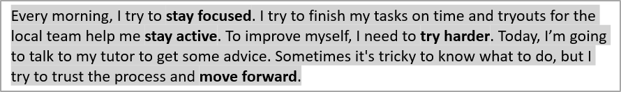

## **Áttekintés**

Ez a cikk bemutatja, hogyan formázható a szöveg PowerPoint és OpenDocument prezentációkban az Aspose.Slides for Python via Java használatával. Tárgyalja a háttérszíneket, átlátszóságot, karakterközöket, betűtulajdonságokat, forgatást, bekezdésközöket, automatikus illesztés viselkedését, szöveg rögzítését, tabulátor stopokat és nyelvi beállításokat.

Kivéve, ha másként van feltüntetve, a példák a [sample.pptx](sample.pptx) fájlt használják. Az első dia első alakzata egy szövegdoboz, és az első bekezdése az alább látható szöveget tartalmazza. Mind a dia, mind az alakzat indexelése nullától indul. A félkövér részeket kiválasztó példák a hatékony formázást használják, beleértve az öröklött félkövér formázást:


A szöveg szó szerinti vagy reguláris kifejezés egyezéseinek megtalálásához és kiemeléséhez lásd a [Search and Replace Text](/slides/hu/python-java/search-and-replace-text/) oldalt.

## **Szöveg háttérszínének beállítása**

Használd a [ParagraphFormat.getDefaultPortionFormat](https://reference.aspose.com/slides/python-java/aspose.slides/paragraphformat/#getDefaultPortionFormat) metódust a bekezdés alapértelmezett kiemelési szín beállításához, vagy a [BasePortionFormat.getHighlightColor](https://reference.aspose.com/slides/python-java/aspose.slides/baseportionformat/#getHighlightColor) metódust egyedi szövegrészekhez.

A következő példa világosszürke kiemelést állít be alapértelmezettként az első bekezdéshez. Az egyedi részekre beállított kiemelési színek felülírják ezt az alapértelmezést:

```python
import jpype
import asposeslides

if not jpype.isJVMStarted():
    jpype.startJVM()

from asposeslides.api import Presentation, SaveFormat
from java.awt import Color

presentation = Presentation("sample.pptx")
try:
    slide = presentation.getSlides().get_Item(0)

    auto_shape = slide.getShapes().get_Item(0)
    paragraph = auto_shape.getTextFrame().getParagraphs().get_Item(0)

    # Állítsa be a kiemelési színt a teljes bekezdéshez.
    paragraph.getParagraphFormat().getDefaultPortionFormat().getHighlightColor().setColor(Color.LIGHT_GRAY)

    presentation.save("gray_paragraph.pptx", SaveFormat.Pptx)
finally:
    presentation.dispose()
```

Az eredmény:



Az alábbi kódrészlet bemutatja, hogyan állítható be a háttérszín **félkövér betűtípusú szövegrészek** esetén:

```python
import jpype
import asposeslides

if not jpype.isJVMStarted():
    jpype.startJVM()

from asposeslides.api import Presentation, SaveFormat
from java.awt import Color

presentation = Presentation("sample.pptx")
try:
    slide = presentation.getSlides().get_Item(0)

    auto_shape = slide.getShapes().get_Item(0)
    paragraph = auto_shape.getTextFrame().getParagraphs().get_Item(0)

    for portion in paragraph.getPortions():
        if portion.getPortionFormat().getEffective().getFontBold():
            # Állítsa be a kiemelési színt a szövegrészhez.
            portion.getPortionFormat().getHighlightColor().setColor(Color.LIGHT_GRAY)

    presentation.save("gray_text_portions.pptx", SaveFormat.Pptx)
finally:
    presentation.dispose()
```

Az eredmény:


## **Szöveg bekezdések igazítása**

Használd a [ParagraphFormat.setAlignment](https://reference.aspose.com/slides/python-java/aspose.slides/paragraphformat/#setAlignment) metódust a bekezdés igazításának beállításához egy szövegkereten belül. Az érték lehet középre igazított, balra igazított, jobbra igazított, sorkizárt stb.

A következő kódrészlet bemutatja, hogyan igazítható a bekezdés **középre**:

```python
import jpype
import asposeslides

if not jpype.isJVMStarted():
    jpype.startJVM()

from asposeslides.api import Presentation, SaveFormat, TextAlignment

presentation = Presentation("sample.pptx")
try:
    slide = presentation.getSlides().get_Item(0)

    auto_shape = slide.getShapes().get_Item(0)
    paragraph = auto_shape.getTextFrame().getParagraphs().get_Item(0)

    # Állítsa be a bekezdés igazítását középre.
    paragraph.getParagraphFormat().setAlignment(TextAlignment.Center)

    presentation.save("aligned_paragraph.pptx", SaveFormat.Pptx)
finally:
    presentation.dispose()
```

Az eredmény:


## **Betűk igazítása egy sorban**

Használd a [ParagraphFormat.setFontAlignment](https://reference.aspose.com/slides/python-java/aspose.slides/paragraphformat/#setFontAlignment) metódust a különböző betűméretű szövegrészek függőleges igazításához egy soron belül. Ez a beállítás a teljes bekezdésre vonatkozik, és szabályozza az egyes sorokban lévő igazítást.

A következő önálló példa négy feliratos szövegdobozt hoz létre egy diaon. Minden bekezdés ugyanazt a szöveget tartalmazza 18, 36 és 54 pont méretben, különböző betűigazítással. Arial-t használ, letiltja az automatikus illesztést és a sortörést, és a szövegkereteket elegendő méretűre állítja egy sorhoz.

```python
import jpype
import asposeslides

if not jpype.isJVMStarted():
    jpype.startJVM()

from asposeslides.api import FillType, FontAlignment, FontData, NullableBool, Paragraph, Portion, Presentation, SaveFormat, ShapeType, TextAlignment, TextAnchorType, TextAutofitType
from java.awt import Color

presentation = Presentation()
try:
    slide = presentation.getSlides().get_Item(0)

    alignments = [FontAlignment.Baseline, FontAlignment.Top, FontAlignment.Center, FontAlignment.Bottom]
    alignment_names = ["Baseline", "Top", "Center", "Bottom"]
    font_sizes = [18.0, 36.0, 54.0]
    font = FontData("Arial")

    for i, alignment in enumerate(alignments):
        shape = slide.getShapes().addAutoShape(ShapeType.Rectangle, 30, 20 + i * 130, 660, 120)
        shape.getFillFormat().setFillType(FillType.NoFill)
        shape.getLineFormat().getFillFormat().setFillType(FillType.NoFill)

        text_frame = shape.getTextFrame()
        text_frame.getTextFrameFormat().setAnchoringType(TextAnchorType.Top)
        text_frame.getTextFrameFormat().setAutofitType(TextAutofitType.None_)
        text_frame.getTextFrameFormat().setWrapText(NullableBool.False_)

        label = text_frame.getParagraphs().get_Item(0)
        label.setText(alignment_names[i])
        label.getParagraphFormat().setAlignment(TextAlignment.Left)
        label.getParagraphFormat().getDefaultPortionFormat().setFontHeight(14)
        label.getParagraphFormat().getDefaultPortionFormat().setLatinFont(font)
        label.getParagraphFormat().getDefaultPortionFormat().getFillFormat().setFillType(FillType.Solid)
        label.getParagraphFormat().getDefaultPortionFormat().getFillFormat().getSolidFillColor().setColor(Color.GRAY)

        paragraph = Paragraph()
        paragraph.getParagraphFormat().setFontAlignment(alignment)
        paragraph.getParagraphFormat().setAlignment(TextAlignment.Left)
        paragraph.getParagraphFormat().getDefaultPortionFormat().setLatinFont(font)
        paragraph.getParagraphFormat().getDefaultPortionFormat().getFillFormat().setFillType(FillType.Solid)
        paragraph.getParagraphFormat().getDefaultPortionFormat().getFillFormat().getSolidFillColor().setColor(Color.BLACK)

        for font_size in font_sizes:
            portion = Portion("Ag ")
            portion.getPortionFormat().setFontHeight(font_size)
            paragraph.getPortions().add(portion)

        text_frame.getParagraphs().add(paragraph)

    presentation.save("font_alignment.pptx", SaveFormat.Pptx)
finally:
    presentation.dispose()
```

Az eredmény:


A betűigazítás a betűmetrikákat használja, ezért az egyes betűk látható szélei nem feltétlenül illeszkednek pontosan. A példában szerepel egy nagybetű és egy lejjebb nyúló karakter, hogy megmutassa a baseline és az alsó igazítás közti különbséget. A betűtípus elérhetősége és helyettesítése, a felhasznált karakterek, valamint a betűméretek eltérése befolyásolja az eredményt. A keretméretek, margók és bekezdésközök azonosak, a sortörés és automatikus illesztés le van tiltva, hogy az összehasonlítás konzisztens legyen. A módok összehasonlításához használj azonos betűtípusokat és elrendezési beállításokat.

Ez a beállítás különbözik a [ParagraphFormat.setAlignment](https://reference.aspose.com/slides/python-java/aspose.slides/paragraphformat/#setAlignment) beállítástól, amely a horizontális bekezdésigazítást szabályozza, és a [TextFrameFormat.setAnchoringType](https://reference.aspose.com/slides/python-java/aspose.slides/textframeformat/#setAnchoringType) beállítástól, amely a szövegblokk függőleges pozícionálását határozza meg az alakzatán belül. A felül- és aláírás formázása a [BasePortionFormat.setEscapement](https://reference.aspose.com/slides/python-java/aspose.slides/baseportionformat/#setEscapement) metódussal egyes részeket a baseline-hez képest eltol, ahelyett, hogy a bekezdés sorainak betűigazítását állítaná be.

## **Szöveg átlátszóságának beállítása**

A szöveg átlátszóságát a [BasePortionFormat.getFillFormat](https://reference.aspose.com/slides/python-java/aspose.slides/baseportionformat/#getFillFormat)‑hez rendelt szín alfa komponense szabályozza. Az alábbi példákban az `alpha = 50` egy ARGB alfa csatorna érték a 0–255 skálán, nem átlátszósági százalék.

Az alábbi kódrészlet bemutatja, hogyan alkalmazható átlátszóság a **teljes bekezdésre**:

```python
import jpype
import asposeslides

if not jpway.isJVMStarted():
    jpway.startJVM()

from asposeslides.api import FillType, Presentation, SaveFormat
from java.awt import Color

alpha = 50
text_color = Color(0, 0, 0, alpha)

presentation = Presentation("sample.pptx")
try:
    slide = presentation.getSlides().get_Item(0)

    auto_shape = slide.getShapes().get_Item(0)
    paragraph = auto_shape.getTextFrame().getParagraphs().get_Item(0)

    # Állítsa be a szöveg kitöltőszínét átlátszó színre.
    paragraph.getParagraphFormat().getDefaultPortionFormat().getFillFormat().setFillType(FillType.Solid)
    paragraph.getParagraphFormat().getDefaultPortionFormat().getFillFormat().getSolidFillColor().setColor(text_color)

    presentation.save("transparent_paragraph.pptx", SaveFormat.Pptx)
finally:
    presentation.dispose()
```

Az eredmény:


A következő kódrészlet bemutatja, hogyan alkalmazható átlátszóság **félkövér betűtípusú szövegrészekre**:

```python
import jpype
import asposeslides

if not jpype.isJVMStarted():
    jpype.startJVM()

from asposeslides.api import FillType, Presentation, SaveFormat
from java.awt import Color

alpha = 50
text_color = Color(0, 0, 0, alpha)

presentation = Presentation("sample.pptx")
try:
    slide = presentation.getSlides().get_Item(0)

    auto_shape = slide.getShapes().get_Item(0)
    paragraph = auto_shape.getTextFrame().getParagraphs().get_Item(0)

    for portion in paragraph.getPortions():
        if portion.getPortionFormat().getEffective().getFontBold():
            # Állítsa be a szövegrész átlátszóságát.
            portion.getPortionFormat().getFillFormat().setFillType(FillType.Solid)
            portion.getPortionFormat().getFillFormat().getSolidFillColor().setColor(text_color)

    presentation.save("transparent_text_portions.pptx", SaveFormat.Pptx)
finally:
    presentation.dispose()
```

Az eredmény:


## **Karakterköz beállítása a szöveghez**

Használd a [BasePortionFormat.setSpacing](https://reference.aspose.com/slides/python-java/aspose.slides/baseportionformat/#setSpacing) metódust a karakterek közti térköz növelésére vagy csökkentésére egy szövegdobozban. A példák 3 ponttal növelik a távolságot; a negatív értékek sűrítik a szöveget.

Az alábbi Python kód bemutatja, hogyan növelhető a karakterköz a **teljes bekezdésben**:

```python
import jpype
import asposeslides

if not jpype.isJVMStarted():
    jpype.startJVM()

from asposeslides.api import Presentation, SaveFormat

presentation = Presentation("sample.pptx")
try:
    slide = presentation.getSlides().get_Item(0)

    auto_shape = slide.getShapes().get_Item(0)
    paragraph = auto_shape.getTextFrame().getParagraphs().get_Item(0)

    # Megjegyzés: Negatív értékek használata a karakterköz összenyomásához.
    paragraph.getParagraphFormat().getDefaultPortionFormat().setSpacing(3) # Karakterköz növelése.

    presentation.save("character_spacing_in_paragraph.pptx", SaveFormat.Pptx)
finally:
    presentation.dispose()
```

Az eredmény:


Az alábbi kódrészlet bemutatja, hogyan növelhető a karakterköz **félkövér betűtípusú szövegrészekben**:

```python
import jpype
import asposeslides

if not jpype.isJVMStarted():
    jpype.startJVM()

from asposeslides.api import Presentation, SaveFormat

presentation = Presentation("sample.pptx")
try:
    slide = presentation.getSlides().get_Item(0)

    auto_shape = slide.getShapes().get_Item(0)
    paragraph = auto_shape.getTextFrame().getParagraphs().get_Item(0)

    for portion in paragraph.getPortions():
        if portion.getPortionFormat().getEffective().getFontBold():
            # Megjegyzés: Negatív értékek használata a karakterköz összenyomásához.
            portion.getPortionFormat().setSpacing(3) # Karakterköz növelése.

    presentation.save("character_spacing_in_text_portions.pptx", SaveFormat.Pptx)
finally:
    presentation.dispose()
```

Az eredmény:


### **Kerning letiltása bizonyos betűtípusoknál**

Bizonyos esetekben az Aspose.Slides által renderelt szöveg kissé szorosabb lehet, mint a PowerPointban megjelenített azonos szöveg. Ez akkor fordulhat elő, amikor a PowerPoint egyes betűtípusok kerning adatait figyelmen kívül hagyja, még akkor is, ha a betűtípus tartalmaz érvényes kerning információkat, és a kerning engedélyezve van a PowerPoint beállításaiban.

Az ilyen esetekben a renderelt kimenetet a PowerPointhoz közelebb hozhatod, ha letiltod a kerninget azoknál a szövegrészeknél, amelyek az érintett betűtípust használják. Állítsd a [BasePortionFormat.setKerningMinimalSize](https://reference.aspose.com/slides/python-java/aspose.slides/baseportionformat/#setKerningMinimalSize) értékét a tényleges betűméretnél nagyobbra. Ez a példa a "presentation.pptx" fájlt igényli, amelynek első alakzata egy szövegdoboz az első dián. Ellenőrzi a hatékony betűneveket, beleértve az örökölt betűtípusokat, és 100 pontos küszöböt állít be a Roboto‑t használó részeknél. Ez letiltja a kerninget azokra a részekre, amelyek betűmérete 100 pont alatti:

```python
import jpype
import asposeslides

if not jpype.isJVMStarted():
    jpype.startJVM()

from asposeslides.api import Presentation, SaveFormat

presentation = Presentation("presentation.pptx")
try:
    slide = presentation.getSlides().get_Item(0)

    auto_shape = slide.getShapes().get_Item(0)
    target_font = "Roboto"

    for paragraph in auto_shape.getTextFrame().getParagraphs():
        for portion in paragraph.getPortions():
            portion_format = portion.getPortionFormat().getEffective()
            fonts = (portion_format.getLatinFont(), portion_format.getEastAsianFont(), portion_format.getComplexScriptFont())
            if any(font is not None and font.getFontName() == target_font for font in fonts):
                portion.getPortionFormat().setKerningMinimalSize(100)

    presentation.save("output.pptx", SaveFormat.Pptx)
finally:
    presentation.dispose()
```

A küszöbnél kisebb szövegnél ez a beállítás megakadályozza a kerninget, és segíthet az Aspose.Slides megjelenítésének a PowerPoint vizuális kimenetéhez igazításában az érintett betűtípusok esetén.

## **Szöveg betűtulajdonságainak kezelése**

A betűtulajdonságok beállíthatók bekezdés szinten a [ParagraphFormat.getDefaultPortionFormat](https://reference.aspose.com/slides/python-java/aspose.slides/paragraphformat/#getDefaultPortionFormat) vagy egyedi részekre a [PortionFormat](https://reference.aspose.com/slides/python-java/aspose.slides/portionformat/) segítségével.

A következő példa az első bekezdés alapértelmezett betűtípusát 12 pontos Times New Roman‑ra állítja félkövér, dőlt és pontozott aláhúzással. Az egyedi formázás az egyes részeken előnyben részesül az alapértelmezésekkel szemben:

```python
import jpype
import asposeslides

if not jpype.isJVMStarted():
    jpype.startJVM()

from asposeslides.api import FontData, NullableBool, Presentation, SaveFormat, TextUnderlineType

presentation = Presentation("sample.pptx")
try:
    slide = presentation.getSlides().get_Item(0)

    auto_shape = slide.getShapes().get_Item(0)
    paragraph = auto_shape.getTextFrame().getParagraphs().get_Item(0)

    # Állítsa be a bekezdés betűtulajdonságait.
    paragraph.getParagraphFormat().getDefaultPortionFormat().setFontHeight(12)
    paragraph.getParagraphFormat().getDefaultPortionFormat().setFontBold(NullableBool.True_)
    paragraph.getParagraphFormat().getDefaultPortionFormat().setFontItalic(NullableBool.True_)
    paragraph.getParagraphFormat().getDefaultPortionFormat().setFontUnderline(TextUnderlineType.Dotted)
    font = FontData("Times New Roman")
    paragraph.getParagraphFormat().getDefaultPortionFormat().setLatinFont(font)

    presentation.save("font_properties_for_paragraph.pptx", SaveFormat.Pptx)
finally:
    presentation.dispose()
```

Az eredmény:


A következő példa 13 pontos Times New Roman, dőlt formázás és pontozott aláhúzás alkalmazását mutatja be a hatékonyan félkövér formázott részekre:

```python
import jpype
import asposeslides

if not jpype.isJVMStarted():
    jpype.startJVM()

from asposeslides.api import FontData, NullableBool, Presentation, SaveFormat, TextUnderlineType

presentation = Presentation("sample.pptx")
try:
    slide = presentation.getSlides().get_Item(0)

    auto_shape = slide.getShapes().get_Item(0)
    paragraph = auto_shape.getTextFrame().getParagraphs().get_Item(0)

    for portion in paragraph.getPortions():
        if portion.getPortionFormat().getEffective().getFontBold():
            # Állítsa be a betűtulajdonságokat a szövegrészhez.
            portion.getPortionFormat().setFontHeight(13)
            portion.getPortionFormat().setFontItalic(NullableBool.True_)
            portion.getPortionFormat().setFontUnderline(TextUnderlineType.Dotted)
            font = FontData("Times New Roman")
            portion.getPortionFormat().setLatinFont(font)

    presentation.save("font_properties_for_text_portions.pptx", SaveFormat.Pptx)
finally:
    presentation.dispose()
```

Az eredmény:


## **Szöveg magasság normalizálásának vezérlése**

Használd a [BasePortionFormat.setNormaliseHeight](https://reference.aspose.com/slides/python-java/aspose.slides/baseportionformat/#setNormaliseHeight) metódust sablon tipográfia reprodukálásakor vagy a karaktermagasság különbségeinek vizsgálatakor. PowerPointban a normalizálás engedélyezése függőlegesen nyújtja vagy összenyomja az egyes karaktereket, hogy egységes látható magasságot biztosítson a szövegrészen belül. Nem garantálja az egyenlő szövegmagasságot a különböző betűtípusok között.

Állítsd a tulajdonságot a [NullableBool.True_ vagy False_](https://reference.aspose.com/slides/python-java/aspose.slides/nullablebool/) értékre a normalizálás kifejezett engedélyezéséhez vagy letiltásához. A `NullableBool.NotDefined` hagyja a helyi beállítást meghatározatlanul, így a rész az értéket örökli, például a bekezdés [getDefaultPortionFormat](https://reference.aspose.com/slides/python-java/aspose.slides/paragraphformat/#getDefaultPortionFormat)‑ból. Ez nem jelent `False`‑t. Használd a [PortionFormat.getEffective](https://reference.aspose.com/slides/python-java/aspose.slides/portionformat/#getEffective) metódust, és olvasd a `getNormaliseHeight` értékét a visszaadott hatékony formázásból a kifejezett logikai érték megszerzéséhez.

Az alábbi önálló példa **Arial** telepítést igényel. Két szövegtömböt hoz létre, amelyek ugyanazokat a nagybetűket, kisbetűket, lejjebb nyúló karaktereket és ékezetes karaktereket tartalmazzák 54 pont méretben. Mindkét bekezdés alapértelmezés szerint engedélyezi a normalizálást. A felső rész kifejezetten letiltja; az alsó rész örökli. A keretméretek, margók és bekezdésközök azonosak, a sortörés és automatikus illesztés le van tiltva, hogy az összehasonlítás konzisztens legyen. A példa kiírja a `False: False` és `NotDefined: True` értékeket, majd elmenti a "text_height_normalization.pptx" fájlt.

```python
import jpype
import asposeslides

if not jpype.isJVMStarted():
    jpype.startJVM()

from asposeslides.api import FillType, FontData, NullableBool, Presentation, SaveFormat, ShapeType, TextAlignment, TextAnchorType, TextAutofitType
from java.awt import Color

presentation = Presentation()
try:
    slide = presentation.getSlides().get_Item(0)

    settings = [NullableBool.False_, NullableBool.NotDefined]
    setting_names = ["False", "NotDefined"]

    for i, setting in enumerate(settings):
        shape = slide.getShapes().addAutoShape(ShapeType.Rectangle, 30, 60 + i * 200, 660, 150)
        shape.getFillFormat().setFillType(FillType.NoFill)
        shape.getLineFormat().getFillFormat().setFillType(FillType.NoFill)

        text_frame = shape.getTextFrame()
        text_frame.setText("Hxgjpq ÅÉ 0123")
        text_frame.getTextFrameFormat().setAutofitType(TextAutofitType.None_)
        text_frame.getTextFrameFormat().setWrapText(NullableBool.False_)
        text_frame.getTextFrameFormat().setAnchoringType(TextAnchorType.Top)
        text_frame.getTextFrameFormat().setMarginTop(0)
        text_frame.getTextFrameFormat().setMarginLeft(0)

        paragraph = text_frame.getParagraphs().get_Item(0)
        paragraph.getParagraphFormat().setAlignment(TextAlignment.Left)
        paragraph.getParagraphFormat().setSpaceBefore(0)
        paragraph.getParagraphFormat().setSpaceAfter(0)
        paragraph.getParagraphFormat().setSpaceWithin(100)
        paragraph.getParagraphFormat().getDefaultPortionFormat().setNormaliseHeight(NullableBool.True_)

        portion = paragraph.getPortions().get_Item(0)
        font = FontData("Arial")
        portion.getPortionFormat().setLatinFont(font)
        portion.getPortionFormat().setFontHeight(54)
        portion.getPortionFormat().getFillFormat().setFillType(FillType.Solid)
        portion.getPortionFormat().getFillFormat().getSolidFillColor().setColor(Color.BLACK)
        portion.getPortionFormat().setNormaliseHeight(setting)

        print(f"{setting_names[i]}: {bool(portion.getPortionFormat().getEffective().getNormaliseHeight())}")

    presentation.save("text_height_normalization.pptx", SaveFormat.Pptx)
finally:
    presentation.dispose()
```

Az alábbi összehasonlítást a mentett prezentációból exportáltuk. A felső sorban a normalizálás le van tiltva (`False`); az alsó sorban örökli a beállított értéket (`NotDefined` → `True`). Az Arial telepítése szükséges a megjelenés reprodukálásához.


A normalizálás megváltoztatja a karaktermagasságot anélkül, hogy módosítaná a hozzárendelt [getFontHeight](https://reference.aspose.com/slides/python-java/aspose.slides/baseportionformat/#getFontHeight) értéket, amely pontban megadja a betűméretet. A bekezdés [setSpaceWithin](https://reference.aspose.com/slides/python-java/aspose.slides/paragraphformat/#setSpaceWithin) szabályozza a sortávolságot, míg a szövegkeret [setAutofitType](https://reference.aspose.com/slides/python-java/aspose.slides/textframeformat/#setAutofitType) határozza meg, hogyan igazítja a szöveg vagy a tartóeleme a mérethez. Ezek a beállítások különböző célokat szolgálnak, és függetlenül befolyásolhatják a teljes elrendezést. A bekezdésformázásról és öröklődésről további információkért lásd a [Manage Paragraph](/slides/hu/python-java/manage-paragraph/) oldalt.

## **Áthúzás alkalmazása és eltávolítása**

Használd a [BasePortionFormat.setStrikethroughType](https://reference.aspose.com/slides/python-java/aspose.slides/baseportionformat/#setStrikethroughType) metódust egy szövegrészen, hogy javításokat, törölt kifejezéseket vagy korábbi árakat jeleníts meg anélkül, hogy törölnéd az eredeti szöveget. Állítsd [TextStrikethroughType.Single vagy Double](https://reference.aspose.com/slides/python-java/aspose.slides/textstrikethroughtype/) értékre egy vagy két áthúzáshoz.

Az áthúzás eltávolításához add meg a [TextStrikethroughType.None_](https://reference.aspose.com/slides/python-java/aspose.slides/textstrikethroughtype/#None) értéket. Ez kifejezetten letiltja a hatást, még akkor is, ha a környező formázás áthúzást specifikál. Ezzel szemben a [TextStrikethroughType.NotDefined](https://reference.aspose.com/slides/python-java/aspose.slides/textstrikethroughtype/#NotDefined) a helyi beállítást meghatározatlanul hagyja, lehetővé téve a rész számára, hogy örökölje a formázást, például a bekezdésből. Ez nem garantálja, hogy az áthúzás eltűnik. Használd a [PortionFormat.getEffective](https://reference.aspose.com/slides/python-java/aspose.slides/portionformat/#getEffective) metódust, hogy elolvasd a keletkezett formázást, beleértve az örökölt értékeket.

Az alábbi önálló példa három ár-összehasonlítást hoz létre. Minden bekezdés külön részekkel rendelkezik a címke, a korábbi ár és a jelenlegi ár számára, így csak a korábbi ár érintett. Az első sor alkalmazza, majd eltávolítja az áthúzást; a többi sor megtartja az egyes és dupla áthúzást. Ennek a beállításnak a módosítása megőrzi a szöveget és egyéb formázását, beleértve a félkövér korábbi árat.

```python
import jpype
import asposeslides

if not jpype.isJVMStarted():
    jpype.startJVM()

from asposeslides.api import FillType, FontData, NullableBool, Paragraph, Portion, Presentation, SaveFormat, ShapeType, TextAlignment, TextStrikethroughType
from java.awt import Color

presentation = Presentation()
try:
    slide = presentation.getSlides().get_Item(0)

    shape = slide.getShapes().addAutoShape(ShapeType.Rectangle, 50, 50, 620, 220)
    shape.getFillFormat().setFillType(FillType.NoFill)
    shape.getLineFormat().getFillFormat().setFillType(FillType.NoFill)
    shape.getTextFrame().getParagraphs().clear()

    labels = ["None: ", "Single: ", "Double: "]

    for label in labels:
        paragraph = Paragraph()
        paragraph.getParagraphFormat().setAlignment(TextAlignment.Left)
        paragraph.getParagraphFormat().setSpaceAfter(20)

        portion_format = paragraph.getParagraphFormat().getDefaultPortionFormat()
        portion_format.setFontHeight(28)
        font = FontData("Arial")
        portion_format.setLatinFont(font)
        portion_format.getFillFormat().setFillType(FillType.Solid)
        portion_format.getFillFormat().getSolidFillColor().setColor(Color.BLACK)

        label_portion = Portion(label)
        paragraph.getPortions().add(label_portion)

        previous_price = Portion("$100")
        previous_price.getPortionFormat().setFontBold(NullableBool.True_)
        paragraph.getPortions().add(previous_price)
        current_price = Portion(" → $80")
        paragraph.getPortions().add(current_price)

        shape.getTextFrame().getParagraphs().add(paragraph)

    paragraphs = shape.getTextFrame().getParagraphs()

    # Alkalmazza az áthúzást, majd kifejezetten eltávolítja az első előző árból.
    paragraphs.get_Item(0).getPortions().get_Item(1).getPortionFormat().setStrikethroughType(TextStrikethroughType.Single)
    paragraphs.get_Item(0).getPortions().get_Item(1).getPortionFormat().setStrikethroughType(TextStrikethroughType.None_)

    paragraphs.get_Item(1).getPortions().get_Item(1).getPortionFormat().setStrikethroughType(TextStrikethroughType.Single)
    paragraphs.get_Item(2).getPortions().get_Item(1).getPortionFormat().setStrikethroughType(TextStrikethroughType.Double)

    presentation.save("strikethrough.pptx", SaveFormat.Pptx)
finally:
    presentation.dispose()
```

Az eredmény felülről lefelé: nincs áthúzás, egyes áthúzás és dupla áthúzás.


## **Szöveg forgatásának beállítása**

Használd a [TextFrameFormat.setTextVerticalType](https://reference.aspose.com/slides/python-java/aspose.slides/textframeformat/#setTextVerticalType) metódust előre meghatározott szövegorientáció beállításához egy alakzaton belül.

Az alábbi kódrészlet a szöveg orientációt a alakzatban a [TextVerticalType.Vertical270](https://reference.aspose.com/slides/python-java/aspose.slides/textverticaltype/) értékre állítja, ami **90 fokkal óramutatóval ellentétesen** forgatja a szöveget:

```python
import jpype
import asposeslides

if not jpype.isJVMStarted():
    jpype.startJVM()

from asposeslides.api import Presentation, SaveFormat, TextVerticalType

presentation = Presentation("sample.pptx")
try:
    slide = presentation.getSlides().get_Item(0)

    auto_shape = slide.getShapes().get_Item(0)
    auto_shape.getTextFrame().getTextFrameFormat().setTextVerticalType(TextVerticalType.Vertical270)

    presentation.save("text_rotation.pptx", SaveFormat.Pptx)
finally:
    presentation.dispose()
```

Az eredmény:


## **Egyéni forgatás beállítása szövegkeretekhez**

Használd a [TextFrameFormat.setRotationAngle](https://reference.aspose.com/slides/python-java/aspose.slides/textframeformat/#setRotationAngle) metódust egyedi forgatási szög beállításához egy [TextFrame](https://reference.aspose.com/slides/python-java/aspose.slides/textframe/) számára.

Az alábbi kódrészlet a szövegkeretet 3 fokkal óramutató járásával megegyező irányban forgatja a alakzatban:

```python
import jpype
import asposeslides

if not jpype.isJVMStarted():
    jpype.startJVM()

from asposeslides.api import Presentation, SaveFormat

presentation = Presentation("sample.pptx")
try:
    slide = presentation.getSlides().get_Item(0)

    auto_shape = slide.getShapes().get_Item(0)
    auto_shape.getTextFrame().getTextFrameFormat().setRotationAngle(3)

    presentation.save("custom_text_rotation.pptx", SaveFormat.Pptx)
finally:
    presentation.dispose()
```

Az eredmény:


## **Bekezdés sortávolságának beállítása**

Az Aspose.Slides a [ParagraphFormat.setSpaceAfter](https://reference.aspose.com/slides/python-java/aspose.slides/paragraphformat/#setSpaceAfter), [ParagraphFormat.setSpaceBefore](https://reference.aspose.com/slides/python-java/aspose.slides/paragraphformat/#setSpaceBefore) és a [ParagraphFormat.setSpaceWithin](https://reference.aspose.com/slides/python-java/aspose.slides/paragraphformat/#setSpaceWithin) metódusokkal biztosítja a bekezdésköz szabályozását. Ezeket a tulajdonságokat a következő módon használhatod:

* Pozitív értékkel adható meg a sortávolság a sormagasság százalékában.
* Negatív értékkel adható meg a sortávolság pontban.

A következő példa a első bekezdésen belüli távolságot a sormagasság 200%-ára (dupla sortávolság) állítja:

```python
import jpype
import asposeslides

if not jpype.isJVMStarted():
    jpype.startJVM()

from asposeslides.api import Presentation, SaveFormat

presentation = Presentation("sample.pptx")
try:
    slide = presentation.getSlides().get_Item(0)

    auto_shape = slide.getShapes().get_Item(0)

    paragraph = auto_shape.getTextFrame().getParagraphs().get_Item(0)
    paragraph.getParagraphFormat().setSpaceWithin(200)

    presentation.save("line_spacing.pptx", SaveFormat.Pptx)
finally:
    presentation.dispose()
```

Az eredmény:


## **Sortörés szabályainak vezérlése**

A bekezdés sortörési szabályai hasznosak szűk szövegtömbökben és olyan prezentációkban, amelyek latint és kelet-ázsiai szöveget kevernek. A következő metódusok a [ParagraphFormat](https://reference.aspose.com/slides/python-java/aspose.slides/paragraphformat/) részei, ezért egy teljes bekezdésre vonatkoznak:

- [setLatinLineBreak](https://reference.aspose.com/slides/python-java/aspose.slides/paragraphformat/#setLatinLineBreak) szabályozza a latin sortörési szabályokat. Vegyes szövegben a módosítása befolyásolhatja a szomszédos kelet-ázsiai szöveg és írásjelek tördelődését.
- [setEastAsianLineBreak](https://reference.aspose.com/slides/python-java/aspose.slides/paragraphformat/#setEastAsianLineBreak) szabályozza a kelet-ázsiai sortörési szabályokat, beleértve a sor elején és végén álló karakterekre vonatkozó korlátozásokat.

Ezek a szabályok nem helyettesítik a [TextFrameFormat.setWrapText](https://reference.aspose.com/slides/python-java/aspose.slides/textframeformat/#setWrapText) metódust, amely automatikus sortörést engedélyez a szövegkereten belül. A zászlók befolyásolják a layoutot a tördeléskor; nem helyeznek sortörés karaktert. Egy explicit sortörés új sort hoz létre a bekezdésen belül, függetlenül a rendelkezésre álló szélességtől.

Az alábbi önálló példa egy szűk szövegtömböt hoz létre, amely kínai és latin szöveget tartalmaz. Mindkét sortörési opciót explicit módon beállítja, és elmenti a "line_breaking.pptx" fájlt. A szabályok kipróbálásához módosítsd a megfelelő értéket, miközben a többi beállítást változatlanul hagyod. A példa 24 pontos Arial és SimSun betűtípusokat használ 160 pont széles kerettel és nulla vízszintes szövegkeret margóval. A [TextFrameFormat.setAutofitType](https://reference.aspose.com/slides/python-java/aspose.slides/textframeformat/#setAutofitType) [TextAutofitType.None_](https://reference.aspose.com/slides/python-java/aspose.slides/textautofittype/) értékkel van meghívva, hogy a szövegméret és a keretméretek fixek maradjanak.

```python
import jpype
import asposeslides

if not jpype.isJVMStarted():
    jpype.startJVM()

from asposeslides.api import FillType, FontData, NullableBool, Presentation, SaveFormat, ShapeType, TextAlignment, TextAutofitType
from java.awt import Color

presentation = Presentation()
try:
    slide = presentation.getSlides().get_Item(0)

    shape = slide.getShapes().addAutoShape(ShapeType.Rectangle, 50, 50, 160, 300)
    shape.getFillFormat().setFillType(FillType.NoFill)

    text_frame = shape.getTextFrame()
    text_frame.getTextFrameFormat().setWrapText(NullableBool.True_)
    text_frame.getTextFrameFormat().setAutofitType(TextAutofitType.None_)
    text_frame.getTextFrameFormat().setMarginLeft(0)
    text_frame.getTextFrameFormat().setMarginRight(0)

    paragraph = text_frame.getParagraphs().get_Item(0)
    paragraph.setText("中文排版测试，PowerPoint 中文演示。")

    paragraph_format = paragraph.getParagraphFormat()
    paragraph_format.setAlignment(TextAlignment.Left)
    paragraph_format.getDefaultPortionFormat().setFontHeight(24)
    latin_font = FontData("Arial")
    paragraph_format.getDefaultPortionFormat().setLatinFont(latin_font)
    east_asian_font = FontData("SimSun")
    paragraph_format.getDefaultPortionFormat().setEastAsianFont(east_asian_font)
    paragraph_format.getDefaultPortionFormat().getFillFormat().setFillType(FillType.Solid)
    paragraph_format.getDefaultPortionFormat().getFillFormat().getSolidFillColor().setColor(Color.BLACK)
    paragraph_format.setLatinLineBreak(NullableBool.False_)
    paragraph_format.setEastAsianLineBreak(NullableBool.True_)

    presentation.save("line_breaking.pptx", SaveFormat.Pptx)
finally:
    presentation.dispose()
```

## **Lebegő írásjelek vezérlése**

A [ParagraphFormat.setHangingPunctuation](https://reference.aspose.com/slides/python-java/aspose.slides/paragraphformat/#setHangingPunctuation) lehetővé teszi, hogy az alkalmas írásjelek túlnyúljanak a szövegsor jobb szélén, ahelyett, hogy a következő sorra kerülnek. Ez a teljes bekezdésre vonatkozik, és különbözik a függőleges behúzástól.

Az alábbi önálló példa bekapcsolja a lebegő írásjelek használatát egy 100 pont széles szövegkeretben, és elmenti a "hanging_punctuation.pptx" fájlt. 24 pontos Arial és nulla vízszintes szövegkeret margóval a végző pont a "sentence" után marad, és túlnyúlik a jobb szöveg szélén. Állítsd a tulajdonságot [NullableBool.False_](https://reference.aspose.com/slides/python-java/aspose.slides/nullablebool/) értékre a összehasonlításhoz: ezekkel a beállításokkal a pont egy külön sorban jelenik meg. A sortörés engedélyezett, az automatikus illesztés letiltott, hogy a rendelkezésre álló szélesség fix maradjon.

```python
import jpype
import asposeslides

if not jpype.isJVMStarted():
    jpype.startJVM()

from asposeslides.api import FillType, FontData, NullableBool, Presentation, SaveFormat, ShapeType, TextAlignment, TextAutofitType
from java.awt import Color

presentation = Presentation()
try:
    slide = presentation.getSlides().get_Item(0)

    shape = slide.getShapes().addAutoShape(ShapeType.Rectangle, 50, 50, 100, 200)
    shape.getFillFormat().setFillType(FillType.NoFill)

    text_frame = shape.getTextFrame()
    text_frame.getTextFrameFormat().setWrapText(NullableBool.True_)
    text_frame.getTextFrameFormat().setAutofitType(TextAutofitType.None_)
    text_frame.getTextFrameFormat().setMarginLeft(0)
    text_frame.getTextFrameFormat().setMarginRight(0)

    paragraph = text_frame.getParagraphs().get_Item(0)
    paragraph.setText("Simple text, next sentence.")

    paragraph_format = paragraph.getParagraphFormat()
    paragraph_format.setAlignment(TextAlignment.Left)
    paragraph_format.getDefaultPortionFormat().setFontHeight(24)
    latin_font = FontData("Arial")
    paragraph_format.getDefaultPortionFormat().setLatinFont(latin_font)
    paragraph_format.getDefaultPortionFormat().getFillFormat().setFillType(FillType.Solid)
    paragraph_format.getDefaultPortionFormat().getFillFormat().getSolidFillColor().setColor(Color.BLACK)
    paragraph_format.setHangingPunctuation(NullableBool.True_)

    presentation.save("hanging_punctuation.pptx", SaveFormat.Pptx)
finally:
    presentation.dispose()
```

Nem minden írásjel lehet lebegő. A [fenti betűtípus- és elrendezési feltételek](#control-line-breaking) szintén érvényesek erre az összehasonlításra: a betűtípus, a rendelkezésre álló szélesség, a margók vagy az automatikus illesztés beállításainak módosítása eltüntetheti a látható különbséget.

## **Automatikus illesztés típusának beállítása szövegkeretekhez**

A [TextFrameFormat.setAutofitType](https://reference.aspose.com/slides/python-java/aspose.slides/textframeformat/#setAutofitType) meghatározza, hogyan viselkedik a szöveg, ha túllépi a tároló határait. Ezzel szabályozhatod, hogy a szöveg zsugorodjon, túlcsorduljon vagy a forma automatikusan átméreteződjön. A következő példa a formát úgy állítja be, hogy a szöveghez igazodva méretezze át, és elmenti az eredményt a "autofit_type.pptx" fájlba.

```python
import jpype
import asposeslides

if not jpype.isJVMStarted():
    jpype.startJVM()

from asposeslides.api import Presentation, SaveFormat, TextAutofitType

presentation = Presentation("sample.pptx")
try:
    slide = presentation.getSlides().get_Item(0)

    auto_shape = slide.getShapes().get_Item(0)
    auto_shape.getTextFrame().getTextFrameFormat().setAutofitType(TextAutofitType.Shape)

    presentation.save("autofit_type.pptx", SaveFormat.Pptx)
finally:
    presentation.dispose()
```

A sorok számolásához automatikus sortörés után és annak megtekintéséhez, hogy a szöveg vagy a forma szélessége hogyan változtatja az eredményt, lásd a [Count Rendered Lines](/slides/hu/python-java/manage-paragraph/) oldalt. A sorok száma önmagában nem jelzi, hogy a szöveg túlcsordul-e a tárolóján.

## **Szövegkeretek rögzítési pontjának beállítása**

A [TextFrameFormat.setAnchoringType](https://reference.aspose.com/slides/python-java/aspose.slides/textframeformat/#setAnchoringType) meghatározza, hogyan helyezkedik el a szöveg függőlegesen egy alakzatban, például felül, középen vagy alul. A következő példa a szöveget az első alakzat aljához rögzíti, és elmenti az eredményt a "text_anchor.pptx" fájlba.

```python
import jpype
import asposeslides

if not jpype.isJVMStarted():
    jpype.startJVM()

from asposeslides.api import Presentation, SaveFormat, TextAnchorType

presentation = Presentation("sample.pptx")
try:
    slide = presentation.getSlides().get_Item(0)

    auto_shape = slide.getShapes().get_Item(0)
    auto_shape.getTextFrame().getTextFrameFormat().setAnchoringType(TextAnchorType.Bottom)

    presentation.save("text_anchor.pptx", SaveFormat.Pptx)
finally:
    presentation.dispose()
```

## **Szöveg tabulációjának beállítása**

Használd a [ParagraphFormat.setDefaultTabSize](https://reference.aspose.com/slides/python-java/aspose.slides/paragraphformat/#setDefaultTabSize) és a [ParagraphFormat.getTabs](https://reference.aspose.com/slides/python-java/aspose.slides/paragraphformat/#getTabs) metódusokat a tabulátorállomások beállításához egy bekezdésben. A következő példa az alapértelmezett tabulátortávolságot 100 pontra állítja, és egy balra igazított tabulátort 30 pontnál ad hozzá. Ezek a beállítások a tab karaktert tartalmazó szövegre hatnak.

```python
import jpype
import asposeslides

if not jpype.isJVMStarted():
    jpype.startJVM()

from asposeslides.api import Presentation, SaveFormat, TabAlignment

presentation = Presentation("sample.pptx")
try:
    slide = presentation.getSlides().get_Item(0)

    auto_shape = slide.getShapes().get_Item(0)

    paragraph = auto_shape.getTextFrame().getParagraphs().get_Item(0)
    paragraph.getParagraphFormat().setDefaultTabSize(100)
    paragraph.getParagraphFormat().getTabs().add(30, TabAlignment.Left)

    presentation.save("paragraph_tabs.pptx", SaveFormat.Pptx)
finally:
    presentation.dispose()
```

Az eredmény:


## **Ellenőrző nyelv beállítása**

Az Aspose.Slides a [BasePortionFormat.setLanguageId](https://reference.aspose.com/slides/python-java/aspose.slides/baseportionformat/#setLanguageId) metódust biztosítja, amely lehetővé teszi egy szövegrész ellenőrző nyelvének beállítását. Az ellenőrző nyelv meghatározza a PowerPointban a helyesírás- és nyelvtani ellenőrzéshez használt nyelvet.

A következő példa a "presentation.pptx" fájlt igényli, amelynek első alakzata egy szövegdoboz az első dián, és legalább egy bekezdést tartalmaz. Az első bekezdés tartalmát "1。"‑re cseréli, a betűtípust SimSun‑ra állítja, és a Simplified Chinese (`zh-CN`) ellenőrző nyelvet rendeli hozzá. Az eredményt a "proofing_language.pptx" fájlba menti:

```python
import jpype
import asposeslides

if not jpype.isJVMStarted():
    jpype.startJVM()

from asposeslides.api import FontData, Portion, Presentation, SaveFormat

presentation = Presentation("presentation.pptx")
try:
    slide = presentation.getSlides().get_Item(0)

    auto_shape = slide.getShapes().get_Item(0)

    paragraph = auto_shape.getTextFrame().getParagraphs().get_Item(0)
    paragraph.getPortions().clear()

    font = FontData("SimSun")

    text_portion = Portion()
    text_portion.getPortionFormat().setComplexScriptFont(font)
    text_portion.getPortionFormat().setEastAsianFont(font)
    text_portion.getPortionFormat().setLatinFont(font)

    # Állítsa be a helyesírási nyelv azonosítóját.
    text_portion.getPortionFormat().setLanguageId("zh-CN")

    text_portion.setText("1。")
    paragraph.getPortions().add(text_portion)

    presentation.save("proofing_language.pptx", SaveFormat.Pptx)
finally:
    presentation.dispose()
```

## **Alapértelmezett nyelv beállítása**

Használd a [LoadOptions.setDefaultTextLanguage](https://reference.aspose.com/slides/python-java/aspose.slides/loadoptions/#setDefaultTextLanguage) metódust a prezentáció betöltése vagy létrehozása során létrehozott szöveg alapértelmezett nyelvének meghatározásához. A következő példa egy prezentációt hoz létre, amelyben az alapértelmezett szövegnyelv az amerikai angol, hozzáad egy szövegdobozt, és kiírja az első szövegrésznek az `en-US` értékét.

```python
import jpype
import asposeslides

if not jpype.isJVMStarted():
    jpype.startJVM()

from asposeslides.api import LoadOptions, Presentation, ShapeType

load_options = LoadOptions()
load_options.setDefaultTextLanguage("en-US")

presentation = Presentation(load_options)
try:
    slide = presentation.getSlides().get_Item(0)

    # Adjunk hozzá egy téglalap alakzatot szöveggel.
    shape = slide.getShapes().addAutoShape(ShapeType.Rectangle, 20, 20, 150, 50)
    shape.getTextFrame().setText("Sample text")

    # Ellenőrizze az első szövegrész nyelvét.
    portion = shape.getTextFrame().getParagraphs().get_Item(0).getPortions().get_Item(0)
    print(portion.getPortionFormat().getLanguageId())
finally:
    presentation.dispose()
```

## **Alapértelmezett szövegstílus beállítása**

Alapértelmezett szövegformázás a prezentáció szintjén a [Presentation.getDefaultTextStyle](https://reference.aspose.com/slides/python-java/aspose.slides/presentation/#getDefaultTextStyle) metódussal alkalmazható.

A következő példa 14 pontos félkövér betűtípust állít be az új prezentáció felső szintű bekezdéseihez alapértelmezettként, és elmenti a "default_text_style.pptx" fájlba. A szöveg örökölheti ezeket az alapértelmezéseket, hacsak egy pontosabb formázás felül nem írja őket.

```python
import jpype
import asposeslides

if not jpype.isJVMStarted():
    jpype.startJVM()

from asposeslides.api import NullableBool, Presentation, SaveFormat

presentation = Presentation()
try:
    # Szerezze meg a legfelső szintű bekezdésformátumot.
    paragraph_format = presentation.getDefaultTextStyle().getLevel(0)

    if paragraph_format is not None:
        paragraph_format.getDefaultPortionFormat().setFontHeight(14)
        paragraph_format.getDefaultPortionFormat().setFontBold(NullableBool.True_)

    presentation.save("default_text_style.pptx", SaveFormat.Pptx)
finally:
    presentation.dispose()
```

## **Szöveg kinyerése all-caps hatással**

PowerPointban az **All Caps** betűhatás alkalmazása a szöveget nagybetűsre jeleníti meg a dián, még akkor is, ha eredetileg kisbetűvel írták. Amikor ilyen szövegrészt kérsz le az Aspose.Slides segítségével, a könyvtár pontosan úgy adja vissza, ahogyan beírták. A megjelenített szöveghez igazodva ellenőrizd a [TextCapType](https://reference.aspose.com/slides/python-java/aspose.slides/textcaptype/) értékét, és a visszakapott karakterláncot alakítsd nagybetűssé, ha az érték `All`.

Ez a példa a "sample2.pptx" fájlt igényli, amelynek első alakzata egy szövegdoboz az első dián. Az első bekezdés első része a "Hello, Aspose!" szöveget tartalmazza All Caps hatással, ahogy az alább látható.


Az alábbi kódrészlet bemutatja, hogyan nyerhető ki a szöveg **All Caps** hatással:

```python
import jpype
import asposeslides

if not jpype.isJVMStarted():
    jpype.startJVM()

from asposeslides.api import Presentation, TextCapType

presentation = Presentation("sample2.pptx")
try:
    slide = presentation.getSlides().get_Item(0)
    
    auto_shape = slide.getShapes().get_Item(0)
    text_portion = auto_shape.getTextFrame().getParagraphs().get_Item(0).getPortions().get_Item(0)

    print("Original text: " + str(text_portion.getText()))

    text_format = text_portion.getPortionFormat().getEffective()
    if text_format.getTextCapType() == TextCapType.All:
        text = str(text_portion.getText()).upper()
        print("All-Caps effect: " + text)
finally:
    presentation.dispose()
```

Kimenet:

```text
Original text: Hello, Aspose!
All-Caps effect: HELLO, ASPOSE!
```

## **GYIK**

**Hogyan módosíthatom egy táblázat szövegét egy dián?**

A dián egy táblázat szövegének módosításához használd a [Table](https://reference.aspose.com/slides/python-java/aspose.slides/table/) elemet. Iterálj a cellákon, és frissítsd az egyes cellákat a [Cell.getTextFrame](https://reference.aspose.com/slides/python-java/aspose.slides/cell/#getTextFrame) segítségével, valamint a bekezdés formázását a [Paragraph.getParagraphFormat](https://reference.aspose.com/slides/python-java/aspose.slides/paragraph/#getParagraphFormat) metódussal.

**Hogyan alkalmazhatok színátmenetes színt a szövegre egy PowerPoint-dián?**

A szövegre színátmenetes színt alkalmazz a [BasePortionFormat.getFillFormat](https://reference.aspose.com/slides/python-java/aspose.slides/baseportionformat/#getFillFormat) használatával. Állítsd a [FillFormat.setFillType](https://reference.aspose.com/slides/python-java/aspose.slides/fillformat/#setFillType) értékét a [FillType.Gradient](https://reference.aspose.com/slides/python-java/aspose.slides/filltype/) típusra, és konfiguráld a gradient állomásokat, az irányt és az átlátszóságot.