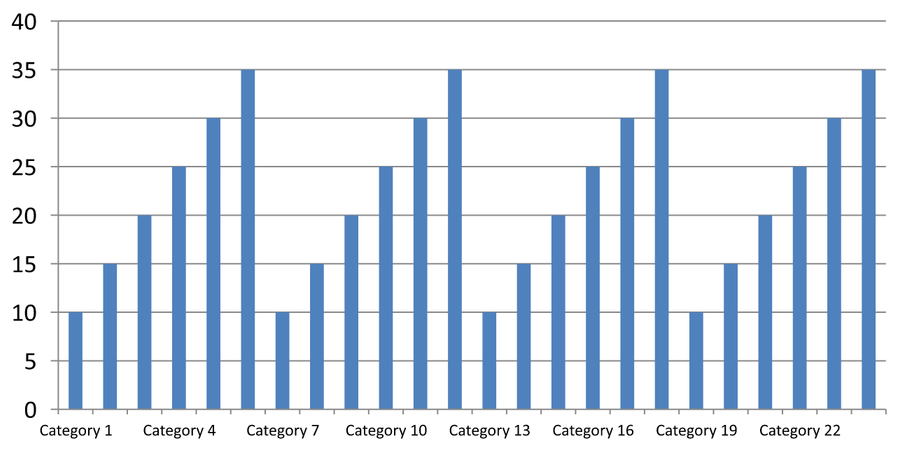

## **Áttekintés**

Ez a cikk elmagyarázza, hogyan lehet testreszabni a diagram tengelyeket az Aspose.Slides for Python via Java segítségével. Lefedi a számított tengelyértékeket, a diagram sorok és oszlopok cseréjét, a tengely láthatóságát, a kategória címke és jelölő távolságokat, a dátumkategóriákat és formázást, a cím forgatását, a tengely elhelyezését, a megjelenítési egységeket és a logaritmikus skálázást.

## **A diagram függőleges tengelyének maximális értékeinek megszerzése**

Hozzon létre egy [Presentation](https://reference.aspose.com/slides/python-java/aspose.slides/presentation/) és adjon hozzá egy alapértelmezett adatokkal ellátott területdiagramot. Hívja meg a [validateChartLayout](https://reference.aspose.com/slides/python-java/aspose.slides/chart/#validateChartLayout) metódust a számított tengelyértékek olvasása előtt, hogy a diagram elrendezése naprakész legyen.

Olvassa a [getActualMaxValue](https://reference.aspose.com/slides/python-java/aspose.slides/axis/#getActualMaxValue) és a [getActualMinValue](https://reference.aspose.com/slides/python-java/aspose.slides/axis/#getActualMinValue) metódusok értékeit a tengely határokhoz, illetve a [getActualMajorUnit](https://reference.aspose.com/slides/python-java/aspose.slides/axis/#getActualMajorUnit) és a [getActualMinorUnit](https://reference.aspose.com/slides/python-java/aspose.slides/axis/#getActualMinorUnit) metódusokkal a jelölőintervallumokat. A [getActualMajorUnitScale](https://reference.aspose.com/slides/python-java/aspose.slides/axis/#getActualMajorUnitScale) és a [getActualMinorUnitScale](https://reference.aspose.com/slides/python-java/aspose.slides/axis/#getActualMinorUnitScale) időegység skálákat biztosítanak, amelyek a dátumtengelyek esetén relevánsak. A példa ezeket az értékeket helyi változókba tárolja, majd elmenti a diagramot.

```python
import jpype
import asposeslides

if not jpype.isJVMStarted():
    jpype.startJVM()

from asposeslides.api import Presentation, ChartType, SaveFormat

presentation = Presentation()
try:
    slide = presentation.getSlides().get_Item(0)

    chart = slide.getShapes().addChart(ChartType.Area, 100, 100, 500, 350)
    chart.validateChartLayout()

    max_value = chart.getAxes().getVerticalAxis().getActualMaxValue()
    min_value = chart.getAxes().getVerticalAxis().getActualMinValue()

    major_unit = chart.getAxes().getVerticalAxis().getActualMajorUnit()
    minor_unit = chart.getAxes().getVerticalAxis().getActualMinorUnit()

    major_unit_scale = chart.getAxes().getVerticalAxis().getActualMajorUnitScale()
    minor_unit_scale = chart.getAxes().getVerticalAxis().getActualMinorUnitScale()

    presentation.save("AxisValues_out.pptx", SaveFormat.Pptx)
finally:
    presentation.dispose()
```

## **Az adatok cseréje tengelyek között**

Használja a [switchRowColumn](https://reference.aspose.com/slides/python-java/aspose.slides/chartdata/#switchRowColumn) metódust a sorozatok és kategóriák szerepének felcseréléséhez a diagram adatainál. Minden korábbi kategória sorozattá, minden korábbi sorozat pedig kategóriává válik. Ez megváltoztatja az adatcsoportosítást; nem cseréli fel a vízszintes és függőleges tengelyeket. A példa a [setRange](https://reference.aspose.com/slides/python-java/aspose.slides/chartdata/#setRange) metódust használja, hogy az alapértelmezett adatokat a `Sheet1!A1:D5` tartományra kötötte, beleértve a fejlécsort és a kategóriaoszlopot, a sorok és oszlopok cseréje előtt. Egy négy sorozatból és három kategóriából álló diagramot ment el.

```python
import jpype
import asposeslides

if not jpype.isJVMStarted():
    jpype.startJVM()

from asposeslides.api import Presentation, ChartType, SaveFormat

presentation = Presentation()
try:
    slide = presentation.getSlides().get_Item(0)

    chart = slide.getShapes().addChart(ChartType.ClusteredColumn, 100, 100, 400, 300)
    chart.getChartData().setRange("Sheet1!A1:D5")
    chart.getChartData().switchRowColumn()

    presentation.save("SwitchChartRowColumns_out.pptx", SaveFormat.Pptx)
finally:
    presentation.dispose()
```

## **A függőleges tengely letiltása vonaldiagramoknál**

Hívja meg a [setVisible](https://reference.aspose.com/slides/python-java/aspose.slides/axis/#setVisible) metódust `False` értékkel a függőleges tengelyen, hogy elrejtse azt. A példa egy alapértelmezett adatokkal ellátott vonaldiagramot hoz létre, és elmenti azt a függőleges tengely rejtve állapotával.

```python
import jpype
import asposeslides

if not jpype.isJVMStarted():
    jpype.startJVM()

from asposeslides.api import Presentation, ChartType, SaveFormat

presentation = Presentation()
try:
    slide = presentation.getSlides().get_Item(0)

    chart = slide.getShapes().addChart(ChartType.Line, 100, 100, 400, 300)
    chart.getAxes().getVerticalAxis().setVisible(False)

    presentation.save("HiddenVerticalAxis.pptx", SaveFormat.Pptx)
finally:
    presentation.dispose()
```

## **A vízszintes tengely letiltása vonaldiagramoknál**

Hívja meg a [setVisible](https://reference.aspose.com/slides/python-java/aspose.slides/axis/#setVisible) metódust `False` értékkel a vízszintes tengelyen, hogy elrejtse azt. A példa egy alapértelmezett adatokkal ellátott vonaldiagramot hoz létre, és elmenti azt a vízszintes tengely rejtve állapotával.

```python
import jpype
import asposeslides

if not jpype.isJVMStarted():
    jpype.startJVM()

from asposeslides.api import Presentation, ChartType, SaveFormat

presentation = Presentation()
try:
    slide = presentation.getSlides().get_Item(0)

    chart = slide.getShapes().addChart(ChartType.Line, 100, 100, 400, 300)
    chart.getAxes().getHorizontalAxis().setVisible(False)

    presentation.save("HiddenHorizontalAxis.pptx", SaveFormat.Pptx)
finally:
    presentation.dispose()
```

## **Kategóriatengely módosítása**

Használja a [setCategoryAxisType](https://reference.aspose.com/slides/python-java/aspose.slides/axis/#setCategoryAxisType) metódust, hogy dátum vagy szöveg kategóriatengelyt válasszon. Ez a példa megköveteli az `ExistingChart.pptx` fájlt, amelyen a diagram az első dián az első alakzat, és a kategória cellák numerikus Excel dátumértékeket tartalmaznak. A vízszintes tengelyt dátumtengelyre változtatja. A [setAutomaticMajorUnit](https://reference.aspose.com/slides/python-java/aspose.slides/axis/#setAutomaticMajorUnit) `False`, a [setMajorUnit](https://reference.aspose.com/slides/python-java/aspose.slides/axis/#setMajorUnit) `1`, valamint a [setMajorUnitScale](https://reference.aspose.com/slides/python-java/aspose.slides/axis/#setMajorUnitScale) [TimeUnitType.Months](https://reference.aspose.com/slides/python-java/aspose.slides/timeunittype/#Months) használata egyhónapos főjelölőket helyez el.

```python
import jpype
import asposeslides

if not jpype.isJVMStarted():
    jpype.startJVM()

from asposeslides.api import Presentation, SaveFormat, CategoryAxisType, TimeUnitType

presentation = Presentation("ExistingChart.pptx")
try:
    slide = presentation.getSlides().get_Item(0)

    chart = slide.getShapes().get_Item(0)
    chart.getAxes().getHorizontalAxis().setCategoryAxisType(CategoryAxisType.Date)
    chart.getAxes().getHorizontalAxis().setAutomaticMajorUnit(False)
    chart.getAxes().getHorizontalAxis().setMajorUnit(1)
    chart.getAxes().getHorizontalAxis().setMajorUnitScale(TimeUnitType.Months)

    presentation.save("ChangeChartCategoryAxis_out.pptx", SaveFormat.Pptx)
finally:
    presentation.dispose()
```

## **Kategóriatengely címkeintervallumok szabályozása**

Amikor egy diagram sok kategóriát tartalmaz, csökkenthető a látható tengelycímkék száma a kategóriák vagy adatpontok eltávolítása nélkül. Hívja meg a [setAutomaticTickLabelSpacing](https://reference.aspose.com/slides/python-java/aspose.slides/axis/#setAutomaticTickLabelSpacing) metódust `False` értékkel, majd adja át a kívánt kategóriaintervallumot a [setTickLabelSpacing](https://reference.aspose.com/slides/python-java/aspose.slides/axis/#setTickLabelSpacing) metódusnak. Szöveges kategóriák esetén a normál sorrendben a számlálás az első kategóriától indul:

| Intervallum | Példában megjelenített címkék |
| --- | --- |
| `1` | Kategória 1, Kategória 2, Kategória 3, … Kategória 24 |
| `2` | Kategória 1, Kategória 3, Kategória 5, … Kategória 23 |
| `3` | Kategória 1, Kategória 4, Kategória 7, … Kategória 22 |

A `3` intervallum minden harmadik címkét jelenít meg, a megjelenő címkék között két címke rejtve marad. Nem távolítja el a megfelelő oszlopokat. Az automatikus térköz a rendelkezésre álló hely alapján választ intervallumot; nem feltétlenül jelenik meg minden címke.

A jelölőjeleknek külön vezérlése van. Hívja meg a [setAutomaticTickMarksSpacing](https://reference.aspose.com/slides/python-java/aspose.slides/axis/#setAutomaticTickMarksSpacing) metódust `False` értékkel, és használja a [setTickMarksSpacing](https://reference.aspose.com/slides/python-java/aspose.slides/axis/#setTickMarksSpacing) metódust az intervallum beállításához. Például a `1` minden kategóriaintervallumnál egy jelölőt helyez el, míg a címkék csak minden harmadik kategórián jelennek meg. Használja a [setMajorTickMark](https://reference.aspose.com/slides/python-java/aspose.slides/axis/#setMajorTickMark) metódust látható stílussal, hogy lássa az eredményt. Bármelyik automatikus beállítót `True`-ra állítva újra engedélyezhető az automatikus választás.

Az alábbi önálló példa 24 kategóriát és egy sorozatot hoz létre, majd három diát ment el a `CategoryAxisIntervals.pptx` fájlba: automatikus térköz, kézi címkeintervallum független jelölőjelekkel, és visszaállított automatikus térköz. A két másolat az eredeti diagramadatokat tartja meg. Bemutató bemenet nem szükséges. A vízszintes címkeszöveg könnyen láthatóvá teszi a sűrűség különbségét.

```python
import jpide
import asposeslides

if not jpide.isJVMStarted():
    jpide.startJVM()

from asposeslides.api import Presentation, ChartType, SaveFormat, CategoryAxisType, TickMarkType

presentation = Presentation()
try:
    slide = presentation.getSlides().get_Item(0)

    chart = slide.getShapes().addChart(ChartType.ClusteredColumn, 30, 40, 660, 320)

    chart.setLegend(False)
    chart.getChartData().getCategories().clear()
    chart.getChartData().getSeries().clear()

    workbook = chart.getChartData().getChartDataWorkbook()
    workbook.clear(0)

    series = chart.getChartData().getSeries().add(ChartType.ClusteredColumn)
    for i in range(24):
        category_cell = workbook.getCell(0, i + 1, 0, f"Category {i + 1}")
        chart.getChartData().getCategories().add(category_cell)
        value_cell = workbook.getCell(0, i + 1, 1, float(10 + i % 6 * 5))
        series.getDataPoints().addDataPointForBarSeries(value_cell)

    axis = chart.getAxes().getHorizontalAxis()
    axis.setCategoryAxisType(CategoryAxisType.Text)
    axis.getTextFormat().getTextBlockFormat().setRotationAngle(0)
    axis.getTextFormat().getPortionFormat().setFontHeight(12)
    axis.setMajorTickMark(TickMarkType.Outside)
    axis.setAutomaticTickLabelSpacing(True)
    axis.setAutomaticTickMarksSpacing(True)

    # 2. dia: jelenítse meg minden harmadik címkét, de tartson meg egy jelölőjelet minden kategóriához.
    manual_slide = presentation.getSlides().addClone(slide)
    manual_chart = manual_slide.getShapes().get_Item(0)
    manual_axis = manual_chart.getAxes().getHorizontalAxis()
    manual_axis.setAutomaticTickLabelSpacing(False)
    manual_axis.setTickLabelSpacing(3)
    manual_axis.setAutomaticTickMarksSpacing(False)
    manual_axis.setTickMarksSpacing(1)

    # 3. dia: engedje, hogy a diagram ismét kiválassza mindkét intervallumot.
    restored_slide = presentation.getSlides().addClone(manual_slide)
    restored_chart = restored_slide.getShapes().get_Item(0)
    restored_chart.getAxes().getHorizontalAxis().setAutomaticTickLabelSpacing(True)
    restored_chart.getAxes().getHorizontalAxis().setAutomaticTickMarksSpacing(True)

    presentation.save("CategoryAxisIntervals.pptx", SaveFormat.Pptx)
finally:
    presentation.dispose()
```

**Automatikus térköz (1. dia):** Ebben a renderelésben minden második kategóriacímke jelenik meg, és két sorba törik. Az automatikus eredmény a diagram méretétől, betűtípusaiktól és a renderelőtől függően változhat.


**Kézi térköz (2. dia):** Minden harmadik címke jelenik meg egy sorban, míg a jelölőjelek minden kategóriaintervallumnál megmaradnak. Az összes 24 oszlop, beleértve a címkézett nélküli oszlopokat is, látható ugyanazzal az értékkel. A 3. dia visszaállítja a fenti automatikus megjelenést.



### **A megfelelő tengely és intervallum kiválasztása**

Használja ezt a kategóriaszám-intervallumot szöveges kategóriatengelyhez, például oszlop-, vonal-, terület- vagy sávdiagram kategóriatengelyéhez. Oszlopdiagram esetén ez a vízszintes tengely. Vízszintes sávdiagram esetén a kategóriatengely függőleges, ezért alkalmazza a beállításokat a [getVerticalAxis](https://reference.aspose.com/slides/python-java/aspose.slides/axesmanager/#getVerticalAxis) által visszaadott tengelyre. A jelölőjeles távolság egy sorozattengelyre is vonatkozik azoknál a diagramoknál, amelyeknek van ilyen.

Ne használjon kategória címke távolságot az értéktengely numerikus skálájának beállításához. Egy értéktengelyen a [setMajorUnit](https://reference.aspose.com/slides/python-java/aspose.slides/axis/#setMajorUnit) egy numerikus értékkülönbséget határoz meg: például a `10` főegység 0, 10, 20 stb. értékeket hoz létre, ha a tengely a nullánál kezdődik. A `3` kategória címke intervallum a kategóriahelyeket számolja, függetlenül az adatértékektől. Szórt és buborék diagramok értéktengellyel dolgoznak, nem szöveges kategóriatengellyel. Dátumtengely esetén használjon időalapú főegységeket és skálákat, ahogyan azt a [Kategóriatengely módosítása](#change-a-category-axis) részben leírták.

## **A kategóriatengely értékek dátumformátumának beállítása**

A példa a alapértelmezett diagramadatokat négy éves értékkel helyettesíti. A dátumok OLE Automation sorozatszámként vannak tárolva az első munkalapon (index `0`), a 1899. december 30. óta eltelt napok számaként. Használja a [setCategoryAxisType](https://reference.aspose.com/slides/python-java/aspose.slides/axis/#setCategoryAxisType) metódust a [CategoryAxisType.Date](https://reference.aspose.com/slides/python-java/aspose.slides/categoryaxistype/#Date) értékkel, hívja meg a [setNumberFormatLinkedToSource](https://reference.aspose.com/slides/python-java/aspose.slides/axis/#setNumberFormatLinkedToSource) metódust `False` értékkel, és adja át a `yyyy` formátumot a [setNumberFormat](https://reference.aspose.com/slides/python-java/aspose.slides/axis/#setNumberFormat) metódusnak, hogy a kategóriacímkék négy számjegyű éveket jelenítsenek meg a cellaformázástól függetlenül.

```python
from datetime import date

import jpype
import asposeslides

if not jpype.isJVMStarted():
    jpype.startJVM()

from asposeslides.api import Presentation, ChartType, SaveFormat, CategoryAxisType

presentation = Presentation()
try:
    slide = presentation.getSlides().get_Item(0)

    chart = slide.getShapes().addChart(ChartType.Line, 50, 50, 450, 300)

    chart.getChartData().getCategories().clear()
    chart.getChartData().getSeries().clear()

    workbook = chart.getChartData().getChartDataWorkbook()
    workbook.clear(0)

    base_date = date(1899, 12, 30)

    series = chart.getChartData().getSeries().add(ChartType.Line)
    for i in range(4):
        category_date = date(2015 + i, 1, 1)
        category_value = float((category_date - base_date).days)
        category_cell = workbook.getCell(0, i + 1, 0, category_value)
        chart.getChartData().getCategories().add(category_cell)

        value_cell = workbook.getCell(0, i + 1, 1, float(i + 1))
        series.getDataPoints().addDataPointForLineSeries(value_cell)

    chart.getAxes().getHorizontalAxis().setCategoryAxisType(CategoryAxisType.Date)
    chart.getAxes().getHorizontalAxis().setNumberFormatLinkedToSource(False)
    chart.getAxes().getHorizontalAxis().setNumberFormat("yyyy")

    presentation.save("DateAxisFormat.pptx", SaveFormat.Pptx)
finally:
    presentation.dispose()
```

## **A diagramtengely címének forgatási szögének beállítása**

Hívja meg a [setTitle](https://reference.aspose.com/slides/python-java/aspose.slides/axis/#setTitle) metódust `True` értékkel a függőleges tengelyen, adjon meg címszöveget, és állítsa be a forgatási szöget a cím szövegdobozának formázásában. A szöget fokban mérik; ez a példa egy oszlopdiagramot ment el, amelynek értéktengely-címe 90 fokban van elforgatva.

```python
import jpype
import asposeslides

if not jpype.isJVMStarted():
    jpype.startJVM()

from asposeslides.api import Presentation, ChartType, SaveFormat

presentation = Presentation()
try:
    slide = presentation.getSlides().get_Item(0)

    chart = slide.getShapes().addChart(ChartType.ClusteredColumn, 50, 50, 450, 300)
    chart.getAxes().getVerticalAxis().setTitle(True)
    chart.getAxes().getVerticalAxis().getTitle().addTextFrameForOverriding("Value")
    chart.getAxes().getVerticalAxis().getTitle().getTextFormat().getTextBlockFormat().setRotationAngle(90)

    presentation.save("RotatedAxisTitle.pptx", SaveFormat.Pptx)
finally:
    presentation.dispose()
```

## **A tengely pozíciójának beállítása kategória- vagy értéktengelyen**

Használja a [setAxisBetweenCategories](https://reference.aspose.com/slides/python-java/aspose.slides/axis/#setAxisBetweenCategories) metódust, hogy szabályozza, a értéktengely a kategóriatengelyet a kategóriák között vagy a kategória jelölőpontoknál metszze-e. Ez a beállítás a kategóriatengelyekre vonatkozik. A példa `True` értékkel állítja be a vízszintes kategóriatengelyt egy oszlopdiagramon, és elmenti az eredményt.

```python
import jpype
import asposeslides

if not jpype.isJVMStarted():
    jpype.startJVM()

from asposeslides.api import Presentation, ChartType, SaveFormat

presentation = Presentation()
try:
    slide = presentation.getSlides().get_Item(0)

    chart = slide.getShapes().addChart(ChartType.ClusteredColumn, 50, 50, 450, 300)
    chart.getAxes().getHorizontalAxis().setAxisBetweenCategories(True)

    presentation.save("AxisBetweenCategories.pptx", SaveFormat.Pptx)
finally:
    presentation.dispose()
```

## **Megjelenítési egység beállítása diagram értéktengelyen**

Használja a [setDisplayUnit](https://reference.aspose.com/slides/python-java/aspose.slides/axis/#setDisplayUnit) metódust, hogy a címke értékét skálázza egy értéktengelyen anélkül, hogy az alatta lévő adatokat módosítaná. A [DisplayUnitType](https://reference.aspose.com/slides/python-java/aspose.slides/displayunittype/) `Millions` értékkel egy 60 000 000-as érték 60‑ként jelenik meg. A példa egy oszlopdiagramot hoz létre, és a függőleges tengelyen a millió megjelenítési egységet alkalmazza.

```python
import jpype
import asposeslides

if not jpype.isJVMStarted():
    jpype.startJVM()

from asposeslides.api import Presentation, ChartType, SaveFormat, DisplayUnitType

presentation = Presentation()
try:
    slide = presentation.getSlides().get_Item(0)

    chart = slide.getShapes().addChart(ChartType.ClusteredColumn, 50, 50, 450, 300)
    chart.getAxes().getVerticalAxis().setDisplayUnit(DisplayUnitType.Millions)

    presentation.save("Result.pptx", SaveFormat.Pptx)
finally:
    presentation.dispose()
```

## **Logaritmikus értéktengely konfigurálása**

A logaritmikus értéktengely akkor hasznos, ha a pozitív értékek több nagyságrendet fednek le. Például egy szolgáltatás öt időszakban 10, 100, 1 000, 10 000 és 100 000 kérést kap. Lineáris skálán a kisebb értékek közel összeérnek a nullához. A logaritmikus skála a relatív növekedést könnyebben összehasonlíthatóvá teszi: az egyenlő távolságok egyenlő arányokat jelentenek, nem egyenlő különbségeket.

Hívja meg a [setLogarithmic](https://reference.aspose.com/slides/python-java/aspose.slides/axis/#setLogarithmic) metódust `True` értékkel az értéktengelyen, és használja a [setLogBase](https://reference.aspose.com/slides/python-java/aspose.slides/axis/#setLogBase) metódust az alap kiválasztásához. Ez megváltoztatja a meglévő értékek megjelenítését; nem módosítja az adatokat, és nem ad hozzá logaritmikus trendvonalat. A trendvonal egy az adatokhoz illesztett kapcsolódást jelent, és külön funkció.

### **Az értéktengely és az alap kiválasztása**

Vonali vagy oszlopdiagram esetén az értéktengely a [getVerticalAxis](https://reference.aspose.com/slides/python-java/aspose.slides/axesmanager/#getVerticalAxis) által visszaadott. Vízszintes sávdiagram esetén a [getHorizontalAxis](https://reference.aspose.com/slides/python-java/aspose.slides/axesmanager/#getHorizontalAxis) által visszaadott. Szórt és buborék diagramok két értéktengellyel rendelkeznek, ezért válassza ki a vízszintes tengelyt az X‑értékekhez, a függőleges tengelyt az Y‑értékekhez, vagy mindkettőt. Ne alkalmazzon logaritmikus skálázást kategóriatengelyen.

Az alapértelmezett logaritmikus alap `10`. PPTX diagramok esetén `2` és `1000` közötti egész szám, valamint törtalapú értékek (pl. `2.5`) is támogatottak. `10` alappal a sorozatos hatványok – 10, 100, 1 000, 10 000 – egyenlő távolságra helyezkednek el.

### **Lineáris és logaritmikus skálák összehasonlítása**

Az alábbi önálló példa egy vonaldiagramot hoz létre, amely az öt kérelem számát ábrázolja az első dián, majd lemásolja azt, és a második dián a 10‑es alapú logaritmikus értéktengelyt aktiválja. Mindkét dia ugyanazt az adatot tartja meg.

```python
import jpype
import asposeslides

if not jpype.isJVMStarted():
    jpype.startJVM()

from asposeslides.api import Presentation, ChartType, SaveFormat

presentation = Presentation()
try:
    slide = presentation.getSlides().get_Item(0)

    chart = slide.getShapes().addChart(ChartType.Line, 30, 40, 660, 200)

    chart.setLegend(False)

    chart.getChartData().getCategories().clear()
    chart.getChartData().getSeries().clear()

    workbook = chart.getChartData().getChartDataWorkbook()
    workbook.clear(0)

    series = chart.getChartData().getSeries().add(ChartType.Line)
    values = [10, 100, 1000, 10000, 100000]

    for i, value in enumerate(values):
        category_cell = workbook.getCell(0, i + 1, 0, f"Period {i + 1}")
        chart.getChartData().getCategories().add(category_cell)

        value_cell = workbook.getCell(0, i + 1, 1, float(value))
        series.getDataPoints().addDataPointForLineSeries(value_cell)

    # Az első diát lineáris állapotban hagyja, és csak a másolat értéktengely skáláját módosítsa.
    logarithmic_slide = presentation.getSlides().addClone(slide)
    logarithmic_chart = logarithmic_slide.getShapes().get_Item(0)
    value_axis = logarithmic_chart.getAxes().getVerticalAxis()
    value_axis.setLogarithmic(True)
    value_axis.setLogBase(10)

    presentation.save("LogarithmicAxis.pptx", SaveFormat.Pptx)
finally:
    presentation.dispose()
```

**Lineáris skála (1. dia):** Az egyenlő függőleges távolságok egyenlő különbségeket jelentenek a kérelem számában. A legnagyobb érték uralja a diagramot, a kisebb értékek nehezen megkülönböztethetők.


**Logaritmikus skála (2. dia):** Az egyenlő függőleges távolságok egyenlő arányokat jelentenek. Minden időszak tízszer annyi kérést kap, mint az előző, így a pontok egy egyenes vonalat alkotnak a 10‑es alapú skálán. A tengelycímkék továbbra is az eredeti kérelem számokat mutatják.


### **Nulla és negatív értékek kezelése**

A logaritmikus skála csak szigorúan pozitív értékeket képes megjeleníteni. Ellenőrizze az adatokat, mielőtt engedélyezi. Ha a nulla vagy negatív értékek jelentősek, használjon lineáris skálát, vagy jelenítse meg őket külön. Ha az ilyen értékek kizárása megfelelő az elemzéshez, magyarázza el a hiányt. Ne cserélje le őket csendben kis pozitív számokra, mert ez az adatok jelentését megváltoztatja. Bármely manuálisan beállított minimum vagy maximum a logaritmikus tengelyen szintén pozitívnak kell lennie.

## **GYIK**

**Hogyan állíthatom be azt az értéket, ahol az egyik tengely metszi a másikat (tengelykeresztezés)?**

Használja a [setCrossType](https://reference.aspose.com/slides/python-java/aspose.slides/axis/#setCrossType) metódust a keresztezési viselkedés kiválasztásához. Numerikus keresztezési érték megadásához használja a [setCrossAt](https://reference.aspose.com/slides/python-java/aspose.slides/axis/#setCrossAt) metódust. Ezek a beállítások lehetővé teszik a tengelykeresztezés áthelyezését egy megfelelő alapvonalra.

**Hogyan helyezhetem el a jelölőcímkéket a tengelyhez viszonyítva?**

Hívja meg a [setTickLabelPosition](https://reference.aspose.com/slides/python-java/aspose.slides/axis/#setTickLabelPosition) metódust a [TickLabelPositionType](https://reference.aspose.com/slides/python-java/aspose.slides/ticklabelpositiontype/) `Low`, `High`, `NextTo` vagy `None` értékekkel. A jelölőjelek vezérléséhez használja a [setMajorTickMark](https://reference.aspose.com/slides/python-java/aspose.slides/axis/#setMajorTickMark) vagy a [setMinorTickMark](https://reference.aspose.com/slides/python-java/aspose.slides/axis/#setMinorTickMark) metódusokat; ezek különállóak a címke pozicionálásától.