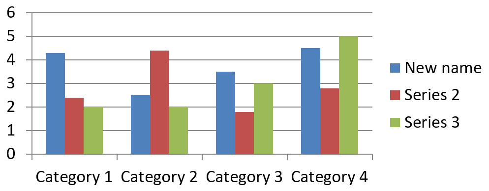

## **Áttekintés**

A diagram tárolhatja a kirajzolt értékeket munkafüzetcellákban vagy közvetlenül numerikus literálokként. Egy [ChartSeries](https://reference.aspose.com/slides/python-java/aspose.slides/chartseries/) egy kapcsolódó értékek halmazát képviseli, és minden [ChartDataPoint](https://reference.aspose.com/slides/python-java/aspose.slides/chartdatapoint/) egy pontot jelent ebben a sorozatban. A [ChartCategory](https://reference.aspose.com/slides/python-java/aspose.slides/chartcategory/) objektumok a sorozatok által közösen használt címkéket vagy csoportosítási értékeket biztosítják. Az alapértelmezett adatokkal létrehozott diagramokban a sorozatnevek, kategóriák és pontértékek a diagram munkafüzetéből származó [ChartDataCell](https://reference.aspose.com/slides/python-java/aspose.slides/chartdatacell/) objektumokat használják.

Tipikus kategória diagram esetén az alapértelmezett munkafüzet a 0‑s sort a sorozatnevekhez, a 0‑s oszlopot a kategórianevekhez, a maradék cellákat pedig a sorozatértékekhez használja. A [ChartDataWorkbook.getCell](https://reference.aspose.com/slides/python-java/aspose.slides/chartdataworkbook/#getCell)‑nek átadott munkalap‑, sor‑ és oszlopindexek nulláról indulnak. Ez a felépítés hasznos, ha alapértelmezett adatokkal hoz létre diagramot, de ne feltételezze, hogy minden meglévő diagram ezt használja. Betöltött prezentáció esetén vizsgálja meg a sorozatok, kategóriák és adatpontok által hivatkozott cellákat, mielőtt megváltoztatná a munkafüzet értékeit.

A diagram beállításainak három különböző hatóköre van:

- Sorozatszintű beállítások, például a [ChartSeries.getFormat](https://reference.aspose.com/slides/python-java/aspose.slides/chartseries/#getFormat) a sorozat összes pontjának alapértelmezett megjelenését adja meg.
- Adatpont beállítások, például a [ChartDataPoint.getFormat](https://reference.aspose.com/slides/python-java/aspose.slides/chartdatapoint/#getFormat) egy pont esetén felülírja a sorozat megjelenését.
- Csoport beállítások, amelyek kompatibilis sorozatokra vonatkoznak, amelyek ugyanahhoz a [ChartSeriesGroup](https://reference.aspose.com/slides/python-java/aspose.slides/chartseriesgroup/) tartoznak. Érje el a csoportot a [ChartSeries.getParentSeriesGroup](https://reference.aspose.com/slides/python-java/aspose.slides/chartseries/#getParentSeriesGroup)‑on keresztül, ha például átfedés vagy részsáv szélesség beállítására van szüksége.

Ha nincs kifejezetten beállítva pont‑ vagy sorozat‑kitöltés, a diagram stílusa és témája határozza meg az automatikus megjelenést. Ha mind a sorozat, mind a pont formázása meg van adva, a pont formázása élvez előnyt az adott pontnál.


Halmozott henger diagram esetén tekintse meg, hogy a [3D sorozattípus vagy oszlop alakjának módosítása](/slides/hu/python-java/3d-chart/#change-the-3d-series-type-and-bar-shape) hogyan befolyásolja az első sorozatot.

## **Sorozatértékek beállítása numerikus literálokkal**

Használjon numerikus literálokat, ha a sorozatértékek alkalmazásadatokból vagy számításokból származnak, és nem szükséges munkalap‑cellahivatkozás. Hívja a [setDataSourceTypeForValues](https://reference.aspose.com/slides/python-java/aspose.slides/chartdatapointcollection/#setDataSourceTypeForValues)‑t a [DataSourceType.DoubleLiterals](https://reference.aspose.com/slides/python-java/aspose.slides/datasourcetype/#DoubleLiterals)‑el, mielőtt minden pont [getValue](https://reference.aspose.com/slides/python-java/aspose.slides/chartdatapoint/#getValue) eredményét a [setAsLiteralDouble](https://reference.aspose.com/slides/python-java/aspose.slides/doublechartvalue/#setAsLiteralDouble)‑el állítaná be.

A gyűjtemény beállítása az adott sorozat összes pontértékének forrástípusát szabályozza. Minden pont [getDataSourceType](https://reference.aspose.com/slides/python-java/aspose.slides/basechartvalue/#getDataSourceType) metódusa jelzi a kiválasztott típust; változtassa meg a gyűjtemény beállításán keresztül. `Worksheet` esetén a [getAsCell](https://reference.aspose.com/slides/python-java/aspose.slides/doublechartvalue/#getAsCell)‑et használja a hivatkozott cellához. `DoubleLiterals` esetén a [getAsLiteralDouble](https://reference.aspose.com/slides/python-java/aspose.slides/doublechartvalue/#getAsLiteralDouble)‑et vagy a `setAsLiteralDouble`‑t használja a szám közvetlen olvasásához vagy írásához.

Az alábbi példa egy oszlopdiagramot hoz létre alapértelmezett sorozatokkal és kategóriákkal, majd a meglévő első sorozat pontjait 10, 20 stb. számított értékekkel tölti fel. Ezután elmenti a prezentációt, újra megnyitja, és kiírja a tárolt értékeket.

```python
import jpype
import asposeslides

if not jpype.isJVMStarted():
    jpype.startJVM()

from asposeslides.api import ChartType, DataSourceType, Presentation, SaveFormat

presentation = Presentation()
try:
    slide = presentation.getSlides().get_Item(0)

    chart = slide.getShapes().addChart(ChartType.ClusteredColumn, 20, 20, 500, 300)
    series = chart.getChartData().getSeries().get_Item(0)

    series.getDataPoints().setDataSourceTypeForValues(DataSourceType.DoubleLiterals)
    for i in range(series.getDataPoints().size()):
        series.getDataPoints().get_Item(i).getValue().setAsLiteralDouble((i + 1) * 10)

    presentation.save("numeric_literals.pptx", SaveFormat.Pptx)
finally:
    presentation.dispose()

reopened_presentation = Presentation("numeric_literals.pptx")
try:
    reopened_slide = reopened_presentation.getSlides().get_Item(0)
    reopened_chart = reopened_slide.getShapes().get_Item(0)
    reopened_series = reopened_chart.getChartData().getSeries().get_Item(0)
    for point in reopened_series.getDataPoints():
        print(point.getValue().getAsLiteralDouble())
finally:
    reopened_presentation.dispose()
```

A pontérték forrástípusa különbözik a [ChartData.getDataSourceType](https://reference.aspose.com/slides/python-java/aspose.slides/chartdata/#getDataSourceType)‑től, amely a diagram belső vagy külső munkafüzet‑konfigurációját azonosítja. A numerikus literálok használata önmagában nem távolítja el a beágyazott munkafüzetet. Ebben a példában a munkafüzet továbbra is elérhető a kategória címkék, sorozatnevek és a többi sorozat számára. Lásd a [Chart Workbook](/slides/hu/python-java/chart-workbook/)‑t a munkafüzet kezeléséhez.

Szórt- és buborékdiagramok esetén használja a [setDataSourceTypeForXValues](https://reference.aspose.com/slides/python-java/aspose.slides/chartdatapointcollection/#setDataSourceTypeForXValues) és a [setDataSourceTypeForYValues](https://reference.aspose.com/slides/python-java/aspose.slides/chartdatapointcollection/#setDataSourceTypeForYValues) metódusokat a [getXValue](https://reference.aspose.com/slides/python-java/aspose.slides/chartdatapoint/#getXValue) és a [getYValue](https://reference.aspose.com/slides/python-java/aspose.slides/chartdatapoint/#getYValue) forrásának kiválasztásához. A buborékdiagramok a [setDataSourceTypeForBubbleSizes](https://reference.aspose.com/slides/python-java/aspose.slides/chartdatapointcollection/#setDataSourceTypeForBubbleSizes)‑et is használják a [getBubbleSize](https://reference.aspose.com/slides/python-java/aspose.slides/chartdatapoint/#getBubbleSize) forrásához. Állítsa minden érintett forrást `DoubleLiterals`‑re, mielőtt a `setAsLiteralDouble`‑el közvetlenül számokat rendelt volna hozzá.

## **Diagram sorozat átfedésének beállítása**

A [ChartSeries.getOverlap](https://reference.aspose.com/slides/python-java/aspose.slides/chartseries/#getOverlap) megadja, hogy a sávok vagy oszlopok milyen mértékben fednek át egy 2D diagramon, -100‑tól 100 %‑ig. Ez csak olvasható leképezése a szülő sorozatcsoport beállításának. A [ChartSeriesGroup.setOverlap](https://reference.aspose.com/slides/python-java/aspose.slides/chartseriesgroup/#setOverlap)‑et használva frissítheti az összes kompatibilis sorozatot ebben a csoportban. Ez a lehetőség azoknál a diagramtípusoknál érvényes, amelyek csoportos sávokat vagy oszlopokat jelenítenek meg; egy kombinált diagram nem kapcsolódó sorozatcsoportokra nem hat.

Az alábbi példa beállítja az átfedést a csoportban, amely az első sorozatot tartalmazza:

```python
import jpype
import asposeslides

if not jpype.isJVMStarted():
    jpype.startJVM()

from asposeslides.api import ChartType, Presentation, SaveFormat

first_slide_index = 0
first_series_index = 0
overlap_percent = 30

presentation = Presentation()
try:
    slide = presentation.getSlides().get_Item(first_slide_index)

    # Az új diagram mintasorozatokat, kategóriákat és értékeket tartalmaz.
    chart = slide.getShapes().addChart(ChartType.ClusteredColumn, 20, 20, 500, 200)

    series = chart.getChartData().getSeries().get_Item(first_series_index)
    series.getParentSeriesGroup().setOverlap(overlap_percent)

    presentation.save("series_overlap.pptx", SaveFormat.Pptx)
finally:
    presentation.dispose()
```

Az eredmény:


## **Sorozat kitöltőszín módosítása**

Használja a [ChartSeries.getFormat](https://reference.aspose.com/slides/python-java/aspose.slides/chartseries/#getFormat)‑t egy teljes sorozat alapértelmezett kitöltésének beállításához. Ha egy pont már rendelkezik kifejezett kitöltéssel, annak [ChartDataPoint.getFormat](https://reference.aspose.com/slides/python-java/aspose.slides/chartdatapoint/#getFormat) beállítása felülírja a sorozat kitöltését az adott pontnál.

Az alábbi példa szilárd kék kitöltést alkalmaz az első sorozatra:

```python
import jpype
import asposeslides

if not jpype.isJVMStarted():
    jpype.startJVM()

from asposeslides.api import ChartType, FillType, Presentation, SaveFormat

Color = jpype.JClass("java.awt.Color")

first_slide_index = 0
first_series_index = 0

presentation = Presentation()
try:
    slide = presentation.getSlides().get_Item(first_slide_index)

    chart = slide.getShapes().addChart(ChartType.ClusteredColumn, 20, 20, 500, 200)

    series = chart.getChartData().getSeries().get_Item(first_series_index)
    series.getFormat().getFill().setFillType(FillType.Solid)
    series.getFormat().getFill().getSolidFillColor().setColor(Color.BLUE)

    presentation.save("series_color.pptx", SaveFormat.Pptx)
finally:
    presentation.dispose()
```

Az eredmény:


## **Sorozat név módosítása**

A sorozat neve a diagram adat‑munkafüzetben tárolódik, és általában a legendában jelenik meg. Alapértelmezett munkafüzet egy halmozott oszlopdiagram esetén a B1 cella a 0‑s sorban, az 1‑es oszlopban található, és az első sorozat nevét tartalmazza. Az alábbi példában a változók ezt a struktúrát teszik egyértelművé:

```python
import jpype
import asposeslides

if not jpype.isJVMStarted():
    jpype.startJVM()

from asposeslides.api import ChartType, Presentation, SaveFormat

first_slide_index = 0
worksheet_index = 0
series_name_row_index = 0
first_series_column_index = 1

presentation = Presentation()
try:
    slide = presentation.getSlides().get_Item(first_slide_index)

    chart = slide.getShapes().addChart(ChartType.ClusteredColumn, 20, 20, 500, 200)

    workbook = chart.getChartData().getChartDataWorkbook()
    series_name_cell = workbook.getCell(worksheet_index, series_name_row_index, first_series_column_index)
    series_name_cell.setValue("Revenue")

    presentation.save("series_name.pptx", SaveFormat.Pptx)
finally:
    presentation.dispose()
```

A [ChartSeries.getName](https://reference.aspose.com/slides/python-java/aspose.slides/chartseries/#getName) által már hivatkozott cellát is módosíthatja. Ez a megközelítés elkerüli, hogy egy adott sorban és oszlopban feltételezzen meglévő diagramot:

```python
import jpype
import asposeslides

if not jpype.isJVMStarted():
    jpype.startJVM()

from asposeslides.api import ChartType, Presentation, SaveFormat

first_slide_index = 0
first_series_index = 0
first_name_cell_index = 0

presentation = Presentation()
try:
    slide = presentation.getSlides().get_Item(first_slide_index)

    chart = slide.getShapes().addChart(ChartType.ClusteredColumn, 20, 20, 500, 200)

    series = chart.getChartData().getSeries().get_Item(first_series_index)
    series_name_cell = series.getName().getAsCells().get_Item(first_name_cell_index)
    series_name_cell.setValue("Revenue")

    presentation.save("series_name.pptx", SaveFormat.Pptx)
finally:
    presentation.dispose()
```

Az eredmény:



### **Sorozat létrehozása több cellából származó névvel**

Összetett sorozatnév hasznos, ha a terméknév és a jelentési időszak külön munkafüzet‑cellákban van tárolva. Például a `Product A` B1‑ben és a `2026` C1‑ben egyetlen sorozatnévvé kombinálható, miközben mindkét rész továbbra is a forráscellához kapcsolódik.

Használja a [ChartDataWorkbook.getCellCollection](https://reference.aspose.com/slides/python-java/aspose.slides/chartdataworkbook/#getCellCollection)‑t a névtartomány lekéréséhez, majd adja át a gyűjteményt a [ChartSeriesCollection.add](https://reference.aspose.com/slides/python-java/aspose.slides/chartseriescollection/#add)‑nak. A `skipHiddenCells` argumentum szabályozza, hogy a rejtett cellák is belekerüljenek-e: `True` kizárja őket, `False` pedig bevonja. Ez a példa `False`‑t használ, hogy minden cellát bevonjon a névtartományba.

Az alábbi példa egy prezentációt hoz létre egy sorozattal és két adatponttal. A B1:C1 csak a sorozatnevet adja, az A2:A3 a kategória címkéket, a B2:B3 a numerikus értékeket.

```python
import jpype
import asposeslides

if not jpype.isJVMStarted():
    jpype.startJVM()

from asposeslides.api import ChartType, Presentation, SaveFormat

presentation = Presentation()
try:
    slide = presentation.getSlides().get_Item(0)

    chart = slide.getShapes().addChart(ChartType.ClusteredColumn, 50, 50, 620, 180)

    chart.getChartData().getSeries().clear()
    chart.getChartData().getCategories().clear()
    chart.setLegend(True)

    workbook = chart.getChartData().getChartDataWorkbook()
    workbook.clear(0)

    # Ez a két cella adja meg a sorozat nevét.
    workbook.getCell(0, 0, 1, "Product A")
    workbook.getCell(0, 0, 2, "2026")
    name_cells = workbook.getCellCollection("Sheet1!$B$1:$C$1", False)
    series = chart.getChartData().getSeries().add(name_cells, ChartType.ClusteredColumn)

    # Külön cellák biztosítják a kategóriákat és a numerikus adatpontokat.
    north_category = workbook.getCell(0, 1, 0, "North")
    south_category = workbook.getCell(0, 2, 0, "South")
    chart.getChartData().getCategories().add(north_category)
    chart.getChartData().getCategories().add(south_category)
    north_value = workbook.getCell(0, 1, 1, jpype.JInt(120))
    south_value = workbook.getCell(0, 2, 1, jpype.JInt(150))
    series.getDataPoints().addDataPointForBarSeries(north_value)
    series.getDataPoints().addDataPointForBarSeries(south_value)

    presentation.save("composite_series_name.pptx", SaveFormat.Pptx)
finally:
    presentation.dispose()
```

Az eredményül kapott sorozatnév `Product A 2026`, a két cellaérték között egy szóközzel. A legendában ez egy bejegyzésként jelenik meg mindkét oszlopra. Az alábbi kép mutatja az eredményt:


## **Automatikus sorozat kitöltőszín lekérése**

A [ChartSeries.getAutomaticSeriesColor](https://reference.aspose.com/slides/python-java/aspose.slides/chartseries/#getAutomaticSeriesColor) visszaadja a sorozatindexből és a diagram stílusából számított színt. Ez a szín akkor kerül használatra, amikor a sorozat kitöltése nincs kifejezetten meghatározva. A metódus meghívása csak kiolvassa a számított színt; új kitöltést nem rendel.

Az alábbi példa kiírja minden alapértelmezett sorozat automatikus színét:

```python
import jpype
import asposeslides

if not jpype.isJVMStarted():
    jpype.startJVM()

from asposeslides.api import ChartType, Presentation

first_slide_index = 0

presentation = Presentation()
try:
    slide = presentation.getSlides().get_Item(first_slide_index)

    chart = slide.getShapes().addChart(ChartType.ClusteredColumn, 20, 20, 500, 200)

    series_count = chart.getChartData().getSeries().size()
    for series_index in range(series_count):
        series = chart.getChartData().getSeries().get_Item(series_index)
        automatic_color = series.getAutomaticSeriesColor()
        print(f"Series {series_index}: {automatic_color}")
finally:
    presentation.dispose()
```

Példa kimenet az alapértelmezett diagram stílusra:

```text
Series 0: java.awt.Color[r=79,g=129,b=189]
Series 1: java.awt.Color[r=192,g=80,b=77]
Series 2: java.awt.Color[r=155,g=187,b=89]
```

A pontos színek a diagram stílusától és témájától függenek.

## **Negatív értékek kitöltőszínének inverzálása egy diagram sorozatnál**

Sáv‑, oszlop‑ és buborék‑sorozatoknál a [ChartSeries.setInvertIfNegative](https://reference.aspose.com/slides/python-java/aspose.slides/chartseries/#setInvertIfNegative) negatív értékeket másik kitöltéssel jeleníthet meg. Állítsa be a normál sorozat kitöltést szilárdra, engedélyezze az invertálást, és rendelje hozzá a negatív‑érték színét a [ChartSeries.getInvertedSolidFillColor](https://reference.aspose.com/slides/python-java/aspose.slides/chartseries/#getInvertedSolidFillColor)‑nel. A negatív számok a munkafüzetben változatlanok maradnak; csak a megjelenítési színük változik.

Az alábbi példa az alapértelmezett diagram adatot cseréli egy sorozatra. Az 0‑s munkalap‑sor a sorozatnevet, a 0‑s oszlop a kategória neveket, az 1‑es oszlop pedig az értékeket tartalmazza:

```python
import jpype
import asposeslides

if not jpype.isJVMStarted():
    jpype.startJVM()

from asposeslides.api import ChartType, FillType, Presentation, SaveFormat

Color = jpype.JClass("java.awt.Color")

first_slide_index = 0
worksheet_index = 0
header_row_index = 0
category_column_index = 0
first_series_column_index = 1
first_data_row_index = 1

category_names = ["Category 1", "Category 2", "Category 3"]
series_values = [-20, 50, -30]

presentation = Presentation()
try:
    slide = presentation.getSlides().get_Item(first_slide_index)

    chart = slide.getShapes().addChart(ChartType.ClusteredColumn, 20, 20, 500, 200)
    chart_data = chart.getChartData()
    workbook = chart_data.getChartDataWorkbook()

    chart_data.getSeries().clear()
    chart_data.getCategories().clear()

    series_name_cell = workbook.getCell(worksheet_index, header_row_index, first_series_column_index, "Series 1")
    chart_type = chart.getType()
    series = chart_data.getSeries().add(series_name_cell, chart_type)

    for category_index in range(len(category_names)):
        data_row_index = first_data_row_index + category_index
        category_name = category_names[category_index]
        series_value = series_values[category_index]

        category_cell = workbook.getCell(worksheet_index, data_row_index, category_column_index, category_name)
        chart_data.getCategories().add(category_cell)

        value_cell = workbook.getCell(worksheet_index, data_row_index, first_series_column_index, series_value)
        series.getDataPoints().addDataPointForBarSeries(value_cell)

    automatic_series_color = series.getAutomaticSeriesColor()
    series.getFormat().getFill().setFillType(FillType.Solid)
    series.getFormat().getFill().getSolidFillColor().setColor(automatic_series_color)
    series.setInvertIfNegative(True)
    series.getInvertedSolidFillColor().setColor(Color.RED)

    presentation.save("inverted_solid_fill_color.pptx", SaveFormat.Pptx)
finally:
    presentation.dispose()
```

Az eredmény:


Inverzálást egyetlen pontnál a [ChartDataPoint.setInvertIfNegative](https://reference.aspose.com/slides/python-java/aspose.slides/chartdatapoint/#setInvertIfNegative)‑nel is engedélyezheti. Az alábbi példában a sorozatnál le van tiltva, csak a kiválasztott pontnál van engedélyezve. A pontnak negatív értéket is adunk, hogy a hatás látható legyen:

```python
import jpype
import asposeslides

if not jpype.isJVMStarted():
    jpype.startJVM()

from asposeslides.api import ChartType, FillType, Presentation, SaveFormat

Color = jpype.JClass("java.awt.Color")

first_slide_index = 0
first_series_index = 0
target_data_point_index = 2
negative_value = -30

presentation = Presentation()
try:
    slide = presentation.getSlides().get_Item(first_slide_index)

    chart = slide.getShapes().addChart(ChartType.ClusteredColumn, 20, 20, 500, 200)

    series = chart.getChartData().getSeries().get_Item(first_series_index)
    automatic_series_color = series.getAutomaticSeriesColor()
    series.getFormat().getFill().setFillType(FillType.Solid)
    series.getFormat().getFill().getSolidFillColor().setColor(automatic_series_color)
    series.getInvertedSolidFillColor().setColor(Color.RED)
    series.setInvertIfNegative(False)

    data_point = series.getDataPoints().get_Item(target_data_point_index)
    data_point.getValue().getAsCell().setValue(negative_value)
    data_point.setInvertIfNegative(True)

    presentation.save("data_point_invert_color_if_negative.pptx", SaveFormat.Pptx)
finally:
    presentation.dispose()
```

## **Egy konkrét adatpont értékének törlése**

Egy pontet akkor lehet üresen hagyni, hogy a többi pont megmaradjon, ha a mögöttes munkafüzet‑cellát `None`‑ra állítja. Oszlopdiagram esetén a kirajzolt érték a [ChartDataPoint.getValue](https://reference.aspose.com/slides/python-java/aspose.slides/chartdatapoint/#getValue)‑n keresztül érhető el. Az adatpont ugyanazon kategóriahelyen marad, de a diagram a beállított “blank‑value” szabályok szerint üresként kezeli.

Az alábbi példa csak a második pontot törli az első sorozatban:

```python
import jpype
import asposeslides

if not jpype.isJVMStarted():
    jpype.startJVM()

from asposeslides.api import ChartType, Presentation, SaveFormat

first_slide_index = 0
first_series_index = 0
target_data_point_index = 1

presentation = Presentation()
try:
    slide = presentation.getSlides().get_Item(first_slide_index)

    chart = slide.getShapes().addChart(ChartType.ClusteredColumn, 20, 20, 500, 200)

    series = chart.getChartData().getSeries().get_Item(first_series_index)
    data_point = series.getDataPoints().get_Item(target_data_point_index)
    data_point.getValue().getAsCell().setValue(None)

    presentation.save("clear_data_point_value.pptx", SaveFormat.Pptx)
finally:
    presentation.dispose()
```

Szórt diagramok külön X és Y cellákat használnak, a buborékdiagramok pedig egy méretcellát is. Törölje csak azt a cellát, amely a törlendő értéket tartalmazza. Ne hívja a [ChartDataPointCollection.clear](https://reference.aspose.com/slides/python-java/aspose.slides/chartdatapointcollection/#clear)‑t, ha a többi pontot meg akarja tartani, mivel ez a metódus az összes adatpontot eltávolítja a gyűjteményből.

## **Üres cellák megjelenésének vezérlése**

A rejtett, értéket tartalmazó cellák külön esetet jelentenek az üres celláktól. A rejtett munkalap‑sorok és -oszlopok adatainak felvételéhez vagy kizárásához lásd a [Include Data from Hidden Rows and Columns](/slides/hu/python-java/chart-workbook/#include-data-from-hidden-rows-and-columns) cikket.

Egy üres munkafüzet‑cellát hiányzó adatként tekintünk; egy `0` értékű cella ismert numerikus értéket jelent. Hívja a [ChartDataCell.setValue](https://reference.aspose.com/slides/python-java/aspose.slides/chartdatacell/#setValue)‑t `None`‑val, hogy a cella üressé váljon. Egy numerikus nulla továbbra is nulla marad a “blank‑cell” beállítástól függetlenül.

Használja a [Chart.setDisplayBlanksAs](https://reference.aspose.com/slides/python-java/aspose.slides/chart/#setDisplayBlanksAs)‑t, hogy kiválassza, a diagram hogyan jelenítse meg az üres cellákat. Ez a beállítás a teljes diagramra vonatkozik, és megváltoztatja, hogy a hiányzó pontok hogyan legyenek ábrázolva, anélkül, hogy a munkafüzet‑cellát nullával vagy interpolált értékkel töltené fel.

Az alábbi önálló példa sorozattal rendelkező vonaldiagramot hoz létre, a 3. nap értékét törli, majd minden módot elment egy-egy fájlba. Bemeneti fájlra nincs szükség. A [ChartDataWorkbook](https://reference.aspose.com/slides/python-java/aspose.slides/chartdataworkbook/) a 0‑s munkalapot, a 0‑s oszlopot a kategória‑címkéknek, az 1‑es oszlopot az értékeknek, a 0‑s sort pedig a sorozat nevének használja; a végső adatsor `10, 20, empty, 30, 40`.

```python
import jpype
import asposeslides

if not jpype.isJVMStarted():
    jpype.startJVM()

from asposeslides.api import ChartType, DisplayBlanksAsType, Presentation, SaveFormat

presentation = Presentation()
try:
    slide = presentation.getSlides().get_Item(0)

    chart = slide.getShapes().addChart(ChartType.LineWithMarkers, 40, 40, 640, 400)
    chart_data = chart.getChartData()
    workbook = chart_data.getChartDataWorkbook()

    chart_data.getSeries().clear()
    chart_data.getCategories().clear()

    series_name_cell = workbook.getCell(0, 0, 1, "Measurements")
    series = chart_data.getSeries().add(series_name_cell, chart.getType())
    values = [10, 20, 25, 30, 40]

    for i, value in enumerate(values):
        category_cell = workbook.getCell(0, i + 1, 0, f"Day {i + 1}")
        chart_data.getCategories().add(category_cell)
        value_cell = workbook.getCell(0, i + 1, 1, jpype.JInt(value))
        series.getDataPoints().addDataPointForLineSeries(value_cell)

    # Hagyja a 3. napot valóban üresen, miközben megtartja a kategóriáját és az adatpontot.
    workbook.getCell(0, 3, 1).setValue(None)

    modes = [DisplayBlanksAsType.Gap, DisplayBlanksAsType.Zero, DisplayBlanksAsType.Span]
    mode_names = ["Gap", "Zero", "Span"]
    for mode, mode_name in zip(modes, mode_names):
        chart.setDisplayBlanksAs(mode)
        presentation.save(f"empty_cells_{mode_name}.pptx", SaveFormat.Pptx)
finally:
    presentation.dispose()
```

Minden kimeneti fájl a mentés előtt beállított módot tárolja: `empty_cells_Gap.pptx`, `empty_cells_Zero.pptx` és `empty_cells_Span.pptx`. Ha csak egy változatot szeretne menteni, állítsa be a kívánt módot, és egyszer mentse a prezentációt a többféle módon való iteráció helyett.

Az alábbi összehasonlítás ugyanazt az adatot mutatja mindhárom fájlban. A 3. nap üres a munkafüzetben minden esetben:


A látható hatás a diagram típustól függ. Egy vonaldiagram három módot is könnyen összehasonlíthatóvá tesz. Sáv‑ és oszlopdiagramok esetén nincs vonal, amely összekötné a hiányzó kategóriát, így a `Span` nem tud egy összekötő szegmenst előállítani; egy hiányzó oszlop és egy null‑magasságú oszlop is hasonlóan nézhet ki. Hasonlóképpen, egy szórt diagram, amely csak jelzőket tartalmaz, nem rendelkezik összekötő vonallal. Ne várjon három különböző eredményt minden diagramtípusnál; ellenőrizze a kimenetet a használt típusra.

## **Sorozat részsávszélesség beállítása**

A részsávszélesség a szomszédos sáv‑ vagy oszlop‑klaszterek közötti távolságot jelöli, a sáv‑ vagy oszlop‑szélesség százalékában kifejezve. Az átfedéshez hasonlóan ez a szülő sorozatcsoporthoz tartozik, nem egyetlen sorozathoz. Hívja a [ChartSeriesGroup.setGapWidth](https://reference.aspose.com/slides/python-java/aspose.slides/chartseriesgroup/#setGapWidth)‑et egyszer a csoporton. Nagyobb érték szélesebb részt teremt a klaszterek között; kisebb érték sűrűbbé teszi őket.

Az alábbi példa módosítja a részsávszélességet, és csak a végső prezentációt menti el:

```python
import jpype
import asposeslides

if not jpype.isJVMStarted():
    jpype.startJVM()

from asposeslides.api import ChartType, Presentation, SaveFormat

first_slide_index = 0
first_series_index = 0
gap_width_percent = 30

presentation = Presentation()
try:
    slide = presentation.getSlides().get_Item(first_slide_index)

    chart = slide.getShapes().addChart(ChartType.StackedColumn, 20, 20, 500, 200)

    series = chart.getChartData().getSeries().get_Item(first_series_index)
    series.getParentSeriesGroup().setGapWidth(gap_width_percent)

    presentation.save("gap_width_30.pptx", SaveFormat.Pptx)
finally:
    presentation.dispose()
```

Az eredmény:


## **Sorozatsorok megjelenítése vagy elrejtése**

A sorozatsorok vizuálisan összekötik a diagram kapcsolódó részeit. Használja a [ChartSeriesGroup.setSeriesLines](https://reference.aspose.com/slides/python-java/aspose.slides/chartseriesgroup/#setSeriesLines)‑t, hogy megjelenítse vagy elrejtse őket a támogatott halmozott sáv‑ és OfPie diagramokban. Két dimenziós halmozott sáv‑ és oszlopdiagramokban a sorozatsorok a megfelelő halmozott határokat kötik össze a kategóriák között. Pie of Pie és Bar of Pie diagramoknál a fő diagramot kapcsolják a másodlagos diagramhoz. Ez a beállítás nem általános csatlakozó más diagramtípusokhoz.

Érje el a csoportot a [ChartSeries.getParentSeriesGroup](https://reference.aspose.com/slides/python-java/aspose.slides/chartseries/#getParentSeriesGroup)‑on keresztül. A beállítás minden sorozatra vonatkozik abban a csoportban. A [ChartSeries.hasSeriesLines](https://reference.aspose.com/slides/python-java/aspose.slides/chartseries/#hasSeriesLines) csak olvasható, és a szülőcsoport beállítását tükrözi; a csoport setter‑ével frissítheti.

Az alábbi példa egy [PieOfPie](https://reference.aspose.com/slides/python-java/aspose.slides/charttype/#PieOfPie) diagramot hoz létre alapértelmezett adatokkal. Két prezentációt ment, egyet sorozatsorokkal engedélyezve, egyet letiltva, összehasonlítás céljából.

```python
import jpype
import asposeslides

if not jpype.isJVMStarted():
    jpype.startJVM()

from asposeslides.api import ChartType, Presentation, SaveFormat

presentation = Presentation()
try:
    slide = presentation.getSlides().get_Item(0)

    chart = slide.getShapes().addChart(ChartType.PieOfPie, 50, 50, 600, 400)
    series = chart.getChartData().getSeries().get_Item(0)
    series_group = series.getParentSeriesGroup()

    series_group.setSeriesLines(True)
    presentation.save("series_lines_enabled.pptx", SaveFormat.Pptx)

    series_group.setSeriesLines(False)
    presentation.save("series_lines_disabled.pptx", SaveFormat.Pptx)
finally:
    presentation.dispose()
```

| Sorozatsorok engedélyezve | Sorozatsorok letiltva |
| --- | --- |
|  |  |
| A két vonal a fő tortát kapcsolja a másodlagos tortához. | Mindkét torta látható, de a kapcsoló vonalak rejtve vannak. |

A sorozatsorok különböznek az adatcímke vezetővonalaitól, amelyek a címkéket kötik az adatpontokhoz; a rácsvonalaktól, amelyek a diagram tengelyein jelölik az intervallumokat; és a vonaldiagram vonalaitól, amelyek az adatértékeket ábrázolják. Ez a beállítás nem irányítja ezeket az elemeket.

## **GYIK**

**Mely diagramtípusok támogatják az adat sorozatokat?**

Az összes diagramtípus, amelyet a [ChartType](https://reference.aspose.com/slides/python-java/aspose.slides/charttype/) felsorolás tartalmaz, adatot használ, de sorozataik nem minden esetben rendelkeznek ugyanazzal az értékstruktúrával vagy beállításokkal. Például a kategória diagramok kategóriákat és értékeket használnak, a szórt diagramok X és Y értékeket, a buborék diagramok pedig buborékméreteket. Használja a sorozattípusnak megfelelő adatpont‑létrehozási módszert. Az olyan opciók, mint az átfedés és a részsávszélesség, csak kompatibilis sáv‑ vagy oszlopcsoportokra érvényesek.

**Mi az a diagram sorozatcsoport?**

A [ChartSeriesGroup](https://reference.aspose.com/slides/python-java/aspose.slides/chartseriesgroup/) kompatibilis sorozatokat tartalmaz, amelyek közös csoportszintű ábrázolási beállításokat osztanak meg. Egy kombinált diagram több mint egy csoportot tartalmazhat, így egy sorozaton keresztül elért csoport módosítása nem feltétlenül változtatja meg a diagram minden sorozatát.

**Tartalmaz egy újonnan létrehozott diagram alapértelmezett adatot?**

Igen. Alapértelmezés szerint a [ShapeCollection.addChart](https://reference.aspose.com/slides/python-java/aspose.slides/shapecollection/#addChart) mintasorozatokat, kategóriákat és értékeket hoz létre. Ezeket a cellákat szerkesztheti, vagy törölheti a sorozat‑ és kategóriagyűjteményeket, mielőtt teljesen egyéni adatkészletet adna hozzá. Egy túlterhelés lehetővé teszi a diagram létrehozását alapértelmezett adatok nélkül is.

**Hogyan kapcsolódnak a diagram objektumok a munkafüzetcellákhoz?**

A sorozatnevek, kategória címkék és adatpont‑értékek a [ChartDataWorkbook](https://reference.aspose.com/slides/python-java/aspose.slides/chartdataworkbook/) celláira hivatkoznak. Egy hivatkozott cella módosítása frissíti a megfelelő diagramelemet. Egyedi adat építésekor tartsa a kategória‑sorokat és a sorozat‑érték‑sorokat összehangoltan, hogy minden pont a megfelelő kategória alatt jelenjen meg.

**Hogyan töröljek egy pontot, a teljes sorozat helyett?**

Állítsa be a megfelelő értékcellát `None`‑ra, hogy a pont kategória‑helye üres pontként maradjon. A [ChartDataPointCollection.clear](https://reference.aspose.com/slides/python-java/aspose.slides/chartdatapointcollection/#clear)‑et csak akkor használja, ha az összes pontot el akarja távolítani az adott sorozatból, mivel ez a metódus minden adatpontot eltávolít a gyűjteményből.

**Hogyan jelennek meg a üres pontok?**

Az eredmény a diagram típustól és a [Chart.setDisplayBlanksAs](https://reference.aspose.com/slides/python-java/aspose.slides/chart/#setDisplayBlanksAs)‑n keresztül beállított értéktől függ. A támogatott diagramok a hiányzó pontokat hézagként, nullaként vagy a szomszédos pontok összekötésével jeleníthetik meg. Válassza ki a megfelelő beállítást a hiányzó adat jelentéséhez a prezentációjában. Tekintse meg a [Control the Display of Empty Cells](#control-the-display-of-empty-cells) fejezetet a teljes példa és vizuális összehasonlítás érdekében.

**Hogyan formázzák a negatív értékeket?**

A támogatott sáv‑, oszlop‑ és buborék‑sorozatoknál hívja a [ChartSeries.setInvertIfNegative](https://reference.aspose.com/slides/python-java/aspose.slides/chartseries/#setInvertIfNegative)‑et, és állítsa be a [ChartSeries.getInvertedSolidFillColor](https://reference.aspose.com/slides/python-java/aspose.slides/chartseries/#getInvertedSolidFillColor) által visszaadott színt. Egy egyedi pont esetén a [ChartDataPoint.setInvertIfNegative](https://reference.aspose.com/slides/python-java/aspose.slides/chartdatapoint/#setInvertIfNegative)‑el felülírhatja a viselkedést. Ezek a metódusok a formázást érintik, nem a tárolt numerikus értékeket.

**Melyik formázás nyer, ha egy sorozat és egy pont is formázva van?**

A kifejezett adatpont‑formázás élvezi az előnyt az adott pontnál. A többi pont a kifejezett sorozat‑formátumot vagy, ha az nincs meghatározva, az automatikus diagram‑stílust és témát használja. A csoport‑beállítások, mint az átfedés és a részsávszélesség, az elrendezést vezérlik, és nem pont‑szintű formázás‑felülírások.

**Van korlát arra, hogy hány sorozatot tartalmazhat egy diagram?**

Az Aspose.Slides nem alkalmaz külön, rögzített sorozatszám‑korlátot. Gyakorlatban a prezentációfájl korlátai, a rendelkezésre álló memória, a renderelési idő és a diagram olvashatósága határozzák meg a hasznos határt.

**Mit módosítsak, ha az oszlopok túl közel vagy túl messze vannak egymástól?**

Hívja a [ChartSeriesGroup.setGapWidth](https://reference.aspose.com/slides/python-java/aspose.slides/chartseriesgroup/#setGapWidth)‑et a megfelelő szülő sorozatcsoporton. Növelje az értéket a klaszterek közötti tér növeléséhez, vagy csökkentse a közelebb hozáshoz.