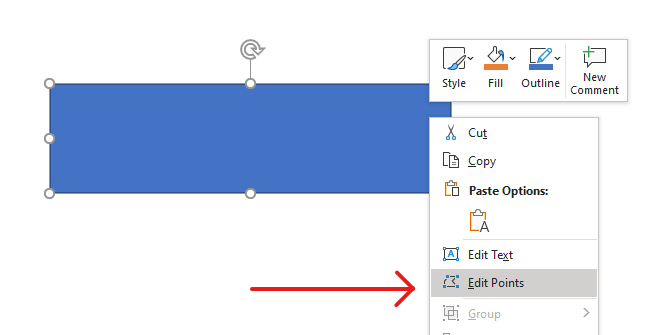

## **Áttekintés**

Ez a cikk bemutatja, hogyan lehet testreszabni a prezentáció alakzatait az Aspose.Slides segítségével a forma geometria szerkesztésével szerkesztőpontok és geometriai útvonalak segítségével. Megmutatja, hogyan lehet a [GeometryPath](https://reference.aspose.com/slides/python-java/aspose.slides/geometrypath/) használatával módosítani meglévő alakzatokat, alapvető útvonal-szerkesztési műveleteket végrehajtani, pontokat hozzáadni vagy eltávolítani, és az frissített geometriát visszaalkalmazni egy alakzatra.

Emellett bemutatja, hogyan lehet egyedi és összetett alakzatokat létrehozni, ívelt sarkokkal ellátott alakzatokat építeni, meghatározni, hogy egy forma geometria zárt‑e, vizsgálni a formaelemeket, és a Java AWT szöveg körvonalait geometriai útvonalakká alakítani.

## **Alakzat módosítása szerkesztőpontokkal**

PowerPointban a **Szerkesztőpontok** segítségével egy négyzetet módosíthat:

* Egy sarkot be‑ vagy kifelé mozgathat.
* Egy pont ívének görbületét állíthatja.
* Új pontokat adhat hozzá.

A pontok szerkesztése lehetővé teszi egy alakzat körvonalának módosítását, vagy egy meglévő alakzat alapjának felhasználását egy új létrehozásához.

## **Alakzat szerkesztési tippek**



PowerPoint‑alakzatok szerkesztésekor tartsa szem előtt a következőket:

* Egy alakzat (vagy annak útvonala) lehet zárt vagy nyitott.
* Az alakzat útvonala horgonypontokból áll, amelyeket szegmensek kötnek össze.
* Egy szegmens lehet egyenes vagy íves. A horgonypontok és a vezérlő fogantyúk határozzák meg alakját.
* A horgonypontok három típusúak: sarokpont, egyenes pont vagy sima pont:
  * Sarokpontnál a szomszédos szegmensek szöget zárhatnak be.
  * Simapontnál a két vezérlő fogantyú egy vonalban van, és azonos távolságra helyezkedik el a horgonyponttól.
  * Egyenes pontnál a két vezérlő fogantyú egy vonalban van, de távolságuk eltérhet a horgonyponttól.
* A horgonypontok mozgatása vagy fogantyúik módosítása megváltoztatja az alakzat körvonalát.

PowerPoint‑alakzatok szerkesztéséhez szerkesztőpontokkal a **Aspose.Slides** a [GeometryPath](https://reference.aspose.com/slides/python-java/aspose.slides/geometrypath/) osztályt biztosítja.

* Egy [GeometryPath](https://reference.aspose.com/slides/python-java/aspose.slides/geometrypath/) példány a [GeometryShape](https://reference.aspose.com/slides/python-java/aspose.slides/geometryshape/) objektum geometriai útvonalát képviseli.
* A [GeometryPath](https://reference.aspose.com/slides/python-java/aspose.slides/geometrypath/) lekéréséhez a [GeometryShape](https://reference.aspose.com/slides/python-java/aspose.slides/geometryshape/) példányból a [GeometryShape.getGeometryPaths](https://reference.aspose.com/slides/python-java/aspose.slides/geometryshape/#getGeometryPaths) metódust használhatja.
* A [GeometryPath](https://reference.aspose.com/slides/python-java/aspose.slides/geometrypath/) beállításához egy alakzatra használja a [GeometryShape.setGeometryPath](https://reference.aspose.com/slides/python-java/aspose.slides/geometryshape/#setGeometryPath) metódust egyetlen útvonalú alakzatoknál, illetve a [GeometryShape.setGeometryPaths](https://reference.aspose.com/slides/python-java/aspose.slides/geometryshape/#setGeometryPaths) metódust több útvonalú alakzatoknál.
* Szegmensek hozzáadásához a [GeometryPath](https://reference.aspose.com/slides/python-java/aspose.slides/geometrypath/) alatti metódusokat használhatja.
* A [GeometryPath.setStroke](https://reference.aspose.com/slides/python-java/aspose.slides/geometrypath/#setStroke) és a [GeometryPath.setFillMode](https://reference.aspose.com/slides/python-java/aspose.slides/geometrypath/#setFillMode) metódusokkal beállíthatja a geometriai útvonal megjelenését.
* A [GeometryPath.getPathData](https://reference.aspose.com/slides/python-java/aspose.slides/geometrypath/#getPathData) metódus segítségével egy [GeometryShape](https://reference.aspose.com/slides/python-java/aspose.slides/geometryshape/) útvonaladatait tömbként kaphatja meg.
* További forma‑geometria testreszabási lehetőségekhez a [java.awt.Shape](https://docs.oracle.com/javase/8/docs/api/java/awt/Shape.html) objektumot a [PathIterator](https://docs.oracle.com/javase/8/docs/api/java/awt/geom/PathIterator.html) segítségével olvashatja, és a szegmenseket egy [GeometryPath](https://reference.aspose.com/slides/python-java/aspose.slides/geometrypath/)‑re “újrajátszhatja”.

## **Egyszerű szerkesztési műveletek**

Használja az alábbi metódusokat egy geometriai útvonal szerkesztéséhez. Az indexet elfogadó felülírások a szegmens‑tömbben a megadott nullán‑induló pozícióba szúrják be a szegmenst.

| Művelet | Metódus |
| --- | --- |
| Egyenes vonal hozzáadása vagy beszúrása. | [GeometryPath.lineTo](https://reference.aspose.com/slides/python-java/aspose.slides/geometrypath/#lineTo) |
| Két vezérlőponttal és egy végponttal rendelkező kúp Bézier‑görbe hozzáadása vagy beszúrása. | [GeometryPath.cubicBezierTo](https://reference.aspose.com/slides/python-java/aspose.slides/geometrypath/#cubicBezierTo) |
| Egyetlen vezérlőponttal és egy végponttal rendelkező kvadratikus Bézier‑görbe hozzáadása vagy beszúrása. | [GeometryPath.quadraticBezierTo](https://reference.aspose.com/slides/python-java/aspose.slides/geometrypath/#quadraticBezierTo) |
| Elliptikus ív hozzáadása a megadott méretekkel és fokokban kifejezett szögekkel. | [GeometryPath.arcTo](https://reference.aspose.com/slides/python-java/aspose.slides/geometrypath/#arcTo) |
| A jelenlegi alakzat lezárása az végpont és a kezdőpont összekötésével. | [GeometryPath.closeFigure](https://reference.aspose.com/slides/python-java/aspose.slides/geometrypath/#closeFigure) |
| Az alakzat kezdőpontjának beállítása. | [GeometryPath.moveTo](https://reference.aspose.com/slides/python-java/aspose.slides/geometrypath/#moveTo) |
| Szegmens eltávolítása nullán‑induló index szerint. | [GeometryPath.removeAt](https://reference.aspose.com/slides/python-java/aspose.slides/geometrypath/#removeAt) |

## **Egyedi pontok hozzáadása egy alakzathoz**

Ez a példa két pontot szúr be egy téglalapba a [GeometryPath.lineTo](https://reference.aspose.com/slides/python-java/aspose.slides/geometrypath/#lineTo) használatával, majd a szerkesztett útvonalat a [GeometryShape.setGeometryPath](https://reference.aspose.com/slides/python-java/aspose.slides/geometryshape/#setGeometryPath)‑vel alkalmazza. A koordináták a forma lokális rendszere szerint értendők: mindkét új pont a középpontban helyezkedik el, 100 pontbalra és 50 pont lejjebb. Az 1‑es és 4‑es szegmens‑indexek a pontokat a felső és alsó élre teszik, ezáltal az éleket befelé húzva.

```python
import jpype
import asposeslides

if not jpype.isJVMStarted():
    jpype.startJVM()

from asposeslides.api import Presentation, ShapeType

presentation = Presentation()
try:
    slide = presentation.getSlides().get_Item(0)

    shape = slide.getShapes().addAutoShape(ShapeType.Rectangle, 100, 100, 200, 100)

    geometry_path = shape.getGeometryPaths()[0]
    geometry_path.lineTo(100, 50, 1)
    geometry_path.lineTo(100, 50, 4)

    shape.setGeometryPath(geometry_path)
finally:
    presentation.dispose()
```


## **Pontok eltávolítása egy alakzatról**

Ez a példa egy szív alakú körvonalat módosít azzal, hogy a [GeometryPath.removeAt](https://reference.aspose.com/slides/python-java/aspose.slides/geometrypath/#removeAt) segítségével eltávolítja a 2‑es nullán‑induló indexű szegmenst. A módosított útvonal [GeometryShape.setGeometryPath](https://reference.aspose.com/slides/python-java/aspose.slides/geometryshape/#setGeometryPath)‑vel való alkalmazása frissíti az alakzat kontúrt.

```python
import jpype
import asposeslides

if not jpype.isJVMStarted():
    jpype.startJVM()

from asposeslides.api import Presentation, ShapeType

presentation = Presentation()
try:
    slide = presentation.getSlides().get_Item(0)

    shape = slide.getShapes().addAutoShape(ShapeType.Heart, 100, 100, 300, 300)

    geometry_path = shape.getGeometryPaths()[0]
    geometry_path.removeAt(2)

    shape.setGeometryPath(geometry_path)
finally:
    presentation.dispose()
```


## **Egyedi alakzat létrehozása**

Ez a példa ötágú csillagot épít a [GeometryPath](https://reference.aspose.com/slides/python-java/aspose.slides/geometrypath/)‑vel. A 100 és 50 pont közötti váltakozó külső‑ és belső‑sugár határozza meg a csúcsokat és a bemetsüléseket; a 72 fokos lépés egyenlően osztja el az öt csúcsot. Az útvonal a [GeometryPath.closeFigure](https://reference.aspose.com/slides/python-java/aspose.slides/geometrypath/#closeFigure)‑vel záródik, és a [GeometryShape.setGeometryPath](https://reference.aspose.com/slides/python-java/aspose.slides/geometryshape/#setGeometryPath)‑vel egy téglalapra alkalmazva felülírja annak körvonalát.

```python
import jpype
import asposeslides

if not jpype.isJVMStarted():
    jpype.startJVM()

from asposeslides.api import Presentation, ShapeType, GeometryPath

import math

points = []
outer_radius = 100
inner_radius = 50
angle_step = 72

for angle in range(-90, 270, angle_step):
    radians = math.radians(angle)
    x = outer_radius * math.cos(radians)
    y = outer_radius * math.sin(radians)
    points.append((x + outer_radius, y + outer_radius))

    radians = math.radians(angle + angle_step / 2)
    x = inner_radius * math.cos(radians)
    y = inner_radius * math.sin(radians)
    points.append((x + outer_radius, y + outer_radius))

star_path = GeometryPath()
star_path.moveTo(*points[0])
for point in points[1:]:
    star_path.lineTo(*point)
star_path.closeFigure()

presentation = Presentation()
try:
    slide = presentation.getSlides().get_Item(0)

    shape = slide.getShapes().addAutoShape(ShapeType.Rectangle, 100, 100, outer_radius * 2, outer_radius * 2)
    shape.setGeometryPath(star_path)
finally:
    presentation.dispose()
```


## **Összetett egyedi alakzat létrehozása**

Ez a példa két zárt [GeometryPath](https://reference.aspose.com/slides/python-java/aspose.slides/geometrypath/) objektumot definiál a forma felső és alsó harmadához. Mindkét útvonal a [GeometryShape.setGeometryPaths](https://reference.aspose.com/slides/python-java/aspose.slides/geometryshape/#setGeometryPaths)‑vel való alkalmazásával egyetlen összetett alakzatot hoz létre, amelynek középső harmada üres marad.

```python
import jpype
import asposeslides

if not jpype.isJVMStarted():
    jpype.startJVM()

from asposeslides.api import Presentation, ShapeType, GeometryPath

presentation = Presentation()
try:
    slide = presentation.getSlides().get_Item(0)

    shape = slide.getShapes().addAutoShape(ShapeType.Rectangle, 100, 100, 200, 100)

    top_path = GeometryPath()
    top_path.moveTo(0, 0)
    top_path.lineTo(shape.getWidth(), 0)
    top_path.lineTo(shape.getWidth(), shape.getHeight() / 3)
    top_path.lineTo(0, shape.getHeight() / 3)
    top_path.closeFigure()

    bottom_path = GeometryPath()
    bottom_path.moveTo(0, shape.getHeight() / 3 * 2)
    bottom_path.lineTo(shape.getWidth(), shape.getHeight() / 3 * 2)
    bottom_path.lineTo(shape.getWidth(), shape.getHeight())
    bottom_path.lineTo(0, shape.getHeight())
    bottom_path.closeFigure()

    shape.setGeometryPaths([top_path, bottom_path])
finally:
    presentation.dispose()
```


## **Egyedi alakzat ívelt sarkokkal**

Ez a példa egyenes szegmenseket kombinál a [GeometryPath.arcTo](https://reference.aspose.com/slides/python-java/aspose.slides/geometrypath/#arcTo)‑val, hogy egy belső‑görbületű sarkokkal rendelkező alakzatot kapjon. Minden sarok mérete meghatározza az ív szélességét és magasságát pontban, a –90 fokos ív pedig egy óramutatóval ellentétes negyed‑ellipszist rajzol. A kész útvonalat a [GeometryShape.setGeometryPath](https://reference.aspose.com/slides/python-java/aspose.slides/geometryshape/#setGeometryPath)‑vel alkalmazza, és a bemutatót PPTX formátumban menti.

```python
import jpype
import asposeslides

if not jpype.isJVMStarted():
    jpype.startJVM()

from asposeslides.api import Presentation, ShapeType, GeometryPath, SaveFormat

shape_x = 20
shape_y = 20
shape_width = 300
shape_height = 200

left_top_size = 50
right_top_size = 20
right_bottom_size = 40
left_bottom_size = 10

presentation = Presentation()
try:
    slide = presentation.getSlides().get_Item(0)

    shape = slide.getShapes().addAutoShape(ShapeType.Custom, shape_x, shape_y, shape_width, shape_height)

    geometry_path = GeometryPath()
    geometry_path.moveTo(left_top_size, 0)
    geometry_path.lineTo(shape_width - right_top_size, 0)
    geometry_path.arcTo(right_top_size, right_top_size, 180, -90)
    geometry_path.lineTo(shape_width, shape_height - right_bottom_size)
    geometry_path.arcTo(right_bottom_size, right_bottom_size, -90, -90)
    geometry_path.lineTo(left_bottom_size, shape_height)
    geometry_path.arcTo(left_bottom_size, left_bottom_size, 0, -90)
    geometry_path.lineTo(0, left_top_size)
    geometry_path.arcTo(left_top_size, left_top_size, 90, -90)
    geometry_path.closeFigure()
    
    shape.setGeometryPath(geometry_path)

    presentation.save("output.pptx", SaveFormat.Pptx)
finally:
    presentation.dispose()
```

## **Megszerzés, hogy egy alakzat geometria zárt‑e**

Az alábbi segédfüggvény ellenőrzi, hogy minden nem üres geometriai útvonal záró szegmensekkel végződik‑e. A [GeometryPath.getPathData](https://reference.aspose.com/slides/python-java/aspose.slides/geometrypath/#getPathData)‑t olvassa, majd a végső szegmens [PathSegment.getPathCommand](https://reference.aspose.com/slides/python-java/aspose.slides/pathsegment/#getPathCommand) értékét összehasonlítja a [PathCommandType.Close](https://reference.aspose.com/slides/python-java/aspose.slides/pathcommandtype/)‑val. Ha nincs nem üres útvonal, `False`‑t ad vissza. A függvény az egyes útvonalak végső parancsát ellenőrzi; nem elemzi a pálya minden alalakzatát. A példa a négyzet esetén `True`‑t ír ki.

```python
import jpype
import asposeslides

if not jpype.isJVMStarted():
    jpype.startJVM()

from asposeslides.api import Presentation, ShapeType, PathCommandType

def is_geometry_closed(geometry_shape):
    has_nonempty_path = False
    for geometry_path in geometry_shape.getGeometryPaths():
        path_data = geometry_path.getPathData()
        if len(path_data) == 0:
            continue
        last_segment = path_data[-1]
        has_nonempty_path = True
        if last_segment.getPathCommand() != PathCommandType.Close:
            return False
    return has_nonempty_path

presentation = Presentation()
try:
    slide = presentation.getSlides().get_Item(0)
    shape = slide.getShapes().addAutoShape(ShapeType.Rectangle, 100, 100, 200, 100)
    closed = is_geometry_closed(shape)
    print(closed)
finally:
    presentation.dispose()
```

## **Alakzat elemeinek kinyerése és vizsgálata**

Használja a [GeometryShape.createShapeElements](https://reference.aspose.com/slides/python-java/aspose.slides/geometryshape/#createShapeElements) metódust, hogy egy meglévő alakzatot elemekkel vizsgáljon, amelyek útvonallépéseket és ponttípusokat tartalmaznak. Minden visszakapott elemet [ShapeElement](https://reference.aspose.com/slides/python-java/aspose.slides/shapeelement/) típusra castoljon `jpype.JObject`‑kel, majd a [getPathPoints](https://reference.aspose.com/slides/python-java/aspose.slides/shapeelement/#getPathPoints) és a [getPathTypes](https://reference.aspose.com/slides/python-java/aspose.slides/shapeelement/#getPathTypes) metódusok segítségével szerezze be a pont‑ és típus‑tömböket. Ez a reprezentáció hasznos kontúr‑elemzéshez vagy a geometria saját rajzolóeszközökbe történő továbbításához.

A példa megnyit egy **input.pptx** fájlt, megtalálja az első geometriai alakzatot az első dián, és kiírja annak szegmenseit. Használjon olyan bemutatót, amelynek alakzata egyenes és ívelt szegmenseket is tartalmaz, hogy mindkét kimenetet lássa. Csoportokon belül nem keres.

```python
import jpype
import asposeslides

if not jpype.isJVMStarted():
    jpype.startJVM()

from asposeslides.api import Presentation, GeometryShape, ShapeElement

presentation = Presentation("input.pptx")
try:
    slide = presentation.getSlides().get_Item(0)

    shape = None
    for candidate in slide.getShapes():
        if isinstance(candidate, GeometryShape):
            shape = candidate
            break

    if shape is None:
        print("No geometry shape found on the first slide.")
    else:
        for element in shape.createShapeElements():
            shape_element = jpype.JObject(element, ShapeElement)
            points = shape_element.getPathPoints()
            types = shape_element.getPathTypes()
            print("Shape element:")

            i = 0
            while i < len(points):
                point_type = types[i] & 0x07  # Keep the segment type, excluding flags.
                if point_type == 0:
                    print(f"Start figure at {points[i]}")
                elif point_type == 1:
                    print(f"Line to {points[i]}")
                elif point_type == 3:
                    print(f"Cubic Bezier: controls {points[i]}, {points[i + 1]}; end {points[i + 2]}")
                    i += 2  # Consume both control points and the endpoint.

                if types[i] & 0x80:
                    print("Close subpath back to its starting point.")
                i += 1
finally:
    presentation.dispose()
```

A tömbök index szerint egyeznek: `points[i]` egy pont, `types[i]` leírja a szerepét. Az `0` típusú elem új alakzatot indít, az `1` típusú elem egy vonalat rajzol az előző pontból a jelenlegi pontba. Egy köb‑Bézier szegmens az előző végpontból indul, és három egymást követő, `3`‑as típusú bejegyzést használ: két vezérlőpontot, majd az új végpontot. A ciklus ezeket a három bejegyzést egyszerre fogyasztja, és a végpont zártságát ellenőrzi.

A ponttípusok flag‑eket is tartalmaznak. A `0x07` maskával azonosítható a szegmens típusa, az `0x80` flag külön tesztelhető a zárt alútvonal felismerésére. Például a `129` (`0x81`) egy vonal‑végpontot jelent, amely zár egy alútvonalat, a `131` (`0x83`) pedig egy Bézier‑végpontot, amely zár egyet. A Java ezeket a flag‑eket előjeles bájtokban tárolja; a maskolás megőrzi a kívánt bitértékeket. A nyers érték csak `1`‑gyel vagy `3`‑mal való összehasonlítása kihagyná ezeket az eseteket. Más flag‑ek, például a szaggatás (`0x10`) vagy a marker (`0x20`), nem változtatják az alap szegmens típust.

**Koordináták és transzformációk.** A pontok pontban (1/72 hüvelyk) vannak megadva, az X jobbra, az Y lefelé növekszik. Egy nem csoportosított alakzatra a kinyert koordináták már tartalmazzák a [getX](https://reference.aspose.com/slides/python-java/aspose.slides/shape/#getX) és [getY](https://reference.aspose.com/slides/python-java/aspose.slides/shape/#getY) által visszaadott pozíciót, valamint a jelenlegi szélességet és magasságot. Például egy nem elforgatott téglalap a `(100, 200)`‑n, `120 × 80` mérettel a kontúr határa `(100, 200)`–`(220, 280)`. Ne adja hozzá újra az alakzat pozícióját; vonja ki az X‑et és Y‑t a lokális koordinátákhoz.

A kinyert pontok nem tartalmazzák az alakzat forgását, amelyet a [getRotation](https://reference.aspose.com/slides/python-java/aspose.slides/shape/#getRotation) ad, illetve a vízszintes és függőleges tükrözést. A megjelenített kontúr reprodukálásához ezekkel a transzformációkkal kell eljárni a forma középpontja körül. Csoportos alakzatok esetén vegye figyelembe a csoport koordináta‑leképezését és transzformációit is; ne feltételezze, hogy a kinyert pontok a végleges diá\-koordináták, és ne alkalmazzon egy fordítást vagy méretezést kétszer, ha már a gyermek keretben megjelennek.

**Vizsgálat vs. szerkesztés.** A kinyert tömbök a kontúrt írják le; ezek módosítása nem frissíti az eredeti alakzatot. Ezt a módszert akkor válassza, ha a pont/típus tömbökre épülő elemzésre vagy rajzoló programra van szükség. Használja a [getGeometryPaths](https://reference.aspose.com/slides/python-java/aspose.slides/geometryshape/#getGeometryPaths)‑t, ha a geometriai parancsokra a forma lokális koordináta‑rendszerében van szüksége, vagy ha a geometria szerkesztése a cél. Szerkesztett útvonalak alkalmazásához használja a [setGeometryPath](https://reference.aspose.com/slides/python-java/aspose.slides/geometryshape/#setGeometryPath) vagy a [setGeometryPaths](https://reference.aspose.com/slides/python-java/aspose.slides/geometryshape/#setGeometryPaths) metódusokat.

## **Java AWT Shape konvertálása GeometryPath‑vé**

Ez a példa egy téglalap körvonalát kombinálja a geometriává konvertált szöveggel. A körvonal [setFillMode](https://reference.aspose.com/slides/python-java/aspose.slides/geometrypath/#setFillMode) metódusa kikapcsolja a kitöltést. Egy [GlyphVector](https://docs.oracle.com/javase/8/docs/api/java/awt/font/GlyphVector.html) létrehozza a szöveg körvonalát egy [java.awt.Shape](https://docs.oracle.com/javase/8/docs/api/java/awt/Shape.html) objektumban. A [PathIterator](https://docs.oracle.com/javase/8/docs/api/java/awt/geom/PathIterator.html) mozgás, vonal, kvadratikus, kúp‑Bézier és záró szegmenseket szolgáltat, amelyeket a példa egy [GeometryPath](https://reference.aspose.com/slides/python-java/aspose.slides/geometrypath/)‑re újrajátssza.

A szöveg 40‑pont Arial betűtípussal jelenik meg. A körvonal 20 ponttal vízszintesen eltolódik, a vizuális teteje pedig 10 ponttal az alakzat felső szélétől lejjebb helyezkedik el. A szöveg útvonal kitöltött, míg az eredeti téglalap csak körvonal marad. Mindkét útvonal a [GeometryShape.setGeometryPaths](https://reference.aspose.com/slides/python-java/aspose.slides/geometryshape/#setGeometryPaths)‑vel való alkalmazásával egyetlen alakzattá alakul, amely a téglalapot és a szöveget egyaránt tartalmazza.

```python
import jpype
import asposeslides

if not jpype.isJVMStarted():
    jpype.startJVM()

from asposeslides.api import Presentation, ShapeType, GeometryPath, PathFillModeType

from java.awt import Font
from java.awt.geom import PathIterator
from java.awt.image import BufferedImage

presentation = Presentation()
try:
    slide = presentation.getSlides().get_Item(0)

    shape = slide.getShapes().addAutoShape(ShapeType.Rectangle, 100, 100, 300, 100)

    # A forma geometriai útvonalának lekérése.
    original_path = shape.getGeometryPaths()[0]
    original_path.setFillMode(PathFillModeType.None_)

    # Új grafikus útvonal létrehozása szöveggel.
    font = Font("Arial", Font.PLAIN, 40)
    text = "Text in shape"
    image = BufferedImage(100, 100, BufferedImage.TYPE_INT_ARGB)
    graphics = image.createGraphics()
    try:
        font_context = graphics.getFontRenderContext()
        glyph_vector = font.createGlyphVector(font_context, text)
        text_bounds = glyph_vector.getVisualBounds()
        baseline = -text_bounds.getY() + 10
        graphics_path = glyph_vector.getOutline(20.0, baseline)
    finally:
        graphics.dispose()

    # A grafikus útvonal átalakítása geometriai útvonallá.
    text_path = GeometryPath()
    path_iterator = graphics_path.getPathIterator(None)
    points = jpype.JArray(jpype.JFloat)(6)
    while not path_iterator.isDone():
        segment_type = path_iterator.currentSegment(points)
        if segment_type == PathIterator.SEG_MOVETO:
            text_path.moveTo(points[0], points[1])
        elif segment_type == PathIterator.SEG_LINETO:
            text_path.lineTo(points[0], points[1])
        elif segment_type == PathIterator.SEG_QUADTO:
            text_path.quadraticBezierTo(points[0], points[1], points[2], points[3])
        elif segment_type == PathIterator.SEG_CUBICTO:
            text_path.cubicBezierTo(points[0], points[1], points[2], points[3], points[4], points[5])
        elif segment_type == PathIterator.SEG_CLOSE:
            text_path.closeFigure()
        path_iterator.next()
    text_path.setFillMode(PathFillModeType.Normal)

    # Apply the text path together with the original geometry path.
    shape.setGeometryPaths([original_path, text_path])
finally:
    presentation.dispose()
```


## **GYIK**

**Mi történik a kitöltéssel és a körvonallal a geometria cseréje után?**

A stílus az alakzaton marad; csak a kontúr változik. A kitöltés és a körvonal automatikusan a új geometriára kerül.

**Hogyan forgathatom helyesen az egyedi alakzatot a geometriai adatokkal együtt?**

Használja az alakzat [setRotation](https://reference.aspose.com/slides/python-java/aspose.slides/shape/#setRotation) metódusát; a geometria az alakzattal együtt forgik, mivel a forma saját koordináta‑rendszeréhez van kötve.

**Átalakíthatom‑e az egyedi alakzatot képpé a „lezáráshoz”?**

Igen. Exportálja a kívánt [slide](/slides/hu/python-java/convert-powerpoint-to-png/) területet vagy a [shape](/slides/hu/python-java/create-shape-thumbnails/)‑t raster formátumba; ez egyszerűsíti a komplex geometriákkal való további munkát.