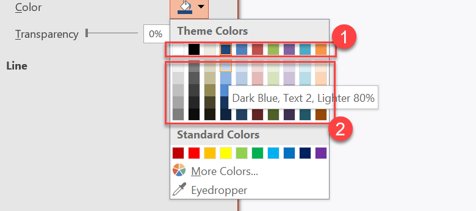

## **Bevezetés**

A prezentáció témája egy koordinált színek, betűtípusok, háttérstílusok, kitöltések, vonalak és effektek halmazát definiálja. A téma‑érzékeny objektumok ezekre a közös definíciókra hivatkoznak, ahelyett, hogy minden vizuális tulajdonságot rögzített értékként tárolnának, így egy téma változtatása egyszerre sok objektumot frissíthet.

Az Aspose.Slides-ban a prezentáció‑szintű téma a [Presentation.getMasterTheme](https://reference.aspose.com/slides/python-java/aspose.slides/presentation/#getMasterTheme) segítségével érhető el. A prezentáció alacsonyabb szinteken is tartalmazhat téma‑felülbírálásokat. Egy mester felülbírálhatja a prezentáció témáját a [MasterThemeManager.getOverrideTheme](https://reference.aspose.com/slides/python-java/aspose.slides/masterthememanager/#getOverrideTheme) segítségével, míg egy elrendezés vagy egy egyedi dia felülbírálhatja a örökölt témát a [BaseOverrideThemeManager.getOverrideTheme](https://reference.aspose.com/slides/python-java/aspose.slides/baseoverridethememanager/#getOverrideTheme) segítségével. Gyakorlatban egy dia hatékony témája ezen öröklődési láncon keresztül kerül feloldásra: prezentáció téma, mester felülbírálás, elrendezés felülbírálás és dia felülbírálás.


Az alábbi szakaszok a leggyakoribb téma‑munkafolyamatokat mutatják be: egy téma ellenőrzése, színek és betűtípusok módosítása, téma másolása vagy alkalmazása, háttér‑ és effektustílusok frissítése, valamint a hatékony értékek kiolvasása az öröklődés és a felülbírálások feloldása után.

## **Téma ellenőrzése**

A [MasterTheme](https://reference.aspose.com/slides/python-java/aspose.slides/mastertheme/) objektum a téma színsémáját, betűtípus-sémáját és formátum-sémáját teszi elérhetővé a [MasterTheme.getColorScheme](https://reference.aspose.com/slides/python-java/aspose.slides/mastertheme/#getColorScheme), a [MasterTheme.getFontScheme](https://reference.aspose.com/slides/python-java/aspose.slides/mastertheme/#getFontScheme) és a [MasterTheme.getFormatScheme](https://reference.aspose.com/slides/python-java/aspose.slides/mastertheme/#getFormatScheme) segítségével. Ezeknek a gyűjteményeknek a vizsgálata a módosítás előtt különösen hasznos, ha a prezentáció külső forrásból származik, mivel a stíluselelemek száma és tartalma változhat.

Az alábbi példa beolvassa a fő téma tulajdonságait, és jelzi, hány háttér-, kitöltés-, vonal‑ és effektus‑stílus van a témában tárolva:

```python
import jpype
import asposeslides

if not jpype.isJVMStarted():
    jpype.startJVM()

from asposeslides.api import Presentation

presentation = Presentation("input.pptx")
try:
    theme = presentation.getMasterTheme()

    print("Theme name:", theme.getName())
    print("Accent 1:", theme.getColorScheme().getAccent1().getColor())
    print("Major Latin font:", theme.getFontScheme().getMajor().getLatinFont().getFontName())
    print("Minor Latin font:", theme.getFontScheme().getMinor().getLatinFont().getFontName())
    print("Background fill styles:", theme.getFormatScheme().getBackgroundFillStyles().size())
    print("Fill styles:", theme.getFormatScheme().getFillStyles().size())
    print("Line styles:", theme.getFormatScheme().getLineStyles().size())
    print("Effect styles:", theme.getFormatScheme().getEffectStyles().size())
finally:
    presentation.dispose()
```

Ha egy fájl több mestert használ, ne feltételezzük, hogy minden dia ugyanazzal a hatékony témával rendelkezik. Ellenőrizzük a diával kapcsolatos mestert, és a későbbiekben bemutatott hatékony‑téma munkafolyamatot alkalmazzuk, ha elrendezés‑ vagy dia‑felülbírálások lehetnek jelen.

## **Téma színeinek módosítása**

A téma‑érzékeny kitöltések, vonalak és szöveg logikai színre hivatkozhat a [SchemeColor](https://reference.aspose.com/slides/python-java/aspose.slides/schemecolor/) felsorolásban. Ha a megfelelő bejegyzést módosítjuk a [ColorScheme](https://reference.aspose.com/slides/python-java/aspose.slides/colorscheme/)‑ben, minden, még mindig azt a téma‑színt referáló objektum az új értékhez lesz feloldva. A közvetlen RGB‑színt használó objektumok nem változnak meg egy téma‑szín frissítésekor.

Az alábbi vég‑ig példa egy olyan alakzatot hoz létre, amely a `Accent4` színt használja, a téma `Accent4` színét pirosra változtatja, elmenti a prezentációt, újra megnyitja, és kiírja a hatékony kitöltési színt:

```python
import jpype
import asposeslides

if not jpype.isJVMStarted():
    jpype.startJVM()

from asposeslides.api import FillType, Presentation, SaveFormat, SchemeColor, ShapeType
from java.awt import Color

presentation = Presentation()
try:
    slide = presentation.getSlides().get_Item(0)

    shape = slide.getShapes().addAutoShape(ShapeType.Rectangle, 10, 10, 100, 100)
    shape.getFillFormat().setFillType(FillType.Solid)
    shape.getFillFormat().getSolidFillColor().setSchemeColor(SchemeColor.Accent4)

    presentation.getMasterTheme().getColorScheme().getAccent4().setColor(Color.RED)

    presentation.save("theme-color.pptx", SaveFormat.Pptx)
finally:
    presentation.dispose()

saved_presentation = Presentation("theme-color.pptx")
try:
    saved_slide = saved_presentation.getSlides().get_Item(0)
    saved_shape = saved_slide.getShapes().get_Item(0)
    effective_fill = saved_shape.getFillFormat().getEffective()
    print("Effective fill color:", effective_fill.getSolidFillColor())
finally:
    saved_presentation.dispose()
```

Mivel a téglalap továbbra is a `Accent4`‑hez van kapcsolva, látható színe a téma módosítása után piros lesz. Ha a téma‑színt közvetlen színre cseréljük az alakzaton, a későbbi `Accent4` változások már nem befolyásolják azt a kitöltést.

### **Színek használata a kiegészítő palettából**

A PowerPoint világosabb és sötétebb variánsokat származtat egy téma‑színből színtranszformációk alkalmazásával. Az Aspose.Slides ezeket a transzformációkat a [ColorTransformOperation](https://reference.aspose.com/slides/python-java/aspose.slides/colortransformoperation/) felsorolásban teszi elérhetővé.



**1** – A fő téma színek.

**2** – A fő téma színeiből előállított világosabb és sötétebb variánsok.

Az alábbi példa hat téglalapot hoz létre a `Accent4` alapján, ötön luminancia‑transzformációt alkalmaz, és elmenti az eredményt:

```python
import jpype
import asposeslides

if not jpype.isJVMStarted():
    jpype.startJVM()

from asposeslides.api import ColorTransformOperation, FillType, Presentation, SaveFormat, SchemeColor, ShapeType

presentation = Presentation()
try:
    slide = presentation.getSlides().get_Item(0)

    base_shape = slide.getShapes().addAutoShape(ShapeType.Rectangle, 10, 10, 50, 50)
    base_shape.getFillFormat().setFillType(FillType.Solid)
    base_shape.getFillFormat().getSolidFillColor().setSchemeColor(SchemeColor.Accent4)

    lightest_shape = slide.getShapes().addAutoShape(ShapeType.Rectangle, 10, 70, 50, 50)
    lightest_shape.getFillFormat().setFillType(FillType.Solid)
    lightest_shape.getFillFormat().getSolidFillColor().setSchemeColor(SchemeColor.Accent4)
    lightest_shape.getFillFormat().getSolidFillColor().getColorTransform().add(ColorTransformOperation.MultiplyLuminance, 0.2)
    lightest_shape.getFillFormat().getSolidFillColor().getColorTransform().add(ColorTransformOperation.AddLuminance, 0.8)

    lighter_shape = slide.getShapes().addAutoShape(ShapeType.Rectangle, 10, 130, 50, 50)
    lighter_shape.getFillFormat().setFillType(FillType.Solid)
    lighter_shape.getFillFormat().getSolidFillColor().setSchemeColor(SchemeColor.Accent4)
    lighter_shape.getFillFormat().getSolidFillColor().getColorTransform().add(ColorTransformOperation.MultiplyLuminance, 0.4)
    lighter_shape.getFillFormat().getSolidFillColor().getColorTransform().add(ColorTransformOperation.AddLuminance, 0.6)

    light_shape = slide.getShapes().addAutoShape(ShapeType.Rectangle, 10, 190, 50, 50)
    light_shape.getFillFormat().setFillType(FillType.Solid)
    light_shape.getFillFormat().getSolidFillColor().setSchemeColor(SchemeColor.Accent4)
    light_shape.getFillFormat().getSolidFillColor().getColorTransform().add(ColorTransformOperation.MultiplyLuminance, 0.6)
    light_shape.getFillFormat().getSolidFillColor().getColorTransform().add(ColorTransformOperation.AddLuminance, 0.4)

    dark_shape = slide.getShapes().addAutoShape(ShapeType.Rectangle, 10, 250, 50, 50)
    dark_shape.getFillFormat().setFillType(FillType.Solid)
    dark_shape.getFillFormat().getSolidFillColor().setSchemeColor(SchemeColor.Accent4)
    dark_shape.getFillFormat().getSolidFillColor().getColorTransform().add(ColorTransformOperation.MultiplyLuminance, 0.75)

    darker_shape = slide.getShapes().addAutoShape(ShapeType.Rectangle, 10, 310, 50, 50)
    darker_shape.getFillFormat().setFillType(FillType.Solid)
    darker_shape.getFillFormat().getSolidFillColor().setSchemeColor(SchemeColor.Accent4)
    darker_shape.getFillFormat().getSolidFillColor().getColorTransform().add(ColorTransformOperation.MultiplyLuminance, 0.5)

    presentation.save("theme-color-palette.pptx", SaveFormat.Pptx)
finally:
    presentation.dispose()
```

Ezek a variánsok továbbra is a téma‑színen alapulnak. Ha a `Accent4` később változik, a transzformált színek újra lesznek számítva az új `Accent4` értékből.

### **A `SchemeColor` értékek leképezése a `ColorScheme` helyekre**

A [SchemeColor](https://reference.aspose.com/slides/python-java/aspose.slides/schemecolor/) felsorolás a `Text1`, `Background1`, `Text2` és `Background2` értékeket használja, míg a [ColorScheme](https://reference.aspose.com/slides/python-java/aspose.slides/colorscheme/) ugyanazokat a téma‑helyeket `Dark1`, `Light1`, `Dark2` és `Light2` néven teszi közzé. A leképezés rögzített:

* `Text1` = `Dark1`
* `Background1` = `Light1`
* `Text2` = `Dark2`
* `Background2` = `Light2`

Ezek ugyanazon téma‑helyek alternatív nevei; nem dinamikusan konvertált értékek.

## **Téma betűtípusainak módosítása**

Egy téma betűtípus‑sémája fő betűtípus‑készletet tartalmaz a címsorokhoz, illetve kisebb betűtípus‑készletet a törzs szöveghez. A [FontScheme.getMajor](https://reference.aspose.com/slides/python-java/aspose.slides/fontscheme/#getMajor) és a [FontScheme.getMinor](https://reference.aspose.com/slides/python-java/aspose.slides/fontscheme/#getMinor) metódusok teszik ezeket a készleteket elérhetővé.

A PowerPoint‑kompatibilis téma‑betűtípus azonosítók a szövegformázásban használhatók:

* `+mn-lt` – Body Font Latin (Minor Latin Font)
* `+mj-lt` – Heading Font Latin (Major Latin Font)
* `+mn-ea` – Body Font East Asian (Minor East Asian Font)
* `+mj-ea` – Heading Font East Asian (Major East Asian Font)
* `+mn-cs` – Body Font Complex Script (Minor Complex Script Font)
* `+mj-cs` – Heading Font Complex Script (Major Complex Script Font)

Az alábbi példa létrehoz egy címsort, amely a fő Latin téma‑betűtípust használja, valamint egy törzssort, amely a kisebb Latin téma‑betűtípust használja. Ezután megváltoztatja a téma betűtípusaival, és elmenti az eredményt:

```python
import jpype
import asposeslides

if not jpype.isJVMStarted():
    jpype.startJVM()

from asposeslides.api import FontData, Presentation, SaveFormat, ShapeType

presentation = Presentation()
try:
    slide = presentation.getSlides().get_Item(0)

    heading = slide.getShapes().addAutoShape(ShapeType.Rectangle, 40, 40, 500, 60)
    heading.getTextFrame().setText("Theme heading")
    font_data = FontData("+mj-lt")
    heading.getTextFrame().getParagraphs().get_Item(0).getPortions().get_Item(0).getPortionFormat().setLatinFont(font_data)

    body = slide.getShapes().addAutoShape(ShapeType.Rectangle, 40, 120, 500, 60)
    body.getTextFrame().setText("Theme body text")
    font_data = FontData("+mn-lt")
    body.getTextFrame().getParagraphs().get_Item(0).getPortions().get_Item(0).getPortionFormat().setLatinFont(font_data)

    font_data = FontData("Aptos Display")
    presentation.getMasterTheme().getFontScheme().getMajor().setLatinFont(font_data)
    font_data = FontData("Arial")
    presentation.getMasterTheme().getFontScheme().getMinor().setLatinFont(font_data)
    presentation.save("theme-fonts.pptx", SaveFormat.Pptx)
finally:
    presentation.dispose()
```

A címsor a fő betűtípust követi, a törzs szöveg a kisebb betűtípust. Az a szöveg, amely kifejezetten betűtípus‑nevet tartalmaz a téma‑azonosító helyett, nem vált automatikusan, amikor a téma betűtípus‑sémája megváltozik.

A fő és kisebb betűtípus‑gyűjtemények tartalmazhatnak betűtípus‑leképezéseket egyedi írásrendszerekhez, például cirill, arab, japán, grúz és thaana. Ezeknek a leképezéseknek az ellenőrzéséhez, hozzáadásához, cseréjéhez vagy eltávolításához lásd a [Script‑Specific Theme Fonts](/slides/hu/python-java/script-specific-font-mappings/) oldalt.

{}

További információk a prezentáció betűtípusairól a [PowerPoint Fonts](/slides/hu/python-java/powerpoint-fonts/) oldalon találhatók.

{}

### **Téma betűtípus‑referenciák feloldása**

Szöveg ellenőrzésekor a [FontData.getFontName](https://reference.aspose.com/slides/python-java/aspose.slides/fontdata/#getFontName) visszaadhat egy téma‑referenciát, például `+mn-lt`, ahelyett, hogy betűcsalád nevet adna vissza. Hívja a [FontData.getFontName](https://reference.aspose.com/slides/python-java/aspose.slides/fontdata/#getFontName)‑t a megfelelő hatékony téma adatával a referencia feloldásához. A `+mj` és `+mn` előtagok a fő és a kisebb betűtípus‑készletet jelölik; a `-lt`, `-ea` és `-cs` utótagok a latin, kelet‑ázsiai és komplex script betűtípusokat választják ki.

Szerezze be a hatékony témát a [BaseOverrideThemeManager.createThemeEffective](https://reference.aspose.com/slides/python-java/aspose.slides/baseoverridethememanager/#createThemeEffective) metódussal annak a téma‑kezelőnek, amelyik a vizsgált szöveget tartalmazó objektumra vonatkozik. Egy normál dián lévő szöveg esetén használja a dia téma‑kezelőjét, hogy a kontextus magában foglalja a dia örökölt témáját és a helyi felülbírálásokat. Egy elrendezés vagy mester ellenőrzésekor használja a saját hatékony témáját. Ne tételezze fel, hogy az első mester témája minden dia számára érvényes.

Az alábbi példa egy olyan szövegrészt hoz létre, amely kifejezetten a kisebb Latin betűtípust hivatkozza. A [OverrideTheme.initFontSchemeFromInherited](https://reference.aspose.com/slides/python-java/aspose.slides/overridetheme/#initFontSchemeFromInherited) segítségével inicializálja a dia betűtípus‑sémáját, és a fő és kisebb Latin családokat `Arial`‑ra és `Calibri`‑ra állítja, hogy az eredmény bemeneti fájl nélkül reprodukálható legyen.

```python
import jpype
import asposeslides

if not jpype.isJVMStarted():
    jpype.startJVM()

from asposeslides.api import FontData, Presentation, ShapeType

presentation = Presentation()
try:
    slide = presentation.getSlides().get_Item(0)

    theme = slide.getThemeManager().getOverrideTheme()
    theme.initFontSchemeFromInherited()
    major_font = FontData("Arial")
    theme.getFontScheme().getMajor().setLatinFont(major_font)
    minor_font = FontData("Calibri")
    theme.getFontScheme().getMinor().setLatinFont(minor_font)

    shape = slide.getShapes().addAutoShape(ShapeType.Rectangle, 20, 20, 400, 60)
    shape.getTextFrame().setText("Text using the minor theme font")

    portion = shape.getTextFrame().getParagraphs().get_Item(0).getPortions().get_Item(0)
    theme_font = FontData("+mn-lt")
    portion.getPortionFormat().setLatinFont(theme_font)

    font = portion.getPortionFormat().getLatinFont()
    effective_theme = slide.getThemeManager().createThemeEffective()
    print(f"{font.getFontName()} -> {font.getFontName(effective_theme)}")

    explicit_font = FontData("Verdana")
    print(f"{explicit_font.getFontName()} -> {explicit_font.getFontName(effective_theme)}")
finally:
    presentation.dispose()
```

A kimenet `+mn-lt -> Calibri` majd `Verdana -> Verdana`. A tárolt referencia változatlan marad, míg a kifejezett családnév változatlanul visszatér. Ha a rész `+mj-lt`‑t használt volna, ez `Arial`‑ra oldódna fel ebben a témában.

A téma‑referencia feloldása meghatározza a téma által megadott betűcsaládot. Nem ellenőrzi a betűtípus elérhetőségét, illetve nem határozza meg, hogy a helyettesítés vagy glyph fallback után melyik betűtípus‑fájl kerül végül felhasználásra a renderelés során. Lásd a [Font Selection Sequence](/slides/hu/python-java/font-selection-sequence/) és a [Font Substitution](/slides/hu/python-java/font-substitution/) oldalakat ezekhez a különálló lépésekhez.

## **Téma másolása vagy alkalmazása**

Az alábbi munkafolyamatok különböző téma‑kapcsolatos problémákat oldanak meg.

### **Külső téma alkalmazása egy mesterhez tartozó diákra**

Használja a [MasterSlide.applyExternalThemeToDependingSlides](https://reference.aspose.com/slides/python-java/aspose.slides/masterslide/#applyExternalThemeToDependingSlides) metódust, ha rendelkezik egy PowerPoint téma fájllal (`.thmx`), és minden, egy adott mesterhez tartozó diát újratervezni szeretne. Válassza ki a mestert a [Presentation.getMasters](https://reference.aspose.com/slides/python-java/aspose.slides/presentation/#getMasters) gyűjteményből, amelyet a [MasterSlideCollection](https://reference.aspose.com/slides/python-java/aspose.slides/masterslidecollection/) képvisel, majd adja át a téma fájl útvonalát a metódusnak.

A metódus a következő műveleteket hajtja végre:

1. Létrehoz egy új mester‑diát a kiválasztott mester alapján.
1. Alkalmazza a külső témát az új mesterre.
1. Hozzárendeli az új mestert minden diához, amely korábban a kiválasztott mesterhez tartozott.
1. Visszaadja a frissen létrehozott [MasterSlide](https://reference.aspose.com/slides/python-java/aspose.slides/masterslide/)‑t.

Az alábbi példa egy külső témát alkalmaz az első mesterhez tartozó diákra, és elmenti a prezentációt:

```python
import jpype
import asposeslides

if not jpype.isJVMStarted():
    jpype.startJVM()

from asposeslides.api import Presentation, SaveFormat

presentation = Presentation("presentation.pptx")
try:
    selected_master = presentation.getMasters().get_Item(0)
    themed_master = selected_master.applyExternalThemeToDependingSlides("corporate-theme.thmx")
    print("Created master:", themed_master.getName())

    presentation.save("presentation-with-external-theme.pptx", SaveFormat.Pptx)
finally:
    presentation.dispose()
```

Egy érvénytelen, sérült vagy nem támogatott téma [PptxReadException](https://reference.aspose.com/slides/python-java/aspose.slides/pptxreadexception/)-t okozhat. Érvényesítse a felhasználók által megadott útvonalakat, kezelje a fájlrendszer‑hozzáférési hibákat, és csak akkor mentse a prezentációt, ha a téma sikeresen alkalmazásra került.

Csak azok a diák, amelyek a kiválasztott mesterhez tartoztak, kerülnek újra hozzárendelésre. Az egyéb mesterekhez tartozó diák megtartják meglévő mestereiket és témáikat. A téma‑érzékeny színek, betűtípusok, kitöltések, vonalak, háttér és effektek a külső témához lesznek feloldva. A közvetlenül hozzárendelt színek, betűtípusok, kitöltések és egyéb explicit formázások változatlanok maradhatnak. Az elrendezés‑szintű és dia‑szintű felülbírálások szintén elsőbbséget élvezhetnek az új mesterből örökölt értékekkel szemben.

A téma hivatkozhat olyan betűtípusokra, amelyek nem állnak rendelkezésre a futtatási környezetben. A konzisztens renderelés és export érdekében telepítse a szükséges betűtípusokat, biztosítsa azokat [egyéni betűtípus‑forrásokon](/slides/hu/python-java/custom-font/) keresztül, vagy konfigurálja a [betűtípus‑helyettesítést](/slides/hu/python-java/font-substitution/).

Ez egy közvetlen mester‑szintű munkafolyamat: a metódus egy `.thmx` fájl elérési útját fogadja, és nem igényel manuális létrehozást dia‑ vagy elrendezés‑szintű téma‑felülbírálásokhoz.

### **Különböző külső témák alkalmazása több‑mesteres prezentációban**

Ha a releváns mester előre nem ismert, szerezze be egy reprezentatív dia segítségével a [Slide.getLayoutSlide](https://reference.aspose.com/slides/python-java/aspose.slides/slide/#getLayoutSlide) és a [LayoutSlide.getMasterSlide](https://reference.aspose.com/slides/python-java/aspose.slides/layoutslide/#getMasterSlide) metódusokkal. Tárolja az eredeti mester‑referenciákat, mielőtt bármilyen témát alkalmazna, mivel minden hívás egy új mestert hoz létre a prezentációban.

Az alábbi példa két szakaszból származó diák segítségével megtalálja a mestereiket, és minden csoporthoz különböző külső témát alkalmaz:

```python
import jpype
import asposeslides

if not jpype.isJVMStarted():
    jpype.startJVM()

from asposeslides.api import Presentation, SaveFormat

presentation = Presentation("multi-master-presentation.pptx")
try:
    if presentation.getSlides().size() < 5:
        print("The presentation does not contain the expected representative slides.")
    else:
        first_group_master = presentation.getSlides().get_Item(0).getLayoutSlide().getMasterSlide()
        second_group_master = presentation.getSlides().get_Item(4).getLayoutSlide().getMasterSlide()

        if first_group_master.getSlideId() == second_group_master.getSlideId():
            print("The representative slides use the same master.")
        else:
            first_themed_master = first_group_master.applyExternalThemeToDependingSlides("blue-theme.thmx")
            second_themed_master = second_group_master.applyExternalThemeToDependingSlides("green-theme.thmx")

            print("First themed master:", first_themed_master.getName())
            print("Second themed master:", second_themed_master.getName())

            presentation.save("multi-master-with-external-themes.pptx", SaveFormat.Pptx)
finally:
    presentation.dispose()
```

Az első hívás csak a `first_group_master`‑hez tartozó diákra hat, a második pedig csak a `second_group_master`‑hez tartozó diákra. Más mesterekhez tartozó diákok nem kapnak új stílust.

### **Forrástéma megőrzése diák áthelyezésekor**

Ha egy diát egy másik prezentációba szeretne áthelyezni, miközben megőrzi az eredeti megjelenését, klónozza a forrás‑mestert a cél‑prezentációba a [MasterSlideCollection.addClone](https://reference.aspose.com/slides/python-java/aspose.slides/masterslidecollection/#addClone) segítségével, majd klónozza a diát a [SlideCollection.addClone](https://reference.aspose.com/slides/python-java/aspose.slides/slidecollection/#addClone) és a klónozott mesterrel. Ez a mester, az elrendezései és a hozzá tartozó téma együtt kerül átvitelre.

```python
import jpype
import asposeslides

if not jpype.isJVMStarted():
    jpype.startJVM()

from asposeslides.api import Presentation, SaveFormat

source = Presentation("source-theme.pptx")
try:
    target = Presentation("target.pptx")
    try:
        source_slide = source.getSlides().get_Item(0)

        source_master = source_slide.getLayoutSlide().getMasterSlide()
        cloned_master = target.getMasters().addClone(source_master)
        target.getSlides().addClone(source_slide, cloned_master, True)

        target.save("theme-preserved.pptx", SaveFormat.Pptx)
    finally:
        target.dispose()
finally:
    source.dispose()
```

Ez az előnyben részesített munkafolyamat, ha a forrás‑diának ugyanúgy kell kinéznie a célhelyen. Csak a tartalmat klónozva egy nem kapcsolódó cél‑mesterre megváltoztathatja a téma‑vezérelt színeket, betűtípusokat, háttereket és effekteket.

### **Téma értékek alkalmazása meglévő diára**

Ha a cél‑dia a jelenlegi mesterén és elrendezésén marad, inicializáljon egy dia‑szintű felülbírálást a forrástémából. A [OverrideTheme.initColorSchemeFrom](https://reference.aspose.com/slides/python-java/aspose.slides/overridetheme/#initColorSchemeFrom), a [OverrideTheme.initFontSchemeFrom](https://reference.aspose.com/slides/python-java/aspose.slides/overridetheme/#initFontSchemeFrom) és a [OverrideTheme.initFormatSchemeFrom](https://reference.aspose.com/slides/python-java/aspose.slides/overridetheme/#initFormatSchemeFrom) metódusok a három fő téma‑komponenst másolják a felülbírálásba.

```python
import jpype
import asposeslides

if not jpype.isJVMStarted():
    jpype.startJVM()

from asposeslides.api import Presentation, SaveFormat

source = Presentation("source-theme.pptx")
try:
    target = Presentation("target.pptx")
    try:
        target_slide = target.getSlides().get_Item(0)

        override_theme = target_slide.getThemeManager().getOverrideTheme()
        override_theme.initColorSchemeFrom(source.getMasterTheme().getColorScheme())
        override_theme.initFontSchemeFrom(source.getMasterTheme().getFontScheme())
        override_theme.initFormatSchemeFrom(source.getMasterTheme().getFormatScheme())

        target.save("theme-applied-to-slide.pptx", SaveFormat.Pptx)
    finally:
        target.dispose()
finally:
    source.dispose()
```

Ez megváltoztatja a dián használt témát anélkül, hogy a többi dia örökölt témáját módosítaná. A helyi felülbírálás eltávolításához és az örökölt értékek visszaállításához hívja a [OverrideTheme.clear](https://reference.aspose.com/slides/python-java/aspose.slides/overridetheme/#clear)‑t.

### **Téma felülbírálás alkalmazása egy elrendezésre**

Az elrendezés‑szintű felülbírálás az arra a elrendezésre épülő diákra hat, hacsak egy adott dia nem rendelkezik saját felülbírálással. Ugyanazokat a inicializáló metódusokat a [LayoutSlideThemeManager](https://reference.aspose.com/slides/python-java/aspose.slides/layoutslidethememanager/) használatával is alkalmazhatja:

```python
import jpype
import asposeslides

if not jpype.isJVMStarted():
    jpype.startJVM()

from asposeslides.api import Presentation, SaveFormat

source = Presentation("source-theme.pptx")
try:
    target = Presentation("target.pptx")
    try:
        target_slide = target.getSlides().get_Item(0)

        target_layout = target_slide.getLayoutSlide()
        override_theme = target_layout.getThemeManager().getOverrideTheme()
        override_theme.initColorSchemeFrom(source.getMasterTheme().getColorScheme())
        override_theme.initFontSchemeFrom(source.getMasterTheme().getFontScheme())
        override_theme.initFormatSchemeFrom(source.getMasterTheme().getFormatScheme())

        target.save("theme-applied-to-layout.pptx", SaveFormat.Pptx)
    finally:
        target.dispose()
finally:
    source.dispose()
```

Használjon mester‑ vagy prezentáció‑szintű témát, ha sok elrendezésnek és diáknak közös alaptervet kell megosztania; elrendezés‑felülbírálást akkor, ha egy elrendezés‑család más stílust igényel, valamint dia‑felülbírálást csak valódi kivételek esetén. A túlzott dia‑szintű felülbírálások megnehezítik a későbbi globális téma‑változtatások előrejelzését.


<!-- visual-explanation:presentation-theme:start -->
[](visual-presentation-theme-20ad12f2193b.svg)

*Egy elrendezés‑felülbírálás a arra az elrendezésre épülő diákra vonatkozik, hacsak egy dia saját felülbírálást nem biztosít. A téma‑alapú értékek feloldott sémájukat követik; a kifejezetten formázott objektumok megtarthatják helyi megjelenésüket. Tartsa a felülbírálásokat olyan szűken, mint a tervezett kivétel.*
<!-- visual-explanation:presentation-theme:end -->

## **Téma háttérstílusainak frissítése**

A téma háttér‑kitöltései a [FormatScheme.getBackgroundFillStyles](https://reference.aspose.com/slides/python-java/aspose.slides/formatscheme/#getBackgroundFillStyles)‑ben tárolódnak. A PowerPoint a felhasználói felületén több háttér‑választást jeleníthet meg, mint a ténylegesen a gyűjteményben tárolt kitöltés‑definíciók száma, mivel a felület a téma‑kitöltéseket téma‑színekkel és egyéb stílus‑referenciákkal tudja kombinálni.


Mielőtt háttér‑stílust használna, ellenőrizze a tárolt gyűjteményt és az aktuális [Background.getStyleIndex](https://reference.aspose.com/slides/python-java/aspose.slides/background/#getStyleIndex) értékét. A `0`‑as stílus‑index azt jelenti, hogy nincs témához kötött kitöltés; a pozitív értékek téma‑háttér‑stílus‑referenciák. Ez eltér attól, amikor a gyűjteményt közvetlenül indexeljük, ahol a `get_Item(0)` az első tárolt elemet jelenti. Ne tételezze fel, hogy minden prezentáció ugyanannyi háttér‑kitöltés‑stílussal rendelkezik.

Az alábbi példa jelzi a rendelkezésre álló háttér‑kitöltések számát, egy téma‑háttér‑referenciát rendel az első mesterhez, és elmenti a prezentációt:

```python
import jpype
import asposeslides

if not jpype.isJVMStarted():
    jpype.startJVM()

from asposeslides.api import BackgroundType, Presentation, SaveFormat

presentation = Presentation("input.pptx")
try:
    background_styles = presentation.getMasterTheme().getFormatScheme().getBackgroundFillStyles()
    print("Background fill styles:", background_styles.size())
    if background_styles.size() == 0:
        print("The presentation theme does not contain background fill styles.")
    else:
        master_slide = presentation.getMasters().get_Item(0)
        master_slide.getBackground().setType(BackgroundType.Themed)
        master_slide.getBackground().setStyleIndex(1)

        presentation.save("theme-background.pptx", SaveFormat.Pptx)
finally:
    presentation.dispose()
```

A látható eredmény a mester által hivatkozott téma‑bejegyzéstől és az elrendezés‑ vagy dia‑szintű háttér‑felülbírálásoktól függ. Ha egy dia saját háttért használ, csak a mester háttér módosítása nem változtatja meg azt a diát. Használja a [Background.getEffective](https://reference.aspose.com/slides/python-java/aspose.slides/background/#getEffective)‑t, ha a végső háttérre van szüksége az öröklődés alkalmazása után.

{}

Ne kezelje a stílus‑indexet nullára kezdődő gyűjtemény‑indexként. Kerülje a stílus‑számok kódban történő hard‑kódolását, és ne feltételezze, hogy egy fájlban használt szám ugyanúgy néz ki egy másik fájlban; a téma‑stílus‑definíciók prezentációnként eltérnek.

{}

{}

A közvetlen háttér‑formázáshoz és a háttér‑öröklődéshez lásd a [Presentation Background](/slides/hu/python-java/presentation-background/) oldalt.

{}

## **Téma effektek frissítése**

Egy téma formátum‑sémája különálló kitöltés‑, vonal‑ és effektus‑stílus‑gyűjteményeket tartalmaz, amelyeket a [FormatScheme.getFillStyles](https://reference.aspose.com/slides/python-java/aspose.slides/formatscheme/#getFillStyles), a [FormatScheme.getLineStyles](https://reference.aspose.com/slides/python-java/aspose.slides/formatscheme/#getLineStyles) és a [FormatScheme.getEffectStyles](https://reference.aspose.com/slides/python-java/aspose.slides/formatscheme/#getEffectStyles) exponálnak. A tipikus Office‑témák gyakran három fő stíluselemet tartalmaznak, amelyek vizuálisan a finom, közepes és intenzív formázásnak felelnek meg, de a kódnak minden gyűjteményt ellenőriznie kell, ahelyett, hogy rögzített számot feltételezne.


Python‑on keresztül Java‑ban történő eléréskor a gyűjtemény indexelése nullára kezdődik: a `get_Item(0)` az első tárolt stílus, a `get_Item(2)` a harmadik. Egy alakzat stílus‑referencia indexei egy külön koncepció, amely a [ShapeStyle](https://reference.aspose.com/slides/python-java/aspose.slides/shapestyle/)‑ben jelenik meg. Egy téma‑stílus módosítása azokat az alakzatokat érinti, amelyek arra a téma‑stílusra hivatkoznak; a közvetlen formázású alakzatok változatlanok maradhatnak.

Az alábbi példa ellenőrzi, hogy a szükséges stíluselemek léteznek, módosítja az első vonal‑stílust, a harmadik kitöltés‑stílust, a harmadik effektus‑stílusban aktivál egy külső árnyékot, majd elmenti az eredményt:

```python
import jpype
import asposeslides

if not jpype.isJVMStarted():
    jpype.startJVM()

from asposeslides.api import FillType, Presentation, SaveFormat
from java.awt import Color

presentation = Presentation("Subtle_Moderate_Intense.pptx")
try:
    format_scheme = presentation.getMasterTheme().getFormatScheme()
    if format_scheme.getLineStyles().size() < 1 or format_scheme.getFillStyles().size() < 3 or format_scheme.getEffectStyles().size() < 3:
        print("The theme does not contain the style entries required by this example.")
    else:
        format_scheme.getLineStyles().get_Item(0).getFillFormat().setFillType(FillType.Solid)
        format_scheme.getLineStyles().get_Item(0).getFillFormat().getSolidFillColor().setColor(Color.RED)
        format_scheme.getFillStyles().get_Item(2).setFillType(FillType.Solid)
        forest_green = Color(34, 139, 34)
        format_scheme.getFillStyles().get_Item(2).getSolidFillColor().setColor(forest_green)
        effect_format = format_scheme.getEffectStyles().get_Item(2).getEffectFormat()
        effect_format.enableOuterShadowEffect()
        effect_format.getOuterShadowEffect().setDistance(10)

        presentation.save("theme-effects.pptx", SaveFormat.Pptx)
finally:
    presentation.dispose()
```

Az ilyen slotokra hivatkozó alakzatok esetén az első téma‑vonal‑stílus pirosra változik, a harmadik téma‑kitöltés‑stílus szilárd erdei zöld lesz, a harmadik effektus‑stílus pedig egy 10 pont távolságú külső árnyékot kap. A pontos vizuális eredmény továbbra is attól függ, hogy melyik slotra hivatkozik az adott alakzat, és hogy a közvetlen formázás felülbírálja‑e a témát.


## **Alakzat kitöltés‑ és vonal‑stílusának kiválasztása a témából**

Egy alakzat a [ShapeStyle.setFillStyleIndex](https://reference.aspose.com/slides/python-java/aspose.slides/shapestyle/#setFillStyleIndex) és a [ShapeStyle.setLineStyleIndex](https://reference.aspose.com/slides/python-java/aspose.slides/shapestyle/#setLineStyleIndex) segítségével függetlenül választhatja ki a kitöltését és a körvonalát. Mindkét metódus esetén az `1`‑es index a megfelelő téma‑gyűjtemény első bejegyzését jelöli (`get_Item(0)`), a `2`‑es index a másodikat (`get_Item(1)`).

Az alábbi példa két kitöltési stílust (arany és égszínkék) és két vonal‑stílust (sötétkék 6 pt és sötétvörös 12 pt) állít be az új prezentáció alap‑témájában. A diákat három szakaszban menti, hogy össze tudja hasonlítani az eredményeket a PowerPoint‑ban.

```python
import jpype
import asposeslides

if not jpype.isJVMStarted():
    jpype.startJVM()

from asposeslides.api import FillType, Presentation, SaveFormat, ShapeType
from java.awt import Color

presentation = Presentation()
try:
    styles = presentation.getMasterTheme().getFormatScheme()

    gold_fill = styles.getFillStyles().get_Item(0)
    gold_fill.setFillType(FillType.Solid)
    gold_fill.getSolidFillColor().setColor(Color(255, 215, 0))
    blue_fill = styles.getFillStyles().get_Item(1)
    blue_fill.setFillType(FillType.Solid)
    blue_fill.getSolidFillColor().setColor(Color(135, 206, 235))

    thin_line = styles.getLineStyles().get_Item(0)
    thin_line.getFillFormat().setFillType(FillType.Solid)
    thin_line.getFillFormat().getSolidFillColor().setColor(Color(0, 0, 139))
    thin_line.setWidth(6)
    thick_line = styles.getLineStyles().get_Item(1)
    thick_line.getFillFormat().setFillType(FillType.Solid)
    thick_line.getFillFormat().getSolidFillColor().setColor(Color(139, 0, 0))
    thick_line.setWidth(12)

    shapes = presentation.getSlides().get_Item(0).getShapes()
    left = shapes.addAutoShape(ShapeType.Rectangle, 100, 205, 200, 130)
    right = shapes.addAutoShape(ShapeType.Rectangle, 420, 205, 200, 130)
    left.getShapeStyle().setFillStyleIndex(1)
    right.getShapeStyle().setFillStyleIndex(2)
    left.getShapeStyle().setLineStyleIndex(1)
    right.getShapeStyle().setLineStyleIndex(1)
    presentation.save("01-initial.pptx", SaveFormat.Pptx)

    right.getShapeStyle().setLineStyleIndex(2)
    presentation.save("02-line-changed.pptx", SaveFormat.Pptx)

    gold_fill.getSolidFillColor().setColor(Color(46, 139, 87))
    presentation.save("03-theme-changed.pptx", SaveFormat.Pptx)
finally:
    presentation.dispose()
```

| Kiinduló stílusok | A jobb körvonal módosítása | Az első téma‑kitöltés szerkesztése |
|:---:|:---:|:---:|
|  |  |  |

Eltérő vonal‑stílus kiválasztása csak a jobb téglalap körvonalát változtatja. Az első téma‑kitöltés szerkesztése minden olyan alakzatot frissít, amely azt használja. Itt csak a bal téglalap válik zöldre.

Egy meglévő alakzaton egy helyi kitöltési szín, vonal‑szín vagy vonal‑szélesség felülbírálhatja a téma‑stílus ezen részét. Ha egy stílus‑index módosítása nem hoz látható változást, ellenőrizze az alakzat [közvetlen formázását](/slides/hu/python-java/shape-formatting/).

## **Megállapítás, hogy a hatékony szilárd kitöltés téma‑színt használ-e**

A kitöltés közvetlenül egy objektumon tárolható, vagy egy bekezdés‑, elrendezés‑, mester‑, téma‑stílus‑ vagy egyéb formázási szintből örökölhető. Hívja a [FillFormat.getEffective](https://reference.aspose.com/slides/python-java/aspose.slides/fillformat/#getEffective)‑t, hogy a hierarchiát egy változtathatatlan hatékony kitöltési adatba feloldja. Először ellenőrizze a `getFillType`‑ot a hatékony adatobjektumban. Csak akkor olvassa ki a szilárd‑kitöltés tulajdonságait, ha az `FillType.Solid`.

Szilárd kitöltés esetén a `getSolidFillColor` adja vissza a végső renderelt RGB‑értéket az öröklődés, téma‑keresés és színtranszformációk alkalmazása után. A `getSolidFillSchemeColor` visszaadja a megfelelő logikai [SchemeColor](https://reference.aspose.com/slides/python-java/aspose.slides/schemecolor/) slotot, például `Text1` vagy `Accent6`. A `SchemeColor.NotDefined` érték azt jelenti, hogy a hatékony szilárd kitöltés nem egy schemából származik. Egy olyan munkafolyamatban, ahol a kitöltések vagy téma‑színek vagy közvetlen RGB‑színek, ez az érték egy közvetlen RGB‑kitöltést jelöl.

Ne csak a helyi [ColorFormat.getSchemeColor](https://reference.aspose.com/slides/python-java/aspose.slides/colorformat/#getSchemeColor) értéket használja a kitöltés besorolásához. Például egy szövegrésznek lehet nincs helyi schemecolor‑definíciója, így a helyi értéke `NotDefined`, míg a hatékony kitöltés örökölt egy téma‑színt, és `Text1`‑re vagy `Accent6`‑ra oldódik fel. Ezzel szemben a `getSolidFillSchemeColor` megmondja, mely logikai téma‑slot adta a hatékony színt, de nem jelzi, hogy ez a slot az objektumtól, bekezdéstől, elrendezéstől, mestertől vagy más szinttől származik-e.

Az alábbi példa betölti a prezentációt, ellenőrzi az alakzat‑ és szövegrész‑kitöltéseket, kiírja minden végső RGB‑értéket és a kapcsolódó schemecolor‑t, valamint jelzi azokat a szilárd kitöltéseket, amelyek nem követik a téma‑szín változásait:

```python
import jpype
import asposeslides

if not jpype.isJVMStarted():
    jpype.startJVM()

from asposeslides.api import AutoShape, FillType, Presentation, SchemeColor

def audit_fill(object_name, local_fill):
    effective_fill = local_fill.getEffective()
    if effective_fill.getFillType() != FillType.Solid:
        print(f"{object_name}: fill type = {effective_fill.getFillType()}; not a solid fill.")
        return

    rgb = effective_fill.getSolidFillColor()
    effective_scheme_color = effective_fill.getSolidFillSchemeColor()
    local_scheme_color = local_fill.getSolidFillColor().getSchemeColor()
    print(f"{object_name}: RGB = #{rgb.getRed():02X}{rgb.getGreen():02X}{rgb.getBlue():02X}")
    print(f"{object_name}: local scheme = {local_scheme_color}, effective scheme = {effective_scheme_color}")
    if effective_scheme_color == SchemeColor.NotDefined:
        print(f"{object_name}: direct RGB or another non-scheme fill; audit as theme-independent.")
    else:
        print(f"{object_name}: theme-dependent through {effective_scheme_color}.")


presentation = Presentation("input.pptx")
try:
    for slide_index, slide in enumerate(presentation.getSlides()):
        for shape_index, shape in enumerate(slide.getShapes()):
            shape_name = f"Slide {slide_index + 1}, shape {shape_index + 1}"
            audit_fill(shape_name, shape.getFillFormat())
            if isinstance(shape, AutoShape):
                for paragraph_index, paragraph in enumerate(shape.getTextFrame().getParagraphs()):
                    for portion_index, portion in enumerate(paragraph.getPortions()):
                        portion_name = f"{shape_name}, paragraph {paragraph_index + 1}, portion {portion_index + 1}"
                        audit_fill(portion_name, portion.getPortionFormat().getFillFormat())
finally:
    presentation.dispose()
```

A `NotDefined` ága egy auditlistát ad a szilárd kitöltésekről, amelyek nem reagálnak a téma‑szín slotok változására. Tekintse át ezeket az objektumokat, amikor egy prezentációnak egy új márkaszínpaletta szerint kell működnie. A jelentett RGB‑érték továbbra is a jelenlegi megjelenést mutatja, míg a scheme‑érték magyarázza, hogy ez a megjelenés kapcsolódik‑e a témához.

A hatékony‑formátum objektumok pillanatfelvételek. A prezentáció téma, egy téma‑felülbírálás vagy bármely örökölt formázás módosítása után hívja a `getEffective`‑et újra, és olvassa ki az új hatékony kitöltési adatot, mielőtt összehasonlítaná vagy jelenteni szeretné a színeket.

## **Hatékony témaértékek olvasása**

A nyers témaobjektumok megmutatják, mi van definiálva egy adott szinten. A hatékony értékek azt mutatják, hogy egy dia vagy alakzat valójában mit használ az öröklődés és a helyi felülbírálások feloldása után. Egy dia esetén hívja a [BaseOverrideThemeManager.createThemeEffective](https://reference.aspose.com/slides/python-java/aspose.slides/baseoverridethememanager/#createThemeEffective)-t. Háttérhez használja a [Background.getEffective](https://reference.aspose.com/slides/python-java/aspose.slides/background/#getEffective), kitöltéshez pedig a [FillFormat.getEffective](https://reference.aspose.com/slides/python-java/aspose.slides/fillformat/#getEffective)-t.

Az alábbi példa beolvassa a hatékony témát, a háttért és az első alakzat kitöltését egy diákról:

```python
import jpype
import asposeslides

if not jpype.isJVMStarted():
    jpype.startJVM()

from asposeslides.api import FillType, Presentation

presentation = Presentation("input.pptx")
try:
    slide = presentation.getSlides().get_Item(0)

    effective_theme = slide.getThemeManager().createThemeEffective()
    effective_background = slide.getBackground().getEffective()
    
    print("Effective major Latin font:", effective_theme.getFontScheme().getMajor().getLatinFont().getFontName())
    print("Effective minor Latin font:", effective_theme.getFontScheme().getMinor().getLatinFont().getFontName())
    print("Effective background fill type:", effective_background.getFillFormat().getFillType())
    if slide.getShapes().size() > 0:
        effective_fill = slide.getShapes().get_Item(0).getFillFormat().getEffective()
        print("First shape effective fill type:", effective_fill.getFillType())
        if effective_fill.getFillType() == FillType.Solid:
            print("First shape effective fill color:", effective_fill.getSolidFillColor())
finally:
    presentation.dispose()
```

Használja a hatékony adatot renderelési diagnosztikához, validáláshoz és összehasonlításokhoz. Ha csak a [Presentation.getMasterTheme](https://reference.aspose.com/slides/python-java/aspose.slides/presentation/#getMasterTheme)‑t vizsgálja, lemaradhat egy mester, elrendezés, dia vagy alakzat felülbírálásáról, amely megváltoztatja a végső megjelenést.

## **GYIK**

**Az külső téma alkalmazása minden diára hat a prezentációban?**

Nem. A [MasterSlide.applyExternalThemeToDependingSlides](https://reference.aspose.com/slides/python-java/aspose.slides/masterslide/#applyExternalThemeToDependingSlides) csak azon diákra vonatkozik, amelyek a kiválasztott mestert használják. A más mestereket használó diák megtartják meglévő témáikat.

**Alkalmazhatok témát egyetlen diára anélkül, hogy a mestert módosítanám?**

Igen. Használja a dia [SlideThemeManager](https://reference.aspose.com/slides/python-java/aspose.slides/slidethememanager/)‑jét, és inicializálja annak felülbírálás‑témáját. A módosítás csak arra a diára marad helyi, a többi dia továbbra is a meglévő témáját örökli.

**Mi a legbiztonságosabb módja annak, hogy egy téma egy prezentációból a másikba kerüljön?**

Diák áthelyezésekor és eredeti megjelenésének megőrzésekor klónozza a forrás‑mestert a célba, majd a diát a mesterrel együtt a [MasterSlideCollection.addClone](https://reference.aspose.com/slides/python-java/aspose.slides/masterslidecollection/#addClone) és a [SlideCollection.addClone](https://reference.aspose.com/slides/python-java/aspose.slides/slidecollection/#addClone) segítségével. Ez együtt tartja a mestert, az elrendezéseket és a témát.

**Hogyan tekinthetem meg a hatékony értékeket az öröklődés és a felülbírálások után?**

Használja a [BaseOverrideThemeManager.createThemeEffective](https://reference.aspose.com/slides/python-java/aspose.slides/baseoverridethememanager/#createThemeEffective)‑t egy dia vagy elrendezés témához, valamint a megfelelő hatékony‑adat metódusokat formátum‑objektumokhoz, például a [Background.getEffective](https://reference.aspose.com/slides/python-java/aspose.slides/background/#getEffective) és a [FillFormat.getEffective](https://reference.aspose.com/slides/python-java/aspose.slides/fillformat/#getEffective)‑t. Ezek az API‑k a öröklődés és a felülbírálások után feloldott értékeket adják vissza.