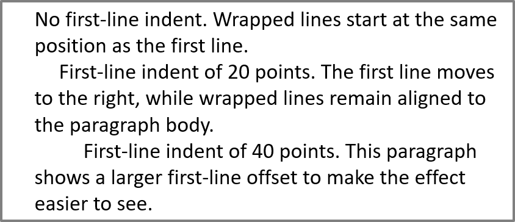

## **Áttekintés**

Az Aspose.Slides for Python via .NET a szöveget a szövegkeretek, bekezdések és részek hierarchiájaként ábrázolja:

* [TextFrame](https://reference.aspose.com/slides/python-net/aspose.slides/textframe/) egy alakzatban a szöveg tárolóját képviseli, és hozzáférést biztosít a bekezdésgyűjteményéhez.
* [Paragraph](https://reference.aspose.com/slides/python-net/aspose.slides/paragraph/) egy bekezdést képvisel egy szövegkeretben, és hozzáférést biztosít a részeihez és a bekezdés‑szintű formázáshoz.
* [Portion](https://reference.aspose.com/slides/python-net/aspose.slides/portion/) egy szövegrészt képvisel egy bekezdésen belül. Minden résznek saját szövege és karakter‑szintű formázása lehet.

Ezért egy bekezdés különböző betűtípusokkal, színekkel, méretekkel és egyéb formázással rendelkező szöveget tartalmazhat több rész használatával.

## **Bekezdések létrehozása és formázása**

Hozzon létre bekezdéseket egy alakzat szövegkeretében, és használjon részeket az egyedi szövegrészek formázásához. Ez a szakasz bemutatja, hogyan kombinálhat több részt minden bekezdésben, és alkalmazhat különböző színeket, betűméreteket és stílusokat.

### **Bekezdések létrehozása több részzel**

A következő Python‑példa három bekezdést hoz létre, mindegyik három szövegrészt tartalmaz a [Paragraph.portions](https://reference.aspose.com/slides/python-net/aspose.slides/paragraph/portions/) gyűjteményében. Újra felhasználja az alapértelmezett bekezdést és annak üres részét, majd hozzáadja a maradék bekezdéseket és részeket. A formázást a [Portion.portion_format](https://reference.aspose.com/slides/python-net/aspose.slides/portion/portion_format/) segítségével alkalmazza: az első rész minden bekezdésben piros, félkövér és 15 pont; a második kék, dőlt és 18 pont. A harmadik rész megtartja az alapértelmezett formázást:

```python
import aspose.pydrawing as draw
import aspose.slides as slides

with slides.Presentation() as presentation:
    slide = presentation.slides[0]

    shape = slide.shapes.add_auto_shape(slides.ShapeType.RECTANGLE, 50, 150, 300, 150)
    text_frame = shape.text_frame

    first_paragraph = text_frame.paragraphs[0]
    first_paragraph.portions.add(slides.Portion())
    first_paragraph.portions.add(slides.Portion())

    second_paragraph = slides.Paragraph()
    second_paragraph.portions.add(slides.Portion())
    second_paragraph.portions.add(slides.Portion())
    second_paragraph.portions.add(slides.Portion())
    text_frame.paragraphs.add(second_paragraph)

    third_paragraph = slides.Paragraph()
    third_paragraph.portions.add(slides.Portion())
    third_paragraph.portions.add(slides.Portion())
    third_paragraph.portions.add(slides.Portion())
    text_frame.paragraphs.add(third_paragraph)

    for paragraph_index in range(text_frame.paragraphs.count):
        paragraph = text_frame.paragraphs[paragraph_index]
        for portion_index in range(paragraph.portions.count):
            portion = paragraph.portions[portion_index]
            portion.text = f"Portion {paragraph_index + 1}.{portion_index + 1}"

            if portion_index == 0:
                portion.portion_format.fill_format.fill_type = slides.FillType.SOLID
                portion.portion_format.fill_format.solid_fill_color.color = draw.Color.red
                portion.portion_format.font_bold = slides.NullableBool.TRUE
                portion.portion_format.font_height = 15
            elif portion_index == 1:
                portion.portion_format.fill_format.fill_type = slides.FillType.SOLID
                portion.portion_format.fill_format.solid_fill_color.color = draw.Color.blue
                portion.portion_format.font_italic = slides.NullableBool.TRUE
                portion.portion_format.font_height = 18

    presentation.save("paragraphs_with_portions.pptx", slides.export.SaveFormat.PPTX)
```

## **Felsorolásos és számozott listák létrehozása**

Szervezze a bekezdés szövegét listákba szimbólumokkal, számokkal vagy egyedi képekkel. Ebben a szakaszban a felsorolásformázás, a többszintű listák és az egyedi kezdőszámok kerülnek bemutatásra.

### **Felsorolásos vagy számozott lista létrehozása**

A felsorolások és a számozás megkönnyítik a kapcsolódó elemek átláthatóságát. Az Aspose.Slides‑ben a lista beállításait a [BulletFormat](https://reference.aspose.com/slides/python-net/aspose.slides/bulletformat/) határozza meg.

Ez a Python‑példa egy szimbólum‑felsorolást és egy számozott elemet ad ugyanahhoz a szövegkerethez. A [BulletFormat.type](https://reference.aspose.com/slides/python-net/aspose.slides/bulletformat/type/) a felsorolás típusát választja, míg a [BulletFormat.char](https://reference.aspose.com/slides/python-net/aspose.slides/bulletformat/char/) a szimbólumot, a [BulletFormat.numbered_bullet_style](https://reference.aspose.com/slides/python-net/aspose.slides/bulletformat/numbered_bullet_style/) a számozási stílust adja meg. Mindkét elem fekete felsorolásjelet használ 100 %-os magassággal és 25 pont bekezdésbehúzással:

```python
import aspose.pydrawing as draw
import aspose.slides as slides

with slides.Presentation() as presentation:
    slide = presentation.slides[0]

    shape = slide.shapes.add_auto_shape(slides.ShapeType.RECTANGLE, 200, 200, 400, 200)
    text_frame = shape.text_frame
    text_frame.paragraphs.clear()

    symbol_paragraph = slides.Paragraph()
    symbol_paragraph.text = "Welcome to Aspose.Slides"
    symbol_paragraph.paragraph_format.bullet.type = slides.BulletType.SYMBOL
    symbol_paragraph.paragraph_format.bullet.char = chr(0x2022)
    symbol_paragraph.paragraph_format.indent = 25
    symbol_paragraph.paragraph_format.bullet.color.color_type = slides.ColorType.RGB
    symbol_paragraph.paragraph_format.bullet.color.color = draw.Color.black
    symbol_paragraph.paragraph_format.bullet.is_bullet_hard_color = slides.NullableBool.TRUE
    symbol_paragraph.paragraph_format.bullet.height = 100
    text_frame.paragraphs.add(symbol_paragraph)

    numbered_paragraph = slides.Paragraph()
    numbered_paragraph.text = "This is a numbered item"
    numbered_paragraph.paragraph_format.bullet.type = slides.BulletType.NUMBERED
    numbered_paragraph.paragraph_format.bullet.numbered_bullet_style = slides.NumberedBulletStyle.BULLET_CIRCLE_NUM_WD_BLACK_PLAIN
    numbered_paragraph.paragraph_format.indent = 25
    numbered_paragraph.paragraph_format.bullet.color.color_type = slides.ColorType.RGB
    numbered_paragraph.paragraph_format.bullet.color.color = draw.Color.black
    numbered_paragraph.paragraph_format.bullet.is_bullet_hard_color = slides.NullableBool.TRUE
    numbered_paragraph.paragraph_format.bullet.height = 100
    text_frame.paragraphs.add(numbered_paragraph)

    presentation.save("bulleted_and_numbered_list.pptx", slides.export.SaveFormat.PPTX)
```

### **Képes felsorolásjel használata**

A képes felsorolásjel lehetővé teszi egy egyedi kép használatát szimbólum vagy szám helyett.

A példa a munkakönyvtárban elérhető `bullets.png` fájlt igényli. Ez a Python‑példa egy képet ad a prezentáció képgyűjteményéhez [PPImage](https://reference.aspose.com/slides/python-net/aspose.slides/ppimage/) formájában, és bekezdés‑felsorolásként használja. A [BulletFormat.type](https://reference.aspose.com/slides/python-net/aspose.slides/bulletformat/type/) értéke képes felsorolásjel, a kép hozzárendelése pedig a [BulletFormat.picture](https://reference.aspose.com/slides/python-net/aspose.slides/bulletformat/picture/) segítségével történik. A [BulletFormat.height](https://reference.aspose.com/slides/python-net/aspose.slides/bulletformat/height/) 100 %-ra van állítva, hogy a felsorolásjel a bekezdés szövegéhez viszonyítva legyen méretezve:

```python
import aspose.slides as slides

with slides.Presentation() as presentation:
    slide = presentation.slides[0]

    with slides.Images.from_file("bullets.png") as bullet_image:
        presentation_image = presentation.images.add_image(bullet_image)

    shape = slide.shapes.add_auto_shape(slides.ShapeType.RECTANGLE, 200, 200, 400, 200)
    text_frame = shape.text_frame
    text_frame.paragraphs.clear()

    paragraph = slides.Paragraph()
    paragraph.text = "Welcome to Aspose.Slides"
    paragraph.paragraph_format.bullet.type = slides.BulletType.PICTURE
    paragraph.paragraph_format.bullet.picture.image = presentation_image
    paragraph.paragraph_format.bullet.height = 100
    text_frame.paragraphs.add(paragraph)

    presentation.save("picture_bullet.pptx", slides.export.SaveFormat.PPTX)
    presentation.save("picture_bullet.ppt", slides.export.SaveFormat.PPT)
```

### **Többszintű lista létrehozása**

A [ParagraphFormat.depth](https://reference.aspose.com/slides/python-net/aspose.slides/paragraphformat/depth/) beállítással a bekezdéseket a lista különböző szintjeire helyezhetjük. A legfelső szint mélysége `0`.

Ez a Python‑példa a [ParagraphFormat.depth](https://reference.aspose.com/slides/python-net/aspose.slides/paragraphformat/depth/) értékét 0‑tól 3‑ig rendeli négy bekezdéshez, egy szövegkereten belül hierarchiát hozva létre. Minden bekezdés szimbólum‑felsorolást használ, a [BulletFormat.char](https://reference.aspose.com/slides/python-net/aspose.slides/bulletformat/char/) váltogatva a kör alakú felsorolás és a kötőjel között a szomszédos szintek megkülönböztetésére:

```python
import aspose.pydrawing as draw
import aspose.slides as slides

with slides.Presentation() as presentation:
    slide = presentation.slides[0]

    shape = slide.shapes.add_auto_shape(slides.ShapeType.RECTANGLE, 200, 200, 400, 200)
    text_frame = shape.text_frame
    text_frame.paragraphs.clear()

    first_paragraph = slides.Paragraph()
    first_paragraph.text = "Content"
    first_paragraph.paragraph_format.bullet.type = slides.BulletType.SYMBOL
    first_paragraph.paragraph_format.bullet.char = chr(0x2022)
    first_paragraph.paragraph_format.default_portion_format.fill_format.fill_type = slides.FillType.SOLID
    first_paragraph.paragraph_format.default_portion_format.fill_format.solid_fill_color.color = draw.Color.black
    first_paragraph.paragraph_format.depth = 0

    second_paragraph = slides.Paragraph()
    second_paragraph.text = "Second level"
    second_paragraph.paragraph_format.bullet.type = slides.BulletType.SYMBOL
    second_paragraph.paragraph_format.bullet.char = "-"
    second_paragraph.paragraph_format.default_portion_format.fill_format.fill_type = slides.FillType.SOLID
    second_paragraph.paragraph_format.default_portion_format.fill_format.solid_fill_color.color = draw.Color.black
    second_paragraph.paragraph_format.depth = 1

    third_paragraph = slides.Paragraph()
    third_paragraph.text = "Third level"
    third_paragraph.paragraph_format.bullet.type = slides.BulletType.SYMBOL
    third_paragraph.paragraph_format.bullet.char = chr(0x2022)
    third_paragraph.paragraph_format.default_portion_format.fill_format.fill_type = slides.FillType.SOLID
    third_paragraph.paragraph_format.default_portion_format.fill_format.solid_fill_color.color = draw.Color.black
    third_paragraph.paragraph_format.depth = 2

    fourth_paragraph = slides.Paragraph()
    fourth_paragraph.text = "Fourth level"
    fourth_paragraph.paragraph_format.bullet.type = slides.BulletType.SYMBOL
    fourth_paragraph.paragraph_format.bullet.char = "-"
    fourth_paragraph.paragraph_format.default_portion_format.fill_format.fill_type = slides.FillType.SOLID
    fourth_paragraph.paragraph_format.default_portion_format.fill_format.solid_fill_color.color = draw.Color.black
    fourth_paragraph.paragraph_format.depth = 3

    text_frame.paragraphs.add(first_paragraph)
    text_frame.paragraphs.add(second_paragraph)
    text_frame.paragraphs.add(third_paragraph)
    text_frame.paragraphs.add(fourth_paragraph)

    presentation.save("multilevel_list.pptx", slides.export.SaveFormat.PPTX)
```

### **Számozott listaelemek indítása egyedi értékekkel**

Használja a [BulletFormat.numbered_bullet_start_with](https://reference.aspose.com/slides/python-net/aspose.slides/bulletformat/numbered_bullet_start_with/) beállítást egy számozott bekezdés kezdeti számának meghatározásához.

Ez a Python‑példa a [BulletFormat.type](https://reference.aspose.com/slides/python-net/aspose.slides/bulletformat/type/) értékét számozásra állítja három bekezdésnél, és a [BulletFormat.numbered_bullet_start_with](https://reference.aspose.com/slides/python-net/aspose.slides/bulletformat/numbered_bullet_start_with/) értékeinek 2, 3 és 7 beállításával. A kezdő érték minden bekezdésnél külön kerül konfigurálásra, lehetővé téve, hogy a megjelenített számok kihagyjanak értékeket:

```python
import aspose.slides as slides

with slides.Presentation() as presentation:
    slide = presentation.slides[0]

    shape = slide.shapes.add_auto_shape(slides.ShapeType.RECTANGLE, 200, 200, 400, 200)
    text_frame = shape.text_frame
    text_frame.paragraphs.clear()

    first_paragraph = slides.Paragraph()
    first_paragraph.text = "Start at 2"
    first_paragraph.paragraph_format.bullet.type = slides.BulletType.NUMBERED
    first_paragraph.paragraph_format.bullet.numbered_bullet_start_with = 2
    text_frame.paragraphs.add(first_paragraph)

    second_paragraph = slides.Paragraph()
    second_paragraph.text = "Start at 3"
    second_paragraph.paragraph_format.bullet.type = slides.BulletType.NUMBERED
    second_paragraph.paragraph_format.bullet.numbered_bullet_start_with = 3
    text_frame.paragraphs.add(second_paragraph)

    third_paragraph = slides.Paragraph()
    third_paragraph.text = "Start at 7"
    third_paragraph.paragraph_format.bullet.type = slides.BulletType.NUMBERED
    third_paragraph.paragraph_format.bullet.numbered_bullet_start_with = 7
    text_frame.paragraphs.add(third_paragraph)

    presentation.save("custom_numbered_list.pptx", slides.export.SaveFormat.PPTX)
```

## **A bekezdés elrendezésének és végjellemzőinek vezérlése**

Állítsa be a bekezdés margóit és behúzásait, hogy szabályozza az első sor és a tördelés helyzetét. A bekezdés befejező jelét is formázhatja külön a látható szövegrészektől.

### **Első sor behúzás beállítása**

Használja a [ParagraphFormat.indent](https://reference.aspose.com/slides/python-net/aspose.slides/paragraphformat/indent/) tulajdonságot a bekezdés első sorának behúzásához. Ez a tulajdonság csak az első sort mozgatja a bekezdés bal margójához képest. Pozitív érték esetén az első sor jobbra kerül, míg a többi sor a bekezdés törzséhez igazodik.

Használja a [ParagraphFormat.margin_left](https://reference.aspose.com/slides/python-net/aspose.slides/paragraphformat/margin_left/) tulajdonságot, ha az egész bekezdést szeretné eltolni. Használja a [ParagraphFormat.indent](https://reference.aspose.com/slides/python-net/aspose.slides/paragraphformat/indent/) tulajdonságot, ha csak az első sort kívánja eltolni.

A következő példa három bekezdésnek ugyanazt a [ParagraphFormat.margin_left](https://reference.aspose.com/slides/python-net/aspose.slides/paragraphformat/margin_left/) értékét (20 pont) adja, a [ParagraphFormat.indent](https://reference.aspose.com/slides/python-net/aspose.slides/paragraphformat/indent/) értékét pedig 0, 20 és 40 pontként állítja be. Az első sorok fokozatosan nagyobb eltolással indulnak, míg a tördelt sorok megtartják ugyanazt a bal margót:

```python
import aspose.pydrawing as draw
import aspose.slides as slides

with slides.Presentation() as presentation:
    slide = presentation.slides[0]

    shape = slide.shapes.add_auto_shape(slides.ShapeType.RECTANGLE, 50, 50, 420, 220)
    shape.fill_format.fill_type = slides.FillType.NO_FILL
    shape.line_format.fill_format.fill_type = slides.FillType.SOLID
    shape.line_format.fill_format.solid_fill_color.color = draw.Color.gray

    text_frame = shape.text_frame
    text_frame.text_frame_format.autofit_type = slides.TextAutofitType.SHAPE
    text_frame.paragraphs.clear()

    first_paragraph = slides.Paragraph()
    first_paragraph.text = "No first-line indent. Wrapped lines start at the same position as the first line."
    first_paragraph.paragraph_format.default_portion_format.fill_format.fill_type = slides.FillType.SOLID
    first_paragraph.paragraph_format.default_portion_format.fill_format.solid_fill_color.color = draw.Color.black
    first_paragraph.paragraph_format.margin_left = 20
    first_paragraph.paragraph_format.indent = 0

    second_paragraph = slides.Paragraph()
    second_paragraph.text = "First-line indent of 20 points. The first line moves to the right, while wrapped lines remain aligned to the paragraph body."
    second_paragraph.paragraph_format.default_portion_format.fill_format.fill_type = slides.FillType.SOLID
    second_paragraph.paragraph_format.default_portion_format.fill_format.solid_fill_color.color = draw.Color.black
    second_paragraph.paragraph_format.margin_left = 20
    second_paragraph.paragraph_format.indent = 20

    third_paragraph = slides.Paragraph()
    third_paragraph.text = "First-line indent of 40 points. This paragraph shows a larger first-line offset to make the effect easier to see."
    third_paragraph.paragraph_format.default_portion_format.fill_format.fill_type = slides.FillType.SOLID
    third_paragraph.paragraph_format.default_portion_format.fill_format.solid_fill_color.color = draw.Color.black
    third_paragraph.paragraph_format.margin_left = 20
    third_paragraph.paragraph_format.indent = 40

    text_frame.paragraphs.add(first_paragraph)
    text_frame.paragraphs.add(second_paragraph)
    text_frame.paragraphs.add(third_paragraph)

    presentation.save("paragraph_indent.pptx", slides.export.SaveFormat.PPTX)
```

Az eredmény:



### **Függő behúzás beállítása**

A függő behúzás olyan bekezdéselrendezés, ahol az első sor a többi sor bal oldalán kezdődik. Az Aspose.Slides‑ben ezt a hatást a [ParagraphFormat.indent](https://reference.aspose.com/slides/python-net/aspose.slides/paragraphformat/indent/) tulajdonsággal hozhatja létre. Az `indent` negatív értékre állításával az első sor balra kerül a bekezdés törzséhez képest.

Gyakorlatban a [ParagraphFormat.margin_left](https://reference.aspose.com/slides/python-net/aspose.slides/paragraphformat/margin_left/) határozza meg a bekezdés törzsének bal pozícióját, a [ParagraphFormat.indent](https://reference.aspose.com/slides/python-net/aspose.slides/paragraphformat/indent/) pedig az első sor pozícióját ehhez a margóhoz képest. Függő behúzás létrehozásához állítson be pozitív `margin_left` értéket és negatív `indent` értéket.

Ez a formázás hasznos bibliográfiák, hivatkozások, szószedetek és más olyan bekezdések esetén, ahol a tördelt soroknak a bekezdés törzsének alá kell illeszkedniük, nem pedig az első sor első karaktere alá.

A következő Python‑példa a [ParagraphFormat.margin_left](https://reference.aspose.com/slides/python-net/aspose.slides/paragraphformat/margin_left/) értékeit 40 és 60 ponttal párosítja a [ParagraphFormat.indent](https://reference.aspose.com/slides/python-net/aspose.slides/paragraphformat/indent/) -20 és -30 pont értékeivel. Minden bekezdésnél az első sor a tördelt sorok bal oldalán kezdődik; a második bekezdés mélyebb függő behúzást kap:

```python
import aspose.pydrawing as draw
import aspose.slides as slides

with slides.Presentation() as presentation:
    slide = presentation.slides[0]

    shape = slide.shapes.add_auto_shape(slides.ShapeType.RECTANGLE, 50, 50, 420, 220)
    shape.fill_format.fill_type = slides.FillType.NO_FILL
    shape.line_format.fill_format.fill_type = slides.FillType.SOLID
    shape.line_format.fill_format.solid_fill_color.color = draw.Color.gray

    text_frame = shape.text_frame
    text_frame.text_frame_format.autofit_type = slides.TextAutofitType.SHAPE
    text_frame.paragraphs.clear()

    first_paragraph = slides.Paragraph()
    first_paragraph.text = "A hanging indent is created by combining a positive left margin with a negative indent. The first line starts to the left, while wrapped lines align with the paragraph body."
    first_paragraph.paragraph_format.default_portion_format.fill_format.fill_type = slides.FillType.SOLID
    first_paragraph.paragraph_format.default_portion_format.fill_format.solid_fill_color.color = draw.Color.black
    first_paragraph.paragraph_format.margin_left = 40
    first_paragraph.paragraph_format.indent = -20

    second_paragraph = slides.Paragraph()
    second_paragraph.text = "This second example uses a deeper hanging indent so the difference between the first line and the wrapped lines is easier to compare."
    second_paragraph.paragraph_format.default_portion_format.fill_format.fill_type = slides.FillType.SOLID
    second_paragraph.paragraph_format.default_portion_format.fill_format.solid_fill_color.color = draw.Color.black
    second_paragraph.paragraph_format.margin_left = 60
    second_paragraph.paragraph_format.indent = -30

    text_frame.paragraphs.add(first_paragraph)
    text_frame.paragraphs.add(second_paragraph)

    presentation.save("hanging_indent.pptx", slides.export.SaveFormat.PPTX)
```

Az eredmény:


### **A bekezdés végének futtatási tulajdonságainak beállítása**

A [Paragraph.end_paragraph_portion_format](https://reference.aspose.com/slides/python-net/aspose.slides/paragraph/end_paragraph_portion_format/) tulajdonság a bekezdés zárójelzésének formázását szabályozza. A példa betölti a `Test.pptx` fájlt, amelynek legalább egy diát kell tartalmaznia, és létrehoz egy [PortionFormat](https://reference.aspose.com/slides/python-net/aspose.slides/portionformat/) objektumot, amelynek a [PortionFormat.font_height](https://reference.aspose.com/slides/python-net/aspose.slides/portionformat/font_height/) értéke 48 pont, a [PortionFormat.latin_font](https://reference.aspose.com/slides/python-net/aspose.slides/portionformat/latin_font/) értéke pedig Times New Roman. Ezt a formátumot a második bekezdés végjelére rendeli, a látható szövegrészeket érintetlenül hagyva:

```python
import aspose.slides as slides

with slides.Presentation("Test.pptx") as presentation:
    slide = presentation.slides[0]

    shape = slide.shapes.add_auto_shape(slides.ShapeType.RECTANGLE, 10, 10, 200, 250)
    text_frame = shape.text_frame
    text_frame.paragraphs.clear()

    first_paragraph = slides.Paragraph()
    first_paragraph.portions.add(slides.Portion("Sample text"))

    second_paragraph = slides.Paragraph()
    second_paragraph.portions.add(slides.Portion("Sample text 2"))

    end_paragraph_format = slides.PortionFormat()
    end_paragraph_format.font_height = 48
    end_paragraph_format.latin_font = slides.FontData("Times New Roman")
    second_paragraph.end_paragraph_portion_format = end_paragraph_format

    text_frame.paragraphs.add(first_paragraph)
    text_frame.paragraphs.add(second_paragraph)

    presentation.save("end_paragraph_format.pptx", slides.export.SaveFormat.PPTX)
```

## **Megjelenített sorok számolása**

Az automatikus tördelést és a sorvégi írásjelek kezelését befolyásoló bekezdés‑szabályokért lásd a [Control Line Breaking](/slides/hu/python-net/text-formatting/#control-line-breaking) és a [Control Hanging Punctuation](/slides/hu/python-net/text-formatting/#control-hanging-punctuation) oldalakat.

Használja a [Paragraph.get_lines_count](https://reference.aspose.com/slides/python-net/aspose.slides/paragraph/get_lines_count/) metódust a bekezdés által elfoglalt sorok számlálásához a szöveg elrendezése után, beleértve az automatikus tördelést. Ez hasznos a szöveghossz és a sablonok elrendezésének ellenőrzésénél.

A bekezdés a [TextFrame.paragraphs](https://reference.aspose.com/slides/python-net/aspose.slides/textframe/paragraphs/) egyik eleme, és több megjelenített sort is elfoglalhat. Egy explicit sortörés a bekezdésen belül új sort kényszerít anélkül, hogy új bekezdést hozna létre. Az automatikus tördelés a rendelkezésre álló szélesség alapján hoz létre sorokat, anélkül hogy explicit sortöréseket illesztene a szövegbe. A bekezdések vagy sortörő karakterek számolása ezért nem adja meg a megjelenített sorok számát.

A következő példa egy szövegalakzatot hoz létre, megszámolja a sorait, szűkíti az alakzatot, majd a szöveget egy rövidebb karakterláncra cseréli. A példa engedélyezi a [TextFrameFormat.wrap_text](https://reference.aspose.com/slides/python-net/aspose.slides/textframeformat/wrap_text/) funkciót, és letiltja a [TextFrameFormat.autofit_type](https://reference.aspose.com/slides/python-net/aspose.slides/textframeformat/autofit_type/) beállítást, hogy a forma szélessége szabályozza a tördelést anélkül, hogy automatikusan zsugorítaná a szöveget vagy átméretezné a formát. Minden mérés a [Paragraph.get_lines_count](https://reference.aspose.com/slides/python-net/aspose.slides/paragraph/get_lines_count/) metódust használja. A forma méretei pontban vannak megadva. Végül a példa egy újabb bekezdést ad hozzá, és összeadja a sorok számát a teljes szövegkeretben.

```python
import aspose.slides as slides

with slides.Presentation() as presentation:
    slide = presentation.slides[0]

    shape = slide.shapes.add_auto_shape(slides.ShapeType.RECTANGLE, 50, 50, 400, 200)
    text_frame = shape.text_frame
    text_frame.text_frame_format.wrap_text = slides.NullableBool.TRUE
    text_frame.text_frame_format.autofit_type = slides.TextAutofitType.NONE

    paragraph = text_frame.paragraphs[0]
    paragraph.paragraph_format.default_portion_format.font_height = 20
    paragraph.text = "This text demonstrates how automatic wrapping changes the number of rendered lines."
    print(f"Original width: {paragraph.get_lines_count()}")

    shape.width = 150
    print(f"Narrower shape: {paragraph.get_lines_count()}")

    paragraph.text = "Short text."
    print(f"Shorter text: {paragraph.get_lines_count()}")

    second_paragraph = slides.Paragraph()
    second_paragraph.text = "Another paragraph."
    second_paragraph.paragraph_format.default_portion_format.font_height = 20
    text_frame.paragraphs.add(second_paragraph)

    total_line_count = 0
    for current_paragraph in text_frame.paragraphs:
        total_line_count += current_paragraph.get_lines_count()
    print(f"Total lines in the text frame: {total_line_count}")
```

Ezzel a szöveggel és ezekkel a méretekkel a forma szűkítése növeli a sorok számát, míg a szöveg rövid karakterláncra cserélése csökkenti azt. A pontos számok a betűtípus elérhetőségétől és helyettesítésétől, betűmérettől, margóktól, behúzásoktól, tördeléstől és az automatikus illesztés beállításaitól függnek. A sablon ellenőrzésekor a célkörnyezethez szánt betűtípusokat és elrendezési beállításokat használja.

A sorok száma önmagában nem határozza meg, hogy a szöveg túlcímkézi‑e a tárolót. A rendelkezésre álló magasság, sormagasságok, bekezdés‑ és sortávolság, valamint az automatikus illesztés viselkedése is számít; még egyetlen sor is túllépheti a rendelkezésre álló szélességet, ha a tördelés le van tiltva.

## **Bekezdés tartalmának importálása és exportálása**

Használjon HTML‑t szöveg bevitelére a prezentációba, vagy exportálja a meglévő bekezdéseket a külső felhasználáshoz. Ez a szakasz bemutatja, hogyan lehet egyedi bekezdéseket képként renderelni, beleértve a táblázatcellákban lévő bekezdéseket is.

### **HTML szöveg importálása bekezdésekbe**

Használja a [ParagraphCollection.add_from_html](https://reference.aspose.com/slides/python-net/aspose.slides/paragraphcollection/add_from_html/) metódust a HTML‑kód átalakításához bekezdésekké és részekké egy szövegkeretben.

Ez a Python‑példa a munkakönyvtárban található `file.html` fájlból olvas HTML‑t, és átadja a kódot a [ParagraphCollection.add_from_html](https://reference.aspose.com/slides/python-net/aspose.slides/paragraphcollection/add_from_html/) metódusnak. Törli a szövegkeret alapértelmezett bekezdését, hogy a keret csak a importált tartalmat tartalmazza. A téglalap alakzat minden oldalra 10 pont margót hagy a dián:

```python
import aspose.slides as slides

with slides.Presentation() as presentation:
    slide = presentation.slides[0]

    shape_width = presentation.slide_size.size.width - 20
    shape_height = presentation.slide_size.size.height - 20
    shape = slide.shapes.add_auto_shape(slides.ShapeType.RECTANGLE, 10, 10, shape_width, shape_height)
    shape.fill_format.fill_type = slides.FillType.NO_FILL
    shape.text_frame.paragraphs.clear()

    with open("file.html", "r", encoding="utf-8") as html_stream:
        html = html_stream.read()

    shape.text_frame.paragraphs.add_from_html(html)
    presentation.save("html_text.pptx", slides.export.SaveFormat.PPTX)
```

### **Bekezdés szövegének exportálása HTML‑be**

Használja a [ParagraphCollection.export_to_html](https://reference.aspose.com/slides/python-net/aspose.slides/paragraphcollection/export_to_html/) metódust a kiválasztott bekezdéstartomány HTML‑ként való exportálásához. Amikor a prezentáció szövegét egy weboldalon szeretné újra felhasználni, megőrizheti a helyi kiemeléseket anélkül, hogy a prezentáció betűtípusa, mérete vagy szövegdoboz‑stílusa átkerülne. Állítsa be a [TextToHtmlConversionOptions.text_inheritance_limit](https://reference.aspose.com/slides/python-net/aspose.slides.export/texttohtmlconversionoptions/text_inheritance_limit/) opciót, hogy szabályozza, milyen mélységig kövesse az exportáló a formázási öröklődést.

Töltse le a [a minta prezentációt](text-inheritance.pptx), és helyezze a program munkakönyvtárába. Az első dia egy szöveges alakzatot tartalmaz a következő szöveggel: „Inherited text; explicit red 18pt”. A bemenet szándékosan több formázási szintet használ:

- A prezentáció alapértelmezett szövegstílusa Calibri‑t és 28 pt méretet biztosít.
- A szövegkeret első szintű szövegstílusa kék szöveget és dőlt betűt biztosít.
- A bekezdés kifejezetten félkövér szöveget állít be.
- A második rész, „explicit red 18pt”, piros szöveget és 18 pt méretet állít be.

Az alábbi teljes példa háromszor exportálja ugyanazokat a bekezdéseket. A [TextToHtmlConversionOptions](https://reference.aspose.com/slides/python-net/aspose.slides.export/texttohtmlconversionoptions/) objektumot adja át az exportálási metódusnak, és minden eredményt külön UTF‑8 HTML fájlba ír:

```python
import aspose.slides as slides

with slides.Presentation("text-inheritance.pptx") as presentation:
    text_shape = presentation.slides[0].shapes[0]
    paragraphs = text_shape.text_frame.paragraphs
    
    modes = {
        "All": slides.export.TextInheritanceLimit.ALL,
        "TextBox": slides.export.TextInheritanceLimit.TEXT_BOX,
        "ParagraphOnly": slides.export.TextInheritanceLimit.PARAGRAPH_ONLY,
    }

    for name, mode in modes.items():
        options = slides.export.TextToHtmlConversionOptions()
        options.text_inheritance_limit = mode

        html = paragraphs.export_to_html(0, paragraphs.count, options)
        with open(f"{name}.html", "w", encoding="utf-8") as html_stream:
            html_stream.write(html)
```

A generált HTML a következő CSS‑t tartalmazza az első részhez, „Inherited text; ”. A táblázat a releváns deklarációkat sorolja fel; a többi generált tulajdonság a tisztaság kedvéért elmaradt.

| Kimenet | Az első részhez tartozó releváns CSS | Megjelenés |
| --- | --- | --- |
| `All.html` | `font-family:'Calibri'; font-size:28pt; color:#0000ff; font-style:italic; font-weight:bold` | Kék, félkövér, dőlt szöveg 28 pt Calibri‑ban, ha a betűtípus elérhető. |
| `TextBox.html` | `color:#0000ff; font-style:italic; font-weight:bold` | Kék, félkövér, dőlt szöveg; a környező oldal vagy böngésző biztosítja a betűtípust és a méretet. |
| `ParagraphOnly.html` | `font-weight:bold` | Félkövér szöveg; a környező oldal vagy böngésző biztosítja a betűtípust, méretet, színt és dőlt stílust. |

A második rész megtartja a `color:#ff0000`, `font-size:18pt` és `font-weight:bold` beállításokat mindhárom kimenetben. Az `ALL` és `TEXT_BOX` esetén megmarad a dőlt, a `PARAGRAPH_ONLY` esetén nem. Az öröklődés korlátozása tehát nem távolítja el a bekezdéshez vagy részhez kifejezetten hozzárendelt formázást.

Nyissa meg a fájlokat ugyanabban a böngészőben a összehasonlításhoz. A két korlátozott módban a kihagyott CSS‑tulajdonságokat a céloldal stílusai vagy a böngésző alapértelmezései oldják fel, ezért a végső megjelenés attól függ, hogy hol használják a HTML‑t.

### **Bekezdés renderelése képként**

A [Paragraph.get_image](https://reference.aspose.com/slides/python-net/aspose.slides/paragraph/get_image/) közvetlenül egyetlen bekezdést renderel, és egy [IImage](https://reference.aspose.com/slides/python-net/aspose.slides/iimage/) példányt ad vissza. A kapott eredményt a [IImage.save](https://reference.aspose.com/slides/python-net/aspose.slides/iimage/save/) metódussal mentheti fájlba vagy streambe. Nem szükséges a környező alakzatot renderelni vagy kézzel vágni a bitmapet.

A [Paragraph.get_image](https://reference.aspose.com/slides/python-net/aspose.slides/paragraph/get_image/) `None`‑t adhat vissza, ha a bekezdés nem található a szülőgyűjteményben, nincs érvényes renderelési határa, vagy nem renderelhető. Ellenőrizze az eredményt a mentés előtt, és használat után szabadítsa fel a visszakapott képet.

#### **Bekezdés renderelése alapértelmezett méretezésben**

A példa a `sample.pptx` fájlt használja, amely egyetlen diával rendelkezik, az első alakzata egy három bekezdést tartalmazó szövegdoboz.


A következő példa a második bekezdést (index 1) választja ki, és a [Paragraph.get_image](https://reference.aspose.com/slides/python-net/aspose.slides/paragraph/get_image/) metódust skálaparaméterek nélkül hívja. Ellenőrzi, hogy az alakzat tartalmazza-e a szükséges bekezdést, és a renderelés képet ad vissza, mielőtt a [IImage.save](https://reference.aspose.com/slides/python-net/aspose.slides/iimage/save/) metódussal PNG formátumban mentené. A kontextus‑kezelő a használat után felszabadítja a kép erőforrásait.

```python
import aspose.slides as slides

with slides.Presentation("sample.pptx") as presentation:
    shape = presentation.slides[0].shapes[0]

    if isinstance(shape, slides.AutoShape) and shape.text_frame is not None and shape.text_frame.paragraphs.count > 1:
        paragraph = shape.text_frame.paragraphs[1]
        paragraph_image = paragraph.get_image()

        if paragraph_image is not None:
            with paragraph_image:
                paragraph_image.save("paragraph.png", slides.ImageFormat.PNG)
        else:
            print("The paragraph could not be rendered.")
    else:
        print("The expected text shape or paragraph was not found.")
```

Az eredmény:


#### **Bekezdés renderelése táblázatcellában méretezéssel**

Használja a [Paragraph.get_image](https://reference.aspose.com/slides/python-net/aspose.slides/paragraph/get_image/) túlterhelést, amely elfogadja a `scale_x` és `scale_y` paramétereket a vízszintes és függőleges skálafaktorok beállításához. A következő példa táblázatot hoz létre, az első cellában lévő bekezdést a standard szélesség és magasság kétszeresére rendereli, majd PNG képként menti az eredményt.

```python
import aspose.slides as slides

scale_x = 2
scale_y = 2

with slides.Presentation() as presentation:
    slide = presentation.slides[0]

    table = slide.shapes.add_table(50, 50, [300], [80])
    paragraph = table.rows[0][0].text_frame.paragraphs[0]
    paragraph.text = "Text in a table cell"

    paragraph_image = paragraph.get_image(scale_x, scale_y)
    if paragraph_image is not None:
        with paragraph_image:
            paragraph_image.save("table_paragraph.png", slides.ImageFormat.PNG)
    else:
        print("The paragraph could not be rendered.")
```

Az `1` skálafaktor megtartja az adott tengely alapértelmezett pixelméretét. Például a `2` mindkét tényező esetén egy olyan képet eredményez, amelynek szélessége és magassága nagyjából kétszerese a standard méretnek, így négyszer annyi pixel keletkezik. A nagyobb faktorok általában élesebb szöveget eredményeznek nagyítás vagy nagy felbontású kimenet esetén, de a memóriahasználatot és a fájlméretet is növelik. Az `1`‑nél kisebb faktort alkalmazva kisebb, kevésbé részletes képet kap. Egyenlő faktorokkal megőrzi a bekezdés képarányát; a különböző vízszintes és függőleges faktort alkalmazva a kimenet egyenlőtlenül nyúlik.

Egy teljes alakzat renderelése a [Shape.get_image](https://reference.aspose.com/slides/python-net/aspose.slides/shape/get_image/) használatával még mindig hasznos, ha a kimenetben szerepelnie kell az alakzat kitöltésének, szegélyének vagy egyéb vizuális kontextusának. Csak bekezdés‑képet szeretne, használja a [Paragraph.get_image](https://reference.aspose.com/slides/python-net/aspose.slides/paragraph/get_image/) metódust.

## **GYIK**

**Teljesen le lehet tiltani a sorok tördelését egy szövegkereten belül?**

Igen. Állítsa a [TextFrameFormat.wrap_text](https://reference.aspose.com/slides/python-net/aspose.slides/textframeformat/wrap_text/) opciót úgy, hogy a tördelés le legyen tiltva, így a sorok nem törnek a szövegkeret szélén.

**Hogyan kaphatom meg egy adott bekezdés pontos dián belüli határait?**

Használja a [Paragraph.get_rect](https://reference.aspose.com/slides/python-net/aspose.slides/paragraph/get_rect/) metódust a bekezdés körülhatároló téglalap lekéréséhez. A [Portion.get_rect](https://reference.aspose.com/slides/python-net/aspose.slides/portion/get_rect/) egy adott rész határait adja vissza.

**Hol vezérelhető a bekezdés igazítása (balra, jobbra, középre vagy sorkizárás)?**

A [ParagraphFormat.alignment](https://reference.aspose.com/slides/python-net/aspose.slides/paragraphformat/alignment/) beállítás bekezdés‑szintű, és az egész bekezdésre érvényes, függetlenül az egyes részek formázásától.

A soron belül különböző betűméretű részek függőleges igazításához lásd a [Align Fonts Within a Line](/slides/hu/python-net/text-formatting/#align-fonts-within-a-line) oldalt.

**Beállítható a helyesírási nyelv egy bekezdés egy részére?**

Igen. Állítsa be a [PortionFormat.language_id](https://reference.aspose.com/slides/python-net/aspose.slides/portionformat/language_id/) értékét az egyes részeknél, így egy bekezdés több nyelven is tartalmazhat szöveget.