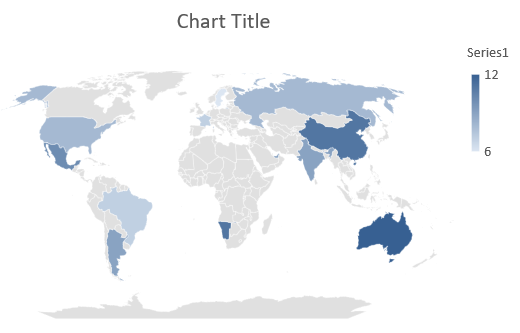

## **Ikhtisar**

Artikel ini memberikan panduan lengkap tentang cara membuat dan menyesuaikan diagram menggunakan Aspose.Slides untuk Android via Java. Anda akan belajar cara menambahkan diagram secara programatis ke slide, mengisinya dengan data, dan menerapkan berbagai opsi pemformatan untuk memenuhi kebutuhan desain spesifik Anda. Sepanjang artikel, contoh kode terperinci menggambarkan setiap langkah, mulai dari menginisialisasi presentasi dan objek diagram hingga mengonfigurasi seri, sumbu, dan legenda. Dengan mengikuti panduan ini, Anda akan memperoleh pemahaman yang kuat tentang cara mengintegrasikan pembuatan diagram dinamis ke dalam aplikasi Android Anda, menyederhanakan proses pembuatan presentasi berbasis data.

## **Membuat Diagram**

Diagram membantu orang dengan cepat memvisualisasikan data dan memperoleh wawasan yang mungkin tidak langsung terlihat dari tabel atau spreadsheet.

**Mengapa Membuat Diagram?**

Dengan diagram, Anda dapat:

* menggabungkan, merangkum, atau menyederhanakan sejumlah besar data pada satu slide dalam sebuah presentasi;
* menampilkan pola dan tren dalam data;
* menilai arah dan momentum data dari waktu ke waktu atau terhadap satuan pengukuran tertentu;
* menemukan outlier, penyimpangan, kesalahan, dan data yang tidak masuk akal;
* menyampaikan atau mempresentasikan data yang kompleks.

Di PowerPoint, Anda dapat membuat diagram melalui fungsi *Insert*, yang menyediakan templat untuk merancang banyak jenis diagram. Dengan Aspose.Slides, Anda dapat membuat diagram reguler (berdasarkan tipe diagram populer) serta diagram kustom.

{}
Gunakan enumerasi [ChartType](https://reference.aspose.com/slides/androidjava/com.aspose.slides/charttype/) dalam paket [com.aspose.slides](https://reference.aspose.com/slides/androidjava/com.aspose.slides/). Nilai-nilai dalam enumerasi ini sesuai dengan berbagai tipe diagram.
{}

### **Membuat Diagram Kolom Berkekelompok**

Contoh ini menggunakan [addChart](https://reference.aspose.com/slides/androidjava/com.aspose.slides/ishapecollection/#addChart-int-float-float-float-float-) untuk membuat diagram kolom berkekelompok yang membandingkan dua seri pada tiga kategori. Seri menggunakan isian merah dan hijau, dan label individual menunjukkan nama kategori, nama seri, serta nilai. Indeks worksheet 0 mengacu pada lembar pertama dalam workbook diagram yang tersemat.

```java
import com.aspose.slides.*;
import android.graphics.Color;

Presentation presentation = new Presentation();
try
{
    ISlide slide = presentation.getSlides().get_Item(0);

    IChart chart = slide.getShapes().addChart(ChartType.ClusteredColumn, 20, 20, 500, 300);

    chart.getChartTitle().addTextFrameForOverriding("Sample Title");
    chart.getChartTitle().getTextFrameForOverriding().getTextFrameFormat().setCenterText(NullableBool.True);
    chart.getChartTitle().setHeight(20);
    chart.setTitle(true);

    IChartDataWorkbook workbook = chart.getChartData().getChartDataWorkbook();
    int worksheetIndex = 0;

    chart.getChartData().getSeries().clear();
    chart.getChartData().getCategories().clear();

    IChartDataCell seriesNameCell = workbook.getCell(worksheetIndex, 0, 1, "Series 1");
    chart.getChartData().getSeries().add(seriesNameCell, chart.getType());
    seriesNameCell = workbook.getCell(worksheetIndex, 0, 2, "Series 2");
    chart.getChartData().getSeries().add(seriesNameCell, chart.getType());

    IChartDataCell categoryCell = workbook.getCell(worksheetIndex, 1, 0, "Category 1");
    chart.getChartData().getCategories().add(categoryCell);
    categoryCell = workbook.getCell(worksheetIndex, 2, 0, "Category 2");
    chart.getChartData().getCategories().add(categoryCell);
    categoryCell = workbook.getCell(worksheetIndex, 3, 0, "Category 3");
    chart.getChartData().getCategories().add(categoryCell);

    IChartSeries series = chart.getChartData().getSeries().get_Item(0);

    IChartDataCell valueCell = workbook.getCell(worksheetIndex, 1, 1, 20);
    series.getDataPoints().addDataPointForBarSeries(valueCell);
    valueCell = workbook.getCell(worksheetIndex, 2, 1, 50);
    series.getDataPoints().addDataPointForBarSeries(valueCell);
    valueCell = workbook.getCell(worksheetIndex, 3, 1, 30);
    series.getDataPoints().addDataPointForBarSeries(valueCell);

    series.getFormat().getFill().setFillType(FillType.Solid);
    series.getFormat().getFill().getSolidFillColor().setColor(Color.RED);

    series = chart.getChartData().getSeries().get_Item(1);

    valueCell = workbook.getCell(worksheetIndex, 1, 2, 30);
    series.getDataPoints().addDataPointForBarSeries(valueCell);
    valueCell = workbook.getCell(worksheetIndex, 2, 2, 10);
    series.getDataPoints().addDataPointForBarSeries(valueCell);
    valueCell = workbook.getCell(worksheetIndex, 3, 2, 60);
    series.getDataPoints().addDataPointForBarSeries(valueCell);

    series.getFormat().getFill().setFillType(FillType.Solid);
    series.getFormat().getFill().getSolidFillColor().setColor(Color.rgb(0, 128, 0));

    IDataLabel label = series.getDataPoints().get_Item(0).getLabel();
    label.getDataLabelFormat().setShowCategoryName(true);

    label = series.getDataPoints().get_Item(1).getLabel();
    label.getDataLabelFormat().setShowSeriesName(true);

    label = series.getDataPoints().get_Item(2).getLabel();
    label.getDataLabelFormat().setShowValue(true);
    label.getDataLabelFormat().setShowSeriesName(true);
    label.getDataLabelFormat().setSeparator("/");

    presentation.save("AsposeChart.pptx", SaveFormat.Pptx);
}
finally
{
    presentation.dispose();
}
```

Hasilnya:


### **Membuat Diagram Sebar**

Diagram sebar (juga dikenal sebagai scatter plot atau grafik x-y) sering digunakan untuk memeriksa pola atau menunjukkan korelasi antara dua variabel.

Gunakan diagram sebar ketika:

* Anda memiliki data numerik berpasangan.
* Anda memiliki dua variabel yang cocok bersama.
* Anda ingin menentukan apakah dua variabel tersebut berhubungan.
* Anda memiliki variabel independen yang memiliki banyak nilai untuk variabel dependen.

Contoh ini memplot dua set nilai x-y. Seri pertama menggunakan garis lurus dengan penanda bintang, sementara seri kedua menggunakan garis halus dengan penanda lingkaran; keduanya menggunakan ukuran penanda 10, yang dikonfigurasi dengan [setSize](https://reference.aspose.com/slides/androidjava/com.aspose.slides/imarker/#setSize-int-). Metode [setSymbol](https://reference.aspose.com/slides/androidjava/com.aspose.slides/imarker/#setSymbol-int-) mengontrol bentuk penanda.

```java
import com.aspose.slides.*;

Presentation presentation = new Presentation();
try
{
    ISlide slide = presentation.getSlides().get_Item(0);

    IChart chart = slide.getShapes().addChart(ChartType.ScatterWithSmoothLines, 20, 20, 500, 300);

    IChartDataWorkbook workbook = chart.getChartData().getChartDataWorkbook();
    int worksheetIndex = 0;

    chart.getChartData().getSeries().clear();

    IChartDataCell seriesNameCell = workbook.getCell(worksheetIndex, 1, 1, "Series 1");
    chart.getChartData().getSeries().add(seriesNameCell, chart.getType());
    seriesNameCell = workbook.getCell(worksheetIndex, 1, 3, "Series 2");
    chart.getChartData().getSeries().add(seriesNameCell, chart.getType());

    IChartSeries series = chart.getChartData().getSeries().get_Item(0);

    IChartDataCell xValueCell = workbook.getCell(worksheetIndex, 2, 1, 1);
    IChartDataCell yValueCell = workbook.getCell(worksheetIndex, 2, 2, 3);
    series.getDataPoints().addDataPointForScatterSeries(xValueCell, yValueCell);

    xValueCell = workbook.getCell(worksheetIndex, 3, 1, 2);
    yValueCell = workbook.getCell(worksheetIndex, 3, 2, 10);
    series.getDataPoints().addDataPointForScatterSeries(xValueCell, yValueCell);

    series.setType(ChartType.ScatterWithStraightLinesAndMarkers);

    series.getMarker().setSize(10);
    series.getMarker().setSymbol(MarkerStyleType.Star);

    series = chart.getChartData().getSeries().get_Item(1);

    xValueCell = workbook.getCell(worksheetIndex, 2, 3, 5);
    yValueCell = workbook.getCell(worksheetIndex, 2, 4, 2);
    series.getDataPoints().addDataPointForScatterSeries(xValueCell, yValueCell);

    xValueCell = workbook.getCell(worksheetIndex, 3, 3, 3);
    yValueCell = workbook.getCell(worksheetIndex, 3, 4, 1);
    series.getDataPoints().addDataPointForScatterSeries(xValueCell, yValueCell);

    xValueCell = workbook.getCell(worksheetIndex, 4, 3, 2);
    yValueCell = workbook.getCell(worksheetIndex, 4, 4, 2);
    series.getDataPoints().addDataPointForScatterSeries(xValueCell, yValueCell);

    xValueCell = workbook.getCell(worksheetIndex, 5, 3, 5);
    yValueCell = workbook.getCell(worksheetIndex, 5, 4, 1);
    series.getDataPoints().addDataPointForScatterSeries(xValueCell, yValueCell);

    series.getMarker().setSize(10);
    series.getMarker().setSymbol(MarkerStyleType.Circle);

    presentation.save("AsposeChart.pptx", SaveFormat.Pptx);
}
finally
{
    presentation.dispose();
}
```

Hasilnya:


### **Membuat Diagram Lingkaran**

Diagram lingkaran paling tepat digunakan untuk menunjukkan hubungan bagian‑ke‑keseluruhan dalam data, terutama ketika data berisi label kategori dengan nilai numerik. Namun, bila data Anda memiliki banyak bagian atau label, Anda mungkin ingin mempertimbangkan menggunakan diagram batang sebagai gantinya.

Contoh ini membuat diagram lingkaran dengan tiga nilai kuartalan. Setiap irisan memiliki isian dan batas kustom, dan label menampilkan kombinasi nilai, persentase, serta informasi seri. Metode [setFirstSliceAngle](https://reference.aspose.com/slides/androidjava/com.aspose.slides/ichartseriesgroup/#setFirstSliceAngle-int-) mengatur irisan pertama mulai dari 180 derajat.

```java
import com.aspose.slides.*;
import android.graphics.Color;

Presentation presentation = new Presentation();
try
{
    ISlide slide = presentation.getSlides().get_Item(0);

    IChart chart = slide.getShapes().addChart(ChartType.Pie, 20, 20, 500, 300);

    chart.getChartTitle().addTextFrameForOverriding("Sample Title");
    chart.getChartTitle().getTextFrameForOverriding().getTextFrameFormat().setCenterText(NullableBool.True);
    chart.getChartTitle().setHeight(20);
    chart.setTitle(true);

    chart.getChartData().getSeries().get_Item(0).getLabels().getDefaultDataLabelFormat().setShowValue(true);

    IChartDataWorkbook workbook = chart.getChartData().getChartDataWorkbook();
    int worksheetIndex = 0;

    chart.getChartData().getSeries().clear();
    chart.getChartData().getCategories().clear();

    IChartDataCell categoryCell = workbook.getCell(0, 1, 0, "1st Qtr");
    chart.getChartData().getCategories().add(categoryCell);
    categoryCell = workbook.getCell(0, 2, 0, "2nd Qtr");
    chart.getChartData().getCategories().add(categoryCell);
    categoryCell = workbook.getCell(0, 3, 0, "3rd Qtr");
    chart.getChartData().getCategories().add(categoryCell);

    IChartDataCell seriesNameCell = workbook.getCell(0, 0, 1, "Series 1");
    IChartSeries series = chart.getChartData().getSeries().add(seriesNameCell, chart.getType());

    IChartDataCell valueCell = workbook.getCell(worksheetIndex, 1, 1, 20);
    series.getDataPoints().addDataPointForPieSeries(valueCell);
    valueCell = workbook.getCell(worksheetIndex, 2, 1, 50);
    series.getDataPoints().addDataPointForPieSeries(valueCell);
    valueCell = workbook.getCell(worksheetIndex, 3, 1, 30);
    series.getDataPoints().addDataPointForPieSeries(valueCell);

    chart.getChartData().getSeriesGroups().get_Item(0).setColorVaried(true);

    IChartDataPoint firstSlice = series.getDataPoints().get_Item(0);
    firstSlice.getFormat().getFill().setFillType(FillType.Solid);
    firstSlice.getFormat().getFill().getSolidFillColor().setColor(Color.CYAN);

    firstSlice.getFormat().getLine().getFillFormat().setFillType(FillType.Solid);
    firstSlice.getFormat().getLine().getFillFormat().getSolidFillColor().setColor(Color.rgb(128, 128, 128));
    firstSlice.getFormat().getLine().setWidth(3.0);
    firstSlice.getFormat().getLine().setStyle(LineStyle.ThinThick);
    firstSlice.getFormat().getLine().setDashStyle(LineDashStyle.LargeDash);

    IChartDataPoint secondSlice = series.getDataPoints().get_Item(1);
    secondSlice.getFormat().getFill().setFillType(FillType.Solid);
    secondSlice.getFormat().getFill().getSolidFillColor().setColor(Color.rgb(165, 42, 42));

    secondSlice.getFormat().getLine().getFillFormat().setFillType(FillType.Solid);
    secondSlice.getFormat().getLine().getFillFormat().getSolidFillColor().setColor(Color.BLUE);
    secondSlice.getFormat().getLine().setWidth(3.0);
    secondSlice.getFormat().getLine().setStyle(LineStyle.Single);
    secondSlice.getFormat().getLine().setDashStyle(LineDashStyle.LargeDashDot);

    IChartDataPoint thirdSlice = series.getDataPoints().get_Item(2);
    thirdSlice.getFormat().getFill().setFillType(FillType.Solid);
    thirdSlice.getFormat().getFill().getSolidFillColor().setColor(Color.rgb(255, 127, 80));

    thirdSlice.getFormat().getLine().getFillFormat().setFillType(FillType.Solid);
    thirdSlice.getFormat().getLine().getFillFormat().getSolidFillColor().setColor(Color.RED);
    thirdSlice.getFormat().getLine().setWidth(2.0);
    thirdSlice.getFormat().getLine().setStyle(LineStyle.ThinThin);
    thirdSlice.getFormat().getLine().setDashStyle(LineDashStyle.LargeDashDotDot);

    IDataLabel firstLabel = series.getDataPoints().get_Item(0).getLabel();
    firstLabel.getDataLabelFormat().setShowValue(true);

    IDataLabel secondLabel = series.getDataPoints().get_Item(1).getLabel();
    secondLabel.getDataLabelFormat().setShowValue(true);
    secondLabel.getDataLabelFormat().setShowLegendKey(true);
    secondLabel.getDataLabelFormat().setShowPercentage(true);

    IDataLabel thirdLabel = series.getDataPoints().get_Item(2).getLabel();
    thirdLabel.getDataLabelFormat().setShowSeriesName(true);
    thirdLabel.getDataLabelFormat().setShowPercentage(true);

    series.getLabels().getDefaultDataLabelFormat().setShowLeaderLines(true);

    chart.getChartData().getSeriesGroups().get_Item(0).setFirstSliceAngle(180);

    presentation.save("PieChart.pptx", SaveFormat.Pptx);
}
finally
{
    presentation.dispose();
}
```

Hasilnya:


Untuk meningkatkan keterbacaan label di luar lingkaran, lihat [Format Leader Lines](/slides/id/androidjava/chart-data-label/#format-leader-lines) untuk contoh yang memposisikan label dan menyesuaikan warna, lebar, transparansi, serta gaya garis.

### **Membuat Diagram Garis**

Diagram garis (juga dikenal sebagai grafik garis) paling tepat digunakan ketika Anda ingin menunjukkan perubahan nilai dari waktu ke waktu. Dengan diagram garis, Anda dapat membandingkan sejumlah besar data sekaligus, melacak perubahan dan tren seiring waktu, menyoroti anomali dalam seri data, dan sebagainya.

Contoh ini menggunakan [addChart](https://reference.aspose.com/slides/androidjava/com.aspose.slides/ishapecollection/#addChart-int-float-float-float-float-) untuk membuat diagram garis dengan seri dan kategori default, kemudian menyimpan presentasi sebagai PPTX.

```java
import com.aspose.slides.*;

Presentation presentation = new Presentation();
try
{
    ISlide slide = presentation.getSlides().get_Item(0);

    IChart lineChart = slide.getShapes().addChart(ChartType.Line, 20, 20, 500, 300);

    presentation.save("lineChart.pptx", SaveFormat.Pptx);
}
finally
{
    presentation.dispose();
}
```

Secara default, titik pada diagram garis dihubungkan oleh garis lurus berkelanjutan. Jika Anda ingin titik-titik tersebut dihubungkan oleh garis putus‑putus, panggil [setDashStyle](https://reference.aspose.com/slides/androidjava/com.aspose.slides/ilineformat/#setDashStyle-byte-) dengan nilai dari [LineDashStyle](https://reference.aspose.com/slides/androidjava/com.aspose.slides/linedashstyle/):

```java
import com.aspose.slides.*;

Presentation presentation = new Presentation();
try
{
    ISlide slide = presentation.getSlides().get_Item(0);

    IChart lineChart = slide.getShapes().addChart(ChartType.Line, 20, 20, 500, 300);

    for (IChartSeries series : lineChart.getChartData().getSeries())
    {
        series.getFormat().getLine().setDashStyle(LineDashStyle.Dash);
    }
}
finally
{
    presentation.dispose();
}
```

Hasilnya:


### **Membuat Diagram Peta Pohon**

Diagram peta pohon paling tepat digunakan untuk data penjualan ketika Anda ingin menampilkan ukuran relatif kategori data dan dengan cepat menarik perhatian ke item yang menjadi kontributor besar dalam tiap kategori.

Contoh ini membuat peta pohon dengan delapan daun yang dikelompokkan menjadi empat batang dan dua cabang. Metode [setGroupingItem](https://reference.aspose.com/slides/androidjava/com.aspose.slides/ichartcategorylevelsmanager/#setGroupingItem-int-java.lang.Object-) menetapkan batang pada level pengelompokan 1 dan cabang pada level 2. Nilai menentukan ukuran relatif persegi panjang, sementara label kategori dan label orangtua yang tumpang tindih mengidentifikasi hierarki.

```java
import com.aspose.slides.*;

Presentation presentation = new Presentation();
try
{
    ISlide slide = presentation.getSlides().get_Item(0);

    IChart chart = slide.getShapes().addChart(ChartType.Treemap, 20, 20, 500, 300);

    chart.getChartData().getCategories().clear();
    chart.getChartData().getSeries().clear();

    IChartDataWorkbook workbook = chart.getChartData().getChartDataWorkbook();
    workbook.clear(0);

    // Cabang 1
    IChartDataCell categoryCell = workbook.getCell(0, "C1", "Leaf1");
    IChartCategory leaf = chart.getChartData().getCategories().add(categoryCell);
    leaf.getGroupingLevels().setGroupingItem(1, "Stem1");
    leaf.getGroupingLevels().setGroupingItem(2, "Branch1");

    categoryCell = workbook.getCell(0, "C2", "Leaf2");
    chart.getChartData().getCategories().add(categoryCell);

    categoryCell = workbook.getCell(0, "C3", "Leaf3");
    leaf = chart.getChartData().getCategories().add(categoryCell);
    leaf.getGroupingLevels().setGroupingItem(1, "Stem2");

    categoryCell = workbook.getCell(0, "C4", "Leaf4");
    chart.getChartData().getCategories().add(categoryCell);

    // Cabang 2
    categoryCell = workbook.getCell(0, "C5", "Leaf5");
    leaf = chart.getChartData().getCategories().add(categoryCell);
    leaf.getGroupingLevels().setGroupingItem(1, "Stem3");
    leaf.getGroupingLevels().setGroupingItem(2, "Branch2");

    categoryCell = workbook.getCell(0, "C6", "Leaf6");
    chart.getChartData().getCategories().add(categoryCell);

    categoryCell = workbook.getCell(0, "C7", "Leaf7");
    leaf = chart.getChartData().getCategories().add(categoryCell);
    leaf.getGroupingLevels().setGroupingItem(1, "Stem4");

    categoryCell = workbook.getCell(0, "C8", "Leaf8");
    chart.getChartData().getCategories().add(categoryCell);

    IChartSeries series = chart.getChartData().getSeries().add(ChartType.Treemap);
    series.getLabels().getDefaultDataLabelFormat().setShowCategoryName(true);
    IChartDataCell valueCell = workbook.getCell(0, "D1", 4);
    series.getDataPoints().addDataPointForTreemapSeries(valueCell);
    valueCell = workbook.getCell(0, "D2", 5);
    series.getDataPoints().addDataPointForTreemapSeries(valueCell);
    valueCell = workbook.getCell(0, "D3", 3);
    series.getDataPoints().addDataPointForTreemapSeries(valueCell);
    valueCell = workbook.getCell(0, "D4", 6);
    series.getDataPoints().addDataPointForTreemapSeries(valueCell);
    valueCell = workbook.getCell(0, "D5", 9);
    series.getDataPoints().addDataPointForTreemapSeries(valueCell);
    valueCell = workbook.getCell(0, "D6", 9);
    series.getDataPoints().addDataPointForTreemapSeries(valueCell);
    valueCell = workbook.getCell(0, "D7", 4);
    series.getDataPoints().addDataPointForTreemapSeries(valueCell);
    valueCell = workbook.getCell(0, "D8", 3);
    series.getDataPoints().addDataPointForTreemapSeries(valueCell);

    series.setParentLabelLayout(ParentLabelLayoutType.Overlapping);

    presentation.save("Treemap.pptx", SaveFormat.Pptx);
}
finally
{
    presentation.dispose();
}
```

Hasilnya:


### **Membuat Diagram Air Terjun**

Diagram air terjun menunjukkan bagaimana perubahan positif dan negatif berkontribusi pada nilai akhir. Misalnya, rincian profit dapat dimulai dengan pendapatan, mengurangi biaya, dan menambahkan pendapatan lain. Kolom perubahan melayang antara nilai berjalan sebelumnya dan baru, sementara kolom total memperluas dari nol hingga nilai terakumulasi.

Contoh berikut menggunakan jumlah dalam ribuan dolar AS:

| Kategori | Nilai workbook | Tipe kolom |
| --- | ---: | --- |
| Pendapatan | 1000 | Peningkatan |
| Biaya penjualan | -400 | Penurunan |
| Laba kotor | 600 | Total menengah |
| Biaya operasional | -200 | Penurunan |
| Pendapatan lain | 50 | Peningkatan |
| Laba bersih | 450 | Total akhir |

Untuk menandai sebuah titik sebagai total menengah atau akhir, panggil metode [setSetAsTotal](https://reference.aspose.com/slides/androidjava/com.aspose.slides/chartdatapoint/#setSetAsTotal-boolean-) pada titik tersebut dengan `true`. Berikan jumlah terakumulasi yang sebenarnya di sel workbook titik itu: `600` untuk laba kotor (`1000 - 400`) dan `450` untuk laba bersih (`600 - 200 + 50`). Metode ini menandai kolom sebagai total; ia tidak menghitung atau mengisi nilai sel. Jangan gunakan nol sebagai placeholder atau memberikan perubahan lain untuk titik total. Kolom total menampilkan nilai terakumulasi tanpa menambahkannya lagi ke nilai berjalan.

Contoh Java lengkap ini membuat diagram menggunakan anggota `Waterfall` dari [ChartType](https://reference.aspose.com/slides/androidjava/com.aspose.slides/charttype/), membersihkan data default, dan mengisi workbook yang tersemat. Indeks worksheet `0` memilih lembar pertama; kolom A berisi nama kategori dan kolom B berisi nilai. Setiap sel nilai ditambahkan dengan [addDataPointForWaterfallSeries](https://reference.aspose.com/slides/androidjava/com.aspose.slides/ichartdatapointcollection/#addDataPointForWaterfallSeries-com.aspose.slides.IChartDataCell-). Indeks titik berbasis nol `2` dan `5` mengidentifikasi total menengah dan akhir. Memanggil [setShowValue](https://reference.aspose.com/slides/androidjava/com.aspose.slides/idatalabelformat/#setShowValue-boolean-) dengan `true` menampilkan jumlah pada kolom. Tidak diperlukan presentasi atau workbook input.

```java
import com.aspose.slides.*;

Presentation presentation = new Presentation();
try
{
    ISlide slide = presentation.getSlides().get_Item(0);

    IChart chart = slide.getShapes().addChart(ChartType.Waterfall, 20, 20, 680, 200);

    chart.setTitle(true);
    chart.getChartTitle().addTextFrameForOverriding("Profit breakdown (USD thousands)");
    chart.getChartTitle().setOverlay(false);
    chart.setLegend(false);

    chart.getChartData().getSeries().clear();
    chart.getChartData().getCategories().clear();

    IChartDataWorkbook workbook = chart.getChartData().getChartDataWorkbook();
    int worksheetIndex = 0;

    workbook.clear(worksheetIndex);

    IChartDataCell seriesNameCell = workbook.getCell(worksheetIndex, 0, 1, "Profit");
    IChartSeries series = chart.getChartData().getSeries().add(seriesNameCell, ChartType.Waterfall);
    String[] categories = new String[] { "Revenue", "Cost of sales", "Gross profit", "Operating expenses", "Other income", "Net profit" };
    double[] values = new double[] { 1000, -400, 600, -200, 50, 450 };

    for (int i = 0; i < categories.length; i++)
    {
        IChartDataCell categoryCell = workbook.getCell(worksheetIndex, i + 1, 0, categories[i]);
        chart.getChartData().getCategories().add(categoryCell);
        IChartDataCell valueCell = workbook.getCell(worksheetIndex, i + 1, 1, values[i]);
        series.getDataPoints().addDataPointForWaterfallSeries(valueCell);
    }

    // Titik ketiga dan keenam mewakili total, bukan perubahan tambahan.
    series.getDataPoints().get_Item(2).setSetAsTotal(true);
    series.getDataPoints().get_Item(5).setSetAsTotal(true);
    series.setShowConnectorLines(true);
    series.getLabels().getDefaultDataLabelFormat().setShowValue(true);

    presentation.save("WaterfallChart.pptx", SaveFormat.Pptx);
}
finally
{
    presentation.dispose();
}
```

Panggil metode tingkat seri [setShowConnectorLines](https://reference.aspose.com/slides/androidjava/com.aspose.slides/chartseries/#setShowConnectorLines-boolean-) dengan `true` untuk menampilkan garis yang menghubungkan kolom berurutan dan mempermudah pelacakan nilai berjalan. Untuk menyembunyikan garis ini, ganti pemanggilan metode dalam contoh dengan `series.setShowConnectorLines(false);` sebelum menyimpan. Ini hanya mengubah visibilitas garis, bukan data atau total.

Presentasi yang disimpan menampilkan laba kotor sebesar 600 dan laba bersih sebesar 450, dengan kedua total dihitung dari nol:


### **Membuat Diagram Saham**

Diagram saham digunakan untuk menampilkan data keuangan seperti harga buka, tinggi, rendah, dan tutup, membantu menganalisis tren pasar dan volatilitas. Diagram ini menawarkan wawasan penting tentang kinerja saham, membantu investor dan analis membuat keputusan yang tepat.

Contoh ini membuat diagram open‑high‑low‑close dengan empat seri dalam urutan tersebut dan tiga kategori. Metode [setUpDownBars](https://reference.aspose.com/slides/androidjava/com.aspose.slides/iupdownbarsmanager/#setUpDownBars-boolean-) mengaktifkan batang naik/turun, dan [getHiLowLinesFormat](https://reference.aspose.com/slides/androidjava/com.aspose.slides/ichartseriesgroup/#getHiLowLinesFormat--) mengontrol garis tinggi‑rendah yang menampilkan rentang harga, sementara garis seri individu dan garis grid horizontal minor disembunyikan.

Manajer yang dikembalikan oleh [getUpDownBars](https://reference.aspose.com/slides/androidjava/com.aspose.slides/ichartseriesgroup/#getUpDownBars--) mengekspos objek pemformatan terpisah melalui [getUpBarsFormat](https://reference.aspose.com/slides/androidjava/com.aspose.slides/iupdownbarsmanager/#getUpBarsFormat--) dan [getDownBarsFormat](https://reference.aspose.com/slides/androidjava/com.aspose.slides/iupdownbarsmanager/#getDownBarsFormat--). Gunakan metode [getFill](https://reference.aspose.com/slides/androidjava/com.aspose.slides/iformat/#getFill--) dan [getLine](https://reference.aspose.com/slides/androidjava/com.aspose.slides/iformat/#getLine--) pada masing‑masing objek untuk mengatur isian dan kontur secara independen. Contoh ini menggunakan batang hijau dengan kontur hijau tua untuk interval naik dan batang oranye‑merah dengan kontur merah tua untuk interval turun.

Berikan nilai numerik untuk keempat seri pada setiap kategori, dengan High dan Low melingkupi Open dan Close. Batang membandingkan Close dengan Open **dalam kategori yang sama**, bukan dengan kategori sebelumnya: A turun dari 72 ke 25, sementara B naik dari 25 ke 38 dan C naik dari 38 ke 50. Nilai Open dan Close yang sama tidak menghasilkan interval terisi yang terlihat. Batang naik/turun membentang Open‑Close; garis tinggi‑rendah membentang Low‑High. Batang ini termasuk dalam grup seri, bukan seri diagram batang biasa.

Pemformatan ini juga berlaku untuk diagram [Line dan LineWithMarkers](https://reference.aspose.com/slides/androidjava/com.aspose.slides/charttype/) yang berisi setidaknya dua seri dalam grup yang sama dan nilai numerik yang sesuai untuk tiap kategori. Untuk diagram garis non‑stacked ini, batang naik/turun membandingkan seri pertama dan terakhir: nilai terakhir yang lebih tinggi menghasilkan batang naik, dan nilai terakhir yang lebih rendah menghasilkan batang turun. Membalik urutan seri akan membalik klasifikasi. Contoh di bawah menggunakan [OpenHighLowClose](https://reference.aspose.com/slides/androidjava/com.aspose.slides/charttype/); jangan mengasumsikan bahwa varian saham, stacked‑line, atau 3D lainnya menggunakan susunan data atau interpretasi interval yang sama.

```java
import com.aspose.slides.*;
import android.graphics.Color;

Presentation presentation = new Presentation();
try
{
    ISlide slide = presentation.getSlides().get_Item(0);

    IChart chart = slide.getShapes().addChart(ChartType.OpenHighLowClose, 20, 20, 500, 150, false);

    IChartDataWorkbook workbook = chart.getChartData().getChartDataWorkbook();

    IChartDataCell categoryCell = workbook.getCell(0, 1, 0, "A");
    chart.getChartData().getCategories().add(categoryCell);
    categoryCell = workbook.getCell(0, 2, 0, "B");
    chart.getChartData().getCategories().add(categoryCell);
    categoryCell = workbook.getCell(0, 3, 0, "C");
    chart.getChartData().getCategories().add(categoryCell);

    IChartDataCell seriesNameCell = workbook.getCell(0, 0, 1, "Open");
    chart.getChartData().getSeries().add(seriesNameCell, ChartType.OpenHighLowClose);
    seriesNameCell = workbook.getCell(0, 0, 2, "High");
    chart.getChartData().getSeries().add(seriesNameCell, ChartType.OpenHighLowClose);
    seriesNameCell = workbook.getCell(0, 0, 3, "Low");
    chart.getChartData().getSeries().add(seriesNameCell, ChartType.OpenHighLowClose);
    seriesNameCell = workbook.getCell(0, 0, 4, "Close");
    chart.getChartData().getSeries().add(seriesNameCell, ChartType.OpenHighLowClose);

    IChartSeries series = chart.getChartData().getSeries().get_Item(0);
    IChartDataCell valueCell = workbook.getCell(0, 1, 1, 72);
    series.getDataPoints().addDataPointForStockSeries(valueCell);
    valueCell = workbook.getCell(0, 2, 1, 25);
    series.getDataPoints().addDataPointForStockSeries(valueCell);
    valueCell = workbook.getCell(0, 3, 1, 38);
    series.getDataPoints().addDataPointForStockSeries(valueCell);

    series = chart.getChartData().getSeries().get_Item(1);
    valueCell = workbook.getCell(0, 1, 2, 172);
    series.getDataPoints().addDataPointForStockSeries(valueCell);
    valueCell = workbook.getCell(0, 2, 2, 57);
    series.getDataPoints().addDataPointForStockSeries(valueCell);
    valueCell = workbook.getCell(0, 3, 2, 57);
    series.getDataPoints().addDataPointForStockSeries(valueCell);

    series = chart.getChartData().getSeries().get_Item(2);
    valueCell = workbook.getCell(0, 1, 3, 12);
    series.getDataPoints().addDataPointForStockSeries(valueCell);
    valueCell = workbook.getCell(0, 2, 3, 12);
    series.getDataPoints().addDataPointForStockSeries(valueCell);
    valueCell = workbook.getCell(0, 3, 3, 13);
    series.getDataPoints().addDataPointForStockSeries(valueCell);

    series = chart.getChartData().getSeries().get_Item(3);
    valueCell = workbook.getCell(0, 1, 4, 25);
    series.getDataPoints().addDataPointForStockSeries(valueCell);
    valueCell = workbook.getCell(0, 2, 4, 38);
    series.getDataPoints().addDataPointForStockSeries(valueCell);
    valueCell = workbook.getCell(0, 3, 4, 50);
    series.getDataPoints().addDataPointForStockSeries(valueCell);

    IUpDownBarsManager upDownBars = chart.getChartData().getSeriesGroups().get_Item(0).getUpDownBars();
    upDownBars.setUpDownBars(true);

    upDownBars.getUpBarsFormat().getFill().setFillType(FillType.Solid);
    upDownBars.getUpBarsFormat().getFill().getSolidFillColor().setColor(Color.rgb(50, 205, 50));
    upDownBars.getUpBarsFormat().getLine().getFillFormat().setFillType(FillType.Solid);
    upDownBars.getUpBarsFormat().getLine().getFillFormat().getSolidFillColor().setColor(Color.rgb(0, 100, 0));
    upDownBars.getUpBarsFormat().getLine().setWidth(2);

    upDownBars.getDownBarsFormat().getFill().setFillType(FillType.Solid);
    upDownBars.getDownBarsFormat().getFill().getSolidFillColor().setColor(Color.rgb(255, 69, 0));
    upDownBars.getDownBarsFormat().getLine().getFillFormat().setFillType(FillType.Solid);
    upDownBars.getDownBarsFormat().getLine().getFillFormat().getSolidFillColor().setColor(Color.rgb(139, 0, 0));
    upDownBars.getDownBarsFormat().getLine().setWidth(2);
    chart.getChartData().getSeriesGroups().get_Item(0).getHiLowLinesFormat().getLine().getFillFormat().setFillType(FillType.Solid);

    for (IChartSeries stockSeries : chart.getChartData().getSeries())
    {
        stockSeries.getFormat().getLine().getFillFormat().setFillType(FillType.NoFill);
    }

    chart.getAxes().getVerticalAxis().getMinorGridLinesFormat().getLine().getFillFormat().setFillType(FillType.NoFill);

    presentation.save("Stock-chart.pptx", SaveFormat.Pptx);
}
finally
{
    presentation.dispose();
}
```

Hasil, diekspor dari PowerPoint:


### **Membuat Diagram Kotak‑dan‑Whisker**

Diagram kotak‑dan‑whisker digunakan untuk menampilkan distribusi data dengan merangkum ukuran statistik utama, seperti median, kuartil, dan outlier potensial. Diagram ini sangat berguna dalam analisis data eksploratori dan studi statistik untuk cepat memahami variabilitas data dan mengidentifikasi anomali.

Contoh ini membuat diagram kotak‑dan‑whisker dari enam nilai. Metode [setQuartileMethod](https://reference.aspose.com/slides/androidjava/com.aspose.slides/ichartseries/#setQuartileMethod-int-) memilih perhitungan kuartil eksklusif. Contoh ini juga mengaktifkan garis rata‑rata, penanda rata‑rata, titik dalam, dan titik outlier.

```java
import com.aspose.slides.*;

Presentation presentation = new Presentation();
try
{
    ISlide slide = presentation.getSlides().get_Item(0);

    IChart chart = slide.getShapes().addChart(ChartType.BoxAndWhisker, 20, 20, 500, 300);

    chart.getChartData().getCategories().clear();
    chart.getChartData().getSeries().clear();

    IChartDataWorkbook workbook = chart.getChartData().getChartDataWorkbook();
    workbook.clear(0);

    IChartDataCell categoryCell = workbook.getCell(0, "A1", "Category 1");
    chart.getChartData().getCategories().add(categoryCell);
    categoryCell = workbook.getCell(0, "A2", "Category 2");
    chart.getChartData().getCategories().add(categoryCell);
    categoryCell = workbook.getCell(0, "A3", "Category 3");
    chart.getChartData().getCategories().add(categoryCell);
    categoryCell = workbook.getCell(0, "A4", "Category 4");
    chart.getChartData().getCategories().add(categoryCell);
    categoryCell = workbook.getCell(0, "A5", "Category 5");
    chart.getChartData().getCategories().add(categoryCell);
    categoryCell = workbook.getCell(0, "A6", "Category 6");
    chart.getChartData().getCategories().add(categoryCell);

    IChartSeries series = chart.getChartData().getSeries().add(ChartType.BoxAndWhisker);

    series.setQuartileMethod(QuartileMethodType.Exclusive);
    series.setShowMeanLine(true);
    series.setShowMeanMarkers(true);
    series.setShowInnerPoints(true);
    series.setShowOutlierPoints(true);

    IChartDataCell valueCell = workbook.getCell(0, "B1", 15);
    series.getDataPoints().addDataPointForBoxAndWhiskerSeries(valueCell);
    valueCell = workbook.getCell(0, "B2", 41);
    series.getDataPoints().addDataPointForBoxAndWhiskerSeries(valueCell);
    valueCell = workbook.getCell(0, "B3", 16);
    series.getDataPoints().addDataPointForBoxAndWhiskerSeries(valueCell);
    valueCell = workbook.getCell(0, "B4", 10);
    series.getDataPoints().addDataPointForBoxAndWhiskerSeries(valueCell);
    valueCell = workbook.getCell(0, "B5", 23);
    series.getDataPoints().addDataPointForBoxAndWhiskerSeries(valueCell);
    valueCell = workbook.getCell(0, "B6", 16);
    series.getDataPoints().addDataPointForBoxAndWhiskerSeries(valueCell);

    presentation.save("BoxAndWhisker.pptx", SaveFormat.Pptx);
}
finally
{
    presentation.dispose();
}
```

### **Membuat Diagram Corong**

Diagram corong digunakan untuk memvisualisasikan proses yang melibatkan tahapan berurutan, dimana volume data menurun seiring bergeraknya dari satu langkah ke langkah berikutnya. Diagram ini sangat membantu untuk menganalisis tingkat konversi, mengidentifikasi bottleneck, dan melacak efisiensi proses penjualan atau pemasaran.

Contoh ini menggunakan [addChart](https://reference.aspose.com/slides/androidjava/com.aspose.slides/ishapecollection/#addChart-int-float-float-float-float-) untuk menambahkan diagram corong ke slide pertama dari presentasi yang sudah ada. Ia menggantikan data default dengan enam kategori dan nilai mulai dari 50 hingga 500, kemudian menyimpan presentasi yang diperbarui. Presentasi input harus memiliki setidaknya satu slide.

```java
import com.aspose.slides.*;

Presentation presentation = new Presentation("test.pptx");
try
{
    ISlide slide = presentation.getSlides().get_Item(0);

    IChart chart = slide.getShapes().addChart(ChartType.Funnel, 50, 50, 500, 400);

    chart.getChartData().getCategories().clear();
    chart.getChartData().getSeries().clear();

    IChartDataWorkbook workbook = chart.getChartData().getChartDataWorkbook();
    workbook.clear(0);

    IChartDataCell categoryCell = workbook.getCell(0, "A1", "Category 1");
    chart.getChartData().getCategories().add(categoryCell);
    categoryCell = workbook.getCell(0, "A2", "Category 2");
    chart.getChartData().getCategories().add(categoryCell);
    categoryCell = workbook.getCell(0, "A3", "Category 3");
    chart.getChartData().getCategories().add(categoryCell);
    categoryCell = workbook.getCell(0, "A4", "Category 4");
    chart.getChartData().getCategories().add(categoryCell);
    categoryCell = workbook.getCell(0, "A5", "Category 5");
    chart.getChartData().getCategories().add(categoryCell);
    categoryCell = workbook.getCell(0, "A6", "Category 6");
    chart.getChartData().getCategories().add(categoryCell);

    IChartSeries series = chart.getChartData().getSeries().add(ChartType.Funnel);

    IChartDataCell valueCell = workbook.getCell(0, "B1", 50);
    series.getDataPoints().addDataPointForFunnelSeries(valueCell);
    valueCell = workbook.getCell(0, "B2", 100);
    series.getDataPoints().addDataPointForFunnelSeries(valueCell);
    valueCell = workbook.getCell(0, "B3", 200);
    series.getDataPoints().addDataPointForFunnelSeries(valueCell);
    valueCell = workbook.getCell(0, "B4", 300);
    series.getDataPoints().addDataPointForFunnelSeries(valueCell);
    valueCell = workbook.getCell(0, "B5", 400);
    series.getDataPoints().addDataPointForFunnelSeries(valueCell);
    valueCell = workbook.getCell(0, "B6", 500);
    series.getDataPoints().addDataPointForFunnelSeries(valueCell);

    presentation.save("Funnel.pptx", SaveFormat.Pptx);
}
finally
{
    presentation.dispose();
}
```

Hasilnya:


### **Membuat Diagram Sunburst**

Diagram sunburst digunakan untuk memvisualisasikan data hierarkis, menampilkan tingkat sebagai cincin konsentris. Diagram ini membantu menggambarkan hubungan bagian‑ke‑keseluruhan dan ideal untuk merepresentasikan kategori bersarang serta subkategori dalam format yang jelas dan ringkas.

Contoh ini membuat diagram sunburst dengan delapan daun yang dikelompokkan menjadi empat batang dan dua cabang. Metode [setGroupingItem](https://reference.aspose.com/slides/androidjava/com.aspose.slides/ichartcategorylevelsmanager/#setGroupingItem-int-java.lang.Object-) menetapkan batang pada level pengelompokan 1 dan cabang pada level 2. Label kategori mengidentifikasi segmen, dan nilai menentukan ukuran relatifnya.

```java
import com.aspose.slides.*;

Presentation presentation = new Presentation();
try
{
    ISlide slide = presentation.getSlides().get_Item(0);

    IChart chart = slide.getShapes().addChart(ChartType.Sunburst, 20, 20, 500, 300);

    chart.getChartData().getCategories().clear();
    chart.getChartData().getSeries().clear();

    IChartDataWorkbook workbook = chart.getChartData().getChartDataWorkbook();
    workbook.clear(0);

    // Cabang 1
    IChartDataCell categoryCell = workbook.getCell(0, "C1", "Leaf1");
    IChartCategory leaf = chart.getChartData().getCategories().add(categoryCell);
    leaf.getGroupingLevels().setGroupingItem(1, "Stem1");
    leaf.getGroupingLevels().setGroupingItem(2, "Branch1");

    categoryCell = workbook.getCell(0, "C2", "Leaf2");
    chart.getChartData().getCategories().add(categoryCell);

    categoryCell = workbook.getCell(0, "C3", "Leaf3");
    leaf = chart.getChartData().getCategories().add(categoryCell);
    leaf.getGroupingLevels().setGroupingItem(1, "Stem2");

    categoryCell = workbook.getCell(0, "C4", "Leaf4");
    chart.getChartData().getCategories().add(categoryCell);

    // Cabang 2
    categoryCell = workbook.getCell(0, "C5", "Leaf5");
    leaf = chart.getChartData().getCategories().add(categoryCell);
    leaf.getGroupingLevels().setGroupingItem(1, "Stem3");
    leaf.getGroupingLevels().setGroupingItem(2, "Branch2");

    categoryCell = workbook.getCell(0, "C6", "Leaf6");
    chart.getChartData().getCategories().add(categoryCell);

    categoryCell = workbook.getCell(0, "C7", "Leaf7");
    leaf = chart.getChartData().getCategories().add(categoryCell);
    leaf.getGroupingLevels().setGroupingItem(1, "Stem4");

    categoryCell = workbook.getCell(0, "C8", "Leaf8");
    chart.getChartData().getCategories().add(categoryCell);

    IChartSeries series = chart.getChartData().getSeries().add(ChartType.Sunburst);
    series.getLabels().getDefaultDataLabelFormat().setShowCategoryName(true);
    IChartDataCell valueCell = workbook.getCell(0, "D1", 4);
    series.getDataPoints().addDataPointForSunburstSeries(valueCell);
    valueCell = workbook.getCell(0, "D2", 5);
    series.getDataPoints().addDataPointForSunburstSeries(valueCell);
    valueCell = workbook.getCell(0, "D3", 3);
    series.getDataPoints().addDataPointForSunburstSeries(valueCell);
    valueCell = workbook.getCell(0, "D4", 6);
    series.getDataPoints().addDataPointForSunburstSeries(valueCell);
    valueCell = workbook.getCell(0, "D5", 9);
    series.getDataPoints().addDataPointForSunburstSeries(valueCell);
    valueCell = workbook.getCell(0, "D6", 9);
    series.getDataPoints().addDataPointForSunburstSeries(valueCell);
    valueCell = workbook.getCell(0, "D7", 4);
    series.getDataPoints().addDataPointForSunburstSeries(valueCell);
    valueCell = workbook.getCell(0, "D8", 3);
    series.getDataPoints().addDataPointForSunburstSeries(valueCell);

    presentation.save("Sunburst.pptx", SaveFormat.Pptx);
}
finally
{
    presentation.dispose();
}
```

Hasilnya:


### **Membuat Diagram Histogram**

Diagram histogram menunjukkan bagaimana nilai numerik didistribusikan di seluruh interval (bin). Untuk laporan bulanan tentang waktu pemrosesan pesanan, gunakan lebar bin dan ambang yang sama untuk menjaga konsistensi interval dan mempermudah perbandingan distribusi.

Panggil [setAggregationType](https://reference.aspose.com/slides/androidjava/com.aspose.slides/iaxis/#setAggregationType-int-) pada sumbu horizontal dengan mode dari [AxisAggregationType](https://reference.aspose.com/slides/androidjava/com.aspose.slides/axisaggregationtype/). [setBinWidth](https://reference.aspose.com/slides/androidjava/com.aspose.slides/iaxis/#setBinWidth-double-) hanya berlaku untuk `ByBinWidth`; [setNumberOfBins](https://reference.aspose.com/slides/androidjava/com.aspose.slides/iaxis/#setNumberOfBins-long-) hanya untuk `ByNumberOfBins`. Gunakan `Automatic` agar diagram menentukan bin secara otomatis.

#### **Gunakan Lebar Bin Tetap**

Contoh ini mengelompokkan waktu pemrosesan ke dalam interval 10 menit, dengan bin terpisah untuk waktu ≤ 10 menit dan > 40 menit. Aktifkan bin ini dengan [setUnderflowBin](https://reference.aspose.com/slides/androidjava/com.aspose.slides/iaxis/#setUnderflowBin-boolean-) dan [setOverflowBin](https://reference.aspose.com/slides/androidjava/com.aspose.slides/iaxis/#setOverflowBin-boolean-). Saat memberikan ambang eksplisit melalui [setUnderflowBin](https://reference.aspose.com/slides/androidjava/com.aspose.slides/iaxis/#setUnderflowBin-double-) dan [setOverflowBin](https://reference.aspose.com/slides/androidjava/com.aspose.slides/iaxis/#setOverflowBin-double-), panggil [setAutomaticUnderflowBin](https://reference.aspose.com/slides/androidjava/com.aspose.slides/iaxis/#setAutomaticUnderflowBin-boolean-) dan [setAutomaticOverflowBin](https://reference.aspose.com/slides/androidjava/com.aspose.slides/iaxis/#setAutomaticOverflowBin-boolean-) dengan `false`.

```java
import com.aspose.slides.*;

Presentation presentation = new Presentation();
try
{
    ISlide slide = presentation.getSlides().get_Item(0);

    IChart chart = slide.getShapes().addChart(ChartType.Histogram, 20, 20, 680, 200);

    chart.setLegend(false);
    chart.setTitle(false);

    chart.getChartData().getCategories().clear();
    chart.getChartData().getSeries().clear();

    IChartDataWorkbook workbook = chart.getChartData().getChartDataWorkbook();
    workbook.clear(0);

    IChartSeries series = chart.getChartData().getSeries().add(ChartType.Histogram);
    double[] values = { 5, 10, 10, 11, 15, 20, 20, 21, 25, 30, 30, 31, 35, 40, 40, 41, 50 };
    for (int i = 0; i < values.length; i++)
    {
        IChartDataCell valueCell = workbook.getCell(0, i, 0, values[i]);
        series.getDataPoints().addDataPointForHistogramSeries(valueCell);
    }

    IAxis axis = chart.getAxes().getHorizontalAxis();
    axis.setAggregationType(AxisAggregationType.ByBinWidth);
    axis.setBinWidth(10);
    axis.setUnderflowBin(true);
    axis.setAutomaticUnderflowBin(false);
    axis.setUnderflowBin(10);
    axis.setOverflowBin(true);
    axis.setAutomaticOverflowBin(false);
    axis.setOverflowBin(40);

    presentation.save("Histogram-bin-width.pptx", SaveFormat.Pptx);
}
finally
{
    presentation.dispose();
}
```

Presentasi yang ditampilkan di PowerPoint memperlihatkan hitungan bin **3, 4, 4, 4, dan 2**. Bin underflow mencakup `5, 10, 10`, sehingga ambangnya inklusif. Bin overflow hanya mencakup `41, 50`, sehingga ambangnya eksklusif; kedua nilai `40` tetap berada di interval sebelumnya. Bin interior berisi nilai lebih besar dari batas bawah dan kurang dari atau sama dengan batas atas.


#### **Tentukan Jumlah Bin**

Untuk tingkat detail tetap alih‑alih interval tetap, minta lima bin untuk data yang sama. Contoh ini menonaktifkan bin underflow dan overflow. Diagram menentukan lebar dari rentang data, sehingga batas dapat berubah antar laporan.

```java
import com.aspose.slides.*;

Presentation presentation = new Presentation();
try
{
    ISlide slide = presentation.getSlides().get_Item(0);

    IChart chart = slide.getShapes().addChart(ChartType.Histogram, 20, 20, 680, 200);

    chart.setLegend(false);
    chart.setTitle(false);

    chart.getChartData().getCategories().clear();
    chart.getChartData().getSeries().clear();

    IChartDataWorkbook workbook = chart.getChartData().getChartDataWorkbook();
    workbook.clear(0);

    IChartSeries series = chart.getChartData().getSeries().add(ChartType.Histogram);
    double[] values = { 5, 10, 10, 11, 15, 20, 20, 21, 25, 30, 30, 31, 35, 40, 40, 41, 50 };
    for (int i = 0; i < values.length; i++)
    {
        IChartDataCell valueCell = workbook.getCell(0, i, 0, values[i]);
        series.getDataPoints().addDataPointForHistogramSeries(valueCell);
    }

    IAxis axis = chart.getAxes().getHorizontalAxis();
    axis.setAggregationType(AxisAggregationType.ByNumberOfBins);
    axis.setNumberOfBins(5);

    presentation.save("Histogram-bin-count.pptx", SaveFormat.Pptx);
}
finally
{
    presentation.dispose();
}
```

Lima bin memiliki hitungan **4, 4, 4, 4, dan 1**. Bandingkan distribusi ini dengan hasil lebar‑bin tetap di atas: nilai input identik, tetapi batasnya berbeda.


### **Membuat Diagram Radar**

Diagram radar digunakan untuk menampilkan data multivariat dalam format dua dimensi, memungkinkan perbandingan beberapa variabel secara bersamaan. Diagram ini sangat berguna untuk mengidentifikasi pola, kekuatan, dan kelemahan di antara berbagai metrik atau atribut kinerja.

Contoh ini menggunakan [addChart](https://reference.aspose.com/slides/androidjava/com.aspose.slides/ishapecollection/#addChart-int-float-float-float-float-) untuk membuat diagram radar dengan seri dan kategori default, kemudian menyimpan presentasi sebagai PPTX.

```java
import com.aspose.slides.*;

Presentation  presentation = new Presentation();
try
{
    ISlide slide = presentation.getSlides().get_Item(0);

    slide.getShapes().addChart(ChartType.Radar , 20, 20, 500, 300);

    presentation.save("Radar‑  chart .ppt  x ", Save Format  .Pptx);
}
finally
{
    presentation  dispose     [  ?   ];
}
```

Hasilnya:


### **Membuat Diagram Multi‑Kategori**

Diagram multi‑kategori digunakan untuk menampilkan data yang melibatkan lebih dari satu pengelompokan kategori, memungkinkan Anda membandingkan nilai di beberapa dimensi secara bersamaan. Diagram ini sangat membantu ketika Anda perlu menganalisis tren dan hubungan dalam kumpulan data berlapis kompleks.

Contoh ini membuat diagram kolom berkekelompok dengan delapan kategori yang disusun dalam empat pasang. Metode [setGroupingItem](https://reference.aspose.com/slides/androidjava/com.aspose.slides/ichartcategorylevelsmanager/#setGroupingItem-int-java.lang.Object-) memberikan tiap pasang label bersama pada level pengelompokan 1, menghasilkan sumbu kategori dengan label individual serta grup.

```java
import com.aspose.slides.*;

Presentation presentation = new Presentation();
try
{
    ISlide slide = presentation.getSlides().get_Item(0);

    IChart chart = slide.getShapes().addChart(ChartType.ClusteredColumn, 20, 20, 500, 300);

    chart.getChartData().getSeries().clear();
    chart.getChartData().getCategories().clear();

    IChartDataWorkbook workbook = chart.getChartData().getChartDataWorkbook();
    workbook.clear(0);

    int worksheetIndex = 0;

    IChartDataCell categoryCell = workbook.getCell(0, "c2", "A");
    IChartCategory category = chart.getChartData().getCategories().add(categoryCell);
    category.getGroupingLevels().setGroupingItem(1, "Group1");
    categoryCell = workbook.getCell(0, "c3", "B");
    category = chart.getChartData().getCategories().add(categoryCell);

    categoryCell = workbook.getCell(0, "c4", "C");
    category = chart.getChartData().getCategories().add(categoryCell);
    category.getGroupingLevels().setGroupingItem(1, "Group2");
    categoryCell = workbook.getCell(0, "c5", "D");
    category = chart.getChartData().getCategories().add(categoryCell);

    categoryCell = workbook.getCell(0, "c6", "E");
    category = chart.getChartData().getCategories().add(categoryCell);
    category.getGroupingLevels().setGroupingItem(1, "Group3");
    categoryCell = workbook.getCell(0, "c7", "F");
    category = chart.getChartData().getCategories().add(categoryCell);

    categoryCell = workbook.getCell(0, "c8", "G");
    category = chart.getChartData().getCategories().add(categoryCell);
    category.getGroupingLevels().setGroupingItem(1, "Group4");
    categoryCell = workbook.getCell(0, "c9", "H");
    category = chart.getChartData().getCategories().add(categoryCell);

    IChartDataCell seriesNameCell = workbook.getCell(0, "D1", "Series 1");
    IChartSeries series = chart.getChartData().getSeries().add(seriesNameCell, ChartType.ClusteredColumn);

    IChartDataCell valueCell = workbook.getCell(worksheetIndex, "D2", 10);
    series.getDataPoints().addDataPointForBarSeries(valueCell);
    valueCell = workbook.getCell(worksheetIndex, "D3", 20);
    series.getDataPoints().addDataPointForBarSeries(valueCell);
    valueCell = workbook.getCell(worksheetIndex, "D4", 30);
    series.getDataPoints().addDataPointForBarSeries(valueCell);
    valueCell = workbook.getCell(worksheetIndex, "D5", 40);
    series.getDataPoints().addDataPointForBarSeries(valueCell);
    valueCell = workbook.getCell(worksheetIndex, "D6", 50);
    series.getDataPoints().addDataPointForBarSeries(valueCell);
    valueCell = workbook.getCell(worksheetIndex, "D7", 60);
    series.getDataPoints().addDataPointForBarSeries(valueCell);
    valueCell = workbook.getCell(worksheetIndex, "D8", 70);
    series.getDataPoints().addDataPointForBarSeries(valueCell);
    valueCell = workbook.getCell(worksheetIndex, "D9", 80);
    series.getDataPoints().addDataPointForBarSeries(valueCell);

    presentation.save("AsposeChart.pptx", SaveFormat.Pptx);
}
finally
{
    presentation.dispose();
}
```

Hasilnya:


#### **Hapus Label Kuartal**

Unduh [quarters.pptx](quarters.pptx) dan letakkan di direktori kerja. Diagramnya menampilkan sembilan bulan dan satu seri penjualan dengan nilai 10‑18. Pada sumbu kategori, Q1 mencakup Januari‑Maret, Q2 April‑Juni, dan Q3 Juli‑September.

April adalah kategori keempat (indeks 3) dan memegang label Q2. Gunakan [getGroupingLevels](https://reference.aspose.com/slides/androidjava/com.aspose.slides/ichartcategory/#getGroupingLevels--) untuk mengakses level pengelompokan April, lalu panggil [deleteGroupingItem](https://reference.aspose.com/slides/androidjava/com.aspose.slides/ichartcategorylevelsmanager/#deleteGroupingItem-int-) dengan level 1 untuk menghapus label kuartalnya. Level 0 mewakili bulan itu sendiri dan tidak dapat dihapus dengan metode ini.

```java
import com.aspose.slides.*;
import java.util.ArrayList;
import java.util.List;
import android.text.TextUtils;

Presentation presentation = new Presentation("quarters.pptx");
try {
    IChart chart = (IChart) presentation.getSlides().get_Item(0).getShapes().get_Item(0);
    IChartCategory april = chart.getChartData().getCategories().get_Item(3);
    april.getGroupingLevels().deleteGroupingItem(1);

    presentation.save("quarters-updated.pptx", SaveFormat.Pptx);
} finally {
    presentation.dispose();
}

Presentation reopened = new Presentation("quarters-updated.pptx");
try {
    IChart updatedChart = (IChart) reopened.getSlides().get_Item(0).getShapes().get_Item(0);
    IChartData data = updatedChart.getChartData();
    
    List<String> months = new ArrayList<>();
    for (IChartCategory month : data.getCategories()) {
        months.add(String.valueOf(month.getAsCell().getValue()));
    }
    List<String> sales = new ArrayList<>();
    for (IChartDataPoint point : data.getSeries().get_Item(0).getDataPoints()) {
        sales.add(String.valueOf(point.getValue().getData()));
    }
    System.out.println(TextUtils.join(", ", months));
    System.out.println(TextUtils.join(", ", sales));
} finally {
    reopened.dispose();
}
```

Setelah membuka kembali diagram, contoh mencetak bulan asli (`Jan, Feb, Mar, Apr, May, Jun, Jul, Aug, Sep`) dan nilai penjualan (`10, 11, 12, 13, 14, 15, 16, 17, 18`) dalam urutan yang sama. Buka `quarters-updated.pptx` di PowerPoint untuk membandingkan label sumbu. Label Q2 dan batas grup sebelum April menghilang, sehingga Q1 mencakup Januari‑Juni. Q3 tetap dimulai pada Juli.


### **Membuat Diagram Peta**

Diagram peta digunakan untuk memvisualisasikan data geografis dengan memetakan informasi ke lokasi spesifik seperti negara, provinsi, atau kota. Diagram ini sangat berguna untuk menganalisis tren regional, data demografis, dan distribusi spasial secara jelas dan menarik.

Contoh ini menggunakan [addChart](https://reference.aspose.com/slides/androidjava/com.aspose.slides/ishapecollection/#addChart-int-float-float-float-float-) untuk membuat diagram peta dengan data geografis default dan menyimpannya untuk dilihat di PowerPoint.

```java
import com.aspose.slides.*;

Presentation presentation = new Presentation();
try
{
    ISlide slide = presentation.getSlides().get_Item(0);

    IChart chart = slide.getShapes().addChart(ChartType.Map, 20, 20, 500, 300);

    presentation.save("mapChart.pptx", SaveFormat.Pptx);
}
finally
{
    presentation.dispose();
}
```

Hasilnya:



{}
Gambar di atas menunjukkan presentasi yang disimpan dan dibuka di PowerPoint. Aspose.Slides menulis diagram peta dan datanya dengan benar, tetapi tidak menggambar diagram peta secara sendiri: ketika sebuah slide yang berisi diagram peta dirender menjadi gambar atau dikonversi ke PDF atau SVG, area diagram muncul kosong. Bentuk lain pada slide yang sama tidak terpengaruh.
{}

### **Membuat Diagram Kombinasi**

Diagram kombinasi (atau combo chart) menggabungkan dua atau lebih tipe diagram dalam satu grafik. Diagram ini memungkinkan Anda menyoroti, membandingkan, atau memeriksa perbedaan antara dua atau lebih kumpulan data, membantu mengidentifikasi hubungan di antaranya.


Contoh ini menggabungkan dua seri kolom berkekelompok dengan satu seri garis pada empat kategori. Kolom menggunakan sumbu vertikal utama, sementara [setPlotOnSecondAxis](https://reference.aspose.com/slides/androidjava/com.aspose.slides/ichartseries/#setPlotOnSecondAxis-boolean-) menempatkan garis pada sumbu vertikal sekunder di sebelah kanan. Fungsi pembantu mengonfigurasi judul, legenda, label sumbu, dan garis kisi.

```java
import com.aspose.slides.*;
import android.graphics.Color;

class ComboChartExample
{
    void createComboChart()
    {
        Presentation presentation = new Presentation();
        try
        {
            IChart chart = createChartWithFirstSeries(presentation.getSlides().get_Item(0));

            addSecondSeriesToChart(chart);
            addThirdSeriesToChart(chart);

            setPrimaryAxesFormat(chart);
            setSecondaryAxesFormat(chart);

            presentation.save("combo-chart.pptx", SaveFormat.Pptx);
        }
        finally
        {
            presentation.dispose();
        }
    }

    IChart createChartWithFirstSeries(ISlide slide)
    {
        IChart chart = slide.getShapes().addChart(ChartType.ClusteredColumn, 50, 50, 600, 400);

        chart.setTitle(true);
        chart.getChartTitle().addTextFrameForOverriding("Chart Title");
        chart.getChartTitle().setOverlay(false);
        IPortionFormat portionFormat = chart.getChartTitle().getTextFrameForOverriding().getParagraphs().get_Item(0).getParagraphFormat().getDefaultPortionFormat();
        portionFormat.setFontBold(NullableBool.False);
        portionFormat.setFontHeight(18f);

        chart.getLegend().setPosition(LegendPositionType.Bottom);
        chart.getLegend().getTextFormat().getPortionFormat().setFontHeight(12f);

        chart.getChartData().getSeries().clear();
        chart.getChartData().getCategories().clear();

        IChartDataWorkbook workbook = chart.getChartData().getChartDataWorkbook();
        int worksheetIndex = 0;

        IChartDataCell categoryCell = workbook.getCell(worksheetIndex, 1, 0, "Category 1");
        chart.getChartData().getCategories().add(categoryCell);
        categoryCell = workbook.getCell(worksheetIndex, 2, 0, "Category 2");
        chart.getChartData().getCategories().add(categoryCell);
        categoryCell = workbook.getCell(worksheetIndex, 3, 0, "Category 3");
        chart.getChartData().getCategories().add(categoryCell);
        categoryCell = workbook.getCell(worksheetIndex, 4, 0, "Category 4");
        chart.getChartData().getCategories().add(categoryCell);

        IChartDataCell seriesNameCell = workbook.getCell(worksheetIndex, 0, 1, "Series 1");
        IChartSeries series = chart.getChartData().getSeries().add(seriesNameCell, chart.getType());

        series.getParentSeriesGroup().setOverlap((byte) -25);
        series.getParentSeriesGroup().setGapWidth(220);

        IChartDataCell valueCell = workbook.getCell(worksheetIndex, 1, 1, 4.3);
        series.getDataPoints().addDataPointForBarSeries(valueCell);
        valueCell = workbook.getCell(worksheetIndex, 2, 1, 2.5);
        series.getDataPoints().addDataPointForBarSeries(valueCell);
        valueCell = workbook.getCell(worksheetIndex, 3, 1, 3.5);
        series.getDataPoints().addDataPointForBarSeries(valueCell);
        valueCell = workbook.getCell(worksheetIndex, 4, 1, 4.5);
        series.getDataPoints().addDataPointForBarSeries(valueCell);

        return chart;
    }

    void addSecondSeriesToChart(IChart chart)
    {
        IChartDataWorkbook workbook = chart.getChartData().getChartDataWorkbook();
        final int worksheetIndex = 0;

        IChartDataCell seriesNameCell = workbook.getCell(worksheetIndex, 0, 2, "Series 2");
        IChartSeries series = chart.getChartData().getSeries().add(seriesNameCell, ChartType.ClusteredColumn);

        series.getParentSeriesGroup().setOverlap((byte) -25);
        series.getParentSeriesGroup().setGapWidth(220);

        IChartDataCell valueCell = workbook.getCell(worksheetIndex, 1, 2, 2.4);
        series.getDataPoints().addDataPointForBarSeries(valueCell);
        valueCell = workbook.getCell(worksheetIndex, 2, 2, 4.4);
        series.getDataPoints().addDataPointForBarSeries(valueCell);
        valueCell = workbook.getCell(worksheetIndex, 3, 2, 1.8);
        series.getDataPoints().addDataPointForBarSeries(valueCell);
        valueCell = workbook.getCell(worksheetIndex, 4, 2, 2.8);
        series.getDataPoints().addDataPointForBarSeries(valueCell);
    }

    void addThirdSeriesToChart(IChart chart)
    {
        IChartDataWorkbook workbook = chart.getChartData().getChartDataWorkbook();
        final int worksheetIndex = 0;

        IChartDataCell seriesNameCell = workbook.getCell(worksheetIndex, 0, 3, "Series 3");
        IChartSeries series = chart.getChartData().getSeries().add(seriesNameCell, ChartType.Line);

        IChartDataCell valueCell = workbook.getCell(worksheetIndex, 1, 3, 2.0);
        series.getDataPoints().addDataPointForLineSeries(valueCell);
        valueCell = workbook.getCell(worksheetIndex, 2, 3, 2.0);
        series.getDataPoints().addDataPointForLineSeries(valueCell);
        valueCell = workbook.getCell(worksheetIndex, 3, 3, 3.0);
        series.getDataPoints().addDataPointForLineSeries(valueCell);
        valueCell = workbook.getCell(worksheetIndex, 4, 3, 5.0);
        series.getDataPoints().addDataPointForLineSeries(valueCell);

        series.setPlotOnSecondAxis(true);
    }

    void setPrimaryAxesFormat(IChart chart)
    {
        IAxis horizontalAxis = chart.getAxes().getHorizontalAxis();
        horizontalAxis.getTextFormat().getPortionFormat().setFontHeight(12f);
        horizontalAxis.getFormat().getLine().getFillFormat().setFillType(FillType.NoFill);

        setAxisTitle(horizontalAxis, "X Axis");

        IAxis verticalAxis = chart.getAxes().getVerticalAxis();
        verticalAxis.getTextFormat().getPortionFormat().setFontHeight(12f);
        verticalAxis.getFormat().getLine().getFillFormat().setFillType(FillType.NoFill);

        setAxisTitle(verticalAxis, "Y Axis 1");

        ILineFillFormat majorGridLinesFormat = verticalAxis.getMajorGridLinesFormat().getLine().getFillFormat();
        majorGridLinesFormat.setFillType(FillType.Solid);
        majorGridLinesFormat.getSolidFillColor().setColor(Color.rgb(217, 217, 217));
    }

    void setSecondaryAxesFormat(IChart chart)
    {
        IAxis secondaryHorizontalAxis = chart.getAxes().getSecondaryHorizontalAxis();
        secondaryHorizontalAxis.setPosition(AxisPositionType.Bottom);
        secondaryHorizontalAxis.setCrossType(CrossesType.Maximum);
        secondaryHorizontalAxis.setVisible(false);
        secondaryHorizontalAxis.getMajorGridLinesFormat().getLine().getFillFormat().setFillType(FillType.NoFill);
        secondaryHorizontalAxis.getMinorGridLinesFormat().getLine().getFillFormat().setFillType(FillType.NoFill);

        IAxis secondaryVerticalAxis = chart.getAxes().getSecondaryVerticalAxis();
        secondaryVerticalAxis.setPosition(AxisPositionType.Right);
        secondaryVerticalAxis.getTextFormat().getPortionFormat().setFontHeight(12f);
        secondaryVerticalAxis.getFormat().getLine().getFillFormat().setFillType(FillType.NoFill);
        secondaryVerticalAxis.getMajorGridLinesFormat().getLine().getFillFormat().setFillType(FillType.NoFill);
        secondaryVerticalAxis.getMinorGridLinesFormat().getLine().getFillFormat().setFillType(FillType.NoFill);

        setAxisTitle(secondaryVerticalAxis, "Y Axis 2");
    }

    void setAxisTitle(IAxis axis, String axisTitle)
    {
        axis.setTitle(true);
        axis.getTitle().setOverlay(false);
        IPortionFormat titlePortionFormat = axis.getTitle().addTextFrameForOverriding(axisTitle).getParagraphs().get_Item(0).getParagraphFormat().getDefaultPortionFormat();
        titlePortionFormat.setFontBold(NullableBool.False);
        titlePortionFormat.setFontHeight(12f);
    }
}

ComboChartExample example = new ComboChartExample();
example.createComboChart();
```

## **Memperbarui Diagram**

Aspose.Slides untuk Android via Java memungkinkan Anda memperbarui diagram PowerPoint dengan memodifikasi data, format, dan gaya diagram. Fungsionalitas ini menyederhanakan proses menjaga presentasi tetap terbaru dengan konten dinamis dan memastikan diagram mencerminkan data serta standar visual terkini.

Contoh ini memperbarui diagram bernama "My chart" pada slide pertama dari presentasi yang sudah ada. Ia memerlukan dua seri kolom dengan tiga titik data masing‑masing, dengan label kategori di kolom A dan nama seri di baris pertama lembar kerja pertama. Contoh ini menggunakan [getCell](https://reference.aspose.com/slides/androidjava/com.aspose.slides/ichartdataworkbook/#getCell-int-int-int-java.lang.Object-) untuk mengubah sel workbook, memperbarui nilai seri, menambahkan seri ketiga, dan mengubah tipe diagram menjadi silinder berkekelompok melalui [setType](https://reference.aspose.com/slides/androidjava/com.aspose.slides/ichart/#setType-int-).

```java
import com.aspose.slides.*;

final String chartName = "My chart";

Presentation presentation = new Presentation("ExistingChart.pptx");
try
{
    ISlide slide = presentation.getSlides().get_Item(0);

    for (IShape shape : slide.getShapes())
    {
        if (shape instanceof IChart && chartName.equals(shape.getName()))
        {
            IChart chart = (IChart) shape;
            int worksheetIndex = 0;

            IChartDataWorkbook workbook = chart.getChartData().getChartDataWorkbook();

            workbook.getCell(worksheetIndex, 1, 0, "Modified Category 1");
            workbook.getCell(worksheetIndex, 2, 0, "Modified Category 2");

            IChartSeries series = chart.getChartData().getSeries().get_Item(0);

            workbook.getCell(worksheetIndex, 0, 1, "New_Series 1");
            series.getDataPoints().get_Item(0).getValue().setData(90);
            series.getDataPoints().get_Item(1).getValue().setData(123);
            series.getDataPoints().get_Item(2).getValue().setData(44);

            series = chart.getChartData().getSeries().get_Item(1);

            workbook.getCell(worksheetIndex, 0, 2, "New_Series 2");
            series.getDataPoints().get_Item(0).getValue().setData(23);
            series.getDataPoints().get_Item(1).getValue().setData(67);
            series.getDataPoints().get_Item(2).getValue().setData(99);

            IChartDataCell seriesNameCell = workbook.getCell(worksheetIndex, 0, 3, "Series 3");
            series = chart.getChartData().getSeries().add(seriesNameCell, chart.getType());

            IChartDataCell valueCell = workbook.getCell(worksheetIndex, 1, 3, 20);
            series.getDataPoints().addDataPointForBarSeries(valueCell);
            valueCell = workbook.getCell(worksheetIndex, 2, 3, 50);
            series.getDataPoints().addDataPointForBarSeries(valueCell);
            valueCell = workbook.getCell(worksheetIndex, 3, 3, 30);
            series.getDataPoints().addDataPointForBarSeries(valueCell);

            chart.setType(ChartType.ClusteredCylinder);
        }
    }

    presentation.save("AsposeChartModified.pptx", SaveFormat.Pptx);
}
finally
{
    presentation.dispose();
}
```

## **Menetapkan Rentang Data untuk Diagram**

Untuk memeriksa rentang yang sudah digunakan oleh diagram yang ada, lihat [Retrieve a Chart's Data Range](/slides/id/androidjava/chart-workbook/#retrieve-a-charts-data-range).

Aspose.Slides untuk Android via Java menyediakan fleksibilitas untuk menentukan rentang data spesifik dari lembar kerja sebagai sumber data diagram Anda. Ini berarti Anda dapat memetakan langsung sebagian lembar kerja ke diagram, memungkinkan kontrol atas sel mana yang berkontribusi pada seri dan kategori diagram. Akibatnya, Anda dapat dengan mudah memperbarui dan menyinkronkan diagram dengan perubahan data terbaru di lembar kerja, memastikan presentasi PowerPoint mencerminkan informasi yang akurat dan terkini.

Contoh ini menggunakan [setRange](https://reference.aspose.com/slides/androidjava/com.aspose.slides/ichartdata/#setRange-java.lang.String-) untuk menetapkan sumber data diagram bernama "My chart" pada slide pertama dari presentasi yang sudah ada ke `Sheet1!A1:B4`. Workbook diagram harus berisi lembar kerja tersebut dan rentang terisi dengan judul seri di baris pertama, label kategori di kolom A, dan tiga nilai di kolom B.

```java
import com.aspose.slides.*;

final String chartName = "My chart";

Presentation presentation = new Presentation("ExistingChart.pptx");
try
{
    ISlide slide = presentation.getSlides().get_Item(0);

    for (IShape shape : slide.getShapes())
    {
        if (shape instanceof IChart && chartName.equals(shape.getName()))
        {
            IChart chart = (IChart) shape;
            chart.getChartData().setRange("Sheet1!A1:B4");
        }
    }

    presentation.save("SetDataRange.pptx", SaveFormat.Pptx);
}
finally
{
    presentation.dispose();
}
```

## **Menggunakan Penanda Default dalam Diagram**

Saat Anda menggunakan penanda default dalam diagram, setiap seri diagram secara otomatis mendapatkan simbol penanda default yang berbeda.

Contoh ini menggunakan [addChart](https://reference.aspose.com/slides/androidjava/com.aspose.slides/ishapecollection/#addChart-int-float-float-float-float-) untuk membuat diagram dengan dua seri garis dan legenda. Pengaturan penanda yang diakses melalui [getMarker](https://reference.aspose.com/slides/androidjava/com.aspose.slides/ichartseries/#getMarker--) mempertahankan simbol penanda yang ditetapkan secara otomatis. Seri pertama mencakup nilai negatif dan nilai yang hilang, yang direpresentasikan oleh `null`, sementara seri kedua memiliki nilai untuk setiap kategori.

```java
import com.aspose.slides.*;

Presentation presentation = new Presentation();
try
{
    ISlide slide = presentation.getSlides().get_Item(0);

    IChart chart = slide.getShapes().addChart(ChartType.LineWithMarkers, 10, 10, 400, 400);

    chart.getChartData().getSeries().clear();
    chart.getChartData().getCategories().clear();

    IChartDataWorkbook workbook = chart.getChartData().getChartDataWorkbook();

    IChartDataCell seriesNameCell = workbook.getCell(0, 0, 1, "Series 1");
    IChartSeries series = chart.getChartData().getSeries().add(seriesNameCell, chart.getType());

    IChartDataCell categoryCell = workbook.getCell(0, 1, 0, "C1");
    chart.getChartData().getCategories().add(categoryCell);
    IChartDataCell valueCell = workbook.getCell(0, 1, 1, 24);
    series.getDataPoints().addDataPointForLineSeries(valueCell);

    categoryCell = workbook.getCell(0, 2, 0, "C2");
    chart.getChartData().getCategories().add(categoryCell);
    valueCell = workbook.getCell(0, 2, 1, 23);
    series.getDataPoints().addDataPointForLineSeries(valueCell);

    categoryCell = workbook.getCell(0, 3, 0, "C3");
    chart.getChartData().getCategories().add(categoryCell);
    valueCell = workbook.getCell(0, 3, 1, -10);
    series.getDataPoints().addDataPointForLineSeries(valueCell);

    categoryCell = workbook.getCell(0, 4, 0, "C4");
    chart.getChartData().getCategories().add(categoryCell);
    valueCell = workbook.getCell(0, 4, 1, null);
    series.getDataPoints().addDataPointForLineSeries(valueCell);

    seriesNameCell = workbook.getCell(0, 0, 2, "Series 2");
    IChartSeries secondSeries = chart.getChartData().getSeries().add(seriesNameCell, chart.getType());

    valueCell = workbook.getCell(0, 1, 2, 30);
    secondSeries.getDataPoints().addDataPointForLineSeries(valueCell);
    valueCell = workbook.getCell(0, 2, 2, 10);
    secondSeries.getDataPoints().addDataPointForLineSeries(valueCell);
    valueCell = workbook.getCell(0, 3, 2, 60);
    secondSeries.getDataPoints().addDataPointForLineSeries(valueCell);
    valueCell = workbook.getCell(0, 4, 2, 40);
    secondSeries.getDataPoints().addDataPointForLineSeries(valueCell);

    chart.setLegend(true);
    chart.getLegend().setOverlay(false);

    presentation.save("DefaultMarkersInChart.pptx", SaveFormat.Pptx);
}
finally
{
    presentation.dispose();
}
```

## **FAQ**

**Jenis diagram apa yang didukung oleh Aspose.Slides untuk Android via Java?**

Aspose.Slides untuk Android via Java mendukung berbagai jenis diagram, termasuk batang, garis, lingkaran, area, sebar, histogram, radar, dan banyak lagi. Fleksibilitas ini memungkinkan Anda memilih tipe diagram yang paling tepat untuk kebutuhan visualisasi data Anda.

**Bagaimana cara menambahkan diagram baru ke slide?**

Untuk menambahkan diagram, pertama buat instance kelas [Presentation](https://reference.aspose.com/slides/androidjava/com.aspose.slides/presentation/), ambil slide yang diinginkan menggunakan indeksnya, lalu panggil metode untuk menambahkan diagram, menentukan tipe diagram dan data awal. Proses ini mengintegrasikan diagram langsung ke dalam presentasi Anda.

**Bagaimana cara memperbarui data yang ditampilkan dalam diagram?**

Anda dapat memperbarui data diagram dengan mengakses workbook datanya ([IChartDataWorkbook](https://reference.aspose.com/slides/androidjava/com.aspose.slides/ichartdataworkbook/)), menghapus seri dan kategori default, lalu menambahkan data kustom Anda. Ini memungkinkan Anda menyegarkan diagram secara programatis agar mencerminkan data terbaru.

**Apakah mungkin menyesuaikan tampilan diagram?**

Ya, Aspose.Slides untuk Android via Java menyediakan opsi penyesuaian yang luas. Anda dapat memodifikasi warna, font, label, legenda, dan elemen pemformatan lainnya untuk menyesuaikan tampilan diagram dengan kebutuhan desain spesifik Anda.