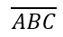

## **Gambaran Umum**

PowerPoint menyimpan persamaan sebagai Office Math Markup Language (OMML). Dengan Aspose.Slides untuk Android via Java, Anda dapat membuat konten matematika serupa secara programatis: pecahan, radikal, fungsi, limit, operator N-ary, matriks, array, dan blok matematika yang diformat.

Di PowerPoint, pengguna biasanya menambahkan persamaan melalui **Insert > Equation**:


Hasilnya adalah teks matematika yang dapat diedit pada slide:


Aspose.Slides membangun teks matematika tersebut melalui tiga objek utama:

- Sebuah bentuk matematika, dibuat dengan [addMathShape](https://reference.aspose.com/slides/androidjava/com.aspose.slides/ishapecollection/), adalah bentuk yang berisi persamaan.
- [MathPortion](https://reference.aspose.com/slides/androidjava/com.aspose.slides/mathportion/) menyimpan konten matematika di dalam bingkai teks bentuk.
- [MathParagraph](https://reference.aspose.com/slides/androidjava/com.aspose.slides/mathparagraph/) berisi satu atau lebih objek [MathBlock](https://reference.aspose.com/slides/androidjava/com.aspose.slides/mathblock/).

Sebagian besar contoh di bawah menggunakan [MathematicalText](https://reference.aspose.com/slides/androidjava/com.aspose.slides/mathematicaltext/) dan metode fluent dari [IMathElement](https://reference.aspose.com/slides/androidjava/com.aspose.slides/imathelement/) untuk menjaga kode tetap singkat dan mudah dibaca.

Untuk skenario ekspor MathML, lihat [Ekspor Persamaan Matematika dari Presentasi di Android](/slides/id/androidjava/exporting-math-equations/).

## **Buat Persamaan**

Contoh ini menggunakan [addMathShape](https://reference.aspose.com/slides/androidjava/com.aspose.slides/ishapecollection/#addMathShape-float-float-float-float-) untuk membuat bentuk matematika dan menambahkan teorema Pythagoras:


```java
import com.aspose.slides.*;

Presentation presentation = new Presentation();
try {
    ISlide slide = presentation.getSlides().get_Item(0);

    IAutoShape mathShape = slide.getShapes().addMathShape(20, 20, 700, 120);
    IMathParagraph mathParagraph = ((MathPortion) mathShape.getTextFrame().getParagraphs()
            .get_Item(0).getPortions().get_Item(0)).getMathParagraph();

    IMathBlock equation = new MathematicalText("c")
            .setSuperscript("2")
            .join("=")
            .join(new MathematicalText("a").setSuperscript("2"))
            .join("+")
            .join(new MathematicalText("b").setSuperscript("2"));

    mathParagraph.add(equation);

    presentation.save("pythagorean-theorem.pptx", SaveFormat.Pptx);
} finally {
    presentation.dispose();
}
```

{}

[addMathShape](https://reference.aspose.com/slides/androidjava/com.aspose.slides/ishapecollection/#addMathShape-float-float-float-float-) membuat sebuah bentuk yang sudah berisi paragraf matematika. Akses [MathPortion](https://reference.aspose.com/slides/androidjava/com.aspose.slides/mathportion/) pertama, panggil [getMathParagraph](https://reference.aspose.com/slides/androidjava/com.aspose.slides/imathportion/#getMathParagraph--), dan tambahkan blok matematika atau elemen matematika ke dalamnya.

{}

## **Tambah Pecahan**

Gunakan [divide](https://reference.aspose.com/slides/androidjava/com.aspose.slides/imathelement/#divide-com.aspose.slides.IMathElement-) untuk membuat pecahan. Anda dapat memilih gaya pecahan dengan [MathFractionTypes](https://reference.aspose.com/slides/androidjava/com.aspose.slides/mathfractiontypes/).


```java
import com.aspose.slides.*;

Presentation presentation = new Presentation();
try {
    ISlide slide = presentation.getSlides().get_Item(0);

    IAutoShape mathShape = slide.getShapes().addMathShape(20, 20, 700, 100);
    IMathParagraph mathParagraph = ((MathPortion) mathShape.getTextFrame().getParagraphs()
            .get_Item(0).getPortions().get_Item(0)).getMathParagraph();

    IMathFraction fraction = new MathematicalText("1")
            .divide("x", MathFractionTypes.Skewed);

    mathParagraph.add(new MathBlock(fraction));

    presentation.save("fraction.pptx", SaveFormat.Pptx);
} finally {
    presentation.dispose();
}
```

Untuk pecahan bertumpuk, gunakan [MathFractionTypes.Bar](https://reference.aspose.com/slides/androidjava/com.aspose.slides/mathfractiontypes/#Bar):

```java
import com.aspose.slides.*;

IMathFraction stackedFraction = new MathematicalText("x + 1").divide("y - 1", MathFractionTypes.Bar);
```

## **Tambah Radikal**

Gunakan [radical](https://reference.aspose.com/slides/androidjava/com.aspose.slides/imathelement/#radical-com.aspose.slides.IMathElement-) untuk membuat akar kuadrat, akar kubik, atau akar lainnya. Elemen saat ini menjadi basis, dan argumen menjadi pangkatnya.


```java
import com.aspose.slides.*;

Presentation presentation = new Presentation();
try {
    ISlide slide = presentation.getSlides().get_Item(0);

    IAutoShape mathShape = slide.getShapes().addMathShape(20, 20, 700, 100);
    IMathParagraph mathParagraph = ((MathPortion) mathShape.getTextFrame().getParagraphs()
            .get_Item(0).getPortions().get_Item(0)).getMathParagraph();

    IMathRadical radical = new MathematicalText("x")
            .radical("n");

    mathParagraph.add(new MathBlock(radical));

    presentation.save("radical.pptx", SaveFormat.Pptx);
} finally {
    presentation.dispose();
}
```

## **Tambah Fungsi dan Limit**

Gunakan [asArgumentOfFunction](https://reference.aspose.com/slides/androidjava/com.aspose.slides/imathelement/#asArgumentOfFunction-com.aspose.slides.IMathElement-) atau [function](https://reference.aspose.com/slides/androidjava/com.aspose.slides/imathelement/#function-com.aspose.slides.IMathElement-) untuk fungsi seperti `sin(x)`, `log(x)`, atau nama fungsi khusus. Untuk limit, letakkan `lim` dalam [MathLimit](https://reference.aspose.com/slides/androidjava/com.aspose.slides/mathlimit/) atau gunakan [setLowerLimit](https://reference.aspose.com/slides/androidjava/com.aspose.slides/imathelement/#setLowerLimit-com.aspose.slides.IMathElement-).


```java
import com.aspose.slides.*;

Presentation presentation = new Presentation();
try {
    ISlide slide = presentation.getSlides().get_Item(0);

    IAutoShape mathShape = slide.getShapes().addMathShape(20, 20, 700, 100);
    IMathParagraph mathParagraph = ((MathPortion) mathShape.getTextFrame().getParagraphs()
            .get_Item(0).getPortions().get_Item(0)).getMathParagraph();

    IMathFunction limit = new MathematicalText("lim")
            .setLowerLimit("x→∞")
            .function("x");

    mathParagraph.add(new MathBlock(limit));

    presentation.save("functions-and-limits.pptx", SaveFormat.Pptx);
} finally {
    presentation.dispose();
}
```

Untuk nama fungsi khusus, jadikan nama fungsi sebagai elemen saat ini dan panggil [function](https://reference.aspose.com/slides/androidjava/com.aspose.slides/imathelement/#function-com.aspose.slides.IMathElement-) dengan argumennya:

```java
import com.aspose.slides.*;

IMathFunction customFunction = new MathematicalText("f").function("x + 1");
```

## **Tambah Operator N-ary dan Integral**

Gunakan [nary](https://reference.aspose.com/slides/androidjava/com.aspose.slides/imathelement/#nary-int-com.aspose.slides.IMathElement-com.aspose.slides.IMathElement-) untuk penjumlahan, union, interseksi, dan operator besar lainnya. Gunakan [integral](https://reference.aspose.com/slides/androidjava/com.aspose.slides/imathelement/#integral-int-com.aspose.slides.IMathElement-com.aspose.slides.IMathElement-) untuk integral. Kedua metode memungkinkan Anda mengatur limit bawah dan atas.


```java
import com.aspose.slides.*;

Presentation presentation = new Presentation();
try {
    ISlide slide = presentation.getSlides().get_Item(0);

    IAutoShape mathShape = slide.getShapes().addMathShape(20, 20, 700, 120);
    IMathParagraph mathParagraph = ((MathPortion) mathShape.getTextFrame().getParagraphs()
            .get_Item(0).getPortions().get_Item(0)).getMathParagraph();

    IMathBlock summationBase = new MathematicalText("x")
            .setSuperscript("k")
            .join(new MathematicalText("a").setSuperscript("n-k"));

    IMathNaryOperator summation = summationBase.nary(MathNaryOperatorTypes.Summation, "k=0", "n");

    mathParagraph.add(new MathBlock(summation));

    presentation.save("nary-operators.pptx", SaveFormat.Pptx);
} finally {
    presentation.dispose();
}
```

Operator N-ary adalah untuk operator besar dengan limit opsional. Operator sederhana seperti `+`, `-`, dan `=` biasanya ditambahkan sebagai [MathematicalText](https://reference.aspose.com/slides/androidjava/com.aspose.slides/mathematicaltext/) dan digabungkan ke dalam ekspresi.

Untuk integral, gunakan [integral](https://reference.aspose.com/slides/androidjava/com.aspose.slides/imathelement/#integral-int-com.aspose.slides.IMathElement-com.aspose.slides.IMathElement-):

```java
import com.aspose.slides.*;

IMathBlock integralBase = new MathematicalText("x").join(new MathematicalText("dx").toBox());
IMathNaryOperator integral = integralBase.integral(MathIntegralTypes.Simple, "0", "1");
```

## **Tambah Matriks**

Gunakan [MathMatrix](https://reference.aspose.com/slides/androidjava/com.aspose.slides/mathmatrix/) untuk baris dan kolom. Matriks tidak menyertakan kurung secara default, jadi balut matriks ketika Anda membutuhkan tanda kurung, kurung siku, atau kurung kurawal.


```java
import com.aspose.slides.*;

Presentation presentation = new Presentation();
try {
    ISlide slide = presentation.getSlides().get_Item(0);

    IAutoShape mathShape = slide.getShapes().addMathShape(20, 20, 700, 120);
    IMathParagraph mathParagraph = ((MathPortion) mathShape.getTextFrame().getParagraphs()
            .get_Item(0).getPortions().get_Item(0)).getMathParagraph();

    MathMatrix matrix = new MathMatrix(2, 3);
    matrix.set_Item(0, 0, new MathematicalText("1"));
    matrix.set_Item(0, 1, new MathematicalText("x"));
    matrix.set_Item(1, 0, new MathematicalText("x"));
    matrix.set_Item(1, 1, new MathematicalText("2"));
    matrix.set_Item(1, 2, new MathematicalText("y"));

    mathParagraph.add(new MathBlock(matrix));

    presentation.save("matrix.pptx", SaveFormat.Pptx);
} finally {
    presentation.dispose();
}
```

## **Tambah Array Persamaan**

Gunakan [toMathArray](https://reference.aspose.com/slides/androidjava/com.aspose.slides/imathelement/#toMathArray--) ketika Anda membutuhkan persamaan yang diratakan atau tumpukan vertikal ekspresi.


```java
import com.aspose.slides.*;

Presentation presentation = new Presentation();
try {
    ISlide slide = presentation.getSlides().get_Item(0);

    IAutoShape mathShape = slide.getShapes().addMathShape(20, 20, 700, 140);
    IMathParagraph mathParagraph = ((MathPortion) mathShape.getTextFrame().getParagraphs()
            .get_Item(0).getPortions().get_Item(0)).getMathParagraph();

    IMathArray equationArray = new MathematicalText("x")
            .join("y")
            .toMathArray();

    mathParagraph.add(new MathBlock(equationArray));

    presentation.save("equation-array.pptx", SaveFormat.Pptx);
} finally {
    presentation.dispose();
}
```

### **Ratakan Array dengan Elemen Sekitar**

[setBaseJustification](https://reference.aspose.com/slides/androidjava/com.aspose.slides/imatharray/#setBaseJustification-int-) mengontrol perataan vertikal sebuah array relatif terhadap elemen matematika di sampingnya. Contoh di bawah membandingkan perataan dengan baris pertama, tengah array, dan baris terakhir.

Contoh berikut membuat tiga array identik, masing‑masing dengan tiga baris dan elemen tetangga `A=` dan `=B`. Semua teks matematika menggunakan Cambria Math berukuran 24 poin. Hanya perataan array yang berubah.

```java
import com.aspose.slides.*;
import android.graphics.Color;

class MathTextFactory {
    MathematicalText createText(String value) {
        MathematicalText text = new MathematicalText(value);
        text.getFormat().setFontHeight(24);
        text.getFormat().setLatinFont(new FontData("Cambria Math"));
        return text;
    }
}

MathTextFactory factory = new MathTextFactory();
Presentation presentation = new Presentation();
try {
    presentation.getSlideSize().setSize(780, 200, SlideSizeScaleType.DoNotScale);
    ISlide slide = presentation.getSlides().get_Item(0);

    int[] alignments = { MathVerticalAlignment.Top, MathVerticalAlignment.Center, MathVerticalAlignment.Bottom };
    String[] alignmentNames = { "Top", "Center", "Bottom" };

    for (int i = 0; i < alignments.length; i++) {
        IAutoShape label = slide.getShapes().addAutoShape(ShapeType.Rectangle, 20 + i * 260, 10, 240, 30);
        label.getFillFormat().setFillType(FillType.NoFill);
        label.getLineFormat().getFillFormat().setFillType(FillType.NoFill);
        label.getTextFrame().setText(alignmentNames[i]);
        IPortionFormat labelFormat = label.getTextFrame().getParagraphs().get_Item(0).getPortions().get_Item(0).getPortionFormat();
        labelFormat.setFontHeight(16);
        labelFormat.getFillFormat().setFillType(FillType.Solid);
        labelFormat.getFillFormat().getSolidFillColor().setColor(Color.BLACK);

        IAutoShape mathShape = slide.getShapes().addMathShape(20 + i * 260, 60, 240, 130);
        mathShape.getTextFrame().getTextFrameFormat().setAnchoringType(TextAnchorType.Top);
        IMathParagraph mathParagraph = ((IMathPortion) mathShape.getTextFrame().getParagraphs().get_Item(0).getPortions().get_Item(0)).getMathParagraph();
        mathParagraph.setJustification(MathJustification.LeftJustified);

        IMathElement[] rows = { factory.createText("x+y=3"), factory.createText("x-y=1"), factory.createText("x=2") };
        MathArray equationArray = new MathArray(rows[0]);
        equationArray.getArguments().add(rows[1]);
        equationArray.getArguments().add(rows[2]);
        equationArray.setBaseJustification(alignments[i]);
        MathematicalText leftText = factory.createText("A=");
        MathematicalText rightText = factory.createText("=B");
        IMathBlock equation = new MathBlock(leftText).join(equationArray).join(rightText);
        mathParagraph.add(equation);
    }

    presentation.save("equation-array-alignment.pptx", SaveFormat.Pptx);
} finally {
    presentation.dispose();
}
```

Perbandingan berikut menunjukkan presentasi yang disimpan di PowerPoint. Perhatikan posisi `A=` dan `=B` di samping setiap array.


### **Konfigurasi Jarak Baris**

[setRowSpacingRule](https://reference.aspose.com/slides/androidjava/com.aspose.slides/imatharray/#setRowSpacingRule-int-) memilih aturan jarak untuk baris dalam array. [setRowSpacing](https://reference.aspose.com/slides/androidjava/com.aspose.slides/imatharray/#setRowSpacing-long-) memberikan nilai numerik untuk aturan jarak eksplisit dan diabaikan oleh aturan bawaan.

Untuk jarak tepat, nilai diukur dalam poin. Untuk jarak proporsional, diukur dalam setengah baris: nilai `3` pada contoh berarti 1,5 baris. Atur kedua properti ketika menentukan nilai eksplisit; mengubah nilai numerik saja tidak memilih aturan jarak.

Contoh di bawah menyimpan lima presentasi dengan persamaan, perataan, dan pengaturan font yang sama. Tiga pertama menggunakan preset; dua terakhir menampilkan nilai eksplisit.

```java
import com.aspose.slides.*;

class MathTextFactory {
    MathematicalText createText(String value) {
        MathematicalText text = new MathematicalText(value);
        text.getFormat().setFontHeight(24);
        text.getFormat().setLatinFont(new FontData("Cambria Math"));
        return text;
    }
}

MathTextFactory factory = new MathTextFactory();
int[] rules = { MathRowSpacingRule.SingleLineGap, MathRowSpacingRule.OneAndAHalfLineGap, MathRowSpacingRule.TwoLineGap, MathRowSpacingRule.Exactly, MathRowSpacingRule.Multiple };
int[] spacingValues = { 0, 0, 0, 20, 3 };
String[] ruleNames = { "SingleLineGap", "OneAndAHalfLineGap", "TwoLineGap", "Exactly", "Multiple" };

for (int i = 0; i < rules.length; i++) {
    String fileName = "equation-array-" + ruleNames[i] + ".pptx";
    Presentation presentation = new Presentation();
    try {
        IAutoShape mathShape = presentation.getSlides().get_Item(0).getShapes().addMathShape(20, 20, 600, 300);
        IParagraph paragraph = mathShape.getTextFrame().getParagraphs().get_Item(0);
        paragraph.getParagraphFormat().setSpaceBefore(0);
        paragraph.getParagraphFormat().setSpaceAfter(0);
        IMathParagraph mathParagraph = ((IMathPortion) paragraph.getPortions().get_Item(0)).getMathParagraph();
        mathParagraph.setJustification(MathJustification.LeftJustified);

        IMathElement[] rows = { factory.createText("x+y=3"), factory.createText("x-y=1"), factory.createText("x=2") };
        MathArray equationArray = new MathArray(rows[0]);
        equationArray.getArguments().add(rows[1]);
        equationArray.getArguments().add(rows[2]);
        equationArray.setBaseJustification(MathVerticalAlignment.Center);
        equationArray.setRowSpacingRule(rules[i]);
        equationArray.setRowSpacing(spacingValues[i]);
        MathematicalText leftText = factory.createText("A=");
        MathematicalText rightText = factory.createText("=B");
        IMathBlock equation = new MathBlock(leftText).join(equationArray).join(rightText);
        mathParagraph.add(equation);

        presentation.save(fileName, SaveFormat.Pptx);
    } finally {
        presentation.dispose();
    }
}
```

Jarak baris array terpisah dari jarak paragraf. [setSpaceBefore](https://reference.aspose.com/slides/androidjava/com.aspose.slides/iparagraphformat/#setSpaceBefore-float-) dan [setSpaceAfter](https://reference.aspose.com/slides/androidjava/com.aspose.slides/iparagraphformat/#setSpaceAfter-float-) menambahkan ruang di sekitar paragraf yang berisi, bukan di antara baris array. Demikian pula, [IMathParagraph.setJustification](https://reference.aspose.com/slides/androidjava/com.aspose.slides/imathparagraph/#setJustification-int-) memposisikan seluruh paragraf matematika secara horizontal; tidak menggantikan pengaturan perataan vertikal array.

## **Tambah Fungsi Trigonometri**

Gunakan [asArgumentOfFunction](https://reference.aspose.com/slides/androidjava/com.aspose.slides/imathelement/#asArgumentOfFunction-com.aspose.slides.IMathElement-) ketika argumen adalah elemen saat ini dan nama fungsi sudah diketahui.


```java
import com.aspose.slides.*;

Presentation presentation = new Presentation();
try {
    ISlide slide = presentation.getSlides().get_Item(0);

    IAutoShape mathShape = slide.getShapes().addMathShape(20, 20, 700, 100);
    IMathParagraph mathParagraph = ((MathPortion) mathShape.getTextFrame().getParagraphs()
            .get_Item(0).getPortions().get_Item(0)).getMathParagraph();

    IMathFunction cosine = new MathematicalText("2x")
            .asArgumentOfFunction(MathFunctionsOfOneArgument.Cos);

    mathParagraph.add(new MathBlock(cosine));

    presentation.save("trigonometric-function.pptx", SaveFormat.Pptx);
} finally {
    presentation.dispose();
}
```

## **Tambah Subskrip dan Superskrip**

Gunakan pembantu subskrip dan superskrip untuk indeks dan pangkat. Ketika indeks harus muncul di sisi kiri basis, gunakan [setSubSuperscriptOnTheLeft](https://reference.aspose.com/slides/androidjava/com.aspose.slides/imathelement/#setSubSuperscriptOnTheLeft-com.aspose.slides.IMathElement-com.aspose.slides.IMathElement-).


```java
import com.aspose.slides.*;

Presentation presentation = new Presentation();
try {
    ISlide slide = presentation.getSlides().get_Item(0);

    IAutoShape mathShape = slide.getShapes().addMathShape(20, 20, 700, 100);
    IMathParagraph mathParagraph = ((MathPortion) mathShape.getTextFrame().getParagraphs()
            .get_Item(0).getPortions().get_Item(0)).getMathParagraph();

    IMathLeftSubSuperscriptElement scripts = new MathematicalText("Y")
            .setSubSuperscriptOnTheLeft("1", "n");

    mathParagraph.add(new MathBlock(scripts));

    presentation.save("subscript-superscript.pptx", SaveFormat.Pptx);
} finally {
    presentation.dispose();
}
```

## **Tambah Pembatas**

Gunakan [enclose](https://reference.aspose.com/slides/androidjava/com.aspose.slides/imathelement/#enclose-char-char-) untuk menempatkan ekspresi di dalam pembatas. Anda juga dapat mengatur karakter pemisah untuk ekspresi pembatas yang berisi beberapa elemen.


```java
import com.aspose.slides.*;

Presentation presentation = new Presentation();
try {
    ISlide slide = presentation.getSlides().get_Item(0);

    IAutoShape mathShape = slide.getShapes().addMathShape(20, 20, 700, 100);
    IMathParagraph mathParagraph = ((MathPortion) mathShape.getTextFrame().getParagraphs()
            .get_Item(0).getPortions().get_Item(0)).getMathParagraph();

    IMathDelimiter delimiter = new MathematicalText("x")
            .join("y")
            .join("z")
            .enclose('<', '>');
    delimiter.setSeparatorCharacter('|');

    mathParagraph.add(new MathBlock(delimiter));

    presentation.save("delimiters.pptx", SaveFormat.Pptx);
} finally {
    presentation.dispose();
}
```

### **Ukuran dan Rata Pembatas**

Berikan `true` ke [setGrowToMatchOperandHeight](https://reference.aspose.com/slides/androidjava/com.aspose.slides/imathdelimiter/#setGrowToMatchOperandHeight-boolean-) agar tanda kurung tumbuh di sekitar operand tinggi, atau `false` agar tetap pada ukuran normal. Gunakan [setDelimiterShape](https://reference.aspose.com/slides/androidjava/com.aspose.slides/imathdelimiter/#setDelimiterShape-int-) dengan salah satu nilai [MathDelimiterShape](https://reference.aspose.com/slides/androidjava/com.aspose.slides/mathdelimitershape/). `Centered` menempatkan tanda kurung di tengah sumbu matematika, yang melintasi tengah tanda sama dengan. `Match` menyesuaikannya dengan konten yang dibungkus. Kedua pengaturan hanya memengaruhi pembatas. Ekspresi di dalamnya tetap sama.

Contoh menempatkan pecahan di eksponen `x` sehingga ekspresi memperluas lebih tinggi di atas garis dasar daripada di bawahnya. Keempat persamaan menggunakan tanda kurung dan pengaturan font yang sama.

```java
import com.aspose.slides.*;

Presentation presentation = new Presentation();
try {
    ISlide slide = presentation.getSlides().get_Item(0);
    for (int row = 0; row < 2; row++) {
        for (int column = 0; column < 2; column++) {
            IMathFraction fraction = new MathematicalText("a + b").divide("c + d");
            IMathSuperscriptElement power = new MathematicalText("x").setSuperscript(fraction);
            IMathDelimiter delimiter = power.enclose('(', ')');
            delimiter.setGrowToMatchOperandHeight(row == 0);
            delimiter.setDelimiterShape(column == 0 ? MathDelimiterShape.Centered : MathDelimiterShape.Match);

            IAutoShape mathShape = slide.getShapes().addMathShape(20 + 330 * column, 20 + 120 * row, 300, 100);
            MathPortion portion = (MathPortion) mathShape.getTextFrame().getParagraphs().get_Item(0).getPortions().get_Item(0);
            portion.getPortionFormat().setFontHeight(32);
            IMathBlock equation = new MathematicalText("y = ").join(delimiter);
            portion.getMathParagraph().add(equation);
        }
    }
    presentation.save("delimiter-sizing.pptx", SaveFormat.Pptx);
} finally {
    presentation.dispose();
}
```

Di PowerPoint, bandingkan baris‑baris untuk melihat pengaruh pertumbuhan. Pada baris atas, tanda kurung tumbuh untuk membungkus eksponen dan terlihat serupa untuk kedua bentuk. Pada baris bawah, pertumbuhan dimatikan. Tanda kurung kecil di kiri (`Centered`) selaras dengan tanda sama dengan, sementara yang di kanan (`Match`) berada lebih tinggi di sekitar ekspresi.


## **Tambah Kotak Batas**

Panggil [toBorderBox](https://reference.aspose.com/slides/androidjava/com.aspose.slides/imathelement/#toBorderBox--) pada sebuah pecahan untuk membingkai seluruh ekspresi. [IMathBorderBox](https://reference.aspose.com/slides/androidjava/com.aspose.slides/imathborderbox/) yang dikembalikan menampilkan keempat sisi secara default. Gunakan [setHideTop](https://reference.aspose.com/slides/androidjava/com.aspose.slides/imathborderbox/#setHideTop-boolean-), [setHideBottom](https://reference.aspose.com/slides/androidjava/com.aspose.slides/imathborderbox/#setHideBottom-boolean-), [setHideLeft](https://reference.aspose.com/slides/androidjava/com.aspose.slides/imathborderbox/#setHideLeft-boolean-), dan [setHideRight](https://reference.aspose.com/slides/androidjava/com.aspose.slides/imathborderbox/#setHideRight-boolean-) untuk menghapus sisi tertentu.

Contoh menempatkan enam salinan pecahan yang sama pada satu slide. Untuk menunjukkan pembatalan, sembunyikan keempat sisi dan berikan `true` ke [setStrikethroughBottomLeftToTopRight](https://reference.aspose.com/slides/androidjava/com.aspose.slides/imathborderbox/#setStrikethroughBottomLeftToTopRight-boolean-) untuk diagonal naik (↗) atau [setStrikethroughTopLeftToBottomRight](https://reference.aspose.com/slides/androidjava/com.aspose.slides/imathborderbox/#setStrikethroughTopLeftToBottomRight-boolean-) untuk diagonal turun (↘). Anda juga dapat menggunakan [setStrikethroughHorizontal](https://reference.aspose.com/slides/androidjava/com.aspose.slides/imathborderbox/#setStrikethroughHorizontal-boolean-) atau [setStrikethroughVertical](https://reference.aspose.com/slides/androidjava/com.aspose.slides/imathborderbox/#setStrikethroughVertical-boolean-) dengan kombinasi sisi yang terlihat mana saja.

```java
import com.aspose.slides.*;

Presentation presentation = new Presentation();
try {
    presentation.getSlideSize().setSize(540, 220, SlideSizeScaleType.DoNotScale);
    ISlide slide = presentation.getSlides().get_Item(0);

    class FractionBuilder {
        IMathBorderBox addFraction(float x, float y, boolean hideBorder) {
            IMathFraction fraction = new MathematicalText("x+1").divide("y+2");
            IMathBorderBox box = fraction.toBorderBox();
            box.setHideTop(hideBorder);
            box.setHideBottom(hideBorder);
            box.setHideLeft(hideBorder);
            box.setHideRight(hideBorder);

            IAutoShape shape = slide.getShapes().addMathShape(x, y, 160, 90);
            MathPortion portion = (MathPortion) shape.getTextFrame().getParagraphs().get_Item(0).getPortions().get_Item(0);
            portion.getPortionFormat().setFontHeight(28);
            portion.getMathParagraph().add(new MathBlock(box));
            return box;
        }
    }

    FractionBuilder builder = new FractionBuilder();
    builder.addFraction(10, 10, false);

    IMathBorderBox partial = builder.addFraction(190, 10, false);
    partial.setHideTop(true);
    partial.setHideRight(true);

    builder.addFraction(370, 10, true).setStrikethroughBottomLeftToTopRight(true);
    builder.addFraction(10, 120, true).setStrikethroughTopLeftToBottomRight(true);
    builder.addFraction(190, 120, true).setStrikethroughHorizontal(true);
    builder.addFraction(370, 120, false).setStrikethroughVertical(true);

    presentation.save("border-box.pptx", SaveFormat.Pptx);
} finally {
    presentation.dispose();
}
```


Pada pecahan ini, goresan horizontal menutupi batang pecahan. Goresan vertikal melintasi baik pembilang maupun penyebut sementara batas di sekelilingnya tetap terlihat. Garis‑garis ini menghias seluruh ekspresi. Coret teks biasa hanya berlaku pada karakter dalam sebuah run teks. Setelah membuka kembali presentasi di PowerPoint, Anda masih dapat mengedit pembilang dan penyebut secara terpisah.

## **Kelompokkan Istilah**

Gunakan [group](https://reference.aspose.com/slides/androidjava/com.aspose.slides/imathelement/#group-char-int-int-) untuk menempatkan karakter pengelompokan di atas atau di bawah sebuah ekspresi. Tambahkan limit untuk memberi label pada istilah yang dikelompokkan.


```java
import com.aspose.slides.*;

Presentation presentation = new Presentation();
try {
    ISlide slide = presentation.getSlides().get_Item(0);

    IAutoShape mathShape = slide.getShapes().addMathShape(20, 20, 700, 120);
    IMathParagraph mathParagraph = ((MathPortion) mathShape.getTextFrame().getParagraphs()
            .get_Item(0).getPortions().get_Item(0)).getMathParagraph();

    IMathLimit grouped = new MathematicalText("x + y")
            .group('\u23DF', MathTopBotPositions.Bottom, MathTopBotPositions.Top)
            .setLowerLimit("any text");

    mathParagraph.add(new MathBlock(grouped));

    presentation.save("grouped-terms.pptx", SaveFormat.Pptx);
} finally {
    presentation.dispose();
}
```

## **Format Elemen Matematika**

Gunakan pembantu format hanya ketika mereka memperjelas rumus. Misalnya, [overbar](https://reference.aspose.com/slides/androidjava/com.aspose.slides/imathelement/#overbar--) menempatkan sebuah bar di atas elemen matematika.



```java
import com.aspose.slides.*;

Presentation presentation = new Presentation();
try {
    ISlide slide = presentation.getSlides().get_Item(0);

    IAutoShape mathShape = slide.getShapes().addMathShape(20, 20, 700, 100);
    IMathParagraph mathParagraph = ((MathPortion) mathShape.getTextFrame().getParagraphs()
            .get_Item(0).getPortions().get_Item(0)).getMathParagraph();

    IMathBar overbar = new MathematicalText("ABC").overbar();

    mathParagraph.add(new MathBlock(overbar));

    presentation.save("overbar.pptx", SaveFormat.Pptx);
} finally {
    presentation.dispose();
}
```

### **Format Teks dalam Persamaan yang Ada**

Untuk memformat teks di seluruh persamaan yang ada, telusuri pohon elemen setiap blok matematika. [IMathElement.getChildren](https://reference.aspose.com/slides/androidjava/com.aspose.slides/imathelement/#getChildren--) mengembalikan hanya anak‑anak langsung, sehingga panggil secara rekursif untuk menjangkau teks di dalam pecahan, skrip, radikal, dan struktur bersarang lainnya. Periksa elemen saat ini serta anak‑anaknya untuk menyertakan elemen awal bila itu adalah [MathematicalText](https://reference.aspose.com/slides/androidjava/com.aspose.slides/mathematicaltext/).

Contoh ini mengasumsikan bahwa `input.pptx` berisi persamaan seperti `z = xᵢ / ∛y`, dengan sebuah pecahan yang memiliki subskrip di pembilang dan radikal di penyebut. Memproses hanya elemen tingkat atas blok akan melewatkan teks di dalam pecahan. Contoh menemukan bagian matematika dalam bingkai teks slide, mengakses blok‑nya melalui [IMathPortion.getMathParagraph](https://reference.aspose.com/slides/androidjava/com.aspose.slides/imathportion/#getMathParagraph--), dan menggunakan [setFontHeight](https://reference.aspose.com/slides/androidjava/com.aspose.slides/baseportionformat/#setFontHeight-float-) untuk mengatur ukuran font menjadi 28 poin melalui metode [getFormat](https://reference.aspose.com/slides/androidjava/com.aspose.slides/mathematicaltext/#getFormat--) pada setiap elemen teks.

```java
import com.aspose.slides.*;

class MathTextFormatter {
    void formatMathText(IMathElement element) {
        if (element instanceof MathematicalText) {
            MathematicalText text = (MathematicalText) element;
            text.getFormat().setFontHeight(28);
        }

        for (IMathElement child : element.getChildren()) {
            formatMathText(child);
        }
    }
}

MathTextFormatter formatter = new MathTextFormatter();
Presentation presentation = new Presentation("input.pptx");
try {
    for (ISlide slide : presentation.getSlides()) {
        for (IShape shape : slide.getShapes()) {
            if (!(shape instanceof IAutoShape)) {
                continue;
            }

            IAutoShape autoShape = (IAutoShape) shape;
            if (autoShape.getTextFrame() == null) {
                continue;
            }

            for (IParagraph paragraph : autoShape.getTextFrame().getParagraphs()) {
                for (IPortion portion : paragraph.getPortions()) {
                    if (portion instanceof IMathPortion) {
                        IMathPortion mathPortion = (IMathPortion) portion;
                        for (IMathBlock block : mathPortion.getMathParagraph()) {
                            formatter.formatMathText(block);
                        }
                    }
                }
            }
        }
    }

    presentation.save("formatted-equations.pptx", SaveFormat.Pptx);
} finally {
    presentation.dispose();
}
```

Presentasi yang disimpan berisi pemformatan teks yang diperbarui pada setiap tingkat setiap persamaan yang diproses, sekaligus mempertahankan konten teks dan struktur matematika.

## **Referensi Cepat**

| Tugas | API Utama |
| --- | --- |
| Buat teks matematika | [MathematicalText](https://reference.aspose.com/slides/androidjava/com.aspose.slides/mathematicaltext/) |
| Gabungkan elemen | [IMathElement.join](https://reference.aspose.com/slides/androidjava/com.aspose.slides/imathelement/) |
| Buat pecahan | [IMathElement.divide](https://reference.aspose.com/slides/androidjava/com.aspose.slides/imathelement/) |
| Tambah superskrip atau subskrip | [setSuperscript](https://reference.aspose.com/slides/androidjava/com.aspose.slides/imathelement/), [setSubscript](https://reference.aspose.com/slides/androidjava/com.aspose.slides/imathelement/) |
| Tambah fungsi | [function](https://reference.aspose.com/slides/androidjava/com.aspose.slides/imathelement/), [asArgumentOfFunction](https://reference.aspose.com/slides/androidjava/com.aspose.slides/imathelement/) |
| Tambah radikal | [IMathElement.radical](https://reference.aspose.com/slides/androidjava/com.aspose.slides/imathelement/) |
| Tambah limit | [setLowerLimit](https://reference.aspose.com/slides/androidjava/com.aspose.slides/imathelement/), [setUpperLimit](https://reference.aspose.com/slides/androidjava/com.aspose.slides/imathelement/) |
| Tambah skrip sisi kiri | [setSubSuperscriptOnTheLeft](https://reference.aspose.com/slides/androidjava/com.aspose.slides/imathelement/) |
| Tambah penjumlahan dan integral | [nary](https://reference.aspose.com/slides/androidjava/com.aspose.slides/imathelement/), [integral](https://reference.aspose.com/slides/androidjava/com.aspose.slides/imathelement/) |
| Tambah matriks | [MathMatrix](https://reference.aspose.com/slides/androidjava/com.aspose.slides/mathmatrix/) |
| Tambah array persamaan | [toMathArray](https://reference.aspose.com/slides/androidjava/com.aspose.slides/imathelement/) |
| Tambah pembatas | [enclose](https://reference.aspose.com/slides/androidjava/com.aspose.slides/imathelement/) |
| Tambah bar dan batas | [overbar](https://reference.aspose.com/slides/androidjava/com.aspose.slides/imathelement/), [toBorderBox](https://reference.aspose.com/slides/androidjava/com.aspose.slides/imathelement/) |
| Kelompokkan istilah | [group](https://reference.aspose.com/slides/androidjava/com.aspose.slides/imathelement/) |

## **FAQ**

**Bisakah saya mengedit persamaan PowerPoint yang ada?**

Ya. Buka presentasi, temukan bentuk yang berisi [MathPortion](https://reference.aspose.com/slides/androidjava/com.aspose.slides/mathportion/), panggil [getMathParagraph](https://reference.aspose.com/slides/androidjava/com.aspose.slides/imathportion/#getMathParagraph--), dan perbarui blok matematika dalam paragraf tersebut.

**Apakah persamaan disimpan sebagai math PowerPoint yang dapat diedit?**

Ya. Saat Anda menyimpan ke PPTX, Aspose.Slides menulis persamaan sebagai konten Office math yang dapat diedit.

**Bisakah saya mengekspor persamaan ke LaTeX?**

Ya. Dapatkan [IMathParagraph](https://reference.aspose.com/slides/androidjava/com.aspose.slides/imathparagraph/) persamaan dari [IMathPortion](https://reference.aspose.com/slides/androidjava/com.aspose.slides/imathportion/), dan panggil [IMathParagraph.toLatex](https://reference.aspose.com/slides/androidjava/com.aspose.slides/imathparagraph/#toLatex--) untuk mengekspornya secara langsung. Untuk contoh lengkap, lihat [Ekspor Persamaan Matematika dari Presentasi di Android via Java](/slides/id/androidjava/exporting-math-equations/#export-math-equations-to-latex).