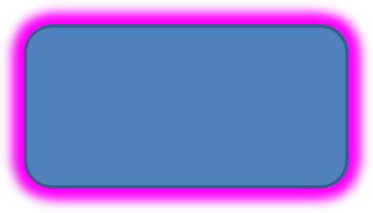

## **Pendahuluan**

Sementara efek di PowerPoint dapat digunakan untuk menonjolkan suatu bentuk, mereka berbeda dari [isi](/slides/id/androidjava/shape-formatting/#gradient-fill) atau garis tepi. Dengan menggunakan efek PowerPoint, Anda dapat membuat refleksi yang meyakinkan pada suatu bentuk, menyebarkan cahaya pada bentuk, dll.


PowerPoint menyediakan enam efek yang dapat diterapkan pada bentuk. Anda dapat menerapkan satu atau lebih efek pada sebuah bentuk.

Beberapa kombinasi efek terlihat lebih baik daripada yang lain. Karena itu, PowerPoint menyediakan opsi di bawah **Preset**. Opsi Preset adalah kombinasi dua atau lebih efek yang diketahui menghasilkan tampilan bagus. Dengan cara ini, dengan memilih preset, Anda tidak perlu membuang waktu menguji atau menggabungkan efek berbeda untuk menemukan kombinasi yang bagus.

Aspose.Slides menyediakan properti dan metode di dalam kelas [EffectFormat](https://reference.aspose.com/slides/androidjava/com.aspose.slides/effectformat/) yang memungkinkan Anda menerapkan efek yang sama pada bentuk dalam presentasi PowerPoint.

## **Menerapkan Efek Bayangan**

Aspose.Slides untuk Android via Java mendukung bayangan luar dan dalam untuk bentuk. Anda dapat menyesuaikan warna, arah, jarak, dan radius blur mereka agar sesuai dengan desain presentasi Anda.

### **Menerapkan Bayangan Luar**

Gunakan bayangan luar untuk membuat kartu atau panel menonjol di atas latar belakang slide. Bayangan tersebut meluas di luar tepi bentuk, menciptakan kesan bahwa bentuk terangkat di atas slide. Sesuaikan warna, arah, jarak, dan radius blur untuk mencocokkan pencahayaan dan gaya templat Anda.

Kode Java ini menunjukkan cara menerapkan [efek bayangan luar](https://reference.aspose.com/slides/androidjava/com.aspose.slides/effectformat/#getOuterShadowEffect--) pada sebuah persegi panjang:

```java
import com.aspose.slides.*;
import android.graphics.Color;

Presentation presentation = new Presentation();
try {
    ISlide slide = presentation.getSlides().get_Item(0);

    IShape shape = slide.getShapes().addAutoShape(ShapeType.RoundCornerRectangle, 20, 20, 200, 100);
    shape.getEffectFormat().enableOuterShadowEffect();
    shape.getEffectFormat().getOuterShadowEffect().getShadowColor().setColor(Color.rgb(169, 169, 169));
    shape.getEffectFormat().getOuterShadowEffect().setDistance(10);
    shape.getEffectFormat().getOuterShadowEffect().setDirection(45);

    presentation.save("shadow_effect.pptx", SaveFormat.Pptx);
} finally {
    presentation.dispose();
}
```


#### **Mengontrol Arah Bayangan Saat Bentuk Diputar**

Secara default, bayangan luar berputar bersama bentuk. Untuk membuat bentuk dengan rotasi berbeda tampak diterangi dari arah yang sama, panggil [setRotateShadowWithShape](https://reference.aspose.com/slides/androidjava/com.aspose.slides/ioutershadow/#setRotateShadowWithShape-boolean-) dengan `false` dan gunakan [setDirection](https://reference.aspose.com/slides/androidjava/com.aspose.slides/ioutershadow/#setDirection-float-) untuk memberi bayangan mereka arah yang sama.

Contoh ini membuat dua panah biru dengan bayangan abu-abu yang digeser 42 poin ke kanan (0°). Kemudian slide diduplikasi dan kedua panah diputar 90° searah jarum jam.

```java
import com.aspose.slides.*;
import android.graphics.Color;

Presentation presentation = new Presentation();
try {
    ISlide before = presentation.getSlides().get_Item(0);

    IAutoShape left = before.getShapes().addAutoShape(ShapeType.RightArrow, 55, 130, 110, 60);
    left.getFillFormat().setFillType(FillType.Solid);
    left.getFillFormat().getSolidFillColor().setColor(Color.rgb(70, 130, 180));
    left.getLineFormat().getFillFormat().setFillType(FillType.NoFill);

    left.getEffectFormat().enableOuterShadowEffect();
    IOuterShadow shadow = left.getEffectFormat().getOuterShadowEffect();
    shadow.getShadowColor().setColor(Color.rgb(128, 128, 128));
    shadow.setDirection(0);
    shadow.setDistance(42);
    shadow.setBlurRadius(0);
    shadow.setRotateShadowWithShape(true);

    IShape right = before.getShapes().addClone(left);
    right.setX(395);
    right.getEffectFormat().getOuterShadowEffect().setRotateShadowWithShape(false);

    ISlide after = presentation.getSlides().addClone(before);
    for (IShape arrow : after.getShapes()) {
        arrow.setRotation(90);
    }

    presentation.save("arrow_shadows.pptx", SaveFormat.Pptx);
} finally {
    presentation.dispose();
}
```

Pada slide kedua, panah kiri menebarkan bayangannya ke bawah, sementara panah kanan masih menebarkan bayangannya ke kanan. Arah yang dikonfigurasi tetap 0° untuk kedua bayangan.


### **Menerapkan Bayangan Dalam**

Saat meniru gaya visual templat, gunakan bayangan dalam untuk memberi kartu atau panel tampilan terukir. Bayangan luar meluas di luar bentuk dan membuatnya tampak terangkat, sementara bayangan dalam meneduhkan bagian dalam tepinya.

Panggil [enableInnerShadowEffect](https://reference.aspose.com/slides/androidjava/com.aspose.slides/effectformat/#enableInnerShadowEffect--), kemudian konfigurasikan bayangan yang dikembalikan oleh [getInnerShadowEffect](https://reference.aspose.com/slides/androidjava/com.aspose.slides/effectformat/#getInnerShadowEffect--). Nilai radius blur yang lebih besar menghasilkan tepi yang lebih lembut.

Contoh Java ini membuat kartu berwarna biru muda dengan bayangan dalam berwarna abu-abu gelap dan menyimpannya sebagai file PPTX. Arah bayangan adalah 225 derajat, jaraknya 7 poin, dan radius blur-nya 6 poin:

```java
import com.aspose.slides.*;
import android.graphics.Color;

Presentation presentation = new Presentation();
try {
    ISlide slide = presentation.getSlides().get_Item(0);

    IAutoShape shape = slide.getShapes().addAutoShape(ShapeType.Rectangle, 20, 20, 200, 100);
    shape.getFillFormat().setFillType(FillType.Solid);
    shape.getFillFormat().getSolidFillColor().setColor(Color.rgb(173, 216, 230));
    shape.getLineFormat().getFillFormat().setFillType(FillType.NoFill);

    shape.getEffectFormat().enableInnerShadowEffect();
    IInnerShadow shadow = shape.getEffectFormat().getInnerShadowEffect();
    shadow.getShadowColor().setColor(Color.rgb(105, 105, 105));
    shadow.setDirection(225);
    shadow.setDistance(7);
    shadow.setBlurRadius(6);

    presentation.save("inner_shadow_effect.pptx", SaveFormat.Pptx);
} finally {
    presentation.dispose();
}
```


Untuk menghapus bayangan dalam, panggil [disableInnerShadowEffect](https://reference.aspose.com/slides/androidjava/com.aspose.slides/effectformat/#disableInnerShadowEffect--) pada format efek bentuk.

### **Menerapkan, Mengubah, dan Menghapus Bayangan Preset**

Panggil [enablePresetShadowEffect](https://reference.aspose.com/slides/androidjava/com.aspose.slides/ieffectformat/#enablePresetShadowEffect--) dan gunakan [setPreset](https://reference.aspose.com/slides/androidjava/com.aspose.slides/ipresetshadow/#setPreset-int-) untuk memilih sebuah [PresetShadowType](https://reference.aspose.com/slides/androidjava/com.aspose.slides/presetshadowtype/). Untuk mengubah gaya, ubah preset pada bentuk yang sama. Panggil [disablePresetShadowEffect](https://reference.aspose.com/slides/androidjava/com.aspose.slides/ieffectformat/#disablePresetShadowEffect--) untuk menghapus bayangan sambil mempertahankan isi dan garis tepi.

Contoh ini menunjukkan empat tahap berdampingan pada satu slide. Kedua bayangan digeser 10 poin. Arah 225° menempatkan bayangan pertama di atas dan di sebelah kiri persegi panjang, dan 45° menempatkan yang kedua di bawah dan di sebelah kanan.

```java
import com.aspose.slides.*;
import android.graphics.Color;

Presentation presentation = new Presentation();
try {
    presentation.getSlideSize().setSize(800, 120, SlideSizeScaleType.DoNotScale);
    IShapeCollection shapes = presentation.getSlides().get_Item(0).getShapes();

    IAutoShape shape = shapes.addAutoShape(ShapeType.Rectangle, 15, 30, 170, 60);
    shape.getFillFormat().setFillType(FillType.Solid);
    shape.getFillFormat().getSolidFillColor().setColor(Color.rgb(70, 130, 180));
    shape.getLineFormat().getFillFormat().setFillType(FillType.Solid);
    shape.getLineFormat().getFillFormat().getSolidFillColor().setColor(Color.rgb(0, 0, 139));
    shape.getTextFrame().setText("No shadow");
    shape.getTextFrame().getParagraphs().get_Item(0).getParagraphFormat().getDefaultPortionFormat().setFontHeight(14);
    shapes.addClone(shape);

    shape.setX(shape.getX() + 200);
    shape.getEffectFormat().enablePresetShadowEffect();
    IPresetShadow shadow = shape.getEffectFormat().getPresetShadowEffect();
    shadow.setPreset(PresetShadowType.TopLeftDropShadow);
    shadow.setDistance(10);
    shadow.setDirection(225);
    shape.getTextFrame().setText("TopLeftDropShadow");
    shapes.addClone(shape);

    shape.setX(shape.getX() + 200);
    shadow.setPreset(PresetShadowType.BottomRightDropShadow);
    shadow.setDirection(45);
    shape.getTextFrame().setText("BottomRightDropShadow");
    shapes.addClone(shape);

    shape.setX(shape.getX() + 200);
    shape.getEffectFormat().disablePresetShadowEffect();
    shape.getTextFrame().setText("No shadow");

    presentation.save("preset_shadows.pptx", SaveFormat.Pptx);
} finally {
    presentation.dispose();
}
```

| Asli | Preset pertama | Preset kedua | Setelah penghapusan |
| :---: | :---: | :---: | :---: |
|  |  |  |  |

## **Menerapkan Efek Refleksi**

Untuk menerapkan efek refleksi di Aspose.Slides untuk Android via Java, Anda dapat menambahkan refleksi mirip cermin pada bentuk, menyesuaikan parameter seperti jarak, transparansi, dan ukuran. Efek ini meningkatkan estetika presentasi Anda dengan memberi bentuk tampilan yang lebih halus dan canggih. Mudah diimplementasikan dengan kode sederhana, memungkinkan penerapan cepat pada banyak elemen untuk desain yang konsisten.

Kode Java ini menunjukkan cara menerapkan [efek refleksi](https://reference.aspose.com/slides/androidjava/com.aspose.slides/effectformat/#getReflectionEffect--) pada sebuah bentuk:

```java
import com.aspose.slides.*;

Presentation presentation = new Presentation();
try {
    ISlide slide = presentation.getSlides().get_Item(0);

    IShape shape = slide.getShapes().addAutoShape(ShapeType.RoundCornerRectangle, 20, 20, 200, 100);
    shape.getEffectFormat().enableReflectionEffect();
    shape.getEffectFormat().getReflectionEffect().setRectangleAlign(RectangleAlignment.Bottom);
    shape.getEffectFormat().getReflectionEffect().setDirection(90);
    shape.getEffectFormat().getReflectionEffect().setDistance(40);
    shape.getEffectFormat().getReflectionEffect().setBlurRadius(2);

    presentation.save("reflection_effect.pptx", SaveFormat.Pptx);
} finally {
    presentation.dispose();
}
```


## **Menerapkan Efek Glow**

Untuk menerapkan efek glow pada sebuah bentuk di Aspose.Slides untuk Android via Java, Anda dapat menambahkan aura lembut yang bersinar di sekitar bentuk, menyesuaikan properti seperti warna dan ukuran. Efek ini membantu membuat bentuk menonjol dan menambahkan elemen visual yang menarik pada presentasi Anda. Mudah diimplementasikan dengan kode minimal, meningkatkan tampilan keseluruhan slide Anda.

Kode Java ini menunjukkan cara menerapkan [efek glow](https://reference.aspose.com/slides/androidjava/com.aspose.slides/effectformat/#getGlowEffect--) pada sebuah bentuk:

```java
import com.aspose.slides.*;
import android.graphics.Color;

Presentation presentation = new Presentation();
try {
    ISlide slide = presentation.getSlides().get_Item(0);

    IShape shape = slide.getShapes().addAutoShape(ShapeType.RoundCornerRectangle, 20, 20, 200, 100);
    shape.getEffectFormat().enableGlowEffect();
    shape.getEffectFormat().getGlowEffect().getColor().setColor(Color.MAGENTA);
    shape.getEffectFormat().getGlowEffect().setRadius(15);

    presentation.save("glow_effect.pptx", SaveFormat.Pptx);
} finally {
    presentation.dispose();
}
```



## **Menerapkan Efek Soft Edges**

Untuk menerapkan efek soft edges di Aspose.Slides untuk Android via Java, Anda dapat membuat transisi halus dan blur di sekitar tepi bentuk. Efek ini menambahkan tampilan yang lebih halus dan elegan, cocok untuk desain yang memerlukan penampilan lembut. Anda dapat dengan mudah menyesuaikan parameter seperti radius untuk mencapai efek yang diinginkan pada berbagai bentuk dalam presentasi Anda.

Kode Java ini menunjukkan cara menerapkan [efek soft edges](https://reference.aspose.com/slides/androidjava/com.aspose.slides/effectformat/#getSoftEdgeEffect--) pada sebuah bentuk:

```java
import com.aspose.slides.*;

Presentation presentation = new Presentation();
try {
    ISlide slide = presentation.getSlides().get_Item(0);

    IShape shape = slide.getShapes().addAutoShape(ShapeType.RoundCornerRectangle, 20, 20, 200, 150);
    shape.getEffectFormat().enableSoftEdgeEffect();
    shape.getEffectFormat().getSoftEdgeEffect().setRadius(8);

    presentation.save("soft_edges_effect.pptx", SaveFormat.Pptx);
} finally {
    presentation.dispose();
}
```


## **Menerapkan Efek Blur**

Gunakan blur bentuk untuk melunakkan isi dan garis tepi bentuk sambil tetap dapat diedit. Panggil [setBlurEffect](https://reference.aspose.com/slides/androidjava/com.aspose.slides/ieffectformat/#setBlurEffect-double-boolean-) pada format efek bentuk. Radius diukur dalam poin (1/72 inci): gunakan nilai non-negatif, dengan nilai yang lebih besar menghasilkan blur yang lebih kuat. Radius nol tidak mengubah tampilan.

Pengaturan [getGrow](https://reference.aspose.com/slides/androidjava/com.aspose.slides/iblur/#getGrow--) mengontrol batas tampak efek. Dengan `false`, blur dipotong pada batas asli yang digambar, termasuk garis tepi. Dengan `true`, blur dapat melampaui batas tersebut. Kedua pengaturan tidak mengubah posisi atau dimensi bentuk.

Perbandingan di bawah ini menggunakan isi, garis tepi, dan dimensi bentuk yang sama sepanjang. Baris atas menggunakan `grow = false`; baris bawah menggunakan `grow = true`.


Contoh Java ini membuat persegi panjang oranye dengan garis tepi biru tua, menerapkan blur 5 poin, dan kemudian memperbaruinya menjadi blur 15 poin dengan memanggil [setBlurEffect](https://reference.aspose.com/slides/androidjava/com.aspose.slides/ieffectformat/#setBlurEffect-double-boolean-) lagi. Ia menyimpan kedua keadaan blur, kemudian memanggil [disableBlurEffect](https://reference.aspose.com/slides/androidjava/com.aspose.slides/ieffectformat/#disableBlurEffect--) dan menyimpan bentuk tanpa blur.

```java
import com.aspose.slides.*;
import android.graphics.Color;

Presentation presentation = new Presentation();
try {
    ISlide slide = presentation.getSlides().get_Item(0);

    IAutoShape shape = slide.getShapes().addAutoShape(ShapeType.Rectangle, 100, 80, 160, 100);
    shape.getFillFormat().setFillType(FillType.Solid);
    shape.getFillFormat().getSolidFillColor().setColor(Color.rgb(255, 165, 0));
    shape.getLineFormat().getFillFormat().setFillType(FillType.Solid);
    shape.getLineFormat().getFillFormat().getSolidFillColor().setColor(Color.rgb(0, 0, 139));
    shape.getLineFormat().setWidth(8);

    shape.getEffectFormat().setBlurEffect(5, false);
    presentation.save("shape_blur_5.pptx", SaveFormat.Pptx);

    shape.getEffectFormat().setBlurEffect(15, true);
    presentation.save("shape_blur_15.pptx", SaveFormat.Pptx);

    shape.getEffectFormat().disableBlurEffect();
    presentation.save("shape_blur_removed.pptx", SaveFormat.Pptx);
} finally {
    presentation.dispose();
}
```

Blur bentuk memengaruhi isi dan garis tepi secara bersamaan. Efek soft edges memudar pada tepi bentuk, sementara blur bayangan melunakkan hanya bayangan. Efek transformasi gambar beroperasi pada konten gambar; contoh ini menerapkan blur langsung pada format efek bentuk tanpa mengubah bentuk menjadi gambar.

## **FAQ**

**Apakah saya dapat menerapkan beberapa efek pada bentuk yang sama?**

Ya, Anda dapat menggabungkan berbagai efek, seperti bayangan, refleksi, dan glow, pada satu bentuk untuk menciptakan tampilan yang lebih dinamis.

**Bentuk apa yang dapat saya terapkan efek?**

Anda dapat menerapkan efek pada berbagai bentuk, termasuk autoshapes, diagram, tabel, gambar, objek SmartArt, objek OLE, dan lainnya.

**Apakah saya dapat menerapkan efek pada bentuk yang dikelompokkan?**

Ya, Anda dapat menerapkan efek pada bentuk yang dikelompokkan. Efek tersebut akan diterapkan pada seluruh grup.