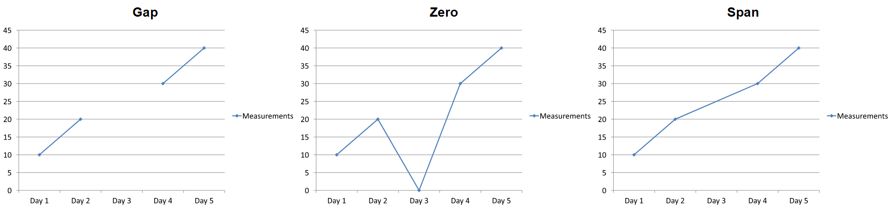

## **Gambaran Umum**

Sebuah diagram dapat menyimpan nilai yang dipetakan di sel workbook atau langsung sebagai literal numerik. Sebuah [IChartSeries](https://reference.aspose.com/slides/cpp/aspose.slides.charts/ichartseries/) mewakili satu set nilai yang terkait, dan setiap [IChartDataPoint](https://reference.aspose.com/slides/cpp/aspose.slides.charts/ichartdatapoint/) mewakili sebuah titik dalam seri tersebut. [IChartCategory](https://reference.aspose.com/slides/cpp/aspose.slides.charts/ichartcategory/) menyediakan label atau nilai pengelompokan yang dibagikan oleh seri. Pada diagram yang dibuat dengan data default, nama seri, kategori, dan nilai titik menggunakan objek [IChartDataCell](https://reference.aspose.com/slides/cpp/aspose.slides.charts/ichartdatacell/) dari workbook diagram.

Untuk diagram kategori tipikal, workbook default menggunakan baris 0 untuk nama seri, kolom 0 untuk nama kategori, dan sel-sel sisanya untuk nilai seri. Indeks worksheet, baris, dan kolom yang diteruskan ke [IChartDataWorkbook::GetCell](https://reference.aspose.com/slides/cpp/aspose.slides.charts/ichartdataworkbook/getcell/) bersifat berbasis nol. Tata letak ini berguna ketika Anda membuat diagram dengan data default, tetapi jangan berasumsi bahwa setiap diagram yang ada menggunakannya. Untuk presentasi yang dimuat, periksa sel-sel yang direferensikan oleh seri, kategori, dan titik data sebelum mengubah nilai workbook.

Pengaturan diagram memiliki tiga ruang lingkup yang berbeda:

- Pengaturan tingkat seri, seperti [IChartSeries::get_Format](https://reference.aspose.com/slides/cpp/aspose.slides.charts/ichartseries/get_format/), menyediakan tampilan default untuk semua titik dalam satu seri.
- Pengaturan titik data, seperti [IChartDataPoint::get_Format](https://reference.aspose.com/slides/cpp/aspose.slides.charts/ichartdatapoint/get_format/), menggantikan tampilan seri untuk satu titik.
- Pengaturan grup berlaku untuk seri yang kompatibel yang termasuk dalam [IChartSeriesGroup](https://reference.aspose.com/slides/cpp/aspose.slides.charts/ichartseriesgroup/). Akses grup melalui [IChartSeries::get_ParentSeriesGroup](https://reference.aspose.com/slides/cpp/aspose.slides.charts/ichartseries/get_parentseriesgroup/) ketika Anda perlu mengatur opsi seperti overlap atau lebar celah.

Ketika tidak ada isian titik atau seri yang eksplisit, gaya diagram dan tema menentukan tampilan otomatis. Ketika format seri dan titik keduanya ada, format titik memiliki prioritas untuk titik tersebut.


## **Atur Nilai Seri Menggunakan Literal Numerik**

Gunakan literal numerik ketika nilai seri berasal dari data aplikasi atau perhitungan dan tidak memerlukan referensi sel worksheet. Panggil [set_DataSourceTypeForValues](https://reference.aspose.com/slides/cpp/aspose.slides.charts/ichartdatapointcollection/set_datasourcetypeforvalues/) dengan [DataSourceType::DoubleLiterals](https://reference.aspose.com/slides/cpp/aspose.slides.charts/datasourcetype/) sebelum menetapkan nilai yang dikembalikan oleh [get_Value](https://reference.aspose.com/slides/cpp/aspose.slides.charts/ichartdatapoint/get_value/) tiap titik melalui [set_AsLiteralDouble](https://reference.aspose.com/slides/cpp/aspose.slides.charts/idoublechartvalue/set_asliteraldouble/).

Pengaturan koleksi mengontrol tipe sumber semua nilai titik dalam seri tersebut. Setiap titik [IBaseChartValue::get_DataSourceType](https://reference.aspose.com/slides/cpp/aspose.slides.charts/ibasechartvalue/get_datasourcetype/) melaporkan tipe yang dipilih; ubah melalui pengaturan koleksi. Dengan `Worksheet`, gunakan [get_AsCell](https://reference.aspose.com/slides/cpp/aspose.slides.charts/isinglecellchartvalue/get_ascell/) untuk mengakses sel yang direferensikan. Dengan `DoubleLiterals`, gunakan [get_AsLiteralDouble](https://reference.aspose.com/slides/cpp/aspose.slides.charts/idoublechartvalue/get_asliteraldouble/) atau `set_AsLiteralDouble` untuk membaca atau menulis angka secara langsung.

Contoh berikut membuat diagram kolom dengan seri dan kategori default, kemudian menetapkan nilai yang dihitung 10, 20, dan seterusnya ke titik yang ada pada seri pertamanya. Ia menyimpan presentasi, membukanya kembali, dan mencetak nilai yang disimpan.

```cpp
#include <DOM/Chart/ChartType.h>
#include <DOM/Chart/DataSourceType.h>
#include <DOM/Chart/IChartData.h>
#include <DOM/Chart/IChartDataPoint.h>
#include <DOM/Chart/IChartDataPointCollection.h>
#include <DOM/Chart/IChartSeries.h>
#include <DOM/Chart/IChartSeriesCollection.h>
#include <DOM/Chart/IDoubleChartValue.h>
#include <DOM/IChart.h>
#include <DOM/IShapeCollection.h>
#include <DOM/ISlide.h>
#include <DOM/Presentation.h>
#include <Export/SaveFormat.h>
#include <system/console.h>
#include <system/object_ext.h>
#include <system/shared_ptr.h>

using namespace Aspose::Slides;
using namespace Aspose::Slides::Charts;
using namespace Aspose::Slides::Export;
using namespace System;

auto presentation = MakeObject<Presentation>();
auto slide = presentation->get_Slide(0);

auto chart = slide->get_Shapes()->AddChart(ChartType::ClusteredColumn, 20, 20, 500, 300);
auto series = chart->get_ChartData()->get_Series()->idx_get(0);

series->get_DataPoints()->set_DataSourceTypeForValues(DataSourceType::DoubleLiterals);
for (auto i = 0; i < series->get_DataPoints()->get_Count(); i++)
{
    series->get_DataPoints()->idx_get(i)->get_Value()->set_AsLiteralDouble((i + 1) * 10);
}

presentation->Save(u"numeric_literals.pptx", SaveFormat::Pptx);
presentation->Dispose();

auto reopenedPresentation = MakeObject<Presentation>(u"numeric_literals.pptx");
auto reopenedSlide = reopenedPresentation->get_Slide(0);
auto reopenedChart = ExplicitCast<IChart>(reopenedSlide->get_Shape(0));
auto reopenedSeries = reopenedChart->get_ChartData()->get_Series()->idx_get(0);
for (auto i = 0; i < reopenedSeries->get_DataPoints()->get_Count(); i++)
{
    auto point = reopenedSeries->get_DataPoints()->idx_get(i);
    Console::WriteLine(point->get_Value()->get_AsLiteralDouble());
}
reopenedPresentation->Dispose();
```

Tipe sumber nilai titik terpisah dari [IChartData::get_DataSourceType](https://reference.aspose.com/slides/cpp/aspose.slides.charts/ichartdata/get_datasourcetype/), yang mengidentifikasi konfigurasi workbook internal atau eksternal diagram. Menggunakan literal numerik tidak, dengan sendirinya, menghapus workbook yang disematkan. Dalam contoh ini, workbook tetap tersedia untuk label kategori, nama seri, dan seri lainnya. Lihat [Chart Workbook](/slides/id/cpp/chart-workbook/) untuk manajemen workbook.

Untuk diagram scatter dan bubble, panggil [set_DataSourceTypeForXValues](https://reference.aspose.com/slides/cpp/aspose.slides.charts/ichartdatapointcollection/set_datasourcetypeforxvalues/) dan [set_DataSourceTypeForYValues](https://reference.aspose.com/slides/cpp/aspose.slides.charts/ichartdatapointcollection/set_datasourcetypeforyvalues/) untuk memilih sumber bagi [get_XValue](https://reference.aspose.com/slides/cpp/aspose.slides.charts/ichartdatapoint/get_xvalue/) dan [get_YValue](https://reference.aspose.com/slides/cpp/aspose.slides.charts/ichartdatapoint/get_yvalue/). Diagram bubble juga menggunakan [set_DataSourceTypeForBubbleSizes](https://reference.aspose.com/slides/cpp/aspose.slides.charts/ichartdatapointcollection/set_datasourcetypeforbubblesizes/) untuk [get_BubbleSize](https://reference.aspose.com/slides/cpp/aspose.slides.charts/ichartdatapoint/get_bubblesize/). Tetapkan setiap sumber yang relevan ke `DoubleLiterals` sebelum menetapkan angka melalui metode `set_AsLiteralDouble` nilai tersebut.

## **Atur Overlap Seri Diagram**

[IChartSeries::get_Overlap](https://reference.aspose.com/slides/cpp/aspose.slides.charts/ichartseries/get_overlap/) melaporkan seberapa banyak batang atau kolom tumpang tindih dalam diagram 2D, dari -100 hingga 100 persen. Ini adalah proyeksi baca-saja dari pengaturan pada grup seri induk. Panggil [IChartSeriesGroup::set_Overlap](https://reference.aspose.com/slides/cpp/aspose.slides.charts/ichartseriesgroup/set_overlap/) untuk memperbarui setiap seri yang kompatibel dalam grup tersebut. Opsi ini berlaku untuk tipe diagram yang menampilkan batang atau kolom berkelompok; tidak memengaruhi grup seri yang tidak terkait dalam diagram kombinasi.

Contoh berikut mengatur overlap untuk grup yang berisi seri pertama:

```cpp
#include <cstdint>
#include <DOM/Chart/ChartType.h>
#include <DOM/Chart/IChartData.h>
#include <DOM/Chart/IChartSeries.h>
#include <DOM/Chart/IChartSeriesCollection.h>
#include <DOM/Chart/IChartSeriesGroup.h>
#include <DOM/IChart.h>
#include <DOM/IShapeCollection.h>
#include <DOM/ISlide.h>
#include <DOM/Presentation.h>
#include <Export/SaveFormat.h>
#include <system/shared_ptr.h>

using Aspose::Slides::Charts::ChartType;
using Aspose::Slides::Export::SaveFormat;
using Aspose::Slides::Presentation;

const int firstSlideIndex = 0;
const int firstSeriesIndex = 0;
const int8_t overlapPercent = 30;

auto presentation = System::MakeObject<Presentation>();
auto slide = presentation->get_Slide(firstSlideIndex);

// Diagram baru berisi contoh seri, kategori, dan nilai.
auto chart = slide->get_Shapes()->AddChart(ChartType::ClusteredColumn, 20.0f, 20.0f, 500.0f, 200.0f);

auto seriesCollection = chart->get_ChartData()->get_Series();
auto series = seriesCollection->idx_get(firstSeriesIndex);
series->get_ParentSeriesGroup()->set_Overlap(overlapPercent);

presentation->Save(u"series_overlap.pptx", SaveFormat::Pptx);
presentation->Dispose();
```

Hasil:


## **Ubah Warna Isian Seri**

Gunakan [IChartSeries::get_Format](https://reference.aspose.com/slides/cpp/aspose.slides.charts/ichartseries/get_format/) untuk mengatur isian default untuk seluruh seri. Jika sebuah titik sudah memiliki isian eksplisit, pengaturan [IChartDataPoint::get_Format](https://reference.aspose.com/slides/cpp/aspose.slides.charts/ichartdatapoint/get_format/) akan menggantikan isian seri untuk titik tersebut.

Contoh berikut menerapkan isian biru padat pada seri pertama:

```cpp
#include <DOM/Chart/ChartType.h>
#include <DOM/Chart/IChartData.h>
#include <DOM/Chart/IChartSeries.h>
#include <DOM/Chart/IChartSeriesCollection.h>
#include <DOM/Chart/IFormat.h>
#include <DOM/FillType.h>
#include <DOM/IChart.h>
#include <DOM/IColorFormat.h>
#include <DOM/IFillFormat.h>
#include <DOM/IShapeCollection.h>
#include <DOM/ISlide.h>
#include <DOM/Presentation.h>
#include <Export/SaveFormat.h>
#include <drawing/color.h>
#include <system/shared_ptr.h>

using Aspose::Slides::Charts::ChartType;
using Aspose::Slides::Export::SaveFormat;
using Aspose::Slides::FillType;
using Aspose::Slides::Presentation;
using System::Drawing::Color;

const int firstSlideIndex = 0;
const int firstSeriesIndex = 0;

auto presentation = System::MakeObject<Presentation>();
auto slide = presentation->get_Slide(firstSlideIndex);

auto chart = slide->get_Shapes()->AddChart(ChartType::ClusteredColumn, 20.0f, 20.0f, 500.0f, 200.0f);

auto seriesCollection = chart->get_ChartData()->get_Series();
auto series = seriesCollection->idx_get(firstSeriesIndex);
auto seriesColor = Color::get_Blue();
series->get_Format()->get_Fill()->set_FillType(FillType::Solid);
series->get_Format()->get_Fill()->get_SolidFillColor()->set_Color(seriesColor);

presentation->Save(u"series_color.pptx", SaveFormat::Pptx);
presentation->Dispose();
```

Hasil:


## **Ubah Nama Seri**

Nama seri disimpan di workbook data diagram dan biasanya ditampilkan di legenda. Di workbook default yang dibuat untuk diagram kolom terkelompok, sel B1 berada pada baris 0, kolom 1 dan berisi nama seri pertama. Konstanta bernama dalam contoh berikut membuat struktur tersebut eksplisit:

```cpp
#include <DOM/Chart/ChartType.h>
#include <DOM/Chart/IChartData.h>
#include <DOM/Chart/IChartDataCell.h>
#include <DOM/Chart/IChartDataWorkbook.h>
#include <DOM/IChart.h>
#include <DOM/IShapeCollection.h>
#include <DOM/ISlide.h>
#include <DOM/Presentation.h>
#include <Export/SaveFormat.h>
#include <system/object_ext.h>
#include <system/shared_ptr.h>
#include <system/string.h>

using Aspose::Slides::Charts::ChartType;
using Aspose::Slides::Export::SaveFormat;
using Aspose::Slides::Presentation;
using System::ObjectExt;
using System::String;

const int firstSlideIndex = 0;
const int worksheetIndex = 0;
const int seriesNameRowIndex = 0;
const int firstSeriesColumnIndex = 1;

auto presentation = System::MakeObject<Presentation>();
auto slide = presentation->get_Slide(firstSlideIndex);

auto chart = slide->get_Shapes()->AddChart(ChartType::ClusteredColumn, 20.0f, 20.0f, 500.0f, 200.0f);

auto workbook = chart->get_ChartData()->get_ChartDataWorkbook();
auto seriesNameCell = workbook->GetCell(worksheetIndex, seriesNameRowIndex, firstSeriesColumnIndex);
auto seriesName = ObjectExt::Box<String>(u"Revenue");
seriesNameCell->set_Value(seriesName);

presentation->Save(u"series_name.pptx", SaveFormat::Pptx);
presentation->Dispose();
```

Anda juga dapat memperbarui sel yang sudah direferensikan oleh [IChartSeries::get_Name](https://reference.aspose.com/slides/cpp/aspose.slides.charts/ichartseries/get_name/). Pendekatan ini menghindari asumsi baris dan kolom tertentu dalam diagram yang ada:

```cpp
#include <DOM/Chart/ChartType.h>
#include <DOM/Chart/IChartCellCollection.h>
#include <DOM/Chart/IChartData.h>
#include <DOM/Chart/IChartDataCell.h>
#include <DOM/Chart/IChartSeries.h>
#include <DOM/Chart/IChartSeriesCollection.h>
#include <DOM/Chart/IStringChartValue.h>
#include <DOM/IChart.h>
#include <DOM/IShapeCollection.h>
#include <DOM/ISlide.h>
#include <DOM/Presentation.h>
#include <Export/SaveFormat.h>
#include <system/object_ext.h>
#include <system/shared_ptr.h>
#include <system/string.h>

using Aspose::Slides::Charts::ChartType;
using Aspose::Slides::Export::SaveFormat;
using Aspose::Slides::Presentation;
using System::ObjectExt;
using System::String;

const int firstSlideIndex = 0;
const int firstSeriesIndex = 0;
const int firstNameCellIndex = 0;

auto presentation = System::MakeObject<Presentation>();
auto slide = presentation->get_Slide(firstSlideIndex);

auto chart = slide->get_Shapes()->AddChart(ChartType::ClusteredColumn, 20.0f, 20.0f, 500.0f, 200.0f);

auto seriesCollection = chart->get_ChartData()->get_Series();
auto series = seriesCollection->idx_get(firstSeriesIndex);
auto seriesNameCells = series->get_Name()->get_AsCells();
auto seriesNameCell = seriesNameCells->idx_get(firstNameCellIndex);
auto seriesName = ObjectExt::Box<String>(u"Revenue");
seriesNameCell->set_Value(seriesName);

presentation->Save(u"series_name.pptx", SaveFormat::Pptx);
presentation->Dispose();
```

Hasil:


### **Buat Seri dengan Nama dari Beberapa Sel**

Nama seri komposit berguna ketika nama produk dan periode pelaporan disimpan di sel workbook yang terpisah. Sebagai contoh, Anda dapat menggabungkan `Product A` di B1 dan `2026` di C1 menjadi satu nama seri sambil menjaga kedua bagian tetap terhubung ke sel sumbernya. Gunakan [IChartDataWorkbook::GetCellCollection](https://reference.aspose.com/slides/cpp/aspose.slides.charts/ichartdataworkbook/getcellcollection/) untuk mengambil rentang nama, kemudian berikan koleksi tersebut ke [IChartSeriesCollection::Add](https://reference.aspose.com/slides/cpp/aspose.slides.charts/ichartseriescollection/add/). Argumen `skipHiddenCells` mengontrol apakah sel tersembunyi disertakan: `true` mengecualikannya, sementara `false` menyertakannya. Contoh ini menggunakan `false` untuk menyertakan setiap sel dalam rentang nama.

Contoh berikut membuat presentasi dengan satu seri dan dua titik data. Sel B1:C1 hanya menyediakan nama seri; A2:A3 menyediakan label kategori, dan B2:B3 menyediakan nilai numerik.

```cpp
#include <DOM/Chart/ChartType.h>
#include <DOM/Chart/IChartCategoryCollection.h>
#include <DOM/Chart/IChartCellCollection.h>
#include <DOM/Chart/IChartData.h>
#include <DOM/Chart/IChartDataCell.h>
#include <DOM/Chart/IChartDataPointCollection.h>
#include <DOM/Chart/IChartDataWorkbook.h>
#include <DOM/Chart/IChartSeries.h>
#include <DOM/Chart/IChartSeriesCollection.h>
#include <DOM/IChart.h>
#include <DOM/IShapeCollection.h>
#include <DOM/ISlide.h>
#include <DOM/Presentation.h>
#include <Export/SaveFormat.h>
#include <system/object_ext.h>
#include <system/shared_ptr.h>
#include <system/string.h>

using namespace Aspose::Slides;
using namespace Aspose::Slides::Charts;
using namespace Aspose::Slides::Export;
using System::ObjectExt;
using System::String;

auto presentation = System::MakeObject<Presentation>();
auto slide = presentation->get_Slide(0);

auto chart = slide->get_Shapes()->AddChart(ChartType::ClusteredColumn, 50.0f, 50.0f, 620.0f, 180.0f);
auto chartData = chart->get_ChartData();

chartData->get_Series()->Clear();
chartData->get_Categories()->Clear();
chart->set_HasLegend(true);

auto workbook = chartData->get_ChartDataWorkbook();
workbook->Clear(0);

// Dua sel ini menyediakan nama seri.
auto productName = ObjectExt::Box<String>(u"Product A");
auto reportingPeriod = ObjectExt::Box<String>(u"2026");
workbook->GetCell(0, 0, 1, productName);
workbook->GetCell(0, 0, 2, reportingPeriod);
auto nameCells = workbook->GetCellCollection(u"Sheet1!$B$1:$C$1", false);
auto series = chartData->get_Series()->Add(nameCells, ChartType::ClusteredColumn);

// Sel terpisah menyediakan kategori dan titik data numerik.
auto northLabel = ObjectExt::Box<String>(u"North");
auto southLabel = ObjectExt::Box<String>(u"South");
auto northCategory = workbook->GetCell(0, 1, 0, northLabel);
auto southCategory = workbook->GetCell(0, 2, 0, southLabel);
chartData->get_Categories()->Add(northCategory);
chartData->get_Categories()->Add(southCategory);
auto northAmount = ObjectExt::Box<int>(120);
auto southAmount = ObjectExt::Box<int>(150);
auto northValue = workbook->GetCell(0, 1, 1, northAmount);
auto southValue = workbook->GetCell(0, 2, 1, southAmount);
series->get_DataPoints()->AddDataPointForBarSeries(northValue);
series->get_DataPoints()->AddDataPointForBarSeries(southValue);

presentation->Save(u"composite_series_name.pptx", SaveFormat::Pptx);
presentation->Dispose();
```

Nama seri yang dihasilkan adalah `Product A 2026`, dengan spasi antara dua nilai sel. Legenda menampilkan ini sebagai satu entri untuk kedua kolom. Gambar di bawah mengilustrasikan hasilnya:


## **Dapatkan Warna Isian Seri Otomatis**

[IChartSeries::GetAutomaticSeriesColor](https://reference.aspose.com/slides/cpp/aspose.slides.charts/ichartseries/getautomaticseriescolor/) mengembalikan warna yang dihitung dari indeks seri dan gaya diagram. Ini adalah warna yang digunakan ketika isian seri tidak didefinisikan secara eksplisit. Memanggil metode ini membaca warna yang dihitung; tidak menetapkan isian baru.

Contoh berikut mencetak warna otomatis masing-masing seri default:

```cpp
#include <DOM/Chart/ChartType.h>
#include <DOM/Chart/IChartData.h>
#include <DOM/Chart/IChartSeries.h>
#include <DOM/Chart/IChartSeriesCollection.h>
#include <DOM/IChart.h>
#include <DOM/IShapeCollection.h>
#include <DOM/ISlide.h>
#include <DOM/Presentation.h>
#include <drawing/color.h>
#include <system/console.h>
#include <system/shared_ptr.h>
#include <system/string.h>

using Aspose::Slides::Charts::ChartType;
using Aspose::Slides::Presentation;
using System::Console;
using System::String;

const int firstSlideIndex = 0;

auto presentation = System::MakeObject<Presentation>();
auto slide = presentation->get_Slide(firstSlideIndex);

auto chart = slide->get_Shapes()->AddChart(ChartType::ClusteredColumn, 20.0f, 20.0f, 500.0f, 200.0f);

auto seriesCollection = chart->get_ChartData()->get_Series();
const int seriesCount = seriesCollection->get_Count();
for (int seriesIndex = 0; seriesIndex < seriesCount; seriesIndex++)
{
    auto series = seriesCollection->idx_get(seriesIndex);
    auto automaticColor = series->GetAutomaticSeriesColor();
    auto colorName = automaticColor.get_Name();
    auto outputLine = String::Format(u"Series {0}: {1}", seriesIndex, colorName);
    Console::WriteLine(outputLine);
}

presentation->Dispose();
```

Contoh output untuk gaya diagram default:

```text
Series 0: ff4f81bd
Series 1: ffc0504d
Series 2: ff9bbb59
```

Warna sebenarnya tergantung pada gaya diagram dan tema.

## **Atur Warna Isian Terbalik untuk Seri Diagram**

Untuk seri bar, kolom, dan bubble, [IChartSeries::set_InvertIfNegative](https://reference.aspose.com/slides/cpp/aspose.slides.charts/ichartseries/set_invertifnegative/) dapat menampilkan nilai negatif dengan isian yang berbeda. Atur isian seri reguler menjadi padat, aktifkan inversi, dan tetapkan warna nilai negatif melalui [IChartSeries::get_InvertedSolidFillColor](https://reference.aspose.com/slides/cpp/aspose.slides.charts/ichartseries/get_invertedsolidfillcolor/). Angka negatif tetap tidak berubah di workbook; hanya warna tampilannya yang berubah.

Contoh berikut menggantikan data diagram default dengan satu seri. Baris worksheet 0 berisi nama seri, kolom 0 berisi nama kategori, dan kolom 1 berisi nilai:

```cpp
#include <DOM/Chart/ChartType.h>
#include <DOM/Chart/IChartCategoryCollection.h>
#include <DOM/Chart/IChartData.h>
#include <DOM/Chart/IChartDataCell.h>
#include <DOM/Chart/IChartDataPointCollection.h>
#include <DOM/Chart/IChartDataWorkbook.h>
#include <DOM/Chart/IChartSeries.h>
#include <DOM/Chart/IChartSeriesCollection.h>
#include <DOM/Chart/IFormat.h>
#include <DOM/FillType.h>
#include <DOM/IChart.h>
#include <DOM/IColorFormat.h>
#include <DOM/IFillFormat.h>
#include <DOM/IShapeCollection.h>
#include <DOM/ISlide.h>
#include <DOM/Presentation.h>
#include <Export/SaveFormat.h>
#include <drawing/color.h>
#include <system/object_ext.h>
#include <system/shared_ptr.h>
#include <system/string.h>

using Aspose::Slides::Charts::ChartType;
using Aspose::Slides::Export::SaveFormat;
using Aspose::Slides::FillType;
using Aspose::Slides::Presentation;
using System::Drawing::Color;
using System::ObjectExt;
using System::String;

const int firstSlideIndex = 0;
const int worksheetIndex = 0;
const int headerRowIndex = 0;
const int categoryColumnIndex = 0;
const int firstSeriesColumnIndex = 1;
const int firstDataRowIndex = 1;
const int categoryCount = 3;

const String categoryNames[] = {u"Category 1", u"Category 2", u"Category 3"};
const int seriesValues[] = {-20, 50, -30};

auto presentation = System::MakeObject<Presentation>();
auto slide = presentation->get_Slide(firstSlideIndex);

auto chart = slide->get_Shapes()->AddChart(ChartType::ClusteredColumn, 20.0f, 20.0f, 500.0f, 200.0f);
auto chartData = chart->get_ChartData();
auto workbook = chartData->get_ChartDataWorkbook();

auto seriesCollection = chartData->get_Series();
seriesCollection->Clear();
chartData->get_Categories()->Clear();

auto seriesName = ObjectExt::Box<String>(u"Series 1");
auto seriesNameCell = workbook->GetCell(worksheetIndex, headerRowIndex, firstSeriesColumnIndex, seriesName);
auto chartType = chart->get_Type();
auto series = seriesCollection->Add(seriesNameCell, chartType);

for (int categoryIndex = 0; categoryIndex < categoryCount; categoryIndex++)
{
    const int dataRowIndex = firstDataRowIndex + categoryIndex;
    auto categoryName = categoryNames[categoryIndex];
    const int seriesValue = seriesValues[categoryIndex];

    auto boxedCategoryName = ObjectExt::Box<String>(categoryName);
    auto categoryCell = workbook->GetCell(worksheetIndex, dataRowIndex, categoryColumnIndex, boxedCategoryName);
    chartData->get_Categories()->Add(categoryCell);

    auto boxedSeriesValue = ObjectExt::Box<int>(seriesValue);
    auto valueCell = workbook->GetCell(worksheetIndex, dataRowIndex, firstSeriesColumnIndex, boxedSeriesValue);
    series->get_DataPoints()->AddDataPointForBarSeries(valueCell);
}

auto automaticSeriesColor = series->GetAutomaticSeriesColor();
auto invertedSeriesColor = Color::get_Red();
series->get_Format()->get_Fill()->set_FillType(FillType::Solid);
series->get_Format()->get_Fill()->get_SolidFillColor()->set_Color(automaticSeriesColor);
series->set_InvertIfNegative(true);
series->get_InvertedSolidFillColor()->set_Color(invertedSeriesColor);

presentation->Save(u"inverted_solid_fill_color.pptx", SaveFormat::Pptx);
presentation->Dispose();
```

Hasil:


Anda dapat mengaktifkan inversi untuk satu titik melalui [IChartDataPoint::set_InvertIfNegative](https://reference.aspose.com/slides/cpp/aspose.slides.charts/ichartdatapoint/set_invertifnegative/). Dalam contoh berikut, inversi dinonaktifkan untuk seri dan diaktifkan hanya untuk titik yang dipilih. Titik tersebut juga diberikan nilai negatif agar efeknya terlihat:

```cpp
#include <DOM/Chart/ChartType.h>
#include <DOM/Chart/IChartData.h>
#include <DOM/Chart/IChartDataCell.h>
#include <DOM/Chart/IChartDataPoint.h>
#include <DOM/Chart/IChartSeries.h>
#include <DOM/Chart/IChartSeriesCollection.h>
#include <DOM/Chart/IDoubleChartValue.h>
#include <DOM/Chart/IFormat.h>
#include <DOM/FillType.h>
#include <DOM/IChart.h>
#include <DOM/IColorFormat.h>
#include <DOM/IFillFormat.h>
#include <DOM/IShapeCollection.h>
#include <DOM/ISlide.h>
#include <DOM/Presentation.h>
#include <Export/SaveFormat.h>
#include <drawing/color.h>
#include <system/object_ext.h>
#include <system/shared_ptr.h>

using Aspose::Slides::Charts::ChartType;
using Aspose::Slides::Export::SaveFormat;
using Aspose::Slides::FillType;
using Aspose::Slides::Presentation;
using System::Drawing::Color;
using System::ObjectExt;

const int firstSlideIndex = 0;
const int firstSeriesIndex = 0;
const int targetDataPointIndex = 2;
const int negativeValue = -30;

auto presentation = System::MakeObject<Presentation>();
auto slide = presentation->get_Slide(firstSlideIndex);

auto chart = slide->get_Shapes()->AddChart(ChartType::ClusteredColumn, 20.0f, 20.0f, 500.0f, 200.0f);

auto seriesCollection = chart->get_ChartData()->get_Series();
auto series = seriesCollection->idx_get(firstSeriesIndex);
auto automaticSeriesColor = series->GetAutomaticSeriesColor();
auto invertedSeriesColor = Color::get_Red();
series->get_Format()->get_Fill()->set_FillType(FillType::Solid);
series->get_Format()->get_Fill()->get_SolidFillColor()->set_Color(automaticSeriesColor);
series->get_InvertedSolidFillColor()->set_Color(invertedSeriesColor);
series->set_InvertIfNegative(false);

auto dataPoint = series->get_DataPoint(targetDataPointIndex);
auto boxedNegativeValue = ObjectExt::Box<int>(negativeValue);
dataPoint->get_YValue()->get_AsCell()->set_Value(boxedNegativeValue);
dataPoint->set_InvertIfNegative(true);

presentation->Save(u"data_point_invert_color_if_negative.pptx", SaveFormat::Pptx);
presentation->Dispose();
```

## **Hapus Nilai Titik Data Tertentu**

Untuk membuat satu titik kosong tanpa menghapus titik lainnya, setel sel workbook yang menjadi dasarnya ke `nullptr`. Untuk diagram kolom, nilai yang dipetakan tersedia melalui [IChartDataPoint::get_YValue](https://reference.aspose.com/slides/cpp/aspose.slides.charts/ichartdatapoint/get_yvalue/). Titik data tetap pada posisi kategori yang sama, tetapi diagram memperlakukan nilainya sebagai kosong sesuai pengaturan nilai kosong diagram.

Contoh berikut menghapus hanya titik kedua dalam seri pertama:

```cpp
#include <DOM/Chart/ChartType.h>
#include <DOM/Chart/IChartData.h>
#include <DOM/Chart/IChartDataCell.h>
#include <DOM/Chart/IChartDataPoint.h>
#include <DOM/Chart/IChartSeries.h>
#include <DOM/Chart/IChartSeriesCollection.h>
#include <DOM/Chart/IDoubleChartValue.h>
#include <DOM/IChart.h>
#include <DOM/IShapeCollection.h>
#include <DOM/ISlide.h>
#include <DOM/Presentation.h>
#include <Export/SaveFormat.h>
#include <system/shared_ptr.h>

using Aspose::Slides::Charts::ChartType;
using Aspose::Slides::Export::SaveFormat;
using Aspose::Slides::Presentation;

const int firstSlideIndex = 0;
const int firstSeriesIndex = 0;
const int targetDataPointIndex = 1;

auto presentation = System::MakeObject<Presentation>();
auto slide = presentation->get_Slide(firstSlideIndex);

auto chart = slide->get_Shapes()->AddChart(ChartType::ClusteredColumn, 20.0f, 20.0f, 500.0f, 200.0f);

auto seriesCollection = chart->get_ChartData()->get_Series();
auto series = seriesCollection->idx_get(firstSeriesIndex);
auto dataPoint = series->get_DataPoint(targetDataPointIndex);
dataPoint->get_YValue()->get_AsCell()->set_Value(nullptr);

presentation->Save(u"clear_data_point_value.pptx", SaveFormat::Pptx);
presentation->Dispose();
```

Diagram scatter menggunakan sel X dan Y terpisah, dan diagram bubble juga menggunakan sel ukuran. Hapus hanya sel yang mewakili nilai yang ingin Anda hapus. Jangan panggil [IChartDataPointCollection::Clear](https://reference.aspose.com/slides/cpp/aspose.slides.charts/ichartdatapointcollection/clear/) ketika Anda ingin mempertahankan titik lainnya, karena metode itu menghapus semua titik data dari koleksi.

## **Kendalikan Tampilan Sel Kosong**

Sel tersembunyi yang berisi nilai merupakan kasus terpisah dari sel kosong. Untuk menyertakan atau mengecualikan data dari baris dan kolom worksheet tersembunyi, lihat [Include Data from Hidden Rows and Columns](/slides/id/cpp/chart-workbook/#include-data-from-hidden-rows-and-columns). Sel workbook kosong mewakili data yang hilang; sel yang berisi `0` mewakili nilai numerik yang diketahui. Panggil [IChartDataCell::set_Value](https://reference.aspose.com/slides/cpp/aspose.slides.charts/ichartdatacell/set_value/) dengan `nullptr` untuk membuat sel kosong. Angka nol tetap nol terlepas dari pengaturan sel kosong. Gunakan [IChart::set_DisplayBlanksAs](https://reference.aspose.com/slides/cpp/aspose.slides.charts/ichart/set_displayblanksas/) untuk memilih bagaimana diagram menampilkan sel kosong. Pengaturan ini berlaku untuk seluruh diagram. Ini mengubah cara kosong dipetakan, tanpa mengisi sel workbook kosong dengan nol atau nilai interpolasi.

Contoh mandiri berikut membuat diagram garis dengan satu seri, menghapus nilai untuk Hari 3, dan menyimpan diagram yang sama dengan setiap mode. Tidak diperlukan file masukan. [IChartDataWorkbook](https://reference.aspose.com/slides/cpp/aspose.slides.charts/ichartdataworkbook/) menggunakan worksheet 0, kolom 0 untuk label kategori, dan kolom 1 untuk nilai; baris 0 menyimpan nama seri. Data akhir adalah `10, 20, empty, 30, 40`.

```cpp
#include <array>
#include <DOM/Chart/ChartType.h>
#include <DOM/Chart/DisplayBlanksAsType.h>
#include <DOM/Chart/IChartCategoryCollection.h>
#include <DOM/Chart/IChartData.h>
#include <DOM/Chart/IChartDataCell.h>
#include <DOM/Chart/IChartDataPointCollection.h>
#include <DOM/Chart/IChartDataWorkbook.h>
#include <DOM/Chart/IChartSeries.h>
#include <DOM/Chart/IChartSeriesCollection.h>
#include <DOM/IChart.h>
#include <DOM/IShapeCollection.h>
#include <DOM/ISlide.h>
#include <DOM/Presentation.h>
#include <Export/SaveFormat.h>
#include <system/object_ext.h>
#include <system/shared_ptr.h>
#include <system/string.h>

using namespace Aspose::Slides;
using namespace Aspose::Slides::Charts;
using namespace Aspose::Slides::Export;
using System::ObjectExt;
using System::String;

auto presentation = System::MakeObject<Presentation>();
auto slide = presentation->get_Slide(0);

auto chart = slide->get_Shapes()->AddChart(ChartType::LineWithMarkers, 40.0f, 40.0f, 640.0f, 400.0f);
auto chartData = chart->get_ChartData();
auto workbook = chartData->get_ChartDataWorkbook();

chartData->get_Series()->Clear();
chartData->get_Categories()->Clear();

auto seriesName = ObjectExt::Box<String>(u"Measurements");
auto seriesNameCell = workbook->GetCell(0, 0, 1, seriesName);
auto series = chartData->get_Series()->Add(seriesNameCell, chart->get_Type());
auto values = std::array<int, 5>{10, 20, 25, 30, 40};

for (auto i = 0; i < values.size(); i++)
{
    auto categoryName = String::Format(u"Day {0}", i + 1);
    auto boxedCategoryName = ObjectExt::Box<String>(categoryName);
    auto categoryCell = workbook->GetCell(0, i + 1, 0, boxedCategoryName);
    chartData->get_Categories()->Add(categoryCell);
    auto boxedValue = ObjectExt::Box<int>(values[i]);
    auto valueCell = workbook->GetCell(0, i + 1, 1, boxedValue);
    series->get_DataPoints()->AddDataPointForLineSeries(valueCell);
}

// Biarkan Hari 3 benar-benar kosong, sambil mempertahankan kategori dan titik datanya.
workbook->GetCell(0, 3, 1)->set_Value(nullptr);

auto modes = std::array<DisplayBlanksAsType, 3>{DisplayBlanksAsType::Gap, DisplayBlanksAsType::Zero, DisplayBlanksAsType::Span};
for (auto mode : modes)
{
    chart->set_DisplayBlanksAs(mode);
    auto outputPath = String::Format(u"empty_cells_{0}.pptx", mode);
    presentation->Save(outputPath, SaveFormat::Pptx);
}

presentation->Dispose();
```

Setiap file output menyimpan mode yang ditetapkan sebelum menyimpan: `empty_cells_Gap.pptx`, `empty_cells_Zero.pptx`, dan `empty_cells_Span.pptx`. Untuk menyimpan hanya satu versi, tetapkan mode yang diinginkan dan simpan presentasi sekali saja alih-alih berulang pada setiap mode.

Perbandingan di bawah menunjukkan data yang sama dalam tiga file. Hari 3 kosong di workbook dalam setiap kasus:



Efek yang terlihat tergantung pada tipe diagram. Diagram garis memudahkan perbandingan ketiga mode. Diagram batang dan kolom tidak memiliki garis untuk menghubungkan kategori yang hilang, sehingga `Span` tidak dapat menghasilkan segmen penghubung yang ditunjukkan di atas; kolom yang hilang dan kolom dengan tinggi nol juga dapat tampak serupa. Demikian pula, diagram scatter dengan hanya penanda tidak memiliki garis penghubung. Jangan mengharapkan tiga hasil yang berbeda untuk setiap tipe diagram; periksa output untuk tipe yang Anda gunakan.

## **Atur Lebar Celah Seri**

Lebar celah adalah ruang antara klaster batang atau kolom yang bersebelahan, dinyatakan sebagai persentase lebar batang atau kolom. Seperti overlap, ini milik grup seri induk bukan satu seri. Panggil [IChartSeriesGroup::set_GapWidth](https://reference.aspose.com/slides/cpp/aspose.slides.charts/ichartseriesgroup/set_gapwidth/) sekali untuk grup. Nilai yang lebih besar menciptakan lebih banyak ruang antar klaster; nilai yang lebih kecil membuatnya lebih padat.

Contoh berikut mengubah lebar celah dan menyimpan hanya presentasi akhir:

```cpp
#include <cstdint>
#include <DOM/Chart/ChartType.h>
#include <DOM/Chart/IChartData.h>
#include <DOM/Chart/IChartSeries.h>
#include <DOM/Chart/IChartSeriesCollection.h>
#include <DOM/Chart/IChartSeriesGroup.h>
#include <DOM/IChart.h>
#include <DOM/IShapeCollection.h>
#include <DOM/ISlide.h>
#include <DOM/Presentation.h>
#include <Export/SaveFormat.h>
#include <system/shared_ptr.h>

using Aspose::Slides::Charts::ChartType;
using Aspose::Slides::Export::SaveFormat;
using Aspose::Slides::Presentation;

const int firstSlideIndex = 0;
const int firstSeriesIndex = 0;
const uint16_t gapWidthPercent = 30;

auto presentation = System::MakeObject<Presentation>();
auto slide = presentation->get_Slide(firstSlideIndex);

auto chart = slide->get_Shapes()->AddChart(ChartType::StackedColumn, 20.0f, 20.0f, 500.0f, 200.0f);

auto seriesCollection = chart->get_ChartData()->get_Series();
auto series = seriesCollection->idx_get(firstSeriesIndex);
series->get_ParentSeriesGroup()->set_GapWidth(gapWidthPercent);

presentation->Save(u"gap_width_30.pptx", SaveFormat::Pptx);
presentation->Dispose();
```

Hasil:


## **FAQ**

**Jenis diagram apa yang mendukung seri data?**  
Semua tipe diagram yang direpresentasikan oleh enumerasi [ChartType](https://reference.aspose.com/slides/cpp/aspose.slides.charts/charttype/) menggunakan data diagram, tetapi seri‑serinya tidak semuanya memiliki struktur nilai atau pengaturan yang sama. Misalnya, diagram kategori menggunakan kategori dan nilai, diagram scatter menggunakan nilai X dan Y, dan diagram bubble menambahkan ukuran gelembung. Gunakan metode pembuatan titik data yang sesuai dengan tipe seri. Opsi seperti overlap dan lebar celah hanya berlaku untuk grup batang atau kolom yang kompatibel.

**Apa itu grup seri diagram?**  
Sebuah [IChartSeriesGroup](https://reference.aspose.com/slides/cpp/aspose.slides.charts/ichartseriesgroup/) berisi seri yang kompatibel yang berbagi pengaturan plot tingkat grup. Diagram kombinasi dapat berisi lebih dari satu grup, sehingga mengubah grup yang diakses melalui satu seri tidak selalu mengubah setiap seri dalam diagram.

**Apakah diagram yang baru dibuat berisi data default?**  
Ya. Secara default, [IShapeCollection::AddChart](https://reference.aspose.com/slides/cpp/aspose.slides/ishapecollection/addchart/) membuat seri, kategori, dan nilai contoh. Anda dapat menyunting sel‑sel tersebut atau mengosongkan koleksi seri dan kategori sebelum menambahkan sekumpulan data yang sepenuhnya kustom. Overload juga dapat membuat diagram tanpa data default.

**Bagaimana objek diagram terhubung ke sel workbook?**  
Nama seri, label kategori, dan nilai titik data merujuk ke sel dalam sebuah [IChartDataWorkbook](https://reference.aspose.com/slides/cpp/aspose.slides.charts/ichartdataworkbook/). Mengubah sel yang direferensikan memperbarui elemen diagram yang bersangkutan. Saat membangun data kustom, pertahankan baris kategori dan baris nilai seri tetap selaras sehingga setiap titik dipetakan di bawah kategori yang dimaksud.

**Bagaimana cara menghapus satu titik alih-alih seluruh seri?**  
Setel sel nilai yang relevan ke `nullptr` untuk mempertahankan posisi kategori titik sebagai titik kosong. Jangan panggil [IChartDataPointCollection::Clear](https://reference.aspose.com/slides/cpp/aspose.slides.charts/ichartdatapointcollection/clear/) ketika Anda ingin mempertahankan titik lainnya, karena metode itu menghapus semua titik data dari koleksi. Jika Anda juga menghapus kategori, perbarui setiap seri sehingga nilai‑nya tetap selaras dengan koleksi kategori.

**Bagaimana titik kosong ditampilkan?**  
Hasilnya tergantung pada tipe diagram dan [IChart::get_DisplayBlanksAs](https://reference.aspose.com/slides/cpp/aspose.slides.charts/ichart/get_displayblanksas/). Diagram yang didukung dapat menampilkan kosong sebagai celah, sebagai nilai nol, atau dengan menghubungkan titik‑titik tetangga. Pilih pengaturan yang sesuai dengan arti data yang hilang dalam presentasi Anda. Lihat [Kendalikan Tampilan Sel Kosong](#control-the-display-of-empty-cells) untuk contoh lengkap dan perbandingan visual.

**Bagaimana nilai negatif diformat?**  
Untuk seri batang, kolom, dan bubble yang didukung, panggil [IChartSeries::set_InvertIfNegative](https://reference.aspose.com/slides/cpp/aspose.slides.charts/ichartseries/set_invertifnegative/) dan tetapkan warna melalui [IChartSeries::get_InvertedSolidFillColor](https://reference.aspose.com/slides/cpp/aspose.slides.charts/ichartseries/get_invertedsolidfillcolor/). Anda dapat menimpa perilaku untuk titik individu dengan [IChartDataPoint::set_InvertIfNegative](https://reference.aspose.com/slides/cpp/aspose.slides.charts/ichartdatapoint/set_invertifnegative/). Metode‑metode ini memengaruhi pemformatan, bukan nilai numerik yang disimpan.

**Format mana yang menang ketika seri dan titik keduanya diformat?**  
Pemformatan titik data yang eksplisit memiliki prioritas untuk titik tersebut. Titik lain tetap menggunakan format seri yang eksplisit atau, bila format seri tidak didefinisikan, gaya dan tema diagram otomatis. Pengaturan grup seperti overlap dan lebar celah mengontrol tata letak dan bukan penimpaan pemformatan tingkat titik.

**Apakah ada batas berapa banyak seri yang dapat dimuat diagram?**  
Aspose.Slides tidak memberlakukan batas tetap terpisah untuk jumlah seri. Dalam praktiknya, batasan file presentasi, memori yang tersedia, waktu rendering, dan keterbacaan diagram menentukan batas yang berguna.

**Apa yang harus diubah ketika kolom terlalu berdekatan atau terlalu jauh?**  
Panggil [IChartSeriesGroup::set_GapWidth](https://reference.aspose.com/slides/cpp/aspose.slides.charts/ichartseriesgroup/set_gapwidth/) pada grup seri induk yang sesuai. Tingkatkan nilai untuk memperlebar ruang antar klaster, atau turunkan nilai untuk mendekatkan klaster.