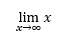

## **Ikhtisar**

PowerPoint menyimpan persamaan sebagai Office Math Markup Language (OMML). Dengan Aspose.Slides untuk C++, Anda dapat membuat konten matematika jenis yang sama secara programatik: pecahan, radikal, fungsi, limit, operator N-ary, matriks, array, dan blok matematika yang diformat.

Di PowerPoint, pengguna biasanya menambahkan persamaan lewat **Insert > Equation**:


Hasilnya adalah teks matematika yang dapat diedit pada slide:


Aspose.Slides membangun teks matematika tersebut melalui tiga objek utama:

- Sebuah shape matematika, dibuat dengan [AddMathShape](https://reference.aspose.com/slides/cpp/aspose.slides/shapecollection/), adalah shape yang berisi persamaan.
- [MathPortion](https://reference.aspose.com/slides/cpp/aspose.slides.mathtext/mathportion/) menyimpan konten matematika di dalam frame teks shape.
- [MathParagraph](https://reference.aspose.com/slides/cpp/aspose.slides.mathtext/mathparagraph/) berisi satu atau lebih objek [MathBlock](https://reference.aspose.com/slides/cpp/aspose.slides.mathtext/mathblock/).

Sebagian besar contoh di bawah menggunakan [MathematicalText](https://reference.aspose.com/slides/cpp/aspose.slides.mathtext/mathematicaltext/) dan metode fluently dari [IMathElement](https://reference.aspose.com/slides/cpp/aspose.slides.mathtext/imathelement/) untuk menjaga kode tetap singkat dan mudah dibaca.

Untuk skenario ekspor MathML, lihat [Export Math Equations from Presentations in C++](/slides/id/cpp/exporting-math-equations/).

## **Membuat Persamaan**

Contoh ini menggunakan [AddMathShape](https://reference.aspose.com/slides/cpp/aspose.slides/ishapecollection/addmathshape/) untuk membuat shape matematika dan menambahkan teorema Pythagoras:


```cpp
#include <DOM/IAutoShape.h>
#include <DOM/IParagraph.h>
#include <DOM/IShapeCollection.h>
#include <DOM/ISlide.h>
#include <DOM/ITextFrame.h>
#include <DOM/MathText/IMathBlock.h>
#include <DOM/MathText/IMathParagraph.h>
#include <DOM/MathText/IMathSuperscriptElement.h>
#include <DOM/MathText/MathPortion.h>
#include <DOM/MathText/MathematicalText.h>
#include <DOM/Presentation.h>
#include <Export/SaveFormat.h>

using namespace Aspose::Slides;
using namespace Aspose::Slides::Export;
using namespace Aspose::Slides::MathText;

auto presentation = System::MakeObject<Presentation>();
auto slide = presentation->get_Slide(0);

auto mathShape = slide->get_Shapes()->AddMathShape(20.0f, 20.0f, 700.0f, 120.0f);
auto mathPortion = System::ExplicitCast<MathPortion>(mathShape->get_TextFrame()->get_Paragraph(0)->get_Portion(0));
auto mathParagraph = mathPortion->get_MathParagraph();

auto equation = System::MakeObject<MathematicalText>(u"c")
        - >SetSuperscript(u"2")
        - >Join(u"=")
        - >Join(System::MakeObject<MathematicalText>(u"a")->SetSuperscript(u"2"))
        - >Join(u"+")
        - >Join(System::MakeObject<MathematicalText>(u"b")->SetSuperscript(u"2"));

mathParagraph->Add(equation);

presentation->Save(u"pythagorean-theorem.pptx", SaveFormat::Pptx);
presentation->Dispose();
```

{}

[AddMathShape](https://reference.aspose.com/slides/cpp/aspose.slides/ishapecollection/addmathshape/) membuat shape yang sudah berisi paragraf matematika. Akses [MathPortion](https://reference.aspose.com/slides/cpp/aspose.slides.mathtext/mathportion/) pertama, panggil [get_MathParagraph](https://reference.aspose.com/slides/cpp/aspose.slides.mathtext/mathportion/get_mathparagraph/), dan tambahkan blok atau elemen matematika ke dalamnya.

{}

## **Menambahkan Pecahan**

Gunakan [Divide](https://reference.aspose.com/slides/cpp/aspose.slides.mathtext/imathelement/divide/) untuk membuat pecahan. Anda dapat memilih gaya pecahan dengan [MathFractionTypes](https://reference.aspose.com/slides/cpp/aspose.slides.mathtext/mathfractiontypes/).


```cpp
#include <DOM/IAutoShape.h>
#include <DOM/IParagraph.h>
#include <DOM/IShapeCollection.h>
#include <DOM/ISlide.h>
#include <DOM/ITextFrame.h>
#include <DOM/MathText/IMathParagraph.h>
#include <DOM/MathText/MathBlock.h>
#include <DOM/MathText/MathFractionTypes.h>
#include <DOM/MathText/MathPortion.h>
#include <DOM/MathText/MathematicalText.h>
#include <DOM/Presentation.h>
#include <Export/SaveFormat.h>

using namespace Aspose::Slides;
using namespace Aspose::Slides::Export;
using namespace Aspose::Slides::MathText;

auto presentation = System::MakeObject<Presentation>();
auto slide = presentation->get_Slide(0);

auto mathShape = slide->get_Shapes()->AddMathShape(20.0f, 20.0f, 700.0f, 100.0f);
auto mathPortion = System::ExplicitCast<MathPortion>(mathShape->get_TextFrame()->get_Paragraph(0)->get_Portion(0));
auto mathParagraph = mathPortion->get_MathParagraph();

auto fraction = System::MakeObject<MathematicalText>(u"1")
        - >Divide(u"x", MathFractionTypes::Skewed);

mathParagraph->Add(System::MakeObject<MathBlock>(fraction));

presentation->Save(u"fraction.pptx", SaveFormat::Pptx);
presentation->Dispose();
```

Untuk pecahan bertumpuk, gunakan [MathFractionTypes::Bar](https://reference.aspose.com/slides/cpp/aspose.slides.mathtext/mathfractiontypes/):

```cpp
#include <DOM/MathText/MathFractionTypes.h>
#include <DOM/MathText/MathematicalText.h>
using namespace Aspose::Slides::MathText;

auto stackedFraction = System::MakeObject<MathematicalText>(u"x + 1")->Divide(u"y - 1", MathFractionTypes::Bar);
```

## **Menambahkan Radikal**

Gunakan [Radical](https://reference.aspose.com/slides/cpp/aspose.slides.mathtext/imathelement/radical/) untuk membuat akar kuadrat, akar kubik, atau akar lainnya. Elemen saat ini menjadi basis, dan argumen menjadi derajat.


```cpp
#include <DOM/IAutoShape.h>
#include <DOM/IParagraph.h>
#include <DOM/IShapeCollection.h>
#include <DOM/ISlide.h>
#include <DOM/ITextFrame.h>
#include <DOM/MathText/IMathParagraph.h>
#include <DOM/MathText/MathBlock.h>
#include <DOM/MathText/MathPortion.h>
#include <DOM/MathText/MathematicalText.h>
#include <DOM/Presentation.h>
#include <Export/SaveFormat.h>

using namespace Aspose::Slides;
using namespace Aspose::Slides::Export;
using namespace Aspose::Slides::MathText;

auto presentation = System::MakeObject<Presentation>();
auto slide = presentation->get_Slide(0);

auto mathShape = slide->get_Shapes()->AddMathShape(20.0f, 20.0f, 700.0f, 100.0f);
auto mathPortion = System::ExplicitCast<MathPortion>(mathShape->get_TextFrame()->get_Paragraph(0)->get_Portion(0));
auto mathParagraph = mathPortion->get_MathParagraph();

auto radical = System::MakeObject<MathematicalText>(u"x")
        - >Radical(u"n");

mathParagraph->Add(System::MakeObject<MathBlock>(radical));

presentation->Save(u"radical.pptx", SaveFormat::Pptx);
presentation->Dispose();
```

## **Menambahkan Fungsi dan Limit**

Gunakan [AsArgumentOfFunction](https://reference.aspose.com/slides/cpp/aspose.slides.mathtext/imathelement/asargumentoffunction/) atau [Function](https://reference.aspose.com/slides/cpp/aspose.slides.mathtext/imathelement/function/) untuk fungsi seperti `sin(x)`, `log(x)`, atau nama fungsi kustom. Untuk limit, letakkan `lim` dalam [MathLimit](https://reference.aspose.com/slides/cpp/aspose.slides.mathtext/mathlimit/) atau gunakan [SetLowerLimit](https://reference.aspose.com/slides/cpp/aspose.slides.mathtext/imathelement/setlowerlimit/).



```cpp
#include <DOM/IAutoShape.h>
#include <DOM/IParagraph.h>
#include <DOM/IShapeCollection.h>
#include <DOM/ISlide.h>
#include <DOM/ITextFrame.h>
#include <DOM/MathText/IMathLimit.h>
#include <DOM/MathText/IMathParagraph.h>
#include <DOM/MathText/MathBlock.h>
#include <DOM/MathText/MathPortion.h>
#include <DOM/MathText/MathematicalText.h>
#include <DOM/Presentation.h>
#include <Export/SaveFormat.h>

using namespace Aspose::Slides;
using namespace Aspose::Slides::Export;
using namespace Aspose::Slides::MathText;

auto presentation = System::MakeObject<Presentation>();
auto slide = presentation->get_Slide(0);

auto mathShape = slide->get_Shapes()->AddMathShape(20.0f, 20.0f, 700.0f, 100.0f);
auto mathPortion = System::ExplicitCast<MathPortion>(mathShape->get_TextFrame()->get_Paragraph(0)->get_Portion(0));
auto mathParagraph = mathPortion->get_MathParagraph();

auto limit = System::MakeObject<MathematicalText>(u"lim")
        - >SetLowerLimit(u"x→∞")
        - >Function(u"x");

mathParagraph->Add(System::MakeObject<MathBlock>(limit));

presentation->Save(u"functions-and-limits.pptx", SaveFormat::Pptx);
presentation->Dispose();
```

Untuk nama fungsi kustom, jadikan nama fungsi sebagai elemen saat ini dan panggil [Function](https://reference.aspose.com/slides/cpp/aspose.slides.mathtext/imathelement/function/) dengan argumennya:

```cpp
#include <DOM/MathText/MathematicalText.h>
using namespace Aspose::Slides::MathText;

auto customFunction = System::MakeObject<MathematicalText>(u"f")->Function(u"x + 1");
```

## **Menambahkan Operator N-ary dan Integral**

Gunakan [Nary](https://reference.aspose.com/slides/cpp/aspose.slides.mathtext/imathelement/nary/) untuk penjumlahan, union, irisan, dan operator besar lainnya. Gunakan [Integral](https://reference.aspose.com/slides/cpp/aspose.slides.mathtext/imathelement/integral/) untuk integral. Kedua metode memungkinkan Anda mengatur limit bawah dan atas.


```cpp
#include <DOM/IAutoShape.h>
#include <DOM/IParagraph.h>
#include <DOM/IShapeCollection.h>
#include <DOM/ISlide.h>
#include <DOM/ITextFrame.h>
#include <DOM/MathText/IMathParagraph.h>
#include <DOM/MathText/IMathSuperscriptElement.h>
#include <DOM/MathText/MathBlock.h>
#include <DOM/MathText/MathNaryOperatorTypes.h>
#include <DOM/MathText/MathPortion.h>
#include <DOM/MathText/MathematicalText.h>
#include <DOM/Presentation.h>
#include <Export/SaveFormat.h>

using namespace Aspose::Slides;
using namespace Aspose::Slides::Export;
using namespace Aspose::Slides::MathText;

auto presentation = System::MakeObject<Presentation>();
auto slide = presentation->get_Slide(0);

auto mathShape = slide->get_Shapes()->AddMathShape(20.0f, 20.0f, 700.0f, 120.0f);
auto mathPortion = System::ExplicitCast<MathPortion>(mathShape->get_TextFrame()->get_Paragraph(0)->get_Portion(0));
auto mathParagraph = mathPortion->get_MathParagraph();

auto summationBase = System::MakeObject<MathematicalText>(u"x")
        - >SetSuperscript(u"k")
        - >Join(System::MakeObject<MathematicalText>(u"a")->SetSuperscript(u"n-k"));

auto summation = summationBase->Nary(MathNaryOperatorTypes::Summation, u"k=0", u"n");

mathParagraph->Add(System::MakeObject<MathBlock>(summation));

presentation->Save(u"nary-operators.pptx", SaveFormat::Pptx);
presentation->Dispose();
```

Operator N-ary digunakan untuk operator besar dengan limit opsional. Operator sederhana seperti `+`, `-`, dan `=` biasanya ditambahkan sebagai [MathematicalText](https://reference.aspose.com/slides/cpp/aspose.slides.mathtext/mathematicaltext/) dan digabungkan ke dalam ekspresi.

Untuk integral, gunakan [Integral](https://reference.aspose.com/slides/cpp/aspose.slides.mathtext/imathelement/integral/):

```cpp
#include <DOM/MathText/IMathBlock.h>
#include <DOM/MathText/IMathBox.h>
#include <DOM/MathText/IMathElement.h>
#include <DOM/MathText/MathIntegralTypes.h>
#include <DOM/MathText/MathematicalText.h>

using namespace Aspose::Slides::MathText;

auto integralBase = System::MakeObject<MathematicalText>(u"x")->Join(System::MakeObject<MathematicalText>(u"dx")->ToBox());
auto integral = integralBase->Integral(MathIntegralTypes::Simple, u"0", u"1");
```

## **Menambahkan Matriks**

Gunakan [MathMatrix](https://reference.aspose.com/slides/cpp/aspose.slides.mathtext/mathmatrix/) untuk baris dan kolom. Matriks tidak menyertakan kurung secara default, jadi balut matriks dengan tanda kurung, siku, atau kurung kurawal bila diperlukan.


```cpp
#include <DOM/IAutoShape.h>
#include <DOM/IParagraph.h>
#include <DOM/IShapeCollection.h>
#include <DOM/ISlide.h>
#include <DOM/ITextFrame.h>
#include <DOM/MathText/IMathBlock.h>
#include <DOM/MathText/IMathElement.h>
#include <DOM/MathText/IMathParagraph.h>
#include <DOM/MathText/MathBlock.h>
#include <DOM/MathText/MathMatrix.h>
#include <DOM/MathText/MathPortion.h>
#include <DOM/MathText/MathematicalText.h>
#include <DOM/Presentation.h>
#include <Export/SaveFormat.h>

using namespace Aspose::Slides;
using namespace Aspose::Slides::Export;
using namespace Aspose::Slides::MathText;

auto presentation = System::MakeObject<Presentation>();
auto slide = presentation->get_Slide(0);

auto mathShape = slide->get_Shapes()->AddMathShape(20.0f, 20.0f, 700.0f, 120.0f);
auto mathPortion = System::ExplicitCast<MathPortion>(mathShape->get_TextFrame()->get_Paragraph(0)->get_Portion(0));
auto mathParagraph = mathPortion->get_MathParagraph();

auto matrix = System::MakeObject<MathMatrix>(2, 3);
matrix->idx_set(0, 0, System::MakeObject<MathematicalText>(u"1"));
matrix->idx_set(0, 1, System::MakeObject<MathematicalText>(u"x"));
matrix->idx_set(1, 0, System::MakeObject<MathematicalText>(u"x"));
matrix->idx_set(1, 1, System::MakeObject<MathematicalText>(u"2"));
matrix->idx_set(1, 2, System::MakeObject<MathematicalText>(u"y"));

mathParagraph->Add(System::MakeObject<MathBlock>(matrix));

presentation->Save(u"matrix.pptx", SaveFormat::Pptx);
presentation->Dispose();
```

## **Menambahkan Array Persamaan**

Gunakan [ToMathArray](https://reference.aspose.com/slides/cpp/aspose.slides.mathtext/imathelement/tomatharray/) ketika Anda memerlukan persamaan yang diratakan atau tumpukan vertikal dari ekspresi.


```cpp
#include <DOM/IAutoShape.h>
#include <DOM/IParagraph.h>
#include <DOM/IShapeCollection.h>
#include <DOM/ISlide.h>
#include <DOM/ITextFrame.h>
#include <DOM/MathText/IMathParagraph.h>
#include <DOM/MathText/MathBlock.h>
#include <DOM/MathText/MathPortion.h>
#include <DOM/MathText/MathematicalText.h>
#include <DOM/Presentation.h>
#include <Export/SaveFormat.h>

using namespace Aspose::Slides;
using namespace Aspose::Slides::Export;
using namespace Aspose::Slides::MathText;

auto presentation = System::MakeObject<Presentation>();
auto slide = presentation->get_Slide(0);

auto mathShape = slide->get_Shapes()->AddMathShape(20.0f, 20.0f, 700.0f, 140.0f);
auto mathPortion = System::ExplicitCast<MathPortion>(mathShape->get_TextFrame()->get_Paragraph(0)->get_Portion(0));
auto mathParagraph = mathPortion->get_MathParagraph();

auto equationArray = System::MakeObject<MathematicalText>(u"x")
        - >Join(u"y")
        - >ToMathArray();

mathParagraph->Add(System::MakeObject<MathBlock>(equationArray));

presentation->Save(u"equation-array.pptx", SaveFormat::Pptx);
presentation->Dispose();
```

## **Menambahkan Fungsi Trigonometri**

Gunakan [AsArgumentOfFunction](https://reference.aspose.com/slides/cpp/aspose.slides.mathtext/imathelement/asargumentoffunction/) ketika argumen merupakan elemen saat ini dan nama fungsi sudah diketahui.


```cpp
#include <DOM/IAutoShape.h>
#include <DOM/IParagraph.h>
#include <DOM/IShapeCollection.h>
#include <DOM/ISlide.h>
#include <DOM/ITextFrame.h>
#include <DOM/MathText/IMathParagraph.h>
#include <DOM/MathText/MathBlock.h>
#include <DOM/MathText/MathFunctionsOfOneArgument.h>
#include <DOM/MathText/MathPortion.h>
#include <DOM/MathText/MathematicalText.h>
#include <DOM/Presentation.h>
#include <Export/SaveFormat.h>

using namespace Aspose::Slides;
using namespace Aspose::Slides::Export;
using namespace Aspose::Slides::MathText;

auto presentation = System::MakeObject<Presentation>();
auto slide = presentation->get_Slide(0);

auto mathShape = slide->get_Shapes()->AddMathShape(20.0f, 20.0f, 700.0f, 100.0f);
auto mathPortion = System::ExplicitCast<MathPortion>(mathShape->get_TextFrame()->get_Paragraph(0)->get_Portion(0));
auto mathParagraph = mathPortion->get_MathParagraph();

auto cosine = System::MakeObject<MathematicalText>(u"2x")
        - >AsArgumentOfFunction(MathFunctionsOfOneArgument::Cos);

mathParagraph->Add(System::MakeObject<MathBlock>(cosine));

presentation->Save(u"trigonometric-function.pptx", SaveFormat::Pptx);
presentation->Dispose();
```

## **Menambahkan Subskrip dan Superskrip**

Gunakan pembantu subskrip dan superskrip untuk indeks dan pangkat. Ketika indeks harus muncul di sisi kiri basis, gunakan [SetSubSuperscriptOnTheLeft](https://reference.aspose.com/slides/cpp/aspose.slides.mathtext/imathelement/setsubsuperscriptontheleft/).


```cpp
#include <DOM/IAutoShape.h>
#include <DOM/IParagraph.h>
#include <DOM/IShapeCollection.h>
#include <DOM/ISlide.h>
#include <DOM/ITextFrame.h>
#include <DOM/MathText/IMathParagraph.h>
#include <DOM/MathText/MathBlock.h>
#include <DOM/MathText/MathPortion.h>
#include <DOM/MathText/MathematicalText.h>
#include <DOM/Presentation.h>
#include <Export/SaveFormat.h>

using namespace Aspose::Slides;
using namespace Aspose::Slides::Export;
using namespace Aspose::Slides::MathText;

auto presentation = System::MakeObject<Presentation>();
auto slide = presentation->get_Slide(0);

auto mathShape = slide->get_Shapes()->AddMathShape(20.0f, 20.0f, 700.0f, 100.0f);
auto mathPortion = System::ExplicitCast<MathPortion>(mathShape->get_TextFrame()->get_Paragraph(0)->get_Portion(0));
auto mathParagraph = mathPortion->get_MathParagraph();

auto scripts = System::MakeObject<MathematicalText>(u"Y")
        - >SetSubSuperscriptOnTheLeft(u"1", u"n");

mathParagraph->Add(System::MakeObject<MathBlock>(scripts));

presentation->Save(u"subscript-superscript.pptx", SaveFormat::Pptx);
presentation->Dispose();
```

## **Menambahkan Delimiter**

Gunakan [Enclose](https://reference.aspose.com/slides/cpp/aspose.slides.mathtext/imathelement/enclose/) untuk menempatkan ekspresi di dalam delimiter. Anda juga dapat mengatur karakter pemisah untuk ekspresi delimiter yang berisi beberapa elemen.


```cpp
#include <DOM/IAutoShape.h>
#include <DOM/IParagraph.h>
#include <DOM/IShapeCollection.h>
#include <DOM/ISlide.h>
#include <DOM/ITextFrame.h>
#include <DOM/MathText/IMathParagraph.h>
#include <DOM/MathText/MathBlock.h>
#include <DOM/MathText/MathPortion.h>
#include <DOM/MathText/MathematicalText.h>
#include <DOM/Presentation.h>
#include <Export/SaveFormat.h>

using namespace Aspose::Slides;
using namespace Aspose::Slides::Export;
using namespace Aspose::Slides::MathText;

auto presentation = System::MakeObject<Presentation>();
auto slide = presentation->get_Slide(0);

auto mathShape = slide->get_Shapes()->AddMathShape(20.0f, 20.0f, 700.0f, 100.0f);
auto mathPortion = System::ExplicitCast<MathPortion>(mathShape->get_TextFrame()->get_Paragraph(0)->get_Portion(0));
auto mathParagraph = mathPortion->get_MathParagraph();

auto delimiter = System::MakeObject<MathematicalText>(u"x")
        - >Join(u"y")
        - >Join(u"z")
        - >Enclose(u'<', u'>', u'|');

mathParagraph->Add(System::MakeObject<MathBlock>(delimiter));

presentation->Save(u"delimiters.pptx", SaveFormat::Pptx);
presentation->Dispose();
```

### **Ukuran dan Penjajaran Delimiter**

Berikan nilai `true` ke [set_GrowToMatchOperandHeight](https://reference.aspose.com/slides/cpp/aspose.slides.mathtext/imathdelimiter/set_growtomatchoperandheight/) agar tanda kurung memperbesar diri di sekitar operand tinggi, atau `false` agar tetap pada ukuran normal. [set_DelimiterShape](https://reference.aspose.com/slides/cpp/aspose.slides.mathtext/imathdelimiter/set_delimitershape/) menerima salah satu dari dua nilai [MathDelimiterShape](https://reference.aspose.com/slides/cpp/aspose.slides.mathtext/mathdelimitershape/). `Centered` memusatkan tanda kurung pada sumbu matematika, yang melintasi tengah tanda sama dengan. `Match` menyesuaikannya dengan konten yang dibungkus. Kedua pengaturan hanya memengaruhi delimiter. Ekspresi di dalamnya tetap sama.

Contoh menempatkan pecahan di pangkat `x` sehingga ekspresi menjorok lebih tinggi di atas garis dasar dibandingkan di bawahnya. Semua empat persamaan menggunakan tanda kurung dan pengaturan font yang sama.

```cpp
#include <DOM/IAutoShape.h>
#include <DOM/IParagraph.h>
#include <DOM/IShapeCollection.h>
#include <DOM/ISlide.h>
#include <DOM/ITextFrame.h>
#include <DOM/MathText/IMathParagraph.h>
#include <DOM/IPortionFormat.h>
#include <DOM/MathText/IMathBlock.h>
#include <DOM/MathText/IMathDelimiter.h>
#include <DOM/MathText/IMathFraction.h>
#include <DOM/MathText/IMathSuperscriptElement.h>
#include <DOM/MathText/MathDelimiterShape.h>
#include <DOM/MathText/MathPortion.h>
#include <DOM/MathText/MathematicalText.h>
#include <DOM/Presentation.h>
#include <Export/SaveFormat.h>

using namespace Aspose::Slides;
using namespace Aspose::Slides::Export;
using namespace Aspose::Slides::MathText;

auto presentation = System::MakeObject<Presentation>();
auto slide = presentation->get_Slide(0);

auto addExpression = [slide](float left, float top, bool grow, MathDelimiterShape shape)
{
    auto fraction = System::MakeObject<MathematicalText>(u"a + b")->Divide(u"c + d");
    auto power = System::MakeObject<MathematicalText>(u"x")->SetSuperscript(fraction);
    auto delimiter = power->Enclose(u'(', u')');
    delimiter->set_GrowToMatchOperandHeight(grow);
    delimiter->set_DelimiterShape(shape);

    auto mathShape = slide->get_Shapes()->AddMathShape(left, top, 300, 100);
    auto portion = System::ExplicitCast<MathPortion>(mathShape->get_TextFrame()->get_Paragraph(0)->get_Portion(0));
    portion->get_PortionFormat()->set_FontHeight(32);
    auto equation = System::MakeObject<MathematicalText>(u"y = ")->Join(delimiter);
    portion->get_MathParagraph()->Add(equation);
};

addExpression(20, 20, true, MathDelimiterShape::Centered);
addExpression(350, 20, true, MathDelimiterShape::Match);
addExpression(20, 140, false, MathDelimiterShape::Centered);
addExpression(350, 140, false, MathDelimiterShape::Match);

presentation->Save(u"delimiter-sizing.pptx", SaveFormat::Pptx);
presentation->Dispose();
```

Di PowerPoint, bandingkan baris-baris untuk melihat efek pertumbuhan. Pada baris atas, tanda kurung memperbesar untuk membungkus pangkat dan tampak serupa untuk kedua shape. Pada baris bawah, pertumbuhan dimatikan. Tanda kurung yang lebih kecil di kiri (`Centered`) selaras dengan tanda sama dengan, sedangkan di kanan (`Match`) berada lebih tinggi di sekitar ekspresi.


## **Menambahkan Kotak Border**

Panggil [ToBorderBox](https://reference.aspose.com/slides/cpp/aspose.slides.mathtext/imathelement/toborderbox/) pada pecahan untuk membingkai seluruh ekspresi. [IMathBorderBox](https://reference.aspose.com/slides/cpp/aspose.slides.mathtext/imathborderbox/) yang dikembalikan menampilkan keempat sisi secara default. Gunakan [set_HideTop](https://reference.aspose.com/slides/cpp/aspose.slides.mathtext/imathborderbox/set_hidetop/), [set_HideBottom](https://reference.aspose.com/slides/cpp/aspose.slides.mathtext/imathborderbox/set_hidebottom/), [set_HideLeft](https://reference.aspose.com/slides/cpp/aspose.slides.mathtext/imathborderbox/set_hideleft/), dan [set_HideRight](https://reference.aspose.com/slides/cpp/aspose.slides.mathtext/imathborderbox/set_hideright/) untuk menghilangkan sisi tertentu.

Contoh menempatkan enam salinan pecahan yang sama pada satu slide. Untuk menunjukkan pembatalan, sembunyikan keempat sisi dan atur [set_StrikethroughBottomLeftToTopRight](https://reference.aspose.com/slides/cpp/aspose.slides.mathtext/imathborderbox/set_strikethroughbottomlefttotopright/) untuk diagonal naik (↗) atau [set_StrikethroughTopLeftToBottomRight](https://reference.aspose.com/slides/cpp/aspose.slides.mathtext/imathborderbox/set_strikethroughtoplefttobottomright/) untuk diagonal turun (↘). Anda juga dapat menggunakan [set_StrikethroughHorizontal](https://reference.aspose.com/slides/cpp/aspose.slides.mathtext/imathborderbox/set_strikethroughhorizontal/) atau [set_StrikethroughVertical](https://reference.aspose.com/slides/cpp/aspose.slides.mathtext/imathborderbox/set_strikethroughvertical/) dengan kombinasi sisi yang terlihat mana pun.

```cpp
#include <DOM/IAutoShape.h>
#include <DOM/IParagraph.h>
#include <DOM/IPortionFormat.h>
#include <DOM/IShapeCollection.h>
#include <DOM/ISlide.h>
#include <DOM/ISlideSize.h>
#include <DOM/ITextFrame.h>
#include <DOM/MathText/IMathBorderBox.h>
#include <DOM/MathText/IMathFraction.h>
#include <DOM/MathText/IMathParagraph.h>
#include <DOM/MathText/MathBlock.h>
#include <DOM/MathText/MathPortion.h>
#include <DOM/MathText/MathematicalText.h>
#include <DOM/Presentation.h>
#include <DOM/SlideSizeScaleType.h>
#include <Export/SaveFormat.h>

using namespace Aspose::Slides;
using namespace Aspose::Slides::Export;
using namespace Aspose::Slides::MathText;

auto presentation = System::MakeObject<Presentation>();
presentation->get_SlideSize()->SetSize(540, 220, SlideSizeScaleType::DoNotScale);
auto slide = presentation->get_Slide(0);

auto addFraction = [slide](float x, float y, bool hideBorder = false)
{
    auto fraction = System::MakeObject<MathematicalText>(u"x+1")->Divide(u"y+2");
    auto box = fraction->ToBorderBox();
    box->set_HideTop(hideBorder);
    box->set_HideBottom(hideBorder);
    box->set_HideLeft(hideBorder);
    box->set_HideRight(hideBorder);

    auto shape = slide->get_Shapes()->AddMathShape(x, y, 160, 90);
    auto portion = System::ExplicitCast<MathPortion>(shape->get_TextFrame()->get_Paragraph(0)->get_Portion(0));
    portion->get_PortionFormat()->set_FontHeight(28);
    auto mathBlock = System::MakeObject<MathBlock>(box);
    portion->get_MathParagraph()->Add(mathBlock);
    return box;
};

addFraction(10, 10);

auto partial = addFraction(190, 10);
partial->set_HideTop(true);
partial->set_HideRight(true);

addFraction(370, 10, true)->set_StrikethroughBottomLeftToTopRight(true);
addFraction(10, 120, true)->set_StrikethroughTopLeftToBottomRight(true);
addFraction(190, 120, true)->set_StrikethroughHorizontal(true);
addFraction(370, 120)->set_StrikethroughVertical(true);

presentation->Save(u"border-box.pptx", SaveFormat::Pptx);
presentation->Dispose();
```


Pada pecahan ini, goresan horizontal menutupi batang pecahan. Goresan vertikal memotong pembilang dan penyebut sementara border di sekitarnya tetap terlihat. Garis-garis ini menghias seluruh ekspresi. Goresan teks biasa berlaku pada karakter dalam run teks. Setelah membuka kembali presentasi di PowerPoint, Anda tetap dapat mengedit pembilang dan penyebut secara terpisah.

## **Mengelompokkan Istilah**

Gunakan [Group](https://reference.aspose.com/slides/cpp/aspose.slides.mathtext/imathelement/group/) untuk menempatkan karakter pengelompokan di atas atau di bawah sebuah ekspresi. Tambahkan limit untuk memberi label pada istilah yang dikelompokkan.


```cpp
#include <DOM/IAutoShape.h>
#include <DOM/IParagraph.h>
#include <DOM/IShapeCollection.h>
#include <DOM/ISlide.h>
#include <DOM/ITextFrame.h>
#include <DOM/MathText/IMathGroupingCharacter.h>
#include <DOM/MathText/IMathParagraph.h>
#include <DOM/MathText/MathBlock.h>
#include <DOM/MathText/MathPortion.h>
#include <DOM/MathText/MathTopBotPositions.h>
#include <DOM/MathText/MathematicalText.h>
#include <DOM/Presentation.h>
#include <Export/SaveFormat.h>

using namespace Aspose::Slides;
using namespace Aspose::Slides::Export;
using namespace Aspose::Slides::MathText;

auto presentation = System::MakeObject<Presentation>();
auto slide = presentation->get_Slide(0);

auto mathShape = slide->get_Shapes()->AddMathShape(20.0f, 20.0f, 700.0f, 120.0f);
auto mathPortion = System::ExplicitCast<MathPortion>(mathShape->get_TextFrame()->get_Paragraph(0)->get_Portion(0));
auto mathParagraph = mathPortion->get_MathParagraph();

auto grouped = System::MakeObject<MathematicalText>(u"x + y")
        - >Group(u'\u23DF', MathTopBotPositions::Bottom, MathTopBotPositions::Top)
        - >SetLowerLimit(u"any text");

mathParagraph->Add(System::MakeObject<MathBlock>(grouped));

presentation->Save(u"grouped-terms.pptx", SaveFormat::Pptx);
presentation->Dispose();
```

## **Memformat Elemen Matematika**

Gunakan pembantu pemformatan hanya bila mereka memperjelas rumus. Misalnya, [Overbar](https://reference.aspose.com/slides/cpp/aspose.slides.mathtext/imathelement/overbar/) menempatkan garis di atas sebuah elemen matematika.


```cpp
#include <DOM/IAutoShape.h>
#include <DOM/IParagraph.h>
#include <DOM/IShapeCollection.h>
#include <DOM/ISlide.h>
#include <DOM/ITextFrame.h>
#include <DOM/MathText/IMathParagraph.h>
#include <DOM/MathText/MathBlock.h>
#include <DOM/MathText/MathPortion.h>
#include <DOM/MathText/MathematicalText.h>
#include <DOM/Presentation.h>
#include <Export/SaveFormat.h>

using namespace Aspose::Slides;
using namespace Aspose::Slides::Export;
using namespace Aspose::Slides::MathText;

auto presentation = System::MakeObject<Presentation>();
auto slide = presentation->get_Slide(0);

auto mathShape = slide->get_Shapes()->AddMathShape(20.0f, 20.0f, 700.0f, 100.0f);
auto mathPortion = System::ExplicitCast<MathPortion>(mathShape->get_TextFrame()->get_Paragraph(0)->get_Portion(0));
auto mathParagraph = mathPortion->get_MathParagraph();

auto overbar = System::MakeObject<MathematicalText>(u"ABC")->Overbar();

mathParagraph->Add(System::MakeObject<MathBlock>(overbar));

presentation->Save(u"overbar.pptx", SaveFormat::Pptx);
presentation->Dispose();
```

### **Memformat Teks dalam Persamaan yang Ada**

Untuk memformat teks di seluruh persamaan yang ada, telusuri pohon elemen setiap blok matematika. [IMathElement::GetChildren](https://reference.aspose.com/slides/cpp/aspose.slides.mathtext/imathelement/getchildren/) mengembalikan hanya anak langsung, jadi panggil secara rekursif untuk mencapai teks di dalam pecahan, skrip, radikal, dan struktur bersarang lainnya. Periksa elemen saat ini serta anak‑anaknya untuk menyertakan elemen awal ketika itu adalah [MathematicalText](https://reference.aspose.com/slides/cpp/aspose.slides.mathtext/mathematicaltext/).

Contoh ini mengasumsikan bahwa presentasi berisi persamaan seperti `z = xᵢ / ∛y`, dengan pecahan yang memiliki subskrip di pembilang dan radikal di penyebut. Memproses hanya elemen tingkat atas blok akan melewatkan teks di dalam pecahan. Contoh menemukan bagian matematika dalam frame teks slide, mengakses blok‑nya melalui [IMathPortion::get_MathParagraph](https://reference.aspose.com/slides/cpp/aspose.slides.mathtext/imathportion/get_mathparagraph/), dan mengatur tinggi font menjadi 28 poin dengan [set_FontHeight](https://reference.aspose.com/slides/cpp/aspose.slides/baseportionformat/set_fontheight/), mengakses pemformatan melalui metode [get_Format](https://reference.aspose.com/slides/cpp/aspose.slides.mathtext/mathematicaltext/get_format/) setiap elemen teks.

```cpp
#include <functional>
#include <system/array.h>
#include <DOM/IAutoShape.h>
#include <DOM/IParagraph.h>
#include <DOM/IParagraphCollection.h>
#include <DOM/IPortion.h>
#include <DOM/IPortionCollection.h>
#include <DOM/IPortionFormat.h>
#include <DOM/IShapeCollection.h>
#include <DOM/ISlide.h>
#include <DOM/ISlideCollection.h>
#include <DOM/ITextFrame.h>
#include <DOM/MathText/IMathBlock.h>
#include <DOM/MathText/IMathElement.h>
#include <DOM/MathText/IMathParagraph.h>
#include <DOM/MathText/IMathPortion.h>
#include <DOM/MathText/MathematicalText.h>
#include <DOM/Presentation.h>
#include <Export/SaveFormat.h>

using namespace Aspose::Slides;
using namespace Aspose::Slides::Export;
using namespace Aspose::Slides::MathText;

std::function<void(System::SharedPtr<IMathElement>)> formatMathText;
formatMathText = [&formatMathText](System::SharedPtr<IMathElement> element)
{
    auto text = System::DynamicCast<MathematicalText>(element);
    if (text != nullptr)
        text->get_Format()->set_FontHeight(28.0f);

    for (auto child : element->GetChildren())
        formatMathText(child);
};

auto presentation = System::MakeObject<Presentation>(u"input.pptx");

for (auto slide : presentation->get_Slides())
{
    for (auto shape : slide->get_Shapes())
    {
        auto autoShape = System::DynamicCast<IAutoShape>(shape);
        if (autoShape == nullptr || autoShape->get_TextFrame() == nullptr)
            continue;

        for (auto paragraph : autoShape->get_TextFrame()->get_Paragraphs())
        {
            for (auto portion : paragraph->get_Portions())
            {
                auto mathPortion = System::DynamicCast<IMathPortion>(portion);
                if (mathPortion != nullptr)
                {
                    for (auto block : mathPortion->get_MathParagraph())
                        formatMathText(block);
                }
            }
        }
    }
}

presentation->Save(u"formatted-equations.pptx", SaveFormat::Pptx);
presentation->Dispose();
```

Presentasi yang disimpan berisi pemformatan teks yang diperbarui pada setiap level masing‑masing persamaan yang diproses, sambil mempertahankan konten teks dan struktur matematikanya.

## **Referensi Cepat**

| Tugas | API Utama |
| --- | --- |
| Membuat teks matematika | [MathematicalText](https://reference.aspose.com/slides/cpp/aspose.slides.mathtext/mathematicaltext/) |
| Menggabungkan elemen | [IMathElement.Join](https://reference.aspose.com/slides/cpp/aspose.slides.mathtext/imathelement/join/) |
| Membuat pecahan | [IMathElement.Divide](https://reference.aspose.com/slides/cpp/aspose.slides.mathtext/imathelement/divide/) |
| Menambahkan superskrip atau subskrip | [SetSuperscript](https://reference.aspose.com/slides/cpp/aspose.slides.mathtext/imathelement/setsuperscript/), [SetSubscript](https://reference.aspose.com/slides/cpp/aspose.slides.mathtext/imathelement/setsubscript/) |
| Menambahkan fungsi | [Function](https://reference.aspose.com/slides/cpp/aspose.slides.mathtext/imathelement/function/), [AsArgumentOfFunction](https://reference.aspose.com/slides/cpp/aspose.slides.mathtext/imathelement/asargumentoffunction/) |
| Menambahkan radikal | [IMathElement.Radical](https://reference.aspose.com/slides/cpp/aspose.slides.mathtext/imathelement/radical/) |
| Menambahkan limit | [SetLowerLimit](https://reference.aspose.com/slides/cpp/aspose.slides.mathtext/imathelement/setlowerlimit/), [SetUpperLimit](https://reference.aspose.com/slides/cpp/aspose.slides.mathtext/imathelement/setupperlimit/) |
| Menambahkan skrip sisi kiri | [SetSubSuperscriptOnTheLeft](https://reference.aspose.com/slides/cpp/aspose.slides.mathtext/imathelement/setsubsuperscriptontheleft/) |
| Menambahkan penjumlahan dan integral | [Nary](https://reference.aspose.com/slides/cpp/aspose.slides.mathtext/imathelement/nary/), [Integral](https://reference.aspose.com/slides/cpp/aspose.slides.mathtext/imathelement/integral/) |
| Menambahkan matriks | [MathMatrix](https://reference.aspose.com/slides/cpp/aspose.slides.mathtext/mathmatrix/) |
| Menambahkan array persamaan | [ToMathArray](https://reference.aspose.com/slides/cpp/aspose.slides.mathtext/imathelement/tomatharray/) |
| Menambahkan delimiter | [Enclose](https://reference.aspose.com/slides/cpp/aspose.slides.mathtext/imathelement/enclose/) |
| Menambahkan bar dan border | [Overbar](https://reference.aspose.com/slides/cpp/aspose.slides.mathtext/imathelement/overbar/), [ToBorderBox](https://reference.aspose.com/slides/cpp/aspose.slides.mathtext/imathelement/toborderbox/) |
| Mengelompokkan istilah | [Group](https://reference.aspose.com/slides/cpp/aspose.slides.mathtext/imathelement/group/) |

## **FAQ**

**Apakah saya dapat mengedit persamaan PowerPoint yang ada?**

Ya. Buka presentasi, temukan shape yang berisi [MathPortion](https://reference.aspose.com/slides/cpp/aspose.slides.mathtext/mathportion/), panggil [get_MathParagraph](https://reference.aspose.com/slides/cpp/aspose.slides.mathtext/mathportion/get_mathparagraph/), dan perbarui blok‑blok matematika dalam paragraf tersebut.

**Apakah persamaan disimpan sebagai matematika PowerPoint yang dapat diedit?**

Ya. Saat menyimpan ke PPTX, Aspose.Slides menulis persamaan sebagai konten Office Math yang dapat diedit.

**Apakah saya dapat mengekspor persamaan ke LaTeX?**

Ya. Dapatkan [IMathParagraph](https://reference.aspose.com/slides/cpp/aspose.slides.mathtext/imathparagraph/) dari [IMathPortion](https://reference.aspose.com/slides/cpp/aspose.slides.mathtext/imathportion/)-nya, lalu panggil [IMathParagraph::ToLatex](https://reference.aspose.com/slides/cpp/aspose.slides.mathtext/imathparagraph/tolatex/) untuk mengekspornya secara langsung. Untuk contoh lengkap, lihat [Export Math Equations from Presentations in C++](/slides/id/cpp/exporting-math-equations/#export-math-equations-to-latex).