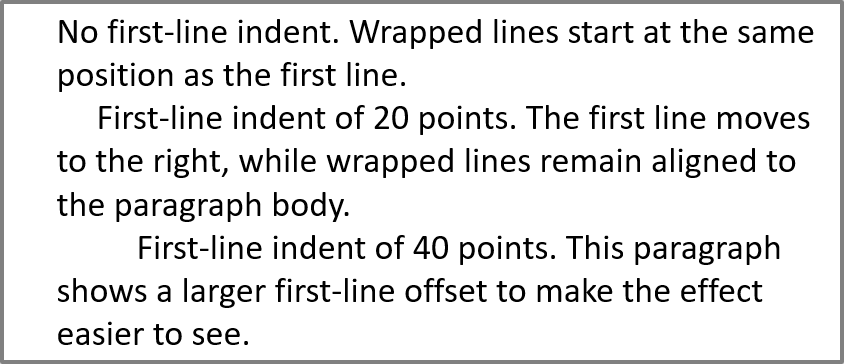

## **Ikhtisar**

Aspose.Slides untuk .NET merepresentasikan teks sebagai hierarki bingkai teks, paragraf, dan bagian:

* [ITextFrame](https://reference.aspose.com/slides/net/aspose.slides/itextframe/) mewakili wadah teks dalam sebuah bentuk dan menyediakan akses ke koleksi paragrafnya.
* [IParagraph](https://reference.aspose.com/slides/net/aspose.slides/iparagraph/) mewakili satu paragraf dalam sebuah bingkai teks dan menyediakan akses ke bagian‑bagian serta pemformatan tingkat paragraf.
* [IPortion](https://reference.aspose.com/slides/net/aspose.slides/iportion/) mewakili sebuah run teks dalam paragraf. Setiap bagian dapat memiliki teks dan pemformatan tingkat karakter masing‑masing.

Dengan demikian sebuah paragraf dapat berisi teks dengan font, warna, ukuran, dan pemformatan lain yang berbeda‑beda dengan menggunakan beberapa bagian.

## **Buat dan Format Paragraf**

Buat paragraf dalam bingkai teks bentuk dan gunakan bagian untuk memformat run teks individu. Bagian ini menunjukkan cara menggabungkan beberapa bagian dalam setiap paragraf dan menerapkan warna, ukuran font, serta gaya yang berbeda.

### **Buat Paragraf dengan Beberapa Bagian**

Contoh C# berikut membuat tiga paragraf, masing‑masing berisi tiga run teks dalam koleksi [IParagraph.Portions](https://reference.aspose.com/slides/net/aspose.slides/iparagraph/portions/). Ia menggunakan kembali paragraf default dan bagiannya yang kosong, kemudian menambahkan paragraf serta bagian yang tersisa. Pemformatan diterapkan melalui [IPortion.PortionFormat](https://reference.aspose.com/slides/net/aspose.slides/iportion/portionformat/): bagian pertama di setiap paragraf berwarna merah, tebal, dan 15 poin; bagian kedua berwarna biru, miring, dan 18 poin. Bagian ketiga mempertahankan pemformatan defaultnya:

```csharp
using System.Drawing;
using Aspose.Slides;
using Aspose.Slides.Export;

using var presentation = new Presentation();
var slide = presentation.Slides[0];

var shape = slide.Shapes.AddAutoShape(ShapeType.Rectangle, 50, 150, 300, 150);
var textFrame = shape.TextFrame;

var firstParagraph = textFrame.Paragraphs[0];
firstParagraph.Portions.Add(new Portion());
firstParagraph.Portions.Add(new Portion());

var secondParagraph = new Paragraph();
secondParagraph.Portions.Add(new Portion());
secondParagraph.Portions.Add(new Portion());
secondParagraph.Portions.Add(new Portion());
textFrame.Paragraphs.Add(secondParagraph);

var thirdParagraph = new Paragraph();
thirdParagraph.Portions.Add(new Portion());
thirdParagraph.Portions.Add(new Portion());
thirdParagraph.Portions.Add(new Portion());
textFrame.Paragraphs.Add(thirdParagraph);

var paragraphCount = textFrame.Paragraphs.Count;
for (var paragraphIndex = 0; paragraphIndex < paragraphCount; paragraphIndex++)
{
    var paragragaph = textFrame.Paragraphs[paragraphIndex];
    var portionCount = paragragaph.Portions.Count;
    for (var portionIndex = 0; portionIndex < portionCount; portionIndex++)
    {
        var portion = paragragaph.Portions[portionIndex];
        portion.Text = $"Portion {paragraphIndex + 1}.{portionIndex + 1}";

        if (portionIndex == 0)
        {
            portion.PortionFormat.FillFormat.FillType = FillType.Solid;
            portion.PortionFormat.FillFormat.SolidFillColor.Color = Color.Red;
            portion.PortionFormat.FontBold = NullableBool.True;
            portion.PortionFormat.FontHeight = 15;
        }
        else if (portionIndex == 1)
        {
            portion.PortionFormat.FillFormat.FillType = FillType.Solid;
            portion.PortionFormat.FillFormat.SolidFillColor.Color = Color.Blue;
            portion.PortionFormat.FontItalic = NullableBool.True;
            portion.PortionFormat.FontHeight = 18;
        }
    }
}

presentation.Save("paragraphs_with_portions.pptx", SaveFormat.Pptx);
```

## **Buat Daftar Bullet dan Bernomor**

Susun teks paragraf menjadi daftar dengan simbol, angka, atau gambar kustom. Contoh‑contoh dalam bagian ini mencakup pemformatan bullet, daftar berjenjang, dan penomoran dengan nilai awal kustom.

### **Buat Daftar Bullet atau Bernomor**

Bullet dan penomoran memudahkan pemindaian item terkait. Di Aspose.Slides, pengaturan daftar didefinisikan melalui [IBulletFormat](https://reference.aspose.com/slides/net/aspose.slides/ibulletformat/).

Contoh C# ini menambahkan bullet simbol dan item bernomor ke bingkai teks yang sama. [IBulletFormat.Type](https://reference.aspose.com/slides/net/aspose.slides/ibulletformat/type/) memilih jenis bullet, sementara [IBulletFormat.Char](https://reference.aspose.com/slides/net/aspose.slides/ibulletformat/char/) menyediakan simbol dan [IBulletFormat.NumberedBulletStyle](https://reference.aspose.com/slides/net/aspose.slides/ibulletformat/numberedbulletstyle/) memilih gaya penomoran. Kedua item menggunakan bullet hitam dengan tinggi 100 percent dan indentasi paragraf 25 poin:

```csharp
using System;
using System.Drawing;
using Aspose.Slides;
using Aspose.Slides.Export;

using var presentation = new Presentation();
var slide = presentation.Slides[0];

var shape = slide.Shapes.AddAutoShape(ShapeType.Rectangle, 200, 200, 400, 200);
var textFrame = shape.TextFrame;
textFrame.Paragraphs.Clear();

var symbolParagraph = new Paragraph { Text = "Welcome to Aspose.Slides" };
symbolParagraph.ParagraphFormat.Bullet.Type = BulletType.Symbol;
symbolParagraph.ParagraphFormat.Bullet.Char = Convert.ToChar(0x2022);
symbolParagraph.ParagraphFormat.Indent = 25;
symbolParagraph.ParagraphFormat.Bullet.Color.ColorType = ColorType.RGB;
symbolParagraph.ParagraphFormat.Bullet.Color.Color = Color.Black;
symbolParagraph.ParagraphFormat.Bullet.IsBulletHardColor = NullableBool.True;
symbolParagraph.ParagraphFormat.Bullet.Height = 100;
textFrame.Paragraphs.Add(symbolParagraph);

var numberedParagraph = new Paragraph { Text = "This is a numbered item" };
numberedParagraph.ParagraphFormat.Bullet.Type = BulletType.Numbered;
numberedParagraph.ParagraphFormat.Bullet.NumberedBulletStyle = NumberedBulletStyle.BulletCircleNumWDBlackPlain;
numberedParagraph.ParagraphFormat.Indent = 25;
numberedParagraph.ParagraphFormat.Bullet.Color.ColorType = ColorType.RGB;
numberedParagraph.ParagraphFormat.Bullet.Color.Color = Color.Black;
numberedParagraph.ParagraphFormat.Bullet.IsBulletHardColor = NullableBool.True;
numberedParagraph.ParagraphFormat.Bullet.Height = 100;
textFrame.Paragraphs.Add(numberedParagraph);

presentation.Save("bulleted_and_numbered_list.pptx", SaveFormat.Pptx);
```

### **Gunakan Bullet Gambar**

Bullet gambar memungkinkan Anda memakai gambar kustom alih‑alih simbol atau angka.

Contoh C# ini menambahkan gambar ke koleksi gambar presentasi sebagai [IPPImage](https://reference.aspose.com/slides/net/aspose.slides/ippimage/) dan menggunakannya sebagai bullet paragraf. Ia mengatur [IBulletFormat.Type](https://reference.aspose.com/slides/net/aspose.slides/ibulletformat/type/) untuk memakai bullet gambar dan menetapkan gambar melalui [IBulletFormat.Picture](https://reference.aspose.com/slides/net/aspose.slides/ibulletformat/picture/). [IBulletFormat.Height](https://reference.aspose.com/slides/net/aspose.slides/ibulletformat/height/) diatur ke 100 percent untuk menyesuaikan ukuran bullet relatif terhadap teks paragraf:

```csharp
using Aspose.Slides;
using Aspose.Slides.Export;

using var presentation = new Presentation();
var slide = presentation.Slides[0];

using var bulletImage = Images.FromFile("bullets.png");
var presentationImage = presentation.Images.AddImage(bulletImage);

var shape = slide.Shapes.AddAutoShape(ShapeType.Rectangle, 200, 200, 400, 200);
var textFrame = shape.TextFrame;
textFrame.Paragraphs.Clear();

var paragraph = new Paragraph { Text = "Welcome to Aspose.Slides" };
paragraph.ParagraphFormat.Bullet.Type = BulletType.Picture;
paragraph.ParagraphFormat.Bullet.Picture.Image = presentationImage;
paragraph.ParagraphFormat.Bullet.Height = 100;
textFrame.Paragraphs.Add(paragraph);

presentation.Save("picture_bullet.pptx", SaveFormat.Pptx);
presentation.Save("picture_bullet.ppt", SaveFormat.Ppt);
```

### **Buat Daftar Bertingkat**

Atur [IParagraphFormat.Depth](https://reference.aspose.com/slides/net/aspose.slides/iparagraphformat/depth/) untuk menempatkan paragraf pada level yang berbeda dalam sebuah daftar. Level teratas memiliki kedalaman `0`.

Contoh C# ini menetapkan nilai [IParagraphFormat.Depth](https://reference.aspose.com/slides/net/aspose.slides/iparagraphformat/depth/) dari 0 hingga 3 untuk empat paragraf, menciptakan hierarki dalam satu bingkai teks. Setiap paragraf menggunakan bullet simbol, dengan [IBulletFormat.Char](https://reference.aspose.com/slides/net/aspose.slides/ibulletformat/char/) bergantian antara bullet bulat dan tanda hubung untuk membedakan level yang berdekatan:

```csharp
using System;
using System.Drawing;
using Aspose.Slides;
using Aspose.Slides.Export;

using var presentation = new Presentation();
var slide = presentation.Slides[0];

var shape = slide.Shapes.AddAutoShape(ShapeType.Rectangle, 200, 200, 400, 200);
var textFrame = shape.TextFrame;
textFrame.Paragraphs.Clear();

var firstParagraph = new Paragraph { Text = "Content" };
firstParagraph.ParagraphFormat.Bullet.Type = BulletType.Symbol;
firstParagraph.ParagraphFormat.Bullet.Char = Convert.ToChar(0x2022);
firstParagraph.ParagraphFormat.DefaultPortionFormat.FillFormat.FillType = FillType.Solid;
firstParagraph.ParagraphFormat.DefaultPortionFormat.FillFormat.SolidFillColor.Color = Color.Black;
firstParagraph.ParagraphFormat.Depth = 0;

var secondParagraph = new Paragraph { Text = "Second level" };
secondParagraph.ParagraphFormat.Bullet.Type = BulletType.Symbol;
secondParagraph.ParagraphFormat.Bullet.Char = '-';
secondParagraph.ParagraphFormat.DefaultPortionFormat.FillFormat.FillType = FillType.Solid;
secondParagraph.ParagraphFormat.DefaultPortionFormat.FillFormat.SolidFillColor.Color = Color.Black;
secondParagraph.ParagraphFormat.Depth = 1;

var thirdParagraph = new Paragraph { Text = "Third level" };
thirdParagraph.ParagraphFormat.Bullet.Type = BulletType.Symbol;
thirdParagraph.ParagraphFormat.Bullet.Char = Convert.ToChar(0x2022);
thirdParagraph.ParagraphFormat.DefaultPortionFormat.FillFormat.FillType = FillType.Solid;
thirdParagraph.ParagraphFormat.DefaultPortionFormat.FillFormat.SolidFillColor.Color = Color.Black;
thirdParagraph.ParagraphFormat.Depth = 2;

var fourthParagraph = new Paragraph { Text = "Fourth level" };
fourthParagraph.ParagraphFormat.Bullet.Type = BulletType.Symbol;
fourthParagraph.ParagraphFormat.Bullet.Char = '-';
fourthParagraph.ParagraphFormat.DefaultPortionFormat.FillFormat.FillType = FillType.Solid;
fourthParagraph.ParagraphFormat.DefaultPortionFormat.FillFormat.SolidFillColor.Color = Color.Black;
fourthParagraph.ParagraphFormat.Depth = 3;

textFrame.Paragraphs.Add(firstParagraph);
textFrame.Paragraphs.Add(secondParagraph);
textFrame.Paragraphs.Add(thirdParagraph);
textFrame.Paragraphs.Add(fourthParagraph);

presentation.Save("multilevel_list.pptx", SaveFormat.Pptx);
```

### **Mulai Item Daftar Bernomor dengan Nilai Kustom**

Gunakan [IBulletFormat.NumberedBulletStartWith](https://reference.aspose.com/slides/net/aspose.slides/ibulletformat/numberedbulletstartwith/) untuk menentukan nomor awal yang ditampilkan pada paragraf bernomor.

Contoh C# ini mengatur [IBulletFormat.Type](https://reference.aspose.com/slides/net/aspose.slides/ibulletformat/type/) untuk memakai penomoran pada tiga paragraf dan menetapkan nilai [IBulletFormat.NumberedBulletStartWith](https://reference.aspose.com/slides/net/aspose.slides/ibulletformat/numberedbulletstartwith/) masing‑masing 2, 3, dan 7. Nilai awal dikonfigurasi secara terpisah untuk setiap paragraf, sehingga nomor yang ditampilkan dapat melompati nilai tertentu:

```csharp
using Aspose.Slides;
using Aspose.Slides.Export;

using var presentation = new Presentation();
var slide = presentation.Slides[0];

var shape = slide.Shapes.AddAutoShape(ShapeType.Rectangle, 200, 200, 400, 200);
var textFrame = shape.TextFrame;
textFrame.Paragraphs.Clear();

var firstParagraph = new Paragraph { Text = "Start at 2" };
firstParagraph.ParagraphFormat.Bullet.Type = BulletType.Numbered;
firstParagraph.ParagraphFormat.Bullet.NumberedBulletStartWith = 2;
textFrame.Paragraphs.Add(firstParagraph);

var secondParagraph = new Paragraph { Text = "Start at 3" };
secondParagraph.ParagraphFormat.Bullet.Type = BulletType.Numbered;
secondParagraph.ParagraphFormat.Bullet.NumberedBulletStartWith = 3;
textFrame.Paragraphs.Add(secondParagraph);

var thirdParagraph = new Paragraph { Text = "Start at 7" };
thirdParagraph.ParagraphFormat.Bullet.Type = BulletType.Numbered;
thirdParagraph.ParagraphFormat.Bullet.NumberedBulletStartWith = 7;
textFrame.Paragraphs.Add(thirdParagraph);

presentation.Save("custom_numbered_list.pptx", SaveFormat.Pptx);
```

## **Kendalikan Tata Letak Paragraf dan Properti Akhir**

Sesuaikan margin dan indentasi paragraf untuk mengontrol posisi baris pertama dan baris yang terbungkus. Anda juga dapat memformat tanda akhir paragraf secara terpisah dari bagian teks yang terlihat.

### **Atur Inden Baris Pertama**

Gunakan properti [IParagraphFormat.Indent](https://reference.aspose.com/slides/net/aspose.slides/iparagraphformat/indent/) untuk mengontrol inden baris pertama sebuah paragraf. Properti ini hanya memindahkan baris pertama relatif terhadap margin kiri paragraf. Nilai positif menggeser baris pertama ke kanan, sementara baris‑baris lainnya tetap rata dengan badan paragraf.

Gunakan [IParagraphFormat.MarginLeft](https://reference.aspose.com/slides/net/aspose.slides/iparagraphformat/marginleft/) bila Anda perlu memindahkan seluruh paragraf. Gunakan [IParagraphFormat.Indent](https://reference.aspose.com/slides/net/aspose.slides/iparagraphformat/indent/) bila Anda hanya perlu memindahkan baris pertama.

Contoh berikut memberikan tiga paragraf margin kiri [IParagraphFormat.MarginLeft](https://reference.aspose.com/slides/net/aspose.slides/iparagraphformat/marginleft/) yang sama, yaitu 20 poin, serta nilai [IParagraphFormat.Indent](https://reference.aspose.com/slides/net/aspose.slides/iparagraphformat/indent/) masing‑masing 0, 20, dan 40 poin. Baris pertama mulai pada offset yang semakin besar, sementara baris yang terbungkus mempertahankan margin kiri yang sama:

```csharp
using System.Drawing;
using Aspose.Slides;
using Aspose.Slides.Export;

using var presentation = new Presentation();
var slide = presentation.Slides[0];

var shape = slide.Shapes.AddAutoShape(ShapeType.Rectangle, 50, 50, 420, 220);
shape.FillFormat.FillType = FillType.NoFill;
shape.LineFormat.FillFormat.FillType = FillType.Solid;
shape.LineFormat.FillFormat.SolidFillColor.Color = Color.Gray;

var textFrame = shape.TextFrame;
textFrame.TextFrameFormat.AutofitType = TextAutofitType.Shape;
textFrame.Paragraphs.Clear();

var firstParagraph = new Paragraph { Text = "No first-line indent. Wrapped lines start at the same position as the first line." };
firstParagraph.ParagraphFormat.DefaultPortionFormat.FillFormat.FillType = FillType.Solid;
firstParagraph.ParagraphFormat.DefaultPortionFormat.FillFormat.SolidFillColor.Color = Color.Black;
firstParagraph.ParagraphFormat.MarginLeft = 20;
firstParagraph.ParagraphFormat.Indent = 0;

var secondParagraph = new Paragraph { Text = "First-line indent of 20 points. The first line moves to the right, while wrapped lines remain aligned to the paragraph body." };
secondParagraph.ParagraphFormat.DefaultPortionFormat.FillFormat.FillType = FillType.Solid;
secondParagraph.ParagraphFormat.DefaultPortionFormat.FillFormat.SolidFillColor.Color = Color.Black;
secondParagraph.ParagraphFormat.MarginLeft = 20;
secondParagraph.ParagraphFormat.Indent = 20;

var thirdParagraph = new Paragraph { Text = "First-line indent of 40 points. This paragraph shows a larger first-line offset to make the effect easier to see." };
thirdParagraph.ParagraphFormat.DefaultPortionFormat.FillFormat.FillType = FillType.Solid;
thirdParagraph.ParagraphFormat.DefaultPortionFormat.FillFormat.SolidFillColor.Color = Color.Black;
thirdParagraph.ParagraphFormat.MarginLeft = 20;
thirdParagraph.ParagraphFormat.Indent = 40;

textFrame.Paragraphs.Add(firstParagraph);
textFrame.Paragraphs.Add(secondParagraph);
textFrame.Paragraphs.Add(thirdParagraph);

presentation.Save("paragraph_indent.pptx", SaveFormat.Pptx);
```

Hasilnya:



### **Atur Inden Gantung**

Indentasi gantung adalah tata letak paragraf di mana baris pertama mulai lebih ke kiri daripada baris‑baris berikutnya. Di Aspose.Slides, Anda membuat efek ini dengan properti [IParagraphFormat.Indent](https://reference.aspose.com/slides/net/aspose.slides/iparagraphformat/indent/). Atur `Indent` ke nilai negatif untuk menggeser baris pertama ke kiri relatif terhadap badan paragraf.

Pada praktiknya, [IParagraphFormat.MarginLeft](https://reference.aspose.com/slides/net/aspose.slides/iparagraphformat/marginleft/) mendefinisikan posisi kiri badan paragraf, dan [IParagraphFormat.Indent](https://reference.aspose.com/slides/net/aspose.slides/iparagraphformat/indent/) mendefinisikan posisi baris pertama relatif terhadap margin tersebut. Untuk membuat indentasi gantung, atur nilai `MarginLeft` positif dan nilai `Indent` negatif.

Pemformatan ini berguna untuk bibliografi, referensi, entri glosarium, dan paragraf lain di mana baris yang terbungkus harus rata di bawah badan paragraf, bukan di bawah karakter pertama baris pertama.

Contoh C# berikut memadukan nilai [IParagraphFormat.MarginLeft](https://reference.aspose.com/slides/net/aspose.slides/iparagraphformat/marginleft/) 40 dan 60 poin dengan nilai [IParagraphFormat.Indent](https://reference.aspose.com/slides/net/aspose.slides/iparagraphformat/indent/) –20 dan –30 poin. Pada tiap paragraf, baris pertama mulai lebih ke kiri daripada baris yang terbungkus; paragraf kedua memiliki indentasi gantung yang lebih dalam:

```csharp
using System.Drawing;
using Aspose.Slides;
using Aspose.Slides.Export;

using var presentation = new Presentation();
var slide = presentation.Slides[0];

var shape = slide.Shapes.AddAutoShape(ShapeType.Rectangle, 50, 50, 420, 220);
shape.FillFormat.FillType = FillType.NoFill;
shape.LineFormat.FillFormat.FillType = FillType.Solid;
shape.LineFormat.FillFormat.SolidFillColor.Color = Color.Gray;

var textFrame = shape.TextFrame;
textFrame.TextFrameFormat.AutofitType = TextAutofitType.Shape;
textFrame.Paragraphs.Clear();

var firstParagraph = new Paragraph { Text = "A hanging indent is created by combining a positive left margin with a negative indent. The first line starts to the left, while wrapped lines align with the paragraph body." };
firstParagraph.ParagraphFormat.DefaultPortionFormat.FillFormat.FillType = FillType.Solid;
firstParagraph.ParagraphFormat.DefaultPortionFormat.FillFormat.SolidFillColor.Color = Color.Black;
firstParagraph.ParagraphFormat.MarginLeft = 40;
firstParagraph.ParagraphFormat.Indent = -20;

var secondParagraph = new Paragraph { Text = "This second example uses a deeper hanging indent so the difference between the first line and the wrapped lines is easier to compare." };
secondParagraph.ParagraphFormat.DefaultPortionFormat.FillFormat.FillType = FillType.Solid;
secondParagraph.ParagraphFormat.DefaultPortionFormat.FillFormat.SolidFillColor.Color = Color.Black;
secondParagraph.ParagraphFormat.MarginLeft = 60;
secondParagraph.ParagraphFormat.Indent = -30;

textFrame.Paragraphs.Add(firstParagraph);
textFrame.Paragraphs.Add(secondParagraph);

presentation.Save("hanging_indent.pptx", SaveFormat.Pptx);
```

Hasilnya:


### **Atur Properti Akhir Jalankan Paragraf**

Properti [IParagraph.EndParagraphPortionFormat](https://reference.aspose.com/slides/net/aspose.slides/iparagraph/endparagraphportionformat/) mengontrol pemformatan tanda akhir paragraf. Contoh berikut membuat sebuah [PortionFormat](https://reference.aspose.com/slides/net/aspose.slides/portionformat/) dengan [IBasePortionFormat.FontHeight](https://reference.aspose.com/slides/net/aspose.slides/ibaseportionformat/fontheight/) 48 poin dan [IBasePortionFormat.LatinFont](https://reference.aspose.com/slides/net/aspose.slides/ibaseportionformat/latinfont/) Times New Roman. Format ini diterapkan pada tanda akhir paragraf kedua, sementara bagian teks yang terlihat tetap tidak berubah:

```csharp
using Aspose.Slides;
using Aspose.Slides.Export;

using var presentation = new Presentation("Test.pptx");
var slide = presentation.Slides[0];

var shape = slide.Shapes.AddAutoShape(ShapeType.Rectangle, 10, 10, 200, 250);
var textFrame = shape.TextFrame;
textFrame.Paragraphs.Clear();

var firstParagraph = new Paragraph();
firstParagraph.Portions.Add(new Portion("Sample text"));

var secondParagraph = new Paragraph();
secondParagraph.Portions.Add(new Portion("Sample text 2"));

var endParagraphFormat = new PortionFormat();
endParagraphFormat.FontHeight = 48;
endParagraphFormat.LatinFont = new FontData("Times New Roman");
secondParagraph.EndParagraphPortionFormat = endParagraphFormat;

textFrame.Paragraphs.Add(firstParagraph);
textFrame.Paragraphs.Add(secondParagraph);

presentation.Save("end_paragraph_format.pptx", SaveFormat.Pptx);
```

## **Hitung Baris yang Dihasilkan**

Untuk aturan paragraf yang memengaruhi pembungkusan otomatis dan tanda baca di akhir baris, lihat [Control Line Breaking](/slides/id/net/text-formatting/#control-line-breaking) dan [Control Hanging Punctuation](/slides/id/net/text-formatting/#control-hanging-punctuation).

Gunakan [IParagraph.GetLinesCount](https://reference.aspose.com/slides/net/aspose.slides/iparagraph/getlinescount/) untuk menghitung baris yang ditempati oleh sebuah paragraf setelah penataan teks, termasuk pembungkusan otomatis. Ini berguna saat memeriksa panjang teks dan tata letak dalam templat presentasi.

Sebuah paragraf merupakan satu item dalam [ITextFrame.Paragraphs](https://reference.aspose.com/slides/net/aspose.slides/itextframe/paragraphs/), dan dapat menempati beberapa baris yang dihasilkan. Break baris eksplisit di dalam paragraf memaksa baris baru tanpa membuat paragraf tambahan. Pembungkusan otomatis menghasilkan baris berdasarkan lebar yang tersedia tanpa menyisipkan break baris eksplisit ke dalam teks. Karena itu menghitung paragraf atau karakter break baris tidak memberikan hitungan baris yang dihasilkan.

Contoh berikut membuat sebuah bentuk teks, menghitung barisnya, mempersempit bentuk, lalu mengganti teks dengan string yang lebih pendek. Contoh tersebut mengaktifkan [ITextFrameFormat.WrapText](https://reference.aspose.com/slides/net/aspose.slides/itextframeformat/wraptext/) dan menonaktifkan [ITextFrameFormat.AutofitType](https://reference.aspose.com/slides/net/aspose.slides/itextframeformat/autofittype/) sehingga lebar bentuk mengendalikan pembungkusan tanpa secara otomatis memperkecil teks atau mengubah ukuran bentuk. Setiap pengukuran menggunakan [IParagraph.GetLinesCount](https://reference.aspose.com/slides/net/aspose.slides/iparagraph/getlinescount/). Dimensi bentuk dalam poin. Akhirnya, contoh menambahkan paragraf lain dan menjumlahkan hitungan baris di seluruh bingkai teks.

```csharp
using System;
using Aspose.Slides;

using var presentation = new Presentation();
var slide = presentation.Slides[0];

var shape = slide.Shapes.AddAutoShape(ShapeType.Rectangle, 50, 50, 400, 200);
var textFrame = shape.TextFrame;
textFrame.TextFrameFormat.WrapText = NullableBool.True;
textFrame.TextFrameFormat.AutofitType = TextAutofitType.None;

var paragraph = textFrame.Paragraphs[0];
paragraph.ParagraphFormat.DefaultPortionFormat.FontHeight = 20;
paragraph.Text = "This text demonstrates how automatic wrapping changes the number of rendered lines.";
Console.WriteLine($"Original width: {paragraph.GetLinesCount()}");

shape.Width = 150;
Console.WriteLine($"Narrower shape: {paragraph.GetLinesCount()}");

paragraph.Text = "Short text.";
Console.WriteLine($"Shorter text: {paragraph.GetLinesCount()}");

var secondParagraph = new Paragraph { Text = "Another paragraph." };
secondParagraph.ParagraphFormat.DefaultPortionFormat.FontHeight = 20;
textFrame.Paragraphs.Add(secondParagraph);

var totalLineCount = 0;
foreach (var currentParagraph in textFrame.Paragraphs)
{
    totalLineCount += currentParagraph.GetLinesCount();
}
Console.WriteLine($"Total lines in the text frame: {totalLineCount}");
```

Dengan teks dan dimensi ini, mempersempit bentuk meningkatkan hitungan baris, sementara mengganti teks dengan string pendek menguranginya. Hitungan tepat dapat bervariasi tergantung pada ketersediaan dan substitusi font, ukuran font, margin, indentasi, pembungkusan, dan pengaturan autofit. Gunakan font dan pengaturan tata letak yang ditujukan untuk lingkungan target saat memeriksa templat.

Hitungan baris saja tidak menentukan apakah teks meluap dari wadahnya. Tinggi yang tersedia, tinggi baris, spasi paragraf dan baris, serta perilaku autofit juga berpengaruh; bahkan satu baris dapat melampaui lebar yang tersedia bila pembungkusan dinonaktifkan.

## **Impor dan Ekspor Konten Paragraf**

Gunakan HTML untuk memasukkan teks ke dalam presentasi atau mengekspor paragraf yang ada untuk digunakan di luar presentasi. Bagian ini juga menunjukkan cara merender paragraf individu sebagai gambar, termasuk paragraf dalam sel tabel.

### **Impor Teks HTML ke Paragraf**

Gunakan [ParagraphCollection.AddFromHtml](https://reference.aspose.com/slides/net/aspose.slides/paragraphcollection/addfromhtml/) untuk mengonversi markup HTML menjadi paragraf dan bagian dalam sebuah bingkai teks.

Contoh C# ini membaca HTML dari sebuah file dan meneruskan markup ke [ParagraphCollection.AddFromHtml](https://reference.aspose.com/slides/net/aspose.slides/paragraphcollection/addfromhtml/). Ia membersihkan paragraf default bingkai teks sehingga bingkai hanya berisi konten yang diimpor. Bentuk persegi panjang meninggalkan margin 10 poin di setiap sisi slide:

```csharp
using System.IO;
using Aspose.Slides;
using Aspose.Slides.Export;

using var presentation = new Presentation();
var slide = presentation.Slides[0];

var shapeWidth = presentation.SlideSize.Size.Width - 20;
var shapeHeight = presentation.SlideSize.Size.Height - 20;
var shape = slide.Shapes.AddAutoShape(ShapeType.Rectangle, 10, 10, shapeWidth, shapeHeight);
shape.FillFormat.FillType = FillType.NoFill;
shape.TextFrame.Paragraphs.Clear();

using var reader = new StreamReader("file.html");
var html = reader.ReadToEnd();
shape.TextFrame.Paragraphs.AddFromHtml(html);

presentation.Save("html_text.pptx", SaveFormat.Pptx);
```

### **Ekspor Teks Paragraf ke HTML**

Gunakan [ParagraphCollection.ExportToHtml](https://reference.aspose.com/slides/net/aspose.slides/paragraphcollection/exporttohtml/) untuk mengekspor rentang paragraf terpilih sebagai HTML. Saat menggunakan kembali teks presentasi di situs web, Anda mungkin ingin mempertahankan penekanan lokal tanpa membawa gaya font, ukuran, atau kotak teks presentasi. Atur [TextToHtmlConversionOptions.TextInheritanceLimit](https://reference.aspose.com/slides/net/aspose.slides.export/texttohtmlconversionoptions/textinheritancelimit/) untuk mengontrol sejauh mana exporter mengikuti pewarisan pemformatan.

Unduh [presentasi contoh](text-inheritance.pptx) dan letakkan di direktori kerja aplikasi. Slide pertamanya berisi satu bentuk teks dengan teks "Inherited text; explicit red 18pt". Input sengaja menggunakan beberapa tingkat pemformatan:

- Gaya teks default presentasi menyediakan Calibri dengan ukuran 28 pt.
- Gaya teks tingkat pertama bingkai teks menyediakan teks biru dan miring.
- Paragraf secara eksplisit mengatur teks tebal.
- Bagian kedua, "explicit red 18pt", secara eksplisit mengatur teks merah dan ukuran 18 pt.

Contoh lengkap berikut mengekspor paragraf yang sama tiga kali. Ia meneruskan [TextToHtmlConversionOptions](https://reference.aspose.com/slides/net/aspose.slides.export/texttohtmlconversionoptions/) ke metode ekspor dan menulis setiap hasil sebagai file HTML UTF‑8 terpisah:

```csharp
using System.IO;
using System.Text;
using Aspose.Slides;
using Aspose.Slides.Export;

using var presentation = new Presentation("text-inheritance.pptx");
var textShape = (IAutoShape)presentation.Slides[0].Shapes[0];

var paragraphs = textShape.TextFrame.Paragraphs;
var modes = new[] { TextInheritanceLimit.All, TextInheritanceLimit.TextBox, TextInheritanceLimit.ParagraphOnly };

foreach (var mode in modes)
{
    var options = new TextToHtmlConversionOptions { TextInheritanceLimit = mode };

    var html = paragraphs.ExportToHtml(0, paragraphs.Count, options);
    File.WriteAllText($"{mode}.html", html, Encoding.UTF8);
}
```

HTML yang dihasilkan berisi CSS berikut untuk bagian pertama, "Inherited text; ". Tabel menampilkan deklarasi yang relevan; properti yang dihasilkan lainnya dihilangkan demi kejelasan.

| Output | CSS Relevan untuk bagian pertama | Penampilan |
| --- | --- | --- |
| `All.html` | `font-family:'Calibri'; font-size:28pt; color:#0000ff; font-style:italic; font-weight:bold` | Teks biru, tebal, miring 28 pt dalam Calibri, bila font tersebut tersedia. |
| `TextBox.html` | `color:#0000ff; font-style:italic; font-weight:bold` | Teks biru, tebal, miring; halaman atau peramban menyediakan keluarga font dan ukuran. |
| `ParagraphOnly.html` | `font-weight:bold` | Teks tebal; halaman atau peramban menyediakan keluarga font, ukuran, warna, dan gaya miring. |

Bagian kedua mempertahankan `color:#ff0000`, `font-size:18pt`, dan `font-weight:bold` dalam ketiga output. Ia juga mempertahankan miring pada `All` dan `TextBox`, tetapi tidak pada `ParagraphOnly`. Membatasi pewarisan karenanya tidak menghapus pemformatan yang secara eksplisit ditetapkan pada paragraf atau bagian.

Buka file‑file tersebut dalam peramban yang sama untuk membandingkannya. Pada dua mode terbatas, properti CSS yang dihilangkan diselesaikan oleh gaya halaman tujuan atau default peramban, sehingga tampilan akhir bergantung pada tempat HTML tersebut digunakan.

### **Hasilkan Fragmen HTML Clipboard**

Atur [AddClipboardFragmentHeader](https://reference.aspose.com/slides/net/aspose.slides.export/texttohtmlconversionoptions/addclipboardfragmentheader/) ke `false` untuk HTML biasa atau `true` untuk menyertakan header clipboard. Kedua pemanggilan mengembalikan string. Header memberikan offset byte UTF‑8 dari HTML di sekelilingnya (`StartHTML` dan `EndHTML`) serta konten yang akan ditempel (`StartFragment` dan `EndFragment`).

Contoh ini mengekspor dua paragraf yang diformat sebagai HTML biasa (`html`) dan sebagai fragmen HTML clipboard (`clipboardHtml`). Menulis fragmen ke clipboard sistem adalah langkah aplikasi terpisah. API clipboard yang menerima byte HTML mentah memerlukan UTF‑8 tanpa BOM.

```cs
using Aspose.Slides;
using Aspose.Slides.Export;

using var presentation = new Presentation();
var slide = presentation.Slides[0];

var shape = slide.Shapes.AddAutoShape(ShapeType.Rectangle, 0, 0, 400, 100);
var paragraphs = shape.TextFrame.Paragraphs;
paragraphs.Clear();
paragraphs.AddFromHtml("<p>Status: <b>Ready</b></p><p><i>Next steps</i></p>");

var options = new TextToHtmlConversionOptions { AddClipboardFragmentHeader = false };
var html = paragraphs.ExportToHtml(0, paragraphs.Count, options);

options.AddClipboardFragmentHeader = true;
var clipboardHtml = paragraphs.ExportToHtml(0, paragraphs.Count, options);
```

### **Render Paragraf sebagai Gambar**

[IParagraph.GetImage](https://reference.aspose.com/slides/net/aspose.slides/iparagraph/getimage/) merender paragraf individual secara langsung dan mengembalikan sebuah [IImage](https://reference.aspose.com/slides/net/aspose.slides/iimage/). Simpan hasilnya ke file atau aliran dengan [IImage.Save](https://reference.aspose.com/slides/net/aspose.slides/iimage/save/). Anda tidak perlu merender bentuk yang menampungnya atau memotong bitmap secara manual.

[IParagraph.GetImage](https://reference.aspose.com/slides/net/aspose.slides/iparagraph/getimage/) dapat mengembalikan `null` bila paragraf tidak dapat ditemukan dalam koleksi induknya, tidak memiliki batas render yang valid, atau tidak dapat dirender. Periksa hasilnya sebelum menyimpannya dan bebaskan gambar yang dikembalikan setelah selesai digunakan.

#### **Render Paragraf dengan Skala Default**

Contoh ini menggunakan sebuah presentasi dengan satu slide yang bentuk pertamanya adalah kotak teks berisi tiga paragraf.


Contoh berikut memilih paragraf kedua pada indeks 1 dan memanggil [IParagraph.GetImage](https://reference.aspose.com/slides/net/aspose.slides/iparagraph/getimage/) tanpa parameter skala. Ia memeriksa bahwa bentuk berisi paragraf yang diperlukan dan bahwa rendering mengembalikan gambar sebelum memanggil [IImage.Save](https://reference.aspose.com/slides/net/aspose.slides/iimage/save/) untuk menyimpannya dalam format PNG. Deklarasi `using` membebaskan gambar setelah selesai digunakan.

```csharp
using System;
using Aspose.Slides;

using var presentation = new Presentation("sample.pptx");
var shape = presentation.Slides[0].Shapes[0];

if (shape is IAutoShape textShape && 
    textShape.TextFrame != null && 
    textShape.TextFrame.Paragraphs.Count > 1)
{
    var paragraph = textShape.TextFrame.Paragraphs[1];
    using var paragraphImage = paragraph.GetImage();

    if (paragraphImage != null)
    {
        paragraphImage.Save("paragraph.png", ImageFormat.Png);
    }
    else
    {
        Console.WriteLine("The paragraph could not be rendered.");
    }
}
else
{
    Console.WriteLine("The expected text shape or paragraph was not found.");
}
```

Hasilnya:


#### **Render Paragraf dalam Sel Tabel dengan Skala**

Gunakan overload [IParagraph.GetImage](https://reference.aspose.com/slides/net/aspose.slides/iparagraph/getimage/) yang menerima parameter `float scaleX` dan `float scaleY` untuk mengatur faktor skala horizontal dan vertikal. Contoh berikut membuat tabel, merender paragraf dalam sel pertama dengan lebar dan tinggi dua kali lipat ukuran default, dan menyimpan hasilnya sebagai gambar PNG.

```csharp
using System;
using Aspose.Slides;

var scaleX = 2f;
var scaleY = 2f;

using var presentation = new Presentation();
var slide = presentation.Slides[0];

var table = slide.Shapes.AddTable(50, 50, new[] { 300d }, new[] { 80d });
var paragraph = table[0, 0].TextFrame.Paragraphs[0];
paragraph.Text = "Text in a table cell";

using var paragraphImage = paragraph.GetImage(scaleX, scaleY);
if (paragraphImage != null)
{
    paragraphImage.Save("table_paragraph.png", ImageFormat.Png);
}
else
{
    Console.WriteLine("The paragraph could not be rendered.");
}
```

Faktor skala `1` mempertahankan ukuran piksel default pada sumbu tersebut. Misalnya, `2` untuk kedua faktor menghasilkan gambar dengan lebar dan tinggi kira‑kira dua kali dimensi default, menghasilkan empat kali jumlah piksel. Faktor yang lebih besar umumnya menghasilkan teks lebih tajam untuk zoom atau output beresolusi tinggi, namun juga meningkatkan penggunaan memori dan ukuran file. Faktor di bawah `1` menghasilkan gambar lebih kecil dengan detail lebih sedikit. Gunakan faktor yang sama untuk mempertahankan rasio aspek paragraf; faktor horizontal dan vertikal yang berbeda akan meregangkan output secara independen.

Merender seluruh bentuk dengan [IShape.GetImage](https://reference.aspose.com/slides/net/aspose.slides/ishape/getimage/) tetap berguna ketika output harus mencakup isi, batas, atau konteks visual bentuk. Untuk gambar hanya paragraf, gunakan [IParagraph.GetImage](https://reference.aspose.com/slides/net/aspose.slides/iparagraph/getimage/).

## **FAQ**

**Apakah saya dapat menonaktifkan sepenuhnya pembungkusan baris di dalam bingkai teks?**

Ya. Atur [ITextFrameFormat.WrapText](https://reference.aspose.com/slides/net/aspose.slides/itextframeformat/wraptext/) untuk menonaktifkan pembungkusan sehingga baris tidak terpotong pada tepi bingkai teks.

**Bagaimana cara mendapatkan batas tepat pada slide untuk paragraf tertentu?**

Gunakan [IParagraph.GetRect](https://reference.aspose.com/slides/net/aspose.slides/iparagraph/getrect/) untuk mengambil persegi batas paragraf. [IPortion.GetRect](https://reference.aspose.com/slides/net/aspose.slides/iportion/getrect/) menyediakan batas bagian individu.

**Di mana kontrol perataan paragraf (kiri, kanan, tengah, atau justified) berada?**

[IParagraphFormat.Alignment](https://reference.aspose.com/slides/net/aspose.slides/iparagraphformat/alignment/) adalah pengaturan tingkat paragraf dan berlaku untuk seluruh paragraf terlepas dari pemformatan bagian individu.

Untuk menyelaraskan vertikal bagian dengan ukuran font berbeda dalam setiap baris, lihat [Align Fonts Within a Line](/slides/id/net/text-formatting/#align-fonts-within-a-line).

**Apakah saya dapat mengatur bahasa proofing untuk bagian tertentu dari paragraf?**

Ya. Atur [IBasePortionFormat.LanguageId](https://reference.aspose.com/slides/net/aspose.slides/ibaseportionformat/languageid/) untuk bagian individu, sehingga satu paragraf dapat berisi teks dalam beberapa bahasa.