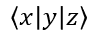

## **Ikhtisar**

PowerPoint menyimpan persamaan sebagai Office Math Markup Language (OMML). Dengan Aspose.Slides untuk .NET, Anda dapat membuat konten matematika serupa secara programatik: pecahan, radikal, fungsi, batas, operator N-ary, matriks, array, dan blok matematika yang diformat.

Dalam PowerPoint, pengguna biasanya menambahkan persamaan melalui **Insert > Equation**:


Hasilnya adalah teks matematika yang dapat diedit pada slide:


Aspose.Slides membangun teks matematika tersebut melalui tiga objek utama:

- Sebuah bentuk matematika, dibuat dengan [AddMathShape](https://reference.aspose.com/slides/net/aspose.slides/ishapecollection/addmathshape/), adalah bentuk yang berisi persamaan.
- [MathPortion](https://reference.aspose.com/slides/net/aspose.slides.mathtext/mathportion/) menyimpan konten matematika di dalam bingkai teks bentuk.
- [MathParagraph](https://reference.aspose.com/slides/net/aspose.slides.mathtext/mathparagraph/) berisi satu atau lebih objek [MathBlock](https://reference.aspose.com/slides/net/aspose.slides.mathtext/mathblock/).

Sebagian besar contoh di bawah menggunakan [MathematicalText](https://reference.aspose.com/slides/net/aspose.slides.mathtext/mathematicaltext/) dan metode fluent dari [IMathElement](https://reference.aspose.com/slides/net/aspose.slides.mathtext/imathelement/) untuk menjaga kode tetap singkat dan mudah dibaca.

Untuk skenario ekspor MathML, lihat [Ekspor Persamaan Matematika dari Presentasi di .NET](/slides/id/net/exporting-math-equations/).

## **Buat Persamaan**

Contoh ini menggunakan [AddMathShape](https://reference.aspose.com/slides/net/aspose.slides/ishapecollection/addmathshape/) untuk membuat bentuk matematika dan menambahkan teorema Pythagoras:


```csharp
using Aspose.Slides;
using Aspose.Slides.Export;
using Aspose.Slides.MathText;

using var presentation = new Presentation();
var slide = presentation.Slides[0];

var mathShape = slide.Shapes.AddMathShape(20, 20, 700, 120);
var mathParagraph = ((MathPortion)mathShape.TextFrame.Paragraphs[0].Portions[0]).MathParagraph;

var equation = new MathematicalText("c")
    .SetSuperscript("2")
    .Join("=")
    .Join(new MathematicalText("a").SetSuperscript("2"))
    .Join("+")
    .Join(new MathematicalText("b").SetSuperscript("2"));

mathParagraph.Add(equation);

presentation.Save("pythagorean-theorem.pptx", SaveFormat.Pptx);
```

{}
[AddMathShape](https://reference.aspose.com/slides/net/aspose.slides/ishapecollection/addmathshape/) membuat sebuah bentuk yang sudah berisi paragraf matematika. Akses [MathPortion](https://reference.aspose.com/slides/net/aspose.slides.mathtext/mathportion/) pertama, dapatkan [MathParagraph](https://reference.aspose.com/slides/net/aspose.slides.mathtext/mathportion/mathparagraph/), dan tambahkan blok matematika atau elemen matematika ke dalamnya.
{}

## **Tambahkan Pecahan**

Gunakan [Divide](https://reference.aspose.com/slides/net/aspose.slides.mathtext/imathelement/divide/) untuk membuat sebuah pecahan. Anda dapat memilih gaya pecahan dengan [MathFractionTypes](https://reference.aspose.com/slides/net/aspose.slides.mathtext/mathfractiontypes/).


```csharp
using Aspose.Slides;
using Aspose.Slides.Export;
using Aspose.Slides.MathText;

using var presentation = new Presentation();
var slide = presentation.Slides[0];

var mathShape = slide.Shapes.AddMathShape(20, 20, 700, 100);
var mathParagraph = ((MathPortion)mathShape.TextFrame.Paragraphs[0].Portions[0]).MathParagraph;

var fraction = new MathematicalText("1")
    .Divide("x", MathFractionTypes.Skewed);

mathParagraph.Add(new MathBlock(fraction));

presentation.Save("fraction.pptx", SaveFormat.Pptx);
```

Untuk pecahan bertumpuk, gunakan [MathFractionTypes.Bar](https://reference.aspose.com/slides/net/aspose.slides.mathtext/mathfractiontypes/):

```csharp
using Aspose.Slides.MathText;

var stackedFraction = new MathematicalText("x + 1").Divide("y - 1", MathFractionTypes.Bar);
```

## **Tambahkan Radikal**

Gunakan [Radical](https://reference.aspose.com/slides/net/aspose.slides.mathtext/imathelement/radical/) untuk membuat akar kuadrat, akar kubik, atau akar lainnya. Elemen saat ini menjadi basis, dan argumen menjadi pangkat.


```csharp
using Aspose.Slides;
using Aspose.Slides.Export;
using Aspose.Slides.MathText;

using var presentation = new Presentation();
var slide = presentation.Slides[0];

var mathShape = slide.Shapes.AddMathShape(20, 20, 700, 100);
var mathParagraph = ((MathPortion)mathShape.TextFrame.Paragraphs[0].Portions[0]).MathParagraph;

var radical = new MathematicalText("x")
    .Radical("n");

mathParagraph.Add(new MathBlock(radical));

presentation.Save("radical.pptx", SaveFormat.Pptx);
```

### **Tampilkan atau Sembunyikan Derajat Akar Kuadrat**

Akar kuadrat dapat menampilkan angka 2 secara eksplisit atau menggunakan notasi √x konvensional. Properti [HideDegree](https://reference.aspose.com/slides/net/aspose.slides.mathtext/imathradical/hidedegree/) dari [IMathRadical](https://reference.aspose.com/slides/net/aspose.slides.mathtext/imathradical/) mengontrol bentuk yang muncul. Kedua bentuk mempertahankan derajat 2 dan radikand x dalam persamaan yang dapat diedit.


Contoh ini menyimpan akar kuadrat yang sama dua kali. Pada `visible-degree.pptx` angka 2 terlihat. Pada `hidden-degree.pptx` angka 2 disembunyikan.

```csharp
using Aspose.Slides;
using Aspose.Slides.Export;
using Aspose.Slides.MathText;

using var presentation = new Presentation();
var slide = presentation.Slides[0];

var radical = new MathematicalText("x").Radical("2");

var shape = slide.Shapes.AddMathShape(20, 20, 200, 100);
var portion = (IMathPortion)shape.TextFrame.Paragraphs[0].Portions[0];
portion.MathParagraph.Add(new MathBlock(radical));

radical.HideDegree = false;
presentation.Save("visible-degree.pptx", SaveFormat.Pptx);

radical.HideDegree = true;
presentation.Save("hidden-degree.pptx", SaveFormat.Pptx);
```

## **Tambahkan Fungsi dan Batas**

Gunakan [AsArgumentOfFunction](https://reference.aspose.com/slides/net/aspose.slides.mathtext/imathelement/asargumentoffunction/) atau [Function](https://reference.aspose.com/slides/net/aspose.slides.mathtext/imathelement/function/) untuk fungsi seperti `sin(x)`, `log(x)`, atau nama fungsi khusus. Untuk batas, letakkan `lim` dalam sebuah [MathLimit](https://reference.aspose.com/slides/net/aspose.slides.mathtext/mathlimit/) atau gunakan [SetLowerLimit](https://reference.aspose.com/slides/net/aspose.slides.mathtext/imathelement/setlowerlimit/).


```csharp
using Aspose.Slides;
using Aspose.Slides.Export;
using Aspose.Slides.MathText;

using var presentation = new Presentation();
var slide = presentation.Slides[0];

var mathShape = slide.Shapes.AddMathShape(20, 20, 700, 100);
var mathParagraph = ((MathPortion)mathShape.TextFrame.Paragraphs[0].Portions[0]).MathParagraph;

var limit = new MathematicalText("lim")
    .SetLowerLimit("x→∞")
    .Function("x");

mathParagraph.Add(new MathBlock(limit));

presentation.Save("functions-and-limits.pptx", SaveFormat.Pptx);
```

Untuk nama fungsi khusus, jadikan nama fungsi sebagai elemen saat ini dan panggil [Function](https://reference.aspose.com/slides/net/aspose.slides.mathtext/imathelement/function/) dengan argumennya:

```csharp
using Aspose.Slides.MathText;

var customFunction = new MathematicalText("f").Function("x + 1");
```

## **Tambahkan Operator N-ary dan Integral**

Gunakan [Nary](https://reference.aspose.com/slides/net/aspose.slides.mathtext/imathelement/nary/) untuk penjumlahan, union, irisan, dan operator besar lainnya. Gunakan [Integral](https://reference.aspose.com/slides/net/aspose.slides.mathtext/imathelement/integral/) untuk integral. Kedua metode memungkinkan Anda mengatur batas bawah dan atas.


```csharp
using Aspose.Slides;
using Aspose.Slides.Export;
using Aspose.Slides.MathText;

using var presentation = new Presentation();
var slide = presentation.Slides[0];

var mathShape = slide.Shapes.AddMathShape(20, 20, 700, 120);
var mathParagraph = ((MathPortion)mathShape.TextFrame.Paragraphs[0].Portions[0]).MathParagraph;

var summationBase = new MathematicalText("x")
    .SetSuperscript("k")
    .Join(new MathematicalText("a").SetSuperscript("n-k"));

var summation = summationBase.Nary(MathNaryOperatorTypes.Summation, "k=0", "n");

mathParagraph.Add(new MathBlock(summation));

presentation.Save("nary-operators.pptx", SaveFormat.Pptx);
```

Operator N-ary digunakan untuk operator besar dengan batas opsional. Operator sederhana seperti `+`, `-`, dan `=` biasanya ditambahkan sebagai [MathematicalText](https://reference.aspose.com/slides/net/aspose.slides.mathtext/mathematicaltext/) dan digabungkan ke dalam ekspresi.

Untuk integral, gunakan [Integral](https://reference.aspose.com/slides/net/aspose.slides.mathtext/imathelement/integral/):

```csharp
using Aspose.Slides.MathText;

var integralBase = new MathematicalText("x").Join(new MathematicalText("dx").ToBox());
var integral = integralBase.Integral(MathIntegralTypes.Simple, "0", "1");
```

## **Tambahkan Matriks**

Gunakan [MathMatrix](https://reference.aspose.com/slides/net/aspose.slides.mathtext/mathmatrix/) untuk baris dan kolom. Matriks tidak menyertakan kurung secara default, jadi bungkus matriks ketika Anda membutuhkan tanda kurung, kurung siku, atau kurung kurawal.


```csharp
using Aspose.Slides;
using Aspose.Slides.Export;
using Aspose.Slides.MathText;

using var presentation = new Presentation();
var slide = presentation.Slides[0];

var mathShape = slide.Shapes.AddMathShape(20, 20, 700, 120);
var mathParagraph = ((MathPortion)mathShape.TextFrame.Paragraphs[0].Portions[0]).MathParagraph;

var matrix = new MathMatrix(2, 3);
matrix[0, 0] = new MathematicalText("1");
matrix[0, 1] = new MathematicalText("x");
matrix[1, 0] = new MathematicalText("x");
matrix[1, 1] = new MathematicalText("2");
matrix[1, 2] = new MathematicalText("y");

mathParagraph.Add(new MathBlock(matrix));

presentation.Save("matrix.pptx", SaveFormat.Pptx);
```

### **Sunting Matriks yang Ada**

Misalkan pelajaran aljabar linear dimulai dengan matriks koefisien di `matrix.pptx`, yang disimpan oleh contoh sebelumnya. Untuk latihan berikutnya, pertahankan persamaan pertama, ganti yang kedua dengan dua persamaan baru, dan revisi kumpulan variabel. Buka matriks yang ada melalui [IMathMatrix](https://reference.aspose.com/slides/net/aspose.slides.mathtext/imathmatrix/) untuk mempertahankan koefisien yang masih berlaku.


Indeks baris dan kolom dimulai dari nol dan merujuk pada matriks pada setiap pemanggilan. Menyisipkan baris sebelum indeks 1 memindahkan baris kedua asli ke indeks 2. Menyisipkan setelah indeks 2 lalu menambahkan sebuah baris. Menghapus baris 2 menghapus persamaan kedua asli dan memindahkan baris yang ditambahkan ke atas satu posisi. Kolom bergeser dengan cara yang sama.

```csharp
using Aspose.Slides;
using Aspose.Slides.Export;
using Aspose.Slides.MathText;

using var presentation = new Presentation("matrix.pptx");

var shape = (IAutoShape)presentation.Slides[0].Shapes[0];
var portion = (IMathPortion)shape.TextFrame.Paragraphs[0].Portions[0];
var matrix = (IMathMatrix)portion.MathParagraph[0][0];

matrix.InsertRowBefore(1);
matrix.InsertRowAfter(2);
matrix.DeleteRow(2);

matrix.InsertColumnBefore(1);
matrix.InsertColumnAfter(3);
matrix.DeleteColumn(3);

// Sel baru pada awalnya null. Atur koefisien yang tidak nol terlebih dahulu.
matrix[1, 0] = new MathematicalText("12");
matrix[1, 1] = new MathematicalText("1");
matrix[2, 2] = new MathematicalText("10");
matrix[2, 3] = new MathematicalText("1");
for (var row = 0; row < matrix.RowCount; row++)
{
    for (var column = 0; column < matrix.ColumnCount; column++)
    {
        matrix[row, column] ??= new MathematicalText("0");
    }
}

matrix.SetColumnAlignment(0, MathHorizontalAlignment.Left);
matrix.SetColumnsAlignment(1, 3, MathHorizontalAlignment.Right);

presentation.Save("updated-matrix.pptx", SaveFormat.Pptx);
```

[SetColumnAlignment](https://reference.aspose.com/slides/net/aspose.slides.mathtext/imathmatrix/setcolumnalignment/) menyelaraskan kolom pertama ke kiri. [SetColumnsAlignment](https://reference.aspose.com/slides/net/aspose.slides.mathtext/imathmatrix/setcolumnsalignment/) menyelaraskan tiga kolom berurutan ke kanan, mulai dari indeks 1. Di `updated-matrix.pptx`, matriks memiliki tiga persamaan dan empat variabel. Koefisien baris pertama asli `1` dan `x` kini muncul di kolom pertama dan ketiga.


## **Tambahkan Array Persamaan**

Gunakan [ToMathArray](https://reference.aspose.com/slides/net/aspose.slides.mathtext/imathelement/tomatharray/) ketika Anda memerlukan persamaan yang disejajarkan atau tumpukan vertikal dari ekspresi.


```csharp
using Aspose.Slides;
using Aspose.Slides.Export;
using Aspose.Slides.MathText;

using var presentation = new Presentation();
var slide = presentation.Slides[0];

var mathShape = slide.Shapes.AddMathShape(20, 20, 700, 140);
var mathParagraph = ((MathPortion)mathShape.TextFrame.Paragraphs[0].Portions[0]).MathParagraph;

var equationArray = new MathematicalText("x")
    .Join("y")
    .ToMathArray();

mathParagraph.Add(new MathBlock(equationArray));

presentation.Save("equation-array.pptx", SaveFormat.Pptx);
```

### **Sejajarkan Array dengan Elemen Sekitar**

[IMathArray.BaseJustification](https://reference.aspose.com/slides/net/aspose.slides.mathtext/imatharray/basejustification/) mengontrol penyelarasan vertikal sebuah array relatif terhadap elemen matematika di sampingnya. Contoh di bawah membandingkan penyelarasan dengan baris pertama, tengah array, dan baris terakhir.

Contoh berikut membuat tiga array identik, masing-masing dengan tiga baris dan elemen tetangga `A=` dan `=B`. Semua teks matematika menggunakan Cambria Math dengan ukuran 24 poin. Hanya penyelarasan array yang berubah.

```csharp
using Aspose.Slides;
using Aspose.Slides.Export;
using Aspose.Slides.MathText;

using var presentation = new Presentation();
presentation.SlideSize.SetSize(780, 200, SlideSizeScaleType.DoNotScale);
var slide = presentation.Slides[0];

var alignments = new[] { MathVerticalAlignment.Top, MathVerticalAlignment.Center, MathVerticalAlignment.Bottom };

for (int i = 0; i < alignments.Length; i++)
{
    var label = slide.Shapes.AddAutoShape(ShapeType.Rectangle, 20 + i * 260, 10, 240, 30);
    label.FillFormat.FillType = FillType.NoFill;
    label.LineFormat.FillFormat.FillType = FillType.NoFill;
    label.TextFrame.Text = alignments[i].ToString();
    var labelFormat = label.TextFrame.Paragraphs[0].Portions[0].PortionFormat;
    labelFormat.FontHeight = 16;
    labelFormat.FillFormat.FillType = FillType.Solid;
    labelFormat.FillFormat.SolidFillColor.Color = System.Drawing.Color.Black;

    var mathShape = slide.Shapes.AddMathShape(20 + i * 260, 60, 240, 130);
    mathShape.TextFrame.TextFrameFormat.AnchoringType = TextAnchorType.Top;
    var mathParagraph = ((IMathPortion)mathShape.TextFrame.Paragraphs[0].Portions[0]).MathParagraph;
    mathParagraph.Justification = MathJustification.LeftJustified;

    var rows = new IMathElement[] { CreateText("x+y=3"), CreateText("x-y=1"), CreateText("x=2") };
    var equationArray = new MathArray(rows);
    equationArray.BaseJustification = alignments[i];
    var equation = new MathBlock(CreateText("A=")).Join(equationArray).Join(CreateText("=B"));
    mathParagraph.Add(equation);
}

presentation.Save("equation-array-alignment.pptx", SaveFormat.Pptx);

MathematicalText CreateText(string value)
{
    var text = new MathematicalText(value);
    text.Format.FontHeight = 24;
    text.Format.LatinFont = new FontData("Cambria Math");
    return text;
}
```

Perbandingan berikut menunjukkan presentasi yang disimpan di PowerPoint. Perhatikan posisi `A=` dan `=B` di sebelah setiap array.


### **Konfigurasikan Jarak Baris**

[RowSpacingRule](https://reference.aspose.com/slides/net/aspose.slides.mathtext/imatharray/rowspacingrule/) memilih aturan jarak untuk baris dalam array. [RowSpacing](https://reference.aspose.com/slides/net/aspose.slides.mathtext/imatharray/rowspacing/) menyediakan nilai numerik untuk aturan jarak eksplisit dan diabaikan oleh aturan preset.

Untuk jarak tepat, nilai diukur dalam poin. Untuk jarak proporsional, diukur dalam setengah baris: nilai `3` dalam contoh menunjukkan 1,5 baris. Atur kedua properti saat menentukan nilai eksplisit; mengubah nilai numerik saja tidak memilih aturan jarak.

Contoh di bawah menyimpan lima presentasi dengan persamaan, penyelarasan, dan pengaturan font yang sama. Tiga pertama menggunakan preset; dua terakhir menunjukkan nilai eksplisit.

```csharp
using Aspose.Slides;
using Aspose.Slides.Export;
using Aspose.Slides.MathText;

var settings = new (MathRowSpacingRule Rule, uint Spacing)[]
{
    (MathRowSpacingRule.SingleLineGap, 0),
    (MathRowSpacingRule.OneAndAHalfLineGap, 0),
    (MathRowSpacingRule.TwoLineGap, 0),
    (MathRowSpacingRule.Exactly, 20),
    (MathRowSpacingRule.Multiple, 3)
};

foreach (var setting in settings)
{
    var fileName = $"equation-array-{setting.Rule}.pptx";
    using (var presentation = new Presentation())
    {
        var mathShape = presentation.Slides[0].Shapes.AddMathShape(20, 20, 600, 300);
        var paragraph = mathShape.TextFrame.Paragraphs[0];
        paragraph.ParagraphFormat.SpaceBefore = 0;
        paragraph.ParagraphFormat.SpaceAfter = 0;
        var mathParagraph = ((IMathPortion)paragraph.Portions[0]).MathParagraph;
        mathParagraph.Justification = MathJustification.LeftJustified;

        var rows = new IMathElement[] { CreateText("x+y=3"), CreateText("x-y=1"), CreateText("x=2") };
        var equationArray = new MathArray(rows);
        equationArray.BaseJustification = MathVerticalAlignment.Center;
        equationArray.RowSpacingRule = setting.Rule;
        equationArray.RowSpacing = setting.Spacing;
        var equation = new MathBlock(CreateText("A=")).Join(equationArray).Join(CreateText("=B"));
        mathParagraph.Add(equation);

        presentation.Save(fileName, SaveFormat.Pptx);
    }

}

MathematicalText CreateText(string value)
{
    var text = new MathematicalText(value);
    text.Format.FontHeight = 24;
    text.Format.LatinFont = new FontData("Cambria Math");
    return text;
}
```

Jarak baris array terpisah dari jarak paragraf. [SpaceBefore](https://reference.aspose.com/slides/net/aspose.slides/iparagraphformat/spacebefore/) dan [SpaceAfter](https://reference.aspose.com/slides/net/aspose.slides/iparagraphformat/spaceafter/) menambahkan ruang di sekitar paragraf yang mengandung, bukan antara baris array. Demikian pula, [IMathParagraph.Justification](https://reference.aspose.com/slides/net/aspose.slides.mathtext/imathparagraph/justification/) memposisikan seluruh paragraf matematika secara horizontal; itu tidak menggantikan pengaturan penyelarasan vertikal array.

## **Tambahkan Fungsi Trigonometri**

Gunakan [AsArgumentOfFunction](https://reference.aspose.com/slides/net/aspose.slides.mathtext/imathelement/asargumentoffunction/) ketika argumen adalah elemen saat ini dan nama fungsi sudah diketahui.


```csharp
using Aspose.Slides;
using Aspose.Slides.Export;
using Aspose.Slides.MathText;

using var presentation = new Presentation();
var slide = presentation.Slides[0];

var mathShape = slide.Shapes.AddMathShape(20, 20, 700, 100);
var mathParagraph = ((MathPortion)mathShape.TextFrame.Paragraphs[0].Portions[0]).MathParagraph;

var cosine = new MathematicalText("2x")
    .AsArgumentOfFunction(MathFunctionsOfOneArgument.Cos);

mathParagraph.Add(new MathBlock(cosine));

presentation.Save("trigonometric-function.pptx", SaveFormat.Pptx);
```

## **Tambahkan Subskrip dan Superskrip**

Gunakan pembantu subskrip dan superskrip untuk indeks dan pangkat. Ketika indeks harus muncul di sisi kiri basis, gunakan [SetSubSuperscriptOnTheLeft](https://reference.aspose.com/slides/net/aspose.slides.mathtext/imathelement/setsubsuperscriptontheleft/).


```csharp
using Aspose.Slides;
using Aspose.Slides.Export;
using Aspose.Slides.MathText;

using var presentation = new Presentation();
var slide = presentation.Slides[0];

var mathShape = slide.Shapes.AddMathShape(20, 20, 700, 100);
var mathParagraph = ((MathPortion)mathShape.TextFrame.Paragraphs[0].Portions[0]).MathParagraph;

var scripts = new MathematicalText("Y")
    .SetSubSuperscriptOnTheLeft("1", "n");

mathParagraph.Add(new MathBlock(scripts));

presentation.Save("subscript-superscript.pptx", SaveFormat.Pptx);
```

## **Tambahkan Pembatas**

Gunakan [Enclose](https://reference.aspose.com/slides/net/aspose.slides.mathtext/imathelement/enclose/) untuk menempatkan ekspresi di dalam pembatas. Anda juga dapat menetapkan karakter pemisah untuk ekspresi pembatas yang berisi beberapa elemen.



```csharp
using Aspose.Slides;
using Aspose.Slides.Export;
using Aspose.Slides.MathText;

using var presentation = new Presentation();
var slide = presentation.Slides[0];

var mathShape = slide.Shapes.AddMathShape(20, 20, 700, 100);
var mathParagraph = ((MathPortion)mathShape.TextFrame.Paragraphs[0].Portions[0]).MathParagraph;

var delimiter = new MathematicalText("x")
    .Join("y")
    .Join("z")
    .Enclose('<', '>');
delimiter.SeparatorCharacter = '|';

mathParagraph.Add(new MathBlock(delimiter));

presentation.Save("delimiters.pptx", SaveFormat.Pptx);
```

### **Ukuran dan Penyelarasan Pembatas**

Setel [GrowToMatchOperandHeight](https://reference.aspose.com/slides/net/aspose.slides.mathtext/imathdelimiter/growtomatchoperandheight/) ke `true` agar tanda kurung tumbuh mengelilingi operand tinggi, atau ke `false` untuk mempertahankan ukuran normal. [DelimiterShape](https://reference.aspose.com/slides/net/aspose.slides.mathtext/imathdelimiter/delimitershape/) mengambil salah satu dari dua nilai [MathDelimiterShape](https://reference.aspose.com/slides/net/aspose.slides.mathtext/mathdelimitershape/). `Centered` menempatkan tanda kurung di tengah sumbu matematika, yang melintasi tengah tanda sama dengan. `Match` menyelaraskan mereka dengan konten yang dibungkus. Kedua pengaturan hanya memengaruhi pembatas. Ekspresi di dalam tetap sama.

Contoh menempatkan pecahan di eksponen `x` sehingga ekspresi memanjang lebih tinggi di atas garis dasar dibandingkan di bawahnya. Keempat persamaan menggunakan tanda kurung dan pengaturan font yang sama.

```csharp
using Aspose.Slides;
using Aspose.Slides.Export;
using Aspose.Slides.MathText;

using var presentation = new Presentation();
var slide = presentation.Slides[0];

void AddExpression(float left, float top, bool grow, MathDelimiterShape shape)
{
    var fraction = new MathematicalText("a + b").Divide("c + d");
    var power = new MathematicalText("x").SetSuperscript(fraction);
    var delimiter = power.Enclose('(', ')');
    delimiter.GrowToMatchOperandHeight = grow;
    delimiter.DelimiterShape = shape;

    var mathShape = slide.Shapes.AddMathShape(left, top, 300, 100);
    var portion = (MathPortion)mathShape.TextFrame.Paragraphs[0].Portions[0];
    portion.PortionFormat.FontHeight = 32;
    var equation = new MathematicalText("y = ").Join(delimiter);
    portion.MathParagraph.Add(equation);
}

AddExpression(20, 20, true, MathDelimiterShape.Centered);
AddExpression(350, 20, true, MathDelimiterShape.Match);
AddExpression(20, 140, false, MathDelimiterShape.Centered);
AddExpression(350, 140, false, MathDelimiterShape.Match);

presentation.Save("delimiter-sizing.pptx", SaveFormat.Pptx);
```

Di PowerPoint, bandingkan baris untuk melihat efek pertumbuhan. Pada baris atas, tanda kurung tumbuh untuk membungkus eksponen dan terlihat serupa untuk kedua bentuk. Pada baris bawah, pertumbuhan dimatikan. Tanda kurung yang lebih kecil di kiri (`Centered`) selaras dengan tanda sama dengan, sementara yang di kanan (`Match`) berada lebih tinggi di sekitar ekspresi.


## **Tambahkan Kotak Batas**

Panggil [ToBorderBox](https://reference.aspose.com/slides/net/aspose.slides.mathtext/imathelement/toborderbox/) pada sebuah pecahan untuk membingkai seluruh ekspresi. [IMathBorderBox](https://reference.aspose.com/slides/net/aspose.slides.mathtext/imathborderbox/) yang dikembalikan menampilkan keempat sisi secara default. Gunakan [HideTop](https://reference.aspose.com/slides/net/aspose.slides.mathtext/imathborderbox/hidetop/), [HideBottom](https://reference.aspose.com/slides/net/aspose.slides.mathtext/imathborderbox/hidebottom/), [HideLeft](https://reference.aspose.com/slides/net/aspose.slides.mathtext/imathborderbox/hideleft/), dan [HideRight](https://reference.aspose.com/slides/net/aspose.slides.mathtext/imathborderbox/hideright/) untuk menghapus sisi individual.

Contoh menempatkan enam salinan pecahan yang sama pada satu slide. Untuk menunjukkan pembatalan, sembunyikan keempat sisi dan setel [StrikethroughBottomLeftToTopRight](https://reference.aspose.com/slides/net/aspose.slides.mathtext/imathborderbox/strikethroughbottomlefttotopright/) untuk diagonal naik (↗) atau [StrikethroughTopLeftToBottomRight](https://reference.aspose.com/slides/net/aspose.slides.mathtext/imathborderbox/strikethroughtoplefttobottomright/) untuk diagonal turun (↘). Anda juga dapat menggunakan [StrikethroughHorizontal](https://reference.aspose.com/slides/net/aspose.slides.mathtext/imathborderbox/strikethroughhorizontal/) atau [StrikethroughVertical](https://reference.aspose.com/slides/net/aspose.slides.mathtext/imathborderbox/strikethroughvertical/) dengan kombinasi sisi yang terlihat apa saja.

```csharp
using Aspose.Slides;
using Aspose.Slides.Export;
using Aspose.Slides.MathText;

using var presentation = new Presentation();
presentation.SlideSize.SetSize(540, 220, SlideSizeScaleType.DoNotScale);
var slide = presentation.Slides[0];

IMathBorderBox AddFraction(float x, float y, bool hideBorder = false)
{
    var fraction = new MathematicalText("x+1").Divide("y+2");
    var box = fraction.ToBorderBox();
    box.HideTop = box.HideBottom = box.HideLeft = box.HideRight = hideBorder;

    var shape = slide.Shapes.AddMathShape(x, y, 160, 90);
    var portion = (MathPortion)shape.TextFrame.Paragraphs[0].Portions[0];
    portion.PortionFormat.FontHeight = 28;
    portion.MathParagraph.Add(new MathBlock(box));
    return box;
}

AddFraction(10, 10);

var partial = AddFraction(190, 10);
partial.HideTop = true;
partial.HideRight = true;

AddFraction(370, 10, hideBorder: true).StrikethroughBottomLeftToTopRight = true;
AddFraction(10, 120, hideBorder: true).StrikethroughTopLeftToBottomRight = true;
AddFraction(190, 120, hideBorder: true).StrikethroughHorizontal = true;
AddFraction(370, 120).StrikethroughVertical = true;

presentation.Save("border-box.pptx", SaveFormat.Pptx);
```


Pada pecahan ini, goresan horizontal menindih bar pecahan. Goresan vertikal melintasi pembilang dan penyebut sekaligus sementara batas di sekitarnya tetap terlihat. Garis-garis ini menghias seluruh ekspresi. Strikethrough teks biasa berlaku pada karakter dalam satu run teks. Setelah membuka kembali presentasi di PowerPoint, Anda masih dapat menyunting pembilang dan penyebut secara terpisah.

## **Kontrol Visibilitas dan Tata Letak dengan Elemen Phantom**

Bungkus sebuah ekspresi dalam [MathPhantom](https://reference.aspose.com/slides/net/aspose.slides.mathtext/mathphantom/) untuk mengontrol visibilitasnya dan ruang yang diberikannya pada sebuah persamaan secara independen. Properti [IMathPhantom](https://reference.aspose.com/slides/net/aspose.slides.mathtext/imathphantom/) mengontrol hal berikut:

| Properti | Efek |
| --- | --- |
| [Show](https://reference.aspose.com/slides/net/aspose.slides.mathtext/imathphantom/show/) | Setel ke `false` untuk menyembunyikan ekspresi. Dimensinya masih berkontribusi pada tata letak kecuali properti terkait di bawah `true`. |
| [ZeroWidth](https://reference.aspose.com/slides/net/aspose.slides.mathtext/imathphantom/zerowidth/) | Anggap lebar horizontal ekspresi sebagai nol, memungkinkan elemen tetangga bergerak lebih dekat. |
| [ZeroAsc](https://reference.aspose.com/slides/net/aspose.slides.mathtext/imathphantom/zeroasc/) | Anggap asennya, tinggi di atas garis dasar, sebagai nol. Ini dapat mengurangi ruang yang dipesan di atas elemen tetangga. |
| [ZeroDesc](https://reference.aspose.com/slides/net/aspose.slides.mathtext/imathphantom/zerodesc/) | Anggap desennya, kedalaman di bawah garis dasar, sebagai nol. Ini dapat memindahkan bar pecahan atau konten lain di bawah ekspresi lebih dekat ke tetangganya. |

Garis dasar adalah garis referensi tempat huruf matematika biasa berada. Menyembunyikan konten tidak menghapus dimensinya, dan menganggap sebuah dimensi sebagai nol tidak menghapus ekspresi. Ekspresi dasar tetap tersedia melalui [Base](https://reference.aspose.com/slides/net/aspose.slides.mathtext/imathphantom/base/). Setel kembali [Show](https://reference.aspose.com/slides/net/aspose.slides.mathtext/imathphantom/show/) ke `true` untuk menampilkannya lagi; pengaturan dimensi tetap tidak berubah.

Contoh di bawah membuat lima varian berdampingan: satu pecahan terlihat, satu pecahan tersembunyi yang masih menyisakan ruang, dan tiga pecahan tersembunyi dengan satu dimensi dianggap nol. Setiap varian menggunakan ekspresi sekeliling yang sama dan Cambria Math dengan ukuran 24 poin. Semua bentuk persamaan memiliki posisi atas yang sama, ditandai oleh panduan abu-abu. Menempatkan phantom di pembilang sebuah pecahan luar membuat perubahan tata letak vertikal lebih mudah terlihat.

```csharp
using Aspose.Slides;
using Aspose.Slides.Export;
using Aspose.Slides.MathText;

using var presentation = new Presentation();
presentation.SlideSize.SetSize(1000, 180, SlideSizeScaleType.DoNotScale);
var slide = presentation.Slides[0];

var labels = new[] { "Visible", "Hidden: reserves space", "Hidden: ZeroWidth", "Hidden: ZeroAsc", "Hidden: ZeroDesc" };

var guide = slide.Shapes.AddAutoShape(ShapeType.Line, 10, 60, 980, 0);
guide.LineFormat.FillFormat.FillType = FillType.Solid;
guide.LineFormat.FillFormat.SolidFillColor.Color = System.Drawing.Color.LightGray;

for (var i = 0; i < labels.Length; i++)
{
    var left = 10 + i * 200;
    
    var label = slide.Shapes.AddAutoShape(ShapeType.Rectangle, left, 10, 190, 30);
    label.FillFormat.FillType = FillType.NoFill;
    label.LineFormat.FillFormat.FillType = FillType.NoFill;
    label.TextFrame.Text = labels[i];

    var labelFormat = label.TextFrame.Paragraphs[0].Portions[0].PortionFormat;
    labelFormat.FontHeight = 14;
    labelFormat.FillFormat.FillType = FillType.Solid;
    labelFormat.FillFormat.SolidFillColor.Color = System.Drawing.Color.Black;

    var fraction = new MathFraction(CreateText("a+b"), CreateText("c+d"));
    var phantom = new MathPhantom(fraction);
    phantom.Show = i == 0;
    phantom.ZeroWidth = i == 2;
    phantom.ZeroAsc = i == 3;
    phantom.ZeroDesc = i == 4;

    var numerator = new MathBlock(CreateText("x+")).Join(phantom).Join(CreateText("+y"));
    var equation = new MathFraction(numerator, CreateText("z"));

    var shape = slide.Shapes.AddMathShape(left, 60, 190, 100);
    shape.TextFrame.TextFrameFormat.AnchoringType = TextAnchorType.Top;

    var mathParagraph = ((IMathPortion)shape.TextFrame.Paragraphs[0].Portions[0]).MathParagraph;
    mathParagraph.Add(new MathBlock(equation));
}

presentation.Save("math-phantom.pptx", SaveFormat.Pptx);

MathematicalText CreateText(string value)
{
    var text = new MathematicalText(value);
    text.Format.FontHeight = 24;
    text.Format.LatinFont = new FontData("Cambria Math");
    return text;
}
```


## **Kelompokkan Istilah**

Gunakan [Group](https://reference.aspose.com/slides/net/aspose.slides.mathtext/imathelement/group/) untuk menempatkan karakter pengelompokan di atas atau di bawah sebuah ekspresi. Tambahkan batas untuk memberi label pada istilah yang dikelompokkan.


```csharp
using Aspose.Slides;
using Aspose.Slides.Export;
using Aspose.Slides.MathText;

using var presentation = new Presentation();
var slide = presentation.Slides[0];

var mathShape = slide.Shapes.AddMathShape(20, 20, 700, 120);
var mathParagraph = ((MathPortion)mathShape.TextFrame.Paragraphs[0].Portions[0]).MathParagraph;

var grouped = new MathematicalText("x + y")
    .Group('\u23DF', MathTopBotPositions.Bottom, MathTopBotPositions.Top)
    .SetLowerLimit("any text");

mathParagraph.Add(new MathBlock(grouped));

presentation.Save("grouped-terms.pptx", SaveFormat.Pptx);
```

## **Format Elemen Matematika**

Gunakan pembantu format hanya di mana mereka memperjelas rumus. Misalnya, [Overbar](https://reference.aspose.com/slides/net/aspose.slides.mathtext/imathelement/overbar/) menempatkan bar di atas sebuah elemen matematika.


```csharp
using Aspose.Slides;
using Aspose.Slides.Export;
using Aspose.Slides.MathText;

using var presentation = new Presentation();
var slide = presentation.Slides[0];

var mathShape = slide.Shapes.AddMathShape(20, 20, 700, 100);
var mathParagraph = ((MathPortion)mathShape.TextFrame.Paragraphs[0].Portions[0]).MathParagraph;

var overbar = new MathematicalText("ABC").Overbar();

mathParagraph.Add(new MathBlock(overbar));

presentation.Save("overbar.pptx", SaveFormat.Pptx);
```

### **Format Teks dalam Persamaan yang Ada**

Untuk memformat teks di seluruh persamaan yang ada, telusuri setiap pohon elemen blok matematika. [IMathElement.GetChildren](https://reference.aspose.com/slides/net/aspose.slides.mathtext/imathelement/getchildren/) mengembalikan hanya anak langsung, sehingga panggil secara rekursif untuk mencapai teks di dalam pecahan, skrip, radikal, dan struktur bersarang lainnya. Periksa elemen saat ini serta anaknya untuk menyertakan elemen awal ketika itu adalah [MathematicalText](https://reference.aspose.com/slides/net/aspose.slides.mathtext/mathematicaltext/).

Contoh ini mengasumsikan bahwa sebuah presentasi berisi persamaan seperti `z = xᵢ / ∛y`, dengan pecahan yang mengandung subskrip di pembilangnya dan radikal di penyebutnya. Memproses hanya elemen tingkat atas blok akan melewatkan teks di dalam pecahan. Contoh menemukan bagian matematika dalam bingkai teks slide, mengakses bloknya melalui [IMathPortion.MathParagraph](https://reference.aspose.com/slides/net/aspose.slides.mathtext/imathportion/mathparagraph/), dan mengatur [FontHeight](https://reference.aspose.com/slides/net/aspose.slides/baseportionformat/fontheight/) ke 28 poin melalui properti [Format](https://reference.aspose.com/slides/net/aspose.slides.mathtext/mathematicaltext/format/) setiap elemen teks.

```csharp
using Aspose.Slides;
using Aspose.Slides.Export;
using Aspose.Slides.MathText;

using var presentation = new Presentation("input.pptx");

foreach (var slide in presentation.Slides)
{
    foreach (var shape in slide.Shapes)
    {
        if (shape is not IAutoShape autoShape || autoShape.TextFrame == null)
            continue;

        foreach (var paragraph in autoShape.TextFrame.Paragraphs)
        {
            foreach (var portion in paragraph.Portions)
            {
                if (portion is IMathPortion mathPortion)
                {
                    foreach (var block in mathPortion.MathParagraph)
                        FormatMathText(block);
                }
            }
        }
    }
}

presentation.Save("formatted-equations.pptx", SaveFormat.Pptx);

void FormatMathText(IMathElement element)
{
    if (element is MathematicalText text)
        text.Format.FontHeight = 28;

    foreach (var child in element.GetChildren())
        FormatMathText(child);
}
```

Presentasi yang disimpan berisi pemformatan teks yang diperbarui pada setiap level setiap persamaan yang diproses, sambil mempertahankan konten teks dan struktur matematikanya.

## **Referensi Cepat**

| Tugas | API Utama |
| --- | --- |
| Buat teks matematika | [MathematicalText](https://reference.aspose.com/slides/net/aspose.slides.mathtext/mathematicaltext/) |
| Gabungkan elemen | [IMathElement.Join](https://reference.aspose.com/slides/net/aspose.slides.mathtext/imathelement/join/) |
| Buat pecahan | [IMathElement.Divide](https://reference.aspose.com/slides/net/aspose.slides.mathtext/imathelement/divide/) |
| Tambahkan superskrip atau subskrip | [SetSuperscript](https://reference.aspose.com/slides/net/aspose.slides.mathtext/imathelement/setsuperscript/), [SetSubscript](https://reference.aspose.com/slides/net/aspose.slides.mathtext/imathelement/setsubscript/) |
| Tambahkan fungsi | [Function](https://reference.aspose.com/slides/net/aspose.slides.mathtext/imathelement/function/), [AsArgumentOfFunction](https://reference.aspose.com/slides/net/aspose.slides.mathtext/imathelement/asargumentoffunction/) |
| Tambahkan radikal | [IMathElement.Radical](https://reference.aspose.com/slides/net/aspose.slides.mathtext/imathelement/radical/) |
| Tambahkan batas | [SetLowerLimit](https://reference.aspose.com/slides/net/aspose.slides.mathtext/imathelement/setlowerlimit/), [SetUpperLimit](https://reference.aspose.com/slides/net/aspose.slides.mathtext/imathelement/setupperlimit/) |
| Tambahkan skrip sisi kiri | [SetSubSuperscriptOnTheLeft](https://reference.aspose.com/slides/net/aspose.slides.mathtext/imathelement/setsubsuperscriptontheleft/) |
| Tambahkan penjumlahan dan integral | [Nary](https://reference.aspose.com/slides/net/aspose.slides.mathtext/imathelement/nary/), [Integral](https://reference.aspose.com/slides/net/aspose.slides.mathtext/imathelement/integral/) |
| Tambahkan matriks | [MathMatrix](https://reference.aspose.com/slides/net/aspose.slides.mathtext/mathmatrix/) |
| Tambahkan array persamaan | [ToMathArray](https://reference.aspose.com/slides/net/aspose.slides.mathtext/imathelement/tomatharray/) |
| Tambahkan pembatas | [Enclose](https://reference.aspose.com/slides/net/aspose.slides.mathtext/imathelement/enclose/) |
| Tambahkan bar dan batas | [Overbar](https://reference.aspose.com/slides/net/aspose.slides.mathtext/imathelement/overbar/), [ToBorderBox](https://reference.aspose.com/slides/net/aspose.slides.mathtext/imathelement/toborderbox/) |
| Kelompokkan istilah | [Group](https://reference.aspose.com/slides/net/aspose.slides.mathtext/imathelement/group/) |

## **FAQ**

**Apakah saya dapat menyunting persamaan PowerPoint yang ada?**

Ya. Buka presentasi, temukan bentuk yang berisi sebuah [MathPortion](https://reference.aspose.com/slides/net/aspose.slides.mathtext/mathportion/), dapatkan [MathParagraph](https://reference.aspose.com/slides/net/aspose.slides.mathtext/mathportion/mathparagraph/)nya, dan perbarui blok matematika dalam paragraf tersebut.

**Apakah persamaan disimpan sebagai matematika PowerPoint yang dapat diedit?**

Ya. Saat Anda menyimpan ke PPTX, Aspose.Slides menulis persamaan sebagai konten Office math yang dapat diedit.

**Apakah saya dapat mengekspor persamaan ke LaTeX?**

Ya. Dapatkan [IMathParagraph](https://reference.aspose.com/slides/net/aspose.slides.mathtext/imathparagraph/) persamaan dari [MathPortion](https://reference.aspose.com/slides/net/aspose.slides.mathtext/mathportion/), dan panggil [IMathParagraph.ToLatex](https://reference.aspose.com/slides/net/aspose.slides.mathtext/imathparagraph/tolatex/) untuk mengekspornya secara langsung. Untuk contoh lengkap, lihat [Ekspor Persamaan Matematika dari Presentasi di .NET](/slides/id/net/exporting-math-equations/#export-math-equations-to-latex).