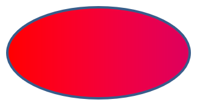

## **Pendahuluan**

Format shape di PowerPoint dengan menyesuaikan garis tepi, isian, dan efeknya. Aspose.Slides untuk .NET memungkinkan Anda mengontrol pengaturan ini secara programatik, termasuk transparansi, rotasi, dan pemformatan 3D.


Aspose.Slides untuk .NET menyediakan antarmuka dan properti yang memungkinkan Anda memformat shape menggunakan opsi yang sama tersedia di PowerPoint.

## **Format Garis**

Gunakan [IShape.LineFormat](https://reference.aspose.com/slides/net/aspose.slides/ishape/lineformat/) untuk mengontrol garis tepi shape. Contoh ini membuat persegi panjang tanpa isi dengan garis luar biru, bergaris titik. [ILineFormat.Style](https://reference.aspose.com/slides/net/aspose.slides/ilineformat/style/) memilih garis komposit tebal‑tipis, sementara [ILineFormat.Width](https://reference.aspose.com/slides/net/aspose.slides/ilineformat/width/) mengatur lebarnya menjadi 7 poin dan [ILineFormat.DashStyle](https://reference.aspose.com/slides/net/aspose.slides/ilineformat/dashstyle/) memilih pola dash.

```csharp
using System.Drawing;
using Aspose.Slides;
using Aspose.Slides.Export;

using var presentation = new Presentation();
var slide = presentation.Slides[0];

var shape = slide.Shapes.AddAutoShape(ShapeType.Rectangle, 50, 50, 150, 75);
shape.FillFormat.FillType = FillType.NoFill;
shape.LineFormat.Style = LineStyle.ThickThin;
shape.LineFormat.Width = 7;
shape.LineFormat.DashStyle = LineDashStyle.Dash;
shape.LineFormat.FillFormat.FillType = FillType.Solid;
shape.LineFormat.FillFormat.SolidFillColor.Color = Color.Blue;

presentation.Save("formatted_lines.pptx", SaveFormat.Pptx);
```

Hasilnya:


### **Atur Pola Dash Garis Kustom**

Gunakan [ILineFormat.CustomDashPattern](https://reference.aspose.com/slides/net/aspose.slides/ilineformat/customdashpattern/) ketika gaya garis bawaan tidak menyediakan panjang dash dan celah yang Anda butuhkan, misalnya untuk garis tepi bermerek atau diagram teknis. Menetapkan pola secara otomatis mengatur [ILineFormat.DashStyle](https://reference.aspose.com/slides/net/aspose.slides/ilineformat/dashstyle/) ke [LineDashStyle.Custom](https://reference.aspose.com/slides/net/aspose.slides/linedashstyle/).

Entri array bergantian antara panjang dash dan celah, dimulai dengan dash. Setiap nilai merupakan kelipatan lebar garis: `{ 4, 2 }` pada lebar 3 poin menghasilkan dash 12 poin diikuti celah 6 poin. Gunakan pasangan nilai terbatas, tidak negatif untuk mendefinisikan segmen dash‑dan‑celah lengkap. Contoh ini menggunakan nilai positif agar setiap dash dan celah terlihat.

Contoh ini membuat lima garis biru dengan panjang yang sama dan cap flat. Tiga pertama membandingkan pola pada lebar 3 poin. Yang keempat mengulangi pola pertama pada lebar dua kali, menggandakan panjang dash dan celah. Yang kelima beralih dari pola kustom ke garis solid.

```csharp
using System.Drawing;
using Aspose.Slides;
using Aspose.Slides.Export;

using var presentation = new Presentation();
presentation.SlideSize.SetSize(600, 300, SlideSizeScaleType.DoNotScale);
var slide = presentation.Slides[0];

var patterns = new[]
{
    new float[] { 4, 2 },
    new float[] { 1, 2 },
    new float[] { 6, 2, 1, 2 },
    new float[] { 4, 2 },
    new float[] { 4, 2 }
};

for (var i = 0; i < patterns.Length; i++)
{
    var line = slide.Shapes.AddAutoShape(ShapeType.Line, 50, 50 + i * 50, 500, 0);
    line.LineFormat.Width = i == 3 ? 6 : 3;
    line.LineFormat.FillFormat.FillType = FillType.Solid;
    line.LineFormat.FillFormat.SolidFillColor.Color = Color.DarkBlue;
    line.LineFormat.CapStyle = LineCapStyle.Flat;
    line.LineFormat.BeginArrowheadStyle = LineArrowheadStyle.None;
    line.LineFormat.EndArrowheadStyle = LineArrowheadStyle.None;
    line.LineFormat.CustomDashPattern = patterns[i];
}

// Kembalikan garis terakhir ke gaya solid.
slide.Shapes[4].LineFormat.DashStyle = LineDashStyle.Solid;

presentation.Save("custom_dash_patterns.pptx", SaveFormat.Pptx);
```

Untuk kembali ke gaya dash bawaan, tetapkan [LineDashStyle.Dash](https://reference.aspose.com/slides/net/aspose.slides/linedashstyle/) ke [ILineFormat.DashStyle](https://reference.aspose.com/slides/net/aspose.slides/ilineformat/dashstyle/). Gaya yang dipilih mengontrol tampilan garis.

Hasilnya di PowerPoint, dari atas ke bawah: **{4, 2}, 3 pt**; **{1, 2}, 3 pt**; **{6, 2, 1, 2}, 3 pt**; **{4, 2}, 6 pt**; dan **Solid, 3 pt**.


### **Atur Cap Garis**

Gunakan [ILineFormat.CapStyle](https://reference.aspose.com/slides/net/aspose.slides/ilineformat/capstyle/) untuk mengatur ujung garis terbuka. Enumerasi [LineCapStyle](https://reference.aspose.com/slides/net/aspose.slides/linecapstyle/) menyediakan tiga gaya cap eksplisit:

- `Flat`: Coretan berhenti pada titik akhir.
- `Round`: Cap setengah lingkaran melampaui titik akhir sebesar setengah lebar garis.
- `Square`: Cap persegi melampaui titik akhir sebesar setengah lebar garis.

Enumerasi juga mencakup `NotDefined`, yang berarti tidak ada gaya cap yang secara eksplisit ditetapkan.

Cap berbeda dari arrowhead, yang menambahkan simbol ke ujung garis, dan join, yang mengontrol sudut antara segmen garis. Contoh ini menonaktifkan arrowhead melalui [ILineFormat.BeginArrowheadStyle](https://reference.aspose.com/slides/net/aspose.slides/ilineformat/beginarrowheadstyle/) dan [ILineFormat.EndArrowheadStyle](https://reference.aspose.com/slides/net/aspose.slides/ilineformat/endarrowheadstyle/) sehingga hanya bentuk cap yang dibandingkan.

```csharp
using System.Drawing;
using Aspose.Slides;
using Aspose.Slides.Export;

using var presentation = new Presentation();
presentation.SlideSize.SetSize(500, 240, SlideSizeScaleType.DoNotScale);
var slide = presentation.Slides[0];

var capStyles = new[] { LineCapStyle.Flat, LineCapStyle.Round, LineCapStyle.Square };

for (var i = 0; i < capStyles.Length; i++)
{
    var line = slide.Shapes.AddAutoShape(ShapeType.Line, 100, 50 + i * 70, 300, 0);
    line.LineFormat.Width = 20;
    line.LineFormat.FillFormat.FillType = FillType.Solid;
    line.LineFormat.FillFormat.SolidFillColor.Color = Color.DarkBlue;
    line.LineFormat.DashStyle = LineDashStyle.Solid;
    line.LineFormat.CapStyle = capStyles[i];
    line.LineFormat.BeginArrowheadStyle = LineArrowheadStyle.None;
    line.LineFormat.EndArrowheadStyle = LineArrowheadStyle.None;
}

presentation.Save("line_caps.pptx", SaveFormat.Pptx);
```

Hasilnya di PowerPoint, dari atas ke bawah: **Flat**, **Round**, dan **Square**.


## **Terapkan Efek Sketch pada Garis Shape**

Efek sketch membuat garis shape terlihat digambar tangan. Gunakan [IShape.LineFormat](https://reference.aspose.com/slides/net/aspose.slides/ishape/lineformat/) untuk mengakses pengaturan garis, [ILineFormat.SketchFormat](https://reference.aspose.com/slides/net/aspose.slides/ilineformat/sketchformat/) untuk mengakses pengaturan sketch, dan [ISketchFormat.SketchType](https://reference.aspose.com/slides/net/aspose.slides/isketchformat/sketchtype/) untuk memilih nilai dari enumerasi [LineSketchType](https://reference.aspose.com/slides/net/aspose.slides/linesketchtype/).

Berikut kode C# yang menunjukkan cara menerapkan efek [LineSketchType.Curved](https://reference.aspose.com/slides/net/aspose.slides/linesketchtype/), membaca nilai yang ditetapkan secara eksplisit, dan menghapus efek dengan [LineSketchType.None](https://reference.aspose.com/slides/net/aspose.slides/linesketchtype/):

```csharp
using System;
using Aspose.Slides;

using var presentation = new Presentation();
var slide = presentation.Slides[0];

var shape = slide.Shapes.AddAutoShape(ShapeType.Rectangle, 50, 50, 200, 100);

var sketchFormat = shape.LineFormat.SketchFormat;
sketchFormat.SketchType = LineSketchType.Curved;
var explicitSketchType = sketchFormat.SketchType;
Console.WriteLine($"Explicit sketch type: {explicitSketchType}");
sketchFormat.SketchType = LineSketchType.None;
```

Nilai yang dikembalikan oleh [ISketchFormat.SketchType](https://reference.aspose.com/slides/net/aspose.slides/isketchformat/sketchtype/) mewakili pengaturan yang ditetapkan langsung pada shape. Jika pemformatan garis dapat diwarisi dari tema, master slide, atau layout slide, gunakan [ILineFormat.GetEffective](https://reference.aspose.com/slides/net/aspose.slides/ilineformat/geteffective/), akses [ILineFormatEffectiveData.SketchFormat](https://reference.aspose.com/slides/net/aspose.slides/ilineformateffectivedata/sketchformat/), dan baca [ISketchFormatEffectiveData.SketchType](https://reference.aspose.com/slides/net/aspose.slides/isketchformateffectivedata/sketchtype/). Nilai efektif mencerminkan pemformatan yang sebenarnya diterapkan setelah pewarisan diselesaikan. Contoh ini memerlukan presentasi yang sudah ada dengan setidaknya satu shape pada slide pertama dan mencetak kedua nilai:

```csharp
using System;
using Aspose.Slides;

using var presentation = new Presentation("presentation.pptx");
var shape = presentation.Slides[0].Shapes[0];

var lineFormat = shape.LineFormat;
var explicitSketchType = lineFormat.SketchFormat.SketchType;
var effectiveLineFormat = lineFormat.GetEffective();
var effectiveSketchType = effectiveLineFormat.SketchFormat.SketchType;

Console.WriteLine($"Explicit sketch type: {explicitSketchType}");
Console.WriteLine($"Effective sketch type: {effectiveSketchType}");
```

## **Format Gaya Sambungan**

Berikut tiga opsi tipe join:

* Bulat
* Miter
* Bevel

Gaya sambungan mengontrol bagaimana dua segmen garis tepi bertemu pada sebuah sudut. Gunakan **Bulat** untuk sudut melengkung, **Miter** untuk sudut tajam, atau **Bevel** untuk sudut rata.


Contoh ini membuat tiga persegi panjang hitam dengan garis luar biru lebar 15 poin. Ia mengatur [ILineFormat.JoinStyle](https://reference.aspose.com/slides/net/aspose.slides/ilineformat/joinstyle/) ke nilai miter, bevel, dan round dari [LineJoinStyle](https://reference.aspose.com/slides/net/aspose.slides/linejoinstyle/) secara berurutan, untuk membandingkan cara sudut digambar.

```csharp
using System.Drawing;
using Aspose.Slides;
using Aspose.Slides.Export;

using var presentation = new Presentation();
var slide = presentation.Slides[0];

var miterShape = slide.Shapes.AddAutoShape(ShapeType.Rectangle, 20, 20, 150, 75);
var bevelShape = slide.Shapes.AddAutoShape(ShapeType.Rectangle, 210, 20, 150, 75);
var roundShape = slide.Shapes.AddAutoShape(ShapeType.Rectangle, 20, 135, 150, 75);

miterShape.FillFormat.FillType = FillType.Solid;
miterShape.FillFormat.SolidFillColor.Color = Color.Black;
bevelShape.FillFormat.FillType = FillType.Solid;
bevelShape.FillFormat.SolidFillColor.Color = Color.Black;
roundShape.FillFormat.FillType = FillType.Solid;
roundShape.FillFormat.SolidFillColor.Color = Color.Black;

miterShape.LineFormat.Width = 15;
bevelShape.LineFormat.Width = 15;
roundShape.LineFormat.Width = 15;

miterShape.LineFormat.FillFormat.FillType = FillType.Solid;
miterShape.LineFormat.FillFormat.SolidFillColor.Color = Color.Blue;
bevelShape.LineFormat.FillFormat.FillType = FillType.Solid;
bevelShape.LineFormat.FillFormat.SolidFillColor.Color = Color.Blue;
roundShape.LineFormat.FillFormat.FillType = FillType.Solid;
roundShape.LineFormat.FillFormat.SolidFillColor.Color = Color.Blue;

miterShape.LineFormat.JoinStyle = LineJoinStyle.Miter;
bevelShape.LineFormat.JoinStyle = LineJoinStyle.Bevel;
roundShape.LineFormat.JoinStyle = LineJoinStyle.Round;

miterShape.TextFrame.Text = "Miter Join Style";
bevelShape.TextFrame.Text = "Bevel Join Style";
roundShape.TextFrame.Text = "Round Join Style";

presentation.Save("join_styles.pptx", SaveFormat.Pptx);
```

### **Batasi Sambungan Miter pada Sudut Tajam**

Gunakan [ILineFormat.MiterLimit](https://reference.aspose.com/slides/net/aspose.slides/ilineformat/miterlimit/) dengan [ILineFormat.JoinStyle](https://reference.aspose.com/slides/net/aspose.slides/ilineformat/joinstyle/) diset ke [LineJoinStyle.Miter](https://reference.aspose.com/slides/net/aspose.slides/linejoinstyle/) untuk membatasi sejauh mana sudut tajam dapat memanjang.

Batasnya adalah rasio jarak antara sudut dalam dan luar join terhadap lebar garis. Misalnya, nilai `8` mengizinkan panjang miter hingga delapan kali lebar garis; bukan ukuran dalam poin. Jika sudut melebihi batas, PowerPoint menggunakan join bevel pada sudut tersebut. Batas yang lebih besar memungkinkan titik yang lebih tajam. Pengaturan ini hanya memengaruhi join miter, dan mengubahnya tidak memberi efek terlihat ketika sudut tetap berada dalam kedua batas.

Contoh ini membuat dua segitiga identik tanpa isi dengan garis luar lebar 20 poin. Segitiga kiri menggunakan batas `2`, dan kanan menggunakan `8`. Setiap segitiga berlebar 80 poin dan tinggi 160 poin, memberi rasio panjang‑miter‑terhadap‑lebar‑garis pada sudut atas kira‑kira `4.12`. Akibatnya, PowerPoint memberi bevel pada puncak kiri dan mempertahankan puncak kanan.

```csharp
using System.Drawing;
using Aspose.Slides;
using Aspose.Slides.Export;

using var presentation = new Presentation();
presentation.SlideSize.SetSize(500, 320, SlideSizeScaleType.DoNotScale);
var slide = presentation.Slides[0];

var miterLimits = new[] { 2f, 8f };

for (var i = 0; i < miterLimits.Length; i++)
{
    var triangle = slide.Shapes.AddAutoShape(ShapeType.Triangle, 90 + i * 240, 110, 80, 160);
    triangle.FillFormat.FillType = FillType.NoFill;
    triangle.LineFormat.Width = 20;
    triangle.LineFormat.FillFormat.FillType = FillType.Solid;
    triangle.LineFormat.FillFormat.SolidFillColor.Color = Color.DarkBlue;
    triangle.LineFormat.JoinStyle = LineJoinStyle.Miter;
    triangle.LineFormat.MiterLimit = miterLimits[i];
}

presentation.Save("miter_limits.pptx", SaveFormat.Pptx);
```

Hasilnya di PowerPoint: **Miter limit 2** pada kiri dan **miter limit 8** pada kanan.


## **Isian Gradien**

Isian gradien mencampur warna di seluruh shape. Contoh ini mengisi elips dengan gradien linear pada sudut 45 derajat dari merah ke ungu menggunakan [IFillFormat.GradientFormat](https://reference.aspose.com/slides/net/aspose.slides/ifillformat/gradientformat/). Metode [IGradientStopCollection.Add](https://reference.aspose.com/slides/net/aspose.slides/igradientstopcollection/add/) menempatkan penghenti warna pada 0 dan 1, awal dan akhir gradien. Menghapus penghenti yang ada memastikan hanya dua warna ini yang digunakan.

```csharp
using Aspose.Slides;
using Aspose.Slides.Export;

using var presentation = new Presentation();
var slide = presentation.Slides[0];

var shape = slide.Shapes.AddAutoShape(ShapeType.Ellipse, 50, 50, 150, 75);
shape.FillFormat.FillType = FillType.Gradient;
shape.FillFormat.GradientFormat.GradientShape = GradientShape.Linear;
shape.FillFormat.GradientFormat.LinearGradientAngle = 45;
shape.FillFormat.GradientFormat.GradientStops.Clear();
shape.FillFormat.GradientFormat.GradientStops.Add(1.0f, PresetColor.Purple);
shape.FillFormat.GradientFormat.GradientStops.Add(0.0f, PresetColor.Red);

presentation.Save("gradient_fill.pptx", SaveFormat.Pptx);
```

Hasilnya:



Jika gradien terlihat berbeda pada gambar yang diekspor dibandingkan dengan di PowerPoint, lihat [Pilih Gaya Rendering Gradien](/slides/id/net/convert-powerpoint-to-png/#choose-a-gradient-rendering-style). Anda dapat memilih gaya rendering tanpa mengubah gradien yang disimpan dalam presentasi.

### **Atur Sudut Gradien Linear**

Gunakan [IGradientFormat.LinearGradientAngle](https://reference.aspose.com/slides/net/aspose.slides/igradientformat/lineargradientangle/) untuk mengontrol orientasi isian [GradientShape.Linear](https://reference.aspose.com/slides/net/aspose.slides/gradientshape/). Sudut diukur dalam derajat dan bertambah searah jarum jam: `0` berjalan dari kiri ke kanan, `90` dari atas ke bawah, `180` dari kanan ke kiri, dan `270` dari bawah ke atas. Sudut pecahan didukung. Sudut tetap di luar `[0, 360)` dinormalisasi menjadi satu putaran; misalnya, `-45` menjadi `315` dan `360` menjadi `0`.

Contoh ini membuat enam persegi panjang dengan penghenti warna merah, hijau, biru yang identik pada posisi `0`, `0.5`, dan `1`. Skala dinonaktifkan sehingga sudut dapat dibandingkan terlepas dari proporsi persegi panjang. Sudut, dari kiri ke kanan, adalah `0`, `45`, dan `90` pada baris pertama, serta `135`, `180`, dan `270` pada baris kedua.

```csharp
using System.Drawing;
using Aspose.Slides;
using Aspose.Slides.Export;

using var presentation = new Presentation();
presentation.SlideSize.SetSize(720, 400, SlideSizeScaleType.DoNotScale);
var slide = presentation.Slides[0];

var angles = new float[] { 0, 45, 90, 135, 180, 270 };

for (var i = 0; i < angles.Length; i++)
{
    var x = 30 + (i % 3) * 230;
    var y = 30 + (i / 3) * 190;

    var shape = slide.Shapes.AddAutoShape(ShapeType.Rectangle, x, y, 200, 150);
    shape.LineFormat.FillFormat.FillType = FillType.NoFill;
    shape.FillFormat.FillType = FillType.Gradient;

    var gradient = shape.FillFormat.GradientFormat;
    gradient.GradientShape = GradientShape.Linear;
    gradient.GradientStops.Clear();
    gradient.GradientStops.Add(0f, Color.Red);
    gradient.GradientStops.Add(0.5f, Color.Lime);
    gradient.GradientStops.Add(1f, Color.Blue);
    gradient.LinearGradientScaled = NullableBool.False;
    gradient.LinearGradientAngle = angles[i];
}

presentation.Save("linear_gradient_angles.pptx", SaveFormat.Pptx);
```

Hasilnya di PowerPoint:


### **Skala Gradien Linear dengan Shape**

[IGradientFormat.LinearGradientScaled](https://reference.aspose.com/slides/net/aspose.slides/igradientformat/lineargradientscaled/) menerima nilai [NullableBool](https://reference.aspose.com/slides/net/aspose.slides/nullablebool/). Tetapkan secara eksplisit ke `False` untuk mempertahankan sudut geometris gradien saat proporsi shape berubah, atau ke `True` untuk menskalakan gradien bersama lebar dan tinggi shape. Dengan skala diaktifkan, sudut yang terlihat dapat berbeda dari sudut yang ditetapkan pada shape yang tidak berbentuk kotak.

Contoh berikut menggunakan sudut `45` derajat dan penghenti warna yang sama dengan perbandingan sudut. Kolom kiri menggunakan `False`; kolom kanan menggunakan `True`. Setiap kolom berisi persegi panjang lebar di atas persegi panjang tinggi. Kedua kolom dimulai dengan dimensi lebar yang sama; mengubah lebar dan tinggi persegi panjang kedua menunjukkan bagaimana isian merespons perubahan ukuran tanpa mengubah pengaturan gradien.

```csharp
using System.Drawing;
using Aspose.Slides;
using Aspose.Slides.Export;

using var presentation = new Presentation();
presentation.SlideSize.SetSize(720, 460, SlideSizeScaleType.DoNotScale);
var slide = presentation.Slides[0];

var scalingOptions = new[] { NullableBool.False, NullableBool.True };

for (var column = 0; column < scalingOptions.Length; column++)
{
    for (var row = 0; row < 2; row++)
    {
        var x = 30 + column * 360;
        var y = row == 0 ? 30 : 150;
        
        var shape = slide.Shapes.AddAutoShape(ShapeType.Rectangle, x, y, 300, 90);
        shape.LineFormat.FillFormat.FillType = FillType.NoFill;
        shape.FillFormat.FillType = FillType.Gradient;

        var gradient = shape.FillFormat.GradientFormat;
        gradient.GradientShape = GradientShape.Linear;
        gradient.GradientStops.Clear();
        gradient.GradientStops.Add(0f, Color.Red);
        gradient.GradientStops.Add(0.5f, Color.Lime);
        gradient.GradientStops.Add(1f, Color.Blue);
        gradient.LinearGradientAngle = 45;
        gradient.LinearGradientScaled = scalingOptions[column];

        if (row == 1)
        {
            shape.Width = 90;
            shape.Height = 280;
        }
    }
}

presentation.Save("linear_gradient_scaling.pptx", SaveFormat.Pptx);
```

Hasilnya di PowerPoint, dengan skala dinonaktifkan di kiri dan diaktifkan di kanan:


Dengan skala dinonaktifkan, pita warna diagonal tetap memiliki orientasi yang sama pada kedua persegi panjang. Dengan skala diaktifkan, pita tersebut meregang mengikuti proporsi shape. Ini membantu mereproduksi gradien templat ketika menyesuaikan shape ke ukuran yang berbeda. Pada bentuk kotak, mengaktifkan skala tidak mengubah tampilan gradien `45` derajat ini.

Baik sudut maupun pengaturan skala berlaku untuk gradien linear. Kedua pengaturan ini tidak mengontrol isian [GradientShape.Radial or GradientShape.Rectangle](https://reference.aspose.com/slides/net/aspose.slides/gradientshape/).

### **Gabungkan Sudut dengan Arah Gradien**

[IGradientFormat.GradientDirection](https://reference.aspose.com/slides/net/aspose.slides/igradientformat/gradientdirection/) memilih gaya gradien dari enumerasi [GradientDirection](https://reference.aspose.com/slides/net/aspose.slides/gradientdirection/); ini bukan pengganti sudut numerik. Untuk gradien linear, gaya sudut dapat mengubah area distribusi warna tanpa mengubah [LinearGradientAngle](https://reference.aspose.com/slides/net/aspose.slides/igradientformat/lineargradientangle/). Pertahankan arah tidak berubah ketika membandingkan sudut atau skala.

Contoh berikut menerapkan pengaturan yang sama dalam urutan berlawanan. Kedua persegi panjang memiliki tampilan yang sama: menetapkan arah sebelum atau sesudah sudut tidak mengubah hasil.

```csharp
using System.Drawing;
using Aspose.Slides;
using Aspose.Slides.Export;

using var presentation = new Presentation();
var slide = presentation.Slides[0];

for (var i = 0; i < 2; i++)
{
    var shape = slide.Shapes.AddAutoShape(ShapeType.Rectangle, 30, 30 + i * 140, 320, 100);
    shape.LineFormat.FillFormat.FillType = FillType.NoFill;
    shape.FillFormat.FillType = FillType.Gradient;

    var gradient = shape.FillFormat.GradientFormat;
    gradient.GradientShape = GradientShape.Linear;
    gradient.GradientStops.Clear();
    gradient.GradientStops.Add(0f, Color.Red);
    gradient.GradientStops.Add(0.5f, Color.Lime);
    gradient.GradientStops.Add(1f, Color.Blue);
    gradient.LinearGradientScaled = NullableBool.True;

    if (i == 0)
    {
        gradient.GradientDirection = GradientDirection.FromCorner1;
        gradient.LinearGradientAngle = 30;
    }
    else
    {
        gradient.LinearGradientAngle = 30;
        gradient.GradientDirection = GradientDirection.FromCorner1;
    }
}

presentation.Save("linear_gradient_direction.pptx", SaveFormat.Pptx);
```

## **Isian Pola**

Isian pola menerapkan desain dua warna, seperti titik, garis, atau kotak-kotak. Contoh ini menggunakan [IPatternFormat.PatternStyle](https://reference.aspose.com/slides/net/aspose.slides/ipatternformat/patternstyle/) untuk memilih pola trellis. [IPatternFormat.BackColor](https://reference.aspose.com/slides/net/aspose.slides/ipatternformat/backcolor/) menyediakan latar abu‑abu muda, dan [IPatternFormat.ForeColor](https://reference.aspose.com/slides/net/aspose.slides/ipatternformat/forecolor/) menyediakan warna kuning untuk pola.

```csharp
using System.Drawing;
using Aspose.Slides;
using Aspose.Slides.Export;

using var presentation = new Presentation();
var slide = presentation.Slides[0];

var shape = slide.Shapes.AddAutoShape(ShapeType.Rectangle, 50, 50, 150, 75);
shape.FillFormat.FillType = FillType.Pattern;
shape.FillFormat.PatternFormat.PatternStyle = PatternStyle.Trellis;
shape.FillFormat.PatternFormat.BackColor.Color = Color.LightGray;
shape.FillFormat.PatternFormat.ForeColor.Color = Color.Yellow;

presentation.Save("pattern_fill.pptx", SaveFormat.Pptx);
```

Hasilnya:


## **Isian Gambar**

Isian gambar menggunakan gambar di dalam shape. Contoh ini memerlukan gambar lokal dan menggunakan [Images.FromFile](https://reference.aspose.com/slides/net/aspose.slides/images/fromfile/) untuk memuatnya ke dalam koleksi gambar presentasi. Menetapkan [IPictureFillFormat.PictureFillMode](https://reference.aspose.com/slides/net/aspose.slides/ipicturefillformat/picturefillmode/) ke mode tiled mengulang gambar di dalam persegi panjang. Gambar sumber yang digunakan ditampilkan di bawah:


```csharp
using Aspose.Slides;
using Aspose.Slides.Export;

using var presentation = new Presentation();
var slide = presentation.Slides[0];

var shape = slide.Shapes.AddAutoShape(ShapeType.Rectangle, 50, 50, 255, 130);
shape.FillFormat.FillType = FillType.Picture;
shape.FillFormat.PictureFillFormat.PictureFillMode = PictureFillMode.Tile;

using var image = Images.FromFile("lotus.png");
var presentationImage = presentation.Images.AddImage(image);
shape.FillFormat.PictureFillFormat.Picture.Image = presentationImage;

presentation.Save("picture_fill.pptx", SaveFormat.Pptx);
```

Hasilnya:


### **Ulangi Gambar sebagai Tekstur**

Jika Anda ingin menetapkan gambar berulang sebagai tekstur dan menyesuaikan perilaku penjejalan, Anda dapat menggunakan properti berikut dari antarmuka [IPictureFillFormat](https://reference.aspose.com/slides/net/aspose.slides/ipicturefillformat/) dan kelas [PictureFillFormat](https://reference.aspose.com/slides/net/aspose.slides/picturefillformat/):

- [PictureFillMode](https://reference.aspose.com/slides/net/aspose.slides/ipicturefillformat/picturefillmode/): Menetapkan mode isian gambar—baik `Tile` maupun `Stretch`.
- [TileAlignment](https://reference.aspose.com/slides/net/aspose.slides/ipicturefillformat/tilealignment/): Menentukan perataan ubin dalam shape.
- [TileFlip](https://reference.aspose.com/slides/net/aspose.slides/ipicturefillformat/tileflip/): Mengontrol apakah ubin dibalik secara horizontal, vertikal, atau keduanya.
- [TileOffsetX](https://reference.aspose.com/slides/net/aspose.slides/ipicturefillformat/tileoffsetx/): Menetapkan offset horizontal ubin (dalam poin) dari asal shape.
- [TileOffsetY](https://reference.aspose.com/slides/net/aspose.slides/ipicturefillformat/tileoffsety/): Menetapkan offset vertikal ubin (dalam poin) dari asal shape.
- [TileScaleX](https://reference.aspose.com/slides/net/aspose.slides/ipicturefillformat/tilescalex/): Mendefinisikan skala horizontal ubin sebagai persentase.
- [TileScaleY](https://reference.aspose.com/slides/net/aspose.slides/ipicturefillformat/tilescaley/): Mendefinisikan skala vertikal ubin sebagai persentase.

Contoh ini memerlukan gambar lokal dan mengonfigurasi [IPictureFillFormat](https://reference.aspose.com/slides/net/aspose.slides/ipicturefillformat/) untuk mengulangnya pada 50 % ukuran aslinya. Offset `−32` poin menggeser ubin secara horizontal dan vertikal; perataan kanan‑bawah dan pembalikan di kedua arah menentukan bagaimana tekstur berulang disusun.

```csharp
using Aspose.Slides;
using Aspose.Slides.Export;

using var presentation = new Presentation();
var firstSlide = presentation.Slides[0];

var shape = firstSlide.Shapes.AddAutoShape(ShapeType.Rectangle, 50, 50, 190, 95);
shape.FillFormat.FillType = FillType.Picture;

using var sourceImage = Images.FromFile("lotus.png");
var presentationImage = presentation.Images.AddImage(sourceImage);

var pictureFillFormat = shape.FillFormat.PictureFillFormat;
pictureFillFormat.Picture.Image = presentationImage;
pictureFillFormat.PictureFillMode = PictureFillMode.Tile;
pictureFillFormat.TileOffsetX = -32;
pictureFillFormat.TileOffsetY = -32;
pictureFillFormat.TileScaleX = 50;
pictureFillFormat.TileScaleY = 50;
pictureFillFormat.TileAlignment = RectangleAlignment.BottomRight;
pictureFillFormat.TileFlip = TileFlip.FlipBoth;

presentation.Save("tile.pptx", SaveFormat.Pptx);
```

Hasilnya:


## **Isian Warna Solid**

Isian solid memberikan shape satu warna seragam. Contoh ini menetapkan [IFillFormat.FillType](https://reference.aspose.com/slides/net/aspose.slides/ifillformat/filltype/) ke mode isian solid dan menetapkan warna kuning melalui [IFillFormat.SolidFillColor](https://reference.aspose.com/slides/net/aspose.slides/ifillformat/solidfillcolor/), lalu menyimpan persegi panjang dalam presentasi.

```csharp
using System.Drawing;
using Aspose.Slides;
using Aspose.Slides.Export;

using var presentation = new Presentation();
var slide = presentation.Slides[0];

var shape = slide.Shapes.AddAutoShape(ShapeType.Rectangle, 50, 50, 150, 75);
shape.FillFormat.FillType = FillType.Solid;
shape.FillFormat.SolidFillColor.Color = Color.Yellow;

presentation.Save("solid_color_fill.pptx", SaveFormat.Pptx);
```

Hasilnya:


## **Gunakan Latar Slide sebagai Isian Shape**

Gunakan [IAutoShape.UseBackgroundFill](https://reference.aspose.com/slides/net/aspose.slides/iautoshape/usebackgroundfill/) ketika shape harus cocok dengan latar slide, misalnya dalam templat presentasi. Tetapkan [IFillFormat.FillType](https://reference.aspose.com/slides/net/aspose.slides/ifillformat/filltype/) ke [FillType.NotDefined](https://reference.aspose.com/slides/net/aspose.slides/filltype/) terlebih dahulu untuk menghapus isian eksplisit apa pun. Dengan kombinasi ini, shape menggunakan latar slide alih‑alih isian gaya nya. Mengaktifkan flag saja tidak menghapus isian eksplisit yang ada.

Hal ini berbeda dari [FillType.NoFill](https://reference.aspose.com/slides/net/aspose.slides/filltype/): isian latar menutupi objek di belakang shape dengan area latar slide yang bersesuaian, sementara tanpa isian membiarkan objek tersebut tetap terlihat. Gradien tetap disejajarkan dengan slide bukan dimulai kembali di dalam setiap shape.

Contoh berikut membuat latar master yang diwarisi oleh slide dan menempatkan pita magenta di belakang tiga persegi panjang. Persegi panjang kiri menggunakan latar, yang tengah tidak memiliki isian, dan yang kanan beralih dari isian latar ke isian oranye eksplisit.

```csharp
using System.Drawing;
using Aspose.Slides;
using Aspose.Slides.Export;

using var presentation = new Presentation();
presentation.SlideSize.SetSize(720, 400, SlideSizeScaleType.DoNotScale);
var slide = presentation.Slides[0];

// Wariskan gradien dari master.
slide.Background.Type = BackgroundType.NotDefined;
slide.LayoutSlide.Background.Type = BackgroundType.NotDefined;
var background = slide.LayoutSlide.MasterSlide.Background;
background.Type = BackgroundType.OwnBackground;
background.FillFormat.FillType = FillType.Gradient;
var gradient = background.FillFormat.GradientFormat;
gradient.GradientShape = GradientShape.Linear;
gradient.LinearGradientAngle = 0;
gradient.GradientStops.Clear();
gradient.GradientStops.Add(0, Color.DarkBlue);
gradient.GradientStops.Add(1, Color.LightSkyBlue);

// Tambahkan objek ini terlebih dahulu agar muncul di belakang persegi panjang.
var band = slide.Shapes.AddAutoShape(ShapeType.Rectangle, 25, 150, 670, 100);
band.FillFormat.FillType = FillType.Solid;
band.FillFormat.SolidFillColor.Color = Color.Magenta;
band.LineFormat.FillFormat.FillType = FillType.NoFill;

var backgroundShape = slide.Shapes.AddAutoShape(ShapeType.Rectangle, 50, 100, 160, 200);
backgroundShape.FillFormat.FillType = FillType.NotDefined;
backgroundShape.UseBackgroundFill = true;

var noFillShape = slide.Shapes.AddAutoShape(ShapeType.Rectangle, 280, 100, 160, 200);
noFillShape.FillFormat.FillType = FillType.NoFill;

var explicitShape = slide.Shapes.AddAutoShape(ShapeType.Rectangle, 510, 100, 160, 200);
explicitShape.FillFormat.FillType = FillType.NotDefined;
explicitShape.UseBackgroundFill = true;

// Nonaktifkan isian latar sebelum menerapkan isian eksplisit.
explicitShape.UseBackgroundFill = false;
explicitShape.FillFormat.FillType = FillType.Solid;
explicitShape.FillFormat.SolidFillColor.Color = Color.Orange;

presentation.Save("background_fill.pptx", SaveFormat.Pptx);
```

Hasilnya, dari kiri ke kanan: **background fill**, **no fill**, dan **explicit fill**. Pita magenta disembunyikan oleh persegi panjang kiri dan kanan tetapi tetap terlihat melalui persegi tengah.


Perilaku yang sama berlaku untuk latar yang didefinisikan langsung pada slide atau diwarisi dari layout. Shape menggunakan latar slide yang telah diselesaikan; contoh ini membiarkan latar slide dan layout tidak didefinisikan sehingga master menyediakannya.

## **Atur Transparansi**

Untuk isian solid, komponen alfa warna mengontrol opasitas: 0 berarti sepenuhnya transparan dan 255 sepenuhnya opak. Contoh ini menggunakan nilai alfa 128 untuk persegi panjang kuning, membuatnya kira‑kira 50 % transparan sehingga persegi panjang di bawahnya tetap terlihat. Warna ditetapkan melalui [IFillFormat.SolidFillColor](https://reference.aspose.com/slides/net/aspose.slides/ifillformat/solidfillcolor/).

```csharp
using System.Drawing;
using Aspose.Slides;
using Aspose.Slides.Export;

const int alpha = 128;

using var presentation = new Presentation();
var slide = presentation.Slides[0];

var solidShape = slide.Shapes.AddAutoShape(ShapeType.Rectangle, 50, 50, 150, 75);

var transparentShape = slide.Shapes.AddAutoShape(ShapeType.Rectangle, 80, 80, 150, 75);
transparentShape.FillFormat.FillType = FillType.Solid;
transparentShape.FillFormat.SolidFillColor.Color = Color.FromArgb(alpha, Color.Yellow);

presentation.Save("shape_transparency.pptx", SaveFormat.Pptx);
```

Hasilnya:


## **Putar Shape**

Gunakan [IShape.Rotation](https://reference.aspose.com/slides/net/aspose.slides/ishape/rotation/) untuk memutar shape pada bidang slide. Sudut diukur dalam derajat; contoh ini memutar persegi panjang 5 derajat searah jarum jam dan menyimpan presentasi.

```csharp
using Aspose.Slides;
using Aspose.Slides.Export;

using var presentation = new Presentation();
var slide = presentation.Slides[0];

var shape = slide.Shapes.AddAutoShape(ShapeType.Rectangle, 50, 50, 150, 75);
shape.Rotation = 5;

presentation.Save("shape_rotation.pptx", SaveFormat.Pptx);
```

Hasilnya:


## **Tambahkan Efek Bevel 3D**

Gunakan [IShape.ThreeDFormat](https://reference.aspose.com/slides/net/aspose.slides/ishape/threedformat/) untuk memberi depth dan tepi bevel pada shape. Contoh ini membuat elips hijau dengan outline oranye, menetapkan [IThreeDFormat.Depth](https://reference.aspose.com/slides/net/aspose.slides/ithreedformat/depth/) ke 4 poin, dan menerapkan bevel atas melingkar dengan lebar serta tinggi 6 poin melalui [IThreeDFormat.BevelTop](https://reference.aspose.com/slides/net/aspose.slides/ithreedformat/beveltop/). Kamera ortografik menghadap depan dan pencahayaan tiga titik membuat bevel terlihat.

```csharp
using System.Drawing;
using Aspose.Slides;
using Aspose.Slides.Export;

using var presentation = new Presentation();
var slide = presentation.Slides[0];

var shape = slide.Shapes.AddAutoShape(ShapeType.Ellipse, 50, 50, 100, 100);
shape.FillFormat.FillType = FillType.Solid;
shape.FillFormat.SolidFillColor.Color = Color.Green;
shape.LineFormat.FillFormat.FillType = FillType.Solid;
shape.LineFormat.FillFormat.SolidFillColor.Color = Color.Orange;
shape.LineFormat.Width = 2.0;
shape.ThreeDFormat.Depth = 4;
shape.ThreeDFormat.BevelTop.BevelType = BevelPresetType.Circle;
shape.ThreeDFormat.BevelTop.Height = 6;
shape.ThreeDFormat.BevelTop.Width = 6;
shape.ThreeDFormat.Camera.CameraType = CameraPresetType.OrthographicFront;
shape.ThreeDFormat.LightRig.LightType = LightRigPresetType.ThreePt;
shape.ThreeDFormat.LightRig.Direction = LightingDirection.Top;

presentation.Save("3D_bevel_effect.pptx", SaveFormat.Pptx);
```

Hasilnya:


## **Tambahkan Efek Rotasi 3D**

Tampilan 3D shape dikontrol oleh pengaturan kamera. Contoh ini menggunakan [ICamera.SetRotation](https://reference.aspose.com/slides/net/aspose.slides/icamera/setrotation/) dengan sudut lintang, bujur, dan revolusi masing‑masing 40, 35, dan 20 derajat. Ia memilih kamera isometrik melalui [ICamera.CameraType](https://reference.aspose.com/slides/net/aspose.slides/icamera/cameratype/) dan pencahayaan seimbang melalui [ILightRig.LightType](https://reference.aspose.com/slides/net/aspose.slides/ilightrig/lighttype/), lalu menyimpan persegi panjang yang diformat.

```csharp
using Aspose.Slides;
using Aspose.Slides.Export;

using var presentation = new Presentation();
var slide = presentation.Slides[0];

var autoShape = slide.Shapes.AddAutoShape(ShapeType.Rectangle, 50, 50, 150, 75);
autoShape.TextFrame.Text = "Hello, Aspose!";
autoShape.ThreeDFormat.Camera.CameraType = CameraPresetType.IsometricLeftUp;
autoShape.ThreeDFormat.Camera.SetRotation(40, 35, 20);
autoShape.ThreeDFormat.LightRig.LightType = LightRigPresetType.Balanced;

presentation.Save("3D_rotation_effect.pptx", SaveFormat.Pptx);
```

Hasilnya:


## **Kendalikan Rendering Hitam‑Putih untuk Shape**

Properti [IShape.BlackWhiteMode](https://reference.aspose.com/slides/net/aspose.slides/ishape/blackwhitemode/) menentukan bagaimana shape individual dirender ketika presentasi dilihat atau diproses dalam mode hitam‑putih. Properti ini tidak mengaktifkan tampilan hitam‑putih sendiri, dan tidak mengubah isian, garis, atau pemformatan lain shape dalam mode warna normal.

Gunakan nilai dari enumerasi [BlackWhiteMode](https://reference.aspose.com/slides/net/aspose.slides/blackwhitemode/) untuk memilih perilaku yang diinginkan. Misalnya, `Automatic` membiarkan aplikasi rendering memilih konversi, `Gray` dan `LightGray` menggunakan warna abu‑abu, `BlackWhite` hanya menggunakan hitam dan putih, `Black` dan `White` memaksa satu warna, `Color` mempertahankan warna normal, dan `Hidden` menghilangkan shape dalam mode hitam‑putih. `NotDefined` berarti tidak ada mode tingkat shape yang ditetapkan.

Contoh ini membuat persegi panjang oranye dan menetapkan [IShape.BlackWhiteMode](https://reference.aspose.com/slides/net/aspose.slides/ishape/blackwhitemode/) ke abu‑abu. Shape yang disimpan mempertahankan isian oranye untuk tampilan warna normal dan meminta pewarnaan abu‑abu dari aplikasi yang menghormati pengaturan tampilan hitam‑putih:

```csharp
using System.Drawing;
using Aspose.Slides;
using Aspose.Slides.Export;

using var presentation = new Presentation();
var slide = presentation.Slides[0];

var shape = slide.Shapes.AddAutoShape(ShapeType.Rectangle, 50, 50, 200, 100);
shape.FillFormat.FillType = FillType.Solid;
shape.FillFormat.SolidFillColor.Color = Color.Orange;
shape.BlackWhiteMode = BlackWhiteMode.Gray;

presentation.Save("shape_black_white_mode.pptx", SaveFormat.Pptx);
```

Dalam mode warna normal, persegi panjang tetap berisi oranye. Dalam alur kerja tampilan hitam‑putih, ia menggunakan pewarnaan abu‑abu karena modenya disetel ke `Gray`. Ini memungkinkan Anda mempertahankan slide berwarna penuh sambil mendefinisikan tampilan berbeda untuk pencetakan, pratinjau, atau alur kerja lain yang menghormati pengaturan tampilan hitam‑putih presentasi.

## **Reset Pemformatan**

Gunakan [ISlide.Reset](https://reference.aspose.com/slides/net/aspose.slides/islide/reset/) untuk mengembalikan posisi, ukuran, dan pemformatan placeholder slide dari placeholder layout yang bersesuaian. Contoh ini memerlukan presentasi yang sudah ada dengan placeholder yang terhubung ke layout dan mereset setiap slide sebelum menyimpan. Shape tanpa placeholder layout yang bersesuaian tidak direset.

```csharp
using Aspose.Slides;
using Aspose.Slides.Export;

using var presentation = new Presentation("sample.pptx");
foreach (var slide in presentation.Slides)
{
    slide.Reset();
}

presentation.Save("reset_formatting.pptx", SaveFormat.Pptx);
```

## **FAQ**

**Apakah pemformatan shape memengaruhi ukuran file presentasi akhir?**

Warna, gaya garis, dan pengaturan efek biasanya menambah sedikit data dibandingkan gambar dan media yang disematkan. Isian gambar dapat meningkatkan ukuran file karena gambarnya disimpan dalam presentasi.

**Bagaimana cara mendeteksi shape pada slide yang memiliki pemformatan identik sehingga dapat dikelompokkan?**

Bandingkan masing‑masing properti utama pemformatan shape—isi, garis, dan pengaturan efek. Jika semua nilai yang bersesuaian cocok, perlakukan gaya mereka sebagai identik dan kelompokkan shape tersebut secara logis, yang menyederhanakan manajemen gaya selanjutnya.

**Apakah saya dapat menyimpan sekumpulan gaya shape kustom ke file terpisah untuk digunakan kembali pada presentasi lain?**

Ya. Simpan shape contoh dengan gaya yang diinginkan dalam deck slide templat atau file .POTX. Saat membuat presentasi baru, buka templat, klon shape yang bergaya sesuai kebutuhan, dan terapkan kembali pemformatannya di mana diperlukan.