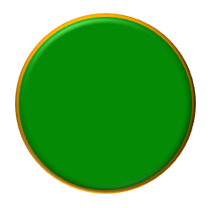

## **Pengantar**

Di PowerPoint, Anda dapat menambahkan bentuk ke slide. Karena bentuk terdiri dari garis, Anda dapat memformatnya dengan memodifikasi atau menerapkan efek pada kontur mereka. Selain itu, Anda dapat memformat bentuk dengan menentukan pengaturan yang mengontrol bagaimana interiornya diisi.


Aspose.Slides untuk .NET menyediakan antarmuka dan properti yang memungkinkan Anda memformat bentuk menggunakan opsi yang sama seperti yang tersedia di PowerPoint.

## **Format Garis**

Dengan menggunakan Aspose.Slides, Anda dapat menentukan gaya garis khusus untuk sebuah bentuk. Langkah-langkah berikut menjelaskan prosedurnya:

1. Buat sebuah instance dari kelas [Presentation](https://reference.aspose.com/slides/net/aspose.slides/presentation/).
2. Dapatkan referensi ke slide berdasarkan indeksnya.
3. Tambahkan sebuah [IAutoShape](https://reference.aspose.com/slides/net/aspose.slides/iautoshape/) ke slide.
4. Atur [line style](https://reference.aspose.com/slides/net/aspose.slides/linestyle/) bentuk tersebut.
5. Atur lebar garis.
6. Atur [dash style](https://reference.aspose.com/slides/net/aspose.slides/linedashstyle/) garis.
7. Atur warna garis untuk bentuk.
8. Simpan presentasi yang dimodifikasi sebagai file PPTX.

Kode C# berikut menunjukkan cara memformat sebuah `AutoShape` persegi panjang:

```c#
using System.Drawing;
using Aspose.Slides;
using Aspose.Slides.Export;

// Buat instance kelas Presentation yang mewakili file presentasi.
using (Presentation presentation = new Presentation())
{
    // Dapatkan slide pertama.
    ISlide slide = presentation.Slides[0];

    // Tambahkan auto shape tipe Rectangle.
    IAutoShape shape = slide.Shapes.AddAutoShape(ShapeType.Rectangle, 50, 50, 150, 75);

    // Atur warna isi untuk shape persegi panjang.
    shape.FillFormat.FillType = FillType.NoFill;

    // Terapkan pemformatan pada garis persegi panjang.
    shape.LineFormat.Style = LineStyle.ThickThin;
    shape.LineFormat.Width = 7;
    shape.LineFormat.DashStyle = LineDashStyle.Dash;

    // Atur warna untuk garis persegi panjang.
    shape.LineFormat.FillFormat.FillType = FillType.Solid;
    shape.LineFormat.FillFormat.SolidFillColor.Color = Color.Blue;

    // Simpan file PPTX ke disk.
    presentation.Save("formatted_lines.pptx", SaveFormat.Pptx);
}
```

Hasilnya:


## **Terapkan Efek Sketsa pada Garis Bentuk**

Efek sketsa membuat garis bentuk terlihat seperti digambar tangan. Gunakan [IShape.LineFormat](https://reference.aspose.com/slides/net/aspose.slides/ishape/lineformat/) untuk mengakses pengaturan garis, [ILineFormat.SketchFormat](https://reference.aspose.com/slides/net/aspose.slides/ilineformat/sketchformat/) untuk mengakses pengaturan sketsa, dan [ISketchFormat.SketchType](https://reference.aspose.com/slides/net/aspose.slides/isketchformat/sketchtype/) untuk memilih nilai dari enumerasi [LineSketchType](https://reference.aspose.com/slides/net/aspose.slides/linesketchtype/).

Kode C# berikut menunjukkan cara menerapkan efek [LineSketchType.Curved](https://reference.aspose.com/slides/net/aspose.slides/linesketchtype/), membaca nilai yang ditetapkan secara eksplisit, dan menghapus efek dengan [LineSketchType.None](https://reference.aspose.com/slides/net/aspose.slides/linesketchtype/):

```csharp
using Aspose.Slides;

using var presentation = new Presentation();

var slide = presentation.Slides[0];
var shape = slide.Shapes.AddAutoShape(ShapeType.Rectangle, 50, 50, 200, 100);

// Access the shape's line format and its sketch format.
var sketchFormat = shape.LineFormat.SketchFormat;

// Apply a sketch effect.
sketchFormat.SketchType = LineSketchType.Curved;

// Read the sketch effect assigned directly to the shape.
var explicitSketchType = sketchFormat.SketchType;
Console.WriteLine($"Explicit sketch type: {explicitSketchType}");

// Remove the sketch effect.
sketchFormat.SketchType = LineSketchType.None;
```

Nilai yang dikembalikan oleh `ISketchFormat.SketchType` mewakili pengaturan yang ditetapkan langsung pada bentuk. Jika pemformatan garis dapat diwarisi dari tema, master slide, atau layout slide, gunakan [ILineFormat.GetEffective](https://reference.aspose.com/slides/net/aspose.slides/ilineformat/geteffective/), akses [ILineFormatEffectiveData.SketchFormat](https://reference.aspose.com/slides/net/aspose.slides/ilineformateffectivedata/sketchformat/), dan baca [ISketchFormatEffectiveData.SketchType](https://reference.aspose.com/slides/net/aspose.slides/isketchformateffectivedata/sketchtype/). Nilai efektif mencerminkan pemformatan yang sebenarnya diterapkan setelah pewarisan diselesaikan:

```csharp
using Aspose.Slides;

using var presentation = new Presentation("presentation.pptx");

var shape = presentation.Slides[0].Shapes[0];
var lineFormat = shape.LineFormat;

var explicitSketchType = lineFormat.SketchFormat.SketchType;
var effectiveLineFormat = lineFormat.GetEffective();
var effectiveSketchType = effectiveLineFormat.SketchFormat.SketchType;

Console.WriteLine($"Explicit sketch type: {explicitSketchType}");
Console.WriteLine($"Effective sketch type: {effectiveSketchType}");
```

## **Format Gaya Sambungan**

Berikut tiga opsi tipe sambungan:

* Bulat
* Miter
* Bevel

Secara default, ketika PowerPoint menggabungkan dua garis pada sudut (seperti pada sudut bentuk), ia menggunakan pengaturan **Bulat**. Namun, jika Anda menggambar bentuk dengan sudut tajam, Anda mungkin lebih memilih opsi **Miter**.


Kode C# berikut menunjukkan bagaimana tiga persegi panjang (seperti yang ditampilkan pada gambar di atas) dibuat menggunakan pengaturan tipe sambungan Miter, Bevel, dan Bulat:

```c#
using System.Drawing;
using Aspose.Slides;
using Aspose.Slides.Export;

// Buat instance kelas Presentation yang mewakili file presentasi.
using (Presentation presentation = new Presentation())
{
    // Dapatkan slide pertama.
    ISlide slide = presentation.Slides[0];

    // Tambahkan tiga auto shape tipe Rectangle.
    IAutoShape shape1 = slide.Shapes.AddAutoShape(ShapeType.Rectangle, 20, 20, 150, 75);
    IAutoShape shape2 = slide.Shapes.AddAutoShape(ShapeType.Rectangle, 210, 20, 150, 75);
    IAutoShape shape3 = slide.Shapes.AddAutoShape(ShapeType.Rectangle, 20, 135, 150, 75);

    // Atur warna isi untuk setiap shape persegi panjang.
    shape1.FillFormat.FillType = FillType.Solid;
    shape1.FillFormat.SolidFillColor.Color = Color.Black;
    shape2.FillFormat.FillType = FillType.Solid;
    shape2.FillFormat.SolidFillColor.Color = Color.Black;
    shape3.FillFormat.FillType = FillType.Solid;
    shape3.FillFormat.SolidFillColor.Color = Color.Black;

    // Atur lebar garis.
    shape1.LineFormat.Width = 15;
    shape2.LineFormat.Width = 15;
    shape3.LineFormat.Width = 15;

    // Atur warna untuk garis setiap persegi panjang.
    shape1.LineFormat.FillFormat.FillType = FillType.Solid;
    shape1.LineFormat.FillFormat.SolidFillColor.Color = Color.Blue;
    shape2.LineFormat.FillFormat.FillType = FillType.Solid;
    shape2.LineFormat.FillFormat.SolidFillColor.Color = Color.Blue;
    shape3.LineFormat.FillFormat.FillType = FillType.Solid;
    shape3.LineFormat.FillFormat.SolidFillColor.Color = Color.Blue;

    // Atur gaya sambungan.
    shape1.LineFormat.JoinStyle = LineJoinStyle.Miter;
    shape2.LineFormat.JoinStyle = LineJoinStyle.Bevel;
    shape3.LineFormat.JoinStyle = LineJoinStyle.Round;

    // Tambahkan teks ke setiap persegi panjang.
    shape1.TextFrame.Text = "Miter Join Style";
    shape2.TextFrame.Text = "Bevel Join Style";
    shape3.TextFrame.Text = "Round Join Style";

    // Simpan file PPTX ke disk.
    presentation.Save("join_styles.pptx", SaveFormat.Pptx);
}
```

## **Isi Gradien**

Di PowerPoint, Isi Gradien adalah opsi pemformatan yang memungkinkan Anda menerapkan perpaduan warna berkelanjutan pada sebuah bentuk. Misalnya, Anda dapat menerapkan dua atau lebih warna secara bertahap sehingga satu warna memudar menjadi warna lain.

Berikut cara menerapkan isi gradien pada sebuah bentuk menggunakan Aspose.Slides:

1. Buat sebuah instance dari kelas [Presentation](https://reference.aspose.com/slides/net/aspose.slides/presentation/).
2. Dapatkan referensi ke slide berdasarkan indeksnya.
3. Tambahkan sebuah [IAutoShape](https://reference.aspose.com/slides/net/aspose.slides/iautoshape/) ke slide.
4. Atur [FillType](https://reference.aspose.com/slides/net/aspose.slides/filltype/) bentuk ke `Gradient`.
5. Tambahkan dua warna pilihan Anda dengan posisi yang ditentukan menggunakan metode `Add` dari koleksi gradient stop yang disediakan oleh antarmuka [IGradientFormat](https://reference.aspose.com/slides/net/aspose.slides/igradientformat/).
6. Simpan presentasi yang dimodifikasi sebagai file PPTX.

```c#
using Aspose.Slides;
using Aspose.Slides.Export;

// Buat instance kelas Presentation yang mewakili file presentasi.
using (Presentation presentation = new Presentation())
{
    // Dapatkan slide pertama.
    ISlide slide = presentation.Slides[0];

    // Tambahkan auto shape tipe Ellipse.
    IAutoShape shape = slide.Shapes.AddAutoShape(ShapeType.Ellipse, 50, 50, 150, 75);

    // Terapkan pemformatan gradien pada elips.
    shape.FillFormat.FillType = FillType.Gradient;
    shape.FillFormat.GradientFormat.GradientShape = GradientShape.Linear;

    // Atur arah gradien.
    shape.FillFormat.GradientFormat.GradientDirection = GradientDirection.FromCorner2;

    // Tambahkan dua gradient stop.
    shape.FillFormat.GradientFormat.GradientStops.Add(1.0f, PresetColor.Purple);
    shape.FillFormat.GradientFormat.GradientStops.Add(0.0f, PresetColor.Red);

    // Simpan file PPTX ke disk.
    presentation.Save("gradient_fill.pptx", SaveFormat.Pptx);
}
```

Hasilnya:


Jika gradien terlihat berbeda dalam gambar yang diekspor dibandingkan dengan di PowerPoint, lihat [Choose a Gradient Rendering Style](/slides/id/net/convert-powerpoint-to-png/#choose-a-gradient-rendering-style). Anda dapat memilih gaya rendering tanpa mengubah isi gradien yang disimpan dalam presentasi.

## **Isi Pola**

Di PowerPoint, Isi Pola adalah opsi pemformatan yang memungkinkan Anda menerapkan desain dua warna—seperti titik, garis, silang, atau cek—pada sebuah bentuk. Anda dapat memilih warna khusus untuk latar depan dan latar belakang pola.

Aspose.Slides menyediakan lebih dari 45 gaya pola yang telah ditetapkan yang dapat Anda terapkan pada bentuk untuk meningkatkan daya tarik visual presentasi Anda. Bahkan setelah memilih pola yang telah ditetapkan, Anda masih dapat menentukan warna tepat yang akan digunakan.

Berikut cara menerapkan isi pola pada sebuah bentuk menggunakan Aspose.Slides:

1. Buat sebuah instance dari kelas [Presentation](https://reference.aspose.com/slides/net/aspose.slides/presentation/).
2. Dapatkan referensi ke slide berdasarkan indeksnya.
3. Tambahkan sebuah [IAutoShape](https://reference.aspose.com/slides/net/aspose.slides/iautoshape/) ke slide.
4. Atur [FillType](https://reference.aspose.com/slides/net/aspose.slides/filltype/) bentuk ke `Pattern`.
5. Pilih gaya pola dari opsi yang telah ditetapkan.
6. Atur [Background Color](https://reference.aspose.com/slides/net/aspose.slides/ipatternformat/backcolor/) pola.
7. Atur [Foreground Color](https://reference.aspose.com/slides/net/aspose.slides/ipatternformat/forecolor/) pola.
8. Simpan presentasi yang dimodifikasi sebagai file PPTX.

```c#
using System.Drawing;
using Aspose.Slides;
using Aspose.Slides.Export;

// Buat instance kelas Presentation yang mewakili file presentasi.
using (Presentation presentation = new Presentation())
{
    // Dapatkan slide pertama.
    ISlide slide = presentation.Slides[0];

    // Tambahkan auto shape tipe Rectangle.
    IAutoShape shape = slide.Shapes.AddAutoShape(ShapeType.Rectangle, 50, 50, 150, 75);

    // Atur tipe isi menjadi Pattern.
    shape.FillFormat.FillType = FillType.Pattern;

    // Atur gaya pola.
    shape.FillFormat.PatternFormat.PatternStyle = PatternStyle.Trellis;

    // Atur warna latar belakang dan latar depan pola.
    shape.FillFormat.PatternFormat.BackColor.Color = Color.LightGray;
    shape.FillFormat.PatternFormat.ForeColor.Color = Color.Yellow;

    // Simpan file PPTX ke disk.
    presentation.Save("pattern_fill.pptx", SaveFormat.Pptx);
}
```

Hasilnya:


## **Isi Gambar**

Di PowerPoint, Isi Gambar adalah opsi pemformatan yang memungkinkan Anda menyisipkan gambar di dalam sebuah bentuk—secara efektif menggunakan gambar sebagai latar belakang bentuk.

Berikut cara menggunakan Aspose.Slides untuk menerapkan isi gambar pada sebuah bentuk:

1. Buat sebuah instance dari kelas [Presentation](https://reference.aspose.com/slides/net/aspose.slides/presentation/).
2. Dapatkan referensi ke slide berdasarkan indeksnya.
3. Tambahkan sebuah [IAutoShape](https://reference.aspose.com/slides/net/aspose.slides/iautoshape/) ke slide.
4. Atur [FillType](https://reference.aspose.com/slides/net/aspose.slides/filltype/) bentuk ke `Picture`.
5. Atur mode isi gambar ke `Tile` (atau mode lain yang diinginkan).
6. Buat objek [IPPImage](https://reference.aspose.com/slides/net/aspose.slides/ippimage/) dari gambar yang ingin Anda gunakan.
7. Tetapkan gambar ini ke properti `Picture.Image` pada `PictureFillFormat` bentuk.
8. Simpan presentasi yang dimodifikasi sebagai file PPTX.

Misalkan kita memiliki file "lotus.png" dengan gambar berikut:


```c#
using Aspose.Slides;
using Aspose.Slides.Export;

// Buat instance kelas Presentation yang mewakili file presentasi.
using (Presentation presentation = new Presentation())
{
    // Dapatkan slide pertama.
    ISlide slide = presentation.Slides[0];

    // Tambahkan auto shape tipe Rectangle.
    IAutoShape shape = slide.Shapes.AddAutoShape(ShapeType.Rectangle, 50, 50, 255, 130);

    // Atur tipe isi menjadi Picture.
    shape.FillFormat.FillType = FillType.Picture;

    // Atur mode isi gambar.
    shape.FillFormat.PictureFillFormat.PictureFillMode = PictureFillMode.Tile;

    // Muat gambar dan tambahkan ke sumber daya presentasi.
    IImage image = Images.FromFile("lotus.png");
    IPPImage presentationImage = presentation.Images.AddImage(image);
    image.Dispose();

    // Atur gambar.
    shape.FillFormat.PictureFillFormat.Picture.Image = presentationImage;

    // Simpan file PPTX ke disk.
    presentation.Save("picture_fill.pptx", SaveFormat.Pptx);
}
```

Hasilnya:


### **Ubin Gambar Sebagai Tekstur**

Jika Anda ingin mengatur gambar berubin sebagai tekstur dan menyesuaikan perilaku ubin, Anda dapat menggunakan properti berikut dari antarmuka [IPictureFillFormat](https://reference.aspose.com/slides/net/aspose.slides/ipicturefillformat/) dan kelas [PictureFillFormat](https://reference.aspose.com/slides/net/aspose.slides/picturefillformat/):

- [PictureFillMode](https://reference.aspose.com/slides/net/aspose.slides/ipicturefillformat/picturefillmode/): Menetapkan mode isi gambar—baik `Tile` atau `Stretch`.
- [TileAlignment](https://reference.aspose.com/slides/net/aspose.slides/ipicturefillformat/tilealignment/): Menentukan perataan ubin di dalam bentuk.
- [TileFlip](https://reference.aspose.com/slides/net/aspose.slides/ipicturefillformat/tileflip/): Mengontrol apakah ubin dibalik secara horizontal, vertikal, atau keduanya.
- [TileOffsetX](https://reference.aspose.com/slides/net/aspose.slides/ipicturefillformat/tileoffsetx/): Menetapkan offset horizontal ubin (dalam point) dari asal bentuk.
- [TileOffsetY](https://reference.aspose.com/slides/net/aspose.slides/ipicturefillformat/tileoffsety/): Menetapkan offset vertikal ubin (dalam point) dari asal bentuk.
- [TileScaleX](https://reference.aspose.com/slides/net/aspose.slides/ipicturefillformat/tilescalex/): Mendefinisikan skala horizontal ubin sebagai persentase.
- [TileScaleY](https://reference.aspose.com/slides/net/aspose.slides/ipicturefillformat/tilescaley/): Mendefinisikan skala vertikal ubin sebagai persentase.

```c#
using Aspose.Slides;
using Aspose.Slides.Export;

// Buat instance kelas Presentation yang mewakili file presentasi.
using (Presentation presentation = new Presentation())
{
    // Dapatkan slide pertama.
    ISlide firstSlide = presentation.Slides[0];

    // Tambahkan auto shape persegi panjang.
    IAutoShape shape = firstSlide.Shapes.AddAutoShape(ShapeType.Rectangle, 50, 50, 190, 95);

    // Atur tipe isi shape menjadi Picture.
    shape.FillFormat.FillType = FillType.Picture;

    // Muat gambar dan tambahkan ke sumber daya presentasi.
    IPPImage presentationImage;
    using (IImage sourceImage = Images.FromFile("lotus.png"))
        presentationImage = presentation.Images.AddImage(sourceImage);

    // Tetapkan gambar ke shape.
    IPictureFillFormat pictureFillFormat = shape.FillFormat.PictureFillFormat;
    pictureFillFormat.Picture.Image = presentationImage;

    // Konfigurasikan mode isi gambar dan properti ubin.
    pictureFillFormat.PictureFillMode = PictureFillMode.Tile;
    pictureFillFormat.TileOffsetX = -32;
    pictureFillFormat.TileOffsetY = -32;
    pictureFillFormat.TileScaleX = 50;
    pictureFillFormat.TileScaleY = 50;
    pictureFillFormat.TileAlignment = RectangleAlignment.BottomRight;
    pictureFillFormat.TileFlip = TileFlip.FlipBoth;

    // Simpan file PPTX ke disk.
    presentation.Save("tile.pptx", SaveFormat.Pptx);
}
```

Hasilnya:


## **Isi Warna Solid**

Di PowerPoint, Isi Warna Solid adalah opsi pemformatan yang mengisi bentuk dengan satu warna seragam. Latar belakang polos ini diterapkan tanpa gradien, tekstur, atau pola apa pun.

Untuk menerapkan isi warna solid pada sebuah bentuk menggunakan Aspose.Slides, ikuti langkah-langkah berikut:

1. Buat sebuah instance dari kelas [Presentation](https://reference.aspose.com/slides/net/aspose.slides/presentation/).
2. Dapatkan referensi ke slide berdasarkan indeksnya.
3. Tambahkan sebuah [IAutoShape](https://reference.aspose.com/slides/net/aspose.slides/iautoshape/) ke slide.
4. Atur [FillType](https://reference.aspose.com/slides/net/aspose.slides/filltype/) bentuk ke `Solid`.
5. Tetapkan warna isi pilihan Anda ke bentuk.
6. Simpan presentasi yang dimodifikasi sebagai file PPTX.

```c#
using System.Drawing;
using Aspose.Slides;
using Aspose.Slides.Export;

// Buat instance kelas Presentation yang mewakili file presentasi.
using (Presentation presentation = new Presentation())
{
    // Dapatkan slide pertama.
    ISlide slide = presentation.Slides[0];

    // Tambahkan auto shape tipe Rectangle.
    IAutoShape shape = slide.Shapes.AddAutoShape(ShapeType.Rectangle, 50, 50, 150, 75);

    // Atur tipe isi menjadi Solid.
    shape.FillFormat.FillType = FillType.Solid;

    // Atur warna isi.
    shape.FillFormat.SolidFillColor.Color = Color.Yellow;

    // Simpan file PPTX ke disk.
    presentation.Save("solid_color_fill.pptx", SaveFormat.Pptx);
}
```

Hasilnya:


## **Atur Transparansi**

Di PowerPoint, ketika Anda menerapkan isi warna solid, gradien, gambar, atau tekstur pada bentuk, Anda juga dapat mengatur tingkat transparansi untuk mengontrol opasitas isi. Nilai transparansi yang lebih tinggi membuat bentuk lebih tembus pandang, memungkinkan latar belakang atau objek di bawahnya terlihat sebagian.

Aspose.Slides memungkinkan Anda mengatur tingkat transparansi dengan menyesuaikan nilai alfa dalam warna yang digunakan untuk isi. Berikut caranya:

1. Buat sebuah instance dari kelas [Presentation](https://reference.aspose.com/slides/net/aspose.slides/presentation/).
2. Dapatkan referensi ke slide berdasarkan indeksnya.
3. Tambahkan sebuah [IAutoShape](https://reference.aspose.com/slides/net/aspose.slides/iautoshape/) ke slide.
4. Atur [FillType](https://reference.aspose.com/slides/net/aspose.slides/filltype/) ke `Solid`.
5. Gunakan `Color.FromArgb(alpha, baseColor)` untuk mendefinisikan warna dengan transparansi (komponen `alpha` mengontrol transparansi).
6. Simpan presentasi.

```c#
using System.Drawing;
using Aspose.Slides;
using Aspose.Slides.Export;

const int alpha = 128;

// Buat instance kelas Presentation yang mewakili file presentasi.
using (Presentation presentation = new Presentation())
{
    // Dapatkan slide pertama.
    ISlide slide = presentation.Slides[0];

    // Tambahkan auto shape persegi panjang solid.
    IAutoShape solidShape = slide.Shapes.AddAutoShape(ShapeType.Rectangle, 50, 50, 150, 75);

    // Tambahkan auto shape persegi panjang transparan di atas shape solid.
    IAutoShape transparentShape = slide.Shapes.AddAutoShape(ShapeType.Rectangle, 80, 80, 150, 75);
    transparentShape.FillFormat.FillType = FillType.Solid;
    transparentShape.FillFormat.SolidFillColor.Color = Color.FromArgb(alpha, Color.Yellow);

    // Simpan file PPTX ke disk.
    presentation.Save("shape_transparency.pptx", SaveFormat.Pptx);
}
```

Hasilnya:


## **Putar Bentuk**

Aspose.Slides memungkinkan Anda memutar bentuk dalam presentasi PowerPoint. Ini dapat berguna saat menempatkan elemen visual dengan kebutuhan penyelarasan atau desain tertentu.

Untuk memutar sebuah bentuk pada slide, ikuti langkah-langkah berikut:

1. Buat sebuah instance dari kelas [Presentation](https://reference.aspose.com/slides/net/aspose.slides/presentation/).
2. Dapatkan referensi ke slide berdasarkan indeksnya.
3. Tambahkan sebuah [IAutoShape](https://reference.aspose.com/slides/net/aspose.slides/iautoshape/) ke slide.
4. Atur properti `Rotation` bentuk ke sudut yang diinginkan.
5. Simpan presentasi.

```c#
using Aspose.Slides;
using Aspose.Slides.Export;

// Buat instance kelas Presentation yang mewakili file presentasi.
using (Presentation presentation = new Presentation())
{
    // Dapatkan slide pertama.
    ISlide slide = presentation.Slides[0];

    // Tambahkan auto shape tipe Rectangle.
    IAutoShape shape = slide.Shapes.AddAutoShape(ShapeType.Rectangle, 50, 50, 150, 75);

    // Putar shape sebesar 5 derajat.
    shape.Rotation = 5;

    // Simpan file PPTX ke disk.
    presentation.Save("shape_rotation.pptx", SaveFormat.Pptx);
}
```

Hasilnya:


## **Tambahkan Efek Bevel 3D**

Aspose.Slides memungkinkan Anda menerapkan efek bevel 3D pada bentuk dengan mengonfigurasi properti [ThreeDFormat](https://reference.aspose.com/slides/net/aspose.slides/threedformat/) mereka.

Untuk menambahkan efek bevel 3D pada sebuah bentuk, ikuti langkah-langkah berikut:

1. Instansiasi kelas [Presentation](https://reference.aspose.com/slides/net/aspose.slides/presentation/).
2. Dapatkan referensi ke slide berdasarkan indeksnya.
3. Tambahkan sebuah [IAutoShape](https://reference.aspose.com/slides/net/aspose.slides/iautoshape/) ke slide.
4. Konfigurasikan [ThreeDFormat](https://reference.aspose.com/slides/net/aspose.slides/threedformat/) bentuk untuk mendefinisikan pengaturan bevel.
5. Simpan presentasi.

```c#
using System.Drawing;
using Aspose.Slides;
using Aspose.Slides.Export;

// Buat instance kelas Presentation.
using (Presentation presentation = new Presentation())
{
    ISlide slide = presentation.Slides[0];

    // Tambahkan bentuk ke slide.
    IAutoShape shape = slide.Shapes.AddAutoShape(ShapeType.Ellipse, 50, 50, 100, 100);
    shape.FillFormat.FillType = FillType.Solid;
    shape.FillFormat.SolidFillColor.Color = Color.Green;
    shape.LineFormat.FillFormat.FillType = FillType.Solid;
    shape.LineFormat.FillFormat.SolidFillColor.Color = Color.Orange;
    shape.LineFormat.Width = 2.0;

    // Atur properti ThreeDFormat bentuk.
    shape.ThreeDFormat.Depth = 4;
    shape.ThreeDFormat.BevelTop.BevelType = BevelPresetType.Circle;
    shape.ThreeDFormat.BevelTop.Height = 6;
    shape.ThreeDFormat.BevelTop.Width = 6;
    shape.ThreeDFormat.Camera.CameraType = CameraPresetType.OrthographicFront;
    shape.ThreeDFormat.LightRig.LightType = LightRigPresetType.ThreePt;
    shape.ThreeDFormat.LightRig.Direction = LightingDirection.Top;

    // Simpan presentasi sebagai file PPTX.
    presentation.Save("3D_bevel_effect.pptx", SaveFormat.Pptx);
}
```

Hasilnya:



## **Tambahkan Efek Rotasi 3D**

Aspose.Slides memungkinkan Anda menerapkan efek rotasi 3D pada bentuk dengan mengonfigurasi properti [ThreeDFormat](https://reference.aspose.com/slides/net/aspose.slides/threedformat/) mereka.

Untuk menerapkan rotasi 3D pada sebuah bentuk:

1. Buat sebuah instance dari kelas [Presentation](https://reference.aspose.com/slides/net/aspose.slides/presentation/).
2. Dapatkan referensi ke slide berdasarkan indeksnya.
3. Tambahkan sebuah [IAutoShape](https://reference.aspose.com/slides/net/aspose.slides/iautoshape/) ke slide.
4. Atur [CameraType](https://reference.aspose.com/slides/net/aspose.slides/icamera/cameratype/) dan [LightType](https://reference.aspose.com/slides/net/aspose.slides/ilightrig/lighttype/) bentuk untuk mendefinisikan rotasi 3D.
5. Simpan presentasi.

```c#
using Aspose.Slides;
using Aspose.Slides.Export;

// Buat instance kelas Presentation.
using (Presentation presentation = new Presentation())
{
    ISlide slide = presentation.Slides[0];

    IAutoShape autoShape = slide.Shapes.AddAutoShape(ShapeType.Rectangle, 50, 50, 150, 75);
    autoShape.TextFrame.Text = "Hello, Aspose!";

    autoShape.ThreeDFormat.Camera.SetRotation(40, 35, 20);
    autoShape.ThreeDFormat.Camera.CameraType = CameraPresetType.IsometricLeftUp;
    autoShape.ThreeDFormat.LightRig.LightType = LightRigPresetType.Balanced;

    // Simpan presentasi sebagai file PPTX.
    presentation.Save("3D_rotation_effect.pptx", SaveFormat.Pptx);
}
```

Hasilnya:


## **Kontrol Rendering Hitam-putih untuk Bentuk**

Properti [IShape.BlackWhiteMode](https://reference.aspose.com/slides/net/aspose.slides/ishape/blackwhitemode/) menentukan bagaimana sebuah bentuk individu dirender ketika presentasi dilihat atau diproses dalam mode hitam-putih. Properti ini tidak mengaktifkan tampilan hitam-putih sendiri, dan tidak mengubah isi, garis, atau pemformatan lain bentuk dalam mode warna normal.

Gunakan nilai dari enumerasi [BlackWhiteMode](https://reference.aspose.com/slides/net/aspose.slides/blackwhitemode/) untuk memilih perilaku yang diinginkan. Misalnya, `Automatic` memungkinkan aplikasi rendering memilih konversi, `Gray` dan `LightGray` menggunakan warna abu‑abu, `BlackWhite` hanya menggunakan hitam dan putih, `Black` dan `White` memaksa satu warna, `Color` mempertahankan warna normal, dan `Hidden` mengecualikan bentuk dalam mode hitam‑putih. `NotDefined` berarti tidak ada mode tingkat bentuk yang ditetapkan.

```csharp
using System.Drawing;
using Aspose.Slides;
using Aspose.Slides.Export;

using var presentation = new Presentation();
var slide = presentation.Slides[0];

var shape = slide.Shapes.AddAutoShape(ShapeType.Rectangle, 50, 50, 200, 100);
shape.FillFormat.FillType = FillType.Solid;
shape.FillFormat.SolidFillColor.Color = Color.Orange;

// Pertahankan isi oranye pada mode warna, tetapi render bentuk dengan warna abu-abu pada mode hitam-putih.
shape.BlackWhiteMode = BlackWhiteMode.Gray;

presentation.Save("shape_black_white_mode.pptx", SaveFormat.Pptx);
```

Dalam mode warna normal, persegi panjang mempertahankan isian oranye. Dalam alur kerja tampilan hitam‑putih, ia menggunakan warna abu‑abu karena mode diatur ke `Gray`. Ini memungkinkan Anda mempertahankan slide berwarna penuh sambil menentukan penampilan khusus untuk pencetakan, pratinjau, atau alur kerja lain yang menghormati pengaturan tampilan hitam‑putih presentasi.

## **Atur Ulang Pemformatan**

Kode C# berikut menunjukkan cara mengatur ulang pemformatan slide dan mengembalikan posisi, ukuran, serta pemformatan semua bentuk dengan placeholder pada [LayoutSlide](https://reference.aspose.com/slides/net/aspose.slides/layoutslide/) ke pengaturan default mereka:

```c#
using Aspose.Slides;
using Aspose.Slides.Export;

using (Presentation presentation = new Presentation("sample.pptx"))
{
    foreach (ISlide slide in presentation.Slides)
    {
        // Atur ulang setiap shape pada slide yang memiliki placeholder pada tata letak.
        slide.Reset();
    }

    presentation.Save("reset_formatting.pptx", SaveFormat.Pptx);
}
```

## **FAQ**

**Apakah pemformatan bentuk mempengaruhi ukuran file presentasi akhir?**

Hanya secara minimal. Gambar dan media yang disematkan menempati sebagian besar ruang file, sementara parameter bentuk seperti warna, efek, dan gradien disimpan sebagai metadata dan hampir tidak menambah ukuran.

**Bagaimana saya dapat mendeteksi bentuk pada slide yang memiliki pemformatan identik sehingga saya dapat mengelompokkannya?**

Bandingkan setiap properti pemformatan utama bentuk—isi, garis, dan pengaturan efek. Jika semua nilai yang bersesuaian cocok, perlakukan gaya mereka sebagai identik dan kelompokkan secara logis bentuk‑bentuk tersebut, yang menyederhanakan manajemen gaya di kemudian hari.

**Apakah saya dapat menyimpan sekumpulan gaya bentuk khusus ke file terpisah untuk digunakan kembali dalam presentasi lain?**

Ya. Simpan contoh bentuk dengan gaya yang diinginkan dalam deck slide templat atau file templat .POTX. Saat membuat presentasi baru, buka templat tersebut, kloning bentuk ber‑gaya yang diperlukan, dan terapkan kembali pemformatannya di mana diperlukan.