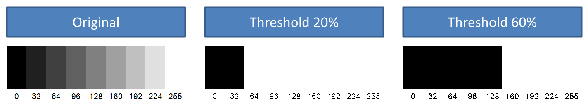

## **Ikhtisar**

Aspose.Slides merepresentasikan penyesuaian gambar sebagai kumpulan terurut operasi transformasi gambar. Untuk sebuah bingkai gambar, mulai dengan [Picture](https://reference.aspose.com/slides/nodejs-java/aspose.slides/picture/) bingkai lalu akses [Picture.getImageTransform](https://reference.aspose.com/slides/nodejs-java/aspose.slides/picture/). [ImageTransformOperationCollection](https://reference.aspose.com/slides/nodejs-java/aspose.slides/imagetransformoperationcollection/) yang dikembalikan memungkinkan Anda menambahkan, menelusuri, memeriksa, menghapus, dan membersihkan efek tanpa menulis ulang byte gambar asli.

Artikel ini mendemonstrasikan alur kerja lengkap untuk kecerahan dan kontras, transformasi warna, blur, transparansi, rantai efek berurutan, nilai efektif, penghapusan, dan verifikasi putar‑balik PPTX.

## **Memahami Kepemilikan Efek dan Penggunaan Ulang Gambar**

Sebuah sumber gambar dan gambar yang menampilkannya adalah objek yang berbeda:

- [PPImage](https://reference.aspose.com/slides/nodejs-java/aspose.slides/ppimage/) menyimpan atau merujuk data gambar sumber yang dimiliki oleh presentasi.
- [Picture](https://reference.aspose.com/slides/nodejs-java/aspose.slides/picture/) milik pengisian gambar dan merujuk ke sumber gambar sambil menyimpan koleksi transformasi gambar.
- [PictureFrame](https://reference.aspose.com/slides/nodejs-java/aspose.slides/pictureframe/) adalah bentuk slide yang memiliki pengisian gambar yang relevan, geometri, pengaturan pemotongan, dan format level bingkai lainnya.

Oleh karena itu, operasi transformasi gambar tidak memodifikasi byte dalam [PPImage](https://reference.aspose.com/slides/nodejs-java/aspose.slides/ppimage/). Ketika [PPImage](https://reference.aspose.com/slides/nodejs-java/aspose.slides/ppimage/) yang sama diteruskan ke [ShapeCollection.addPictureFrame](https://reference.aspose.com/slides/nodejs-java/aspose.slides/shapecollection/) lebih dari satu kali, setiap bingkai gambar baru menerima [Picture](https://reference.aspose.com/slides/nodejs-java/aspose.slides/picture/) miliknya sendiri dan koleksi transformasinya masing‑masing. Menerapkan grayscale pada satu bingkai tidak membuat bingkai lain menjadi grayscale, meskipun semuanya menggunakan kembali sumber gambar tersemat yang sama.

Model [Picture.getImageTransform](https://reference.aspose.com/slides/nodejs-java/aspose.slides/picture/) yang sama juga digunakan oleh pengisian gambar lainnya, seperti bentuk atau latar belakang slide. Contoh di bawah ini berfokus pada bingkai gambar.

## **Gunakan Rentang Parameter dan Satuan yang Valid**

Metode yang didemonstrasikan menggunakan rentang semantik dan satuan berikut. Simpan nilai dalam rentang ini meskipun versi pustaka tertentu tidak menolak setiap nilai di luar rentang secara langsung; format presentasi target mungkin menormalkan, menghilangkan, atau menolak data tidak valid saat menyimpan atau ketika PowerPoint membuka berkas.

| Operasi | Parameter | Rentang dan satuan yang valid |
|---|---|---|
| [addBrightnessContrastEffect](https://reference.aspose.com/slides/nodejs-java/aspose.slides/imagetransformoperationcollection/) | `brightness`, `contrast` | `-100` hingga `100`, persen; `0` membiarkan komponen tidak berubah. |
| [addGrayScaleEffect](https://reference.aspose.com/slides/nodejs-java/aspose.slides/imagetransformoperationcollection/) | None | Tidak ada parameter numerik. Alfa tidak berubah. |
| [addDuotoneEffect](https://reference.aspose.com/slides/nodejs-java/aspose.slides/imagetransformoperationcollection/) | `color1`, `color2` | Dua warna untuk piksel gelap dan terang. Kanal RGB dan alfa dalam `java.awt.Color` menggunakan `0` hingga `255`. |
| [addTintEffect](https://reference.aspose.com/slides/nodejs-java/aspose.slides/imagetransformoperationcollection/) | `hue`, `amount` | Hue `0` inklusif hingga `360` eksklusif, dalam derajat; amount `-100` hingga `100`, persen. |
| [addHSLEffect](https://reference.aspose.com/slides/nodejs-java/aspose.slides/imagetransformoperationcollection/) | `hue`, `saturation`, `luminance` | Hue `0` inklusif hingga `360` eksklusif, dalam derajat; saturasi dan luminansi `-100` hingga `100`, persen. |
| [addColorReplaceEffect](https://reference.aspose.com/slides/nodejs-java/aspose.slides/imagetransformoperationcollection/) | `color` | Warna pengganti menggunakan nilai kanal dari `0` hingga `255`. Nilai alfa yang ada tidak berubah. |
| [addBlurEffect](https://reference.aspose.com/slides/nodejs-java/aspose.slides/imagetransformoperationcollection/) | `radius`, `grow` | Radius tidak negatif dan diukur dalam point; `grow` adalah Boolean yang mengontrol apakah konten blur dapat meluas di luar batas asli. |
| [addAlphaModulateFixedEffect](https://reference.aspose.com/slides/nodejs-java/aspose.slides/imagetransformoperationcollection/) | `amount` | Persen tidak negatif. Gunakan `0` hingga `100` untuk skala opasitas biasa: `0` sepenuhnya transparan dan `100` mempertahankan alfa yang ada. |
| [addAlphaReplaceEffect](https://reference.aspose.com/slides/nodejs-java/aspose.slides/imagetransformoperationcollection/) | `alpha` | `0` hingga `100`, persen opasitas. |
| [addAlphaBiLevelEffect](https://reference.aspose.com/slides/nodejs-java/aspose.slides/imagetransformoperationcollection/) | `threshold` | `0` hingga `100`, persen ambang alfa. Nilai di bawahnya menjadi transparan; nilai pada atau di atasnya menjadi opaque. |

Untuk modulasi alfa tetap, transparansi dan opasitas bersifat komplementer. Misalnya, transparansi 35 % bersesuaian dengan modulasi alfa 65 %.

## **Terapkan Kecerahan dan Kontras**

[ImageTransformOperationCollection.addBrightnessContrastEffect](https://reference.aspose.com/slides/nodejs-java/aspose.slides/imagetransformoperationcollection/) mengembalikan operasi [BrightnessContrast](https://reference.aspose.com/slides/nodejs-java/aspose.slides/brightnesscontrast/). Pengaturan skalar disediakan saat operasi dibuat. [BrightnessContrast.getEffective](https://reference.aspose.com/slides/nodejs-java/aspose.slides/brightnesscontrast/) mengembalikan nilai baca‑saja yang dihitung yang dapat diperiksa atau dicatat.

Contoh berikut meningkatkan kecerahan sebesar 15 % dan kontras sebesar 20 %, lalu menampilkan pratinjau tanpa mengubah gambar tersemat:

```javascript
const aspose = {};
aspose.slides = require("aspose.slides.via.java");

const presentation = new aspose.slides.Presentation();
try {
    const slide = presentation.getSlides().get_Item(0);

    let image;
    const sourceImage = aspose.slides.Images.fromFile("photo.png");
    try {
        image = presentation.getImages().addImage(sourceImage);
    } finally {
        sourceImage.dispose();
    }

    const pictureFrame = slide.getShapes().addPictureFrame(aspose.slides.ShapeType.Rectangle, 50, 50, 400, 260, image);
    const imageTransform = pictureFrame.getPictureFormat().getPicture().getImageTransform();
    const brightnessContrast = imageTransform.addBrightnessContrastEffect(15, 20);

    const effectiveValues = brightnessContrast.getEffective();
    console.log("Brightness: " + effectiveValues.getBrightness() + "%");
    console.log("Contrast: " + effectiveValues.getContrast() + "%");

    const preview = slide.getImage();
    try {
        preview.save("brightness-contrast-preview.png", aspose.slides.ImageFormat.Png);
    } finally {
        preview.dispose();
    }
} finally {
    presentation.dispose();
}
```

[BrightnessContrast](https://reference.aspose.com/slides/nodejs-java/aspose.slides/brightnesscontrast/) adalah ekstensi efek gambar Office 2010 dan kurang portabel dibandingkan efek luminansi DrawingML standar. Ketika kecerahan dan kontras harus tetap dapat diedit setelah putar‑balik PPTX, gunakan [ImageTransformOperationCollection.addLuminanceEffect](https://reference.aspose.com/slides/nodejs-java/aspose.slides/imagetransformoperationcollection/) dan verifikasi hasil setelah membuka kembali berkas. Bagian batasan format menjelaskan perbedaan ini secara lebih rinci.

## **Terapkan Transformasi Warna**

Efek warna dapat diterapkan secara independen pada bingkai gambar yang menggunakan satu sumber gambar. Contoh berikut membuat lima bingkai dan menerapkan grayscale, duotone, tint, penyesuaian HSL, serta penggantian warna.

[Duotone](https://reference.aspose.com/slides/nodejs-java/aspose.slides/duotone/) memiliki dua parameter warna yang dapat diedit secara terpisah: `color1` memetakan piksel gelap, sementara `color2` memetakan piksel terang. Ini menjadikannya contoh yang berguna untuk efek yang pengaturannya lebih kompleks daripada satu nilai skalar.

```javascript
const aspose = {};
aspose.slides = require("aspose.slides.via.java");
const java = require("java");

const presentation = new aspose.slides.Presentation();
try {
    const slide = presentation.getSlides().get_Item(0);

    let image;
    const sourceImage = aspose.slides.Images.fromFile("photo.png");
    try {
        image = presentation.getImages().addImage(sourceImage);
    } finally {
        sourceImage.dispose();
    }

    const grayFrame = slide.getShapes().addPictureFrame(aspose.slides.ShapeType.Rectangle, 20, 20, 180, 120, image);
    grayFrame.getPictureFormat().getPicture().getImageTransform().addGrayScaleEffect();

    const duotoneFrame = slide.getShapes().addPictureFrame(aspose.slides.ShapeType.Rectangle, 220, 20, 180, 120, image);
    const duotone = duotoneFrame.getPictureFormat().getPicture().getImageTransform().addDuotoneEffect();
    duotone.getColor1().setColor(java.newInstanceSync("java.awt.Color", 0, 0, 128));
    duotone.getColor2().setColor(java.newInstanceSync("java.awt.Color", 255, 215, 0));

    const tintFrame = slide.getShapes().addPictureFrame(aspose.slides.ShapeType.Rectangle, 420, 20, 180, 120, image);
    tintFrame.getPictureFormat().getPicture().getImageTransform().addTintEffect(210, 35);

    const hslFrame = slide.getShapes().addPictureFrame(aspose.slides.ShapeType.Rectangle, 120, 170, 180, 120, image);
    hslFrame.getPictureFormat().getPicture().getImageTransform().addHSLEffect(30, 20, -10);

    const replacementFrame = slide.getShapes().addPictureFrame(aspose.slides.ShapeType.Rectangle, 320, 170, 180, 120, image);
    const colorReplacement = replacementFrame.getPictureFormat().getPicture().getImageTransform().addColorReplaceEffect();
    colorReplacement.getColor().setColor(java.newInstanceSync("java.awt.Color", 100, 149, 237));

    presentation.save("color-transformations.pptx", aspose.slides.SaveFormat.Pptx);
} finally {
    presentation.dispose();
}
```

[addColorReplaceEffect](https://reference.aspose.com/slides/nodejs-java/aspose.slides/imagetransformoperationcollection/) mengganti setiap warna piksel dengan satu warna tetap sambil mempertahankan alfa. Ini berbeda dari [addColorChangeEffect](https://reference.aspose.com/slides/nodejs-java/aspose.slides/imagetransformoperationcollection/), yang memetakan satu warna sumber ke warna lain dan mengekspose format warna sumber dan target.

### **Terapkan Ambang Luminansi**

Ambang luminansi dapat membuat goresan samar pada halaman yang dipindai lebih mudah dibedakan dari latar belakang. [addGrayScaleEffect](https://reference.aspose.com/slides/nodejs-java/aspose.slides/imagetransformoperationcollection/) mempertahankan nuansa abu‑abu menengah. [addBiLevelEffect](https://reference.aspose.com/slides/nodejs-java/aspose.slides/imagetransformoperationcollection/) memetakan luminansi ke hitam atau putih, sementara [addAlphaBiLevelEffect](https://reference.aspose.com/slides/nodejs-java/aspose.slides/imagetransformoperationcollection/) menerapkan ambang pada opasitas.

Ambang luminansi berkisar dari 0 % hingga 100 %, inklusif. Piksel di bawah ambang menjadi hitam. Piksel pada atau di atas ambang menjadi putih. Meningkatkan ambang mengubah lebih banyak nuansa menjadi hitam karena lebih banyak di antaranya berada di bawah batas.

Unduh [grayscale-swatches.png](grayscale-swatches.png) ke direktori kerja. Setiap label memberikan tingkat abu‑abu asli pada skala 0 hingga 255. Contoh menempatkan asli di sebelah dua salinan dan menyimpan ambang masing‑masing salinan dalam presentasi.

```javascript
const slides = require("aspose.slides.via.java");

const presentation = new slides.Presentation();
try {
    presentation.getSlideSize().setSize(720, 150, slides.SlideSizeScaleType.DoNotScale);
    const shapes = presentation.getSlides().get_Item(0).getShapes();

    const sourceImage = slides.Images.fromFile("grayscale-swatches.png");
    let image;
    try {
        image = presentation.getImages().addImage(sourceImage);
    } finally {
        sourceImage.dispose();
    }

    const captions = ["Original", "Threshold 20%", "Threshold 60%"];
    const frames = [];
    for (let i = 0; i < captions.length; i++) {
        const x = 12 + 240 * i;
        const label = shapes.addAutoShape(slides.ShapeType.Rectangle, x, 12, 216, 36);
        label.getTextFrame().setText(captions[i]);
        const frame = shapes.addPictureFrame(slides.ShapeType.Rectangle, x, 60, 216, 72, image);
        frames.push(frame);
    }

    frames[1].getPictureFormat().getPicture().getImageTransform().addBiLevelEffect(20);
    frames[2].getPictureFormat().getPicture().getImageTransform().addBiLevelEffect(60);
    
    presentation.save("luminance-threshold.pptx", slides.SaveFormat.Pptx);
} finally {
    presentation.dispose();
}
```

Buka presentasi output di PowerPoint untuk membandingkan tiga bingkai. Swatch yang diberi label 96 memiliki luminansi sekitar 38 % (96 dari 255). Swatch ini menjadi putih pada ambang 20 % dan hitam pada ambang 60 %.



## **Tambahkan Blur, Transparansi, dan Efek Alpha**

[addBlurEffect](https://reference.aspose.com/slides/nodejs-java/aspose.slides/imagetransformoperationcollection/) memengaruhi semua kanal warna, termasuk alfa. Atur `grow` ke `true` ketika tepi blur dapat meluas di luar batas gambar asli.

Untuk transparansi seragam, gunakan [addAlphaModulateFixedEffect](https://reference.aspose.com/slides/nodejs-java/aspose.slides/imagetransformoperationcollection/). Ia mengalikan setiap nilai alfa yang ada, sehingga piksel semi‑transparan tetap berbeda secara proporsional. [addAlphaReplaceEffect](https://reference.aspose.com/slides/nodejs-java/aspose.slides/imagetransformoperationcollection/) malah menetapkan satu nilai alfa untuk semua piksel. [addAlphaBiLevelEffect](https://reference.aspose.com/slides/nodejs-java/aspose.slides/imagetransformoperationcollection/) mengubah alfa menjadi dua tingkat berdasarkan ambang.

```javascript
const aspose = {};
aspose.slides = require("aspose.slides.via.java");

const presentation = new aspose.slides.Presentation();
try {
    const slide = presentation.getSlides().get_Item(0);

    let image;
    const sourceImage = aspose.slides.Images.fromFile("photo.png");
    try {
        image = presentation.getImages().addImage(sourceImage);
    } finally {
        sourceImage.dispose();
    }

    const blurredFrame = slide.getShapes().addPictureFrame(aspose.slides.ShapeType.Rectangle, 20, 20, 200, 140, image);
    const blur = blurredFrame.getPictureFormat().getPicture().getImageTransform().addBlurEffect(4.5, true);
    blur.setRadius(5);

    const transparentFrame = slide.getShapes().addPictureFrame(aspose.slides.ShapeType.Rectangle, 240, 20, 200, 140, image);
    const alphaModulate = transparentFrame.getPictureFormat().getPicture().getImageTransform().addAlphaModulateFixedEffect(65);
    alphaModulate.setAmount(60);

    const uniformAlphaFrame = slide.getShapes().addPictureFrame(aspose.slides.ShapeType.Rectangle, 20, 180, 200, 140, image);
    uniformAlphaFrame.getPictureFormat().getPicture().getImageTransform().addAlphaReplaceEffect(55);

    const binaryAlphaFrame = slide.getShapes().addPictureFrame(aspose.slides.ShapeType.Rectangle, 240, 180, 200, 140, image);
    const alphaBiLevel = binaryAlphaFrame.getPictureFormat().getPicture().getImageTransform().addAlphaBiLevelEffect(50);
    alphaBiLevel.setThreshold(45);
    binaryAlphaFrame.getPictureFormat().getPicture().getImageTransform().addAlphaInverseEffect();

    presentation.save("blur-and-alpha-effects.pptx", aspose.slides.SaveFormat.Pptx);
} finally {
    presentation.dispose();
}
```

Operasi alfa tanpa parameter lainnya meliputi [addAlphaCeilingEffect](https://reference.aspose.com/slides/nodejs-java/aspose.slides/imagetransformoperationcollection/), yang membuat setiap alfa non‑nol sepenuhnya opaque; [addAlphaFloorEffect](https://reference.aspose.com/slides/nodejs-java/aspose.slides/imagetransformoperationcollection/), yang membuat setiap alfa di bawah 100 % sepenuhnya transparan; dan [addAlphaInverseEffect](https://reference.aspose.com/slides/nodejs-java/aspose.slides/imagetransformoperationcollection/), yang mengubah alfa menjadi `100% - alpha`.

## **Bangun Rantai Efek Berurutan**

Setiap metode `add...Effect` menambahkan operasi baru ke akhir koleksi. Renderer menggunakan koleksi sebagai pipeline berurutan: output operasi 0 menjadi input operasi 1, dan seterusnya. Akibatnya, operasi yang sama dalam urutan berbeda dapat menghasilkan gambar yang berbeda.

Sebagai contoh, grayscale diikuti tint pertama‑tama menghapus informasi kromatik lalu mewarnai kembali hasil luminansi. Tint diikuti grayscale menghapus tint kembali. Demikian pula, penggantian alfa dapat menimpa nilai alfa yang dihitung oleh operasi sebelumnya, sedangkan modulasi alfa mempertahankan perbedaan relatifnya.

Contoh berikut membangun rantai empat operasi, menyimpannya sebagai PPTX, membuka kembali presentasi, memeriksa tipe operasi serta urutannya, dan merender hasil yang dibuka kembali:

```javascript
const aspose = {};
aspose.slides = require("aspose.slides.via.java");
const java = require("java");

const presentation = new aspose.slides.Presentation();
try {
    const slide = presentation.getSlides().get_Item(0);

    let image;
    const sourceImage = aspose.slides.Images.fromFile("photo.png");
    try {
        image = presentation.getImages().addImage(sourceImage);
    } finally {
        sourceImage.dispose();
    }

    const pictureFrame = slide.getShapes().addPictureFrame(aspose.slides.ShapeType.Rectangle, 50, 50, 400, 260, image);
    const imageTransform = pictureFrame.getPictureFormat().getPicture().getImageTransform();
    imageTransform.addGrayScaleEffect();
    imageTransform.addTintEffect(220, 25);
    imageTransform.addBlurEffect(2.5, false);
    imageTransform.addAlphaModulateFixedEffect(80);

    presentation.save("image-transform-chain.pptx", aspose.slides.SaveFormat.Pptx);
} finally {
    presentation.dispose();
}

const reopenedPresentation = new aspose.slides.Presentation("image-transform-chain.pptx");
try {
    const reopenedShape = reopenedPresentation.getSlides().get_Item(0).getShapes().get_Item(0);

    if (java.instanceOf(reopenedShape, "com.aspose.slides.IPictureFrame")) {
        const reopenedTransform = reopenedShape.getPictureFormat().getPicture().getImageTransform();
        const orderIsPreserved = reopenedTransform.size() === 4 &&
            java.instanceOf(reopenedTransform.get_Item(0), "com.aspose.slides.IGrayScale") &&
            java.instanceOf(reopenedTransform.get_Item(1), "com.aspose.slides.ITint") &&
            java.instanceOf(reopenedTransform.get_Item(2), "com.aspose.slides.IBlur") &&
            java.instanceOf(reopenedTransform.get_Item(3), "com.aspose.slides.IAlphaModulateFixed");
        console.log(orderIsPreserved ? "The effect chain was preserved." : "The effect chain changed during the round trip.");

        const renderedSlide = reopenedPresentation.getSlides().get_Item(0).getImage();
        try {
            renderedSlide.save("reopened-effect-chain.png", aspose.slides.ImageFormat.Png);
        } finally {
            renderedSlide.dispose();
        }
    } else {
        console.log("The reopened shape is not a picture frame.");
    }
} finally {
    reopenedPresentation.dispose();
}
```

Koleksi tidak memberlakukan matriks kompatibilitas yang membatasi operasi warna, alfa, dan blur ke rantai terpisah. Mereka dapat digabungkan, tetapi kombinasi tidak selalu berguna. Penggantian warna tetap menghilangkan variasi RGB yang dihasilkan oleh efek warna sebelumnya; grayscale setelah duotone menghilangkan dua warna terpilih; dan operasi alfa ceiling, floor, replacement, atau bi‑level dapat membuang detail alfa yang dibuat sebelumnya. Bangun rantai sesuai urutan pemrosesan piksel yang diinginkan, bukan memperlakukan item‑nya sebagai bendera format yang tidak berurutan.

<!-- visual-explanation:image-transform-effects:start -->
[](visual-image-transform-effects-49aa72211f3a.svg)

*Dalam ilustrasi Aspose.Slides for .NET 26.11 ini, tint 220° dengan 25 % tidak mengubah gambar grayscale. Menerapkan tint yang sama sebelum grayscale menghasilkan nada yang berbeda.*
<!-- visual-explanation:image-transform-effects:end -->

## **Periksa Nilai yang Dapat Diedit dan Efektif**

Sebuah operasi yang dapat diedit adalah objek yang disimpan dalam [Picture.getImageTransform](https://reference.aspose.com/slides/nodejs-java/aspose.slides/picture/). Tergantung pada efeknya, objek tersebut dapat mengekspos anggota yang dapat ditulis secara langsung. Misalnya, [Blur](https://reference.aspose.com/slides/nodejs-java/aspose.slides/blur/) mengekspos nilai `radius` dan `grow` yang dapat ditulis, [AlphaModulateFixed](https://reference.aspose.com/slides/nodejs-java/aspose.slides/alphamodulatefixed/) mengekspos `amount` yang dapat ditulis, dan [AlphaBiLevel](https://reference.aspose.com/slides/nodejs-java/aspose.slides/alphabilevel/) mengekspos `threshold` yang dapat ditulis. Efek warna seperti [Duotone](https://reference.aspose.com/slides/nodejs-java/aspose.slides/duotone/) mengekspos objek [ColorFormat](https://reference.aspose.com/slides/nodejs-java/aspose.slides/colorformat/) yang dapat diubah.

Beberapa operasi, termasuk [BrightnessContrast](https://reference.aspose.com/slides/nodejs-java/aspose.slides/brightnesscontrast/), [HSL](https://reference.aspose.com/slides/nodejs-java/aspose.slides/hsl/), [Tint](https://reference.aspose.com/slides/nodejs-java/aspose.slides/tint/), dan [AlphaReplace](https://reference.aspose.com/slides/nodejs-java/aspose.slides/alphareplace/), tidak mengekspos skalar pembuatannya sebagai properti yang dapat ditulis. Untuk mengubah pengaturan tersebut, hapus operasi dan tambahkan pengganti pada posisi yang diperlukan.

Data efektif yang dikembalikan oleh `getEffective()` dihitung dan bersifat baca‑saja. Data ini berguna untuk menyelesaikan warna yang bergantung pada tema dan membaca nilai ternormalkan yang digunakan renderer, tetapi bukan permukaan penyuntingan lain. Contoh berikut menelusuri rantai dan memeriksa nilai efektif di mana API yang bersangkutan menyediakannya:

```javascript
const aspose = {};
aspose.slides = require("aspose.slides.via.java");
const java = require("java");

const presentation = new aspose.slides.Presentation("image-transform-chain.pptx");
try {
    const shapes = presentation.getSlides().get_Item(0).getShapes();
    let pictureFrame = null;

    for (let index = 0; index < shapes.size(); index++) {
        const shape = shapes.get_Item(index);
        if (java.instanceOf(shape, "com.aspose.slides.IPictureFrame")) {
            pictureFrame = shape;
            break;
        }
    }

    if (pictureFrame != null) {
        const imageTransform = pictureFrame.getPictureFormat().getPicture().getImageTransform();

        for (let index = 0; index < imageTransform.size(); index++) {
            const operation = imageTransform.get_Item(index);
            console.log(index + ": " + operation.getClass().getSimpleName());

            if (java.instanceOf(operation, "com.aspose.slides.IBrightnessContrast")) {
                const data = operation.getEffective();
                console.log("  Brightness: " + data.getBrightness());
                console.log("  Contrast: " + data.getContrast());
            } else if (java.instanceOf(operation, "com.aspose.slides.ILuminance")) {
                const data = operation.getEffective();
                console.log("  Brightness: " + data.getBrightness());
                console.log("  Contrast: " + data.getContrast());
            } else if (java.instanceOf(operation, "com.aspose.slides.IDuotone")) {
                const data = operation.getEffective();
                console.log("  Dark color: " + data.getColor1());
                console.log("  Light color: " + data.getColor2());
            } else if (java.instanceOf(operation, "com.aspose.slides.IColorReplace")) {
                const data = operation.getEffective();
                console.log("  Replacement color: " + data.getColor());
            } else if (java.instanceOf(operation, "com.aspose.slides.IHSL")) {
                const data = operation.getEffective();
                console.log("  HSL: " + data.getHue() + ", " + data.getSaturation() + ", " + data.getLuminance());
            } else if (java.instanceOf(operation, "com.aspose.slides.ITint")) {
                const data = operation.getEffective();
                console.log("  Tint: " + data.getHue() + ", " + data.getAmount());
            } else if (java.instanceOf(operation, "com.aspose.slides.IBlur")) {
                const data = operation.getEffective();
                console.log("  Blur radius: " + data.getRadius() + " pt");
            } else if (java.instanceOf(operation, "com.aspose.slides.IAlphaModulateFixed")) {
                const data = operation.getEffective();
                console.log("  Alpha amount: " + data.getAmount() + "%");
            } else if (java.instanceOf(operation, "com.aspose.slides.IAlphaReplace")) {
                const data = operation.getEffective();
                console.log("  Replacement alpha: " + data.getAlpha() + "%");
            } else if (java.instanceOf(operation, "com.aspose.slides.IAlphaBiLevel")) {
                const data = operation.getEffective();
                console.log("  Alpha threshold: " + data.getThreshold() + "%");
            }
        }
    }
} finally {
    presentation.dispose();
}
```

Efek tanpa parameter seperti grayscale, alpha ceiling, dan alpha inverse tetap memiliki objek data‑efektif, tetapi tidak ada pengaturan skalar yang dapat dicetak. Keberadaan dan posisinya dalam koleksi adalah informasi penting.

## **Hapus atau Bersihkan Transformasi Gambar**

Gunakan [ImageTransformOperationCollection.removeAt](https://reference.aspose.com/slides/nodejs-java/aspose.slides/imagetransformoperationcollection/) untuk menghapus satu operasi berdasarkan indeks. Karena indeks bergeser setelah penghapusan, cari target terlebih dahulu dan hapus setelah penelusuran. Gunakan [ImageTransformOperationCollection.clear](https://reference.aspose.com/slides/nodejs-java/aspose.slides/imagetransformoperationcollection/) untuk menghapus seluruh rantai.

```javascript
const aspose = {};
aspose.slides = require("aspose.slides.via.java");
const java = require("java");

const presentation = new aspose.slides.Presentation("image-transform-chain.pptx");
try {
    const shapes = presentation.getSlides().get_Item(0).getShapes();
    let pictureFrame = null;

    for (let index = 0; index < shapes.size(); index++) {
        const shape = shapes.get_Item(index);
        if (java.instanceOf(shape, "com.aspose.slides.IPictureFrame")) {
            pictureFrame = shape;
            break;
        }
    }

    if (pictureFrame != null) {
        const imageTransform = pictureFrame.getPictureFormat().getPicture().getImageTransform();
        let blurIndex = -1;

        for (let index = 0; index < imageTransform.size(); index++) {
            if (java.instanceOf(imageTransform.get_Item(index), "com.aspose.slides.IBlur")) {
                blurIndex = index;
                break;
            }
        }

        if (blurIndex >= 0) {
            imageTransform.removeAt(blurIndex);
            console.log("The blur operation was removed.");
        }

        imageTransform.clear();
        console.log("Remaining operations: " + imageTransform.size());
        presentation.save("image-transforms-cleared.pptx", aspose.slides.SaveFormat.Pptx);
    }
} finally {
    presentation.dispose();
}
```

Menghapus atau membersihkan transformasi hanya mengubah format gambar. Hal ini tidak menghapus, mengompresi ulang, atau mengubah sumber [PPImage](https://reference.aspose.com/slides/nodejs-java/aspose.slides/ppimage/) yang digunakan kembali.

## **Pertimbangkan Format Presentasi dan Target Ekspor**

Transformasi gambar berasal dari DrawingML, sehingga PPTX adalah format yang disarankan untuk rantai efek yang dapat diedit. Bahkan dengan PPTX, tidak setiap operasi memiliki portabilitas yang sama:

- Operasi DrawingML standar seperti luminansi, grayscale, duotone, tint, HSL, blur, dan operasi alfa umum memiliki peluang terbaik untuk bertahan setelah putar‑balik PPTX. Selalu buka kembali berkas yang dihasilkan dan periksa koleksi ketika preservasi menjadi keharusan.
- [BrightnessContrast](https://reference.aspose.com/slides/nodejs-java/aspose.slides/brightnesscontrast/) adalah ekstensi Office 2010 bukan operasi luminansi DrawingML standar. Ia dapat digunakan untuk rendering dalam memori, tetapi tidak dijamin tetap sebagai operasi [BrightnessContrast](https://reference.aspose.com/slides/nodejs-java/aspose.slides/brightnesscontrast/) yang dapat diedit setelah menyimpan dan membuka kembali PPTX. Pilih [addLuminanceEffect](https://reference.aspose.com/slides/nodejs-java/aspose.slides/imagetransformoperationcollection/) untuk penyesuaian kecerahan dan kontras yang persisten.
- Format PPT biner lebih dulu muncul sebelum model efek DrawingML lengkap. Menyimpan ke PPT dapat menghilangkan operasi yang tidak didukung, mereduksi rantai menjadi subset yang didukung, atau memperkirakan tampilan. Jangan gunakan PPT sebagai format verifikasi untuk rantai yang dapat diedit secara kompleks.
- Rendering ke PNG, JPEG, TIFF, PDF, SVG, HTML, atau output visual lainnya menerapkan rantai yang didukung pada tampilan yang dirender. Output tersebut tidak berisi [ImageTransformOperationCollection](https://reference.aspose.com/slides/nodejs-java/aspose.slides/imagetransformoperationcollection/) yang dapat diedit; format raster meratakan hasil menjadi piksel, dan ekspor dokumen/vektor menyimpan representasi rendering mereka sendiri.
- Efek tidak membuat gambar yang ditautkan menjadi mandiri. Rendering gambar yang ditautkan tetap bergantung pada keberadaan sumber yang ditautkan ketika presentasi dimuat.

Berbagai konsumen presentasi dapat merender kasus tepi secara berbeda, terutama ketika beberapa operasi alfa atau kuantisasi warna digabungkan. Untuk output yang kritis, uji baik putar‑balik yang dapat diedit maupun format ekspor akhir dengan versi Aspose.Slides yang sama digunakan dalam produksi.

## **FAQ**

**Apakah efek transformasi gambar memodifikasi data gambar tersemat?**

Tidak. Operasi tersebut merupakan bagian dari [Picture](https://reference.aspose.com/slides/nodejs-java/aspose.slides/picture/) yang dipakai oleh pengisian gambar. Byte [PPImage](https://reference.aspose.com/slides/nodejs-java/aspose.slides/ppimage/) yang mendasarinya tetap tidak berubah.

**Apakah dua bingkai gambar yang menggunakan ulang gambar yang sama berbagi efeknya?**

Tidak. Menggunakan kembali [PPImage](https://reference.aspose.com/slides/nodejs-java/aspose.slides/ppimage/) menghindari duplikasi data gambar, tetapi setiap bingkai gambar biasanya memiliki [Picture](https://reference.aspose.com/slides/nodejs-java/aspose.slides/picture/) dan koleksi transformasi gambar yang terpisah.

**Bisakah efek warna, blur, dan alfa digabungkan?**

Ya. Koleksi menerima semua dalam satu rantai berurutan. Pertimbangkan apa yang dilakukan setiap operasi pada output sebelumnya karena operasi penggantian dan ambang dapat menghapus detail warna atau alfa sebelumnya.

**Mengapa nilai efektif bersifat baca‑saja?**

Data efektif mewakili nilai yang dihitung dan dipakai untuk rendering, termasuk warna yang telah diselesaikan. Edit operasi yang disimpan dalam koleksi transformasi di mana anggota dapat ditulis; bila tidak, hapus dan tambahkan pengganti dengan parameter pembuatan yang baru.

**Format apa yang harus saya gunakan untuk mempertahankan rantai transformasi?**

Gunakan PPTX dan verifikasi berkas dengan membukanya kembali. PPT lama tidak dapat merepresentasikan model efek DrawingML lengkap, dan format ekspor yang dirender hanya mempertahankan tampilan, bukan operasi transformasi yang dapat diedit.