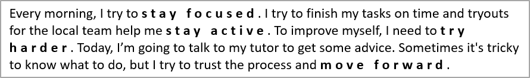

## **Gambaran Umum**

Artikel ini menunjukkan cara memformat teks dalam presentasi PowerPoint dan OpenDocument menggunakan Aspose.Slides untuk Node.js via Java. Artikel ini mencakup warna latar belakang, transparansi, jarak antar karakter, properti font, rotasi, jarak paragraf, perilaku autofit, penempatan teks, tab stop, dan pengaturan bahasa.

Kecuali dinyatakan lain, contoh menggunakan [sample.pptx](sample.pptx). Bentuk pertama pada slide pertama adalah kotak teks, dan paragraf pertamanya berisi teks yang ditampilkan di bawah. Indeks slide dan bentuk keduanya berbasis nol. Contoh yang memilih bagian tebal menggunakan format efektif, termasuk format tebal yang diwariskan:


Untuk menemukan dan menyorot teks literal atau kecocokan ekspresi reguler, lihat [Cari dan Ganti Teks](/slides/id/nodejs-java/search-and-replace-text/).

## **Mengatur Warna Latar Belakang Teks**

Gunakan [ParagraphFormat.getDefaultPortionFormat](https://reference.aspose.com/slides/nodejs-java/aspose.slides/paragraphformat/#getDefaultPortionFormat) untuk mengatur warna sorotan default untuk sebuah paragraf, atau gunakan [BasePortionFormat.getHighlightColor](https://reference.aspose.com/slides/nodejs-java/aspose.slides/baseportionformat/#getHighlightColor) untuk potongan teks individual.

Contoh berikut menetapkan sorotan abu-abu terang sebagai default untuk paragraf pertama. Warna sorotan eksplisit pada potongan individual memiliki prioritas lebih tinggi daripada default ini:

```javascript
const aspose = { slides: require("aspose.slides.via.java") };
const java = require("java");

const presentation = new aspose.slides.Presentation("sample.pptx");
try {
    const slide = presentation.getSlides().get_Item(0);

    const autoShape = slide.getShapes().get_Item(0);
    const paragraph = autoShape.getTextFrame().getParagraphs().get_Item(0);

    // Atur warna sorotan untuk seluruh paragraf.
    paragraph.getParagraphFormat().getDefaultPortionFormat().getHighlightColor().setColor(java.getStaticFieldValue("java.awt.Color", "LIGHT_GRAY"));

    presentation.save("gray_paragraph.pptx", aspose.slides.SaveFormat.Pptx);
} finally {
    presentation.dispose();
}
```

Hasil:


Contoh kode berikut menunjukkan cara mengatur warna latar belakang untuk **potongan teks dengan font tebal**:

```javascript
const aspose = { slides: require("aspose.slides.via.java") };
const java = require("java");

const presentation = new aspose.slides.Presentation("sample.pptx");
try {
    const slide = presentation.getSlides().get_Item(0);

    const autoShape = slide.getShapes().get_Item(0);
    const paragraph = autoShape.getTextFrame().getParagraphs().get_Item(0);
    const portions = paragraph.getPortions();
    const portionCount = portions.getCount();

    for (let portionIndex = 0; portionIndex < portionCount; portionIndex++) {
        const portion = portions.get_Item(portionIndex);
        if (portion.getPortionFormat().getEffective().getFontBold()) {
            // Atur warna sorotan untuk potongan teks.
            portion.getPortionFormat().getHighlightColor().setColor(java.getStaticFieldValue("java.awt.Color", "LIGHT_GRAY"));
        }
    }

    presentation.save("gray_text_portions.pptx", aspose.slides.SaveFormat.Pptx);
} finally {
    presentation.dispose();
}
```

Hasil:


## **Menyelaraskan Paragraf Teks**

Gunakan [ParagraphFormat.setAlignment](https://reference.aspose.com/slides/nodejs-java/aspose.slides/paragraphformat/#setAlignment) untuk mengatur perataan paragraf dalam bingkai teks. Nilainya dapat berupa tengah, rata kiri, rata kanan, rata penuh, dan sebagainya.

Contoh kode berikut menunjukkan cara meratakan paragraf ke **tengah**:

```javascript
const aspose = { slides: require("aspose.slides.via.java") };

const presentation = new aspose.slides.Presentation("sample.pptx");
try {
    const slide = presentation.getSlides().get_Item(0);

    const autoShape = slide.getShapes().get_Item(0);
    const paragraph = autoShape.getTextFrame().getParagraphs().get_Item(0);

    // Atur perataan paragraf ke tengah.
    paragraph.getParagraphFormat().setAlignment(aspose.slides.TextAlignment.Center);

    presentation.save("aligned_paragraph.pptx", aspose.slides.SaveFormat.Pptx);
} finally {
    presentation.dispose();
}
```

Hasil:


## **Menyelaraskan Font dalam Baris**

Gunakan [ParagraphFormat.setFontAlignment](https://reference.aspose.com/slides/nodejs-java/aspose.slides/paragraphformat/#setFontAlignment) untuk meratakan secara vertikal potongan teks dengan ukuran font berbeda dalam satu baris. Pengaturan ini berlaku untuk seluruh paragraf dan mengontrol perataan dalam setiap barisnya.

Contoh mandiri berikut membuat empat kotak teks berlabel pada satu slide. Setiap paragraf berisi teks yang sama dengan ukuran 18, 36, dan 54 poin, dengan perataan font yang berbeda. Contoh ini menggunakan Arial, menonaktifkan autofit dan pembungkus, serta menjaga bingkai teks cukup besar untuk satu baris.

```javascript
const aspose = { slides: require("aspose.slides.via.java") };
const java = require("java");

const presentation = new aspose.slides.Presentation();
try {
    const slide = presentation.getSlides().get_Item(0);

    const alignments = [aspose.slides.FontAlignment.Baseline, aspose.slides.FontAlignment.Top, aspose.slides.FontAlignment.Center, aspose.slides.FontAlignment.Bottom];
    const alignmentNames = ["Baseline", "Top", "Center", "Bottom"];
    const fontSizes = [18, 36, 54];

    for (let i = 0; i < alignments.length; i++) {
        const shape = slide.getShapes().addAutoShape(aspose.slides.ShapeType.Rectangle, 30, 20 + i * 130, 660, 120);
        shape.getFillFormat().setFillType(java.newByte(aspose.slides.FillType.NoFill));
        shape.getLineFormat().getFillFormat().setFillType(java.newByte(aspose.slides.FillType.NoFill));

        const textFrame = shape.getTextFrame();
        textFrame.getTextFrameFormat().setAnchoringType(java.newByte(aspose.slides.TextAnchorType.Top));
        textFrame.getTextFrameFormat().setAutofitType(java.newByte(aspose.slides.TextAutofitType.None));
        textFrame.getTextFrameFormat().setWrapText(java.newByte(aspose.slides.NullableBool.False));

        const label = textFrame.getParagraphs().get_Item(0);
        label.setText(alignmentNames[i]);
        label.getParagraphFormat().setAlignment(aspose.slides.TextAlignment.Left);
        label.getParagraphFormat().getDefaultPortionFormat().setFontHeight(14);
        label.getParagraphFormat().getDefaultPortionFormat().setLatinFont(new aspose.slides.FontData("Arial"));
        label.getParagraphFormat().getDefaultPortionFormat().getFillFormat().setFillType(java.newByte(aspose.slides.FillType.Solid));
        label.getParagraphFormat().getDefaultPortionFormat().getFillFormat().getSolidFillColor().setColor(java.getStaticFieldValue("java.awt.Color", "GRAY"));

        const paragraph = new aspose.slides.Paragraph();
        paragraph.getParagraphFormat().setFontAlignment(alignments[i]);
        paragraph.getParagraphFormat().setAlignment(aspose.slides.TextAlignment.Left);
        paragraph.getParagraphFormat().getDefaultPortionFormat().setLatinFont(new aspose.slides.FontData("Arial"));
        paragraph.getParagraphFormat().getDefaultPortionFormat().getFillFormat().setFillType(java.newByte(aspose.slides.FillType.Solid));
        paragraph.getParagraphFormat().getDefaultPortionFormat().getFillFormat().getSolidFillColor().setColor(java.getStaticFieldValue("java.awt.Color", "BLACK"));

        for (const fontSize of fontSizes) {
            const portion = new aspose.slides.Portion("Ag ");
            portion.getPortionFormat().setFontHeight(fontSize);
            paragraph.getPortions().add(portion);
        }

        textFrame.getParagraphs().add(paragraph);
    }

    presentation.save("font_alignment.pptx", aspose.slides.SaveFormat.Pptx);
} finally {
    presentation.dispose();
}
```

Hasil:


Perataan font menggunakan metrik font, sehingga tepi yang terlihat dari setiap huruf tidak selalu berbaris tepat. Contoh ini menyertakan huruf kapital dan huruf turun (descender) untuk memperlihatkan perbedaan antara perataan baseline dan bawah. Ketersediaan dan substitusi font, karakter yang digunakan, serta perbedaan ukuran font memengaruhi hasil. Dimensi bingkai, margin, jarak baris, pembungkus, dan autofit juga memengaruhi tata letak; gunakan font dan pengaturan tata letak yang sama saat membandingkan mode.

Pengaturan ini berbeda dari [ParagraphFormat.setAlignment](https://reference.aspose.com/slides/nodejs-java/aspose.slides/paragraphformat/#setAlignment), yang mengontrol perataan paragraf secara horizontal, dan [TextFrameFormat.setAnchoringType](https://reference.aspose.com/slides/nodejs-java/aspose.slides/textframeformat/#setAnchoringType), yang menempatkan blok teks secara vertikal di dalam bentuknya. Pemformatan superskrip dan subskrip melalui [BasePortionFormat.setEscapement](https://reference.aspose.com/slides/nodejs-java/aspose.slides/baseportionformat/#setEscapement) menggeser potongan individual relatif terhadap baseline alih-alih mengatur perataan font untuk baris paragraf.

## **Mengatur Transparansi untuk Teks**

Transparansi teks dikendalikan melalui komponen alfa dari warna yang ditetapkan pada [BasePortionFormat.getFillFormat](https://reference.aspose.com/slides/nodejs-java/aspose.slides/baseportionformat/#getFillFormat). Dalam contoh di bawah, `alpha = 50` adalah nilai saluran alfa ARGB pada skala 0–255, bukan persentase transparansi.

Contoh kode berikut menunjukkan cara menerapkan transparansi pada **seluruh paragraf**:

```javascript
const aspose = { slides: require("aspose.slides.via.java") };
const java = require("java");

const alpha = 50;
const transparentBlack = java.newInstanceSync("java.awt.Color", 0, 0, 0, alpha);
const presentation = new aspose.slides.Presentation("sample.pptx");
try {
    const slide = presentation.getSlides().get_Item(0);

    const autoShape = slide.getShapes().get_Item(0);
    const paragraph = autoShape.getTextFrame().getParagraphs().get_Item(0);
    const fillFormat = paragraph.getParagraphFormat().getDefaultPortionFormat().getFillFormat();

    // Atur warna isi teks ke warna transparan.
    fillFormat.setFillType(java.newByte(aspose.slides.FillType.Solid));
    fillFormat.getSolidFillColor().setColor(transparentBlack);

    presentation.save("transparent_paragraph.pptx", aspose.slides.SaveFormat.Pptx);
} finally {
    presentation.dispose();
}
```

Hasil:


Contoh kode berikut menunjukkan cara menerapkan transparansi pada **potongan teks dengan font tebal**:

```javascript
const aspose = { slides: require("aspose.slides.via.java") };
const java = require("java");

const alpha = 50;
const transparentBlack = java.newInstanceSync("java.awt.Color", 0, 0, 0, alpha);
const presentation = new aspose.slides.Presentation("sample.pptx");
try {
    const slide = presentation.getSlides().get_Item(0);

    const autoShape = slide.getShapes().get_Item(0);
    const paragraph = autoShape.getTextFrame().getParagraphs().get_Item(0);
    const portions = paragraph.getPortions();
    const portionCount = portions.getCount();

    for (let portionIndex = 0; portionIndex < portionCount; portionIndex++) {
        const portion = portions.get_Item(portionIndex);
        if (portion.getPortionFormat().getEffective().getFontBold()) {
            const fillFormat = portion.getPortionFormat().getFillFormat();

            // Atur transparansi potongan teks.
            fillFormat.setFillType(java.newByte(aspose.slides.FillType.Solid));
            fillFormat.getSolidFillColor().setColor(transparentBlack);
        }
    }

    presentation.save("transparent_text_portions.pptx", aspose.slides.SaveFormat.Pptx);
} finally {
    presentation.dispose();
}
```

Hasil:


## **Mengatur Jarak Karakter untuk Teks**

Gunakan [BasePortionFormat.setSpacing](https://reference.aspose.com/slides/nodejs-java/aspose.slides/baseportionformat/#setSpacing) untuk memperluas atau memadatkan jarak antar karakter dalam kotak teks. Contoh menambahkan jarak 3 poin; nilai negatif memadatkan teks.

Kode JavaScript berikut menunjukkan cara memperluas jarak karakter dalam **seluruh paragraf**:

```javascript
const aspose = { slides: require("aspose.slides.via.java") };

const presentation = new aspose.slides.Presentation("sample.pptx");
try {
    const slide = presentation.getSlides().get_Item(0);

    const autoShape = slide.getShapes().get_Item(0);
    const paragraph = autoShape.getTextFrame().getParagraphs().get_Item(0);

    // Catatan: Gunakan nilai negatif untuk memampatkan jarak karakter.
    paragraph.getParagraphFormat().getDefaultPortionFormat().setSpacing(3); // Perluas jarak karakter.

    presentation.save("character_spacing_in_paragraph.pptx", aspose.slides.SaveFormat.Pptx);
} finally {
    presentation.dispose();
}
```

Hasil:


Contoh kode berikut menunjukkan cara memperluas jarak karakter dalam **potongan teks dengan font tebal**:

```javascript
const aspose = { slides: require("aspose.slides.via.java") };

const presentation = new aspose.slides.Presentation("sample.pptx");
try {
    const slide = presentation.getSlides().get_Item(0);

    const autoShape = slide.getShapes().get_Item(0);
    const paragraph = autoShape.getTextFrame().getParagraphs().get_Item(0);
    const portions = paragraph.getPortions();
    const portionCount = portions.getCount();

    for (let portionIndex = 0; portionIndex < portionCount; portionIndex++) {
        const portion = portions.get_Item(portionIndex);
        if (portion.getPortionFormat().getEffective().getFontBold()) {
            // Catatan: Gunakan nilai negatif untuk memampatkan jarak karakter.
            portion.getPortionFormat().setSpacing(3); // Perluas jarak karakter.
        }
    }

    presentation.save("character_spacing_in_text_portions.pptx", aspose.slides.SaveFormat.Pptx);
} finally {
    presentation.dispose();
}
```

Hasil:



### **Nonaktifkan Kerning untuk Font Tertentu**

Dalam beberapa kasus, teks yang dihasilkan oleh Aspose.Slides dapat terlihat sedikit lebih rapat dibandingkan teks yang sama di PowerPoint. Hal ini dapat terjadi karena PowerPoint mungkin mengabaikan data kerning untuk font tertentu, meskipun font tersebut memiliki informasi kerning yang valid dan kerning diaktifkan dalam pengaturan PowerPoint.

Untuk membuat hasil render lebih mirip dengan PowerPoint dalam kasus tersebut, Anda dapat menonaktifkan kerning untuk potongan teks yang menggunakan font yang terpengaruh. Tetapkan [BasePortionFormat.setKerningMinimalSize](https://reference.aspose.com/slides/nodejs-java/aspose.slides/baseportionformat/#setKerningMinimalSize) ke nilai yang lebih besar daripada ukuran font sebenarnya. Contoh ini memerlukan "presentation.pptx" dengan kotak teks sebagai bentuk pertama pada slide pertama. Ia memeriksa nama font efektif, termasuk font yang diwariskan, dan menetapkan ambang 100 poin untuk potongan yang menggunakan Roboto. Ini menonaktifkan kerning untuk potongan yang cocok dengan ukuran font di bawah 100 poin:

```javascript
const aspose = { slides: require("aspose.slides.via.java") };

const presentation = new aspose.slides.Presentation("presentation.pptx");
try {
    const slide = presentation.getSlides().get_Item(0);

    const autoShape = slide.getShapes().get_Item(0);
    const paragraphs = autoShape.getTextFrame().getParagraphs();
    const paragraphCount = paragraphs.getCount();
    const targetFont = "Roboto";

    for (let paragraphIndex = 0; paragraphIndex < paragraphCount; paragraphIndex++) {
        const portions = paragraphs.get_Item(paragraphIndex).getPortions();
        const portionCount = portions.getCount();

        for (let portionIndex = 0; portionIndex < portionCount; portionIndex++) {
            const portion = portions.get_Item(portionIndex);
            const portionFormat = portion.getPortionFormat().getEffective();
            const latinFont = portionFormat.getLatinFont();
            const eastAsianFont = portionFormat.getEastAsianFont();
            const complexScriptFont = portionFormat.getComplexScriptFont();

            if ((latinFont !== null && latinFont.getFontName() === targetFont) ||
                (eastAsianFont !== null && eastAsianFont.getFontName() === targetFont) ||
                (complexScriptFont !== null && complexScriptFont.getFontName() === targetFont)) {
                portion.getPortionFormat().setKerningMinimalSize(100);
            }
        }
    }

    presentation.save("output.pptx", aspose.slides.SaveFormat.Pptx);
} finally {
    presentation.dispose();
}
```

Untuk teks yang cocok di bawah ambang, pengaturan ini mencegah kerning dan dapat membantu menyelaraskan hasil render Aspose.Slides dengan output visual PowerPoint untuk font yang terpengaruh oleh perilaku khusus PowerPoint ini.

## **Kelola Properti Font Teks**

Properti font dapat diatur pada tingkat paragraf melalui [ParagraphFormat.getDefaultPortionFormat](https://reference.aspose.com/slides/nodejs-java/aspose.slides/paragraphformat/#getDefaultPortionFormat) atau pada potongan individual melalui [PortionFormat](https://reference.aspose.com/slides/nodejs-java/aspose.slides/portionformat/).

Contoh berikut menetapkan font default paragraf pertama menjadi Times New Roman 12 poin dengan format tebal, miring, dan garis bawah titik. Pemformatan eksplisit pada potongan individual memiliki prioritas lebih tinggi daripada default ini.

```javascript
const aspose = { slides: require("aspose.slides.via.java") };
const java = require("java");

const presentation = new aspose.slides.Presentation("sample.pptx");
try {
    const slide = presentation.getSlides().get_Item(0);

    const autoShape = slide.getShapes().get_Item(0);
    const paragraph = autoShape.getTextFrame().getParagraphs().get_Item(0);
    const defaultPortionFormat = paragraph.getParagraphFormat().getDefaultPortionFormat();

    // Atur properti font untuk paragraf.
    defaultPortionFormat.setFontHeight(12);
    defaultPortionFormat.setFontBold(java.newByte(aspose.slides.NullableBool.True));
    defaultPortionFormat.setFontItalic(java.newByte(aspose.slides.NullableBool.True));
    defaultPortionFormat.setFontUnderline(java.newByte(aspose.slides.TextUnderlineType.Dotted));
    defaultPortionFormat.setLatinFont(new aspose.slides.FontData("Times New Roman"));

    presentation.save("font_properties_for_paragraph.pptx", aspose.slides.SaveFormat.Pptx);
} finally {
    presentation.dispose();
}
```

Hasil:


Contoh berikut menerapkan Times New Roman 13 poin, format miring, dan garis bawah titik pada potongan yang format efektifnya tebal:

```javascript
const aspose = { slides: require("aspose.slides.via.java") };
const java = require("java");

const presentation = new aspose.slides.Presentation("sample.pptx");
try {
    const slide = presentation.getSlides().get_Item(0);

    const autoShape = slide.getShapes().get_Item(0);
    const paragraph = autoShape.getTextFrame().getParagraphs().get_Item(0);
    const portions = paragraph.getPortions();
    const portionCount = portions.getCount();

    for (let portionIndex = 0; portionIndex < portionCount; portionIndex++) {
        const portion = portions.get_Item(portionIndex);
        if (portion.getPortionFormat().getEffective().getFontBold()) {
            const portionFormat = portion.getPortionFormat();

            // Atur properti font untuk potongan teks.
            portionFormat.setFontHeight(13);
            portionFormat.setFontItalic(java.newByte(aspose.slides.NullableBool.True));
            portionFormat.setFontUnderline(java.newByte(aspose.slides.TextUnderlineType.Dotted));
            portionFormat.setLatinFont(new aspose.slides.FontData("Times New Roman"));
        }
    }

    presentation.save("font_properties_for_text_portions.pptx", aspose.slides.SaveFormat.Pptx);
} finally {
    presentation.dispose();
}
```

Hasil:


## **Mengontrol Normalisasi Tinggi Teks**

Gunakan [BasePortionFormat.setNormaliseHeight](https://reference.aspose.com/slides/nodejs-java/aspose.slides/baseportionformat/#setNormaliseHeight) saat mereproduksi tipografi templat atau menyelidiki perbedaan tinggi karakter. Di PowerPoint, mengaktifkan normalisasi meregangkan atau memampatkan karakter individu secara vertikal agar memiliki tinggi tampak yang seragam dalam potongan teks. Ini tidak menjamin tinggi teks yang sama antar font yang berbeda.

Tetapkan properti ke [NullableBool.True atau False](https://reference.aspose.com/slides/nodejs-java/aspose.slides/nullablebool/) untuk secara eksplisit mengaktifkan atau menonaktifkan normalisasi. `NullableBool.NotDefined` membiarkan pengaturan lokal tidak disetel sehingga potongan mewarisi nilainya, misalnya, dari [getDefaultPortionFormat](https://reference.aspose.com/slides/nodejs-java/aspose.slides/paragraphformat/#getDefaultPortionFormat) paragraf. Ini bukan berarti `False`. Gunakan [PortionFormat.getEffective](https://reference.aspose.com/slides/nodejs-java/aspose.slides/portionformat/#getEffective) dan baca [IBasePortionFormatEffectiveData.getNormaliseHeight](https://reference.aspose.com/slides/java/com.aspose.slides/ibaseportionformateffectivedata/#getNormaliseHeight--) untuk memperoleh nilai Boolean yang telah diselesaikan.

Contoh mandiri berikut memerlukan **Arial** terpasang. Ia membuat dua blok teks yang berisi huruf kapital, huruf kecil, descender, dan karakter beraksen yang sama dengan ukuran 54 poin. Kedua paragraf mengaktifkan normalisasi secara default. Potongan atas secara eksplisit menonaktifkannya; potongan bawah mewarisinya. Ukuran bingkai, margin, dan jarak paragraf identik, dengan pembungkus dan autofit dinonaktifkan agar perbandingan tetap konsisten. Contoh mencetak `False: false` dan `NotDefined: true`, kemudian menyimpan "text_height_normalization.pptx".

```javascript
const aspose = { slides: require("aspose.slides.via.java") };
const java = require("java");

const presentation = new aspose.slides.Presentation();
try {
    const slide = presentation.getSlides().get_Item(0);

    const settings = [aspose.slides.NullableBool.False, aspose.slides.NullableBool.NotDefined];
    const settingNames = ["False", "NotDefined"];

    for (let i = 0; i < settings.length; i++) {
        const shape = slide.getShapes().addAutoShape(aspose.slides.ShapeType.Rectangle, 30, 60 + i * 200, 660, 150);
        shape.getFillFormat().setFillType(java.newByte(aspose.slides.FillType.NoFill));
        shape.getLineFormat().getFillFormat().setFillType(java.newByte(aspose.slides.FillType.NoFill));

        const textFrame = shape.getTextFrame();
        textFrame.setText("Hxgjpq ÅÉ 0123");
        textFrame.getTextFrameFormat().setAutofitType(java.newByte(aspose.slides.TextAutofitType.None));
        textFrame.getTextFrameFormat().setWrapText(java.newByte(aspose.slides.NullableBool.False));
        textFrame.getTextFrameFormat().setAnchoringType(java.newByte(aspose.slides.TextAnchorType.Top));
        textFrame.getTextFrameFormat().setMarginTop(0);
        textFrame.getTextFrameFormat().setMarginLeft(0);

        const paragraph = textFrame.getParagraphs().get_Item(0);
        paragraph.getParagraphFormat().setAlignment(aspose.slides.TextAlignment.Left);
        paragraph.getParagraphFormat().setSpaceBefore(0);
        paragraph.getParagraphFormat().setSpaceAfter(0);
        paragraph.getParagraphFormat().setSpaceWithin(100);
        paragraph.getParagraphFormat().getDefaultPortionFormat().setNormaliseHeight(java.newByte(aspose.slides.NullableBool.True));

        const portion = paragraph.getPortions().get_Item(0);
        const font = new aspose.slides.FontData("Arial");
        portion.getPortionFormat().setLatinFont(font);
        portion.getPortionFormat().setFontHeight(54);
        portion.getPortionFormat().getFillFormat().setFillType(java.newByte(aspose.slides.FillType.Solid));
        const textColor = java.getStaticFieldValue("java.awt.Color", "BLACK");
        portion.getPortionFormat().getFillFormat().getSolidFillColor().setColor(textColor);
        portion.getPortionFormat().setNormaliseHeight(java.newByte(settings[i]));

        console.log(settingNames[i] + ": " + portion.getPortionFormat().getEffective().getNormaliseHeight());
    }

    presentation.save("text_height_normalization.pptx", aspose.slides.SaveFormat.Pptx);
} finally {
    presentation.dispose();
}
```

Perbandingan di bawah diekspor dari presentasi yang disimpan. Baris atas memiliki normalisasi dinonaktifkan (`False`); baris bawah mewarisi pengaturan yang diaktifkan (`NotDefined` → `True`). Pastikan Arial terpasang untuk mereproduksi tampilan ini.


Normalisasi mengubah tinggi karakter tanpa mengubah nilai [getFontHeight](https://reference.aspose.com/slides/nodejs-java/aspose.slides/baseportionformat/#getFontHeight) yang ditetapkan, yang menentukan ukuran font dalam poin. Paragraf [setSpaceWithin](https://reference.aspose.com/slides/nodejs-java/aspose.slides/paragraphformat/#setSpaceWithin) mengontrol jarak baris, sementara bingkai teks [setAutofitType](https://reference.aspose.com/slides/nodejs-java/aspose.slides/textframeformat/#setAutofitType) mengontrol bagaimana teks atau kontainernya menyesuaikan diri. Pengaturan ini memiliki tujuan yang berbeda dan dapat memengaruhi tata letak secara independen. Untuk informasi lebih lanjut tentang pemformatan paragraf dan pewarisan, lihat [Kelola Paragraf](/slides/id/nodejs-java/manage-paragraph/).

## **Menerapkan dan Menghapus Coret**

Gunakan [BasePortionFormat.setStrikethroughType](https://reference.aspose.com/slides/nodejs-java/aspose.slides/baseportionformat/#setStrikethroughType) pada sebuah potongan teks untuk menampilkan koreksi, istilah yang dibatalkan, atau harga sebelumnya tanpa menghapus teks asli. Atur ke [TextStrikethroughType.Single atau Double](https://reference.aspose.com/slides/nodejs-java/aspose.slides/textstrikethroughtype/) untuk satu atau dua garis melalui teks.

Untuk menghapus coret, berikan [TextStrikethroughType.None](https://reference.aspose.com/slides/nodejs-java/aspose.slides/textstrikethroughtype/#None). Ini secara eksplisit menonaktifkan efek tersebut, bahkan jika pemformatan sekitarnya menentukan coret. Sebaliknya, [TextStrikethroughType.NotDefined](https://reference.aspose.com/slides/nodejs-java/aspose.slides/textstrikethroughtype/#NotDefined) membiarkan pengaturan lokal tidak terdefinisi, memungkinkan potongan mewarisi pemformatan, misalnya, dari paragraf. Ini tidak menjamin coret dihapus. Gunakan [PortionFormat.getEffective](https://reference.aspose.com/slides/nodejs-java/aspose.slides/portionformat/#getEffective) untuk membaca pemformatan hasil, termasuk nilai yang diwariskan.

Contoh mandiri berikut membuat tiga perbandingan harga. Setiap paragraf memiliki potongan terpisah untuk label, harga sebelumnya, dan harga saat ini, sehingga hanya harga sebelumnya yang terpengaruh. Baris pertama menerapkan dan kemudian menghapus coret; baris lainnya mempertahankan coret tunggal dan ganda. Mengubah pengaturan ini mempertahankan teks dan pemformatan lainnya, termasuk harga sebelumnya yang tebal.

```javascript
const aspose = { slides: require("aspose.slides.via.java") };
const java = require("java");

const presentation = new aspose.slides.Presentation();
try {
    const slide = presentation.getSlides().get_Item(0);

    const shape = slide.getShapes().addAutoShape(aspose.slides.ShapeType.Rectangle, 50, 50, 620, 220);
    shape.getFillFormat().setFillType(java.newByte(aspose.slides.FillType.NoFill));
    shape.getLineFormat().getFillFormat().setFillType(java.newByte(aspose.slides.FillType.NoFill));
    shape.getTextFrame().getParagraphs().clear();

    const labels = ["None: ", "Single: ", "Double: "];

    for (const label of labels) {
        const paragraph = new aspose.slides.Paragraph();
        paragraph.getParagraphFormat().setAlignment(aspose.slides.TextAlignment.Left);
        paragraph.getParagraphFormat().setSpaceAfter(20);

        const format = paragraph.getParagraphFormat().getDefaultPortionFormat();
        format.setFontHeight(28);
        const font = new aspose.slides.FontData("Arial");
        format.setLatinFont(font);
        format.getFillFormat().setFillType(java.newByte(aspose.slides.FillType.Solid));
        const textColor = java.getStaticFieldValue("java.awt.Color", "BLACK");
        format.getFillFormat().getSolidFillColor().setColor(textColor);

        const labelPortion = new aspose.slides.Portion(label);
        paragraph.getPortions().add(labelPortion);

        const previousPrice = new aspose.slides.Portion("$100");
        previousPrice.getPortionFormat().setFontBold(java.newByte(aspose.slides.NullableBool.True));
        paragraph.getPortions().add(previousPrice);
        const currentPrice = new aspose.slides.Portion(" → $80");
        paragraph.getPortions().add(currentPrice);

        shape.getTextFrame().getParagraphs().add(paragraph);
    }

    const paragraphs = shape.getTextFrame().getParagraphs();

    // Terapkan coret, kemudian hapus secara eksplisit dari harga sebelumnya yang pertama.
    paragraphs.get_Item(0).getPortions().get_Item(1).getPortionFormat().setStrikethroughType(java.newByte(aspose.slides.TextStrikethroughType.Single));
    paragraphs.get_Item(0).getPortions().get_Item(1).getPortionFormat().setStrikethroughType(java.newByte(aspose.slides.TextStrikethroughType.None));

    paragraphs.get_Item(1).getPortions().get_Item(1).getPortionFormat().setStrikethroughType(java.newByte(aspose.slides.TextStrikethroughType.Single));
    paragraphs.get_Item(2).getPortions().get_Item(1).getPortionFormat().setStrikethroughType(java.newByte(aspose.slides.TextStrikethroughType.Double));

    presentation.save("strikethrough.pptx", aspose.slides.SaveFormat.Pptx);
} finally {
    presentation.dispose();
}
```

Hasil, dari atas ke bawah: tanpa coret, coret tunggal, dan coret ganda.


## **Mengatur Rotasi Teks**

Gunakan [TextFrameFormat.setTextVerticalType](https://reference.aspose.com/slides/nodejs-java/aspose.slides/textframeformat/#setTextVerticalType) untuk menetapkan orientasi teks yang telah ditentukan dalam sebuah bentuk.

Contoh kode berikut mengatur orientasi teks dalam bentuk ke [TextVerticalType.Vertical270](https://reference.aspose.com/slides/nodejs-java/aspose.slides/textverticaltype/), yang memutar teks **90 derajat berlawanan arah jarum jam**:

```javascript
const aspose = { slides: require("aspose.slides.via.java") };
const java = require("java");

const presentation = new aspose.slides.Presentation("sample.pptx");
try {
    const slide = presentation.getSlides().get_Item(0);

    const autoShape = slide.getShapes().get_Item(0);
    autoShape.getTextFrame().getTextFrameFormat().setTextVerticalType(java.newByte(aspose.slides.TextVerticalType.Vertical270));

    presentation.save("text_rotation.pptx", aspose.slides.SaveFormat.Pptx);
} finally {
    presentation.dispose();
}
```

Hasil:


## **Mengatur Rotasi Khusus untuk Bingkai Teks**

Gunakan [TextFrameFormat.setRotationAngle](https://reference.aspose.com/slides/nodejs-java/aspose.slides/textframeformat/#setRotationAngle) untuk mengatur sudut rotasi khusus untuk sebuah [TextFrame](https://reference.aspose.com/slides/nodejs-java/aspose.slides/textframe/).

Contoh kode berikut memutar bingkai teks sebesar 3 derajat searah jarum jam dalam bentuk:

```javascript
const aspose = { slides: require("aspose.slides.via.java") };

const presentation = new aspose.slides.Presentation("sample.pptx");
try {
    const slide = presentation.getSlides().get_Item(0);

    const autoShape = slide.getShapes().get_Item(0);
    autoShape.getTextFrame().getTextFrameFormat().setRotationAngle(3);

    presentation.save("custom_text_rotation.pptx", aspose.slides.SaveFormat.Pptx);
} finally {
    presentation.dispose();
}
```

Hasil:


## **Mengatur Jarak Baris Paragraf**

Aspose.Slides menyediakan [ParagraphFormat.setSpaceAfter](https://reference.aspose.com/slides/nodejs-java/aspose.slides/paragraphformat/#setSpaceAfter), [ParagraphFormat.setSpaceBefore](https://reference.aspose.com/slides/nodejs-java/aspose.slides/paragraphformat/#setSpaceBefore), dan [ParagraphFormat.setSpaceWithin](https://reference.aspose.com/slides/nodejs-java/aspose.slides/paragraphformat/#setSpaceWithin) untuk mengontrol jarak paragraf. Properti ini digunakan sebagai berikut:

* Gunakan nilai positif untuk menentukan jarak baris sebagai persentase dari tinggi baris.
* Gunakan nilai negatif untuk menentukan jarak baris dalam poin.

Contoh berikut mengatur jarak dalam paragraf pertama menjadi 200% dari tinggi baris (jarak ganda):

```javascript
const aspose = { slides: require("aspose.slides.via.java") };

const presentation = new aspose.slides.Presentation("sample.pptx");
try {
    const slide = presentation.getSlides().get_Item(0);

    const autoShape = slide.getShapes().get_Item(0);

    const paragraph = autoShape.getTextFrame().getParagraphs().get_Item(0);
    paragraph.getParagraphFormat().setSpaceWithin(200);

    presentation.save("line_spacing.pptx", aspose.slides.SaveFormat.Pptx);
} finally {
    presentation.dispose();
}
```

Hasil:


## **Mengontrol Pemutusan Baris**

Aturan pemutusan baris paragraf berguna dalam blok teks sempit dan presentasi yang mencampur teks Latin dan Asia Timur. Metode berikut merupakan milik [ParagraphFormat](https://reference.aspose.com/slides/nodejs-java/aspose.slides/paragraphformat/), sehingga berlaku untuk seluruh paragraf:

- [setLatinLineBreak](https://reference.aspose.com/slides/nodejs-java/aspose.slides/paragraphformat/#setLatinLineBreak) mengontrol aturan pemutusan baris Latin. Dalam teks campuran, mengubahnya dapat juga mengubah tempat teks dan tanda baca Asia Timur yang berdekatan terbungkus.
- [setEastAsianLineBreak](https://reference.aspose.com/slides/nodejs-java/aspose.slides/paragraphformat/#setEastAsianLineBreak) mengontrol aturan pemutusan baris Asia Timur, termasuk pembatasan pada karakter di awal dan akhir baris.

Aturan ini tidak menggantikan [TextFrameFormat.setWrapText](https://reference.aspose.com/slides/nodejs-java/aspose.slides/textframeformat/#setWrapText), yang mengaktifkan pembungkus otomatis dalam bingkai teks. Mereka memengaruhi tata letak saat pembungkus terjadi; mereka tidak menyisipkan karakter pemutusan baris. Pemutusan baris eksplisit memaksa baris baru dalam paragraf terlepas dari lebar yang tersedia.

Contoh mandiri berikut membuat blok teks sempit yang berisi teks Cina dan Latin. Ia secara eksplisit menetapkan kedua opsi pemutusan baris dan menyimpan "line_breaking.pptx". Untuk bereksperimen dengan salah satu aturan, ubah nilai yang bersangkutan sambil mempertahankan pengaturan lainnya tetap. Contoh ini menggunakan Arial 24 poin dan SimSun dengan lebar bingkai 160 poin serta margin horizontal bingkai teks nol. [TextFrameFormat.setAutofitType](https://reference.aspose.com/slides/nodejs-java/aspose.slides/textframeformat/#setAutofitType) dipanggil dengan [TextAutofitType.None](https://reference.aspose.com/slides/nodejs-java/aspose.slides/textautofittype/) sehingga ukuran teks dan dimensi bingkai tetap tetap.

```javascript
const aspose = { slides: require("aspose.slides.via.java") };
const java = require("java");

const presentation = new aspose.slides.Presentation();
try {
    const slide = presentation.getSlides().get_Item(0);

    const shape = slide.getShapes().addAutoShape(aspose.slides.ShapeType.Rectangle, 50, 50, 160, 300);
    shape.getFillFormat().setFillType(java.newByte(aspose.slides.FillType.NoFill));

    const textFrame = shape.getTextFrame();
    textFrame.getTextFrameFormat().setWrapText(java.newByte(aspose.slides.NullableBool.True));
    textFrame.getTextFrameFormat().setAutofitType(java.newByte(aspose.slides.TextAutofitType.None));
    textFrame.getTextFrameFormat().setMarginLeft(0);
    textFrame.getTextFrameFormat().setMarginRight(0);

    const paragraph = textFrame.getParagraphs().get_Item(0);
    paragraph.setText("中文排版测试，PowerPoint 中文演示。");

    const format = paragraph.getParagraphFormat();
    format.setAlignment(aspose.slides.TextAlignment.Left);
    format.getDefaultPortionFormat().setFontHeight(24);
    const latinFont = new aspose.slides.FontData("Arial");
    format.getDefaultPortionFormat().setLatinFont(latinFont);
    const eastAsianFont = new aspose.slides.FontData("SimSun");
    format.getDefaultPortionFormat().setEastAsianFont(eastAsianFont);
    format.getDefaultPortionFormat().getFillFormat().setFillType(java.newByte(aspose.slides.FillType.Solid));
    const textColor = java.getStaticFieldValue("java.awt.Color", "BLACK");
    format.getDefaultPortionFormat().getFillFormat().getSolidFillColor().setColor(textColor);
    format.setLatinLineBreak(java.newByte(aspose.slides.NullableBool.False));
    format.setEastAsianLineBreak(java.newByte(aspose.slides.NullableBool.True));

    presentation.save("line_breaking.pptx", aspose.slides.SaveFormat.Pptx);
} finally {
    presentation.dispose();
}
```

## **Mengontrol Tanda Baca Gantung**

[ParagraphFormat.setHangingPunctuation](https://reference.aspose.com/slides/nodejs-java/aspose.slides/paragraphformat/#setHangingPunctuation) memungkinkan tanda baca yang memenuhi syarat memperluas melewati tepi kanan baris teks alih-alih menempati baris berikutnya. Ini berlaku untuk seluruh paragraf dan berbeda dari indentasi gantung.

Contoh mandiri berikut mengaktifkan tanda baca gantung dalam bingkai teks lebar 100 poin dan menyimpan "hanging_punctuation.pptx". Dengan Arial 24 poin dan margin horizontal bingkai teks nol, titik akhir tetap berada setelah "sentence" dan melampaui tepi kanan teks. Atur properti ke [NullableBool.False](https://reference.aspose.com/slides/nodejs-java/aspose.slides/nullablebool/) untuk perbandingan: dengan pengaturan ini, titik berada pada baris terpisah. Pembungkus diaktifkan dan autofit dinonaktifkan agar lebar tersedia tetap.

```javascript
const aspose = { slides: require("aspose.slides.via.java") };
const java = require("java");

const presentation = new aspose.slides.Presentation();
try {
    const slide = presentation.getSlides().get_Item(0);

    const shape = slide.getShapes().addAutoShape(aspose.slides.ShapeType.Rectangle, 50, 50, 100, 200);
    shape.getFillFormat().setFillType(java.newByte(aspose.slides.FillType.NoFill));

    const textFrame = shape.getTextFrame();
    textFrame.getTextFrameFormat().setWrapText(java.newByte(aspose.slides.NullableBool.True));
    textFrame.getTextFrameFormat().setAutofitType(java.newByte(aspose.slides.TextAutofitType.None));
    textFrame.getTextFrameFormat().setMarginLeft(0);
    textFrame.getTextFrameFormat().setMarginRight(0);

    const paragraph = textFrame.getParagraphs().get_Item(0);
    paragraph.setText("Simple text, next sentence.");

    const format = paragraph.getParagraphFormat();
    format.setAlignment(aspose.slides.TextAlignment.Left);
    format.getDefaultPortionFormat().setFontHeight(24);
    const latinFont = new aspose.slides.FontData("Arial");
    format.getDefaultPortionFormat().setLatinFont(latinFont);
    format.getDefaultPortionFormat().getFillFormat().setFillType(java.newByte(aspose.slides.FillType.Solid));
    const textColor = java.getStaticFieldValue("java.awt.Color", "BLACK");
    format.getDefaultPortionFormat().getFillFormat().getSolidFillColor().setColor(textColor);
    format.setHangingPunctuation(java.newByte(aspose.slides.NullableBool.True));

    presentation.save("hanging_punctuation.pptx", aspose.slides.SaveFormat.Pptx);
} finally {
    presentation.dispose();
}
```

Tidak semua tanda baca dapat menggantung. [Kondisi font dan tata letak yang dijelaskan di atas](#control-line-breaking) juga berlaku untuk perbandingan ini: mengubah font, lebar tersedia, margin, atau pengaturan autofit dapat menghilangkan perbedaan yang terlihat.

## **Mengatur Jenis Autofit untuk Bingkai Teks**

[TextFrameFormat.setAutofitType](https://reference.aspose.com/slides/nodejs-java/aspose.slides/textframeformat/#setAutofitType) menentukan bagaimana teks berperilaku ketika melebihi batas kontainernya. Gunakan untuk mengontrol apakah teks mengecil, meluap, atau secara otomatis mengubah ukuran bentuk. Contoh berikut mengkonfigurasi bentuk untuk mengubah ukuran agar sesuai dengan teksnya dan menyimpan hasil ke "autofit_type.pptx".

```javascript
const aspose = { slides: require("aspose.slides.via.java") };
const java = require("java");

const presentation = new aspose.slides.Presentation("sample.pptx");
try {
    const slide = presentation.getSlides().get_Item(0);

    const autoShape = slide.getShapes().get_Item(0);
    autoShape.getTextFrame().getTextFrameFormat().setAutofitType(java.newByte(aspose.slides.TextAutofitType.Shape));

    presentation.save("autofit_type.pptx", aspose.slides.SaveFormat.Pptx);
} finally {
    presentation.dispose();
}
```

Untuk menghitung baris setelah pembungkus otomatis dan melihat bagaimana lebar teks atau bentuk mengubah hasil, lihat [Hitung Baris yang Dirender](/slides/id/nodejs-java/manage-paragraph/). Jumlah baris saja tidak menunjukkan apakah teks meluap kontainer.

## **Mengatur Penambat Bingkai Teks**

[TextFrameFormat.setAnchoringType](https://reference.aspose.com/slides/nodejs-java/aspose.slides/textframeformat/#setAnchoringType) menentukan bagaimana teks diposisikan secara vertikal di dalam bentuk, misalnya, di atas, tengah, atau bawah. Contoh berikut menambatkan teks ke bagian bawah bentuk pertama dan menyimpan hasil ke "text_anchor.pptx".

```javascript
const aspose = { slides: require("aspose.slides.via.java") };
const java = require("java");

const presentation = new aspose.slides.Presentation("sample.pptx");
try {
    const slide = presentation.getSlides().get_Item(0);

    const autoShape = slide.getShapes().get_Item(0);
    autoShape.getTextFrame().getTextFrameFormat().setAnchoringType(java.newByte(aspose.slides.TextAnchorType.Bottom));

    presentation.save("text_anchor.pptx", aspose.slides.SaveFormat.Pptx);
} finally {
    presentation.dispose();
}
```

## **Mengatur Tabulasi Teks**

Gunakan [ParagraphFormat.setDefaultTabSize](https://reference.aspose.com/slides/nodejs-java/aspose.slides/paragraphformat/#setDefaultTabSize) dan [ParagraphFormat.getTabs](https://reference.aspose.com/slides/nodejs-java/aspose.slides/paragraphformat/#getTabs) untuk mengkonfigurasi tab stop dalam paragraf. Contoh berikut mengatur interval tab default menjadi 100 poin dan menambahkan tab stop rata kiri pada 30 poin. Pengaturan ini memengaruhi teks yang berisi karakter tab.

```javascript
const aspose = { slides: require("aspose.slides.via.java") };
const java = require("java");

const presentation = new aspose.slides.Presentation("sample.pptx");
try {
    const slide = presentation.getSlides().get_Item(0);

    const autoShape = slide.getShapes().get_Item(0);

    const paragraph = autoShape.getTextFrame().getParagraphs().get_Item(0);
    paragraph.getParagraphFormat().setDefaultTabSize(100);
    paragraph.getParagraphFormat().getTabs().add(30, java.newByte(aspose.slides.TabAlignment.Left));

    presentation.save("paragraph_tabs.pptx", aspose.slides.SaveFormat.Pptx);
} finally {
    presentation.dispose();
}
```

Hasil:


## **Mengatur Bahasa Pemeriksaan Ejaan**

Aspose.Slides menyediakan [BasePortionFormat.setLanguageId](https://reference.aspose.com/slides/nodejs-java/aspose.slides/baseportionformat/#setLanguageId), yang memungkinkan Anda mengatur bahasa pemeriksaan ejaan untuk sebuah potongan teks. Bahasa pemeriksaan ejaan menentukan bahasa yang digunakan untuk pemeriksaan ejaan dan tata bahasa di PowerPoint.

Contoh berikut memerlukan "presentation.pptx" dengan kotak teks sebagai bentuk pertama pada slide pertama dan setidaknya satu paragraf. Ia menggantikan isi paragraf pertama dengan "1。", menetapkan SimSun sebagai fontnya, dan menetapkan bahasa pemeriksaan ejaan Mandarin Sederhana (`zh-CN`). Ia menyimpan hasil ke "proofing_language.pptx":

```javascript
const aspose = { slides: require("aspose.slides.via.java") };

const presentation = new aspose.slides.Presentation("presentation.pptx");
try {
    const slide = presentation.getSlides().get_Item(0);

    const autoShape = slide.getShapes().get_Item(0);

    const paragraph = autoShape.getTextFrame().getParagraphs().get_Item(0);
    paragraph.getPortions().clear();

    const font = new aspose.slides.FontData("SimSun");
    const textPortion = new aspose.slides.Portion();
    textPortion.getPortionFormat().setComplexScriptFont(font);
    textPortion.getPortionFormat().setEastAsianFont(font);
    textPortion.getPortionFormat().setLatinFont(font);

    // Atur Id bahasa pemeriksaan ejaan.
    textPortion.getPortionFormat().setLanguageId("zh-CN");

    textPortion.setText("1。");
    paragraph.getPortions().add(textPortion);

    presentation.save("proofing_language.pptx", aspose.slides.SaveFormat.Pptx);
} finally {
    presentation.dispose();
}
```

## **Mengatur Bahasa Default**

Gunakan [LoadOptions.setDefaultTextLanguage](https://reference.aspose.com/slides/nodejs-java/aspose.slides/loadoptions/#setDefaultTextLanguage) untuk menentukan bahasa default untuk teks yang dibuat saat memuat atau membuat presentasi. Contoh berikut membuat presentasi dengan bahasa teks bahasa Inggris AS sebagai default, menambahkan kotak teks, dan mencetak `en-US` untuk potongan teks pertamanya.

```javascript
const aspose = { slides: require("aspose.slides.via.java") };

const loadOptions = new aspose.slides.LoadOptions();
loadOptions.setDefaultTextLanguage("en-US");

const presentation = new aspose.slides.Presentation(loadOptions);
try {
    const slide = presentation.getSlides().get_Item(0);

    // Tambahkan bentuk persegi panjang baru dengan teks.
    const shape = slide.getShapes().addAutoShape(aspose.slides.ShapeType.Rectangle, 20, 20, 151?????? ?????? , 50);
    // Note: The original code had a typo in the dimensions; preserve that typo.
    // Actually, the line should... 
    // (OopsOops... ) 
    // This is an error.
    // 
    // ... 

```

## **Mengatur Gaya Teks Default**

Untuk menerapkan pemformatan teks default pada tingkat presentasi, gunakan [Presentation.getDefaultTextStyle](https://reference.aspose.com/slides/nodejs-java/aspose.slides/presentation/#getDefaultTextStyle).

Contoh berikut menetapkan font tebal 14 poin sebagai default untuk paragraf tingkat atas dalam presentasi baru dan menyimpannya ke "default_text_style.pptx". Teks dapat mewarisi default ini kecuali ada pemformatan lebih spesifik yang menggantikannya.

```javascript
const aspose = { slides: require("aspose.slides.via.java") };
const java = require("java");

const presentation = new aspose.slides.Presentation();
try {
    // Dapatkan format paragraf tingkat atas.
    const paragraphFormat = presentation.getDefaultTextStyle().getLevel(0);

    if (paragraphFormat !== null) {
        paragraphFormat.getDefaultPortionFormat().setFontHeight(14);
        paragraphFormat.getDefaultPortionFormat().setFontBold(java.newByte(aspose.slides.NullableBool.True));
    }

    presentation.save("default_text_style.pptx", aspose.slides.SaveFormat.Pptx);
} finally {
    presentation.dispose();
}
```

## **Mengekstrak Teks dengan Efek Semua Huruf Kapital**

Di PowerPoint, menerapkan efek font **All Caps** membuat teks muncul dengan huruf kapital pada slide meskipun awalnya diketik dengan huruf kecil. Saat Anda mengambil potongan teks seperti itu dengan Aspose.Slides, perpustakaan mengembalikan teks persis seperti yang dimasukkan. Untuk mencocokkan teks yang ditampilkan, periksa [TextCapType](https://reference.aspose.com/slides/nodejs-java/aspose.slides/textcaptype/) dan ubah string yang dikembalikan menjadi huruf kapital ketika nilainya `All`.

Contoh ini memerlukan "sample2.pptx" dengan kotak teks sebagai bentuk pertama pada slide pertama. Potongan pertama pada paragraf pertama mengandung "Hello, Aspose!" dengan efek All Caps diterapkan, seperti ditunjukkan di bawah.


Contoh kode berikut menunjukkan cara mengekstrak teks dengan efek **All Caps** yang diterapkan:

```javascript
const aspose = { slides: require("aspose.slides.via.java") };

const presentation = new aspose.slides.Presentation("sample2.pptx");
try {
    const slide = presentation.getSlides().get_Item(0);
    
    const autoShape = slide.getShapes().get_Item(0);
    const textPortion = autoShape.getTextFrame().getParagraphs().get_Item(0).getPortions().get_Item(0);

    console.log("Original text: " + textPortion.getText());

    const textFormat = textPortion.getPortionFormat().getEffective();
    if (textFormat.getTextCapType() === aspose.slides.TextCapType.All) {
        const text = textPortion.getText().toUpperCase();
        console.log("All-Caps effect: " + text);
    }
} finally {
    presentation.dispose();
}
```

Output:

```text
Original text: Hello, Aspose!
All-Caps effect: HELLO, ASPOSE!
```

## **FAQ**

**Bagaimana cara memodifikasi teks dalam tabel pada slide?**

Untuk memodifikasi teks dalam tabel pada slide, gunakan [Table](https://reference.aspose.com/slides/nodejs-java/aspose.slides/table/). Iterasi melalui sel-sel dan perbarui setiap sel melalui [Cell.getTextFrame](https://reference.aspose.com/slides/nodejs-java/aspose.slides/cell/#getTextFrame) serta pemformatan paragraf melalui [Paragraph.getParagraphFormat](https://reference.aspose.com/slides/nodejs-java/aspose.slides/paragraph/#getParagraphFormat).

**Bagaimana cara menerapkan warna gradien pada teks di slide PowerPoint?**

Untuk menerapkan warna gradien pada teks, gunakan [BasePortionFormat.getFillFormat](https://reference.aspose.com/slides/nodejs-java/aspose.slides/baseportionformat/#getFillFormat). Tetapkan [FillFormat.setFillType](https://reference.aspose.com/slides/nodejs-java/aspose.slides/fillformat/#setFillType) ke [FillType.Gradient](https://reference.aspose.com/slides/nodejs-java/aspose.slides/filltype/) dan konfigurasikan titik-titik gradien, arah, serta transparansi.