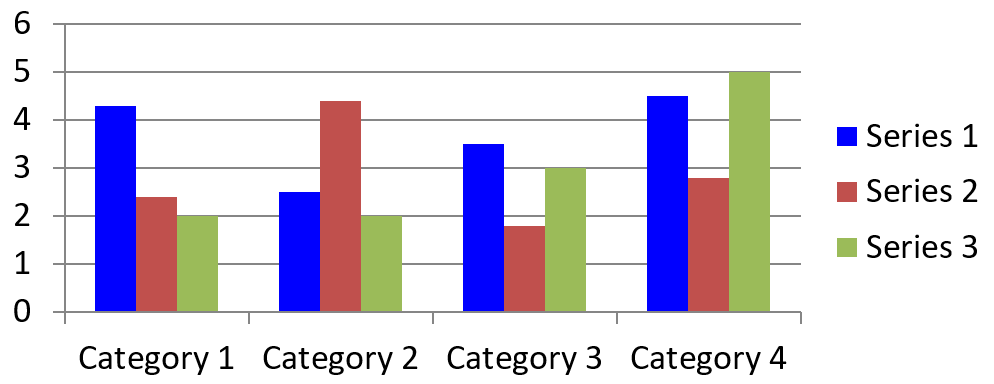

## **Gambaran Umum**

Sebuah diagram dapat menyimpan nilai yang dipetakan dalam sel workbook atau langsung sebagai literal numerik. Sebuah [ChartSeries](https://reference.aspose.com/slides/nodejs-java/aspose.slides/chartseries/) mewakili satu set nilai yang terkait, dan setiap [ChartDataPoint](https://reference.aspose.com/slides/nodejs-java/aspose.slides/chartdatapoint/) mewakili sebuah titik dalam seri tersebut. Objek [ChartCategory](https://reference.aspose.com/slides/nodejs-java/aspose.slides/chartcategory/) menyediakan label atau nilai pengelompokan yang dibagi oleh seri. Pada diagram yang dibuat dengan data default, nama seri, kategori, dan nilai titik menggunakan objek [ChartDataCell](https://reference.aspose.com/slides/nodejs-java/aspose.slides/chartdatacell/) dari workbook diagram.

Untuk diagram kategori tipikal, workbook default menggunakan baris 0 untuk nama seri, kolom 0 untuk nama kategori, dan sel‑sel lainnya untuk nilai seri. Indeks worksheet, baris, dan kolom yang diberikan ke [ChartDataWorkbook.getCell](https://reference.aspose.com/slides/nodejs-java/aspose.slides/chartdataworkbook/getcell/) bersifat berbasis nol. Tata letak ini berguna ketika Anda membuat diagram dengan data default, tetapi jangan berasumsi bahwa setiap diagram yang ada menggunakannya. Untuk presentasi yang dimuat, periksa sel‑sel yang dirujuk oleh seri, kategori, dan titik data sebelum mengubah nilai workbook.

Pengaturan diagram memiliki tiga ruang lingkup yang berbeda:

- Pengaturan pada tingkat seri, seperti [ChartSeries.getFormat](https://reference.aspose.com/slides/nodejs-java/aspose.slides/chartseries/getformat/), memberikan tampilan default untuk semua titik dalam satu seri.
- Pengaturan titik data, seperti [ChartDataPoint.getFormat](https://reference.aspose.com/slides/nodejs-java/aspose.slides/chartdatapoint/getformat/), menggantikan tampilan seri untuk satu titik.
- Pengaturan grup berlaku untuk seri yang kompatibel yang termasuk dalam [ChartSeriesGroup](https://reference.aspose.com/slides/nodejs-java/aspose.slides/chartseriesgroup/) yang sama. Akses grup melalui [ChartSeries.getParentSeriesGroup](https://reference.aspose.com/slides/nodejs-java/aspose.slides/chartseries/getparentseriesgroup/) ketika Anda perlu mengatur opsi seperti overlap atau lebar celah.

Ketika tidak ada isian titik atau seri yang eksplisit, gaya dan tema diagram menentukan tampilan otomatis. Ketika format seri dan titik keduanya ada, format titik memiliki prioritas untuk titik tersebut.


Untuk diagram silinder berkelompok, lihat bagaimana [changing the 3D series type or bar shape](/slides/id/nodejs-java/3d-chart/#change-the-3d-series-type-and-bar-shape) mempengaruhi seri pertama.

## **Mengatur Nilai Seri Menggunakan Literal Numerik**

Gunakan literal numerik ketika nilai seri berasal dari data aplikasi atau perhitungan dan tidak memerlukan referensi sel worksheet. Panggil [setDataSourceTypeForValues](https://reference.aspose.com/slides/nodejs-java/aspose.slides/chartdatapointcollection/setdatasourcetypeforvalues/) dengan [DataSourceType.DoubleLiterals](https://reference.aspose.com/slides/nodejs-java/aspose.slides/datasourcetype/) sebelum menetapkan hasil [getValue](https://reference.aspose.com/slides/nodejs-java/aspose.slides/chartdatapoint/getvalue/) tiap titik melalui [setAsLiteralDouble](https://reference.aspose.com/slides/nodejs-java/aspose.slides/doublechartvalue/setasliteraldouble/).

Pengaturan koleksi mengontrol tipe sumber semua nilai titik dalam seri tersebut. Metode [getDataSourceType](https://reference.aspose.com/slides/nodejs-java/aspose.slides/basechartvalue/) tiap nilai titik melaporkan tipe yang dipilih; ubah melalui pengaturan koleksi. Dengan `Worksheet`, gunakan [getAsCell](https://reference.aspose.com/slides/nodejs-java/aspose.slides/doublechartvalue/getascell/) untuk mengakses sel yang dirujuk. Dengan `DoubleLiterals`, gunakan [getAsLiteralDouble](https://reference.aspose.com/slides/nodejs-java/aspose.slides/doublechartvalue/getasliteraldouble/) atau `setAsLiteralDouble` untuk membaca atau menulis angka secara langsung.

Contoh berikut membuat diagram kolom dengan seri dan kategori default, lalu menetapkan nilai terhitung 10, 20, dan seterusnya ke titik‑titik yang ada pada seri pertama. Diagram disimpan, dibuka kembali, dan nilai yang tersimpan dicetak.

```javascript
const aspose = { slides: require("aspose.slides.via.java") };

const presentation = new aspose.slides.Presentation();
try {
    const slide = presentation.getSlides().get_Item(0);

    const chart = slide.getShapes().addChart(aspose.slides.ChartType.ClusteredColumn, 20, 20, 500, 300);
    const series = chart.getChartData().getSeries().get_Item(0);

    series.getDataPoints().setDataSourceTypeForValues(aspose.slides.DataSourceType.DoubleLiterals);
    for (let i = 0; i < series.getDataPoints().size(); i++) {
        series.getDataPoints().get_Item(i).getValue().setAsLiteralDouble((i + 1) * 10);
    }

    presentation.save("numeric_literals.pptx", aspose.slides.SaveFormat.Pptx);
} finally {
    presentation.dispose();
}

const reopenedPresentation = new aspose.slides.Presentation("numeric_literals.pptx");
try {
    const reopenedSlide = reopenedPresentation.getSlides().get_Item(0);
    const reopenedChart = reopenedSlide.getShapes().get_Item(0);
    const reopenedSeries = reopenedChart.getChartData().getSeries().get_Item(0);
    for (let i = 0; i < reopenedSeries.getDataPoints().size(); i++) {
        const point = reopenedSeries.getDataPoints().get_Item(i);
        console.log(point.getValue().getAsLiteralDouble());
    }
} finally {
    reopenedPresentation.dispose();
}
```

Tipe sumber nilai titik terpisah dari [ChartData.getDataSourceType](https://reference.aspose.com/slides/nodejs-java/aspose.slides/chartdata/getdatasourcetype/), yang mengidentifikasi konfigurasi workbook internal atau eksternal diagram. Menggunakan literal numerik tidak secara otomatis menghapus workbook yang disematkan. Pada contoh ini, workbook tetap tersedia untuk label kategori, nama seri, dan seri lain. Lihat [Chart Workbook](/slides/id/nodejs-java/chart-workbook/) untuk manajemen workbook.

Untuk diagram pencar dan gelembung, gunakan [setDataSourceTypeForXValues](https://reference.aspose.com/slides/nodejs-java/aspose.slides/chartdatapointcollection/setdatasourcetypeforxvalues/) dan [setDataSourceTypeForYValues](https://reference.aspose.com/slides/nodejs-java/aspose.slides/chartdatapointcollection/setdatasourcetypeforyvalues/) untuk memilih sumber bagi [getXValue](https://reference.aspose.com/slides/nodejs-java/aspose.slides/chartdatapoint/getxvalue/) dan [getYValue](https://reference.aspose.com/slides/nodejs-java/aspose.slides/chartdatapoint/getyvalue/). Diagram gelembung juga menggunakan [setDataSourceTypeForBubbleSizes](https://reference.aspose.com/slides/nodejs-java/aspose.slides/chartdatapointcollection/setdatasourcetypeforbubblesizes/) untuk [getBubbleSize](https://reference.aspose.com/slides/nodejs-java/aspose.slides/chartdatapoint/getbubblesize/). Tetapkan setiap sumber yang relevan ke `DoubleLiterals` sebelum menetapkan angka melalui metode `setAsLiteralDouble` nilai tersebut.

## **Mengatur Overlap Seri Diagram**

[ChartSeries.getOverlap](https://reference.aspose.com/slides/nodejs-java/aspose.slides/chartseries/getoverlap/) melaporkan seberapa banyak batang atau kolom saling tumpang tindih dalam diagram 2D, dari -100 hingga 100 persen. Ini adalah proyeksi baca‑saja dari pengaturan pada grup seri induk. Gunakan [ChartSeriesGroup.setOverlap](https://reference.aspose.com/slides/nodejs-java/aspose.slides/chartseriesgroup/setoverlap/) untuk memperbarui setiap seri yang kompatibel dalam grup tersebut. Opsi ini berlaku untuk tipe diagram yang menampilkan batang atau kolom berkelompok; tidak memengaruhi grup seri yang tidak terkait dalam diagram gabungan.

Contoh berikut mengatur overlap untuk grup yang berisi seri pertama:

```javascript
const aspose = {};
aspose.slides = require("aspose.slides.via.java");
const java = require("java");

const firstSlideIndex = 0;
const firstSeriesIndex = 0;
const overlapPercent = java.newByte(30);

const presentation = new aspose.slides.Presentation();
try {
    const slide = presentation.getSlides().get_Item(firstSlideIndex);

    // Diagram baru berisi contoh seri, kategori, dan nilai.
    const chart = slide.getShapes().addChart(aspose.slides.ChartType.ClusteredColumn, 20, 20, 500, 200);

    const series = chart.getChartData().getSeries().get_Item(firstSeriesIndex);
    series.getParentSeriesGroup().setOverlap(overlapPercent);

    presentation.save("series_overlap.pptx", aspose.slides.SaveFormat.Pptx);
} finally {
    presentation.dispose();
}
```

Hasilnya:


## **Mengubah Warna Isi Seri**

Gunakan [ChartSeries.getFormat](https://reference.aspose.com/slides/nodejs-java/aspose.slides/chartseries/getformat/) untuk menetapkan isian default untuk seluruh seri. Jika sebuah titik sudah memiliki isian eksplisit, pengaturan [ChartDataPoint.getFormat](https://reference.aspose.com/slides/nodejs-java/aspose.slides/chartdatapoint/getformat/) menimpa isian seri untuk titik tersebut.

Contoh berikut menerapkan isian biru solid pada seri pertama:

```javascript
const aspose = {};
aspose.slides = require("aspose.slides.via.java");
const java = require("java");

const firstSlideIndex = 0;
const firstSeriesIndex = 0;
const solidFillType = java.newByte(aspose.slides.FillType.Solid);
const blueColor = java.getStaticFieldValue("java.awt.Color", "BLUE");

const presentation = new aspose.slides.Presentation();
try {
    const slide = presentation.getSlides().get_Item(firstSlideIndex);

    const chart = slide.getShapes().addChart(aspose.slides.ChartType.ClusteredColumn, 20, 20, 500, 200);

    const series = chart.getChartData().getSeries().get_Item(firstSeriesIndex);
    series.getFormat().getFill().setFillType(solidFillType);
    series.getFormat().getFill().getSolidFillColor().setColor(blueColor);

    presentation.save("series_color.pptx", aspose.slides.SaveFormat.Pptx);
} finally {
    presentation.dispose();
}
```

Hasilnya:



## **Mengubah Nama Seri**

Nama seri disimpan dalam workbook data diagram dan biasanya ditampilkan di legenda. Pada workbook default yang dibuat untuk diagram kolom berkelompok, sel B1 berada di baris 0, kolom 1 dan berisi nama seri pertama. Konstanta yang dinamai dalam contoh berikut membuat struktur itu eksplisit:

```javascript
const aspose = {};
aspose.slides = require("aspose.slides.via.java");

const firstSlideIndex = 0;
const worksheetIndex = 0;
const seriesNameRowIndex = 0;
const firstSeriesColumnIndex = 1;

const presentation = new aspose.slides.Presentation();
try {
    const slide = presentation.getSlides().get_Item(firstSlideIndex);

    const chart = slide.getShapes().addChart(aspose.slides.ChartType.ClusteredColumn, 20, 20, 500, 200);

    const workbook = chart.getChartData().getChartDataWorkbook();
    const seriesNameCell = workbook.getCell(worksheetIndex, seriesNameRowIndex, firstSeriesColumnIndex);
    seriesNameCell.setValue("Revenue");

    presentation.save("series_name.pptx", aspose.slides.SaveFormat.Pptx);
} finally {
    presentation.dispose();
}
```

Anda juga dapat memperbarui sel yang sudah dirujuk oleh [ChartSeries.getName](https://reference.aspose.com/slides/nodejs-java/aspose.slides/chartseries/getname/). Pendekatan ini menghindari asumsi baris dan kolom tertentu dalam diagram yang ada:

```javascript
const aspose = {};
aspose.slides = require("aspose.slides.via.java");

const firstSlideIndex = 0;
const firstSeriesIndex = 0;
const firstNameCellIndex = 0;

const presentation = new aspose.slides.Presentation();
try {
    const slide = presentation.getSlides().get_Item(firstSlideIndex);

    const chart = slide.getShapes().addChart(aspose.slides.ChartType.ClusteredColumn, 20, 20, 500, 200);

    const series = chart.getChartData().getSeries().get_Item(firstSeriesIndex);
    const seriesNameCell = series.getName().getAsCells().get_Item(firstNameCellIndex);
    seriesNameCell.setValue("Revenue");

    presentation.save("series_name.pptx", aspose.slides.SaveFormat.Pptx);
} finally {
    presentation.dispose();
}
```

Hasilnya:


### **Membuat Seri dengan Nama dari Beberapa Sel**

Nama seri komposit berguna ketika nama produk dan periode pelaporan disimpan dalam sel workbook terpisah. Misalnya, Anda dapat menggabungkan `Product A` di B1 dan `2026` di C1 menjadi satu nama seri sambil mempertahankan kedua bagian terhubung ke sel sumber mereka.

Gunakan [ChartDataWorkbook.getCellCollection](https://reference.aspose.com/slides/nodejs-java/aspose.slides/chartdataworkbook/getcellcollection/) untuk mengambil rentang nama, kemudian berikan koleksi itu ke [ChartSeriesCollection.add](https://reference.aspose.com/slides/nodejs-java/aspose.slides/chartseriescollection/add/). Argumen `skipHiddenCells` mengendalikan apakah sel tersembunyi disertakan: `true` mengecualikannya, sementara `false` menyertakannya. Contoh ini menggunakan `false` untuk menyertakan setiap sel dalam rentang nama.

Contoh berikut membuat presentasi dengan satu seri dan dua titik data. Sel B1:C1 hanya menyediakan nama seri; A2:A3 menyediakan label kategori, dan B2:B3 menyediakan nilai numerik.

```javascript
const aspose = {};
aspose.slides = require("aspose.slides.via.java");

const presentation = new aspose.slides.Presentation();
try {
    const slide = presentation.getSlides().get_Item(0);

    const chart = slide.getShapes().addChart(aspose.slides.ChartType.ClusteredColumn, 50, 50, 620, 180);

    chart.getChartData().getSeries().clear();
    chart.getChartData().getCategories().clear();
    chart.setLegend(true);

    const workbook = chart.getChartData().getChartDataWorkbook();
    workbook.clear(0);

    // Dua sel ini menyediakan nama seri.
    workbook.getCell(0, 0, 1, "Product A");
    workbook.getCell(0, 0, 2, "2026");
    const nameCells = workbook.getCellCollection("Sheet1!$B$1:$C$1", false);
    const series = chart.getChartData().getSeries().add(nameCells, aspose.slides.ChartType.ClusteredColumn);

    // Sel terpisah menyediakan kategori dan titik data numerik.
    const northCategory = workbook.getCell(0, 1, 0, "North");
    const southCategory = workbook.getCell(0, 2, 0, "South");
    chart.getChartData().getCategories().add(northCategory);
    chart.getChartData().getCategories().add(southCategory);
    const northValue = workbook.getCell(0, 1, 1, 120);
    const southValue = workbook.getCell(0, 2, 1, 150);
    series.getDataPoints().addDataPointForBarSeries(northValue);
    series.getDataPoints().addDataPointForBarSeries(southValue);

    presentation.save("composite_series_name.pptx", aspose.slides.SaveFormat.Pptx);
} finally {
    presentation.dispose();
}
```

Nama seri yang dihasilkan adalah `Product A 2026`, dengan spasi di antara dua nilai sel. Legenda menampilkan ini sebagai satu entri untuk kedua kolom. Gambar di bawah menggambarkan hasilnya:


## **Mendapatkan Warna Isi Seri Otomatis**

[ChartSeries.getAutomaticSeriesColor](https://reference.aspose.com/slides/nodejs-java/aspose.slides/chartseries/getautomaticseriescolor/) mengembalikan warna yang dihitung dari indeks seri dan gaya diagram. Ini adalah warna yang digunakan ketika isian seri tidak didefinisikan secara eksplisit. Memanggil metode ini membaca warna yang dihitung; tidak menetapkan isian baru.

Contoh berikut mencetak warna otomatis setiap seri default:

```javascript
const aspose = {};
aspose.slides = require("aspose.slides.via.java");

const firstSlideIndex = 0;

const presentation = new aspose.slides.Presentation();
try {
    const slide = presentation.getSlides().get_Item(firstSlideIndex);

    const chart = slide.getShapes().addChart(aspose.slides.ChartType.ClusteredColumn, 20, 20, 500, 200);

    const seriesCount = chart.getChartData().getSeries().size();
    for (let seriesIndex = 0; seriesIndex < seriesCount; seriesIndex++) {
        const series = chart.getChartData().getSeries().get_Item(seriesIndex);
        const automaticColor = series.getAutomaticSeriesColor();
        const automaticColorText = automaticColor.toString();
        console.log("Series " + seriesIndex + ": " + automaticColorText);
    }
} finally {
    presentation.dispose();
}
```

Contoh keluaran untuk gaya diagram default:

```text
Series 0: java.awt.Color[r=79,g=129,b=189]
Series 1: java.awt.Color[r=192,g=80,b=77]
Series 2: java.awt.Color[r=155,g=187,b=89]
```

Warna tepat bergantung pada gaya dan tema diagram.

## **Mengatur Warna Isi Invert untuk Seri Diagram**

Untuk seri batang, kolom, dan gelembung, [ChartSeries.setInvertIfNegative](https://reference.aspose.com/slides/nodejs-java/aspose.slides/chartseries/setinvertifnegative/) dapat menampilkan nilai negatif dengan isian berbeda. Tetapkan isian seri reguler menjadi solid, aktifkan inversi, dan tetapkan warna nilai negatif melalui [ChartSeries.getInvertedSolidFillColor](https://reference.aspose.com/slides/nodejs-java/aspose.slides/chartseries/getinvertedsolidfillcolor/). Angka negatif tetap tidak berubah di workbook; hanya warna tampilan yang berubah.

Contoh berikut mengganti data diagram default dengan satu seri. Baris worksheet 0 berisi nama seri, kolom 0 berisi nama kategori, dan kolom 1 berisi nilai-nilai:

```javascript
const aspose = {};
aspose.slides = require("aspose.slides.via.java");
const java = require("java");

const firstSlideIndex = 0;
const worksheetIndex = 0;
const headerRowIndex = 0;
const categoryColumnIndex = 0;
const firstSeriesColumnIndex = 1;
const firstDataRowIndex = 1;
const solidFillType = java.newByte(aspose.slides.FillType.Solid);
const redColor = java.getStaticFieldValue("java.awt.Color", "RED");

const categoryNames = ["Category 1", "Category 2", "Category 3"];
const seriesValues = [-20, 50, -30];

const presentation = new aspose.slides.Presentation();
try {
    const slide = presentation.getSlides().get_Item(firstSlideIndex);

    const chart = slide.getShapes().addChart(aspose.slides.ChartType.ClusteredColumn, 20, 20, 500, 200);
    const chartData = chart.getChartData();
    const workbook = chartData.getChartDataWorkbook();

    chartData.getSeries().clear();
    chartData.getCategories().clear();

    const seriesNameCell = workbook.getCell(worksheetIndex, headerRowIndex, firstSeriesColumnIndex, "Series 1");
    const chartType = chart.getType();
    const series = chartData.getSeries().add(seriesNameCell, chartType);

    for (let categoryIndex = 0; categoryIndex < categoryNames.length; categoryIndex++) {
        const dataRowIndex = firstDataRowIndex + categoryIndex;
        const categoryName = categoryNames[categoryIndex];
        const seriesValue = seriesValues[categoryIndex];

        const categoryCell = workbook.getCell(worksheetIndex, dataRowIndex, categoryColumnIndex, categoryName);
        chartData.getCategories().add(categoryCell);

        const valueCell = workbook.getCell(worksheetIndex, dataRowIndex, firstSeriesColumnIndex, seriesValue);
        series.getDataPoints().addDataPointForBarSeries(valueCell);
    }

    const automaticSeriesColor = series.getAutomaticSeriesColor();
    series.getFormat().getFill().setFillType(solidFillType);
    series.getFormat().getFill().getSolidFillColor().setColor(automaticSeriesColor);
    series.setInvertIfNegative(true);
    series.getInvertedSolidFillColor().setColor(redColor);

    presentation.save("inverted_solid_fill_color.pptx", aspose.slides.SaveFormat.Pptx);
} finally {
    presentation.dispose();
}
```

Hasilnya:


Anda dapat mengaktifkan inversi untuk satu titik melalui [ChartDataPoint.setInvertIfNegative](https://reference.aspose.com/slides/nodejs-java/aspose.slides/chartdatapoint/setinvertifnegative/). Pada contoh berikut, inversi dinonaktifkan untuk seri dan diaktifkan hanya untuk titik yang dipilih. Titik tersebut juga diberikan nilai negatif agar efeknya terlihat:

```javascript
const aspose = {};
aspose.slides = require("aspose.slides.via.java");
const java = require("java");

const firstSlideIndex = 0;
const firstSeriesIndex = 0;
const targetDataPointIndex = 2;
const negativeValue = -30;
const solidFillType = java.newByte(aspose.slides.FillType.Solid);
const redColor = java.getStaticFieldValue("java.awt.Color", "RED");

const presentation = new aspose.slides.Presentation();
try {
    const slide = presentation.getSlides().get_Item(firstSlideIndex);

    const chart = slide.getShapes().addChart(aspose.slides.ChartType.ClusteredColumn, 20, 20, 500, 200);

    const series = chart.getChartData().getSeries().get_Item(firstSeriesIndex);
    const automaticSeriesColor = series.getAutomaticSeriesColor();
    series.getFormat().getFill().setFillType(solidFillType);
    series.getFormat().getFill().getSolidFillColor().setColor(automaticSeriesColor);
    series.getInvertedSolidFillColor().setColor(redColor);
    series.setInvertIfNegative(false);

    const dataPoint = series.getDataPoints().get_Item(targetDataPointIndex);
    dataPoint.getValue().getAsCell().setValue(negativeValue);
    dataPoint.setInvertIfNegative(true);

    presentation.save("data_point_invert_color_if_negative.pptx", aspose.slides.SaveFormat.Pptx);
} finally {
    presentation.dispose();
}
```

## **Menghapus Nilai Titik Data Spesifik**

Untuk membuat satu titik kosong tanpa menghapus titik lain, setel sel workbook yang mendasarinya ke `null`. Pada diagram kolom, nilai yang dipetakan tersedia melalui [ChartDataPoint.getValue](https://reference.aspose.com/slides/nodejs-java/aspose.slides/chartdatapoint/getvalue/). Titik data tetap berada pada posisi kategori yang sama, tetapi diagram memperlakukan nilainya sebagai kosong sesuai dengan pengaturan nilai kosong diagram.

Contoh berikut mengosongkan hanya titik kedua dalam seri pertama:

```javascript
const aspose = {};
aspose.slides = require("aspose.slides.via.java");

const firstSlideIndex = 0;
const firstSeriesIndex = 0;
const targetDataPointIndex = 1;

const presentation = new aspose.slides.Presentation();
try {
    const slide = presentation.getSlides().get_Item(firstSlideIndex);

    const chart = slide.getShapes().addChart(aspose.slides.ChartType.ClusteredColumn, 20, 20, 500, 200);

    const series = chart.getChartData().getSeries().get_Item(firstSeriesIndex);
    const dataPoint = series.getDataPoints().get_Item(targetDataPointIndex);
    dataPoint.getValue().getAsCell().setValue(null);

    presentation.save("clear_data_point_value.pptx", aspose.slides.SaveFormat.Pptx);
} finally {
    presentation.dispose();
}
```

Diagram pencar menggunakan sel X dan Y terpisah, dan diagram gelembung juga menggunakan sel ukuran. Hapus hanya sel yang mewakili nilai yang ingin Anda hilangkan. Jangan panggil [ChartDataPointCollection.clear](https://reference.aspose.com/slides/nodejs-java/aspose.slides/chartdatapointcollection/clear/) ketika Anda ingin mempertahankan titik lain, karena metode itu menghapus semua titik data dari koleksi.

## **Mengontrol Tampilan Sel Kosong**

Sel tersembunyi yang berisi nilai merupakan kasus terpisah dari sel kosong. Untuk menyertakan atau mengecualikan data dari baris dan kolom worksheet yang tersembunyi, lihat [Include Data from Hidden Rows and Columns](/slides/id/nodejs-java/chart-workbook/#include-data-from-hidden-rows-and-columns).

Sel workbook kosong mewakili data yang hilang; sel yang berisi `0` mewakili nilai numerik yang diketahui. Panggil [ChartDataCell.setValue](https://reference.aspose.com/slides/nodejs-java/aspose.slides/chartdatacell/setvalue/) dengan `null` untuk membuat sel menjadi kosong. Nol numerik tetap nol terlepas dari pengaturan sel kosong.

Gunakan [Chart.setDisplayBlanksAs](https://reference.aspose.com/slides/nodejs-java/aspose.slides/chart/setdisplayblanksas/) untuk memilih bagaimana diagram menampilkan sel kosong. Pengaturan ini berlaku untuk seluruh diagram. Ia mengubah cara kosong dipetakan, tanpa mengisi sel workbook kosong dengan nol atau nilai interpolasi.

Contoh mandiri berikut membuat diagram garis dengan satu seri, mengosongkan nilai untuk Hari 3, dan menyimpan diagram yang sama dengan setiap mode. Tidak diperlukan file input. [ChartDataWorkbook](https://reference.aspose.com/slides/nodejs-java/aspose.slides/chartdataworkbook/) menggunakan worksheet 0, kolom 0 untuk label kategori, dan kolom 1 untuk nilai; baris 0 memuat nama seri. Data akhir adalah `10, 20, empty, 30, 40`.

```javascript
const aspose = {};
aspose.slides = require("aspose.slides.via.java");

const presentation = new aspose.slides.Presentation();
try {
    const slide = presentation.getSlides().get_Item(0);

    const chart = slide.getShapes().addChart(aspose.slides.ChartType.LineWithMarkers, 40, 40, 640, 400);
    const chartData = chart.getChartData();
    const workbook = chartData.getChartDataWorkbook();

    chartData.getSeries().clear();
    chartData.getCategories().clear();

    const seriesNameCell = workbook.getCell(0, 0, 1, "Measurements");
    const series = chartData.getSeries().add(seriesNameCell, chart.getType());
    const values = [10, 20, 25, 30, 40];

    for (let i = 0; i < values.length; i++) {
        const categoryCell = workbook.getCell(0, i + 1, 0, "Day " + (i + 1));
        chartData.getCategories().add(categoryCell);
        const valueCell = workbook.getCell(0, i + 1, 1, values[i]);
        series.getDataPoints().addDataPointForLineSeries(valueCell);
    }

    // Biarkan Hari 3 benar-benar kosong, sambil mempertahankan kategorinya dan titik datanya.
    workbook.getCell(0, 3, 1).setValue(null);

    const modes = [aspose.slides.DisplayBlanksAsType.Gap, aspose.slides.DisplayBlanksAsType.Zero, aspose.slides.DisplayBlanksAsType.Span];
    const modeNames = ["Gap", "Zero", "Span"];
    for (let i = 0; i < modes.length; i++) {
        chart.setDisplayBlanksAs(modes[i]);
        presentation.save("empty_cells_" + modeNames[i] + ".pptx", aspose.slides.SaveFormat.Pptx);
    }
} finally {
    presentation.dispose();
}
```

Setiap file output menyimpan mode yang ditetapkan sebelum penyimpanan: `empty_cells_Gap.pptx`, `empty_cells_Zero.pptx`, dan `empty_cells_Span.pptx`. Untuk menyimpan hanya satu versi, tetapkan mode yang diinginkan dan simpan presentasi sekali saja alih‑alih iterasi atas semua mode.

Perbandingan di bawah menunjukkan data yang sama dalam ketiga file. Hari 3 kosong di workbook dalam setiap kasus:


Efek yang terlihat bergantung pada tipe diagram. Diagram garis memudahkan perbandingan ketiga mode. Diagram batang dan kolom tidak memiliki garis untuk menghubungkan kategori yang hilang, sehingga `Span` tidak dapat menghasilkan segmen penghubung yang ditunjukkan di atas; kolom yang hilang dan kolom dengan tinggi nol dapat tampak serupa. Begitu juga, diagram pencar dengan hanya penanda tidak memiliki garis penghubung. Jangan mengharapkan tiga hasil berbeda untuk setiap tipe diagram; periksa output untuk tipe yang Anda gunakan.

## **Mengatur Lebar Celah Seri**

Lebar celah adalah ruang antara klaster batang atau kolom yang berdekatan, dinyatakan sebagai persentase lebar batang atau kolom. Seperti overlap, lebar celah termasuk dalam grup seri induk, bukan pada satu seri. Panggil [ChartSeriesGroup.setGapWidth](https://reference.aspose.com/slides/nodejs-java/aspose.slides/chartseriesgroup/setgapwidth/) sekali untuk grup tersebut. Nilai yang lebih besar menciptakan lebih banyak ruang antar klaster; nilai yang lebih kecil membuatnya lebih padat.

Contoh berikut mengubah lebar celah dan menyimpan hanya presentasi akhir:

```javascript
const aspose = {};
aspose.slides = require("aspose.slides.via.java");

const firstSlideIndex = 0;
const firstSeriesIndex = 0;
const gapWidthPercent = 30;

const presentation = new aspose.slides.Presentation();
try {
    const slide = presentation.getSlides().get_Item(firstSlideIndex);

    const chart = slide.getShapes().addChart(aspose.slides.ChartType.StackedColumn, 20, 20, 500, 200);

    const series = chart.getChartData().getSeries().get_Item(firstSeriesIndex);
    series.getParentSeriesGroup().setGapWidth(gapWidthPercent);

    presentation.save("gap_width_30.pptx", aspose.slides.SaveFormat.Pptx);
} finally {
    presentation.dispose();
}
```

Hasilnya:


## **Menampilkan atau Menyembunyikan Garis Seri**

Garis seri secara visual menghubungkan bagian-bagian terkait dalam diagram. Gunakan [ChartSeriesGroup.setSeriesLines](https://reference.aspose.com/slides/nodejs-java/aspose.slides/chartseriesgroup/setserieslines/) untuk menampilkan atau menyembunyikannya pada diagram batang berlapis yang didukung dan diagram OfPie. Pada diagram batang dan kolom berlapis dua dimensi, mereka menghubungkan batas tumpukan yang bersesuaian antar kategori. Pada diagram Pie of Pie dan Bar of Pie, mereka menghubungkan plot utama ke plot sekunder. Pengaturan ini bukan penghubung umum untuk tipe diagram lain.

Akses grup melalui [ChartSeries.getParentSeriesGroup](https://reference.aspose.com/slides/nodejs-java/aspose.slides/chartseries/getparentseriesgroup/). Pengaturan berlaku untuk setiap seri dalam grup tersebut. [ChartSeries.hasSeriesLines](https://reference.aspose.com/slides/nodejs-java/aspose.slides/chartseries/hasserieslines/) bersifat baca‑saja dan mencerminkan pengaturan grup induk; panggil setter grup untuk memperbaruinya.

Contoh berikut membuat satu diagram [PieOfPie](https://reference.aspose.com/slides/nodejs-java/aspose.slides/charttype/) dengan data default. Ia menyimpan diagram yang sama dengan garis seri diaktifkan dan kemudian dinonaktifkan, menghasilkan dua presentasi untuk perbandingan.

```javascript
const aspose = { slides: require("aspose.slides.via.java") };

const presentation = new aspose.slides.Presentation();
try {
    const slide = presentation.getSlides().get_Item(0);

    const chart = slide.getShapes().addChart(aspose.slides.ChartType.PieOfPie, 50, 50, 600, 400);
    const series = chart.getChartData().getSeries().get_Item(0);
    const seriesGroup = series.getParentSeriesGroup();

    seriesGroup.setSeriesLines(true);
    presentation.save("series_lines_enabled.pptx", aspose.slides.SaveFormat.Pptx);

    seriesGroup.setSeriesLines(false);
    presentation.save("series_lines_disabled.pptx", aspose.slides.SaveFormat.Pptx);
} finally {
    presentation.dispose();
}
```

| Garis seri diaktifkan | Garis seri dinonaktifkan |
| --- | --- |
|  |  |
| Dua garis tersebut menghubungkan pai utama ke pai sekunder. | Kedua pai tetap terlihat, tetapi garis penghubung disembunyikan. |

Garis seri berbeda dari garis pemimpin label data, yang menghubungkan label ke titik datanya; garis kisi, yang menandai interval sepanjang sumbu diagram; dan garis pada diagram garis, yang mewakili nilai data. Pengaturan ini tidak mengontrol elemen‑elemen tersebut.

## **FAQ**

**Jenis diagram apa yang mendukung seri data?**

Semua tipe diagram yang diwakili oleh enumerasi [ChartType](https://reference.aspose.com/slides/nodejs-java/aspose.slides/charttype/) menggunakan data diagram, tetapi serinya tidak semua memiliki struktur nilai atau pengaturan yang sama. Misalnya, diagram kategori menggunakan kategori dan nilai, diagram pencar menggunakan nilai X dan Y, dan diagram gelembung menambahkan ukuran gelembung. Gunakan metode pembuatan titik data yang cocok dengan tipe seri. Opsi seperti overlap dan lebar celah hanya berlaku untuk grup batang atau kolom yang kompatibel.

**Apa itu grup seri diagram?**

[ChartSeriesGroup](https://reference.aspose.com/slides/nodejs-java/aspose.slides/chartseriesgroup/) berisi seri yang kompatibel yang berbagi pengaturan plot tingkat grup. Diagram kombinasi dapat berisi lebih dari satu grup, sehingga mengubah grup yang diakses melalui satu seri tidak selalu mengubah setiap seri dalam diagram.

**Apakah diagram yang baru dibuat berisi data default?**

Ya. Secara default, [ShapeCollection.addChart](https://reference.aspose.com/slides/nodejs-java/aspose.slides/shapecollection/addchart/) membuat contoh seri, kategori, dan nilai. Anda dapat mengedit sel‑sel tersebut atau mengosongkan koleksi seri dan kategori sebelum menambahkan kumpulan data yang sepenuhnya khusus. Sebuah overload juga dapat membuat diagram tanpa data default.

**Bagaimana objek diagram terhubung ke sel workbook?**

Nama seri, label kategori, dan nilai titik data merujuk ke sel dalam [ChartDataWorkbook](https://reference.aspose.com/slides/nodejs-java/aspose.slides/chartdataworkbook/). Mengubah sel yang dirujuk memperbarui elemen diagram yang bersesuaian. Saat Anda membangun data khusus, pertahankan baris kategori dan baris nilai seri tetap selaras sehingga setiap titik dipetakan di bawah kategori yang dimaksud.

**Bagaimana cara menghapus satu titik alih‑alih seluruh seri?**

Setel sel nilai yang relevan ke `null` untuk mempertahankan posisi kategori titik sebagai titik kosong. Gunakan [ChartDataPointCollection.clear](https://reference.aspose.com/slides/nodejs-java/aspose.slides/chartdatapointcollection/clear/) hanya ketika Anda ingin menghapus semua titik dari seri tersebut. Jika Anda juga menghapus kategori, perbarui setiap seri agar nilainya tetap selaras dengan koleksi kategori.

**Bagaimana titik kosong ditampilkan?**

Hasilnya tergantung pada tipe diagram dan nilai yang dikonfigurasi melalui [Chart.setDisplayBlanksAs](https://reference.aspose.com/slides/nodejs-java/aspose.slides/chart/setdisplayblanksas/). Diagram yang didukung dapat menampilkan kosong sebagai celah, sebagai nilai nol, atau dengan menghubungkan titik‑titik tetangga. Pilih pengaturan yang cocok dengan makna data yang hilang dalam presentasi Anda. Lihat [Mengontrol Tampilan Sel Kosong](#mengontrol-tampilan-sel-kosong) untuk contoh lengkap dan perbandingan visual.

**Bagaimana nilai negatif diformat?**

Untuk seri batang, kolom, dan gelembung yang didukung, panggil [ChartSeries.setInvertIfNegative](https://reference.aspose.com/slides/nodejs-java/aspose.slides/chartseries/setinvertifnegative/) dan tetapkan warna yang dikembalikan oleh [ChartSeries.getInvertedSolidFillColor](https://reference.aspose.com/slides/nodejs-java/aspose.slides/chartseries/getinvertedsolidfillcolor/). Anda dapat menimpa perilaku untuk titik individu dengan [ChartDataPoint.setInvertIfNegative](https://reference.aspose.com/slides/nodejs-java/aspose.slides/chartdatapoint/setinvertifnegative/). Metode‑metode ini memengaruhi format, bukan nilai numerik yang disimpan.

**Format mana yang menang ketika baik seri maupun titik diformat?**

Format titik data eksplisit memiliki prioritas untuk titik tersebut. Titik lain terus menggunakan format seri eksplisit atau, bila format seri tidak didefinisikan, gaya dan tema diagram otomatis. Pengaturan grup seperti overlap dan lebar celah mengendalikan tata letak dan bukan penimpaan format tingkat titik.

**Apakah ada batas berapa banyak seri yang dapat dimiliki diagram?**

Aspose.Slides tidak memberlakukan batas seri yang tetap. Pada praktiknya, batas dipengaruhi oleh batasan berkas presentasi, memori yang tersedia, waktu rendering, dan keterbacaan diagram.

**Apa yang harus diubah ketika kolom terlalu berdekatan atau terlalu jauh?**

Panggil [ChartSeriesGroup.setGapWidth](https://reference.aspose.com/slides/nodejs-java/aspose.slides/chartseriesgroup/setgapwidth/) pada grup seri induk yang sesuai. Tingkatkan nilai untuk memperlebar ruang antara klaster, atau turunkan nilai untuk mendekatkan klaster.