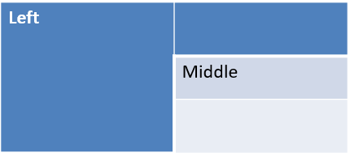

## **Ikhtisar**

Aspose.Slides memungkinkan Anda mengakses dan memodifikasi sel tabel dalam presentasi PowerPoint. Artikel ini menjelaskan cara mengidentifikasi sel tabel yang digabungkan, menghapus batas sel, bekerja dengan penomoran sel setelah menggabungkan atau memisahkan sel, mengubah warna latar belakang sel, dan menambahkan gambar di dalam sel tabel. Contoh-contoh menunjukkan cara membuat atau membuka presentasi, mengambil tabel dari slide, memperbarui format sel melalui properti sel, dan menyimpan presentasi yang dimodifikasi sebagai file PPTX.

Aspose.Slides menggunakan indeks berbasis nol untuk mengakses sel tabel dengan urutan `(column, row)`.

## **Identifikasi Sel Tabel yang Digabungkan**

Contoh ini membuka presentasi yang ada dan mengakses bentuk pertama pada slide pertama sebagai tabel. Asumsinya slide dan bentuk ada serta bentuk tersebut adalah tabel. Selanjutnya iterasi melalui semua baris dan kolom dan menggunakan [isMergedCell](https://reference.aspose.com/slides/nodejs-java/aspose.slides/cell/ismergedcell/) untuk mengidentifikasi sel dalam wilayah yang digabungkan. Untuk setiap kecocokan, contoh mencetak koordinat sel dalam urutan `row;column`, [getRowSpan](https://reference.aspose.com/slides/nodejs-java/aspose.slides/cell/getrowspan/), [getColSpan](https://reference.aspose.com/slides/nodejs-java/aspose.slides/cell/getcolspan/), dan koordinat awal wilayah, [getFirstRowIndex](https://reference.aspose.com/slides/nodejs-java/aspose.slides/cell/getfirstrowindex/) serta [getFirstColumnIndex](https://reference.aspose.com/slides/nodejs-java/aspose.slides/cell/getfirstcolumnindex/).

```javascript
const aspose = { slides: require("aspose.slides.via.java") };
const java = require("java");

const presentation = new aspose.slides.Presentation("presentation_with_table.pptx");
try {
    const slide = presentation.getSlides().get_Item(0);
    const table = slide.getShapes().get_Item(0);

    const rowCount = table.getRows().size();
    for (let rowIndex = 0; rowIndex < rowCount; rowIndex++) {
        const columnCount = table.getColumns().size();
        for (let columnIndex = 0; columnIndex < columnCount; columnIndex++) {
            const cell = table.get_Item(columnIndex, rowIndex);
            if (cell.isMergedCell()) {
                console.log("Cell %d;%d belongs to a merged region with RowSpan=%d and ColSpan=%d starting at %d;%d.", rowIndex, columnIndex, cell.getRowSpan(), cell.getColSpan(), cell.getFirstRowIndex(), cell.getFirstColumnIndex());
            }
        }
    }
} finally {
    presentation.dispose();
}
```

## **Hapus Batas Sel Tabel**

Buat sebuah [Presentation](https://reference.aspose.com/slides/nodejs-java/aspose.slides/presentation/) dan tambahkan tabel ke slide pertama dengan [addTable](https://reference.aspose.com/slides/nodejs-java/aspose.slides/shapecollection/addtable/). Lebar kolom, tinggi baris, dan posisi tabel ditentukan dalam poin. Contoh ini mengatur keempat batas sel menjadi [FillType.NoFill](https://reference.aspose.com/slides/nodejs-java/aspose.slides/filltype/), menjadikannya tidak terlihat.

```javascript
const aspose = { slides: require("aspose.slides.via.java") };
const java = require("java");

const presentation = new aspose.slides.Presentation();
try {
    const slide = presentation.getSlides().get_Item(0);

    const columnWidths = java.newArray("double", [50, 50, 50, 50]);
    const rowHeights = java.newArray("double", [50, 30, 30, 30, 30]);
    const table = slide.getShapes().addTable(100, 50, columnWidths, rowHeights);

    for (let rowIndex = 0; rowIndex < table.getRows().size(); rowIndex++) {
        const row = table.getRows().get_Item(rowIndex);
        for (let columnIndex = 0; columnIndex < row.size(); columnIndex++) {
            const cell = row.get_Item(columnIndex);
            cell.getCellFormat().getBorderTop().getFillFormat().setFillType(java.newByte(aspose.slides.FillType.NoFill));
            cell.getCellFormat().getBorderBottom().getFillFormat().setFillType(java.newByte(aspose.slides.FillType.NoFill));
            cell.getCellFormat().getBorderLeft().getFillFormat().setFillType(java.newByte(aspose.slides.FillType.NoFill));
            cell.getCellFormat().getBorderRight().getFillFormat().setFillType(java.newByte(aspose.slides.FillType.NoFill));
        }
    }

    presentation.save("table.pptx", aspose.slides.SaveFormat.Pptx);
} finally {
    presentation.dispose();
}
```

## **Tambahkan Garis Diagonal Sel**

Gunakan [getBorderDiagonalDown](https://reference.aspose.com/slides/nodejs-java/aspose.slides/cellformat/getborderdiagonaldown/) untuk menggambar garis dari sudut kiri‑atas ke kanan‑bawah, dan [getBorderDiagonalUp](https://reference.aspose.com/slides/nodejs-java/aspose.slides/cellformat/getborderdiagonalup/) untuk menggambar garis dari sudut kiri‑bawah ke kanan‑atas. Diagonal dapat menandai header sudut; kedua diagonal dapat membentuk X untuk menandai sel tidak berlaku.

Setiap diagonal adalah sebuah [LineFormat](https://reference.aspose.com/slides/nodejs-java/aspose.slides/lineformat/). Di dalam [getFillFormat](https://reference.aspose.com/slides/nodejs-java/aspose.slides/lineformat/getfillformat/), gunakan [setFillType](https://reference.aspose.com/slides/nodejs-java/aspose.slides/fillformat/setfilltype/) untuk memilih [FillType.Solid](https://reference.aspose.com/slides/nodejs-java/aspose.slides/filltype/) dan pilih warna melalui [getSolidFillColor](https://reference.aspose.com/slides/nodejs-java/aspose.slides/fillformat/getsolidfillcolor/). Atur lebar garis dalam poin dengan [setWidth](https://reference.aspose.com/slides/nodejs-java/aspose.slides/lineformat/setwidth/).

Contoh ini membuat tiga sel dalam satu baris: diagonal merah ke bawah, diagonal biru ke atas, dan kedua diagonal. Batas atas, bawah, kiri, dan kanan sel dibiarkan tidak berubah.

```javascript
const aspose = { slides: require("aspose.slides.via.java") };
const java = require("java");

const presentation = new aspose.slides.Presentation();
try {
    const slide = presentation.getSlides().get_Item(0);

    const columnWidths = java.newArray("double", [210, 210, 210]);
    const rowHeights = java.newArray("double", [160]);
    const table = slide.getShapes().addTable(45, 130, columnWidths, rowHeights);

    const downwardBorder = table.get_Item(0, 0).getCellFormat().getBorderDiagonalDown();
    downwardBorder.getFillFormat().setFillType(java.newByte(aspose.slides.FillType.Solid));
    downwardBorder.getFillFormat().getSolidFillColor().setColor(java.getStaticFieldValue("java.awt.Color", "RED"));
    downwardBorder.setWidth(3);

    const upwardBorder = table.get_Item(1, 0).getCellFormat().getBorderDiagonalUp();
    upwardBorder.getFillFormat().setFillType(java.newByte(aspose.slides.FillType.Solid));
    upwardBorder.getFillFormat().getSolidFillColor().setColor(java.getStaticFieldValue("java.awt.Color", "BLUE"));
    upwardBorder.setWidth(5);

    const crossDownwardBorder = table.get_Item(2, 0).getCellFormat().getBorderDiagonalDown();
    crossDownwardBorder.getFillFormat().setFillType(java.newByte(aspose.slides.FillType.Solid));
    crossDownwardBorder.getFillFormat().getSolidFillColor().setColor(java.getStaticFieldValue("java.awt.Color", "RED"));
    crossDownwardBorder.setWidth(3);

    const crossUpwardBorder = table.get_Item(2, 0).getCellFormat().getBorderDiagonalUp();
    crossUpwardBorder.getFillFormat().setFillType(java.newByte(aspose.slides.FillType.Solid));
    crossUpwardBorder.getFillFormat().getSolidFillColor().setColor(java.getStaticFieldValue("java.awt.Color", "BLUE"));
    crossUpwardBorder.setWidth(5);

    presentation.save("diagonal_cell_borders.pptx", aspose.slides.SaveFormat.Pptx);
} finally {
    presentation.dispose();
}
```

Diagonal merupakan properti pemformatan, bukan pemisahan sel. Setiap sel mempertahankan satu bingkai teks, diakses melalui [getTextFrame](https://reference.aspose.com/slides/nodejs-java/aspose.slides/cell/gettextframe/); wilayah di kedua sisi diagonal tidak dapat diedit secara terpisah.

Tabel yang disimpan, dirender di Microsoft PowerPoint:


*Dari kiri ke kanan: diagonal ke bawah (merah, 3 pt), diagonal ke atas (biru, 5 pt), dan kedua diagonal.*

## **Gabungkan Sel Tabel**

Gunakan [mergeCells](https://reference.aspose.com/slides/nodejs-java/aspose.slides/table/mergecells/) untuk menggabungkan rentang persegi panjang sel tabel menjadi satu sel. Tentukan sel pada sudut kiri‑atas dan kanan‑bawah rentang. Argumen akhir mengontrol apakah penggabungan dapat mencakup sel di luar rentang yang ditentukan; `false` menjaga penggabungan tetap dalam rentang tersebut.

Contoh ini membuat tabel 4‑by‑4 dengan kolom dan baris 70 poin, lalu menggabungkan empat sel tengah dari `(1, 1)` sampai `(2, 2)`. Sel yang dihasilkan membentang dua kolom dan dua baris, sementara grid dasar tabel tetap memiliki empat kolom dan empat baris. Untuk mengakses konten atau pemformatan sel yang digabungkan, gunakan posisi kiri‑atasnya: `table.get_Item(1, 1)` dalam contoh ini. Posisi lain dalam rentang yang digabungkan tetap menjadi bagian dari grid tabel, sehingga indeks sel di luar rentang tidak berubah.

```javascript
const aspose = { slides: require("aspose.slides.via.java") };
const java = require("java");

const presentation = new aspose.slides.Presentation();
try {
    const slide = presentation.getSlides().get_Item(0);

    const columnWidths = java.newArray("double", [70, 70, 70, 70]);
    const rowHeights = java.newArray("double", [70, 70, 70, 70]);
    const table = slide.getShapes().addTable(100, 50, columnWidths, rowHeights);

    table.mergeCells(table.get_Item(1, 1), table.get_Item(2, 2), false);

    presentation.save("merged_cells.pptx", aspose.slides.SaveFormat.Pptx);
} finally {
    presentation.dispose();
}
```

## **Pisahkan Sel Tabel**

Menggabungkan sel pada contoh sebelumnya mempertahankan grid tabel. Memisahkan sebuah sel dapat menambahkan kolom grid baru dan mengubah indeks kolom sel di sebelah kanannya. Aspose.Slides mengikuti model grid tabel PowerPoint.

Contoh ini membuat tabel 4‑by‑4 dengan kolom dan baris 70 poin dan memanggil [splitByWidth](https://reference.aspose.com/slides/nodejs-java/aspose.slides/cell/splitbywidth/) pada sel `(1, 1)`. Setengah lebar 70 poin sel tersebut diberikan untuk membuat dua sel dengan lebar yang sama.

Setelah pemisahan ini, dua bagian diakses sebagai `table.get_Item(1, 1)` dan `table.get_Item(2, 1)`. Grid tabel kini memiliki lima kolom: sel yang semula berada di kolom 2 dan 3 berpindah ke kolom 3 dan 4 masing‑masing. Indeks baris tetap tidak berubah. Gunakan indeks kolom yang diperbarui ini saat mengakses sel setelah pemisahan.

```javascript
const aspose = { slides: require("aspose.slides.via.java") };
const java = require("java");

const presentation = new aspose.slides.Presentation();
try {
    const slide = presentation.getSlides().get_Item(0);

    const columnWidths = java.newArray("double", [70, 70, 70, 70]);
    const rowHeights = java.newArray("double", [70, 70, 70, 70]);
    const table = slide.getShapes().addTable(100, 50, columnWidths, rowHeights);

    table.get_Item(1, 1).splitByWidth(table.get_Item(1, 1).getWidth() / 2);

    presentation.save("split_cells.pptx", aspose.slides.SaveFormat.Pptx);
} finally {
    presentation.dispose();
}
```

<!-- visual-explanation:manage-cells:start -->
[](visual-manage-cells-04c40789d81c.svg)

*Pemecahan lebar mempengaruhi sel (1, 1), menggunakan indeks (kolom, baris) berbasis nol. Baris lain mempertahankan sel yang membentang kedua posisi kolom baru.*
<!-- visual-explanation:manage-cells:end -->

### **Pisahkan Sel yang Digabungkan berdasarkan Baris atau Kolom**

Untuk menyiapkan sel templat yang digabungkan bagi pengisian data, gunakan [splitByRowSpan](https://reference.aspose.com/slides/nodejs-java/aspose.slides/cell/splitbyrowspan/) untuk memisahkan sepanjang batas baris yang ada, atau [splitByColSpan](https://reference.aspose.com/slides/nodejs-java/aspose.slides/cell/splitbycolspan/) untuk memisahkan sepanjang batas kolom.

Argumen `index` menghitung baris di bagian atas atau kolom di bagian kiri pemisahan; itu relatif terhadap wilayah yang digabungkan:

- Pemecahan baris: `0 < index <` [getRowSpan](https://reference.aspose.com/slides/nodejs-java/aspose.slides/cell/getrowspan/).
- Pemecahan kolom: `0 < index <` [getColSpan](https://reference.aspose.com/slides/nodejs-java/aspose.slides/cell/getcolspan/).

Contoh mengasumsikan presentasi memiliki tabel sebagai bentuk pertama pada slide pertama, dengan `(1, 2)` dan `(1, 3)` digabungkan secara vertikal. Dimulai dari posisi bawah, contoh menggunakan [getFirstColumnIndex](https://reference.aspose.com/slides/nodejs-java/aspose.slides/cell/getfirstcolumnindex/) dan [getFirstRowIndex](https://reference.aspose.com/slides/nodejs-java/aspose.slides/cell/getfirstrowindex/) untuk menemukan asal dan memeriksa kedua rentang. `splitByRowSpan(1)` kemudian memisahkan baris 2 dan 3 untuk nama produk. Untuk penggabungan dua kolom secara horizontal, gunakan `splitByColSpan(1)` sebagai gantinya.

```javascript
const aspose = { slides: require("aspose.slides.via.java") };
const java = require("java");

const presentation = new aspose.slides.Presentation("table_template.pptx");
try {
    const slide = presentation.getSlides().get_Item(0);
    const table = slide.getShapes().get_Item(0);

    const selectedCell = table.get_Item(1, 3);
    const firstColumnIndex = selectedCell.getFirstColumnIndex();
    const firstRowIndex = selectedCell.getFirstRowIndex();
    const mergedCell = table.get_Item(firstColumnIndex, firstRowIndex);

    if (mergedCell.isMergedCell() && mergedCell.getRowSpan() == 2 && mergedCell.getColSpan() == 1) {
        mergedCell.splitByRowSpan(1);

        // Ambil sel yang dihasilkan dari tabel setelah pemisahan.
        const upperCell = table.get_Item(firstColumnIndex, firstRowIndex);
        const lowerCell = table.get_Item(firstColumnIndex, firstRowIndex + 1);
        console.log("Upper cell merged: " + upperCell.isMergedCell());
        console.log("Lower cell merged: " + lowerCell.isMergedCell());

        upperCell.getTextFrame().setText("Product A");
        lowerCell.getTextFrame().setText("Product B");

        presentation.save("split_template.pptx", aspose.slides.SaveFormat.Pptx);
    } else {
        console.log("Select a merged region spanning exactly two rows and one column.");
    }
} finally {
    presentation.dispose();
}
```

Grid tabel dan indeks sel di sekitarnya tetap tidak berubah. Ambil sel yang dihasilkan dengan koordinatnya; di sini, keduanya memiliki rentang 1 dan [isMergedCell](https://reference.aspose.com/slides/nodejs-java/aspose.slides/cell/ismergedcell/) mencetak `false`. Wilayah yang lebih besar dapat tetap sebagian digabung setelah satu pemisahan.

Teks asli dan pemformatannya tetap berada di sel atas (atau kiri); sel baru kosong tetapi mewarisi pemformatan sel seperti isi, batas, dan margin. Isi sel setelah pemisahan dan atur pemformatan teks yang diperlukan secara eksplisit.

Presentasi yang disimpan berisi sel terpisah "Product A" dan "Product B" dengan pemformatan sel templat tetap dipertahankan. Lihat [Cell API Reference](https://reference.aspose.com/slides/nodejs-java/aspose.slides/cell/) untuk detail.

### **Pisahkan Sel pada Tinggi Tertentu**

[splitByHeight](https://reference.aspose.com/slides/nodejs-java/aspose.slides/cell/splitbyheight/) menerima tinggi bagian atas dalam poin. [splitByRowSpan](https://reference.aspose.com/slides/nodejs-java/aspose.slides/cell/splitbyrowspan/) menerima jumlah baris grid yang ada pada bagian atas. Untuk menempatkan sel 40 poin di tengah kolom kanan, kurangi 40 dari tinggi aktual sel dan bagi sisa ruang secara merata di atas dan di bawahnya.

```javascript
const aspose = { slides: require("aspose.slides.via.java") };
const java = require("java");

const presentation = new aspose.slides.Presentation();
try {
    const slide = presentation.getSlides().get_Item(0);

    const columnWidths = java.newArray("double", [160, 160]);
    const rowHeights = java.newArray("double", [140]);

    const table = slide.getShapes().addTable(50, 50, columnWidths, rowHeights);
    table.get_Item(0, 0).getTextFrame().setText("Left");

    const height = table.get_Item(1, 0).getHeight();
    const margin = (height - 40) / 2;

    table.get_Item(1, 0).splitByHeight(margin);
    table.get_Item(1, 1).splitByHeight(40);
    table.get_Item(1, 1).getTextFrame().setText("Middle");

    presentation.save("split_by_height.pptx", aspose.slides.SaveFormat.Pptx);
} finally {
    presentation.dispose();
}
```

Pemecahan pertama menambahkan baris grid dan meninggalkan 90 poin di bagian bawah sel `(1, 1)`. Pemecahan kedua membagi sel itu menjadi sel tengah 40 poin dan sel bawah 50 poin. Kolom kanan kini memiliki tiga sel dengan tinggi 50, 40, dan 50 poin dari atas ke bawah. Sel kiri membentang semua tiga baris dan mempertahankan tinggi aslinya 140 poin.



## **Ubah Warna Latar Belakang Sel Tabel**

Contoh ini membuat tabel dengan kolom 150 poin dan baris 50 poin. Ia menggunakan [setFillType](https://reference.aspose.com/slides/nodejs-java/aspose.slides/fillformat/setfilltype/) untuk memilih isi padat dan mengatur warna yang dikembalikan oleh [getSolidFillColor](https://reference.aspose.com/slides/nodejs-java/aspose.slides/fillformat/getsolidfillcolor/) menjadi merah untuk sel `(2, 3)`, yaitu kolom ketiga dan baris keempat.

```javascript
const aspose = { slides: require("aspose.slides.via.java") };
const java = require("java");

const presentation = new aspose.slides.Presentation();
try {
    const slide = presentation.getSlides().get_Item(0);

    const columnWidths = java.newArray("double", [150, 150, 150, 150]);
    const rowHeights = java.newArray("double", [50, 50, 50, 50, 50]);
    const table = slide.getShapes().addTable(50, 50, columnWidths, rowHeights);

    const cell = table.get_Item(2, 3);
    cell.getCellFormat().getFillFormat().setFillType(java.newByte(aspose.slides.FillType.Solid));
    cell.getCellFormat().getFillFormat().getSolidFillColor().setColor(java.getStaticFieldValue("java.awt.Color", "RED"));

    presentation.save("cell_background_color.pptx", aspose.slides.SaveFormat.Pptx);
} finally {
    presentation.dispose();
}
```

## **Tambahkan Gambar di Dalam Sel Tabel**

Tempatkan gambar masukan di direktori kerja sebelum menjalankan contoh ini. Ia memuat gambar dengan [Images.fromFile](https://reference.aspose.com/slides/nodejs-java/aspose.slides/images/#fromFile) dan menambahkannya ke koleksi gambar presentasi dengan [addImage](https://reference.aspose.com/slides/nodejs-java/aspose.slides/imagecollection/addimage/). Selanjutnya gambar tersebut ditetapkan ke isi gambar sel `(0, 0)`, sel pertama dalam tabel.

[PictureFillMode.Stretch](https://reference.aspose.com/slides/nodejs-java/aspose.slides/picturefillmode/) meregangkan gambar untuk mengisi sel, yang mungkin mengubah rasio aspeknya. Lebar kolom dan tinggi baris dalam poin. Gambar yang dimuat dibuang dalam blok `finally` setelah ditambahkan ke presentasi.

```javascript
const aspose = { slides: require("aspose.slides.via.java") };
const java = require("java");

const presentation = new aspose.slides.Presentation();
try {
    const slide = presentation.getSlides().get_Item(0);

    const columnWidths = java.newArray("double", [150, 150, 150, 150]);
    const rowHeights = java.newArray("double", [100, 100, 100, 100, 90]);
    const table = slide.getShapes().addTable(50, 50, columnWidths, rowHeights);

    let ppImage;
    const image = aspose.slides.Images.fromFile("aspose_logo.jpg");
    try {
        ppImage = presentation.getImages().addImage(image);
    } finally {
        image.dispose();
    }

    table.get_Item(0, 0).getCellFormat().getFillFormat().setFillType(java.newByte(aspose.slides.FillType.Picture));
    table.get_Item(0, 0).getCellFormat().getFillFormat().getPictureFillFormat().setPictureFillMode(aspose.slides.PictureFillMode.Stretch);
    table.get_Item(0, 0).getCellFormat().getFillFormat().getPictureFillFormat().getPicture().setImage(ppImage);

    presentation.save("table_cell_with_image.pptx", aspose.slides.SaveFormat.Pptx);
} finally {
    presentation.dispose();
}
```

## **FAQ**

**Apakah saya dapat mengatur ketebalan dan gaya garis yang berbeda untuk sisi yang berbeda dari satu sel?**

Ya. Batas [top](https://reference.aspose.com/slides/nodejs-java/aspose.slides/cellformat/getbordertop/)/[bottom](https://reference.aspose.com/slides/nodejs-java/aspose.slides/cellformat/getborderbottom/)/[left](https://reference.aspose.com/slides/nodejs-java/aspose.slides/cellformat/getborderleft/)/[right](https://reference.aspose.com/slides/nodejs-java/aspose.slides/cellformat/getborderright/) memiliki properti terpisah, sehingga ketebalan dan gaya setiap sisi dapat berbeda.

**Apa yang terjadi pada gambar jika saya mengubah ukuran kolom/baris setelah menetapkan gambar sebagai latar belakang sel?**

Perilaku tergantung pada [fill mode](https://reference.aspose.com/slides/nodejs-java/aspose.slides/picturefillmode/) (stretch/tile). Dengan stretch, gambar menyesuaikan dengan sel yang baru; dengan tile, ubin dihitung ulang.

**Apakah saya dapat menetapkan hyperlink ke seluruh konten sel?**

[Hyperlinks](/slides/id/nodejs-java/manage-hyperlinks/) diatur pada tingkat teks (bagian) di dalam bingkai teks sel atau pada tingkat seluruh tabel/bentuk. Praktiknya, Anda menetapkan tautan ke sebuah bagian atau ke seluruh teks dalam sel.

**Apakah saya dapat mengatur font yang berbeda dalam satu sel?**

Ya. Bingkai teks sel mendukung [portions](https://reference.aspose.com/slides/nodejs-java/aspose.slides/portion/) (run) dengan pemformatan independen—jenis font, gaya, ukuran, dan warna.