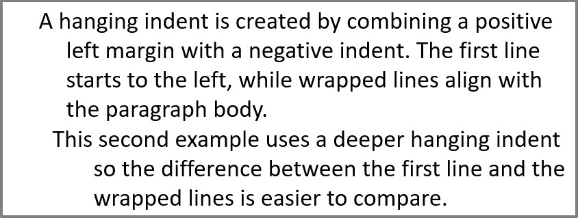

## **Ikhtisar**

Aspose.Slides for PHP via Java merepresentasikan teks sebagai hierarki frame teks, paragraf, dan bagian:

* [TextFrame](https://reference.aspose.com/slides/php-java/aspose.slides/textframe/) mewakili kontainer teks dalam sebuah bentuk dan menyediakan akses ke koleksi paragrafnya.
* [Paragraph](https://reference.aspose.com/slides/php-java/aspose.slides/paragraph/) mewakili satu paragraf dalam sebuah frame teks dan menyediakan akses ke bagian‑bagian serta pemformatan tingkat paragraf.
* [Portion](https://reference.aspose.com/slides/php-java/aspose.slides/portion/) mewakili urutan teks dalam sebuah paragraf. Setiap bagian dapat memiliki teks sendiri dan pemformatan tingkat karakter.

Dengan demikian, sebuah paragraf dapat berisi teks dengan font, warna, ukuran, dan pemformatan lain yang berbeda‑beda dengan menggunakan beberapa bagian.

## **Buat dan Format Paragraf**

Buat paragraf dalam frame teks sebuah bentuk dan gunakan bagian untuk memformat urutan teks individu. Bagian ini menunjukkan cara menggabungkan beberapa bagian dalam setiap paragraf serta menerapkan warna, ukuran font, dan gaya yang berbeda.

### **Buat Paragraf dengan Beberapa Bagian**

Contoh PHP berikut membuat tiga paragraf, masing‑masing berisi tiga urutan teks dalam koleksi yang dikembalikan oleh [Paragraph::getPortions](https://reference.aspose.com/slides/php-java/aspose.slides/paragraph/#getPortions). Ia menggunakan kembali paragraf default dan bagian kosongnya, kemudian menambahkan paragraf dan bagian yang tersisa. Pemformatan diterapkan melalui [Portion::getPortionFormat](https://reference.aspose.com/slides/php-java/aspose.slides/portion/#getPortionFormat): bagian pertama dalam setiap paragraf berwarna merah, tebal, dan 15 poin; bagian kedua berwarna biru, miring, dan 18 poin. Bagian ketiga mempertahankan pemformatan defaultnya:

```php
use aspose\slides\FillType;
use aspose\slides\NullableBool;
use aspose\slides\Paragraph;
use aspose\slides\Portion;
use aspose\slides\Presentation;
use aspose\slides\SaveFormat;
use aspose\slides\ShapeType;

$presentation = new Presentation();
try {
    $slide = $presentation->getSlides()->get_Item(0);

    $shape = $slide->getShapes()->addAutoShape(ShapeType::Rectangle, 50, 150, 300, 150);
    $textFrame = $shape->getTextFrame();

    $firstParagraph = $textFrame->getParagraphs()->get_Item(0);
    $firstParagraph->getPortions()->add(new Portion());
    $firstParagraph->getPortions()->add(new Portion());

    $secondParagraph = new Paragraph();
    $secondParagraph->getPortions()->add(new Portion());
    $secondParagraph->getPortions()->add(new Portion());
    $secondParagraph->getPortions()->add(new Portion());
    $textFrame->getParagraphs()->add($secondParagraph);

    $thirdParagraph = new Paragraph();
    $thirdParagraph->getPortions()->add(new Portion());
    $thirdParagraph->getPortions()->add(new Portion());
    $thirdParagraph->getPortions()->add(new Portion());
    $textFrame->getParagraphs()->add($thirdParagraph);

    $paragraphCount = java_values($textFrame->getParagraphs()->getCount());
    for ($paragraphIndex = 0; $paragraphIndex < $paragraphCount; $paragraphIndex++) {
        $paragraph = $textFrame->getParagraphs()->get_Item($paragraphIndex);
        $portionCount = java_values($paragraph->getPortions()->getCount());
        for ($portionIndex = 0; $portionIndex < $portionCount; $portionIndex++) {
            $portion = $paragraph->getPortions()->get_Item($portionIndex);
            $portion->setText("Portion " . ($paragraphIndex + 1) . "." . ($portionIndex + 1));

            if ($portionIndex == 0) {
                $portion->getPortionFormat()->getFillFormat()->setFillType(FillType::Solid);
                $portion->getPortionFormat()->getFillFormat()->getSolidFillColor()->setColor(java("java.awt.Color")->RED);
                $portion->getPortionFormat()->setFontBold(NullableBool::True);
                $portion->getPortionFormat()->setFontHeight(15);
            } else if ($portionIndex == 1) {
                $portion->getPortionFormat()->getFillFormat()->setFillType(FillType::Solid);
                $portion->getPortionFormat()->getFillFormat()->getSolidFillColor()->setColor(java("java.awt.Color")->BLUE);
                $portion->getPortionFormat()->setFontItalic(NullableBool::True);
                $portion->getPortionFormat()->setFontHeight(18);
            }
        }
    }

    $presentation->save("paragraphs_with_portions.pptx", SaveFormat::Pptx);
} finally {
    $presentation->dispose();
}
```

## **Buat Daftar Bertitik dan Bernomor**

Atur teks paragraf menjadi daftar dengan simbol, angka, atau gambar khusus. Contoh‑contoh dalam bagian ini mencakup pemformatan bullet, daftar berjenjang, dan penomoran mulai dari nilai khusus.

### **Buat Daftar Bertitik atau Bernomor**

Bullet dan penomoran memudahkan pemindaian item terkait. Di Aspose.Slides, pengaturan daftar didefinisikan melalui [BulletFormat](https://reference.aspose.com/slides/php-java/aspose.slides/bulletformat/).

Contoh PHP ini menambahkan bullet simbol dan item bernomor ke frame teks yang sama. [BulletFormat::setType](https://reference.aspose.com/slides/php-java/aspose.slides/bulletformat/#setType) memilih jenis bullet, sementara [BulletFormat::setChar](https://reference.aspose.com/slides/php-java/aspose.slides/bulletformat/#setChar) memberikan simbol dan [BulletFormat::setNumberedBulletStyle](https://reference.aspose.com/slides/php-java/aspose.slides/bulletformat/#setNumberedBulletStyle) memilih gaya penomoran. Kedua item menggunakan bullet hitam dengan tinggi 100 % dan indentasi paragraf 25 poin:

```php
use aspose\slides\BulletType;
use aspose\slides\ColorType;
use aspose\slides\NullableBool;
use aspose\slides\NumberedBulletStyle;
use aspose\slides\Paragraph;
use aspose\slides\Presentation;
use aspose\slides\SaveFormat;
use aspose\slides\ShapeType;

$presentation = new Presentation();
try {
    $slide = $presentation->getSlides()->get_Item(0);

    $shape = $slide->getShapes()->addAutoShape(ShapeType::Rectangle, 200, 200, 400, 200);
    $textFrame = $shape->getTextFrame();
    $textFrame->getParagraphs()->clear();

    $symbolParagraph = new Paragraph();
    $symbolParagraph->setText("Welcome to Aspose.Slides");
    $symbolParagraph->getParagraphFormat()->getBullet()->setType(BulletType::Symbol);
    $symbolParagraph->getParagraphFormat()->getBullet()->setChar("•");
    $symbolParagraph->getParagraphFormat()->setIndent(25);
    $symbolParagraph->getParagraphFormat()->getBullet()->getColor()->setColorType(ColorType::RGB);
    $symbolParagraph->getParagraphFormat()->getBullet()->getColor()->setColor(java("java.awt.Color")->BLACK);
    $symbolParagraph->getParagraphFormat()->getBullet()->setBulletHardColor(NullableBool::True);
    $symbolParagraph->getParagraphFormat()->getBullet()->setHeight(100);
    $textFrame->getParagraphs()->add($symbolParagraph);

    $numberedParagraph = new Paragraph();
    $numberedParagraph->setText("This is a numbered item");
    $numberedParagraph->getParagraphFormat()->getBullet()->setType(BulletType::Numbered);
    $numberedParagraph->getParagraphFormat()->getBullet()->setNumberedBulletStyle(NumberedBulletStyle::BulletCircleNumWDBlackPlain);
    $numberedParagraph->getParagraphFormat()->setIndent(25);
    $numberedParagraph->getParagraphFormat()->getBullet()->getColor()->setColorType(ColorType::RGB);
    $numberedParagraph->getParagraphFormat()->getBullet()->getColor()->setColor(java("java.awt.Color")->BLACK);
    $numberedParagraph->getParagraphFormat()->getBullet()->setBulletHardColor(NullableBool::True);
    $numberedParagraph->getParagraphFormat()->getBullet()->setHeight(100);
    $textFrame->getParagraphs()->add($numberedParagraph);

    $presentation->save("bulleted_and_numbered_list.pptx", SaveFormat::Pptx);
} finally {
    $presentation->dispose();
}
```

### **Gunakan Bullet Gambar**

Bullet gambar memungkinkan Anda menggunakan gambar khusus alih‑alih simbol atau angka.

Contoh PHP ini menambahkan gambar ke koleksi gambar presentasi sebagai [PPImage](https://reference.aspose.com/slides/php-java/aspose.slides/ppimage/) dan menggunakannya sebagai bullet paragraf. Ia memanggil [BulletFormat::setType](https://reference.aspose.com/slides/php-java/aspose.slides/bulletformat/#setType) untuk menggunakan bullet gambar dan menetapkan gambar melalui [BulletFormat::getPicture](https://reference.aspose.com/slides/php-java/aspose.slides/bulletformat/#getPicture). [BulletFormat::setHeight](https://reference.aspose.com/slides/php-java/aspose.slides/bulletformat/#setHeight) diatur ke 100 % untuk menyesuaikan ukuran bullet terhadap teks paragraf:

```php
use aspose\slides\BulletType;
use aspose\slides\Images;
use aspose\slides\Paragraph;
use aspose\slides\Presentation;
use aspose\slides\SaveFormat;
use aspose\slides\ShapeType;

$presentation = new Presentation();
try {
    $slide = $presentation->getSlides()->get_Item(0);

    $bulletImage = Images::fromFile("bullets.png");
    try {
        $presentationImage = $presentation->getImages()->addImage($bulletImage);
    } finally {
        $bulletImage->dispose();
    }

    $shape = $slide->getShapes()->addAutoShape(ShapeType::Rectangle, 200, 200, 400, 200);
    $textFrame = $shape->getTextFrame();
    $textFrame->getParagraphs()->clear();

    $paragraph = new Paragraph();
    $paragraph->setText("Welcome to Aspose.Slides");
    $paragraph->getParagraphFormat()->getBullet()->setType(BulletType::Picture);
    $paragraph->getParagraphFormat()->getBullet()->getPicture()->setImage($presentationImage);
    $paragraph->getParagraphFormat()->getBullet()->setHeight(100);
    $textFrame->getParagraphs()->add($paragraph);

    $presentation->save("picture_bullet.pptx", SaveFormat::Pptx);
    $presentation->save("picture_bullet.ppt", SaveFormat::Ppt);
} finally {
    $presentation->dispose();
}
```

### **Buat Daftar Berjenjang**

Setel [ParagraphFormat::setDepth](https://reference.aspose.com/slides/php-java/aspose.slides/paragraphformat/#setDepth) untuk menempatkan paragraf pada level berjenjang dalam sebuah daftar. Level teratas memiliki kedalaman `0`.

Contoh PHP ini menetapkan nilai [ParagraphFormat::setDepth](https://reference.aspose.com/slides/php-java/aspose.slides/paragraphformat/#setDepth) dari 0 hingga 3 pada empat paragraf, membentuk hierarki dalam satu frame teks. Setiap paragraf menggunakan bullet simbol, dengan [BulletFormat::setChar](https://reference.aspose.com/slides/php-java/aspose.slides/bulletformat/#setChar) berganti antara bullet bulat dan tanda hubung untuk membedakan level berdekatan:

```php
use aspose\slides\BulletType;
use aspose\slides\FillType;
use aspose\slides\Paragraph;
use aspose\slides\Presentation;
use aspose\slides\SaveFormat;
use aspose\slides\ShapeType;

$presentation = new Presentation();
try {
    $slide = $presentation->getSlides()->get_Item(0);

    $shape = $slide->getShapes()->addAutoShape(ShapeType::Rectangle, 200, 200, 400, 200);
    $textFrame = $shape->getTextFrame();
    $textFrame->getParagraphs()->clear();

    $firstParagraph = new Paragraph();
    $firstParagraph->setText("Content");
    $firstParagraph->getParagraphFormat()->getBullet()->setType(BulletType::Symbol);
    $firstParagraph->getParagraphFormat()->getBullet()->setChar("•");
    $firstParagraph->getParagraphFormat()->getDefaultPortionFormat()->getFillFormat()->setFillType(FillType::Solid);
    $firstParagraph->getParagraphFormat()->getDefaultPortionFormat()->getFillFormat()->getSolidFillColor()->setColor(java("java.awt.Color")->BLACK);
    $firstParagraph->getParagraphFormat()->setDepth(0);

    $secondParagraph = new Paragraph();
    $secondParagraph->setText("Second level");
    $secondParagraph->getParagraphFormat()->getBullet()->setType(BulletType::Symbol);
    $secondParagraph->getParagraphFormat()->getBullet()->setChar('-');
    $secondParagraph->getParagraphFormat()->getDefaultPortionFormat()->getFillFormat()->setFillType(FillType::Solid);
    $secondParagraph->getParagraphFormat()->getDefaultPortionFormat()->getFillFormat()->getSolidFillColor()->setColor(java("java.awt.Color")->BLACK);
    $secondParagraph->getParagraphFormat()->setDepth(1);

    $thirdParagraph = new Paragraph();
    $thirdParagraph->setText("Third level");
    $thirdParagraph->getParagraphFormat()->getBullet()->setType(BulletType::Symbol);
    $thirdParagraph->getParagraphFormat()->getBullet()->setChar("•");
    $thirdParagraph->getParagraphFormat()->getDefaultPortionFormat()->getFillFormat()->setFillType(FillType::Solid);
    $thirdParagraph->getParagraphFormat()->getDefaultPortionFormat()->getFillFormat()->getSolidFillColor()->setColor(java("java.awt.Color")->BLACK);
    $thirdParagraph->getParagraphFormat()->setDepth(2);

    $fourthParagraph = new Paragraph();
    $fourthParagraph->setText("Fourth level");
    $fourthParagraph->getParagraphFormat()->getBullet()->setType(BulletType::Symbol);
    $fourthParagraph->getParagraphFormat()->getBullet()->setChar('-');
    $fourthParagraph->getParagraphFormat()->getDefaultPortionFormat()->getFillFormat()->setFillType(FillType::Solid);
    $fourthParagraph->getParagraphFormat()->getDefaultPortionFormat()->getFillFormat()->getSolidFillColor()->setColor(java("java.awt.Color")->BLACK);
    $fourthParagraph->getParagraphFormat()->setDepth(3);

    $textFrame->getParagraphs()->add($firstParagraph);
    $textFrame->getParagraphs()->add($secondParagraph);
    $textFrame->getParagraphs()->add($thirdParagraph);
    $textFrame->getParagraphs()->add($fourthParagraph);

    $presentation->save("multilevel_list.pptx", SaveFormat::Pptx);
} finally {
    $presentation->dispose();
}
```

### **Mulai Item Daftar Bernomor dengan Nilai Khusus**

Gunakan [BulletFormat::setNumberedBulletStartWith](https://reference.aspose.com/slides/php-java/aspose.slides/bulletformat/#setNumberedBulletStartWith) untuk menentukan angka awal yang ditampilkan pada paragraf bernomor.

Contoh PHP ini menetapkan [BulletFormat::setType](https://reference.aspose.com/slides/php-java/aspose.slides/bulletformat/#setType) untuk menggunakan penomoran pada tiga paragraf dan menetapkan nilai [BulletFormat::setNumberedBulletStartWith](https://reference.aspose.com/slides/php-java/aspose.slides/bulletformat/#setNumberedBulletStartWith) masing‑masing 2, 3, dan 7. Nilai awal dikonfigurasi secara terpisah untuk setiap paragraf, memungkinkan angka yang ditampilkan melewati nilai tertentu:

```php
use aspose\slides\BulletType;
use aspose\slides\Paragraph;
use aspose\slides\Presentation;
use aspose\slides\SaveFormat;
use aspose\slides\ShapeType;

$presentation = new Presentation();
try {
    $slide = $presentation->getSlides()->get_Item(0);

    $shape = $slide->getShapes()->addAutoShape(ShapeType::Rectangle, 200, 200, 400, 200);
    $textFrame = $shape->getTextFrame();
    $textFrame->getParagraphs()->clear();

    $firstParagraph = new Paragraph();
    $firstParagraph->setText("Start at 2");
    $firstParagraph->getParagraphFormat()->getBullet()->setType(BulletType::Numbered);
    $firstParagraph->getParagraphFormat()->getBullet()->setNumberedBulletStartWith(2);
    $textFrame->getParagraphs()->add($firstParagraph);

    $secondParagraph = new Paragraph();
    $secondParagraph->setText("Start at 3");
    $secondParagraph->getParagraphFormat()->getBullet()->setType(BulletType::Numbered);
    $secondParagraph->getParagraphFormat()->getBullet()->setNumberedBulletStartWith(3);
    $textFrame->getParagraphs()->add($secondParagraph);

    $thirdParagraph = new Paragraph();
    $thirdParagraph->setText("Start at 7");
    $thirdParagraph->getParagraphFormat()->getBullet()->setType(BulletType::Numbered);
    $thirdParagraph->getParagraphFormat()->getBullet()->setNumberedBulletStartWith(7);
    $textFrame->getParagraphs()->add($thirdParagraph);

    $presentation->save("custom_numbered_list.pptx", SaveFormat::Pptx);
} finally {
    $presentation->dispose();
}
```

## **Kontrol Tata Letak Paragraf dan Properti Akhir**

Sesuaikan margin dan indentasi paragraf untuk mengontrol posisi baris pertama dan baris terbalut. Anda juga dapat memformat tanda akhir paragraf secara terpisah dari bagian teks yang terlihat.

### **Tetapkan Indentasi Baris Pertama**

Gunakan metode [ParagraphFormat::setIndent](https://reference.aspose.com/slides/php-java/aspose.slides/paragraphformat/#setIndent) untuk mengontrol indentasi baris pertama paragraf. Pengaturan ini memindahkan hanya baris pertama relatif terhadap margin kiri paragraf. Nilai positif menggeser baris pertama ke kanan, sementara baris‑baris lainnya tetap sejajar dengan badan paragraf.

Gunakan [ParagraphFormat::setMarginLeft](https://reference.aspose.com/slides/php-java/aspose.slides/paragraphformat/#setMarginLeft) ketika Anda perlu memindahkan seluruh paragraf. Gunakan [ParagraphFormat::setIndent](https://reference.aspose.com/slides/php-java/aspose.slides/paragraphformat/#setIndent) ketika Anda hanya perlu memindahkan baris pertama.

Contoh berikut memberikan tiga paragraf margin kiri yang sama sebesar 20 poin melalui [ParagraphFormat::setMarginLeft](https://reference.aspose.com/slides/php-java/aspose.slides/paragraphformat/#setMarginLeft) dan nilai indentasi [ParagraphFormat::setIndent](https://reference.aspose.com/slides/php-java/aspose.slides/paragraphformat/#setIndent) sebesar 0, 20, dan 40 poin. Baris pertama mulai pada offset yang semakin besar, sementara baris terbalut mempertahankan margin kiri yang sama:

```php
use aspose\slides\FillType;
use aspose\slides\Paragraph;
use aspose\slides\Presentation;
use aspose\slides\SaveFormat;
use aspose\slides\ShapeType;
use aspose\slides\TextAutofitType;

$presentation = new Presentation();
try {
    $slide = $presentation->getSlides()->get_Item(0);

    $shape = $slide->getShapes()->addAutoShape(ShapeType::Rectangle, 50, 50, 420, 220);
    $shape->getFillFormat()->setFillType(FillType::NoFill);
    $shape->getLineFormat()->getFillFormat()->setFillType(FillType::Solid);
    $shape->getLineFormat()->getFillFormat()->getSolidFillColor()->setColor(java("java.awt.Color")->GRAY);

    $textFrame = $shape->getTextFrame();
    $textFrame->getTextFrameFormat()->setAutofitType(TextAutofitType::Shape);
    $textFrame->getParagraphs()->clear();

    $firstParagraph = new Paragraph();
    $firstParagraph->setText("No first-line indent. Wrapped lines start at the same position as the first line.");
    $firstParagraph->getParagraphFormat()->getDefaultPortionFormat()->getFillFormat()->setFillType(FillType::Solid);
    $firstParagraph->getParagraphFormat()->getDefaultPortionFormat()->getFillFormat()->getSolidFillColor()->setColor(java("java.awt.Color")->BLACK);
    $firstParagraph->getParagraphFormat()->setMarginLeft(20.0);
    $firstParagraph->getParagraphFormat()->setIndent(0.0);

    $secondParagraph = new Paragraph();
    $secondParagraph->setText("First-line indent of 20 points. The first line moves to the right, while wrapped lines remain aligned to the paragraph body.");
    $secondParagraph->getParagraphFormat()->getDefaultPortionFormat()->getFillFormat()->setFillType(FillType::Solid);
    $secondParagraph->getParagraphFormat()->getDefaultPortionFormat()->getFillFormat()->getSolidFillColor()->setColor(java("java.awt.Color")->BLACK);
    $secondParagraph->getParagraphFormat()->setMarginLeft(20.0);
    $secondParagraph->getParagraphFormat()->setIndent(20.0);

    $thirdParagraph = new Paragraph();
    $thirdParagraph->setText("First-line indent of 40 points. This paragraph shows a larger first-line offset to make the effect easier to see.");
    $thirdParagraph->getParagraphFormat()->getDefaultPortionFormat()->getFillFormat()->setFillType(FillType::Solid);
    $thirdParagraph->getParagraphFormat()->getDefaultPortionFormat()->getFillFormat()->getSolidFillColor()->setColor(java("java.awt.Color")->BLACK);
    $thirdParagraph->getParagraphFormat()->setMarginLeft(20.0);
    $thirdParagraph->getParagraphFormat()->setIndent(40.0);

    $textFrame->getParagraphs()->add($firstParagraph);
    $textFrame->getParagraphs()->add($secondParagraph);
    $textFrame->getParagraphs()->add($thirdParagraph);

    $presentation->save("paragraph_indent.pptx", SaveFormat::Pptx);
} finally {
    $presentation->dispose();
}
```

Hasilnya:


### **Tetapkan Indentasi Gantung**

Indentasi gantung adalah tata letak paragraf di mana baris pertama mulai lebih ke kiri daripada baris‑baris berikutnya. Di Aspose.Slides, Anda menciptakan efek ini dengan properti [ParagraphFormat::setIndent](https://reference.aspose.com/slides/php-java/aspose.slides/paragraphformat/#setIndent). Setel `Indent` ke nilai negatif untuk menggerakkan baris pertama ke kiri relatif terhadap badan paragraf.

Secara praktis, [ParagraphFormat::setMarginLeft](https://reference.aspose.com/slides/php-java/aspose.slides/paragraphformat/#setMarginLeft) menentukan posisi kiri badan paragraf, dan [ParagraphFormat::setIndent](https://reference.aspose.com/slides/php-java/aspose.slides/paragraphformat/#setIndent) menentukan posisi baris pertama relatif terhadap margin tersebut. Untuk membuat indentasi gantung, setel nilai `MarginLeft` positif dan nilai `Indent` negatif.

Pemformatan ini berguna untuk bibliografi, referensi, entri glosarium, dan paragraf lain di mana baris terbalut harus sejajar di bawah badan paragraf, bukan di bawah karakter pertama baris pertama.

Contoh PHP berikut memadukan nilai [ParagraphFormat::setMarginLeft](https://reference.aspose.com/slides/php-java/aspose.slides/paragraphformat/#setMarginLeft) sebesar 40 dan 60 poin dengan nilai [ParagraphFormat::setIndent](https://reference.aspose.com/slides/php-java/aspose.slides/paragraphformat/#setIndent) sebesar -20 dan -30 poin. Pada masing‑masing paragraf, baris pertama mulai lebih ke kiri daripada baris terbalut; paragraf kedua memiliki indentasi gantung yang lebih dalam:

```php
use aspose\slides\FillType;
use aspose\slides\Paragraph;
use aspose\slides\Presentation;
use aspose\slides\SaveFormat;
use aspose\slides\ShapeType;
use aspose\slides\TextAutofitType;

$presentation = new Presentation();
try {
    $slide = $presentation->getSlides()->get_Item(0);

    $shape = $slide->getShapes()->addAutoShape(ShapeType::Rectangle, 50, 50, 420, 220);
    $shape->getFillFormat()->setFillType(FillType::NoFill);
    $shape->getLineFormat()->getFillFormat()->setFillType(FillType::Solid);
    $shape->getLineFormat()->getFillFormat()->getSolidFillColor()->setColor(java("java.awt.Color")->GRAY);

    $textFrame = $shape->getTextFrame();
    $textFrame->getTextFrameFormat()->setAutofitType(TextAutofitType::Shape);
    $textFrame->getParagraphs()->clear();

    $firstParagraph = new Paragraph();
    $firstParagraph->setText("A hanging indent is created by combining a positive left margin with a negative indent. The first line starts to the left, while wrapped lines align with the paragraph body.");
    $firstParagraph->getParagraphFormat()->getDefaultPortionFormat()->getFillFormat()->setFillType(FillType::Solid);
    $firstParagraph->getParagraphFormat()->getDefaultPortionFormat()->getFillFormat()->getSolidFillColor()->setColor(java("java.awt.Color")->BLACK);
    $firstParagraph->getParagraphFormat()->setMarginLeft(40.0);
    $firstParagraph->getParagraphFormat()->setIndent(-20.0);

    $secondParagraph = new Paragraph();
    $secondParagraph->setText("This second example uses a deeper hanging indent so the difference between the first line and the wrapped lines is easier to compare.");
    $secondParagraph->getParagraphFormat()->getDefaultPortionFormat()->getFillFormat()->setFillType(FillType::Solid);
    $secondParagraph->getParagraphFormat()->getDefaultPortionFormat()->getFillFormat()->getSolidFillColor()->setColor(java("java.awt.Color")->BLACK);
    $secondParagraph->getParagraphFormat()->setMarginLeft(60.0);
    $secondParagraph->getParagraphFormat()->setIndent(-30.0);

    $textFrame->getParagraphs()->add($firstParagraph);
    $textFrame->getParagraphs()->add($secondParagraph);

    $presentation->save("hanging_indent.pptx", SaveFormat::Pptx);
} finally {
    $presentation->dispose();
}
```

Hasilnya:



### **Set Properti Run Akhir Paragraf**

Metode [Paragraph::setEndParagraphPortionFormat](https://reference.aspose.com/slides/php-java/aspose.slides/paragraph/#setEndParagraphPortionFormat) mengontrol pemformatan tanda akhir paragraf. Contoh berikut membuat sebuah [PortionFormat](https://reference.aspose.com/slides/php-java/aspose.slides/portionformat/) dengan [BasePortionFormat::setFontHeight](https://reference.aspose.com/slides/php-java/aspose.slides/baseportionformat/#setFontHeight) di‑set ke 48 poin dan [BasePortionFormat::setLatinFont](https://reference.aspose.com/slides/php-java/aspose.slides/baseportionformat/#setLatinFont) di‑set ke Times New Roman. Format ini diterapkan pada tanda akhir paragraf kedua, sementara bagian teks yang terlihat tetap tidak berubah:

```php
use aspose\slides\FontData;
use aspose\slides\Paragraph;
use aspose\slides\Portion;
use aspose\slides\PortionFormat;
use aspose\slides\Presentation;
use aspose\slides\SaveFormat;
use aspose\slides\ShapeType;

$presentation = new Presentation("Test.pptx");
try {
    $slide = $presentation->getSlides()->get_Item(0);

    $shape = $slide->getShapes()->addAutoShape(ShapeType::Rectangle, 10, 10, 200, 250);
    $textFrame = $shape->getTextFrame();
    $textFrame->getParagraphs()->clear();

    $firstParagraph = new Paragraph();
    $firstParagraph->getPortions()->add(new Portion("Sample text"));

    $secondParagraph = new Paragraph();
    $secondParagraph->getPortions()->add(new Portion("Sample text 2"));

    $endParagraphFormat = new PortionFormat();
    $endParagraphFormat->setFontHeight(48);
    $endParagraphFormat->setLatinFont(new FontData("Times New Roman"));
    $secondParagraph->setEndParagraphPortionFormat($endParagraphFormat);

    $textFrame->getParagraphs()->add($firstParagraph);
    $textFrame->getParagraphs()->add($secondParagraph);

    $presentation->save("end_paragraph_format.pptx", SaveFormat::Pptx);
} finally {
    $presentation->dispose();
}
```

## **Hitung Baris yang Dirender**

Untuk aturan paragraf yang memengaruhi pembungkusan otomatis dan tanda baca pada akhir baris, lihat [Control Line Breaking](/slides/id/php-java/text-formatting/#control-line-breaking) dan [Control Hanging Punctuation](/slides/id/php-java/text-formatting/#control-hanging-punctuation).

Gunakan [Paragraph::getLinesCount](https://reference.aspose.com/slides/php-java/aspose.slides/paragraph/#getLinesCount) untuk menghitung jumlah baris yang ditempati oleh sebuah paragraf setelah tata letak teks, termasuk pembungkusan otomatis. Ini berguna saat memeriksa panjang teks dan tata letak dalam templat presentasi.

Sebuah paragraf merupakan satu item dalam [TextFrame::getParagraphs](https://reference.aspose.com/slides/php-java/aspose.slides/textframe/#getParagraphs), dan dapat menempati beberapa baris yang dirender. Penyisipan pemutusan baris eksplisit dalam paragraf memaksa baris baru tanpa membuat paragraf lain. Pembungkusan otomatis menciptakan baris berdasarkan lebar yang tersedia tanpa menyisipkan pemutusan baris eksplisit ke dalam teks. Karena itu menghitung paragraf atau karakter pemutusan baris tidak memberikan jumlah baris yang dirender.

Contoh berikut membuat sebuah shape teks, menghitung barisnya, mempersempit shape, dan kemudian mengganti teks dengan string yang lebih pendek. Contoh ini mengaktifkan pembungkusan dengan [TextFrameFormat::setWrapText](https://reference.aspose.com/slides/php-java/aspose.slides/textframeformat/#setWrapText) dan menonaktifkan autofit dengan [TextFrameFormat::setAutofitType](https://reference.aspose.com/slides/php-java/aspose.slides/textframeformat/#setAutofitType) sehingga lebar shape mengontrol pembungkusan tanpa secara otomatis memperkecil teks atau mengubah ukuran shape. Setiap pengukuran menggunakan [Paragraph::getLinesCount](https://reference.aspose.com/slides/php-java/aspose.slides/paragraph/#getLinesCount). Dimensi shape dalam poin. Akhirnya, contoh menambahkan paragraf lain dan menjumlahkan jumlah baris di seluruh frame teks.

```php
use aspose\slides\NullableBool;
use aspose\slides\Paragraph;
use aspose\slides\Presentation;
use aspose\slides\ShapeType;
use aspose\slides\TextAutofitType;

$presentation = new Presentation();
try {
    $slide = $presentation->getSlides()->get_Item(0);

    $shape = $slide->getShapes()->addAutoShape(ShapeType::Rectangle, 50, 50, 400, 200);
    $textFrame = $shape->getTextFrame();
    $textFrame->getTextFrameFormat()->setWrapText(NullableBool::True);
    $textFrame->getTextFrameFormat()->setAutofitType(TextAutofitType::None);

    $paragraph = $textFrame->getParagraphs()->get_Item(0);
    $paragraph->getParagraphFormat()->getDefaultPortionFormat()->setFontHeight(20);
    $paragraph->setText("This text demonstrates how automatic wrapping changes the number of rendered lines.");
    echo "Original width: " . java_values($paragraph->getLinesCount()) . PHP_EOL;

    $shape->setWidth(150);
    echo "Narrower shape: " . java_values($paragraph->getLinesCount()) . PHP_EOL;

    $paragraph->setText("Short text.");
    echo "Shorter text: " . java_values($paragraph->getLinesCount()) . PHP_EOL;

    $secondParagraph = new Paragraph();
    $secondParagraph->setText("Another paragraph.");
    $secondParagraph->getParagraphFormat()->getDefaultPortionFormat()->setFontHeight(20);
    $textFrame->getParagraphs()->add($secondParagraph);

    $totalLineCount = 0;
    for ($i = 0; $i < java_values($textFrame->getParagraphs()->getCount()); $i++) {
        $currentParagraph = $textFrame->getParagraphs()->get_Item($i);
        $totalLineCount += java_values($currentParagraph->getLinesCount());
    }
    echo "Total lines in the text frame: " . $totalLineCount . PHP_EOL;
} finally {
    $presentation->dispose();
}
```

Dengan teks dan dimensi ini, mempersempit shape meningkatkan jumlah baris, sementara mengganti teks dengan string pendek menurunkannya. Hitungan tepat dapat bervariasi tergantung pada ketersediaan dan substitusi font, ukuran font, margin, indentasi, pembungkusan, dan pengaturan autofit. Gunakan font dan pengaturan tata letak yang dimaksudkan untuk lingkungan target saat memeriksa templat.

Jumlah baris saja tidak menentukan apakah teks melampaui wadahnya. Tinggi yang tersedia, tinggi baris, spasi paragraf dan baris, serta perilaku autofit juga berpengaruh; bahkan satu baris dapat melampaui lebar yang tersedia bila pembungkusan dinonaktifkan.

## **Impor dan Ekspor Konten Paragraf**

Gunakan HTML untuk membawa teks ke dalam presentasi atau mengekspor paragraf yang ada untuk digunakan di luar presentasi. Bagian ini juga menunjukkan cara merender paragraf individu sebagai gambar, termasuk paragraf dalam sel tabel.

### **Impor Teks HTML ke Paragraf**

Gunakan [ParagraphCollection::addFromHtml](https://reference.aspose.com/slides/php-java/aspose.slides/paragraphcollection/#addFromHtml) untuk mengonversi markup HTML menjadi paragraf dan bagian dalam sebuah frame teks.

Contoh PHP ini membaca HTML dari sebuah berkas dan meneruskan markup tersebut ke [ParagraphCollection::addFromHtml](https://reference.aspose.com/slides/php-java/aspose.slides/paragraphcollection/#addFromHtml). Ia membersihkan paragraf default frame teks sehingga frame hanya berisi konten yang diimpor. Bentuk persegi panjang meninggalkan margin 10 poin di setiap sisi slide:

```php
use aspose\slides\FillType;
use aspose\slides\Presentation;
use aspose\slides\SaveFormat;
use aspose\slides\ShapeType;

$presentation = new Presentation();
try {
    $slide = $presentation->getSlides()->get_Item(0);

    $shapeWidth = java_values($presentation->getSlideSize()->getSize()->getWidth()) - 20;
    $shapeHeight = java_values($presentation->getSlideSize()->getSize()->getHeight()) - 20;
    $shape = $slide->getShapes()->addAutoShape(ShapeType::Rectangle, 10, 10, $shapeWidth, $shapeHeight);
    $shape->getFillFormat()->setFillType(FillType::NoFill);
    $shape->getTextFrame()->getParagraphs()->clear();

    $html = file_get_contents("file.html");
    if ($html !== false) {
        $shape->getTextFrame()->getParagraphs()->addFromHtml($html);
        $presentation->save("html_text.pptx", SaveFormat::Pptx);
    } else {
        echo "The HTML file could not be read.";
    }
} finally {
    $presentation->dispose();
}
```

### **Ekspor Teks Paragraf ke HTML**

Gunakan [ParagraphCollection::exportToHtml](https://reference.aspose.com/slides/php-java/aspose.slides/paragraphcollection/#exportToHtml) untuk mengekspor rentang paragraf yang dipilih sebagai HTML. Saat menggunakan kembali teks presentasi di situs web, Anda mungkin ingin mempertahankan penekanan lokal tanpa membawa gaya font, ukuran, atau kotak teks presentasi. Setel [TextToHtmlConversionOptions::setTextInheritanceLimit](https://reference.aspose.com/slides/php-java/aspose.slides/texttohtmlconversionoptions/#setTextInheritanceLimit) untuk mengendalikan sejauh mana pengekspor mengikuti warisan pemformatan.

Unduh [presentasi contoh](text-inheritance.pptx) dan letakkan di direktori kerja aplikasi. Slide pertamanya berisi satu shape teks dengan teks "Inherited text; explicit red 18pt". Input secara sengaja menggunakan beberapa level pemformatan:

- Gaya teks default presentasi menyediakan Calibri dengan ukuran 28 pt.
- Gaya teks tingkat pertama frame teks menyediakan teks berwarna biru dan miring.
- Paragraf secara eksplisit menetapkan teks tebal.
- Bagian kedua, "explicit red 18pt", secara eksplisit menetapkan teks merah dan ukuran 18 pt.

Contoh lengkap berikut mengekspor paragraf yang sama tiga kali. Ia meneruskan [TextToHtmlConversionOptions](https://reference.aspose.com/slides/php-java/aspose.slides/texttohtmlconversionoptions/) ke metode ekspor dan menulis setiap hasil sebagai berkas HTML UTF‑8 terpisah:

```php
use aspose\slides\Presentation;
use aspose\slides\TextInheritanceLimit;
use aspose\slides\TextToHtmlConversionOptions;

$presentation = new Presentation("text-inheritance.pptx");
try {
    $shape = $presentation->getSlides()->get_Item(0)->getShapes()->get_Item(0);

    if (java_instanceof($shape, new JavaClass("com.aspose.slides.AutoShape"))) {
        $textFrame = $shape->getTextFrame();
        if (!java_is_null($textFrame)) {
            $paragraphs = $textFrame->getParagraphs();

            $modes = array(TextInheritanceLimit::All, TextInheritanceLimit::TextBox, TextInheritanceLimit::ParagraphOnly);
            $fileNames = array("All.html", "TextBox.html", "ParagraphOnly.html");

            for ($i = 0; $i < count($modes); $i++) {
                $options = new TextToHtmlConversionOptions();
                $options->setTextInheritanceLimit($modes[$i]);

                $html = $paragraphs->exportToHtml(0, $paragraphs->getCount(), $options);
                if (file_put_contents($fileNames[$i], java_values($html)) === false) {
                    echo "The HTML file could not be written." . PHP_EOL;
                }
            }
        } else {
            echo "The first shape does not contain a text frame.";
        }
    } else {
        echo "The first shape is not a text shape.";
    }
} finally {
    $presentation->dispose();
}
```

HTML yang dihasilkan berisi CSS berikut untuk bagian pertama, "Inherited text; ". Tabel menampilkan deklarasi yang relevan; properti lain yang dihasilkan dihilangkan demi kejelasan.

| Output | CSS Relevan untuk Bagian Pertama | Penampilan |
| --- | --- | --- |
| `All.html` | `font-family:'Calibri'; font-size:28pt; color:#0000ff; font-style:italic; font-weight:bold` | Teks biru, tebal, miring berukuran 28 pt dalam Calibri, bila font tersedia. |
| `TextBox.html` | `color:#0000ff; font-style:italic; font-weight:bold` | Teks biru, tebal, miring; halaman atau peramban menyediakan keluarga font dan ukuran. |
| `ParagraphOnly.html` | `font-weight:bold` | Teks tebal; halaman atau peramban menyediakan keluarga font, ukuran, warna, dan gaya miring. |

Bagian kedua mempertahankan `color:#ff0000`, `font-size:18pt`, dan `font-weight:bold` dalam ketiga keluaran. Ia juga mempertahankan miring pada `All` dan `TextBox`, tetapi tidak pada `ParagraphOnly`. Membatasi warisan sehingga tidak menghapus pemformatan yang secara eksplisit diberikan pada paragraf atau bagian.

Buka berkas‑berkas tersebut dalam peramban yang sama untuk membandingkannya. Pada dua mode terbatas, properti CSS yang dihilangkan diselesaikan oleh gaya halaman tujuan atau default peramban, sehingga tampilan akhir bergantung pada tempat HTML tersebut digunakan.

### **Hasilkan Fragmen Clipboard HTML**

Gunakan [TextToHtmlConversionOptions::setAddClipboardFragmentHeader](https://reference.aspose.com/slides/php-java/aspose.slides/texttohtmlconversionoptions/#setAddClipboardFragmentHeader) untuk memilih output dari [ParagraphCollection::exportToHtml](https://reference.aspose.com/slides/php-java/aspose.slides/paragraphcollection/#exportToHtml). Dengan `false`, metode mengembalikan HTML biasa. Dengan `true`, string yang dikembalikan diawali dengan header clipboard Windows. Field `StartHTML` dan `EndHTML` memberikan offset byte UTF‑8 dari HTML, sementara `StartFragment` dan `EndFragment` mengidentifikasi konten yang akan ditempel.

Contoh ini mengekspor dua paragraf terformat sebagai HTML biasa (`$html`) dan sebagai fragmen clipboard HTML (`$clipboardHtml`). Aplikasi kemudian dapat menulis fragmen tersebut ke clipboard sistem. Jika API clipboard mengharapkan byte mentah, berikan fragmen sebagai UTF‑8 tanpa BOM.

```php
use aspose\slides\Presentation;
use aspose\slides\ShapeType;
use aspose\slides\TextToHtmlConversionOptions;

$presentation = new Presentation();
try {
    $slide = $presentation->getSlides()->get_Item(0);
    
    $shape = $slide->getShapes()->addAutoShape(ShapeType::Rectangle, 0, 0, 400, 100);
    $paragraphs = $shape->getTextFrame()->getParagraphs();
    $paragraphs->clear();
    $paragraphs->addFromHtml("<p>Status: <b>Ready</b></p><p><i>Next steps</i></p>");

    $options = new TextToHtmlConversionOptions();
    $options->setAddClipboardFragmentHeader(false);
    $html = java_values($paragraphs->exportToHtml(0, $paragraphs->getCount(), $options));

    $options->setAddClipboardFragmentHeader(true);
    $clipboardHtml = java_values($paragraphs->exportToHtml(0, $paragraphs->getCount(), $options));
} finally {
    $presentation->dispose();
}
```

### **Render Paragraf sebagai Gambar**

[Paragraph::getImage](https://reference.aspose.com/slides/php-java/aspose.slides/paragraph/#getImage) merender paragraf individu secara langsung dan mengembalikan sebuah [IImage](https://reference.aspose.com/slides/php-java/aspose.slides/iimage/). Simpan hasilnya ke berkas atau aliran dengan [IImage::save](https://reference.aspose.com/slides/php-java/aspose.slides/iimage/#save). Anda tidak perlu merender shape yang berisi atau memotong bitmap secara manual.

[Paragraph::getImage](https://reference.aspose.com/slides/php-java/aspose.slides/paragraph/#getImage) dapat mengembalikan `null` jika paragraf tidak ditemukan dalam koleksi induknya, tidak memiliki batas render yang valid, atau tidak dapat dirender. Periksa hasilnya sebelum menyimpan dan bersihkan gambar yang dikembalikan setelah penggunaan.

#### **Render Paragraf dengan Skala Default**

Contoh ini menggunakan presentasi dengan satu slide yang shape pertamanya adalah kotak teks berisi tiga paragraf.


Contoh berikut memilih paragraf kedua pada indeks 1 dan memanggil [Paragraph::getImage](https://reference.aspose.com/slides/php-java/aspose.slides/paragraph/#getImage) tanpa parameter skala. Ia memeriksa bahwa shape berisi paragraf yang diperlukan dan bahwa render menghasilkan gambar sebelum memanggil [IImage::save](https://reference.aspose.com/slides/php-java/aspose.slides/iimage/#save) untuk menyimpannya dalam format PNG. Blok `finally` membersihkan gambar setelah penggunaan.

```php
use aspose\slides\ImageFormat;
use aspose\slides\Presentation;

$presentation = new Presentation("sample.pptx");
try {
    $shape = $presentation->getSlides()->get_Item(0)->getShapes()->get_Item(0);

    if (java_instanceof($shape, new JavaClass("com.aspose.slides.AutoShape"))) {
        $textFrame = $shape->getTextFrame();
        if (!java_is_null($textFrame) && java_values($textFrame->getParagraphs()->getCount()) > 1) {
            $paragraph = $textFrame->getParagraphs()->get_Item(1);
            $paragraphImage = $paragraph->getImage();

            if (!java_is_null($paragraphImage)) {
                try {
                    $paragraphImage->save("paragraph.png", ImageFormat::Png);
                } finally {
                    $paragraphImage->dispose();
                }
            } else {
                echo "The paragraph could not be rendered.";
            }
        } else {
            echo "The expected paragraph was not found.";
        }
    } else {
        echo "The first shape is not a text shape.";
    }
} finally {
    $presentation->dispose();
}
```

Hasilnya:


#### **Render Paragraf dalam Sel Tabel dengan Skala**

Gunakan overload [Paragraph::getImage](https://reference.aspose.com/slides/php-java/aspose.slides/paragraph/#getImage) yang menerima parameter `$scaleX` dan `$scaleY` untuk mengatur faktor skala horizontal dan vertikal. Contoh berikut membuat sebuah tabel, merender paragraf di sel pertamanya dengan lebar dan tinggi dua kali ukuran default, dan menyimpan hasilnya sebagai gambar PNG.

```php
use aspose\slides\ImageFormat;
use aspose\slides\Presentation;

$scaleX = 2;
$scaleY = 2;

$presentation = new Presentation();
try {
    $slide = $presentation->getSlides()->get_Item(0);
    
    $table = $slide->getShapes()->addTable(50, 50, array(300), array(80));
    $paragraph = $table->get_Item(0, 0)->getTextFrame()->getParagraphs()->get_Item(0);
    $paragraph->setText("Text in a table cell");

    $paragraphImage = $paragraph->getImage($scaleX, $scaleY);
    if (!java_is_null($paragraphImage)) {
        try {
            $paragraphImage->save("table_paragraph.png", ImageFormat::Png);
        } finally {
            $paragraphImage->dispose();
        }
    } else {
        echo "The paragraph could not be rendered.";
    }
} finally {
    $presentation->dispose();
}
```

Faktor skala `1` menjaga sumbu pada ukuran piksel defaultnya. Misalnya, `2` untuk kedua faktor menghasilkan gambar dengan lebar dan tinggi kira‑kira dua kali dimensi standar, sehingga menghasilkan empat kali lebih banyak piksel. Faktor yang lebih besar umumnya menghasilkan teks yang lebih tajam untuk zoom atau output beresolusi tinggi, tetapi juga meningkatkan penggunaan memori dan ukuran berkas. Faktor di bawah `1` menghasilkan gambar lebih kecil dengan detail berkurang. Gunakan faktor yang sama untuk menjaga rasio aspek paragraf; faktor horizontal dan vertikal yang berbeda akan meregangkan output secara terpisah.

Merender seluruh shape dengan [Shape::getImage](https://reference.aspose.com/slides/php-java/aspose.slides/shape/#getImage) tetap berguna ketika output harus menyertakan isi, batas, atau konteks visual shape. Untuk gambar yang hanya berisi paragraf, gunakan [Paragraph::getImage](https://reference.aspose.com/slides/php-java/aspose.slides/paragraph/#getImage).

## **FAQ**

**Apakah saya dapat menonaktifkan pembungkusan baris sepenuhnya di dalam sebuah frame teks?**

Ya. Setel [TextFrameFormat::setWrapText](https://reference.aspose.com/slides/php-java/aspose.slides/textframeformat/#setWrapText) untuk menonaktifkan pembungkusan sehingga baris tidak terputus di tepi frame teks.

**Bagaimana cara mendapatkan batas tepat pada slide untuk paragraf tertentu?**

Gunakan [Paragraph::getRect](https://reference.aspose.com/slides/php-java/aspose.slides/paragraph/#getRect) untuk mengambil persegi panjang pembatas paragraf. [Portion::getRect](https://reference.aspose.com/slides/php-java/aspose.slides/portion/#getRect) memberikan batas bagian individu.

**Di mana kontrol perataan paragraf (kiri, kanan, tengah, atau justify) berada?**

[ParagraphFormat::setAlignment](https://reference.aspose.com/slides/php-java/aspose.slides/paragraphformat/#setAlignment) adalah pengaturan tingkat paragraf dan berlaku untuk seluruh paragraf terlepas dari pemformatan bagian individu.

Untuk menyelaraskan vertikal bagian dengan ukuran font berbeda dalam setiap baris, lihat [Align Fonts Within a Line](/slides/id/php-java/text-formatting/#align-fonts-within-a-line).

**Apakah saya dapat mengatur bahasa proofing untuk bagian tertentu dalam paragraf?**

Ya. Setel [BasePortionFormat::setLanguageId](https://reference.aspose.com/slides/php-java/aspose.slides/baseportionformat/#setLanguageId) untuk bagian individu, sehingga satu paragraf dapat berisi teks dalam beberapa bahasa.