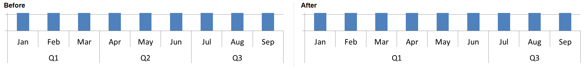

## **Ikhtisar**

Artikel ini memberikan panduan komprehensif tentang cara membuat dan menyesuaikan diagram menggunakan Aspose.Slides untuk PHP via Java. Anda akan belajar cara menambahkan diagram secara programatik ke slide, mengisi data, dan menerapkan berbagai opsi pemformatan untuk memenuhi kebutuhan desain spesifik Anda. Sepanjang artikel, contoh kode terperinci menggambarkan setiap langkah, mulai dari menginisialisasi presentasi dan objek diagram hingga mengonfigurasi seri, sumbu, dan legenda. Dengan mengikuti panduan ini, Anda akan memperoleh pemahaman yang kuat tentang cara mengintegrasikan pembuatan diagram dinamis ke dalam aplikasi PHP Anda, sehingga mempermudah proses pembuatan presentasi berbasis data.

## **Buat Diagram**

Diagram membantu orang memvisualisasikan data dengan cepat dan memperoleh wawasan yang mungkin tidak langsung terlihat dari tabel atau spreadsheet.

**Mengapa Membuat Diagram?**

Dengan diagram, Anda dapat:

* menggabungkan, meringkas, atau menyimpulkan sejumlah besar data pada satu slide dalam presentasi;
* menampilkan pola dan tren dalam data;
* menentukan arah dan momentum data seiring waktu atau terhadap satuan pengukuran tertentu;
* mengidentifikasi nilai pencilan, penyimpangan, kesalahan, dan data yang tidak masuk akal;
* mengkomunikasikan atau menyajikan data yang kompleks.

Di PowerPoint, Anda dapat membuat diagram melalui fungsi *Insert*, yang menyediakan templat untuk merancang berbagai jenis diagram. Dengan Aspose.Slides, Anda dapat membuat diagram reguler (berdasarkan tipe diagram populer) maupun diagram khusus.

{}
Gunakan enumerasi [ChartType](https://reference.aspose.com/slides/php-java/aspose.slides/charttype/) dalam namespace [aspose\slides](https://reference.aspose.com/slides/php-java/aspose.slides/). Nilai dalam enumerasi ini sesuai dengan tipe diagram yang berbeda.
{}

### **Buat Diagram Kolom Terkelompok**

Contoh ini menggunakan [addChart](https://reference.aspose.com/slides/php-java/aspose.slides/shapecollection/addchart/) untuk membuat diagram kolom terkelompok yang membandingkan dua seri pada tiga kategori. Seri menggunakan isian merah dan hijau, dan label individual menampilkan nama kategori, nama seri, dan nilai. Indeks lembar kerja 0 mengacu pada lembar pertama dalam buku kerja diagram yang tersemat.

```php
use aspose\slides\ChartType;
use aspose\slides\FillType;
use aspose\slides\NullableBool;
use aspose\slides\Presentation;
use aspose\slides\SaveFormat;

$presentation = new Presentation();
try
{
    $slide = $presentation->getSlides()->get_Item(0);

    $chart = $slide->getShapes()->addChart(ChartType::ClusteredColumn, 20, 20, 500, 300);

    $chart->getChartTitle()->addTextFrameForOverriding("Sample Title");
    $chart->getChartTitle()->getTextFrameForOverriding()->getTextFrameFormat()->setCenterText(NullableBool::True);
    $chart->getChartTitle()->setHeight(20);
    $chart->setTitle(true);

    $workbook = $chart->getChartData()->getChartDataWorkbook();
    $worksheetIndex = 0;

    $chart->getChartData()->getSeries()->clear();
    $chart->getChartData()->getCategories()->clear();

    $seriesNameCell = $workbook->getCell($worksheetIndex, 0, 1, "Series 1");
    $chart->getChartData()->getSeries()->add($seriesNameCell, $chart->getType());
    $seriesNameCell = $workbook->getCell($worksheetIndex, 0, 2, "Series 2");
    $chart->getChartData()->getSeries()->add($seriesNameCell, $chart->getType());

    $categoryCell = $workbook->getCell($worksheetIndex, 1, 0, "Category 1");
    $chart->getChartData()->getCategories()->add($categoryCell);
    $categoryCell = $workbook->getCell($worksheetIndex, 2, 0, "Category 2");
    $chart->getChartData()->getCategories()->add($categoryCell);
    $categoryCell = $workbook->getCell($worksheetIndex, 3, 0, "Category 3");
    $chart->getChartData()->getCategories()->add($categoryCell);

    $series = $chart->getChartData()->getSeries()->get_Item(0);

    $valueCell = $workbook->getCell($worksheetIndex, 1, 1, 20);
    $series->getDataPoints()->addDataPointForBarSeries($valueCell);
    $valueCell = $workbook->getCell($worksheetIndex, 2, 1, 50);
    $series->getDataPoints()->addDataPointForBarSeries($valueCell);
    $valueCell = $workbook->getCell($worksheetIndex, 3, 1, 30);
    $series->getDataPoints()->addDataPointForBarSeries($valueCell);

    $series->getFormat()->getFill()->setFillType(FillType::Solid);
    $color = new Java("java.awt.Color", 255, 0, 0);
    $series->getFormat()->getFill()->getSolidFillColor()->setColor($color);

    $series = $chart->getChartData()->getSeries()->get_Item(1);

    $valueCell = $workbook->getCell($worksheetIndex, 1, 2, 30);
    $series->getDataPoints()->addDataPointForBarSeries($valueCell);
    $valueCell = $workbook->getCell($worksheetIndex, 2, 2, 10);
    $series->getDataPoints()->addDataPointForBarSeries($valueCell);
    $valueCell = $workbook->getCell($worksheetIndex, 3, 2, 60);
    $series->getDataPoints()->addDataPointForBarSeries($valueCell);

    $series->getFormat()->getFill()->setFillType(FillType::Solid);
    $color = new Java("java.awt.Color", 0, 128, 0);
    $series->getFormat()->getFill()->getSolidFillColor()->setColor($color);

    $label = $series->getDataPoints()->get_Item(0)->getLabel();
    $label->getDataLabelFormat()->setShowCategoryName(true);

    $label = $series->getDataPoints()->get_Item(1)->getLabel();
    $label->getDataLabelFormat()->setShowSeriesName(true);

    $label = $series->getDataPoints()->get_Item(2)->getLabel();
    $label->getDataLabelFormat()->setShowValue(true);
    $label->getDataLabelFormat()->setShowSeriesName(true);
    $label->getDataLabelFormat()->setSeparator("/");

    $presentation->save("AsposeChart.pptx", SaveFormat::Pptx);
}
finally
{
    $presentation->dispose();
}
```

Hasilnya:


### **Buat Diagram Sebar**

Diagram sebar (juga dikenal sebagai scatter plot atau grafik x‑y) sering digunakan untuk memeriksa pola atau menunjukkan korelasi antara dua variabel.

Gunakan diagram sebar ketika:

* Anda memiliki data numerik berpasangan.
* Anda memiliki dua variabel yang berpasangan dengan baik.
* Anda ingin menentukan apakah kedua variabel saling berhubungan.
* Anda memiliki variabel independen yang memiliki banyak nilai untuk variabel dependen.

Contoh ini memplot dua set nilai x‑y. Seri pertama menggunakan garis lurus dengan penanda bintang, sementara seri kedua menggunakan garis halus dengan penanda lingkaran; keduanya menggunakan ukuran penanda 10, yang diatur dengan [setSize](https://reference.aspose.com/slides/php-java/aspose.slides/marker/setsize/). Metode [setSymbol](https://reference.aspose.com/slides/php-java/aspose.slides/marker/setsymbol/) mengontrol bentuk penanda.

```php
use aspose\slides\ChartType;
use aspose\slides\MarkerStyleType;
use aspose\slides\Presentation;
use aspose\slides\SaveFormat;

$presentation = new Presentation();
try
{
    $slide = $presentation->getSlides()->get_Item(0);

    $chart = $slide->getShapes()->addChart(ChartType::ScatterWithSmoothLines, 20, 20, 500, 300);

    $workbook = $chart->getChartData()->getChartDataWorkbook();
    $worksheetIndex = 0;

    $chart->getChartData()->getSeries()->clear();

    $seriesNameCell = $workbook->getCell($worksheetIndex, 1, 1, "Series 1");
    $chart->getChartData()->getSeries()->add($seriesNameCell, $chart->getType());
    $seriesNameCell = $workbook->getCell($worksheetIndex, 1, 3, "Series 2");
    $chart->getChartData()->getSeries()->add($seriesNameCell, $chart->getType());

    $series = $chart->getChartData()->getSeries()->get_Item(0);

    $xValueCell = $workbook->getCell($worksheetIndex, 2, 1, 1);
    $yValueCell = $workbook->getCell($worksheetIndex, 2, 2, 3);
    $series->getDataPoints()->addDataPointForScatterSeries($xValueCell, $yValueCell);

    $xValueCell = $workbook->getCell($worksheetIndex, 3, 1, 2);
    $yValueCell = $workbook->getCell($worksheetIndex, 3, 2, 10);
    $series->getDataPoints()->addDataPointForScatterSeries($xValueCell, $yValueCell);

    $series->setType(ChartType::ScatterWithStraightLinesAndMarkers);

    $series->getMarker()->setSize(10);
    $series->getMarker()->setSymbol(MarkerStyleType::Star);

    $series = $chart->getChartData()->getSeries()->get_Item(1);

    $xValueCell = $workbook->getCell($worksheetIndex, 2, 3, 5);
    $yValueCell = $workbook->getCell($worksheetIndex, 2, 4, 2);
    $series->getDataPoints()->addDataPointForScatterSeries($xValueCell, $yValueCell);

    $xValueCell = $workbook->getCell($worksheetIndex, 3, 3, 3);
    $yValueCell = $workbook->getCell($worksheetIndex, 3, 4, 1);
    $series->getDataPoints()->addDataPointForScatterSeries($xValueCell, $yValueCell);

    $xValueCell = $workbook->getCell($worksheetIndex, 4, 3, 2);
    $yValueCell = $workbook->getCell($worksheetIndex, 4, 4, 2);
    $series->getDataPoints()->addDataPointForScatterSeries($xValueCell, $yValueCell);

    $xValueCell = $workbook->getCell($worksheetIndex, 5, 3, 5);
    $yValueCell = $workbook->getCell($worksheetIndex, 5, 4, 1);
    $series->getDataPoints()->addDataPointForScatterSeries($xValueCell, $yValueCell);

    $series->getMarker()->setSize(10);
    $series->getMarker()->setSymbol(MarkerStyleType::Circle);

    $presentation->save("AsposeChart.pptx", SaveFormat::Pptx);
}
finally
{
    $presentation->dispose();
}
```

Hasilnya:


### **Buat Diagram Lingkaran**

Diagram lingkaran paling cocok untuk menunjukkan hubungan bagian‑ke‑keseluruhan dalam data, terutama ketika data berisi label kategori dengan nilai numerik. Namun, jika data Anda memiliki banyak bagian atau label, pertimbangkan menggunakan diagram batang sebagai gantinya.

Contoh ini membuat diagram lingkaran dengan tiga nilai kuartalan. Setiap irisan memiliki isian dan batas khusus, dan label menampilkan kombinasi nilai, persentase, dan informasi seri yang berbeda. Metode [setFirstSliceAngle](https://reference.aspose.com/slides/php-java/aspose.slides/chartseriesgroup/setfirstsliceangle/) mengatur irisan pertama mulai pada 180 derajat.

```php
use aspose\slides\ChartType;
use aspose\slides\FillType;
use aspose\slides\LineDashStyle;
use aspose\slides\LineStyle;
use aspose\slides\NullableBool;
use aspose\slides\Presentation;
use aspose\slides\SaveFormat;

$presentation = new Presentation();
try
{
    $slide = $presentation->getSlides()->get_Item(0);

    $chart = $slide->getShapes()->addChart(ChartType::Pie, 20, 20, 500, 300);

    $chart->getChartTitle()->addTextFrameForOverriding("Sample Title");
    $chart->getChartTitle()->getTextFrameForOverriding()->getTextFrameFormat()->setCenterText(NullableBool::True);
    $chart->getChartTitle()->setHeight(20);
    $chart->setTitle(true);

    $chart->getChartData()->getSeries()->get_Item(0)->getLabels()->getDefaultDataLabelFormat()->setShowValue(true);

    $workbook = $chart->getChartData()->getChartDataWorkbook();
    $worksheetIndex = 0;

    $chart->getChartData()->getSeries()->clear();
    $chart->getChartData()->getCategories()->clear();

    $categoryCell = $workbook->getCell(0, 1, 0, "1st Qtr");
    $chart->getChartData()->getCategories()->add($categoryCell);
    $categoryCell = $workbook->getCell(0, 2, 0, "2nd Qtr");
    $chart->getChartData()->getCategories()->add($categoryCell);
    $categoryCell = $workbook->getCell(0, 3, 0, "3rd Qtr");
    $chart->getChartData()->getCategories()->add($categoryCell);

    $seriesNameCell = $workbook->getCell(0, 0, 1, "Series 1");
    $series = $chart->getChartData()->getSeries()->add($seriesNameCell, $chart->getType());

    $valueCell = $workbook->getCell($worksheetIndex, 1, 1, 20);
    $series->getDataPoints()->addDataPointForPieSeries($valueCell);
    $valueCell = $workbook->getCell($worksheetIndex, 2, 1, 50);
    $series->getDataPoints()->addDataPointForPieSeries($valueCell);
    $valueCell = $workbook->getCell($worksheetIndex, 3, 1, 30);
    $series->getDataPoints()->addDataPointForPieSeries($valueCell);

    $chart->getChartData()->getSeriesGroups()->get_Item(0)->setColorVaried(true);

    $firstSlice = $series->getDataPoints()->get_Item(0);
    $firstSlice->getFormat()->getFill()->setFillType(FillType::Solid);
    $color = new Java("java.awt.Color", 0, 255, 255);
    $firstSlice->getFormat()->getFill()->getSolidFillColor()->setColor($color);

    $firstSlice->getFormat()->getLine()->getFillFormat()->setFillType(FillType::Solid);
    $color = new Java("java.awt.Color", 128, 128, 128);
    $firstSlice->getFormat()->getLine()->getFillFormat()->getSolidFillColor()->setColor($color);
    $firstSlice->getFormat()->getLine()->setWidth(3.0);
    $firstSlice->getFormat()->getLine()->setStyle(LineStyle::ThinThick);
    $firstSlice->getFormat()->getLine()->setDashStyle(LineDashStyle::LargeDash);

    $secondSlice = $series->getDataPoints()->get_Item(1);
    $secondSlice->getFormat()->getFill()->setFillType(FillType::Solid);
    $color = new Java("java.awt.Color", 165, 42, 42);
    $secondSlice->getFormat()->getFill()->getSolidFillColor()->setColor($color);

    $secondSlice->getFormat()->getLine()->getFillFormat()->setFillType(FillType::Solid);
    $color = new Java("java.awt.Color", 0, 0, 255);
    $secondSlice->getFormat()->getLine()->getFillFormat()->getSolidFillColor()->setColor($color);
    $secondSlice->getFormat()->getLine()->setWidth(3.0);
    $secondSlice->getFormat()->getLine()->setStyle(LineStyle::Single);
    $secondSlice->getFormat()->getLine()->setDashStyle(LineDashStyle::LargeDashDot);

    $thirdSlice = $series->getDataPoints()->get_Item(2);
    $thirdSlice->getFormat()->getFill()->setFillType(FillType::Solid);
    $color = new Java("java.awt.Color", 255, 127, 80);
    $thirdSlice->getFormat()->getFill()->getSolidFillColor()->setColor($color);

    $thirdSlice->getFormat()->getLine()->getFillFormat()->setFillType(FillType::Solid);
    $color = new Java("java.awt.Color", 255, 0, 0);
    $thirdSlice->getFormat()->getLine()->getFillFormat()->getSolidFillColor()->setColor($color);
    $thirdSlice->getFormat()->getLine()->setWidth(2.0);
    $thirdSlice->getFormat()->getLine()->setStyle(LineStyle::ThinThin);
    $thirdSlice->getFormat()->getLine()->setDashStyle(LineDashStyle::LargeDashDotDot);

    $firstLabel = $series->getDataPoints()->get_Item(0)->getLabel();
    $firstLabel->getDataLabelFormat()->setShowValue(true);

    $secondLabel = $series->getDataPoints()->get_Item(1)->getLabel();
    $secondLabel->getDataLabelFormat()->setShowValue(true);
    $secondLabel->getDataLabelFormat()->setShowLegendKey(true);
    $secondLabel->getDataLabelFormat()->setShowPercentage(true);

    $thirdLabel = $series->getDataPoints()->get_Item(2)->getLabel();
    $thirdLabel->getDataLabelFormat()->setShowSeriesName(true);
    $thirdLabel->getDataLabelFormat()->setShowPercentage(true);

    $series->getLabels()->getDefaultDataLabelFormat()->setShowLeaderLines(true);

    $chart->getChartData()->getSeriesGroups()->get_Item(0)->setFirstSliceAngle(180);

    $presentation->save("PieChart.pptx", SaveFormat::Pptx);
}
finally
{
    $presentation->dispose();
}
```

Hasilnya:


Untuk meningkatkan keterbacaan label di luar lingkaran, lihat [Format Leader Lines](/slides/id/php-java/chart-data-label/#format-leader-lines) untuk contoh yang memposisikan label dan menyesuaikan warna, lebar, transparansi, serta gaya dash garis.

### **Buat Diagram Garis**

Diagram garis (juga dikenal sebagai grafik garis) paling cocok untuk situasi di mana Anda ingin menunjukkan perubahan nilai seiring waktu. Dengan diagram garis, Anda dapat membandingkan sejumlah besar data sekaligus, melacak perubahan dan tren seiring waktu, menyoroti anomali dalam seri data, dan lain‑lain.

Contoh ini menggunakan [addChart](https://reference.aspose.com/slides/php-java/aspose.slides/shapecollection/addchart/) untuk membuat diagram garis dengan seri dan kategori default, kemudian menyimpan presentasi sebagai PPTX.

```php
use aspose\slides\ChartType;
use aspose\slides\Presentation;
use aspose\slides\SaveFormat;

$presentation = new Presentation();
try
{
    $slide = $presentation->getSlides()->get_Item(0);

    $lineChart = $slide->getShapes()->addChart(ChartType::Line, 20, 20, 500, 300);

    $presentation->save("lineChart.pptx", SaveFormat::Pptx);
}
finally
{
    $presentation->dispose();
}
```

Secara default, titik pada diagram garis dihubungkan oleh garis lurus kontinu. Jika Anda ingin titik dihubungkan oleh garis putus‑putus, panggil [setDashStyle](https://reference.aspose.com/slides/php-java/aspose.slides/lineformat/setdashstyle/) dengan nilai dari [LineDashStyle](https://reference.aspose.com/slides/php-java/aspose.slides/linedashstyle/):

```php
use aspose\slides\ChartType;
use aspose\slides\LineDashStyle;
use aspose\slides\Presentation;

$presentation = new Presentation();
try
{
    $slide = $presentation->getSlides()->get_Item(0);

    $lineChart = $slide->getShapes()->addChart(ChartType::Line, 20, 20, 500, 300);

    for ($i = 0; $i < java_values($lineChart->getChartData()->getSeries()->size()); $i++)
    {
        $series = $lineChart->getChartData()->getSeries()->get_Item($i);
        $series->getFormat()->getLine()->setDashStyle(LineDashStyle::Dash);
    }
}
finally
{
    $presentation->dispose();
}
```

Hasilnya:


### **Buat Diagram Peta Pohon**

Diagram peta pohon paling cocok untuk data penjualan ketika Anda ingin menampilkan ukuran relatif kategori data dan dengan cepat menarik perhatian ke item yang menjadi kontributor besar dalam setiap kategori.

Contoh ini membuat peta pohon dengan delapan daun yang dikelompokkan menjadi empat batang dan dua cabang. Metode [setGroupingItem](https://reference.aspose.com/slides/php-java/aspose.slides/chartcategorylevelsmanager/setgroupingitem/) menetapkan batang pada tingkat pengelompokan 1 dan cabang pada tingkat 2. Nilai menentukan ukuran persegi panjang relatif, sementara label kategori dan label induk yang tumpang tindih mengidentifikasi hierarki.

```php
use aspose\slides\ChartType;
use aspose\slides\ParentLabelLayoutType;
use aspose\slides\Presentation;
use aspose\slides\SaveFormat;

$presentation = new Presentation();
try
{
    $slide = $presentation->getSlides()->get_Item(0);

    $chart = $slide->getShapes()->addChart(ChartType::Treemap, 20, 20, 500, 300);

    $chart->getChartData()->getCategories()->clear();
    $chart->getChartData()->getSeries()->clear();

    $workbook = $chart->getChartData()->getChartDataWorkbook();
    $workbook->clear(0);

    // Cabang 1
    $categoryCell = $workbook->getCell(0, "C1", "Leaf1");
    $leaf = $chart->getChartData()->getCategories()->add($categoryCell);
    $leaf->getGroupingLevels()->setGroupingItem(1, "Stem1");
    $leaf->getGroupingLevels()->setGroupingItem(2, "Branch1");

    $categoryCell = $workbook->getCell(0, "C2", "Leaf2");
    $chart->getChartData()->getCategories()->add($categoryCell);

    $categoryCell = $workbook->getCell(0, "C3", "Leaf3");
    $leaf = $chart->getChartData()->getCategories()->add($categoryCell);
    $leaf->getGroupingLevels()->setGroupingItem(1, "Stem2");

    $categoryCell = $workbook->getCell(0, "C4", "Leaf4");
    $chart->getChartData()->getCategories()->add($categoryCell);

    // Cabang 2
    $categoryCell = $workbook->getCell(0, "C5", "Leaf5");
    $leaf = $chart->getChartData()->getCategories()->add($categoryCell);
    $leaf->getGroupingLevels()->setGroupingItem(1, "Stem3");
    $leaf->getGroupingLevels()->setGroupingItem(2, "Branch2");

    $categoryCell = $workbook->getCell(0, "C6", "Leaf6");
    $chart->getChartData()->getCategories()->add($categoryCell);

    $categoryCell = $workbook->getCell(0, "C7", "Leaf7");
    $leaf = $chart->getChartData()->getCategories()->add($categoryCell);
    $leaf->getGroupingLevels()->setGroupingItem(1, "Stem4");

    $categoryCell = $workbook->getCell(0, "C8", "Leaf8");
    $chart->getChartData()->getCategories()->add($categoryCell);

    $series = $chart->getChartData()->getSeries()->add(ChartType::Treemap);
    $series->getLabels()->getDefaultDataLabelFormat()->setShowCategoryName(true);
    $valueCell = $workbook->getCell(0, "D1", 4);
    $series->getDataPoints()->addDataPointForTreemapSeries($valueCell);
    $valueCell = $workbook->getCell(0, "D2", 5);
    $series->getDataPoints()->addDataPointForTreemapSeries($valueCell);
    $valueCell = $workbook->getCell(0, "D3", 3);
    $series->getDataPoints()->addDataPointForTreemapSeries($valueCell);
    $valueCell = $workbook->getCell(0, "D4", 6);
    $series->getDataPoints()->addDataPointForTreemapSeries($valueCell);
    $valueCell = $workbook->getCell(0, "D5", 9);
    $series->getDataPoints()->addDataPointForTreemapSeries($valueCell);
    $valueCell = $workbook->getCell(0, "D6", 9);
    $series->getDataPoints()->addDataPointForTreemapSeries($valueCell);
    $valueCell = $workbook->getCell(0, "D7", 4);
    $series->getDataPoints()->addDataPointForTreemapSeries($valueCell);
    $valueCell = $workbook->getCell(0, "D8", 3);
    $series->getDataPoints()->addDataPointForTreemapSeries($valueCell);

    $series->setParentLabelLayout(ParentLabelLayoutType::Overlapping);

    $presentation->save("Treemap.pptx", SaveFormat::Pptx);
}
finally
{
    $presentation->dispose();
}
```

Hasilnya:


### **Buat Diagram Air Terjun**

Diagram air terjun menunjukkan bagaimana perubahan positif dan negatif berkontribusi pada nilai akhir. Misalnya, rincian laba dapat dimulai dengan pendapatan, mengurangi biaya, dan menambahkan pendapatan lain. Kolom perubahan mengambang antara nilai berjalan sebelumnya dan nilai baru, sementara kolom total memperluas dari nol ke nilai terakumulasi.

Contoh berikut menggunakan jumlah dalam ribuan dolar AS:

| Kategori | Nilai Buku Kerja | Tipe Kolom |
| --- | ---: | --- |
| Pendapatan | 1000 | Peningkatan |
| Biaya penjualan | -400 | Penurunan |
| Laba kotor | 600 | Total Intermediat |
| Beban operasional | -200 | Penurunan |
| Pendapatan lain | 50 | Peningkatan |
| Laba bersih | 450 | Total Akhir |

Untuk menandai titik sebagai total intermediat atau final, panggil metode [setSetAsTotal](https://reference.aspose.com/slides/php-java/aspose.slides/chartdatapoint/setsetastotal/) dengan `true`. Isi sel buku kerja titik tersebut dengan jumlah terakumulasi aktual: `600` untuk laba kotor (`1000 - 400`) dan `450` untuk laba bersih (`600 - 200 + 50`). Metode ini menandai kolom sebagai total; ia tidak menghitung atau mengisi nilai sel. Jangan gunakan nol sebagai placeholder atau memberikan perubahan lain untuk titik total. Kolom total menampilkan nilai terakumulasi tanpa menambahkannya lagi ke nilai berjalan.

Contoh PHP lengkap ini membuat diagram menggunakan anggota `Waterfall` dari [ChartType](https://reference.aspose.com/slides/php-java/aspose.slides/charttype/), menghapus data default, dan mengisi buku kerja yang tersemat. Indeks lembar kerja `0` memilih lembar kerja pertama; kolom A berisi nama kategori dan kolom B berisi nilai. Setiap sel nilai ditambahkan dengan [addDataPointForWaterfallSeries](https://reference.aspose.com/slides/php-java/aspose.slides/chartdatapointcollection/adddatapointforwaterfallseries/). Indeks titik berbasis nol `2` dan `5` mengidentifikasi total intermediat dan final. Memanggil [setShowValue](https://reference.aspose.com/slides/php-java/aspose.slides/datalabelformat/setshowvalue/) dengan `true` menampilkan jumlah pada kolom. Tidak diperlukan presentasi atau buku kerja masukan.

```php
use aspose\slides\ChartType;
use aspose\slides\Presentation;
use aspose\slides\SaveFormat;

$presentation = new Presentation();
try
{
    $slide = $presentation->getSlides()->get_Item(0);

    $chart = $slide->getShapes()->addChart(ChartType::Waterfall, 20, 20, 680, 200);

    $chart->setTitle(true);
    $chart->getChartTitle()->addTextFrameForOverriding("Profit breakdown (USD thousands)");
    $chart->getChartTitle()->setOverlay(false);
    $chart->setLegend(false);

    $chart->getChartData()->getSeries()->clear();
    $chart->getChartData()->getCategories()->clear();

    $workbook = $chart->getChartData()->getChartDataWorkbook();
    $worksheetIndex = 0;

    $workbook->clear($worksheetIndex);

    $seriesNameCell = $workbook->getCell($worksheetIndex, 0, 1, "Profit");
    $series = $chart->getChartData()->getSeries()->add($seriesNameCell, ChartType::Waterfall);
    $categories = [ "Revenue", "Cost of sales", "Gross profit", "Operating expenses", "Other income", "Net profit" ];
    $values = [ 1000, -400, 600, -200, 50, 450 ];

    for ($i = 0; $i < count($categories); $i++)
    {
        $categoryCell = $workbook->getCell($worksheetIndex, $i + 1, 0, $categories[$i]);
        $chart->getChartData()->getCategories()->add($categoryCell);
        $valueCell = $workbook->getCell($worksheetIndex, $i + 1, 1, $values[$i]);
        $series->getDataPoints()->addDataPointForWaterfallSeries($valueCell);
    }

    // Poin ketiga dan keenam mewakili total, bukan perubahan tambahan.
    $series->getDataPoints()->get_Item(2)->setSetAsTotal(true);
    $series->getDataPoints()->get_Item(5)->setSetAsTotal(true);
    $series->setShowConnectorLines(true);
    $series->getLabels()->getDefaultDataLabelFormat()->setShowValue(true);

    $presentation->save("WaterfallChart.pptx", SaveFormat::Pptx);
}
finally
{
    $presentation->dispose();
}
```

Panggil metode tingkat seri [setShowConnectorLines](https://reference.aspose.com/slides/php-java/aspose.slides/chartseries/setshowconnectorlines/) dengan `true` untuk menampilkan garis yang menghubungkan kolom berurutan dan mempermudah pelacakan nilai berjalan. Untuk menyembunyikan garis ini, ganti pemanggilan metode dalam contoh dengan `$series->setShowConnectorLines(false);` sebelum menyimpan. Ini hanya mengubah visibilitas garis, bukan data atau total.

Presentasi yang disimpan menampilkan laba kotor 600 dan laba bersih 450, dengan kedua total dimulai dari nol:


### **Buat Diagram Saham**

Diagram saham digunakan untuk menampilkan data keuangan seperti harga buka, tertinggi, terendah, dan tutup, membantu menganalisis tren pasar dan volatilitas. Mereka memberikan wawasan penting tentang kinerja saham, membantu investor dan analis membuat keputusan yang tepat.

Contoh ini membuat diagram open‑high‑low‑close dengan empat seri dalam urutan tersebut dan tiga kategori. Metode [setUpDownBars](https://reference.aspose.com/slides/php-java/aspose.slides/updownbarsmanager/setupdownbars/) mengaktifkan batang naik/turun, dan [getHiLowLinesFormat](https://reference.aspose.com/slides/php-java/aspose.slides/chartseriesgroup/gethilowlinesformat/) mengatur garis tinggi‑rendah yang menunjukkan rentang harga, sementara garis seri individu dan gridline horizontal minor disembunyikan.

Manajer yang dikembalikan oleh [getUpDownBars](https://reference.aspose.com/slides/php-java/aspose.slides/chartseriesgroup/getupdownbars/) mengekspos objek format terpisah melalui [getUpBarsFormat](https://reference.aspose.com/slides/php-java/aspose.slides/updownbarsmanager/getupbarsformat/) dan [getDownBarsFormat](https://reference.aspose.com/slides/php-java/aspose.slides/updownbarsmanager/getdownbarsformat/). Gunakan [getFill](https://reference.aspose.com/slides/php-java/aspose.slides/format/getfill/) dan [getLine](https://reference.aspose.com/slides/php-java/aspose.slides/format/getline/) masing‑masing untuk mengatur isian dan garis tepi secara independen. Contoh ini menggunakan batang hijau dengan tepi hijau tua untuk interval naik dan batang oranye‑merah dengan tepi merah tua untuk interval turun.

Berikan nilai numerik untuk semua empat seri pada setiap kategori, dengan High dan Low melingkupi Open dan Close. Batang membandingkan Close dengan Open **dalam kategori yang sama**, bukan dengan kategori sebelumnya: A turun dari 72 ke 25, sementara B naik dari 25 ke 38 dan C naik dari 38 ke 50. Nilai Open dan Close yang sama tidak menghasilkan interval terisi yang terlihat. Batang naik/turun melintasi Open‑Close; garis tinggi‑rendah melintasi Low‑High. Batang‑batang ini termasuk dalam grup seri, bukan seri diagram batang biasa.

Pemformatan ini juga berlaku untuk diagram [Line and LineWithMarkers](https://reference.aspose.com/slides/php-java/aspose.slides/charttype/) yang berisi setidaknya dua seri dalam grup yang sama dan nilai numerik yang bersesuaian untuk setiap kategori. Untuk diagram garis tidak berstack ini, batang naik/turun membandingkan seri pertama dan terakhir: nilai terakhir yang lebih tinggi menghasilkan batang naik, dan nilai terakhir yang lebih rendah menghasilkan batang turun. Membalik urutan seri membalik klasifikasinya. Contoh di bawah menggunakan [OpenHighLowClose](https://reference.aspose.com/slides/php-java/aspose.slides/charttype/); jangan berasumsi varian saham, garis berstack, atau 3D lain menggunakan susunan data atau interpretasi interval yang sama.

```php
use aspose\slides\ChartType;
use aspose\slides\FillType;
use aspose\slides\Presentation;
use aspose\slides\SaveFormat;

$presentation = new Presentation();
try
{
    $slide = $presentation->getSlides()->get_Item(0);

    $chart = $slide->getShapes()->addChart(ChartType::OpenHighLowClose, 20, 20, 500, 150, false);

    $workbook = $chart->getChartData()->getChartDataWorkbook();

    $categoryCell = $workbook->getCell(0, 1, 0, "A");
    $chart->getChartData()->getCategories()->add($categoryCell);
    $categoryCell = $workbook->getCell(0, 2, 0, "B");
    $chart->getChartData()->getCategories()->add($categoryCell);
    $categoryCell = $workbook->getCell(0, 3, 0, "C");
    $chart->getChartData()->getCategories()->add($categoryCell);

    $seriesNameCell = $workbook->getCell(0, 0, 1, "Open");
    $chart->getChartData()->getSeries()->add($seriesNameCell, ChartType::OpenHighLowClose);
    $seriesNameCell = $workbook->getCell(0, 0, 2, "High");
    $chart->getChartData()->getSeries()->add($seriesNameCell, ChartType::OpenHighLowClose);
    $seriesNameCell = $workbook->getCell(0, 0, 3, "Low");
    $chart->getChartData()->getSeries()->add($seriesNameCell, ChartType::OpenHighLowClose);
    $seriesNameCell = $workbook->getCell(0, 0, 4, "Close");
    $chart->getChartData()->getSeries()->add($seriesNameCell, ChartType::OpenHighLowClose);

    $series = $chart->getChartData()->getSeries()->get_Item(0);
    $valueCell = $workbook->getCell(0, 1, 1, 72);
    $series->getDataPoints()->addDataPointForStockSeries($valueCell);
    $valueCell = $workbook->getCell(0, 2, 1, 25);
    $series->getDataPoints()->addDataPointForStockSeries($valueCell);
    $valueCell = $workbook->getCell(0, 3, 1, 38);
    $series->getDataPoints()->addDataPointForStockSeries($valueCell);

    $series = $chart->getChartData()->getSeries()->get_Item(1);
    $valueCell = $workbook->getCell(0, 1, 2, 172);
    $series->getDataPoints()->addDataPointForStockSeries($valueCell);
    $valueCell = $workbook->getCell(0, 2, 2, 57);
    $series->getDataPoints()->addDataPointForStockSeries($valueCell);
    $valueCell = $workbook->getCell(0, 3, 2, 57);
    $series->getDataPoints()->addDataPointForStockSeries($valueCell);

    $series = $chart->getChartData()->getSeries()->get_Item(2);
    $valueCell = $workbook->getCell(0, 1, 3, 12);
    $series->getDataPoints()->addDataPointForStockSeries($valueCell);
    $valueCell = $workbook->getCell(0, 2, 3, 12);
    $series->getDataPoints()->addDataPointForStockSeries($valueCell);
    $valueCell = $workbook->getCell(0, 3, 3, 13);
    $series->getDataPoints()->addDataPointForStockSeries($valueCell);

    $series = $chart->getChartData()->getSeries()->get_Item(3);
    $valueCell = $workbook->getCell(0, 1, 4, 25);
    $series->getDataPoints()->addDataPointForStockSeries($valueCell);
    $valueCell = $workbook->getCell(0, 2, 4, 38);
    $series->getDataPoints()->addDataPointForStockSeries($valueCell);
    $valueCell = $workbook->getCell(0, 3, 4, 50);
    $series->getDataPoints()->addDataPointForStockSeries($valueCell);

    $upDownBars = $chart->getChartData()->getSeriesGroups()->get_Item(0)->getUpDownBars();
    $upDownBars->setUpDownBars(true);

    $upDownBars->getUpBarsFormat()->getFill()->setFillType(FillType::Solid);
    $upDownBars->getUpBarsFormat()->getFill()->getSolidFillColor()->setColor(new Java("java.awt.Color", 50, 205, 50));
    $upDownBars->getUpBarsFormat()->getLine()->getFillFormat()->setFillType(FillType::Solid);
    $upDownBars->getUpBarsFormat()->getLine()->getFillFormat()->getSolidFillColor()->setColor(new Java("java.awt.Color", 0, 100, 0));
    $upDownBars->getUpBarsFormat()->getLine()->setWidth(2);

    $upDownBars->getDownBarsFormat()->getFill()->setFillType(FillType::Solid);
    $upDownBars->getDownBarsFormat()->getFill()->getSolidFillColor()->setColor(new Java("java.awt.Color", 255, 69, 0));
    $upDownBars->getDownBarsFormat()->getLine()->getFillFormat()->setFillType(FillType::Solid);
    $upDownBars->getDownBarsFormat()->getLine()->getFillFormat()->getSolidFillColor()->setColor(new Java("java.awt.Color", 139, 0, 0));
    $upDownBars->getDownBarsFormat()->getLine()->setWidth(2);
    $chart->getChartData()->getSeriesGroups()->get_Item(0)->getHiLowLinesFormat()->getLine()->getFillFormat()->setFillType(FillType::Solid);

    for ($i = 0; $i < java_values($chart->getChartData()->getSeries()->size()); $i++)
    {
        $stockSeries = $chart->getChartData()->getSeries()->get_Item($i);
        $stockSeries->getFormat()->getLine()->getFillFormat()->setFillType(FillType::NoFill);
    }

    $chart->getAxes()->getVerticalAxis()->getMinorGridLinesFormat()->getLine()->getFillFormat()->setFillType(FillType::NoFill);

    $presentation->save("Stock-chart.pptx", SaveFormat::Pptx);
}
finally
{
    $presentation->dispose();
}
```

Hasil, diekspor dari PowerPoint:


### **Buat Diagram Kotak‑Whisker**

Diagram kotak‑whisker digunakan untuk menampilkan distribusi data dengan merangkum ukuran statistik utama, seperti median, kuartil, dan pencilan potensial. Mereka sangat berguna dalam analisis data eksploratif dan studi statistik untuk cepat memahami variabilitas data dan mengidentifikasi anomali.

Contoh ini membuat diagram kotak‑whisker dari enam nilai. Metode [setQuartileMethod](https://reference.aspose.com/slides/php-java/aspose.slides/chartseries/setquartilemethod/) memilih perhitungan kuartil eksklusif. Contoh juga mengaktifkan garis mean, penanda mean, titik dalam, dan titik pencilan.

```php
use aspose\slides\ChartType;
use aspose\slides\Presentation;
use aspose\slides\QuartileMethodType;
use aspose\slides\SaveFormat;

$presentation = new Presentation();
try
{
    $slide = $presentation->getSlides()->get_Item(0);

    $chart = $slide->getShapes()->addChart(ChartType::BoxAndWhisker, 20, 20, 500, 300);

    $chart->getChartData()->getCategories()->clear();
    $chart->getChartData()->getSeries()->clear();

    $workbook = $chart->getChartData()->getChartDataWorkbook();
    $workbook->clear(0);

    $categoryCell = $workbook->getCell(0, "A1", "Category 1");
    $chart->getChartData()->getCategories()->add($categoryCell);
    $categoryCell = $workbook->getCell(0, "A2", "Category 2");
    $chart->getChartData()->getCategories()->add($categoryCell);
    $categoryCell = $workbook->getCell(0, "A3", "Category 3");
    $chart->getChartData()->getCategories()->add($categoryCell);
    $categoryCell = $workbook->getCell(0, "A4", "Category 4");
    $chart->getChartData()->getCategories()->add($categoryCell);
    $categoryCell = $workbook->getCell(0, "A5", "Category 5");
    $chart->getChartData()->getCategories()->add($categoryCell);
    $categoryCell = $workbook->getCell(0, "A6", "Category 6");
    $chart->getChartData()->getCategories()->add($categoryCell);

    $series = $chart->getChartData()->getSeries()->add(ChartType::BoxAndWhisker);

    $series->setQuartileMethod(QuartileMethodType::Exclusive);
    $series->setShowMeanLine(true);
    $series->setShowMeanMarkers(true);
    $series->setShowInnerPoints(true);
    $series->setShowOutlierPoints(true);

    $valueCell = $workbook->getCell(0, "B1", 15);
    $series->getDataPoints()->addDataPointForBoxAndWhiskerSeries($valueCell);
    $valueCell = $workbook->getCell(0, "B2", 41);
    $series->getDataPoints()->addDataPointForBoxAndWhiskerSeries($valueCell);
    $valueCell = $workbook->getCell(0, "B3", 16);
    $series->getDataPoints()->addDataPointForBoxAndWhiskerSeries($valueCell);
    $valueCell = $workbook->getCell(0, "B4", 10);
    $series->getDataPoints()->addDataPointForBoxAndWhiskerSeries($valueCell);
    $valueCell = $workbook->getCell(0, "B5", 23);
    $series->getDataPoints()->addDataPointForBoxAndWhiskerSeries($valueCell);
    $valueCell = $workbook->getCell(0, "B6", 16);
    $series->getDataPoints()->addDataPointForBoxAndWhiskerSeries($valueCell);

    $presentation->save("BoxAndWhisker.pptx", SaveFormat::Pptx);
}
finally
{
    $presentation->dispose();
}
```

### **Buat Diagram Corong**

Diagram corong digunakan untuk memvisualisasikan proses yang melibatkan tahap berurutan, di mana volume data berkurang seiring proses bergerak dari satu langkah ke langkah berikutnya. Mereka sangat membantu untuk menganalisis tingkat konversi, mengidentifikasi bottleneck, dan melacak efisiensi proses penjualan atau pemasaran.

Contoh ini menggunakan [addChart](https://reference.aspose.com/slides/php-java/aspose.slides/shapecollection/addchart/) untuk menambahkan diagram corong ke slide pertama presentasi yang ada. Ia menggantikan data default dengan enam kategori dan nilai mulai dari 50 hingga 500, kemudian menyimpan presentasi yang diperbarui. Presentasi masukan harus memiliki setidaknya satu slide.

```php
use aspose\slides\ChartType;
use aspose\slides\Presentation;
use aspose\slides\SaveFormat;

$presentation = new Presentation("test.pptx");
try
{
    $slide = $presentation->getSlides()->get_Item(0);

    $chart = $slide->getShapes()->addChart(ChartType::Funnel, 50, 50, 500, 400);

    $chart->getChartData()->getCategories()->clear();
    $chart->getChartData()->getSeries()->clear();

    $workbook = $chart->getChartData()->getChartDataWorkbook();
    $workbook->clear(0);

    $categoryCell = $workbook->getCell(0, "A1", "Category 1");
    $chart->getChartData()->getCategories()->add($categoryCell);
    $categoryCell = $workbook->getCell(0, "A2", "Category 2");
    $chart->getChartData()->getCategories()->add($categoryCell);
    $categoryCell = $workbook->getCell(0, "A3", "Category 3");
    $chart->getChartData()->getCategories()->add($categoryCell);
    $categoryCell = $workbook->getCell(0, "A4", "Category 4");
    $chart->getChartData()->getCategories()->add($categoryCell);
    $categoryCell = $workbook->getCell(0, "A5", "Category 5");
    $chart->getChartData()->getCategories()->add($categoryCell);
    $categoryCell = $workbook->getCell(0, "A6", "Category 6");
    $chart->getChartData()->getCategories()->add($categoryCell);

    $series = $chart->getChartData()->getSeries()->add(ChartType::Funnel);

    $valueCell = $workbook->getCell(0, "B1", 50);
    $series->getDataPoints()->addDataPointForFunnelSeries($valueCell);
    $valueCell = $workbook->getCell(0, "B2", 100);
    $series->getDataPoints()->addDataPointForFunnelSeries($valueCell);
    $valueCell = $workbook->getCell(0, "B3", 200);
    $series->getDataPoints()->addDataPointForFunnelSeries($valueCell);
    $valueCell = $workbook->getCell(0, "B4", 300);
    $series->getDataPoints()->addDataPointForFunnelSeries($valueCell);
    $valueCell = $workbook->getCell(0, "B5", 400);
    $series->getDataPoints()->addDataPointForFunnelSeries($valueCell);
    $valueCell = $workbook->getCell(0, "B6", 500);
    $series->getDataPoints()->addDataPointForFunnelSeries($valueCell);

    $presentation->save("Funnel.pptx", SaveFormat::Pptx);
}
finally
{
    $presentation->dispose();
}
```

Hasilnya:


### **Buat Diagram Sunburst**

Diagram sunburst digunakan untuk memvisualisasikan data hierarkis, menampilkan level sebagai cincin konsentris. Mereka membantu menggambarkan hubungan bagian‑ke‑keseluruhan dan ideal untuk merepresentasikan kategori bersarang serta subkategori dalam format yang jelas dan kompak.

Contoh ini membuat diagram sunburst dengan delapan daun yang dikelompokkan menjadi empat batang dan dua cabang. Metode [setGroupingItem](https://reference.aspose.com/slides/php-java/aspose.slides/chartcategorylevelsmanager/setgroupingitem/) menetapkan batang pada tingkat pengelompokan 1 dan cabang pada tingkat 2. Label kategori mengidentifikasi segmen, dan nilai menentukan ukuran relatifnya.

```php
use aspose\slides\ChartType;
use aspose\slides\Presentation;
use aspose\slides\SaveFormat;

$presentation = new Presentation();
try
{
    $slide = $presentation->getSlides()->get_Item(0);

    $chart = $slide->getShapes()->addChart(ChartType::Sunburst, 20, 20, 500, 300);

    $chart->getChartData()->getCategories()->clear();
    $chart->getChartData()->getSeries()->clear();

    $workbook = $chart->getChartData()->getChartDataWorkbook();
    $workbook->clear(0);

    // Cabang 1
    $categoryCell = $workbook->getCell(0, "C1", "Leaf1");
    $leaf = $chart->getChartData()->getCategories()->add($categoryCell);
    $leaf->getGroupingLevels()->setGroupingItem(1, "Stem1");
    $leaf->getGroupingLevels()->setGroupingItem(2, "Branch1");

    $categoryCell = $workbook->getCell(0, "C2", "Leaf2");
    $chart->getChartData()->getCategories()->add($categoryCell);

    $categoryCell = $workbook->getCell(0, "C3", "Leaf3");
    $leaf = $chart->getChartData()->getCategories()->add($categoryCell);
    $leaf->getGroupingLevels()->setGroupingItem(1, "Stem2");

    $categoryCell = $workbook->getCell(0, "C4", "Leaf4");
    $chart->getChartData()->getCategories()->add($categoryCell);

    // Cabang 2
    $categoryCell = $workbook->getCell(0, "C5", "Leaf5");
    $leaf = $chart->getChartData()->getCategories()->add($categoryCell);
    $leaf->getGroupingLevels()->setGroupingItem(1, "Stem3");
    $leaf->getGroupingLevels()->setGroupingItem(2, "Branch2");

    $categoryCell = $workbook->getCell(0, "C6", "Leaf6");
    $chart->getChartData()->getCategories()->add($categoryCell);

    $categoryCell = $workbook->getCell(0, "C7", "Leaf7");
    $leaf = $chart->getChartData()->getCategories()->add($categoryCell);
    $leaf->getGroupingLevels()->setGroupingItem(1, "Stem4");

    $categoryCell = $workbook->getCell(0, "C8", "Leaf8");
    $chart->getChartData()->getCategories()->add($categoryCell);

    $series = $chart->getChartData()->getSeries()->add(ChartType::Sunburst);
    $series->getLabels()->getDefaultDataLabelFormat()->setShowCategoryName(true);
    $valueCell = $workbook->getCell(0, "D1", 4);
    $series->getDataPoints()->addDataPointForSunburstSeries($valueCell);
    $valueCell = $workbook->getCell(0, "D2", 5);
    $series->getDataPoints()->addDataPointForSunburstSeries($valueCell);
    $valueCell = $workbook->getCell(0, "D3", 3);
    $series->getDataPoints()->addDataPointForSunburstSeries($valueCell);
    $valueCell = $workbook->getCell(0, "D4", 6);
    $series->getDataPoints()->addDataPointForSunburstSeries($valueCell);
    $valueCell = $workbook->getCell(0, "D5", 9);
    $series->getDataPoints()->addDataPointForSunburstSeries($valueCell);
    $valueCell = $workbook->getCell(0, "D6", 9);
    $series->getDataPoints()->addDataPointForSunburstSeries($valueCell);
    $valueCell = $workbook->getCell(0, "D7", 4);
    $series->getDataPoints()->addDataPointForSunburstSeries($valueCell);
    $valueCell = $workbook->getCell(0, "D8", 3);
    $series->getDataPoints()->addDataPointForSunburstSeries($valueCell);

    $presentation->save("Sunburst.pptx", SaveFormat::Pptx);
}
finally
{
    $presentation->dispose();
}
```

Hasilnya:


### **Buat Diagram Histogram**

Diagram histogram menunjukkan bagaimana nilai numerik terdistribusi di seluruh interval (bin). Untuk laporan bulanan tentang waktu proses pesanan, gunakan lebar bin dan ambang yang sama agar interval konsisten dan distribusi lebih mudah dibandingkan.

Panggil [setAggregationType](https://reference.aspose.com/slides/php-java/aspose.slides/axis/setaggregationtype/) pada sumbu horizontal dengan mode dari [AxisAggregationType](https://reference.aspose.com/slides/php-java/aspose.slides/axisaggregationtype/). [setBinWidth](https://reference.aspose.com/slides/php-java/aspose.slides/axis/setbinwidth/) hanya berlaku untuk `ByBinWidth`; [setNumberOfBins](https://reference.aspose.com/slides/php-java/aspose.slides/axis/setnumberofbins/) hanya berlaku untuk `ByNumberOfBins`. Gunakan `Automatic` agar diagram memilih bin secara otomatis.

#### **Gunakan Lebar Bin Tetap**

Contoh ini mengelompokkan waktu proses ke dalam interval 10 menit, dengan bin terpisah untuk waktu ≤ 10 menit dan > 40 menit. Aktifkan bin tersebut dengan [setUnderflowBin](https://reference.aspose.com/slides/php-java/aspose.slides/axis/setunderflowbin/) dan [setOverflowBin](https://reference.aspose.com/slides/php-java/aspose.slides/axis/setoverflowbin/). Saat memberikan ambang eksplisit melalui [setUnderflowBin](https://reference.aspose.com/slides/php-java/aspose.slides/axis/setunderflowbin/) dan [setOverflowBin](https://reference.aspose.com/slides/php-java/aspose.slides/axis/setoverflowbin/), panggil [setAutomaticUnderflowBin](https://reference.aspose.com/slides/php-java/aspose.slides/axis/setautomaticunderflowbin/) dan [setAutomaticOverflowBin](https://reference.aspose.com/slides/php-java/aspose.slides/axis/setautomaticoverflowbin/) dengan `false`.

```php
use aspose\slides\AxisAggregationType;
use aspose\slides\ChartType;
use aspose\slides\Presentation;
use aspose\slides\SaveFormat;

$presentation = new Presentation();
try
{
    $slide = $presentation->getSlides()->get_Item(0);

    $chart = $slide->getShapes()->addChart(ChartType::Histogram, 20, 20, 680, 200);

    $chart->setLegend(false);
    $chart->setTitle(false);

    $chart->getChartData()->getCategories()->clear();
    $chart->getChartData()->getSeries()->clear();

    $workbook = $chart->getChartData()->getChartDataWorkbook();
    $workbook->clear(0);

    $series = $chart->getChartData()->getSeries()->add(ChartType::Histogram);
    $values = [ 5, 10, 10, 11, 15, 20, 20, 21, 25, 30, 30, 31, 35, 40, 40, 41, 50 ];
    for ($i = 0; $i < count($values); $i++)
    {
        $valueCell = $workbook->getCell(0, $i, 0, $values[$i]);
        $series->getDataPoints()->addDataPointForHistogramSeries($valueCell);
    }

    $axis = $chart->getAxes()->getHorizontalAxis();
    $axis->setAggregationType(AxisAggregationType::ByBinWidth);
    $axis->setBinWidth(10);
    $axis->setUnderflowBin(true);
    $axis->setAutomaticUnderflowBin(false);
    $axis->setUnderflowBin(10);
    $axis->setOverflowBin(true);
    $axis->setAutomaticOverflowBin(false);
    $axis->setOverflowBin(40);

    $presentation->save("Histogram-bin-width.pptx", SaveFormat::Pptx);
}
finally
{
    $presentation->dispose();
}
```

Presentasi yang ditampilkan di PowerPoint menunjukkan jumlah bin **3, 4, 4, 4, dan 2**. Bin underflow mencakup `5, 10, 10`, sehingga ambangnya inklusif. Bin overflow hanya mencakup `41, 50`, sehingga ambangnya eksklusif; kedua nilai yang sama dengan `40` tetap berada di interval sebelumnya. Bin interior berisi nilai yang lebih besar dari batas bawah dan kurang dari atau sama dengan batas atasnya.


#### **Tentukan Jumlah Bin**

Untuk tingkat detail tetap alih‑alih interval tetap, minta lima bin untuk data yang sama. Contoh ini menonaktifkan bin underflow dan overflow. Diagram menentukan lebar dari rentang data, sehingga batas dapat berubah antar laporan.

```php
use aspose\slides\AxisAggregationType;
use aspose\slides\ChartType;
use aspose\slides\Presentation;
use aspose\slides\SaveFormat;

$presentation = new Presentation();
try
{
    $slide = $presentation->getSlides()->get_Item(0);

    $chart = $slide->getShapes()->addChart(ChartType::Histogram, 20, 20, 680, 200);

    $chart->setLegend(false);
    $chart->setTitle(false);

    $chart->getChartData()->getCategories()->clear();
    $chart->getChartData()->getSeries()->clear();

    $workbook = $chart->getChartData()->getChartDataWorkbook();
    $workbook->clear(0);

    $series = $chart->getChartData()->getSeries()->add(ChartType::Histogram);
    $values = [ 5, 10, 10, 11, 15, 20, 20, 21, 25, 30, 30, 31, 35, 40, 40, 41, 50 ];
    for ($i = 0; $i < count($values); $i++)
    {
        $valueCell = $workbook->getCell(0, $i, 0, $values[$i]);
        $series->getDataPoints()->addDataPointForHistogramSeries($valueCell);
    }

    $axis = $chart->getAxes()->getHorizontalAxis();
    $axis->setAggregationType(AxisAggregationType::ByNumberOfBins);
    $axis->setNumberOfBins(5);

    $presentation->save("Histogram-bin-count.pptx", SaveFormat::Pptx);
}
finally
{
    $presentation->dispose();
}
```

Lima bin memiliki jumlah **4, 4, 4, 4, dan 1**. Bandingkan distribusi ini dengan hasil lebar bin tetap di atas: nilai input identik, namun batasnya berbeda.


### **Buat Diagram Radar**

Diagram radar digunakan untuk menampilkan data multivariat dalam format dua dimensi, memungkinkan perbandingan beberapa variabel secara bersamaan. Mereka sangat berguna untuk mengidentifikasi pola, kekuatan, dan kelemahan di berbagai metrik atau atribut kinerja.

Contoh ini menggunakan [addChart](https://reference.aspose.com/slides/php-java/aspose.slides/shapecollection/addchart/) untuk membuat diagram radar dengan seri dan kategori default, lalu menyimpan presentasi sebagai PPTX.

```php
use aspose\slides\ChartType;
use aspose\slides\Presentation;
use aspose\slides\SaveFormat;

$presentation = new Presentation();
try
{
    $slide = $presentation->getSlides()->get_Item(0);

    $slide->getShapes()->addChart(ChartType::Radar, 20, 20, 500, 300);

    $presentation->save("Radar-chart.pptx", SaveFormat::Pptx);
}
finally
{
    $presentation->dispose();
}
```

Hasilnya:


### **Buat Diagram Multi‑Kategori**

Diagram multi‑kategori digunakan untuk menampilkan data yang melibatkan lebih dari satu pengelompokan kategori, memungkinkan Anda membandingkan nilai di beberapa dimensi secara bersamaan. Mereka sangat membantu saat Anda perlu menganalisis tren dan hubungan dalam dataset berlapis kompleks.

Contoh ini membuat diagram kolom terkelompok dengan delapan kategori yang diatur dalam empat pasangan. Metode [setGroupingItem](https://reference.aspose.com/slides/php-java/aspose.slides/chartcategorylevelsmanager/setgroupingitem/) memberikan setiap pasangan label bersama pada tingkat pengelompokan 1, menghasilkan sumbu kategori dengan label individual dan grup.

```php
use aspose\slides\ChartType;
use aspose\slides\Presentation;
use aspose\slides\SaveFormat;

$presentation = new Presentation();
try
{
    $slide = $presentation->getSlides()->get_Item(0);

    $chart = $slide->getShapes()->addChart(ChartType::ClusteredColumn, 20, 20, 500, 300);

    $chart->getChartData()->getSeries()->clear();
    $chart->getChartData()->getCategories()->clear();

    $workbook = $chart->getChartData()->getChartDataWorkbook();
    $workbook->clear(0);

    $worksheetIndex = 0;

    $categoryCell = $workbook->getCell(0, "c2", "A");
    $category = $chart->getChartData()->getCategories()->add($categoryCell);
    $category->getGroupingLevels()->setGroupingItem(1, "Group1");
    $categoryCell = $workbook->getCell(0, "c3", "B");
    $category = $chart->getChartData()->getCategories()->add($categoryCell);

    $categoryCell = $workbook->getCell(0, "c4", "C");
    $category = $chart->getChartData()->getCategories()->add($categoryCell);
    $category->getGroupingLevels()->setGroupingItem(1, "Group2");
    $categoryCell = $workbook->getCell(0, "c5", "D");
    $category = $chart->getChartData()->getCategories()->add($categoryCell);

    $categoryCell = $workbook->getCell(0, "c6", "E");
    $category = $chart->getChartData()->getCategories()->add($categoryCell);
    $category->getGroupingLevels()->setGroupingItem(1, "Group3");
    $categoryCell = $workbook->getCell(0, "c7", "F");
    $category = $chart->getChartData()->getCategories()->add($categoryCell);

    $categoryCell = $workbook->getCell(0, "c8", "G");
    $category = $chart->getChartData()->getCategories()->add($categoryCell);
    $category->getGroupingLevels()->setGroupingItem(1, "Group4");
    $categoryCell = $workbook->getCell(0, "c9", "H");
    $category = $chart->getChartData()->getCategories()->add($categoryCell);

    $seriesNameCell = $workbook->getCell(0, "D1", "Series 1");
    $series = $chart->getChartData()->getSeries()->add($seriesNameCell, ChartType::ClusteredColumn);

    $valueCell = $workbook->getCell($worksheetIndex, "D2", 10);
    $series->getDataPoints()->addDataPointForBarSeries($valueCell);
    $valueCell = $workbook->getCell($worksheetIndex, "D3", 20);
    $series->getDataPoints()->addDataPointForBarSeries($valueCell);
    $valueCell = $workbook->getCell($worksheetIndex, "D4", 30);
    $series->getDataPoints()->addDataPointForBarSeries($valueCell);
    $valueCell = $workbook->getCell($worksheetIndex, "D5", 40);
    $series->getDataPoints()->addDataPointForBarSeries($valueCell);
    $valueCell = $workbook->getCell($worksheetIndex, "D6", 50);
    $series->getDataPoints()->addDataPointForBarSeries($valueCell);
    $valueCell = $workbook->getCell($worksheetIndex, "D7", 60);
    $series->getDataPoints()->addDataPointForBarSeries($valueCell);
    $valueCell = $workbook->getCell($worksheetIndex, "D8", 70);
    $series->getDataPoints()->addDataPointForBarSeries($valueCell);
    $valueCell = $workbook->getCell($worksheetIndex, "D9", 80);
    $series->getDataPoints()->addDataPointForBarSeries($valueCell);

    $presentation->save("AsposeChart.pptx", SaveFormat::Pptx);
}
finally
{
    $presentation->dispose();
}
```

Hasilnya:


#### **Hapus Label Kuartal**

Unduh [quarters.pptx](quarters.pptx) dan letakkan di direktori yang sama dengan skrip PHP. Diagramnya menampilkan sembilan bulan dan satu seri penjualan dengan nilai dari 10 hingga 18. Pada sumbu kategori, Q1 mencakup Januari‑Maret, Q2 mencakup April‑Juni, dan Q3 mencakup Juli‑September.

April adalah kategori keempat (indeks 3) dan memegang label Q2. Gunakan [getGroupingLevels](https://reference.aspose.com/slides/php-java/aspose.slides/chartcategory/getgroupinglevels/) untuk mengakses tingkat pengelompokan April, lalu panggil [deleteGroupingItem](https://reference.aspose.com/slides/php-java/aspose.slides/chartcategorylevelsmanager/deletegroupingitem/) dengan level 1 untuk menghapus label kuartalnya. Level 0 mewakili bulan itu sendiri dan tidak dapat dihapus dengan metode ini.

```php
use aspose\slides\Presentation;
use aspose\slides\SaveFormat;

$presentation = new Presentation(__DIR__ . "/quarters.pptx");
try
{
    $chart = $presentation->getSlides()->get_Item(0)->getShapes()->get_Item(0);
    $april = $chart->getChartData()->getCategories()->get_Item(3);
    $april->getGroupingLevels()->deleteGroupingItem(1);

    $presentation->save(__DIR__ . "/quarters-updated.pptx", SaveFormat::Pptx);
}
finally
{
    $presentation->dispose();
}

$reopened = new Presentation(__DIR__ . "/quarters-updated.pptx");
try
{
    $updatedChart = $reopened->getSlides()->get_Item(0)->getShapes()->get_Item(0);
    $data = $updatedChart->getChartData();

    $months = [];
    $categories = $data->getCategories();
    
    for ($i = 0; $i < java_values($categories->size()); $i++)
    {
        $months[] = (string)$categories->get_Item($i)->getAsCell()->getValue();
    }

    $sales = [];
    $points = $data->getSeries()->get_Item(0)->getDataPoints();
    for ($i = 0; $i < java_values($points->size()); $i++)
    {
        $sales[] = (string)$points->get_Item($i)->getValue()->getData();
    }

    echo implode(", ", $months), PHP_EOL;
    echo implode(", ", $sales), PHP_EOL;
}
finally
{
    $reopened->dispose();
}
```

Setelah membuka kembali diagram, contoh mencetak bulan asli (`Jan, Feb, Mar, Apr, May, Jun, Jul, Aug, Sep`) dan nilai penjualan (`10.0, 11.0, 12.0, 13.0, 14.0, 15.0, 16.0, 17.0, 18.0`) dalam urutan yang sama. Buka `quarters-updated.pptx` di PowerPoint untuk membandingkan label sumbu. Label Q2 dan batas grup sebelum April menghilang, sehingga Q1 mencakup Januari‑Juni. Q3 masih dimulai pada Juli.



### **Buat Diagram Peta**

Diagram peta digunakan untuk memvisualisasikan data geografis dengan memetakan informasi ke lokasi tertentu seperti negara, provinsi, atau kota. Mereka sangat berguna untuk menganalisis tren regional, data demografis, dan distribusi spasial secara jelas dan menarik.

Contoh ini menggunakan [addChart](https://reference.aspose.com/slides/php-java/aspose.slides/shapecollection/addchart/) untuk membuat diagram peta dengan data geografis default dan menyimpannya untuk dilihat di PowerPoint.

```php
use aspose\slides\ChartType;
use aspose\slides\Presentation;
use aspose\slides\SaveFormat;

$presentation = new Presentation();
try
{
    $slide = $presentation->getSlides()->get_Item(0);

    $chart = $slide->getShapes()->addChart(ChartType::Map, 20, 20, 500, 300);

    $presentation->save("mapChart.pptx", SaveFormat::Pptx);
}
finally
{
    $presentation->dispose();
}
```

Hasilnya:


{}
Gambar di atas menunjukkan presentasi yang disimpan dibuka di PowerPoint. Aspose.Slides menulis diagram peta dan datanya dengan benar, tetapi tidak menggambar diagram peta sendiri: ketika slide yang memuatnya dirender menjadi gambar atau dikonversi ke PDF atau SVG, area diagram muncul kosong. Bentuk lain pada slide yang sama tidak terpengaruh.
{}

### **Buat Diagram Kombinasi**

Diagram kombinasi (atau combo chart) menggabungkan dua atau lebih tipe diagram dalam satu grafik. Diagram ini memungkinkan Anda menyoroti, membandingkan, atau memeriksa perbedaan antara dua atau lebih set data, membantu mengidentifikasi hubungan di antaranya.


Contoh ini menggabungkan dua seri kolom terkelompok dengan satu seri garis pada empat kategori. Kolom menggunakan sumbu vertikal utama, sementara [setPlotOnSecondAxis](https://reference.aspose.com/slides/php-java/aspose.slides/chartseries/setplotonsecondaxis/) menempatkan garis pada sumbu vertikal sekunder di kanan. Fungsi bantu mengonfigurasi judul, legenda, label sumbu, dan garis kisi.

```php
use aspose\slides\AxisPositionType;
use aspose\slides\ChartType;
use aspose\slides\CrossesType;
use aspose\slides\FillType;
use aspose\slides\LegendPositionType;
use aspose\slides\NullableBool;
use aspose\slides\Presentation;
use aspose\slides\SaveFormat;

function createComboChart()
{
    $presentation = new Presentation();
    try
    {
        $chart = createChartWithFirstSeries($presentation->getSlides()->get_Item(0));

        addSecondSeriesToChart($chart);
        addThirdSeriesToChart($chart);

        setPrimaryAxesFormat($chart);
        setSecondaryAxesFormat($chart);

        $presentation->save("combo-chart.pptx", SaveFormat::Pptx);
    }
    finally
    {
        $presentation->dispose();
    }
}

function createChartWithFirstSeries($slide)
{
    $chart = $slide->getShapes()->addChart(ChartType::ClusteredColumn, 50, 50, 600, 400);

    $chart->setTitle(true);
    $chart->getChartTitle()->addTextFrameForOverriding("Chart Title");
    $chart->getChartTitle()->setOverlay(false);
    $portionFormat = $chart->getChartTitle()->getTextFrameForOverriding()->getParagraphs()->get_Item(0)->getParagraphFormat()->getDefaultPortionFormat();
    $portionFormat->setFontBold(NullableBool::False);
    $portionFormat->setFontHeight(18);

    $chart->getLegend()->setPosition(LegendPositionType::Bottom);
    $chart->getLegend()->getTextFormat()->getPortionFormat()->setFontHeight(12);

    $chart->getChartData()->getSeries()->clear();
    $chart->getChartData()->getCategories()->clear();

    $workbook = $chart->getChartData()->getChartDataWorkbook();
    $worksheetIndex = 0;

    $categoryCell = $workbook->getCell($worksheetIndex, 1, 0, "Category 1");
    $chart->getChartData()->getCategories()->add($categoryCell);
    $categoryCell = $workbook->getCell($worksheetIndex, 2, 0, "Category 2");
    $chart->getChartData()->getCategories()->add($categoryCell);
    $categoryCell = $workbook->getCell($worksheetIndex, 3, 0, "Category 3");
    $chart->getChartData()->getCategories()->add($categoryCell);
    $categoryCell = $workbook->getCell($worksheetIndex, 4, 0, "Category 4");
    $chart->getChartData()->getCategories()->add($categoryCell);

    $seriesNameCell = $workbook->getCell($worksheetIndex, 0, 1, "Series 1");
    $series = $chart->getChartData()->getSeries()->add($seriesNameCell, $chart->getType());

    $series->getParentSeriesGroup()->setOverlap(-25);
    $series->getParentSeriesGroup()->setGapWidth(220);

    $valueCell = $workbook->getCell($worksheetIndex, 1, 1, 4.3);
    $series->getDataPoints()->addDataPointForBarSeries($valueCell);
    $valueCell = $workbook->getCell($worksheetIndex, 2, 1, 2.5);
    $series->getDataPoints()->addDataPointForBarSeries($valueCell);
    $valueCell = $workbook->getCell($worksheetIndex, 3, 1, 3.5);
    $series->getDataPoints()->addDataPointForBarSeries($valueCell);
    $valueCell = $workbook->getCell($worksheetIndex, 4, 1, 4.5);
    $series->getDataPoints()->addDataPointForBarSeries($valueCell);

    return $chart;
}

function addSecondSeriesToChart($chart)
{
    $workbook = $chart->getChartData()->getChartDataWorkbook();
    $worksheetIndex = 0;

    $seriesNameCell = $workbook->getCell($worksheetIndex, 0, 2, "Series 2");
    $series = $chart->getChartData()->getSeries()->add($seriesNameCell, ChartType::ClusteredColumn);

    $series->getParentSeriesGroup()->setOverlap(-25);
    $series->getParentSeriesGroup()->setGapWidth(220);

    $valueCell = $workbook->getCell($worksheetIndex, 1, 2, 2.4);
    $series->getDataPoints()->addDataPointForBarSeries($valueCell);
    $valueCell = $workbook->getCell($worksheetIndex, 2, 2, 4.4);
    $series->getDataPoints()->addDataPointForBarSeries($valueCell);
    $valueCell = $workbook->getCell($worksheetIndex, 3, 2, 1.8);
    $series->getDataPoints()->addDataPointForBarSeries($valueCell);
    $valueCell = $workbook->getCell($worksheetIndex, 4, 2, 2.8);
    $series->getDataPoints()->addDataPointForBarSeries($valueCell);
}

function addThirdSeriesToChart($chart)
{
    $workbook = $chart->getChartData()->getChartDataWorkbook();
    $worksheetIndex = 0;

    $seriesNameCell = $workbook->getCell($worksheetIndex, 0, 3, "Series 3");
    $series = $chart->getChartData()->getSeries()->add($seriesNameCell, ChartType::Line);

    $valueCell = $workbook->getCell($worksheetIndex, 1, 3, 2.0);
    $series->getDataPoints()->addDataPointForLineSeries($valueCell);
    $valueCell = $workbook->getCell($worksheetIndex, 2, 3, 2.0);
    $series->getDataPoints()->addDataPointForLineSeries($valueCell);
    $valueCell = $workbook->getCell($worksheetIndex, 3, 3, 3.0);
    $series->getDataPoints()->addDataPointForLineSeries($valueCell);
    $valueCell = $workbook->getCell($worksheetIndex, 4, 3, 5.0);
    $series->getDataPoints()->addDataPointForLineSeries($valueCell);

    $series->setPlotOnSecondAxis(true);
}

function setPrimaryAxesFormat($chart)
{
    $horizontalAxis = $chart->getAxes()->getHorizontalAxis();
    $horizontalAxis->getTextFormat()->getPortionFormat()->setFontHeight(12);
    $horizontalAxis->getFormat()->getLine()->getFillFormat()->setFillType(FillType::NoFill);

    setAxisTitle($horizontalAxis, "X Axis");

    $verticalAxis = $chart->getAxes()->getVerticalAxis();
    $verticalAxis->getTextFormat()->getPortionFormat()->setFontHeight(12);
    $verticalAxis->getFormat()->getLine()->getFillFormat()->setFillType(FillType::NoFill);

    setAxisTitle($verticalAxis, "Y Axis 1");

    $majorGridLinesFormat = $verticalAxis->getMajorGridLinesFormat()->getLine()->getFillFormat();
    $majorGridLinesFormat->setFillType(FillType::Solid);
    $color = new Java("java.awt.Color", 217, 217, 217);
    $majorGridLinesFormat->getSolidFillColor()->setColor($color);
}

function setSecondaryAxesFormat($chart)
{
    $secondaryHorizontalAxis = $chart->getAxes()->getSecondaryHorizontalAxis();
    $secondaryHorizontalAxis->setPosition(AxisPositionType::Bottom);
    $secondaryHorizontalAxis->setCrossType(CrossesType::Maximum);
    $secondaryHorizontalAxis->setVisible(false);
    $secondaryHorizontalAxis->getMajorGridLinesFormat()->getLine()->getFillFormat()->setFillType(FillType::NoFill);
    $secondaryHorizontalAxis->getMinorGridLinesFormat()->getLine()->getFillFormat()->setFillType(FillType::NoFill);

    $secondaryVerticalAxis = $chart->getAxes()->getSecondaryVerticalAxis();
    $secondaryVerticalAxis->setPosition(AxisPositionType::Right);
    $secondaryVerticalAxis->getTextFormat()->getPortionFormat()->setFontHeight(12);
    $secondaryVerticalAxis->getFormat()->getLine()->getFillFormat()->setFillType(FillType::NoFill);
    $secondaryVerticalAxis->getMajorGridLinesFormat()->getLine()->getFillFormat()->setFillType(FillType::NoFill);
    $secondaryVerticalAxis->getMinorGridLinesFormat()->getLine()->getFillFormat()->setFillType(FillType::NoFill);

    setAxisTitle($secondaryVerticalAxis, "Y Axis 2");
}

function setAxisTitle($axis, $axisTitle)
{
    $axis->setTitle(true);
    $axis->getTitle()->setOverlay(false);
    $titlePortionFormat = $axis->getTitle()->addTextFrameForOverriding($axisTitle)->getParagraphs()->get_Item(0)->getParagraphFormat()->getDefaultPortionFormat();
    $titlePortionFormat->setFontBold(NullableBool::False);
    $titlePortionFormat->setFontHeight(12);
}

createComboChart();
```

## **Perbarui Diagram**

Aspose.Slides untuk PHP via Java memungkinkan Anda memperbarui diagram PowerPoint dengan memodifikasi data diagram, pemformatan, dan gaya. Fungsionalitas ini menyederhanakan proses menjaga presentasi tetap up‑to‑date dengan konten dinamis dan memastikan diagram secara akurat mencerminkan data serta standar visual terkini.

Contoh ini memperbarui diagram bernama "My chart" pada slide pertama presentasi yang ada. Ia memerlukan dua seri kolom dengan tiga poin data masing‑masing, dengan label kategori di kolom A dan nama seri di baris pertama lembar kerja pertama. Contoh menggunakan [getCell](https://reference.aspose.com/slides/php-java/aspose.slides/chartdataworkbook/getcell/) untuk mengubah sel buku kerja, memperbarui nilai seri, menambahkan seri ketiga, dan mengubah diagram menjadi silinder terkelompok melalui [setType](https://reference.aspose.com/slides/php-java/aspose.slides/chart/settype/).

```php
use aspose\slides\ChartType;
use aspose\slides\Presentation;
use aspose\slides\SaveFormat;

$chartName = "My chart";
$chartClass = new JavaClass("com.aspose.slides.IChart");

$presentation = new Presentation("ExistingChart.pptx");
try
{
    $slide = $presentation->getSlides()->get_Item(0);

    for ($i = 0; $i < java_values($slide->getShapes()->size()); $i++)
    {
        $shape = $slide->getShapes()->get_Item($i);
        if (java_instanceof($shape, $chartClass) && $chartName === java_values($shape->getName()))
        {
            $chart = $shape;
            $worksheetIndex = 0;

            $workbook = $chart->getChartData()->getChartDataWorkbook();

            $workbook->getCell($worksheetIndex, 1, 0, "Modified Category 1");
            $workbook->getCell($worksheetIndex, 2, 0, "Modified Category 2");

            $series = $chart->getChartData()->getSeries()->get_Item(0);

            $workbook->getCell($worksheetIndex, 0, 1, "New_Series 1");
            $series->getDataPoints()->get_Item(0)->getValue()->setData(90);
            $series->getDataPoints()->get_Item(1)->getValue()->setData(123);
            $series->getDataPoints()->get_Item(2)->getValue()->setData(44);

            $series = $chart->getChartData()->getSeries()->get_Item(1);

            $workbook->getCell($worksheetIndex, 0, 2, "New_Series 2");
            $series->getDataPoints()->get_Item(0)->getValue()->setData(23);
            $series->getDataPoints()->get_Item(1)->getValue()->setData(67);
            $series->getDataPoints()->get_Item(2)->getValue()->setData(99);

            $seriesNameCell = $workbook->getCell($worksheetIndex, 0, 3, "Series 3");
            $series = $chart->getChartData()->getSeries()->add($seriesNameCell, $chart->getType());

            $valueCell = $workbook->getCell($worksheetIndex, 1, 3, 20);
            $series->getDataPoints()->addDataPointForBarSeries($valueCell);
            $valueCell = $workbook->getCell($worksheetIndex, 2, 3, 50);
            $series->getDataPoints()->addDataPointForBarSeries($valueCell);
            $valueCell = $workbook->getCell($worksheetIndex, 3, 3, 30);
            $series->getDataPoints()->addDataPointForBarSeries($valueCell);

            $chart->setType(ChartType::ClusteredCylinder);
        }
    }

    $presentation->save("AsposeChartModified.pptx", SaveFormat::Pptx);
}
finally
{
    $presentation->dispose();
}
```

## **Tetapkan Rentang Data untuk Diagram**

Untuk memeriksa rentang yang sudah digunakan oleh diagram yang ada, lihat [Retrieve a Chart's Data Range](/slides/id/php-java/chart-workbook/#retrieve-a-charts-data-range).

Aspose.Slides untuk PHP via Java menyediakan fleksibilitas untuk menentukan rentang data spesifik dari lembar kerja sebagai sumber data diagram Anda. Ini berarti Anda dapat memetakan secara langsung bagian lembar kerja ke diagram, memungkinkan Anda mengontrol sel mana yang berkontribusi pada seri dan kategori diagram. Sebagai hasilnya, Anda dapat dengan mudah memperbarui dan menyinkronkan diagram dengan perubahan data terbaru di lembar kerja, memastikan presentasi PowerPoint Anda mencerminkan informasi yang akurat dan terkini.

Contoh ini menggunakan [setRange](https://reference.aspose.com/slides/php-java/aspose.slides/chartdata/setrange/) untuk menetapkan sumber data diagram bernama "My chart" pada slide pertama presentasi yang ada ke `Sheet1!A1:B4`. Buku kerja diagram harus berisi lembar kerja tersebut dan rentang terisi dengan judul seri di baris pertama, label kategori di kolom A, dan tiga nilai di kolom B.

```php
use aspose\slides\Presentation;
use aspose\slides\SaveFormat;

$chartName = "My chart";
$chartClass = new JavaClass("com.aspose.slides.IChart");

$presentation = new Presentation("ExistingChart.pptx");
try
{
    $slide = $presentation->getSlides()->get_Item(0);

    for ($i = 0; $i < java_values($slide->getShapes()->size()); $i++)
    {
        $shape = $slide->getShapes()->get_Item($i);
        if (java_instanceof($shape, $chartClass) && $chartName === java_values($shape->getName()))
        {
            $chart = $shape;
            $chart->getChartData()->setRange("Sheet1!A1:B4");
        }
    }

    $presentation->save("SetDataRange.pptx", SaveFormat::Pptx);
}
finally
{
    $presentation->dispose();
}
```

## **Gunakan Penanda Bawaan di Diagram**

Ketika Anda menggunakan penanda bawaan di diagram, setiap seri diagram secara otomatis memperoleh simbol penanda bawaan yang berbeda.

Contoh ini menggunakan [addChart](https://reference.aspose.com/slides/php-java/aspose.slides/shapecollection/addchart/) untuk membuat diagram dengan dua seri garis dan legenda. Pengaturan penanda yang diakses melalui [getMarker](https://reference.aspose.com/slides/php-java/aspose.slides/chartseries/getmarker/) mempertahankan simbol penanda yang ditetapkan secara otomatis. Seri pertama mencakup nilai negatif dan nilai yang hilang, yang direpresentasikan oleh `null`, sementara seri kedua memiliki nilai untuk setiap kategori.

```php
use aspose\slides\ChartType;
use aspose\slides\Presentation;
use aspose\slides\SaveFormat;

$presentation = new Presentation();
try
{
    $slide = $presentation->getSlides()->get_Item(0);

    $chart = $slide->getShapes()->addChart(ChartType::LineWithMarkers, 10, 10, 400, 400);

    $chart->getChartData()->getSeries()->clear();
    $chart->getChartData()->getCategories()->clear();

    $workbook = $chart->getChartData()->getChartDataWorkbook();

    $seriesNameCell = $workbook->getCell(0, 0, 1, "Series 1");
    $series = $chart->getChartData()->getSeries()->add($seriesNameCell, $chart->getType());

    $categoryCell = $workbook->getCell(0, 1, 0, "C1");
    $chart->getChartData()->getCategories()->add($categoryCell);
    $valueCell = $workbook->getCell(0, 1, 1, 24);
    $series->getDataPoints()->addDataPointForLineSeries($valueCell);

    $categoryCell = $workbook->getCell(0, 2, 0, "C2");
    $chart->getChartData()->getCategories()->add($categoryCell);
    $valueCell = $workbook->getCell(0, 2, 1, 23);
    $series->getDataPoints()->addDataPointForLineSeries($valueCell);

    $categoryCell = $workbook->getCell(0, 3, 0, "C3");
    $chart->getChartData()->getCategories()->add($categoryCell);
    $valueCell = $workbook->getCell(0, 3, 1, -10);
    $series->getDataPoints()->addDataPointForLineSeries($valueCell);

    $categoryCell = $workbook->getCell(0, 4, 0, "C4");
    $chart->getChartData()->getCategories()->add($categoryCell);
    $valueCell = $workbook->getCell(0, 4, 1, null);
    $series->getDataPoints()->addDataPointForLineSeries($valueCell);

    $seriesNameCell = $workbook->getCell(0, 0, 2, "Series 2");
    $secondSeries = $chart->getChartData()->getSeries()->add($seriesNameCell, $chart->getType());

    $valueCell = $workbook->getCell(0, 1, 2, 30);
    $secondSeries->getDataPoints()->addDataPointForLineSeries($valueCell);
    $valueCell = $workbook->getCell(0, 2, 2, 10);
    $secondSeries->getDataPoints()->addDataPointForLineSeries($valueCell);
    $valueCell = $workbook->getCell(0, 3, 2, 60);
    $secondSeries->getDataPoints()->addDataPointForLineSeries($valueCell);
    $valueCell = $workbook->getCell(0, 4, 2, 40);
    $secondSeries->getDataPoints()->addDataPointForLineSeries($valueCell);

    $chart->setLegend(true);
    $chart->getLegend()->setOverlay(false);

    $presentation->save("DefaultMarkersInChart.pptx", SaveFormat::Pptx);
}
finally
{
    $presentation->dispose();
}
```

## **FAQ**

**Tipe diagram apa yang didukung oleh Aspose.Slides untuk PHP via Java?**

Aspose.Slides untuk PHP via Java mendukung beragam tipe diagram, termasuk bar, line, pie, area, scatter, histogram, radar, dan banyak lagi. Fleksibilitas ini memungkinkan Anda memilih tipe diagram yang paling sesuai untuk kebutuhan visualisasi data Anda.

**Bagaimana cara menambahkan diagram baru ke slide?**

Untuk menambahkan diagram, pertama buat instance kelas [Presentation](https://reference.aspose.com/slides/php-java/aspose.slides/presentation/), ambil slide yang diinginkan menggunakan indeksnya, kemudian panggil metode untuk menambahkan diagram, menentukan tipe diagram dan data awal. Proses ini menyisipkan diagram langsung ke dalam presentasi Anda.

**Bagaimana cara memperbarui data yang ditampilkan dalam diagram?**

Anda dapat memperbarui data diagram dengan mengakses buku kerja datanya ([ChartDataWorkbook](https://reference.aspose.com/slides/php-java/aspose.slides/chartdataworkbook/)), menghapus seri dan kategori default, kemudian menambahkan data khusus Anda. Ini memungkinkan Anda secara programatik menyegarkan diagram agar mencerminkan data terbaru.

**Apakah mungkin menyesuaikan tampilan diagram?**

Ya, Aspose.Slides untuk PHP via Java menyediakan opsi kostumisasi yang luas. Anda dapat memodifikasi warna, font, label, legenda, dan elemen pemformatan lainnya untuk menyesuaikan tampilan diagram dengan kebutuhan desain spesifik Anda.