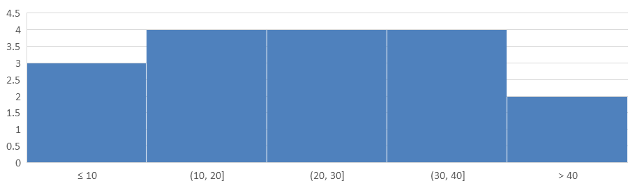

## **Ikhtisar**

Artikel ini menyediakan panduan komprehensif tentang cara membuat dan menyesuaikan diagram menggunakan Aspose.Slides untuk Python via Java. Anda akan belajar cara menambahkan diagram secara programatik ke slide, mengisinya dengan data, dan menerapkan berbagai opsi pemformatan untuk memenuhi kebutuhan desain spesifik Anda. Sepanjang artikel, contoh kode terperinci menunjukkan setiap langkah, mulai dari menginisialisasi presentasi dan objek diagram hingga mengkonfigurasi seri, sumbu, dan legenda. Dengan mengikuti panduan ini, Anda akan memperoleh pemahaman yang kuat tentang cara mengintegrasikan pembuatan diagram dinamis ke dalam aplikasi Python Anda, mempermudah proses pembuatan presentasi berbasis data.

## **Buat Diagram**

Diagram membantu orang dengan cepat memvisualisasikan data dan memperoleh wawasan yang mungkin tidak langsung terlihat dari tabel atau lembar kerja.

**Mengapa Membuat Diagram?**

* mengagregasi, merangkum, atau menyimpulkan sejumlah besar data pada satu slide dalam presentasi;
* menampilkan pola dan tren dalam data;
* menyimpulkan arah dan momentum data seiring waktu atau terkait unit pengukuran tertentu;
* mengidentifikasi outlier, penyimpangan, deviasi, kesalahan, dan data yang tidak masuk akal;
* mengkomunikasikan atau menyajikan data yang kompleks.

Di PowerPoint, Anda dapat membuat diagram melalui fungsi *Insert*, yang menyediakan templat untuk merancang banyak jenis diagram. Dengan menggunakan Aspose.Slides, Anda dapat membuat diagram reguler (berdasarkan jenis diagram populer) maupun diagram khusus.

{}
Gunakan enumerasi [ChartType](https://reference.aspose.com/slides/python-java/aspose.slides/charttype/) dalam paket [asposeslides.api](https://reference.aspose.com/slides/python-java/aspose.slides/). Nilai-nilai dalam enumerasi ini sesuai dengan berbagai jenis diagram.
{}

### **Buat Diagram Kolom Berkumpul**

Contoh ini menggunakan [addChart](https://reference.aspose.com/slides/python-java/aspose.slides/shapecollection/#addChart) untuk membuat diagram kolom berkumpul yang membandingkan dua seri dalam tiga kategori. Seri menggunakan isian merah dan hijau, dan label individual menampilkan nama kategori, nama seri, dan nilai. Indeks worksheet 0 mengacu pada lembar pertama dalam buku kerja diagram yang disematkan.

```python
import jpype
import asposeslides

if not jpype.isJVMStarted():
    jpype.startJVM()

from asposeslides.api import ChartType, FillType, NullableBool, Presentation, SaveFormat

Color = jpype.JClass("java.awt.Color")

presentation = Presentation()
try:
    slide = presentation.getSlides().get_Item(0)

    chart = slide.getShapes().addChart(ChartType.ClusteredColumn, 20, 20, 500, 300)

    chart.getChartTitle().addTextFrameForOverriding("Sample Title")
    chart.getChartTitle().getTextFrameForOverriding().getTextFrameFormat().setCenterText(NullableBool.True_)
    chart.getChartTitle().setHeight(20)
    chart.setTitle(True)

    workbook = chart.getChartData().getChartDataWorkbook()
    worksheet_index = 0

    chart.getChartData().getSeries().clear()
    chart.getChartData().getCategories().clear()

    series_name_cell = workbook.getCell(worksheet_index, 0, 1, "Series 1")
    chart.getChartData().getSeries().add(series_name_cell, chart.getType())
    series_name_cell = workbook.getCell(worksheet_index, 0, 2, "Series 2")
    chart.getChartData().getSeries().add(series_name_cell, chart.getType())

    category_cell = workbook.getCell(worksheet_index, 1, 0, "Category 1")
    chart.getChartData().getCategories().add(category_cell)
    category_cell = workbook.getCell(worksheet_index, 2, 0, "Category 2")
    chart.getChartData().getCategories().add(category_cell)
    category_cell = workbook.getCell(worksheet_index, 3, 0, "Category 3")
    chart.getChartData().getCategories().add(category_cell)

    series = chart.getChartData().getSeries().get_Item(0)

    value_cell = workbook.getCell(worksheet_index, 1, 1, 20)
    series.getDataPoints().addDataPointForBarSeries(value_cell)
    value_cell = workbook.getCell(worksheet_index, 2, 1, 50)
    series.getDataPoints().addDataPointForBarSeries(value_cell)
    value_cell = workbook.getCell(worksheet_index, 3, 1, 30)
    series.getDataPoints().addDataPointForBarSeries(value_cell)

    series.getFormat().getFill().setFillType(FillType.Solid)
    series.getFormat().getFill().getSolidFillColor().setColor(Color.RED)

    series = chart.getChartData().getSeries().get_Item(1)

    value_cell = workbook.getCell(worksheet_index, 1, 2, 30)
    series.getDataPoints().addDataPointForBarSeries(value_cell)
    value_cell = workbook.getCell(worksheet_index, 2, 2, 10)
    series.getDataPoints().addDataPointForBarSeries(value_cell)
    value_cell = workbook.getCell(worksheet_index, 3, 2, 60)
    series.getDataPoints().addDataPointForBarSeries(value_cell)

    series.getFormat().getFill().setFillType(FillType.Solid)
    color = Color(0, 128, 0)
    series.getFormat().getFill().getSolidFillColor().setColor(color)

    label = series.getDataPoints().get_Item(0).getLabel()
    label.getDataLabelFormat().setShowCategoryName(True)

    label = series.getDataPoints().get_Item(1).getLabel()
    label.getDataLabelFormat().setShowSeriesName(True)

    label = series.getDataPoints().get_Item(2).getLabel()
    label.getDataLabelFormat().setShowValue(True)
    label.getDataLabelFormat().setShowSeriesName(True)
    label.getDataLabelFormat().setSeparator("/")

    presentation.save("AsposeChart.pptx", SaveFormat.Pptx)
finally:
    presentation.dispose()
```

Hasil:


### **Buat Diagram Sebar**

Diagram sebar (juga dikenal sebagai plot sebar atau grafik x-y) sering digunakan untuk memeriksa pola atau menunjukkan korelasi antara dua variabel.

Gunakan diagram sebar ketika:

* Anda memiliki data numerik berpasangan.
* Anda memiliki dua variabel yang saling berpasangan dengan baik.
* Anda ingin menentukan apakah kedua variabel terkait.
* Anda memiliki variabel independen yang memiliki banyak nilai untuk variabel dependen.

Contoh ini memplot dua set nilai x-y. Seri pertama menggunakan garis lurus dengan penanda bintang, sementara seri kedua menggunakan garis halus dengan penanda lingkaran; keduanya menggunakan ukuran penanda 10, yang dikonfigurasi dengan [setSize](https://reference.aspose.com/slides/python-java/aspose.slides/marker/#setSize). Metode [setSymbol](https://reference.aspose.com/slides/python-java/aspose.slides/marker/#setSymbol) mengontrol bentuk penanda.

```python
import jpype
import asposeslides

if not jpype.isJVMStarted():
    jpype.startJVM()

from asposeslides.api import ChartType, MarkerStyleType, Presentation, SaveFormat

presentation = Presentation()
try:
    slide = presentation.getSlides().get_Item(0)

    chart = slide.getShapes().addChart(ChartType.ScatterWithSmoothLines, 20, 20, 500, 300)

    workbook = chart.getChartData().getChartDataWorkbook()
    worksheet_index = 0

    chart.getChartData().getSeries().clear()

    series_name_cell = workbook.getCell(worksheet_index, 1, 1, "Series 1")
    chart.getChartData().getSeries().add(series_name_cell, chart.getType())
    series_name_cell = workbook.getCell(worksheet_index, 1, 3, "Series 2")
    chart.getChartData().getSeries().add(series_name_cell, chart.getType())

    series = chart.getChartData().getSeries().get_Item(0)

    x_value_cell = workbook.getCell(worksheet_index, 2, 1, 1)
    y_value_cell = workbook.getCell(worksheet_index, 2, 2, 3)
    series.getDataPoints().addDataPointForScatterSeries(x_value_cell, y_value_cell)

    x_value_cell = workbook.getCell(worksheet_index, 3, 1, 2)
    y_value_cell = workbook.getCell(worksheet_index, 3, 2, 10)
    series.getDataPoints().addDataPointForScatterSeries(x_value_cell, y_value_cell)

    series.setType(ChartType.ScatterWithStraightLinesAndMarkers)

    series.getMarker().setSize(10)
    series.getMarker().setSymbol(MarkerStyleType.Star)

    series = chart.getChartData().getSeries().get_Item(1)

    x_value_cell = workbook.getCell(worksheet_index, 2, 3, 5)
    y_value_cell = workbook.getCell(worksheet_index, 2, 4, 2)
    series.getDataPoints().addDataPointForScatterSeries(x_value_cell, y_value_cell)

    x_value_cell = workbook.getCell(worksheet_index, 3, 3, 3)
    y_value_cell = workbook.getCell(worksheet_index, 3, 4, 1)
    series.getDataPoints().addDataPointForScatterSeries(x_value_cell, y_value_cell)

    x_value_cell = workbook.getCell(worksheet_index, 4, 3, 2)
    y_value_cell = workbook.getCell(worksheet_index, 4, 4, 2)
    series.getDataPoints().addDataPointForScatterSeries(x_value_cell, y_value_cell)

    x_value_cell = workbook.getCell(worksheet_index, 5, 3, 5)
    y_value_cell = workbook.getCell(worksheet_index, 5, 4, 1)
    series.getDataPoints().addDataPointForScatterSeries(x_value_cell, y_value_cell)

    series.getMarker().setSize(10)
    series.getMarker().setSymbol(MarkerStyleType.Circle)

    presentation.save("AsposeChart.pptx", SaveFormat.Pptx)
finally:
    presentation.dispose()
```

Hasil:


### **Buat Diagram Lingkaran**

Diagram lingkaran paling baik digunakan untuk menampilkan hubungan bagian-dengan-seluruh dalam data, terutama ketika data berisi label kategori dengan nilai numerik. Namun, jika data Anda memiliki banyak bagian atau label, pertimbangkan menggunakan diagram batang sebagai gantinya.

Contoh ini membuat diagram lingkaran dengan tiga nilai kuartalan. Setiap irisan memiliki isian dan batas khusus, dan label menampilkan kombinasi nilai, persentase, dan informasi seri yang berbeda. Metode [setFirstSliceAngle](https://reference.aspose.com/slides/python-java/aspose.slides/chartseriesgroup/#setFirstSliceAngle) mengatur irisan pertama mulai pada 180 derajat.

```python
import jpype
import asposeslides

if not jpype.isJVMStarted():
    jpype.startJVM()

from asposeslides.api import ChartType, FillType, LineDashStyle, LineStyle, NullableBool, Presentation, SaveFormat

Color = jpype.JClass("java.awt.Color")

presentation = Presentation()
try:
    slide = presentation.getSlides().get_Item(0)

    chart = slide.getShapes().addChart(ChartType.Pie, 20, 20, 500, 300)

    chart.getChartTitle().addTextFrameForOverriding("Sample Title")
    chart.getChartTitle().getTextFrameForOverriding().getTextFrameFormat().setCenterText(NullableBool.True_)
    chart.getChartTitle().setHeight(20)
    chart.setTitle(True)

    chart.getChartData().getSeries().get_Item(0).getLabels().getDefaultDataLabelFormat().setShowValue(True)

    workbook = chart.getChartData().getChartDataWorkbook()
    worksheet_index = 0

    chart.getChartData().getSeries().clear()
    chart.getChartData().getCategories().clear()

    category_cell = workbook.getCell(0, 1, 0, "1st Qtr")
    chart.getChartData().getCategories().add(category_cell)
    category_cell = workbook.getCell(0, 2, 0, "2nd Qtr")
    chart.getChartData().getCategories().add(category_cell)
    category_cell = workbook.getCell(0, 3, 0, "3rd Qtr")
    chart.getChartData().getCategories().add(category_cell)

    series_name_cell = workbook.getCell(0, 0, 1, "Series 1")
    series = chart.getChartData().getSeries().add(series_name_cell, chart.getType())

    value_cell = workbook.getCell(worksheet_index, 1, 1, 20)
    series.getDataPoints().addDataPointForPieSeries(value_cell)
    value_cell = workbook.getCell(worksheet_index, 2, 1, 50)
    series.getDataPoints().addDataPointForPieSeries(value_cell)
    value_cell = workbook.getCell(worksheet_index, 3, 1, 30)
    series.getDataPoints().addDataPointForPieSeries(value_cell)

    chart.getChartData().getSeriesGroups().get_Item(0).setColorVaried(True)

    first_slice = series.getDataPoints().get_Item(0)
    first_slice.getFormat().getFill().setFillType(FillType.Solid)
    first_slice.getFormat().getFill().getSolidFillColor().setColor(Color.CYAN)

    first_slice.getFormat().getLine().getFillFormat().setFillType(FillType.Solid)
    first_slice.getFormat().getLine().getFillFormat().getSolidFillColor().setColor(Color.GRAY)
    first_slice.getFormat().getLine().setWidth(3.0)
    first_slice.getFormat().getLine().setStyle(LineStyle.ThinThick)
    first_slice.getFormat().getLine().setDashStyle(LineDashStyle.LargeDash)

    second_slice = series.getDataPoints().get_Item(1)
    second_slice.getFormat().getFill().setFillType(FillType.Solid)
    color = Color(165, 42, 42)
    second_slice.getFormat().getFill().getSolidFillColor().setColor(color)

    second_slice.getFormat().getLine().getFillFormat().setFillType(FillType.Solid)
    second_slice.getFormat().getLine().getFillFormat().getSolidFillColor().setColor(Color.BLUE)
    second_slice.getFormat().getLine().setWidth(3.0)
    second_slice.getFormat().getLine().setStyle(LineStyle.Single)
    second_slice.getFormat().getLine().setDashStyle(LineDashStyle.LargeDashDot)

    third_slice = series.getDataPoints().get_Item(2)
    third_slice.getFormat().getFill().setFillType(FillType.Solid)
    color = Color(255, 127, 80)
    third_slice.getFormat().getFill().getSolidFillColor().setColor(color)

    third_slice.getFormat().getLine().getFillFormat().setFillType(FillType.Solid)
    third_slice.getFormat().getLine().getFillFormat().getSolidFillColor().setColor(Color.RED)
    third_slice.getFormat().getLine().setWidth(2.0)
    third_slice.getFormat().getLine().setStyle(LineStyle.ThinThin)
    third_slice.getFormat().getLine().setDashStyle(LineDashStyle.LargeDashDotDot)

    first_label = series.getDataPoints().get_Item(0).getLabel()
    first_label.getDataLabelFormat().setShowValue(True)

    second_label = series.getDataPoints().get_Item(1).getLabel()
    second_label.getDataLabelFormat().setShowValue(True)
    second_label.getDataLabelFormat().setShowLegendKey(True)
    second_label.getDataLabelFormat().setShowPercentage(True)

    third_label = series.getDataPoints().get_Item(2).getLabel()
    third_label.getDataLabelFormat().setShowSeriesName(True)
    third_label.getDataLabelFormat().setShowPercentage(True)

    series.getLabels().getDefaultDataLabelFormat().setShowLeaderLines(True)

    chart.getChartData().getSeriesGroups().get_Item(0).setFirstSliceAngle(180)

    presentation.save("PieChart.pptx", SaveFormat.Pptx)
finally:
    presentation.dispose()
```

Hasil:


Untuk meningkatkan keterbacaan label di luar diagram lingkaran, lihat [Format Leader Lines](/slides/id/python-java/chart-data-label/#format-leader-lines) untuk contoh yang memposisikan label dan menyesuaikan warna, lebar, transparansi, dan gaya putus garis.

### **Buat Diagram Garis**

Diagram garis (juga dikenal sebagai grafik garis) paling baik digunakan dalam situasi di mana Anda ingin menunjukkan perubahan nilai seiring waktu. Dengan diagram garis, Anda dapat membandingkan sejumlah besar data sekaligus, melacak perubahan dan tren dari waktu ke waktu, menyoroti anomali dalam seri data, dan lain-lain.

Contoh ini menggunakan [addChart](https://reference.aspose.com/slides/python-java/aspose.slides/shapecollection/#addChart) untuk membuat diagram garis dengan seri dan kategori default, kemudian menyimpan presentasi sebagai PPTX.

```python
import jpype
import asposeslides

if not jpype.isJVMStarted():
    jpype.startJVM()

from asposeslides.api import ChartType, Presentation, SaveFormat

presentation = Presentation()
try:
    slide = presentation.getSlides().get_Item(0)

    line_chart = slide.getShapes().addChart(ChartType.Line, 20, 20, 500, 300)

    presentation.save("line_chart.pptx", SaveFormat.Pptx)
finally:
    presentation.dispose()
```

Secara default, titik pada diagram garis dihubungkan oleh garis lurus kontinu. Jika Anda ingin titik-titik dihubungkan dengan garis putus-putus, panggil [setDashStyle](https://reference.aspose.com/slides/python-java/aspose.slides/lineformat/#setDashStyle) dengan nilai dari [LineDashStyle](https://reference.aspose.com/slides/python-java/aspose.slides/linedashstyle/):

```python
import jpype
import asposeslides

if not jpype.isJVMStarted():
    jpype.startJVM()

from asposeslides.api import ChartType, LineDashStyle, Presentation

presentation = Presentation()
try:
    slide = presentation.getSlides().get_Item(0)

    line_chart = slide.getShapes().addChart(ChartType.Line, 20, 20, 500, 300)

    for series in line_chart.getChartData().getSeries():
        series.getFormat().getLine().setDashStyle(LineDashStyle.Dash)
finally:
    presentation.dispose()
```

Hasil:


### **Buat Diagram Tree Map**

Diagram tree map paling baik digunakan untuk data penjualan ketika Anda ingin menampilkan ukuran relatif kategori data dan dengan cepat menarik perhatian pada item yang berkontribusi besar dalam setiap kategori.

Contoh ini membuat diagram tree map dengan delapan daun yang dikelompokkan menjadi empat batang dan dua cabang. Metode [setGroupingItem](https://reference.aspose.com/slides/python-java/aspose.slides/chartcategorylevelsmanager/#setGroupingItem) menugaskan batang pada level pengelompokan 1 dan cabang pada level 2. Nilai menentukan ukuran relatif persegi panjang, sementara label kategori dan label induk yang tumpang tindih mengidentifikasi hierarki.

```python
import jpype
import asposeslides

if not jpype.isJVMStarted():
    jpype.startJVM()

from asposeslides.api import ChartType, ParentLabelLayoutType, Presentation, SaveFormat

presentation = Presentation()
try:
    slide = presentation.getSlides().get_Item(0)

    chart = slide.getShapes().addChart(ChartType.Treemap, 20, 20, 500, 300)

    chart.getChartData().getCategories().clear()
    chart.getChartData().getSeries().clear()

    workbook = chart.getChartData().getChartDataWorkbook()
    workbook.clear(0)

    # Cabang 1
    category_cell = workbook.getCell(0, "C1", "Leaf1")
    leaf = chart.getChartData().getCategories().add(category_cell)
    leaf.getGroupingLevels().setGroupingItem(1, "Stem1")
    leaf.getGroupingLevels().setGroupingItem(2, "Branch1")

    category_cell = workbook.getCell(0, "C2", "Leaf2")
    chart.getChartData().getCategories().add(category_cell)

    category_cell = workbook.getCell(0, "C3", "Leaf3")
    leaf = chart.getChartData().getCategories().add(category_cell)
    leaf.getGroupingLevels().setGroupingItem(1, "Stem2")

    category_cell = workbook.getCell(0, "C4", "Leaf4")
    chart.getChartData().getCategories().add(category_cell)

    # Cabang 2
    category_cell = workbook.getCell(0, "C5", "Leaf5")
    leaf = chart.getChartData().getCategories().add(category_cell)
    leaf.getGroupingLevels().setGroupingItem(1, "Stem3")
    leaf.getGroupingLevels().setGroupingItem(2, "Branch2")

    category_cell = workbook.getCell(0, "C6", "Leaf6")
    chart.getChartData().getCategories().add(category_cell)

    category_cell = workbook.getCell(0, "C7", "Leaf7")
    leaf = chart.getChartData().getCategories().add(category_cell)
    leaf.getGroupingLevels().setGroupingItem(1, "Stem4")

    category_cell = workbook.getCell(0, "C8", "Leaf8")
    chart.getChartData().getCategories().add(category_cell)

    series = chart.getChartData().getSeries().add(ChartType.Treemap)
    series.getLabels().getDefaultDataLabelFormat().setShowCategoryName(True)
    value_cell = workbook.getCell(0, "D1", 4)
    series.getDataPoints().addDataPointForTreemapSeries(value_cell)
    value_cell = workbook.getCell(0, "D2", 5)
    series.getDataPoints().addDataPointForTreemapSeries(value_cell)
    value_cell = workbook.getCell(0, "D3", 3)
    series.getDataPoints().addDataPointForTreemapSeries(value_cell)
    value_cell = workbook.getCell(0, "D4", 6)
    series.getDataPoints().addDataPointForTreemapSeries(value_cell)
    value_cell = workbook.getCell(0, "D5", 9)
    series.getDataPoints().addDataPointForTreemapSeries(value_cell)
    value_cell = workbook.getCell(0, "D6", 9)
    series.getDataPoints().addDataPointForTreemapSeries(value_cell)
    value_cell = workbook.getCell(0, "D7", 4)
    series.getDataPoints().addDataPointForTreemapSeries(value_cell)
    value_cell = workbook.getCell(0, "D8", 3)
    series.getDataPoints().addDataPointForTreemapSeries(value_cell)

    series.setParentLabelLayout(ParentLabelLayoutType.Overlapping)

    presentation.save("Treemap.pptx", SaveFormat.Pptx)
finally:
    presentation.dispose()
```

Hasil:


### **Buat Diagram Waterfall**

Diagram waterfall menunjukkan bagaimana perubahan positif dan negatif berkontribusi pada nilai akhir. Misalnya, rincian keuntungan dapat dimulai dengan pendapatan, mengurangkan biaya, dan menambahkan pendapatan lain. Kolom perubahan melayang di antara nilai berjalan sebelumnya dan yang baru, sementara kolom total memperluas dari nol hingga nilai terakumulasi.

| Kategori | Nilai workbook | Tipe kolom |
| --- | ---: | --- |
| Revenue | 1000 | Peningkatan |
| Cost of sales | -400 | Penurunan |
| Gross profit | 600 | Total menengah |
| Operating expenses | -200 | Penurunan |
| Other income | 50 | Peningkatan |
| Net profit | 450 | Total akhir |

Untuk menandai sebuah titik sebagai total menengah atau total akhir, panggil metode [setSetAsTotal](https://reference.aspose.com/slides/python-java/aspose.slides/chartdatapoint/#setSetAsTotal) pada titik tersebut dengan `True`. Berikan jumlah terakumulasi yang sebenarnya di sel workbook titik itu: `600` untuk laba kotor (`1000 - 400`) dan `450` untuk laba bersih (`600 - 200 + 50`). Metode tersebut menandai kolom sebagai total; ia tidak menghitung atau mengisi nilai sel. Jangan gunakan nol sebagai placeholder atau memberikan perubahan lain untuk titik total. Kolom total menampilkan nilai terakumulasi tanpa menambahkannya lagi ke nilai berjalan.

Contoh Python lengkap ini membuat diagram menggunakan anggota `Waterfall` dari [ChartType](https://reference.aspose.com/slides/python-java/aspose.slides/charttype/), menghapus data default, dan mengisi workbook yang disematkan. Indeks worksheet `0` memilih lembar kerja pertama; kolom A berisi nama kategori dan kolom B berisi nilai. Setiap sel nilai ditambahkan dengan [addDataPointForWaterfallSeries](https://reference.aspose.com/slides/python-java/aspose.slides/chartdatapointcollection/#addDataPointForWaterfallSeries). Indeks titik berbasis nol `2` dan `5` mengidentifikasi total menengah dan total akhir. Memanggil [setShowValue](https://reference.aspose.com/slides/python-java/aspose.slides/datalabelformat/#setShowValue) dengan `True` menampilkan jumlah pada kolom. Tidak diperlukan presentasi atau workbook input.

```python
import jpype
import asposeslides

if not jpype.isJVMStarted():
    jpype.startJVM()

from asposeslides.api import ChartType, Presentation, SaveFormat

presentation = Presentation()
try:
    slide = presentation.getSlides().get_Item(0)

    chart = slide.getShapes().addChart(ChartType.Waterfall, 20, 20, 680, 200)

    chart.setTitle(True)
    chart.getChartTitle().addTextFrameForOverriding("Profit breakdown (USD thousands)")
    chart.getChartTitle().setOverlay(False)
    chart.setLegend(False)

    chart.getChartData().getSeries().clear()
    chart.getChartData().getCategories().clear()

    workbook = chart.getChartData().getChartDataWorkbook()
    worksheet_index = 0

    workbook.clear(worksheet_index)

    series_name_cell = workbook.getCell(worksheet_index, 0, 1, "Profit")
    series = chart.getChartData().getSeries().add(series_name_cell, ChartType.Waterfall)
    categories = ["Revenue", "Cost of sales", "Gross profit", "Operating expenses", "Other income", "Net profit"]
    values = [1000, -400, 600, -200, 50, 450]

    for i in range(len(categories)):
        category_cell = workbook.getCell(worksheet_index, i + 1, 0, categories[i])
        chart.getChartData().getCategories().add(category_cell)
        value_cell = workbook.getCell(worksheet_index, i + 1, 1, values[i])
        series.getDataPoints().addDataPointForWaterfallSeries(value_cell)

    # Titik ketiga dan keenam mewakili total, bukan perubahan tambahan.
    series.getDataPoints().get_Item(2).setSetAsTotal(True)
    series.getDataPoints().get_Item(5).setSetAsTotal(True)
    series.setShowConnectorLines(True)
    series.getLabels().getDefaultDataLabelFormat().setShowValue(True)

    presentation.save("WaterfallChart.pptx", SaveFormat.Pptx)
finally:
    presentation.dispose()
```

Panggil metode series-level [setShowConnectorLines](https://reference.aspose.com/slides/python-java/aspose.slides/chartseries/#setShowConnectorLines) dengan `True` untuk menampilkan garis yang menghubungkan kolom berurutan dan memudahkan pelacakan nilai berjalan. Untuk menyembunyikan garis ini, ganti pemanggilan metode dalam contoh dengan `series.setShowConnectorLines(False)` sebelum menyimpan. Ini hanya mengubah visibilitas garis, bukan data atau total.

Presentasi yang disimpan menampilkan laba kotor sebesar 600 dan laba bersih sebesar 450, dengan kedua total dihitung dari nol:


### **Buat Diagram Saham**

Diagram saham digunakan untuk menampilkan data keuangan seperti harga pembukaan, tertinggi, terendah, dan penutupan, membantu menganalisis tren pasar dan volatilitas. Mereka memberikan wawasan penting tentang kinerja saham, membantu investor dan analis membuat keputusan yang tepat.

Contoh ini membuat diagram open-high-low-close dengan empat seri dalam urutan tersebut dan tiga kategori. Metode [setUpDownBars](https://reference.aspose.com/slides/python-java/aspose.slides/updownbarsmanager/#setUpDownBars) mengaktifkan batang naik/turun, dan [getHiLowLinesFormat](https://reference.aspose.com/slides/python-java/aspose.slides/chartseriesgroup/#getHiLowLinesFormat) mengontrol garis tinggi-rendah yang menampilkan rentang harga, sementara garis seri individual dan grid horizontal kecil disembunyikan.

```python
import jpype
import asposeslides

if not jpype.isJVMStarted():
    jpype.startJVM()

from asposeslides.api import ChartType, FillType, Presentation, SaveFormat

presentation = Presentation()
try:
    slide = presentation.getSlides().get_Item(0)

    chart = slide.getShapes().addChart(ChartType.OpenHighLowClose, 20, 20, 500, 300, False)

    workbook = chart.getChartData().getChartDataWorkbook()

    category_cell = workbook.getCell(0, 1, 0, "A")
    chart.getChartData().getCategories().add(category_cell)
    category_cell = workbook.getCell(0, 2, 0, "B")
    chart.getChartData().getCategories().add(category_cell)
    category_cell = workbook.getCell(0, 3, 0, "C")
    chart.getChartData().getCategories().add(category_cell)

    series_name_cell = workbook.getCell(0, 0, 1, "Open")
    chart.getChartData().getSeries().add(series_name_cell, ChartType.OpenHighLowClose)
    series_name_cell = workbook.getCell(0, 0, 2, "High")
    chart.getChartData().getSeries().add(series_name_cell, ChartType.OpenHighLowClose)
    series_name_cell = workbook.getCell(0, 0, 3, "Low")
    chart.getChartData().getSeries().add(series_name_cell, ChartType.OpenHighLowClose)
    series_name_cell = workbook.getCell(0, 0, 4, "Close")
    chart.getChartData().getSeries().add(series_name_cell, ChartType.OpenHighLowClose)

    series = chart.getChartData().getSeries().get_Item(0)
    value_cell = workbook.getCell(0, 1, 1, 72)
    series.getDataPoints().addDataPointForStockSeries(value_cell)
    value_cell = workbook.getCell(0, 2, 1, 25)
    series.getDataPoints().addDataPointForStockSeries(value_cell)
    value_cell = workbook.getCell(0, 3, 1, 38)
    series.getDataPoints().addDataPointForStockSeries(value_cell)

    series = chart.getChartData().getSeries().get_Item(1)
    value_cell = workbook.getCell(0, 1, 2, 172)
    series.getDataPoints().addDataPointForStockSeries(value_cell)
    value_cell = workbook.getCell(0, 2, 2, 57)
    series.getDataPoints().addDataPointForStockSeries(value_cell)
    value_cell = workbook.getCell(0, 3, 2, 57)
    series.getDataPoints().addDataPointForStockSeries(value_cell)

    series = chart.getChartData().getSeries().get_Item(2)
    value_cell = workbook.getCell(0, 1, 3, 12)
    series.getDataPoints().addDataPointForStockSeries(value_cell)
    value_cell = workbook.getCell(0, 2, 3, 12)
    series.getDataPoints().addDataPointForStockSeries(value_cell)
    value_cell = workbook.getCell(0, 3, 3, 13)
    series.getDataPoints().addDataPointForStockSeries(value_cell)

    series = chart.getChartData().getSeries().get_Item(3)
    value_cell = workbook.getCell(0, 1, 4, 25)
    series.getDataPoints().addDataPointForStockSeries(value_cell)
    value_cell = workbook.getCell(0, 2, 4, 38)
    series.getDataPoints().addDataPointForStockSeries(value_cell)
    value_cell = workbook.getCell(0, 3, 4, 50)
    series.getDataPoints().addDataPointForStockSeries(value_cell)

    chart.getChartData().getSeriesGroups().get_Item(0).getUpDownBars().setUpDownBars(True)
    chart.getChartData().getSeriesGroups().get_Item(0).getHiLowLinesFormat().getLine().getFillFormat().setFillType(FillType.Solid)

    for stock_series in chart.getChartData().getSeries():
        stock_series.getFormat().getLine().getFillFormat().setFillType(FillType.NoFill)

    chart.getAxes().getVerticalAxis().getMinorGridLinesFormat().getLine().getFillFormat().setFillType(FillType.NoFill)

    presentation.save("Stock-chart.pptx", SaveFormat.Pptx)
finally:
    presentation.dispose()
```

Hasil:


### **Buat Diagram Kotak dan Whisker**

Diagram kotak dan whisker digunakan untuk menampilkan distribusi data dengan merangkum ukuran statistik utama, seperti median, kuartil, dan kemungkinan outlier. Mereka sangat berguna dalam analisis data eksploratif dan studi statistik untuk cepat memahami variabilitas data dan mengidentifikasi anomali.

Contoh ini membuat diagram kotak dan whisker dari enam nilai. Metode [setQuartileMethod](https://reference.aspose.com/slides/python-java/aspose.slides/chartseries/#setQuartileMethod) memilih perhitungan kuartil eksklusif. Contoh ini juga mengaktifkan garis rata-rata, penanda rata-rata, titik internal, dan titik outlier.

```python
import jpype
import asposeslides

if not jpype.isJVMStarted():
    jpype.startJVM()

from asposeslides.api import ChartType, Presentation, QuartileMethodType, SaveFormat

presentation = Presentation()
try:
    slide = presentation.getSlides().get_Item(0)

    chart = slide.getShapes().addChart(ChartType.BoxAndWhisker, 20, 20, 500, 300)

    chart.getChartData().getCategories().clear()
    chart.getChartData().getSeries().clear()

    workbook = chart.getChartData().getChartDataWorkbook()
    workbook.clear(0)

    category_cell = workbook.getCell(0, "A1", "Category 1")
    chart.getChartData().getCategories().add(category_cell)
    category_cell = workbook.getCell(0, "A2", "Category 2")
    chart.getChartData().getCategories().add(category_cell)
    category_cell = workbook.getCell(0, "A3", "Category 3")
    chart.getChartData().getCategories().add(category_cell)
    category_cell = workbook.getCell(0, "A4", "Category 4")
    chart.getChartData().getCategories().add(category_cell)
    category_cell = workbook.getCell(0, "A5", "Category 5")
    chart.getChartData().getCategories().add(category_cell)
    category_cell = workbook.getCell(0, "A6", "Category 6")
    chart.getChartData().getCategories().add(category_cell)

    series = chart.getChartData().getSeries().add(ChartType.BoxAndWhisker)

    series.setQuartileMethod(QuartileMethodType.Exclusive)
    series.setShowMeanLine(True)
    series.setShowMeanMarkers(True)
    series.setShowInnerPoints(True)
    series.setShowOutlierPoints(True)

    value_cell = workbook.getCell(0, "B1", 15)
    series.getDataPoints().addDataPointForBoxAndWhiskerSeries(value_cell)
    value_cell = workbook.getCell(0, "B2", 41)
    series.getDataPoints().addDataPointForBoxAndWhiskerSeries(value_cell)
    value_cell = workbook.getCell(0, "B3", 16)
    series.getDataPoints().addDataPointForBoxAndWhiskerSeries(value_cell)
    value_cell = workbook.getCell(0, "B4", 10)
    series.getDataPoints().addDataPointForBoxAndWhiskerSeries(value_cell)
    value_cell = workbook.getCell(0, "B5", 23)
    series.getDataPoints().addDataPointForBoxAndWhiskerSeries(value_cell)
    value_cell = workbook.getCell(0, "B6", 16)
    series.getDataPoints().addDataPointForBoxAndWhiskerSeries(value_cell)

    presentation.save("BoxAndWhisker.pptx", SaveFormat.Pptx)
finally:
    presentation.dispose()
```

### **Buat Diagram Corong**

Diagram corong digunakan untuk memvisualisasikan proses yang melibatkan tahapan berurutan, di mana volume data berkurang saat bergerak dari satu langkah ke langkah berikutnya. Mereka sangat membantu untuk menganalisis tingkat konversi, mengidentifikasi bottleneck, dan melacak efisiensi proses penjualan atau pemasaran.

Contoh ini menggunakan [addChart](https://reference.aspose.com/slides/python-java/aspose.slides/shapecollection/#addChart) untuk menambahkan diagram corong ke slide pertama dari presentasi yang ada. Ia menggantikan data default dengan enam kategori dan nilai mulai dari 50 hingga 500, lalu menyimpan presentasi yang diperbarui. Presentasi input harus memiliki setidaknya satu slide.

```python
import jpype
import asposeslides

if not jpype.isJVMStarted():
    jpype.startJVM()

from asposeslides.api import ChartType, Presentation, SaveFormat

presentation = Presentation("test.pptx")
try:
    slide = presentation.getSlides().get_Item(0)

    chart = slide.getShapes().addChart(ChartType.Funnel, 50, 50, 500, 400)

    chart.getChartData().getCategories().clear()
    chart.getChartData().getSeries().clear()

    workbook = chart.getChartData().getChartDataWorkbook()
    workbook.clear(0)

    category_cell = workbook.getCell(0, "A1", "Category 1")
    chart.getChartData().getCategories().add(category_cell)
    category_cell = workbook.getCell(0, "A2", "Category 2")
    chart.getChartData().getCategories().add(category_cell)
    category_cell = workbook.getCell(0, "A3", "Category 3")
    chart.getChartData().getCategories().add(category_cell)
    category_cell = workbook.getCell(0, "A4", "Category 4")
    chart.getChartData().getCategories().add(category_cell)
    category_cell = workbook.getCell(0, "A5", "Category 5")
    chart.getChartData().getCategories().add(category_cell)
    category_cell = workbook.getCell(0, "A6", "Category 6")
    chart.getChartData().getCategories().add(category_cell)

    series = chart.getChartData().getSeries().add(ChartType.Funnel)

    value_cell = workbook.getCell(0, "B1", 50)
    series.getDataPoints().addDataPointForFunnelSeries(value_cell)
    value_cell = workbook.getCell(0, "B2", 100)
    series.getDataPoints().addDataPointForFunnelSeries(value_cell)
    value_cell = workbook.getCell(0, "B3", 200)
    series.getDataPoints().addDataPointForFunnelSeries(value_cell)
    value_cell = workbook.getCell(0, "B4", 300)
    series.getDataPoints().addDataPointForFunnelSeries(value_cell)
    value_cell = workbook.getCell(0, "B5", 400)
    series.getDataPoints().addDataPointForFunnelSeries(value_cell)
    value_cell = workbook.getCell(0, "B6", 500)
    series.getDataPoints().addDataPointForFunnelSeries(value_cell)

    presentation.save("Funnel.pptx", SaveFormat.Pptx)
finally:
    presentation.dispose()
```

Hasil:


### **Buat Diagram Sunburst**

Diagram sunburst digunakan untuk memvisualisasikan data hierarkis, menampilkan level sebagai cincin konsentris. Mereka membantu mengilustrasikan hubungan bagian-dengan-seluruh dan ideal untuk mewakili kategori bersarang dan subkategori dalam format yang jelas dan kompak.

Contoh ini membuat diagram sunburst dengan delapan daun yang dikelompokkan menjadi empat batang dan dua cabang. Metode [setGroupingItem](https://reference.aspose.com/slides/python-java/aspose.slides/chartcategorylevelsmanager/#setGroupingItem) menugaskan batang pada level pengelompokan 1 dan cabang pada level 2. Label kategori mengidentifikasi segmen, dan nilai menentukan ukuran relatifnya.

```python
import jpype
import asposeslides

if not jpype.isJVMStarted():
    jpjp.startJVM()

from asposeslides.api import ChartType, Presentation, SaveFormat

presentation = Presentation()
try:
    slide = presentation.getSlides().get_Item(0)

    chart = slide.getShapes().addChart(ChartType.Sunburst, 20, 20, 500, 300)

    chart.getChartData().getCategories().clear()
    chart.getChartData().getSeries().clear()

    workbook = chart.getChartData().getChartDataWorkbook()
    workbook.clear(0)

    # Cabang 1
    category_cell = workbook.getCell(0, "C1", "Leaf1")
    leaf = chart.getChartData().getCategories().add(category_cell)
    leaf.getGroupingLevels().setGroupingItem(1, "Stem1")
    leaf.getGroupingLevels().setGroupingItem(2, "Branch1")

    category_cell = workbook.getCell(0, "C2", "Leaf2")
    chart.getChartData().getCategories().add(category_cell)

    category_cell = workbook.getCell(0, "C3", "Leaf3")
    leaf = chart.getChartData().getCategories().add(category_cell)
    leaf.getGroupingLevels().setGroupingItem(1, "Stem2")

    category_cell = workbook.getCell(0, "C4", "Leaf4")
    chart.getChartData().getCategories().add(category_cell)

    # Cabang 2
    category_cell = workbook.getCell(0, "C5", "Leaf5")
    leaf = chart.getChartData().getCategories().add(category_cell)
    leaf.getGroupingLevels().setGroupingItem(1, "Stem3")
    leaf.getGroupingLevels().setGroupingItem(2, "Branch2")

    category_cell = workbook.getCell(0, "C6", "Leaf6")
    chart.getChartData().getCategories().add(category_cell)

    category_cell = workbook.getCell(0, "C7", "Leaf7")
    leaf = chart.getChartData().getCategories().add(category_cell)
    leaf.getGroupingLevels().setGroupingItem(1, "Stem4")

    category_cell = workbook.getCell(0, "C8", "Leaf8")
    chart.getChartData().getCategories().add(category_cell)

    series = chart.getChartData().getSeries().add(ChartType.Sunburst)
    series.getLabels().getDefaultDataLabelFormat().setShowCategoryName(True)
    value_cell = workbook.getCell(0, "D1", 4)
    series.getDataPoints().addDataPointForSunburstSeries(value_cell)
    value_cell = workbook.getCell(0, "D2", 5)
    series.getDataPoints().addDataPointForSunburstSeries(value_cell)
    value_cell = workbook.getCell(0, "D3", 3)
    series.getDataPoints().addDataPointForSunburstSeries(value_cell)
    value_cell = workbook.getCell(0, "D4", 6)
    series.getDataPoints().addDataPointForSunburstSeries(value_cell)
    value_cell = workbook.getCell(0, "D5", 9)
    series.getDataPoints().addDataPointForSunburstSeries(value_cell)
    value_cell = workbook.getCell(0, "D6", 9)
    series.getDataPoints().addDataPointForSunburstSeries(value_cell)
    value_cell = workbook.getCell(0, "D7", 4)
    series.getDataPoints().addDataPointForSunburstSeries(value_cell)
    value_cell = workbook.getCell(0, "D8", 3)
    series.getDataPoints().addDataPointForSunburstSeries(value_cell)

    presentation.save("Sunburst.pptx", SaveFormat.Pptx)
finally:
    presentation.dispose()
```

Hasil:


### **Buat Diagram Histogram**

Diagram histogram memperlihatkan bagaimana nilai numerik terdistribusi di seluruh interval (bin). Untuk laporan bulanan tentang waktu proses pesanan, gunakan lebar bin dan ambang yang sama untuk menjaga konsistensi interval dan memudahkan perbandingan distribusi.

Panggil [setAggregationType](https://reference.aspose.com/slides/python-java/aspose.slides/axis/#setAggregationType) pada sumbu horizontal dengan mode dari [AxisAggregationType](https://reference.aspose.com/slides/python-java/aspose.slides/axisaggregationtype/). [setBinWidth](https://reference.aspose.com/slides/python-java/aspose.slides/axis/#setBinWidth) diterapkan hanya pada `ByBinWidth`; [setNumberOfBins](https://reference.aspose.com/slides/python-java/aspose.slides/axis/#setNumberOfBins) diterapkan hanya pada `ByNumberOfBins`. Gunakan `Automatic` agar diagram memilih bin secara otomatis.

#### **Gunakan Lebar Bin Tetap**

Contoh ini mengelompokkan waktu pemrosesan menjadi interval 10 menit, dengan bin terpisah untuk waktu ≤10 menit dan >40 menit. Aktifkan bin ini dengan [setUnderflowBin](https://reference.aspose.com/slides/python-java/aspose.slides/axis/#setUnderflowBin) dan [setOverflowBin](https://reference.aspose.com/slides/python-java/aspose.slides/axis/#setOverflowBin). Saat menyediakan ambang eksplisit melalui [setUnderflowBin](https://reference.aspose.com/slides/python-java/aspose.slides/axis/#setUnderflowBin) dan [setOverflowBin](https://reference.aspose.com/slides/python-java/aspose.slides/axis/#setOverflowBin), panggil [setAutomaticUnderflowBin](https://reference.aspose.com/slides/python-java/aspose.slides/axis/#setAutomaticUnderflowBin) dan [setAutomaticOverflowBin](https://reference.aspose.com/slides/python-java/aspose.slides/axis/#setAutomaticOverflowBin) dengan `False`.

```python
import jpype
import asposeslides

if not jpype.isJVMStarted():
    jpype.startJVM()

from asposeslides.api import AxisAggregationType, ChartType, Presentation, SaveFormat

presentation = Presentation()
try:
    slide = presentation.getSlides().get_Item(0)

    chart = slide.getShapes().addChart(ChartType.Histogram, 20, 20, 680, 200)

    chart.setLegend(False)
    chart.setTitle(False)

    chart.getChartData().getCategories().clear()
    chart.getChartData().getSeries().clear()

    workbook = chart.getChartData().getChartDataWorkbook()
    workbook.clear(0)

    series = chart.getChartData().getSeries().add(ChartType.Histogram)
    values = [5, 10, 10, 11, 15, 20, 20, 21, 25, 30, 30, 31, 35, 40, 40, 41, 50]
    for i, value in enumerate(values):
        value_cell = workbook.getCell(0, i, 0, float(value))
        series.getDataPoints().addDataPointForHistogramSeries(value_cell)

    axis = chart.getAxes().getHorizontalAxis()
    axis.setAggregationType(AxisAggregationType.ByBinWidth)
    axis.setBinWidth(10.0)
    axis.setUnderflowBin(True)
    axis.setAutomaticUnderflowBin(False)
    axis.setUnderflowBin(10.0)
    axis.setOverflowBin(True)
    axis.setAutomaticOverflowBin(False)
    axis.setOverflowBin(40.0)

    presentation.save("Histogram-bin-width.pptx", SaveFormat.Pptx)
finally:
    presentation.dispose()
```

Presentasi yang ditampilkan di PowerPoint menunjukkan hitungan bin **3, 4, 4, 4, dan 2**. Bin underflow mencakup `5, 10, 10`, sehingga ambangnya inklusif. Bin overflow hanya mencakup `41, 50`, sehingga ambangnya eksklusif; kedua nilai yang sama dengan `40` tetap di interval sebelumnya. Bin interior berisi nilai yang lebih besar dari batas bawahnya dan kurang dari atau sama dengan batas atasnya.



#### **Tentukan Jumlah Bin**

Untuk tingkat detail tetap alih-alih interval tetap, minta lima bin untuk data yang sama. Contoh ini menonaktifkan bin underflow dan overflow. Diagram menentukan lebar dari rentang data, sehingga batas dapat berubah antara laporan.

```python
import jpype
import asposeslides

if not jpype.isJVMStarted():
    jpype.startJVM()

from asposeslides.api import AxisAggregationType, ChartType, Presentation, SaveFormat

presentation = Presentation()
try:
    slide = presentation.getSlides().get_Item(0)

    chart = slide.getShapes().addChart(ChartType.Histogram, 20, 20, 680, 200)

    chart.setLegend(False)
    chart.setTitle(False)

    chart.getChartData().getCategories().clear()
    chart.getChartData().getSeries().clear()

    workbook = chart.getChartData().getChartDataWorkbook()
    workbook.clear(0)

    series = chart.getChartData().getSeries().add(ChartType.Histogram)
    values = [5, 10, 10, 11, 15, 20, 20, 21, 25, 30, 30, 31, 35, 40, 40, 41, 50]
    for i, value in enumerate(values):
        value_cell = workbook.getCell(0, i, 0, float(value))
        series.getDataPoints().addDataPointForHistogramSeries(value_cell)

    axis = chart.getAxes().getHorizontalAxis()
    axis.setAggregationType(AxisAggregationType.ByNumberOfBins)
    axis.setNumberOfBins(5)

    presentation.save("Histogram-bin-count.pptx", SaveFormat.Pptx)
finally:
    presentation.dispose()
```

Lima bin memiliki hitungan **4, 4, 4, 4, dan 1**. Bandingkan distribusi ini dengan hasil lebar tetap di atas: nilai inputnya sama, tetapi batasnya berbeda.


### **Buat Diagram Radar**

Diagram radar digunakan untuk menampilkan data multivariat dalam format dua dimensi, memungkinkan perbandingan beberapa variabel secara bersamaan. Mereka sangat berguna untuk mengidentifikasi pola, kekuatan, dan kelemahan di seluruh metrik atau atribut kinerja.

Contoh ini menggunakan [addChart](https://reference.aspose.com/slides/python-java/aspose.slides/shapecollection/#addChart) untuk membuat diagram radar dengan seri dan kategori default, kemudian menyimpan presentasi sebagai PPTX.

```python
import jpype
import asposeslides

if not jpype.isJVMStarted():
    jpype.startJVM()

from asposeslides.api import ChartType, Presentation, SaveFormat

presentation = Presentation()
try:
    slide = presentation.getSlides().get_Item(0)

    slide.getShapes().addChart(ChartType.Radar, 20, 20, 500, 300)

    presentation.save("Radar-chart.pptx", SaveFormat.Pptx)
finally:
    presentation.dispose()
```

Hasil:


### **Buat Diagram Multi-Kategori**

Diagram multi-kategori digunakan untuk menampilkan data yang melibatkan lebih dari satu pengelompokan kategori, memungkinkan Anda membandingkan nilai melintasi beberapa dimensi secara bersamaan. Mereka sangat membantu ketika Anda perlu menganalisis tren dan hubungan dalam dataset yang kompleks dan berlapis.

Contoh ini membuat diagram kolom berkumpul dengan delapan kategori yang diatur dalam empat pasangan. Metode [setGroupingItem](https://reference.aspose.com/slides/python-java/aspose.slides/chartcategorylevelsmanager/#setGroupingItem) memberikan setiap pasangan label bersama pada level pengelompokan 1, menghasilkan sumbu kategori dengan label individual dan grup.

```python
import jpype
import asposeslides

if not jpype.isJVMStarted():
    jpype.startJVM()

from asposeslides.api import ChartType, Presentation, SaveFormat

presentation = Presentation()
try:
    slide = presentation.getSlides().get_Item(0)

    chart = slide.getShapes().addChart(ChartType.ClusteredColumn, 20, 20, 500, 300)

    chart.getChartData().getSeries().clear()
    chart.getChartData().getCategories().clear()

    workbook = chart.getChartData().getChartDataWorkbook()
    workbook.clear(0)

    worksheet_index = 0

    category_cell = workbook.getCell(0, "c2", "A")
    category = chart.getChartData().getCategories().add(category_cell)
    category.getGroupingLevels().setGroupingItem(1, "Group1")
    category_cell = workbook.getCell(0, "c3", "B")
    category = chart.getChartData().getCategories().add(category_cell)

    category_cell = workbook.getCell(0, "c4", "C")
    category = chart.getChartData().getCategories().add(category_cell)
    category.getGroupingLevels().setGroupingItem(1, "Group2")
    category_cell = workbook.getCell(0, "c5", "D")
    category = chart.getChartData().getCategories().add(category_cell)

    category_cell = workbook.getCell(0, "c6", "E")
    category = chart.getChartData().getCategories().add(category_cell)
    category.getGroupingLevels().setGroupingItem(1, "Group3")
    category_cell = workbook.getCell(0, "c7", "F")
    category = chart.getChartData().getCategories().add(category_cell)

    category_cell = workbook.getCell(0, "c8", "G")
    category = chart.getChartData().getCategories().add(category_cell)
    category.getGroupingLevels().setGroupingItem(1, "Group4")
    category_cell = workbook.getCell(0, "c9", "H")
    category = chart.getChartData().getCategories().add(category_cell)

    series_name_cell = workbook.getCell(0, "D1", "Series 1")
    series = chart.getChartData().getSeries().add(series_name_cell, ChartType.ClusteredColumn)

    value_cell = workbook.getCell(worksheet_index, "D2", 10)
    series.getDataPoints().addDataPointForBarSeries(value_cell)
    value_cell = workbook.getCell(worksheet_index, "D3", 20)
    series.getDataPoints().addDataPointForBarSeries(value_cell)
    value_cell = workbook.getCell(worksheet_index, "D4", 30)
    series.getDataPoints().addDataPointForBarSeries(value_cell)
    value_cell = workbook.getCell(worksheet_index, "D5", 40)
    series.getDataPoints().addDataPointForBarSeries(value_cell)
    value_cell = workbook.getCell(worksheet_index, "D6", 50)
    series.getDataPoints().addDataPointForBarSeries(value_cell)
    value_cell = workbook.getCell(worksheet_index, "D7", 60)
    series.getDataPoints().addDataPointForBarSeries(value_cell)
    value_cell = workbook.getCell(worksheet_index, "D8", 70)
    series.getDataPoints().addDataPointForBarSeries(value_cell)
    value_cell = workbook.getCell(worksheet_index, "D9", 80)
    series.getDataPoints().addDataPointForBarSeries(value_cell)

    presentation.save("AsposeChart.pptx", SaveFormat.Pptx)
finally:
    presentation.dispose()
```

Hasil:


### **Buat Diagram Peta**

Diagram peta digunakan untuk memvisualisasikan data geografis dengan memetakan informasi ke lokasi spesifik seperti negara, provinsi, atau kota. Mereka sangat berguna untuk menganalisis tren regional, data demografis, dan distribusi spasial dalam cara yang jelas dan menarik secara visual.

Contoh ini menggunakan [addChart](https://reference.aspose.com/slides/python-java/aspose.slides/shapecollection/#addChart) untuk membuat diagram peta dengan data geografis default dan menyimpannya untuk ditampilkan di PowerPoint.

```python
import jpype
import asposeslides

if not jpype.isJVMStarted():
    jpype.startJVM()

from asposeslides.api import ChartType, Presentation, SaveFormat

presentation = Presentation()
try:
    slide = presentation.getSlides().get_Item(0)

    chart = slide.getShapes().addChart(ChartType.Map, 20, 20, 500, 300)

    presentation.save("mapChart.pptx", SaveFormat.Pptx)
finally:
    presentation.dispose()
```

Hasil:


{}
Gambar di atas menunjukkan presentasi yang disimpan dibuka di PowerPoint. Aspose.Slides menulis diagram peta dan datanya dengan benar, tetapi tidak menggambar diagram peta secara langsung: ketika slide yang berisi diagram tersebut dirender menjadi gambar atau dikonversi ke PDF atau SVG, area diagram menjadi kosong. Bentuk lain pada slide yang sama tidak terpengaruh.
{}

### **Buat Diagram Kombinasi**

Diagram kombinasi (atau combo chart) menggabungkan dua atau lebih jenis diagram dalam satu grafik. Diagram ini memungkinkan Anda menyoroti, membandingkan, atau memeriksa perbedaan antara dua atau lebih set data, membantu mengidentifikasi hubungan di antaranya.


Contoh ini menggabungkan dua seri kolom berkumpul dengan satu seri garis melintasi empat kategori. Kolom menggunakan sumbu vertikal utama, sedangkan [setPlotOnSecondAxis](https://reference.aspose.com/slides/python-java/aspose.slides/chartseries/#setPlotOnSecondAxis) menempatkan garis pada sumbu vertikal sekunder di kanan. Fungsi pembantu mengkonfigurasi judul, legenda, label sumbu, dan garis grid.

```python
import jpype
import asposeslides

if not jpype.isJVMStarted():
    jpype.startJVM()

from asposeslides.api import AxisPositionType, ChartType, CrossesType, FillType, LegendPositionType, NullableBool, Presentation, SaveFormat

Color = jpype.JClass("java.awt.Color")

def create_combo_chart():
    presentation = Presentation()
    slide = presentation.getSlides().get_Item(0)
    try:
        chart = create_chart_with_first_series(slide)

        add_second_series_to_chart(chart)
        add_third_series_to_chart(chart)

        set_primary_axes_format(chart)
        set_secondary_axes_format(chart)

        presentation.save("combo-chart.pptx", SaveFormat.Pptx)
    finally:
        presentation.dispose()

def create_chart_with_first_series(slide):
    chart = slide.getShapes().addChart(ChartType.ClusteredColumn, 50, 50, 600, 400)

    # Atur judul diagram.
    chart.setTitle(True)
    chart.getChartTitle().addTextFrameForOverriding("Chart Title")
    chart.getChartTitle().setOverlay(False)
    title_paragraph = chart.getChartTitle().getTextFrameForOverriding().getParagraphs().get_Item(0)
    title_format = title_paragraph.getParagraphFormat().getDefaultPortionFormat()
    title_format.setFontBold(NullableBool.False_)
    title_format.setFontHeight(18.0)

    # Atur legenda diagram.
    chart.getLegend().setPosition(LegendPositionType.Bottom)
    chart.getLegend().getTextFormat().getPortionFormat().setFontHeight(12.0)

    # Hapus seri dan kategori default yang dihasilkan.
    chart.getChartData().getSeries().clear()
    chart.getChartData().getCategories().clear()

    worksheet_index = 0
    workbook = chart.getChartData().getChartDataWorkbook()

    # Tambahkan kategori baru.
    cell = workbook.getCell(worksheet_index, 1, 0, "Category 1")
    chart.getChartData().getCategories().add(cell)
    cell = workbook.getCell(worksheet_index, 2, 0, "Category 2")
    chart.getChartData().getCategories().add(cell)
    cell = workbook.getCell(worksheet_index, 3, 0, "Category 3")
    chart.getChartData().getCategories().add(cell)
    cell = workbook.getCell(worksheet_index, 4, 0, "Category 4")
    chart.getChartData().getCategories().add(cell)

    # Tambahkan seri pertama.
    series_name_cell = workbook.getCell(worksheet_index, 0, 1, "Series 1")
    series = chart.getChartData().getSeries().add(series_name_cell, chart.getType())

    series.getParentSeriesGroup().setOverlap(jpype.JByte(-25))
    series.getParentSeriesGroup().setGapWidth(220)

    cell = workbook.getCell(worksheet_index, 1, 1, 4.3)
    series.getDataPoints().addDataPointForBarSeries(cell)
    cell = workbook.getCell(worksheet_index, 2, 1, 2.5)
    series.getDataPoints().addDataPointForBarSeries(cell)
    cell = workbook.getCell(worksheet_index, 3, 1, 3.5)
    series.getDataPoints().addDataPointForBarSeries(cell)
    cell = workbook.getCell(worksheet_index, 4, 1, 4.5)
    series.getDataPoints().addDataPointForBarSeries(cell)

    return chart

def add_second_series_to_chart(chart):
    workbook = chart.getChartData().getChartDataWorkbook()
    worksheet_index = 0

    series_name_cell = workbook.getCell(worksheet_index, 0, 2, "Series 2")
    series = chart.getChartData().getSeries().add(series_name_cell, ChartType.ClusteredColumn)

    series.getParentSeriesGroup().setOverlap(jpype.JByte(-25))
    series.getParentSeriesGroup().setGapWidth(220)

    cell = workbook.getCell(worksheet_index, 1, 2, 2.4)
    series.getDataPoints().addDataPointForBarSeries(cell)
    cell = workbook.getCell(worksheet_index, 2, 2, 4.4)
    series.getDataPoints().addDataPointForBarSeries(cell)
    cell = workbook.getCell(worksheet_index, 3, 2, 1.8)
    series.getDataPoints().addDataPointForBarSeries(cell)
    cell = workbook.getCell(worksheet_index, 4, 2, 2.8)
    series.getDataPoints().addDataPointForBarSeries(cell)

def add_third_series_to_chart(chart):
    workbook = chart.getChartData().getChartDataWorkbook()
    worksheet_index = 0

    series_name_cell = workbook.getCell(worksheet_index, 0, 3, "Series 3")
    series = chart.getChartData().getSeries().add(series_name_cell, ChartType.Line)

    cell = workbook.getCell(worksheet_index, 1, 3, 2.0)
    series.getDataPoints().addDataPointForLineSeries(cell)
    cell = workbook.getCell(worksheet_index, 2, 3, 2.0)
    series.getDataPoints().addDataPointForLineSeries(cell)
    cell = workbook.getCell(worksheet_index, 3, 3, 3.0)
    series.getDataPoints().addDataPointForLineSeries(cell)
    cell = workbook.getCell(worksheet_index, 4, 3, 5.0)
    series.getDataPoints().addDataPointForLineSeries(cell)

    series.setPlotOnSecondAxis(True)

def set_primary_axes_format(chart):
    # Atur sumbu horizontal.
    horizontal_axis = chart.getAxes().getHorizontalAxis()
    horizontal_axis.getTextFormat().getPortionFormat().setFontHeight(12.0)
    horizontal_axis.getFormat().getLine().getFillFormat().setFillType(FillType.NoFill)

    set_axis_title(horizontal_axis, "X Axis")

    # Atur sumbu vertikal.
    vertical_axis = chart.getAxes().getVerticalAxis()
    vertical_axis.getTextFormat().getPortionFormat().setFontHeight(12.0)
    vertical_axis.getFormat().getLine().getFillFormat().setFillType(FillType.NoFill)

    set_axis_title(vertical_axis, "Y Axis 1")

    # Set the vertical major gridlines color.
    major_grid_lines_format = vertical_axis.getMajorGridLinesFormat().getLine().getFillFormat()
    major_grid_lines_format.setFillType(FillType.Solid)
    color = Color(217, 217, 217)
    major_grid_lines_format.getSolidFillColor().setColor(color)

def set_secondary_axes_format(chart):
    # Atur sumbu horizontal sekunder.
    secondary_horizontal_axis = chart.getAxes().getSecondaryHorizontalAxis()
    secondary_horizontal_axis.setPosition(AxisPositionType.Bottom)
    secondary_horizontal_axis.setCrossType(CrossesType.Maximum)
    secondary_horizontal_axis.setVisible(False)
    secondary_horizontal_axis.getMajorGridLinesFormat().getLine().getFillFormat().setFillType(FillType.NoFill)
    secondary_horizontal_axis.getMinorGridLinesFormat().getLine().getFillFormat().setFillType(FillType.NoFill)

    # Atur sumbu vertikal sekunder.
    secondary_vertical_axis = chart.getAxes().getSecondaryVerticalAxis()
    secondary_vertical_axis.setPosition(AxisPositionType.Right)
    secondary_vertical_axis.getTextFormat().getPortionFormat().setFontHeight(12.0)
    secondary_vertical_axis.getFormat().getLine().getFillFormat().setFillType(FillType.NoFill)
    secondary_vertical_axis.getMajorGridLinesFormat().getLine().getFillFormat().setFillType(FillType.NoFill)
    secondary_vertical_axis.getMinorGridLinesFormat().getLine().getFillFormat().setFillType(FillType.NoFill)

    set_axis_title(secondary_vertical_axis, "Y Axis 2")

def set_axis_title(axis, axis_title):
    axis.setTitle(True)
    axis.getTitle().setOverlay(False)
    title_paragraph = axis.getTitle().addTextFrameForOverriding(axis_title).getParagraphs().get_Item(0)
    title_format = title_paragraph.getParagraphFormat().getDefaultPortionFormat()
    title_format.setFontBold(NullableBool.False_)
    title_format.setFontHeight(12.0)

create_combo_chart()
```

## **Perbarui Diagram**

Aspose.Slides untuk Python via Java memungkinkan Anda memperbarui diagram PowerPoint dengan memodifikasi data diagram, pemformatan, dan gaya. Fungsionalitas ini menyederhanakan proses menjaga presentasi tetap terbaru dengan konten dinamis dan memastikan diagram secara akurat mencerminkan data dan standar visual saat ini.

Contoh ini memperbarui diagram bernama "My chart" pada slide pertama dari presentasi yang ada. Ia memerlukan dua seri kolom dengan tiga titik data masing-masing, dengan label kategori di kolom A dan nama seri di baris pertama lembar kerja pertama. Contoh ini menggunakan [getCell](https://reference.aspose.com/slides/python-java/aspose.slides/chartdataworkbook/#getCell) untuk mengubah sel workbook, memperbarui nilai seri, menambahkan seri ketiga, dan mengubah diagram menjadi silinder berkumpul melalui [setType](https://reference.aspose.com/slides/python-java/aspose.slides/chart/#setType).

```python
import jpype
import asposeslides

if not jpype.isJVMStarted():
    jpype.startJVM()

from asposeslides.api import Chart, ChartType, Presentation, SaveFormat

chart_name = "My chart"

presentation = Presentation("ExistingChart.pptx")
try:
    slide = presentation.getSlides().get_Item(0)

    for shape in slide.getShapes():
        if isinstance(shape, Chart) and chart_name == shape.getName():
            chart = shape
            worksheet_index = 0

            workbook = chart.getChartData().getChartDataWorkbook()

            workbook.getCell(worksheet_index, 1, 0, "Modified Category 1")
            workbook.getCell(worksheet_index, 2, 0, "Modified Category 2")

            series = chart.getChartData().getSeries().get_Item(0)

            workbook.getCell(worksheet_index, 0, 1, "New_Series 1")
            series.getDataPoints().get_Item(0).getValue().setData(90)
            series.getDataPoints().get_Item(1).getValue().setData(123)
            series.getDataPoints().get_Item(2).getValue().setData(44)

            series = chart.getChartData().getSeries().get_Item(1)

            workbook.getCell(worksheet_index, 0, 2, "New_Series 2")
            series.getDataPoints().get_Item(0).getValue().setData(23)
            series.getDataPoints().get_Item(1).getValue().setData(67)
            series.getDataPoints().get_Item(2).getValue().setData(99)

            series_name_cell = workbook.getCell(worksheet_index, 0, 3, "Series 3")
            series = chart.getChartData().getSeries().add(series_name_cell, chart.getType())

            value_cell = workbook.getCell(worksheet_index, 1, 3, 20)
            series.getDataPoints().addDataPointForBarSeries(value_cell)
            value_cell = workbook.getCell(worksheet_index, 2, 3, 50)
            series.getDataPoints().addDataPointForBarSeries(value_cell)
            value_cell = workbook.getCell(worksheet_index, 3, 3, 30)
            series.getDataPoints().addDataPointForBarSeries(value_cell)

            chart.setType(ChartType.ClusteredCylinder)

    presentation.save("AsposeChartModified.pptx", SaveFormat.Pptx)
finally:
    presentation.dispose()
```

## **Atur Rentang Data untuk Diagram**

Untuk memeriksa rentang yang sudah digunakan oleh diagram yang ada, lihat [Retrieve a Chart's Data Range](/slides/id/python-java/chart-workbook/#retrieve-a-charts-data-range).

Aspose.Slides untuk Python via Java menyediakan fleksibilitas untuk menentukan rentang data spesifik dari lembar kerja sebagai sumber data diagram Anda. Ini berarti Anda dapat memetakan secara langsung sebagian lembar kerja ke diagram, memungkinkan Anda mengontrol sel mana yang berkontribusi pada seri dan kategori diagram. Akibatnya, Anda dapat dengan mudah memperbarui dan menyinkronkan diagram dengan perubahan data terbaru di lembar kerja, memastikan presentasi PowerPoint Anda mencerminkan informasi yang terkini dan akurat.

Contoh ini menggunakan [setRange](https://reference.aspose.com/slides/python-java/aspose.slides/chartdata/#setRange) untuk mengatur sumber data diagram bernama "My chart" pada slide pertama dari presentasi yang ada ke `Sheet1!A1:B4`. Buku kerja diagram harus berisi lembar kerja tersebut dan rentang terisi dengan judul seri di baris pertama, label kategori di kolom A, dan tiga nilai di kolom B.

```python
import jpype
import asposeslides

if not jpype.isJVMStarted():
    jpype.startJVM()

from asposeslides.api import Chart, Presentation, SaveFormat

chart_name = "My chart"

presentation = Presentation("ExistingChart.pptx")
try:
    slide = presentation.getSlides().get_Item(0)

    for shape in slide.getShapes():
        if isinstance(shape, Chart) and chart_name == shape.getName():
            chart = shape
            chart.getChartData().setRange("Sheet1!A1:B4")

    presentation.save("SetDataRange.pptx", SaveFormat.Pptx)
finally:
    presentation.dispose()
```

## **Gunakan Penanda Default pada Diagram**

Ketika Anda menggunakan penanda default pada diagram, setiap seri diagram secara otomatis mendapatkan simbol penanda default yang berbeda.

Contoh ini menggunakan [addChart](https://reference.aspose.com/slides/python-java/aspose.slides/shapecollection/#addChart) untuk membuat diagram dengan dua seri garis dan legend. Pengaturan penanda yang diakses melalui [getMarker](https://reference.aspose.com/slides/python-java/aspose.slides/chartseries/#getMarker) mempertahankan simbol penanda yang ditetapkan secara otomatis. Seri pertama mencakup nilai negatif dan nilai yang hilang, yang direpresentasikan oleh `None`, sementara seri kedua memiliki nilai untuk setiap kategori.

```python
import jpype
import asposeslides

if not jpype.isJVMStarted():
    jpype.startJVM()

from asposeslides.api import ChartType, Presentation, SaveFormat

presentation = Presentation()
try:
    slide = presentation.getSlides().get_Item(0)

    chart = slide.getShapes().addChart(ChartType.LineWithMarkers, 10, 10, 400, 400)

    chart.getChartData().getSeries().clear()
    chart.getChartData().getCategories().clear()

    workbook = chart.getChartData().getChartDataWorkbook()

    series_name_cell = workbook.getCell(0, 0, 1, "Series 1")
    series = chart.getChartData().getSeries().add(series_name_cell, chart.getType())

    category_cell = workbook.getCell(0, 1, 0, "C1")
    chart.getChartData().getCategories().add(category_cell)
    value_cell = workbook.getCell(0, 1, 1, 24)
    series.getDataPoints().addDataPointForLineSeries(value_cell)

    category_cell = workbook.getCell(0, 2, 0, "C2")
    chart.getChartData().getCategories().add(category_cell)
    value_cell = workbook.getCell(0, 2, 1, 23)
    series.getDataPoints().addDataPointForLineSeries(value_cell)

    category_cell = workbook.getCell(0, 3, 0, "C3")
    chart.getChartData().getCategories().add(category_cell)
    value_cell = workbook.getCell(0, 3, 1, -10)
    series.getDataPoints().addDataPointForLineSeries(value_cell)

    category_cell = workbook.getCell(0, 4, 0, "C4")
    chart.getChartData().getCategories().add(category_cell)
    value_cell = workbook.getCell(0, 4, 1, None)
    series.getDataPoints().addDataPointForLineSeries(value_cell)

    series_name_cell = workbook.getCell(0, 0, 2, "Series 2")
    second_series = chart.getChartData().getSeries().add(series_name_cell, chart.getType())

    value_cell = workbook.getCell(0, 1, 2, 30)
    second_series.getDataPoints().addDataPointForLineSeries(value_cell)
    value_cell = workbook.getCell(0, 2, 2, 10)
    second_series.getDataPoints().addDataPointForLineSeries(value_cell)
    value_cell = workbook.getCell(0, 3, 2, 60)
    second_series.getDataPoints().addDataPointForLineSeries(value_cell)
    value_cell = workbook.getCell(0, 4, 2, 40)
    second_series.getDataPoints().addDataPointForLineSeries(value_cell)

    chart.setLegend(True)
    chart.getLegend().setOverlay(False)

    presentation.save("DefaultMarkersInChart.pptx", SaveFormat.Pptx)
finally:
    presentation.dispose()
```

## **FAQ**

**Jenis diagram apa yang didukung oleh Aspose.Slides untuk Python via Java?**

Aspose.Slides untuk Python via Java mendukung berbagai jenis diagram, termasuk batang, garis, lingkaran, area, sebar, histogram, radar, dan banyak lagi. Fleksibilitas ini memungkinkan Anda memilih jenis diagram yang paling tepat untuk kebutuhan visualisasi data Anda.

**Bagaimana cara menambahkan diagram baru ke slide?**

Untuk menambahkan diagram, pertama buat instance kelas [Presentation](https://reference.aspose.com/slides/python-java/aspose.slides/presentation/) , ambil slide yang diinginkan menggunakan indeksnya, lalu panggil metode untuk menambahkan diagram, menentukan jenis diagram dan data awal. Proses ini mengintegrasikan diagram langsung ke dalam presentasi Anda.

**Bagaimana cara memperbarui data yang ditampilkan dalam diagram?**

Anda dapat memperbarui data diagram dengan mengakses workbook data diagram ([ChartDataWorkbook](https://reference.aspose.com/slides/python-java/aspose.slides/chartdataworkbook/)), menghapus seri dan kategori default, lalu menambahkan data khusus Anda. Ini memungkinkan Anda menyegarkan diagram secara programatik untuk mencerminkan data terbaru.

**Apakah memungkinkan untuk menyesuaikan tampilan diagram?**

Ya, Aspose.Slides untuk Python via Java menyediakan opsi kustomisasi yang luas. Anda dapat mengubah warna, font, label, legenda, dan elemen pemformatan lainnya untuk menyesuaikan tampilan diagram sesuai kebutuhan desain spesifik Anda.