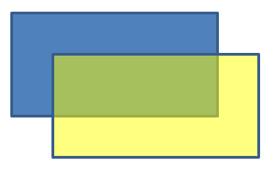

## **Pendahuluan**

Di PowerPoint, Anda dapat menambahkan bentuk ke slide. Karena bentuk terdiri dari garis, Anda dapat memformatnya dengan mengubah atau menerapkan efek pada kontur mereka. Selain itu, Anda dapat memformat bentuk dengan menentukan pengaturan yang mengontrol bagaimana interiornya diisi.


Aspose.Slides for Python via Java menyediakan kelas dan metode yang memungkinkan Anda memformat bentuk menggunakan opsi yang sama dengan yang tersedia di PowerPoint.

## **Format Garis**

Dengan Aspose.Slides, Anda dapat menentukan gaya garis khusus untuk sebuah bentuk. Langkah‑langkah berikut menjelaskan prosedurnya:

1. Buat instance kelas [Presentation](https://reference.aspose.com/slides/python-java/aspose.slides/presentation/).
1. Dapatkan referensi ke slide berdasarkan indeksnya.
1. Tambahkan sebuah [AutoShape](https://reference.aspose.com/slides/python-java/aspose.slides/autoshape/) ke slide.
1. Atur [gaya garis](https://reference.aspose.com/slides/python-java/aspose.slides/linestyle/) bentuk.
1. Atur lebar garis.
1. Atur [gaya dash](https://reference.aspose.com/slides/python-java/aspose.slides/linedashstyle/) garis.
1. Atur warna garis untuk bentuk.
1. Simpan presentasi yang telah dimodifikasi sebagai file PPTX.

Kode berikut memperlihatkan cara memformat sebuah [AutoShape](https://reference.aspose.com/slides/python-java/aspose.slides/autoshape/) persegi panjang:

```python
import jpype
import asposeslides

if not jpype.isJVMStarted():
    jpype.startJVM()

from asposeslides.api import FillType, LineDashStyle, LineStyle, Presentation, SaveFormat, ShapeType
from java.awt import Color

# Membuat instance kelas Presentation yang mewakili file presentasi.
presentation = Presentation()
try:
    # Ambil slide pertama.
    slide = presentation.getSlides().get_Item(0)

    # Tambahkan auto shape dengan tipe Rectangle.
    shape = slide.getShapes().addAutoShape(ShapeType.Rectangle, 50, 150, 150, 75)

    # Atur warna isi untuk shape persegi panjang.
    shape.getFillFormat().setFillType(FillType.NoFill)

    # Terapkan pemformatan pada garis persegi panjang.
    shape.getLineFormat().setStyle(LineStyle.ThickThin)
    shape.getLineFormat().setWidth(7)
    shape.getLineFormat().setDashStyle(LineDashStyle.Dash)

    # Atur warna untuk garis persegi panjang.
    shape.getLineFormat().getFillFormat().setFillType(FillType.Solid)
    shape.getLineFormat().getFillFormat().getSolidFillColor().setColor(Color.BLUE)

    # Simpan file PPTX ke disk.
    presentation.save("formatted_lines.pptx", SaveFormat.Pptx)
finally:
    presentation.dispose()
```

Hasilnya:


## **Terapkan Efek Sketsa pada Garis Bentuk**

Efek sketsa membuat garis bentuk tampak digambar tangan. Gunakan [Shape.getLineFormat](https://reference.aspose.com/slides/python-java/aspose.slides/shape/#getLineFormat) untuk mengakses pengaturan garis, [LineFormat.getSketchFormat](https://reference.aspose.com/slides/python-java/aspose.slides/lineformat/#getSketchFormat) untuk mengakses pengaturan sketsa, dan [SketchFormat.setSketchType](https://reference.aspose.com/slides/python-java/aspose.slides/sketchformat/#setSketchType) untuk memilih nilai dari enumerasi [LineSketchType](https://reference.aspose.com/slides/python-java/aspose.slides/linesketchtype/).

Kode Python berikut menunjukkan cara menerapkan efek [LineSketchType.Curved](https://reference.aspose.com/slides/python-java/aspose.slides/linesketchtype/#Curved), membaca nilai yang secara eksplisit ditetapkan, dan menghapus efek dengan [LineSketchType.None_](https://reference.aspose.com/slides/python-java/aspose.slides/linesketchtype/#None):

```python
import jpype
import asposeslides

if not jpype.isJVMStarted():
    jpype.startJVM()

from asposeslides.api import LineSketchType, Presentation, ShapeType

presentation = Presentation()
try:
    slide = presentation.getSlides().get_Item(0)
    shape = slide.getShapes().addAutoShape(ShapeType.Rectangle, 50, 50, 200, 100)

    # Akses format garis shape dan format sketsanya.
    sketch_format = shape.getLineFormat().getSketchFormat()

    # Terapkan efek sketsa.
    sketch_format.setSketchType(LineSketchType.Curved)

    # Baca efek sketsa yang ditetapkan langsung pada shape.
    explicit_sketch_type = sketch_format.getSketchType()
    print(f"Explicit sketch type: {explicit_sketch_type}")

    # Hapus efek sketsa.
    sketch_format.setSketchType(LineSketchType.None_)
finally:
    presentation.dispose()
```

Nilai yang dikembalikan oleh [SketchFormat.getSketchType](https://reference.aspose.com/slides/python-java/aspose.slides/sketchformat/#getSketchType) mewakili pengaturan yang ditetapkan langsung ke bentuk. Jika pemformatan garis dapat diwarisi dari tema, master slide, atau layout slide, gunakan [LineFormat.getEffective](https://reference.aspose.com/slides/python-java/aspose.slides/lineformat/#getEffective), akses `LineFormatEffectiveData.getSketchFormat`, dan baca `SketchFormatEffectiveData.getSketchType`. Nilai efektif mencerminkan pemformatan yang sebenarnya diterapkan setelah pewarisan diselesaikan:

```python
import jpype
import asposeslides

if not jpype.isJVMStarted():
    jpype.startJVM()

from asposeslides.api import Presentation

presentation = Presentation("presentation.pptx")
try:
    shape = presentation.getSlides().get_Item(0).getShapes().get_Item(0)
    line_format = shape.getLineFormat()

    explicit_sketch_type = line_format.getSketchFormat().getSketchType()
    effective_line_format = line_format.getEffective()
    effective_sketch_type = effective_line_format.getSketchFormat().getSketchType()

    print(f"Explicit sketch type: {explicit_sketch_type}")
    print(f"Effective sketch type: {effective_sketch_type}")
finally:
    presentation.dispose()
```

## **Format Gaya Sambungan**

Berikut tiga opsi tipe sambungan:

* **Round**
* **Miter**
* **Bevel**

Secara default, ketika PowerPoint menggabungkan dua garis pada sudut (seperti pada sudut bentuk), ia menggunakan pengaturan **Round**. Namun, bila Anda menggambar bentuk dengan sudut tajam, Anda mungkin lebih menyukai opsi **Miter**.


Kode Python berikut mendemonstrasikan bagaimana tiga persegi panjang (seperti pada gambar di atas) dibuat menggunakan pengaturan sambungan Miter, Bevel, dan Round:

```python
import jpype
import asposeslides

if not jpype.isJVMStarted():
    jpype.startJVM()

from asposeslides.api import FillType, LineJoinStyle, Presentation, SaveFormat, ShapeType
from java.awt import Color

# Membuat instance kelas Presentation yang mewakili file presentasi.
presentation = Presentation()
try:
    # Ambil slide pertama.
    slide = presentation.getSlides().get_Item(0)

    # Tambahkan tiga auto shape dengan tipe Rectangle.
    miter_shape = slide.getShapes().addAutoShape(ShapeType.Rectangle, 20, 20, 150, 75)
    bevel_shape = slide.getShapes().addAutoShape(ShapeType.Rectangle, 210, 20, 150, 75)
    round_shape = slide.getShapes().addAutoShape(ShapeType.Rectangle, 20, 135, 150, 75)

    # Atur warna isi untuk setiap shape persegi panjang.
    miter_shape.getFillFormat().setFillType(FillType.Solid)
    miter_shape.getFillFormat().getSolidFillColor().setColor(Color.BLACK)
    bevel_shape.getFillFormat().setFillType(FillType.Solid)
    bevel_shape.getFillFormat().getSolidFillColor().setColor(Color.BLACK)
    round_shape.getFillFormat().setFillType(FillType.Solid)
    round_shape.getFillFormat().getSolidFillColor().setColor(Color.BLACK)

    # Atur lebar garis.
    miter_shape.getLineFormat().setWidth(15)
    bevel_shape.getLineFormat().setWidth(15)
    round_shape.getLineFormat().setWidth(15)

    # Atur warna untuk garis setiap persegi panjang.
    miter_shape.getLineFormat().getFillFormat().setFillType(FillType.Solid)
    miter_shape.getLineFormat().getFillFormat().getSolidFillColor().setColor(Color.BLUE)
    bevel_shape.getLineFormat().getFillFormat().setFillType(FillType.Solid)
    bevel_shape.getLineFormat().getFillFormat().getSolidFillColor().setColor(Color.BLUE)
    round_shape.getLineFormat().getFillFormat().setFillType(FillType.Solid)
    round_shape.getLineFormat().getFillFormat().getSolidFillColor().setColor(Color.BLUE)

    # Atur gaya sambungan.
    miter_shape.getLineFormat().setJoinStyle(LineJoinStyle.Miter)
    bevel_shape.getLineFormat().setJoinStyle(LineJoinStyle.Bevel)
    round_shape.getLineFormat().setJoinStyle(LineJoinStyle.Round)

    # Tambahkan teks ke setiap persegi panjang.
    miter_shape.getTextFrame().setText("Miter Join Style")
    bevel_shape.getTextFrame().setText("Bevel Join Style")
    round_shape.getTextFrame().setText("Round Join Style")

    # Simpan file PPTX ke disk.
    presentation.save("join_styles.pptx", SaveFormat.Pptx)
finally:
    presentation.dispose()
```

## **Gradient Fill**

Di PowerPoint, Gradient Fill adalah opsi pemformatan yang memungkinkan Anda menerapkan perpaduan warna berkelanjutan ke sebuah bentuk. Misalnya, Anda dapat menerapkan dua atau lebih warna sehingga satu warna secara bertahap memudar menjadi warna lainnya.

Berikut cara menerapkan gradient fill ke sebuah bentuk menggunakan Aspose.Slides:

1. Buat instance kelas [Presentation](https://reference.aspose.com/slides/python-java/aspose.slides/presentation/).
1. Dapatkan referensi ke slide berdasarkan indeksnya.
1. Tambahkan sebuah [AutoShape](https://reference.aspose.com/slides/python-java/aspose.slides/autoshape/) ke slide.
1. Atur [FillType](https://reference.aspose.com/slides/python-java/aspose.slides/filltype/) bentuk menjadi `Gradient`.
1. Tambahkan dua warna pilihan Anda dengan posisi yang ditentukan menggunakan metode [addPresetColor](https://reference.aspose.com/slides/python-java/aspose.slides/gradientstopcollection/#addPresetColor) pada koleksi gradient stop yang disediakan oleh kelas [GradientFormat](https://reference.aspose.com/slides/python-java/aspose.slides/gradientformat/).
1. Simpan presentasi yang telah dimodifikasi sebagai file PPTX.

Kode Python berikut memperlihatkan cara menerapkan efek gradient fill ke sebuah elips:

```python
import jpype
import asposeslides

if not jpype.isJVMStarted():
    jpype.startJVM()

from asposeslides.api import FillType, GradientDirection, GradientShape, Presentation, PresetColor, SaveFormat, ShapeType
from java.awt import Color

# Membuat instance kelas Presentation yang mewakili file presentasi.
presentation = Presentation()
try:
    # Ambil slide pertama.
    slide = presentation.getSlides().get_Item(0)

    # Tambahkan auto shape dengan tipe Ellipse.
    shape = slide.getShapes().addAutoShape(ShapeType.Ellipse, 50, 50, 150, 75)

    # Terapkan pemformatan gradien ke elips.
    shape.getFillFormat().setFillType(FillType.Gradient)
    shape.getFillFormat().getGradientFormat().setGradientShape(GradientShape.Linear)

    # Atur arah gradien.
    shape.getFillFormat().getGradientFormat().setGradientDirection(GradientDirection.FromCorner2)

    # Tambahkan dua gradient stop.
    shape.getFillFormat().getGradientFormat().getGradientStops().addPresetColor(1.0, PresetColor.Purple)
    shape.getFillFormat().getGradientFormat().getGradientStops().addPresetColor(0.0, PresetColor.Red)

    # Simpan file PPTX ke disk.
    presentation.save("gradient_fill.pptx", SaveFormat.Pptx)
finally:
    presentation.dispose()
```

Hasilnya:


Jika gradient terlihat berbeda pada gambar yang diekspor dibandingkan di PowerPoint, lihat [Choose a Gradient Rendering Style](/slides/id/python-java/convert-powerpoint-to-png/#choose-a-gradient-rendering-style). Anda dapat memilih gaya render tanpa mengubah gradient fill yang disimpan dalam presentasi.

## **Pattern Fill**

Di PowerPoint, Pattern Fill adalah opsi pemformatan yang memungkinkan Anda menerapkan desain dua warna—seperti titik, garis, pola silang, atau kotak centang—ke sebuah bentuk. Anda dapat memilih warna khusus untuk latar depan dan latar belakang pola.

Aspose.Slides menyediakan lebih dari 45 gaya pola bawaan yang dapat Anda terapkan pada bentuk untuk meningkatkan daya tarik visual presentasi Anda. Bahkan setelah memilih pola bawaan, Anda masih dapat menentukan warna tepat yang digunakan.

Berikut cara menerapkan pattern fill ke sebuah bentuk menggunakan Aspose.Slides:

1. Buat instance kelas [Presentation](https://reference.aspose.com/slides/python-java/aspose.slides/presentation/).
1. Dapatkan referensi ke slide berdasarkan indeksnya.
1. Tambahkan sebuah [AutoShape](https://reference.aspose.com/slides/python-java/aspose.slides/autoshape/) ke slide.
1. Atur [FillType](https://reference.aspose.com/slides/python-java/aspose.slides/filltype/) bentuk menjadi `Pattern`.
1. Pilih gaya pola dari opsi bawaan.
1. Atur [Background Color](https://reference.aspose.com/slides/python-java/aspose.slides/patternformat/#getBackColor) pola.
1. Atur [Foreground Color](https://reference.aspose.com/slides/python-java/aspose.slides/patternformat/#getForeColor) pola.
1. Simpan presentasi yang telah dimodifikasi sebagai file PPTX.

Kode Python berikut memperlihatkan cara menerapkan pattern fill ke sebuah persegi panjang:

```python
import jpype
import asposeslides

if not jpype.isJVMStarted():
    jpype.startJVM()

from asposeslides.api import FillType, PatternStyle, Presentation, SaveFormat, ShapeType
from java.awt import Color

# Membuat instance kelas Presentation yang mewakili file presentasi.
presentation = Presentation()
try:
    # Ambil slide pertama.
    slide = presentation.getSlides().get_Item(0)

    # Tambahkan auto shape dengan tipe Rectangle.
    shape = slide.getShapes().addAutoShape(ShapeType.Rectangle, 50, 50, 150, 75)

    # Atur tipe isi menjadi Pattern.
    shape.getFillFormat().setFillType(FillType.Pattern)

    # Atur gaya pola.
    shape.getFillFormat().getPatternFormat().setPatternStyle(PatternStyle.Trellis)

    # Atur warna latar belakang dan latar depan pola.
    shape.getFillFormat().getPatternFormat().getBackColor().setColor(Color.LIGHT_GRAY)
    shape.getFillFormat().getPatternFormat().getForeColor().setColor(Color.YELLOW)

    # Simpan file PPTX ke disk.
    presentation.save("pattern_fill.pptx", SaveFormat.Pptx)
finally:
    presentation.dispose()
```

Hasilnya:


## **Picture Fill**

Di PowerPoint, Picture Fill adalah opsi pemformatan yang memungkinkan Anda menyisipkan gambar di dalam sebuah bentuk—secara efektif menggunakan gambar sebagai latar belakang bentuk.

Berikut cara menggunakan Aspose.Slides untuk menerapkan picture fill ke sebuah bentuk:

1. Buat instance kelas [Presentation](https://reference.aspose.com/slides/python-java/aspose.slides/presentation/).
1. Dapatkan referensi ke slide berdasarkan indeksnya.
1. Tambahkan sebuah [AutoShape](https://reference.aspose.com/slides/python-java/aspose.slides/autoshape/) ke slide.
1. Atur [FillType](https://reference.aspose.com/slides/python-java/aspose.slides/filltype/) bentuk menjadi `Picture`.
1. Atur mode picture fill menjadi `Tile` (atau mode lain yang diinginkan).
1. Buat objek [PPImage](https://reference.aspose.com/slides/python-java/aspose.slides/ppimage/) dari gambar yang ingin Anda gunakan.
1. Berikan gambar ke metode `SlidesPicture.setImage`.
1. Simpan presentasi yang telah dimodifikasi sebagai file PPTX.

Misalkan kita memiliki file "lotus.png" dengan gambar berikut:


Kode Python berikut memperlihatkan cara mengisi sebuah bentuk dengan gambar:

```python
import jpype
import asposeslides

if not jpype.isJVMStarted():
    jpype.startJVM()

from asposeslides.api import FillType, Images, PictureFillMode, Presentation, SaveFormat, ShapeType

# Membuat instance kelas Presentation yang mewakili file presentasi.
presentation = Presentation()
try:
    # Ambil slide pertama.
    slide = presentation.getSlides().get_Item(0)

    # Tambahkan auto shape dengan tipe Rectangle.
    shape = slide.getShapes().addAutoShape(ShapeType.Rectangle, 50, 50, 255, 130)
    
    # Atur tipe isi menjadi Picture.
    shape.getFillFormat().setFillType(FillType.Picture)

    # Atur mode picture fill.
    shape.getFillFormat().getPictureFillFormat().setPictureFillMode(PictureFillMode.Tile)

    # Muat gambar dan tambahkan ke sumber daya presentasi.
    image = Images.fromFile("lotus.png")
    picture = presentation.getImages().addImage(image)
    image.dispose()

    # Atur gambar.
    shape.getFillFormat().getPictureFillFormat().getPicture().setImage(picture)

    # Simpan file PPTX ke disk.
    presentation.save("picture_fill.pptx", SaveFormat.Pptx)
finally:
    presentation.dispose()
```

Hasilnya:


### **Tile Picture As Texture**

Jika Anda ingin mengatur gambar berulang sebagai tekstur dan menyesuaikan perilaku pengulangan, Anda dapat menggunakan metode berikut dari kelas [PictureFillFormat](https://reference.aspose.com/slides/python-java/aspose.slides/picturefillformat/):

- [setPictureFillMode](https://reference.aspose.com/slides/python-java/aspose.slides/picturefillformat/#setPictureFillMode): Menetapkan mode picture fill—baik `Tile` maupun `Stretch`.
- [setTileAlignment](https://reference.aspose.com/slides/python-java/aspose.slides/picturefillformat/#setTileAlignment): Menentukan perataan ubin di dalam bentuk.
- [setTileFlip](https://reference.aspose.com/slides/python-java/aspose.slides/picturefillformat/#setTileFlip): Mengontrol apakah ubin dibalik secara horizontal, vertikal, atau keduanya.
- [setTileOffsetX](https://reference.aspose.com/slides/python-java/aspose.slides/picturefillformat/#setTileOffsetX): Menetapkan offset horizontal ubin (dalam point) dari asal bentuk.
- [setTileOffsetY](https://reference.aspose.com/slides/python-java/aspose.slides/picturefillformat/#setTileOffsetY): Menetapkan offset vertikal ubin (dalam point) dari asal bentuk.
- [setTileScaleX](https://reference.aspose.com/slides/python-java/aspose.slides/picturefillformat/#setTileScaleX): Menentukan skala horizontal ubin dalam persentase.
- [setTileScaleY](https://reference.aspose.com/slides/python-java/aspose.slides/picturefillformat/#setTileScaleY): Menentukan skala vertikal ubin dalam persentase.

Contoh kode berikut menunjukkan cara menambahkan bentuk persegi panjang dengan picture fill berulang dan mengonfigurasi opsi ubin:

```python
import jpype
import asposeslides

if not jpype.isJVMStarted():
    jpype.startJVM()

from asposeslides.api import FillType, Images, PictureFillMode, Presentation, RectangleAlignment, SaveFormat, ShapeType, TileFlip

    # Membuat instance kelas Presentation yang mewakili file presentasi.
    presentation = Presentation()
    try:
        # Ambil slide pertama.
        first_slide = presentation.getSlides().get_Item(0)

        # Tambahkan auto shape persegi panjang.
        shape = first_slide.getShapes().addAutoShape(ShapeType.Rectangle, 50, 50, 190, 95)

        # Atur tipe isi shape menjadi Picture.
        shape.getFillFormat().setFillType(FillType.Picture)

        # Muat gambar dan tambahkan ke sumber daya presentasi.
        source_image = Images.fromFile("lotus.png")
        presentation_image = presentation.getImages().addImage(source_image)
        source_image.dispose()

        # Tetapkan gambar ke shape.
        picture_fill_format = shape.getFillFormat().getPictureFillFormat()
        picture_fill_format.getPicture().setImage(presentation_image)

        # Konfigurasi mode picture fill dan properti ubin.
        picture_fill_format.setPictureFillMode(PictureFillMode.Tile)
        picture_fill_format.setTileOffsetX(-32)
        picture_fill_format.setTileOffsetY(-32)
        picture_fill_format.setTileScaleX(50)
        picture_fill_format.setTileScaleY(50)
        picture_fill_format.setTileAlignment(RectangleAlignment.BottomRight)
        picture_fill_format.setTileFlip(TileFlip.FlipBoth)

        # Simpan file PPTX ke disk.
        presentation.save("tile.pptx", SaveFormat.Pptx)
    finally:
        presentation.dispose()
```

Hasilnya:


## **Solid Color Fill**

Di PowerPoint, Solid Color Fill adalah opsi pemformatan yang mengisi sebuah bentuk dengan satu warna seragam. Latar belakang polos ini diterapkan tanpa gradient, tekstur, atau pola.

Untuk menerapkan solid color fill ke sebuah bentuk menggunakan Aspose.Slides, ikuti langkah berikut:

1. Buat instance kelas [Presentation](https://reference.aspose.com/slides/python-java/aspose.slides/presentation/).
1. Dapatkan referensi ke slide berdasarkan indeksnya.
1. Tambahkan sebuah [AutoShape](https://reference.aspose.com/slides/python-java/aspose.slides/autoshape/) ke slide.
1. Atur [FillType](https://reference.aspose.com/slides/python-java/aspose.slides/filltype/) bentuk menjadi `Solid`.
1. Tetapkan warna isi yang Anda inginkan ke bentuk.
1. Simpan presentasi yang telah dimodifikasi sebagai file PPTX.

Kode Python berikut memperlihatkan cara menerapkan solid color fill ke sebuah persegi panjang dalam slide PowerPoint:

```python
import jpype
import asposeslides

if not jppp.isJVMStarted():
    jpype.startJVM()

from asposeslides.api import FillType, Presentation, SaveFormat, ShapeType
from java.awt import Color

# Membuat instance kelas Presentation yang mewakili file presentasi.
presentation = Presentation()
try:
    # Ambil slide pertama.
    slide = presentation.getSlides().get_Item(0)

    # Tambahkan auto shape dengan tipe Rectangle.
    shape = slide.getShapes().addAutoShape(ShapeType.Rectangle, 50, 50, 150, 75)

    # Atur tipe isi menjadi Solid.
    shape.getFillFormat().setFillType(FillType.Solid)

    # Atur warna isi.
    shape.getFillFormat().getSolidFillColor().setColor(Color.YELLOW)

    # Simpan file PPTX ke disk.
    presentation.save("solid_color_fill.pptx", SaveFormat.Pptx)
finally:
    presentation.dispose()
```

Hasilnya:


## **Set Transparency**

Di PowerPoint, ketika Anda menerapkan solid color, gradient, picture, atau texture fill ke bentuk, Anda juga dapat mengatur tingkat transparansi untuk mengontrol opacity isi. Nilai transparansi yang lebih tinggi membuat bentuk lebih tembus pandang, sehingga latar belakang atau objek di bawahnya dapat terlihat sebagian.

Aspose.Slides memungkinkan Anda mengatur tingkat transparansi dengan menyesuaikan nilai alpha pada warna yang digunakan untuk isi. Berikut cara melakukannya:

1. Buat instance kelas [Presentation](https://reference.aspose.com/slides/python-java/aspose.slides/presentation/).
1. Dapatkan referensi ke slide berdasarkan indeksnya.
1. Tambahkan sebuah [AutoShape](https://reference.aspose.com/slides/python-java/aspose.slides/autoshape/) ke slide.
1. Atur [FillType](https://reference.aspose.com/slides/python-java/aspose.slides/filltype/) menjadi `Solid`.
1. Gunakan [Color](https://docs.oracle.com/en/java/javase/17/docs/api/java.desktop/java/awt/Color.html) untuk mendefinisikan warna dengan transparansi (komponen `alpha` mengontrol transparansi).
1. Simpan presentasi.

Kode Python berikut memperlihatkan cara menerapkan warna isi transparan ke sebuah persegi panjang:

```python
import jpype
import asposeslides

if not jpype.isJVMStarted():
    jpype.startJVM()

from asposeslides.api import FillType, Presentation, SaveFormat, ShapeType
from java.awt import Color

# Membuat instance kelas Presentation yang mewakili file presentasi.
presentation = Presentation()
try:
    # Ambil slide pertama.
    slide = presentation.getSlides().get_Item(0)

    # Tambahkan auto shape persegi panjang solid.
    solid_shape = slide.getShapes().addAutoShape(ShapeType.Rectangle, 50, 50, 150, 75)

    # Tambahkan auto shape persegi panjang transparan di atas shape solid.
    transparent_shape = slide.getShapes().addAutoShape(ShapeType.Rectangle, 80, 80, 150, 75)
    transparent_shape.getFillFormat().setFillType(FillType.Solid)
    transparent_color = Color(255, 255, 0, 204)
    transparent_shape.getFillFormat().getSolidFillColor().setColor(transparent_color)

    # Simpan file PPTX ke disk.
    presentation.save("shape_transparency.pptx", SaveFormat.Pptx)
finally:
    presentation.dispose()
```

Hasilnya:



## **Rotate Shapes**

Aspose.Slides memungkinkan Anda memutar bentuk dalam presentasi PowerPoint. Ini berguna saat menempatkan elemen visual dengan kebutuhan penyelarasan atau desain tertentu.

Untuk memutar sebuah bentuk pada slide, ikuti langkah berikut:

1. Buat instance kelas [Presentation](https://reference.aspose.com/slides/python-java/aspose.slides/presentation/).
1. Dapatkan referensi ke slide berdasarkan indeksnya.
1. Tambahkan sebuah [AutoShape](https://reference.aspose.com/slides/python-java/aspose.slides/autoshape/) ke slide.
1. Atur properti rotasi bentuk ke sudut yang diinginkan.
1. Simpan presentasi.

Kode Python berikut memperlihatkan cara memutar sebuah bentuk sebesar 5 derajat:

```python
import jpype
import asposeslides

if not jpype.isJVMStarted():
    jpype.startJVM()

from asposeslides.api import Presentation, SaveFormat, ShapeType

# Membuat instance kelas Presentation yang mewakili file presentasi.
presentation = Presentation()
try:
    # Ambil slide pertama.
    slide = presentation.getSlides().get_Item(0)

    # Tambahkan auto shape dengan tipe Rectangle.
    shape = slide.getShapes().addAutoShape(ShapeType.Rectangle, 50, 50, 150, 75)

    # Putar shape sebesar 5 derajat.
    shape.setRotation(5)

    # Simpan file PPTX ke disk.
    presentation.save("shape_rotation.pptx", SaveFormat.Pptx)
finally:
    presentation.dispose()
```

Hasilnya:


## **Add 3D Bevel Effects**

Aspose.Slides memungkinkan Anda menerapkan efek 3D bevel pada bentuk dengan mengonfigurasi properti [ThreeDFormat](https://reference.aspose.com/slides/python-java/aspose.slides/threedformat/).

Untuk menambahkan efek 3D bevel ke sebuah bentuk, ikuti langkah berikut:

1. Instansiasikan kelas [Presentation](https://reference.aspose.com/slides/python-java/aspose.slides/presentation/).
1. Dapatkan referensi ke slide berdasarkan indeksnya.
1. Tambahkan sebuah [AutoShape](https://reference.aspose.com/slides/python-java/aspose.slides/autoshape/) ke slide.
1. Konfigurasikan [ThreeDFormat](https://reference.aspose.com/slides/python-java/aspose.slides/threedformat/) bentuk untuk mendefinisikan pengaturan bevel.
1. Simpan presentasi.

Kode Python berikut menunjukkan cara menerapkan efek 3D bevel ke sebuah bentuk:

```python
import jpype
import asposeslides

if not jpype.isJVMStarted():
    jpype.startJVM()

from asposeslides.api import BevelPresetType, CameraPresetType, FillType, LightRigPresetType, LightingDirection, Presentation, SaveFormat, ShapeType
from java.awt import Color

# Buat sebuah instance dari kelas Presentation.
presentation = Presentation()
try:
    slide = presentation.getSlides().get_Item(0)

    # Tambahkan sebuah shape ke slide.
    shape = slide.getShapes().addAutoShape(ShapeType.Ellipse, 50, 50, 100, 100)
    shape.getFillFormat().setFillType(FillType.Solid)
    shape.getFillFormat().getSolidFillColor().setColor(Color.GREEN)
    shape.getLineFormat().getFillFormat().setFillType(FillType.Solid)
    shape.getLineFormat().getFillFormat().getSolidFillColor().setColor(Color.ORANGE)
    shape.getLineFormat().setWidth(2.0)

    # Atur properti ThreeDFormat shape.
    shape.getThreeDFormat().setDepth(4)
    shape.getThreeDFormat().getBevelTop().setBevelType(BevelPresetType.Circle)
    shape.getThreeDFormat().getBevelTop().setHeight(6)
    shape.getThreeDFormat().getBevelTop().setWidth(6)
    shape.getThreeDFormat().getCamera().setCameraType(CameraPresetType.OrthographicFront)
    shape.getThreeDFormat().getLightRig().setLightType(LightRigPresetType.ThreePt)
    shape.getThreeDFormat().getLightRig().setDirection(LightingDirection.Top)

    # Simpan presentasi sebagai file PPTX.
    presentation.save("3D_bevel_effect.pptx", SaveFormat.Pptx)
finally:
    presentation.dispose()
```

Hasilnya:


## **Add 3D Rotation Effects**

Aspose.Slides memungkinkan Anda menerapkan efek rotasi 3D pada bentuk dengan mengonfigurasi properti [ThreeDFormat](https://reference.aspose.com/slides/python-java/aspose.slides/threedformat/).

Untuk menerapkan rotasi 3D pada sebuah bentuk:

1. Buat instance kelas [Presentation](https://reference.aspose.com/slides/python-java/aspose.slides/presentation/).
1. Dapatkan referensi ke slide berdasarkan indeksnya.
1. Tambahkan sebuah [AutoShape](https://reference.aspose.com/slides/python-java/aspose.slides/autoshape/) ke slide.
1. Gunakan metode [setCameraType](https://reference.aspose.com/slides/python-java/aspose.slides/camera/#setCameraType) dan [setLightType](https://reference.aspose.com/slides/python-java/aspose.slides/lightrig/#setLightType) untuk mendefinisikan rotasi 3D.
1. Simpan presentasi.

Kode Python berikut memperlihatkan cara menerapkan efek rotasi 3D pada sebuah bentuk:

```python
import jpype
import asposeslides

if not jpype.isJVMStarted():
    jpype.startJVM()

from asposeslides.api import CameraPresetType, LightRigPresetType, Presentation, SaveFormat, ShapeType

# Buat sebuah instance dari kelas Presentation.
presentation = Presentation()
try:
    slide = presentation.getSlides().get_Item(0)

    auto_shape = slide.getShapes().addAutoShape(ShapeType.Rectangle, 50, 50, 150, 75)
    auto_shape.getTextFrame().setText("Hello, Aspose!")

    auto_shape.getThreeDFormat().setDepth(6)
    auto_shape.getThreeDFormat().getCamera().setRotation(40, 35, 20)
    auto_shape.getThreeDFormat().getCamera().setCameraType(CameraPresetType.IsometricLeftUp)
    auto_shape.getThreeDFormat().getLightRig().setLightType(LightRigPresetType.Balanced)

    # Simpan presentasi sebagai file PPTX.
    presentation.save("3D_rotation_effect.pptx", SaveFormat.Pptx)
finally:
    presentation.dispose()
```

Hasilnya:


## **Control Black-and-White Rendering for Shapes**

Metode [Shape.setBlackWhiteMode](https://reference.aspose.com/slides/python-java/aspose.slides/shape/#setBlackWhiteMode) menentukan bagaimana sebuah bentuk individual dirender ketika presentasi ditampilkan atau diproses dalam mode hitam‑putih. Metode ini tidak mengaktifkan tampilan hitam‑putih sendiri, dan tidak mengubah isi, garis, atau pemformatan lain bentuk dalam mode warna normal.

Gunakan nilai dari kelas [BlackWhiteMode](https://reference.aspose.com/slides/python-java/aspose.slides/blackwhitemode/) untuk memilih perilaku yang diinginkan. Misalnya, `Automatic` membiarkan aplikasi rendering memilih konversi, `Gray` dan `LightGray` menggunakan warna abu‑abu, `BlackWhite` hanya menggunakan hitam dan putih, `Black` dan `White` memaksa satu warna, `Color` mempertahankan warna normal, dan `Hidden` menghilangkan bentuk dalam mode hitam‑putih. `NotDefined` berarti tidak ada mode tingkat bentuk yang ditetapkan.

Kode Python berikut membuat bentuk berwarna dan membuatnya tampil abu‑abu dalam mode tampilan hitam‑putih:

```python
import jpype
import asposeslides

if not jpype.isJVMStarted():
    jpype.startJVM()

from asposeslides.api import BlackWhiteMode, FillType, Presentation, SaveFormat, ShapeType
from java.awt import Color

presentation = Presentation()
try:
    slide = presentation.getSlides().get_Item(0)

    shape = slide.getShapes().addAutoShape(ShapeType.Rectangle, 50, 50, 200, 100)
    shape.getFillFormat().setFillType(FillType.Solid)
    shape.getFillFormat().getSolidFillColor().setColor(Color.ORANGE)

    # Pertahankan isian oranye dalam mode warna, tetapi render bentuk dengan pewarnaan abu-abu dalam mode hitam-putih.
    shape.setBlackWhiteMode(BlackWhiteMode.Gray)

    presentation.save("shape_black_white_mode.pptx", SaveFormat.Pptx)
finally:
    presentation.dispose()
```

Dalam mode warna normal, persegi panjang tetap berisi oranye. Dalam alur kerja tampilan hitam‑putih, ia menggunakan warna abu‑abu karena mode-nya disetel ke `Gray`. Ini memungkinkan Anda mempertahankan slide berwarna penuh sambil mendefinisikan tampilan khusus untuk pencetakan, pratinjau, atau alur kerja lain yang menghormati pengaturan tampilan hitam‑putih presentasi.

## **Reset Formatting**

Kode Python berikut menunjukkan cara mereset pemformatan slide dan mengembalikan posisi, ukuran, serta pemformatan semua bentuk dengan placeholder pada [LayoutSlide](https://reference.aspose.com/slides/python-java/aspose.slides/layoutslide/) ke pengaturan default mereka:

```python
import jpype
import asposeslides

if not jpype.isJVMStarted():
    jpype.startJVM()

from asposeslides.api import Presentation, SaveFormat

presentation = Presentation("sample.pptx")
try:
    for slide in presentation.getSlides():
        # Reset setiap bentuk pada slide yang memiliki placeholder pada layout.
        slide.reset()

    presentation.save("reset_formatting.pptx", SaveFormat.Pptx)
finally:
    presentation.dispose()
```

## **FAQ**

**Apakah pemformatan bentuk memengaruhi ukuran akhir file presentasi?**

Hanya sedikit. Gambar dan media yang disematkan menyerap sebagian besar ruang file, sementara parameter bentuk seperti warna, efek, dan gradient disimpan sebagai metadata dan hampir tidak menambah ukuran.

**Bagaimana cara mendeteksi bentuk pada slide yang memiliki pemformatan identik sehingga saya dapat mengelompokkannya?**

Bandingkan setiap properti pemformatan utama bentuk—pengaturan isi, garis, dan efek. Jika semua nilai yang bersesuaian cocok, perlakukan gaya mereka sebagai identik dan kelompokkan bentuk‑bentuk tersebut secara logis, yang menyederhanakan manajemen gaya di kemudian hari.

**Apakah saya dapat menyimpan sekumpulan gaya bentuk khusus ke file terpisah untuk digunakan kembali di presentasi lain?**

Ya. Simpan contoh bentuk dengan gaya yang diinginkan dalam deck slide templat atau file templat .POTX. Saat membuat presentasi baru, buka templat tersebut, kloning bentuk bergaya yang diperlukan, dan terapkan kembali pemformatannya di mana diperlukan.