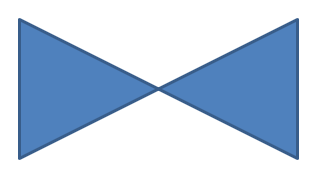

## **Gambaran Umum**

Artikel ini menjelaskan cara menyesuaikan bentuk presentasi di Aspose.Slides dengan mengedit geometri bentuk melalui titik edit dan jalur geometri. Ini menunjukkan cara bekerja dengan [GeometryPath](https://reference.aspose.com/slides/python-net/aspose.slides/geometrypath/) untuk memodifikasi bentuk yang ada, melakukan operasi pengeditan jalur dasar, menambah atau menghapus titik, dan menerapkan geometri yang diperbarui kembali ke sebuah bentuk.

Ini juga menunjukkan cara membuat bentuk khusus dan komposit, membangun bentuk dengan sudut melengkung, menentukan apakah geometri bentuk tertutup, dan mengekstrak elemen bentuk untuk analisis kontur.

## **Mengubah Bentuk Menggunakan Titik Edit**

Di PowerPoint, Anda dapat menggunakan **Edit Points** untuk memodifikasi sebuah persegi:

* Memindahkan sudut ke dalam atau ke luar.
* Menyesuaikan kelengkungan pada sebuah titik.
* Menambahkan titik baru.

Mengedit titik memungkinkan Anda memodifikasi garis luar bentuk atau menggunakan bentuk yang ada sebagai dasar untuk bentuk baru.

## **Tips Pengeditan Bentuk**


Saat mengedit bentuk PowerPoint, ingatlah konsep-konsep berikut:

* Sebuah bentuk (atau jalurnya) dapat berupa tertutup atau terbuka.
* Jalur bentuk terdiri dari titik jangkar yang dihubungkan oleh segmen.
* Segmen dapat lurus atau melengkung. Titik jangkar dan pegangan kontrol menentukan bentuknya.
* Titik jangkar ada sebagai titik sudut, titik lurus, atau titik halus:
  * Pada titik sudut, segmen yang berdekatan dapat bertemu pada suatu sudut.
  * Pada titik halus, dua pegangan kontrol sejajar dan berjarak sama dari titik jangkar.
  * Pada titik lurus, dua pegangan kontrol sejajar tetapi dapat memiliki jarak yang berbeda dari titik jangkar.
* Memindahkan titik jangkar atau menyesuaikan pegangan mereka mengubah garis luar bentuk.

Untuk mengedit bentuk PowerPoint melalui titik edit, **Aspose.Slides** menyediakan kelas [GeometryPath](https://reference.aspose.com/slides/python-net/aspose.slides/geometrypath/).

* Sebuah instance [GeometryPath](https://reference.aspose.com/slides/python-net/aspose.slides/geometrypath/) merepresentasikan jalur geometri dari objek [GeometryShape](https://reference.aspose.com/slides/python-net/aspose.slides/geometryshape/).
* Untuk mengambil [GeometryPath](https://reference.aspose.com/slides/python-net/aspose.slides/geometrypath/) dari instance [GeometryShape](https://reference.aspose.com/slides/python-net/aspose.slides/geometryshape/), Anda dapat menggunakan metode [GeometryShape.get_geometry_paths](https://reference.aspose.com/slides/python-net/aspose.slides/geometryshape/get_geometry_paths/).
* Untuk menetapkan [GeometryPath](https://reference.aspose.com/slides/python-net/aspose.slides/geometrypath/) pada sebuah bentuk, Anda dapat menggunakan metode berikut: [GeometryShape.set_geometry_path](https://reference.aspose.com/slides/python-net/aspose.slides/geometryshape/set_geometry_path/) untuk bentuk dengan satu jalur dan [GeometryShape.set_geometry_paths](https://reference.aspose.com/slides/python-net/aspose.slides/geometryshape/set_geometry_paths/) untuk bentuk dengan beberapa jalur.
* Untuk menambahkan segmen, Anda dapat menggunakan metode di bawah [GeometryPath](https://reference.aspose.com/slides/python-net/aspose.slides/geometrypath/).
* Dengan menggunakan properti [GeometryPath.stroke](https://reference.aspose.com/slides/python-net/aspose.slides/geometrypath/stroke/) dan [GeometryPath.fill_mode](https://reference.aspose.com/slides/python-net/aspose.slides/geometrypath/fill_mode/), Anda dapat mengatur tampilan untuk sebuah jalur geometri.
* Dengan menggunakan properti [GeometryPath.path_data](https://reference.aspose.com/slides/python-net/aspose.slides/geometrypath/path_data/), Anda dapat mengambil jalur geometri dari sebuah [GeometryShape](https://reference.aspose.com/slides/python-net/aspose.slides/geometryshape/) sebagai array segmen jalur.

## **Operasi Pengeditan Sederhana**

Gunakan metode berikut untuk mengedit jalur geometri. Overload yang menerima indeks menyisipkan segmen pada posisi berbasis nol dalam array segmen jalur.

| Operasi | Metode |
| --- | --- |
| Menambahkan atau menyisipkan garis lurus. | [GeometryPath.line_to](https://reference.aspose.com/slides/python-net/aspose.slides/geometrypath/line_to/) |
| Menambahkan atau menyisipkan kurva Bézier kubik dengan dua titik kontrol dan satu titik akhir. | [GeometryPath.cubic_bezier_to](https://reference.aspose.com/slides/python-net/aspose.slides/geometrypath/cubic_bezier_to/) |
| Menambahkan atau menyisipkan kurva Bézier kuadratik dengan satu titik kontrol dan satu titik akhir. | [GeometryPath.quadratic_bezier_to](https://reference.aspose.com/slides/python-net/aspose.slides/geometrypath/quadratic_bezier_to/) |
| Menambahkan busur elips dengan dimensi dan sudut yang ditentukan dalam derajat. | [GeometryPath.arc_to](https://reference.aspose.com/slides/python-net/aspose.slides/geometrypath/arc_to/) |
| Menutup gambar saat ini dengan menghubungkan titik akhirnya ke titik awalnya. | [GeometryPath.close_figure](https://reference.aspose.com/slides/python-net/aspose.slides/geometrypath/close_figure/) |
| Menetapkan titik awal dari sebuah gambar. | [GeometryPath.move_to](https://reference.aspose.com/slides/python-net/aspose.slides/geometrypath/move_to/) |
| Menghapus segmen pada indeks berbasis nol. | [GeometryPath.remove_at](https://reference.aspose.com/slides/python-net/aspose.slides/geometrypath/remove_at/) |

## **Menambahkan Titik Kustom ke Bentuk**

Contoh ini menyisipkan dua titik ke dalam bentuk persegi panjang menggunakan [GeometryPath.line_to](https://reference.aspose.com/slides/python-net/aspose.slides/geometrypath/line_to/) dan menerapkan jalur yang diedit dengan [GeometryShape.set_geometry_path](https://reference.aspose.com/slides/python-net/aspose.slides/geometryshape/set_geometry_path/). Koordinat bersifat lokal terhadap bentuk: kedua titik baru berada di tengahnya, 100 poin dari kiri dan 50 poin dari atas. Indeks segmen 1 dan 4 menempatkannya pada tepi atas dan bawah, menarik tepi tersebut ke dalam.

```python
import aspose.slides as slides

with slides.Presentation() as presentation:
    slide = presentation.slides[0]

    shape = slide.shapes.add_auto_shape(slides.ShapeType.RECTANGLE, 100, 100, 200, 100)

    geometry_path = shape.get_geometry_paths()[0]
    geometry_path.line_to(100, 50, 1)
    geometry_path.line_to(100, 50, 4)

    shape.set_geometry_path(geometry_path)
```



## **Menghapus Titik dari Bentuk**

Contoh ini mengubah garis luar berbentuk hati dengan menghapus segmen pada indeks berbasis nol 2 menggunakan [GeometryPath.remove_at](https://reference.aspose.com/slides/python-net/aspose.slides/geometrypath/remove_at/). Menerapkan jalur yang dimodifikasi dengan [GeometryShape.set_geometry_path](https://reference.aspose.com/slides/python-net/aspose.slides/geometryshape/set_geometry_path/) memperbarui kontur bentuk.

```python
import aspose.slides as slides

with slides.Presentation() as presentation:
    slide = presentation.slides[0]

    shape = slide.shapes.add_auto_shape(slides.ShapeType.HEART, 100, 100, 300, 300)

    path = shape.get_geometry_paths()[0]
    path.remove_at(2)

    shape.set_geometry_path(path)
```


## **Membuat Bentuk Kustom**

Contoh ini membangun bintang lima sudut dengan [GeometryPath](https://reference.aspose.com/slides/python-net/aspose.slides/geometrypath/). Radius luar dan dalam yang bergantian masing-masing 100 dan 50 poin menentukan ujung dan lekukan; langkah 72 derajat menempatkan lima ujung secara merata. Jalur ditutup dengan [GeometryPath.close_figure](https://reference.aspose.com/slides/python-net/aspose.slides/geometrypath/close_figure/) dan diterapkan ke bentuk persegi panjang menggunakan [GeometryShape.set_geometry_path](https://reference.aspose.com/slides/python-net/aspose.slides/geometryshape/set_geometry_path/), menggantikan garis luarnya.

```python
import aspose.slides as slides
import aspose.pydrawing as draw
import math

points = []

outer_radius = 100
inner_radius = 50
angle_step = 72

for angle in range(-90, 270, angle_step):
    radians = angle * (math.pi / 180)
    x = outer_radius * math.cos(radians)
    y = outer_radius * math.sin(radians)
    points.append(slides.PointF(x + outer_radius, y + outer_radius))

    radians = math.pi * (angle + angle_step / 2) / 180.0
    x = inner_radius * math.cos(radians)
    y = inner_radius * math.sin(radians)
    points.append(slides.PointF(x + outer_radius, y + outer_radius))

star_path = slides.GeometryPath()
star_path.move_to(points[0])

for i in range(1, len(points)):
    star_path.line_to(points[i])

star_path.close_figure()

with slides.Presentation() as presentation:
    slide = presentation.slides[0]

    shape = slide.shapes.add_auto_shape(slides.ShapeType.RECTANGLE, 100, 100, outer_radius * 2, outer_radius * 2)
    shape.set_geometry_path(star_path)
```


## **Membuat Bentuk Kustom Komposit**

Contoh ini mendefinisikan dua objek [GeometryPath](https://reference.aspose.com/slides/python-net/aspose.slides/geometrypath/) tertutup untuk sepertiga atas dan bawah sebuah bentuk. Menerapkan kedua jalur dengan [GeometryShape.set_geometry_paths](https://reference.aspose.com/slides/python-net/aspose.slides/geometryshape/set_geometry_paths/) menghasilkan satu bentuk komposit dengan celah di sepertiga tengahnya.

```python
import aspose.slides as slides

with slides.Presentation() as presentation:
    slide = presentation.slides[0]

    shape = slide.shapes.add_auto_shape(slides.ShapeType.RECTANGLE, 100, 100, 200, 100)

    top_path = slides.GeometryPath()
    top_path.move_to(0, 0)
    top_path.line_to(shape.width, 0)
    top_path.line_to(shape.width, shape.height / 3)
    top_path.line_to(0, shape.height / 3)
    top_path.close_figure()

    bottom_path = slides.GeometryPath()
    bottom_path.move_to(0, shape.height / 3 * 2)
    bottom_path.line_to(shape.width, shape.height / 3 * 2)
    bottom_path.line_to(shape.width, shape.height)
    bottom_path.line_to(0, shape.height)
    bottom_path.close_figure()

    shape.set_geometry_paths([top_path, bottom_path])
```


## **Membuat Bentuk Kustom dengan Sudut Melengkung**

Contoh ini menggabungkan segmen lurus dengan [GeometryPath.arc_to](https://reference.aspose.com/slides/python-net/aspose.slides/geometrypath/arc_to/) untuk membuat bentuk dengan sudut melengkung ke dalam. Setiap ukuran sudut menetapkan lebar dan tinggi busur dalam poin, dan sapuan -90 derajat menggambar seperempat elips berlawanan arah jarum jam. Jalur yang selesai diterapkan dengan [GeometryShape.set_geometry_path](https://reference.aspose.com/slides/python-net/aspose.slides/geometryshape/set_geometry_path/), dan presentasi disimpan dalam format PPTX.

```python
import aspose.slides as slides
import aspose.pydrawing as draw

shape_x = 20
shape_y = 20
shape_width = 300
shape_height = 200

left_top_size = 50
right_top_size = 20
right_bottom_size = 40
left_bottom_size = 10

with slides.Presentation() as presentation:
    slide = presentation.slides[0]

    shape = slide.shapes.add_auto_shape(slides.ShapeType.CUSTOM, shape_x, shape_y, shape_width, shape_height)

    top_left = slides.PointF(left_top_size, 0)
    top_right = slides.PointF(shape_width - right_top_size, 0)
    right_bottom = slides.PointF(shape_width, shape_height - right_bottom_size)
    bottom_left = slides.PointF(left_bottom_size, shape_height)
    left_top = slides.PointF(0, left_top_size)

    geometry_path = slides.GeometryPath()
    geometry_path.move_to(top_left)
    geometry_path.line_to(top_right)
    geometry_path.arc_to(right_top_size, right_top_size, 180, -90)
    geometry_path.line_to(right_bottom)
    geometry_path.arc_to(right_bottom_size, right_bottom_size, -90, -90)
    geometry_path.line_to(bottom_left)
    geometry_path.arc_to(left_bottom_size, left_bottom_size, 0, -90)
    geometry_path.line_to(left_top)
    geometry_path.arc_to(left_top_size, left_top_size, 90, -90)
    geometry_path.close_figure()

    shape.set_geometry_path(geometry_path)

    presentation.save("output.pptx", slides.export.SaveFormat.PPTX)
```

## **Menentukan Apakah Geometri Bentuk Tertutup**

Helper berikut memeriksa apakah setiap jalur geometri yang tidak kosong diakhiri dengan segmen penutup. Ia membaca [GeometryPath.path_data](https://reference.aspose.com/slides/python-net/aspose.slides/geometrypath/path_data/) dan membandingkan perintah segmen terakhir [PathSegment.path_command](https://reference.aspose.com/slides/python-net/aspose.slides/pathsegment/path_command/) dengan [PathCommandType.CLOSE](https://reference.aspose.com/slides/python-net/aspose.slides/pathcommandtype/). Ia mengembalikan false bila tidak ada jalur yang tidak kosong. Pemeriksaan ini melihat perintah akhir dari setiap jalur; tidak memeriksa setiap subgambar di dalam jalur. Contoh mencetak `True` untuk sebuah persegi panjang.

```python
import aspose.slides as slides


def is_geometry_closed(geometry_shape):
    has_nonempty_path = False

    for geometry_path in geometry_shape.get_geometry_paths():
        segments = geometry_path.path_data
        if len(segments) == 0:
            continue

        has_nonempty_path = True
        last_segment = segments[len(segments) - 1]
        if last_segment.path_command != slides.PathCommandType.CLOSE:
            return False

    return has_nonempty_path


with slides.Presentation() as presentation:
    slide = presentation.slides[0]
    shape = slide.shapes.add_auto_shape(slides.ShapeType.RECTANGLE, 100, 100, 200, 100)
    print(is_geometry_closed(shape))
```

## **Mengekstrak dan Memeriksa Elemen Bentuk**

Gunakan [GeometryShape.create_shape_elements](https://reference.aspose.com/slides/python-net/aspose.slides/geometryshape/create_shape_elements/) untuk memeriksa sebuah bentuk yang ada sebagai elemen yang berisi titik jalur dan tipe titik. Setiap [ShapeElement](https://reference.aspose.com/slides/python-net/aspose.slides/shapeelement/) yang dikembalikan menampilkan array [path_points](https://reference.aspose.com/slides/python-net/aspose.slides/shapeelement/path_points/) dan [path_types](https://reference.aspose.com/slides/python-net/aspose.slides/shapeelement/path_types/). Representasi ini berguna untuk analisis kontur atau mengirim geometri ke alat gambar kustom.

Contoh ini membuka sebuah presentasi, menemukan bentuk geometri pertama secara langsung pada slide pertama, dan mencetak segmen jalurnya. Gunakan presentasi yang berisi bentuk dengan segmen lurus dan melengkung untuk melihat kedua jenis output. Ia tidak mencari di dalam grup.

```python
import aspose.slides as slides

with slides.Presentation("input.pptx") as presentation:
    slide = presentation.slides[0]
    shape = next((item for item in slide.shapes if isinstance(item, slides.GeometryShape)), None)

    if shape is None:
        print("No geometry shape found on the first slide.")
    else:
        for element in shape.create_shape_elements():
            points = element.path_points
            types = element.path_types
            print("Shape element:")

            i = 0
            while i < len(points):
                point_type = types[i] & 0x07  # Pertahankan tipe segmen, kecuali flag.
                if point_type == 0:
                    print(f"Start figure at {points[i]}")
                elif point_type == 1:
                    print(f"Line to {points[i]}")
                elif point_type == 3:
                    print(f"Cubic Bezier: controls {points[i]}, {points[i + 1]}; end {points[i + 2]}")
                    i += 2  # Konsumsi kedua titik kontrol dan titik akhir.

                if (types[i] & 0x80) != 0:
                    print("Close subpath back to its starting point.")
                i += 1
```

Array tersebut berkorespondensi berdasarkan indeks: `points[i]` adalah sebuah titik dan `types[i]` menjelaskan perannya. Tipe `0` memulai sebuah gambar, dan tipe `1` menggambar garis dari titik sebelumnya ke titik saat ini. Segmen Bézier kubik dimulai pada titik akhir sebelumnya dan menggunakan tiga entri tipe-`3` berurutan: dua titik kontrol diikuti oleh titik akhir baru. Loop mengonsumsi ketiga entri ini bersama-sama dan memeriksa titik akhir untuk penutupan.

Tipe titik juga mengandung flag. Gunakan masker `0x07` untuk mengidentifikasi tipe segmen, dan uji `0x80` secara terpisah untuk mendeteksi subpath tertutup. Misalnya, `129` (`0x81`) berarti titik akhir garis yang menutup subpath, dan `131` (`0x83`) berarti titik akhir Bézier yang menutup satu. Membandingkan nilai mentah hanya dengan `1` atau `3` akan melewatkan kasus ini. Flag lain, seperti dash (`0x10`) dan marker (`0x20`), tidak mengubah tipe segmen dasar.

**Koordinat dan transformasi.** Titik diukur dalam poin (1/72 inci), dengan X meningkat ke kanan dan Y meningkat ke bawah. Untuk bentuk yang tidak dikelompokkan, koordinat yang diekstrak sudah mencakup posisi [x](https://reference.aspose.com/slides/python-net/aspose.slides/shape/x/) dan [y](https://reference.aspose.com/slides/python-net/aspose.slides/shape/y/)nya serta mencerminkan lebar dan tinggi saat ini. Misalnya, persegi panjang yang tidak diputar pada `(100, 200)` dengan ukuran `120 × 80` memiliki batas kontur `(100, 200)`–`(220, 280)`. Jangan menambahkan posisi bentuk lagi. Kurangi X dan Y-nya untuk memperoleh koordinat relatif terhadap bingkai yang tidak diputar.

Titik yang diekstrak tidak menerapkan [rotation](https://reference.aspose.com/slides/python-net/aspose.slides/shape/rotation/) bentuk atau pembalikan horizontal dan vertikal. Untuk mereproduksi kontur yang ditampilkan, terapkan transformasi tersebut di sekitar pusat bentuk. Untuk bentuk yang dikelompokkan, juga perhitungkan pemetaan koordinat grup dan transformasinya; jangan mengasumsikan bahwa titik yang diekstrak adalah koordinat slide yang akhir atau menerapkan translasi atau skala dua kali jika sudah tercermin dalam bingkai anak.

**Inspeksi vs pengeditan.** Array yang diekstrak menggambarkan kontur; mengubahnya tidak memperbarui bentuk asli. Pilih pendekatan ini ketika analisis atau kode gambar Anda membutuhkan array titik/tipe. Gunakan [get_geometry_paths](https://reference.aspose.com/slides/python-net/aspose.slides/geometryshape/get_geometry_paths/) ketika Anda memerlukan perintah geometri dalam sistem koordinat lokal bentuk atau ingin mengedit geometri tersebut. Terapkan jalur yang diedit melalui [set_geometry_path](https://reference.aspose.com/slides/python-net/aspose.slides/geometryshape/set_geometry_path/) atau [set_geometry_paths](https://reference.aspose.com/slides/python-net/aspose.slides/geometryshape/set_geometry_paths/).

## **FAQ**

**Apa yang terjadi pada isian dan garis luar setelah mengganti geometri?**

Gaya tetap pada bentuk; hanya kontur yang berubah. Isian dan garis luar secara otomatis diterapkan pada geometri baru.

**Bagaimana cara memutar bentuk kustom secara benar bersama geometri nya?**

Gunakan properti [rotation](https://reference.aspose.com/slides/python-net/aspose.slides/shape/rotation/) pada bentuk; geometri berputar bersama bentuk karena terikat pada sistem koordinat bentuk itu sendiri.

**Apakah saya dapat mengonversi bentuk kustom menjadi gambar untuk “mengunci” hasilnya?**

Ya. Ekspor area [slide](/slides/id/python-net/convert-powerpoint-to-png/) yang diperlukan atau [shape](/slides/id/python-net/create-shape-thumbnails/) itu sendiri ke format raster; ini menyederhanakan pekerjaan selanjutnya dengan geometri yang kompleks.