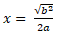

## **Panoramica**

PowerPoint memorizza le equazioni come Office Math Markup Language (OMML). Con Aspose.Slides per C++, è possibile creare lo stesso tipo di contenuto matematico programmaticamente: frazioni, radici, funzioni, limiti, operatori N-ari, matrici, array e blocchi matematici formattati.

In PowerPoint, gli utenti normalmente aggiungono equazioni da **Insert > Equation**:


Il risultato è testo matematico modificabile nella diapositiva:



Aspose.Slides costruisce quel testo matematico tramite tre oggetti principali:

- Una forma matematica, creata con [AddMathShape](https://reference.aspose.com/slides/cpp/aspose.slides/shapecollection/), è la forma che contiene l'equazione.
- [MathPortion](https://reference.aspose.com/slides/cpp/aspose.slides.mathtext/mathportion/) memorizza il contenuto matematico all'interno del frame di testo della forma.
- [MathParagraph](https://reference.aspose.com/slides/cpp/aspose.slides.mathtext/mathparagraph/) contiene uno o più oggetti [MathBlock](https://reference.aspose.com/slides/cpp/aspose.slides.mathtext/mathblock/).

La maggior parte degli esempi seguenti utilizza [MathematicalText](https://reference.aspose.com/slides/cpp/aspose.slides.mathtext/mathematicaltext/) e i metodi fluenti da [IMathElement](https://reference.aspose.com/slides/cpp/aspose.slides.mathtext/imathelement/) per mantenere il codice breve e leggibile.

Per scenari di esportazione MathML, vedere [Esporta equazioni matematiche dalle presentazioni in C++](/slides/it/cpp/exporting-math-equations/).

## **Crea un'equazione**

Questo esempio utilizza [AddMathShape](https://reference.aspose.com/slides/cpp/aspose.slides/ishapecollection/addmathshape/) per creare una forma matematica e aggiunge il teorema di Pitagora:


```cpp
#include <DOM/IAutoShape.h>
#include <DOM/IParagraph.h>
#include <DOM/IShapeCollection.h>
#include <DOM/ISlide.h>
#include <DOM/ITextFrame.h>
#include <DOM/MathText/IMathBlock.h>
#include <DOM/MathText/IMathParagraph.h>
#include <DOM/MathText/IMathSuperscriptElement.h>
#include <DOM/MathText/MathPortion.h>
#include <DOM/MathText/MathematicalText.h>
#include <DOM/Presentation.h>
#include <Export/SaveFormat.h>

using namespace Aspose::Slides;
using namespace Aspose::Slides::Export;
using namespace Aspose::Slides::MathText;

auto presentation = System::MakeObject<Presentation>();
auto slide = presentation->get_Slide(0);

auto mathShape = slide->get_Shapes()->AddMathShape(20.0f, 20.0f, 700.0f, 120.0f);
auto mathPortion = System::ExplicitCast<MathPortion>(mathShape->get_TextFrame()->get_Paragraph(0)->get_Portion(0));
auto mathParagraph = mathPortion->get_MathParagraph();

auto equation = System::MakeObject<MathematicalText>(u"c")
        - >SetSuperscript(u"2")
        - >Join(u"=")
        - >Join(System::MakeObject<MathematicalText>(u"a")->SetSuperscript(u"2"))
        - >Join(u"+")
        - >Join(System::MakeObject<MathematicalText>(u"b")->SetSuperscript(u"2"));

mathParagraph->Add(equation);

presentation->Save(u"pythagorean-theorem.pptx", SaveFormat::Pptx);
presentation->Dispose();
```

{}
[AddMathShape](https://reference.aspose.com/slides/cpp/aspose.slides/ishapecollection/addmathshape/) crea una forma che contiene già un paragrafo matematico. Accedi al primo [MathPortion](https://reference.aspose.com/slides/cpp/aspose.slides.mathtext/mathportion/), chiama [get_MathParagraph](https://reference.aspose.com/slides/cpp/aspose.slides.mathtext/mathportion/get_mathparagraph/), e aggiungi blocchi matematici o elementi matematici.
{}

## **Aggiungi frazioni**

Usa [Divide](https://reference.aspose.com/slides/cpp/aspose.slides.mathtext/imathelement/divide/) per creare una frazione. Puoi scegliere uno stile di frazione con [MathFractionTypes](https://reference.aspose.com/slides/cpp/aspose.slides.mathtext/mathfractiontypes/).


```cpp
#include <DOM/IAutoShape.h>
#include <DOM/IParagraph.h>
#include <DOM/IShapeCollection.h>
#include <DOM/ISlide.h>
#include <DOM/ITextFrame.h>
#include <DOM/MathText/IMathParagraph.h>
#include <DOM/MathText/MathBlock.h>
#include <DOM/MathText/MathFractionTypes.h>
#include <DOM/MathText/MathPortion.h>
#include <DOM/MathText/MathematicalText.h>
#include <DOM/Presentation.h>
#include <Export/SaveFormat.h>

using namespace Aspose::Slides;
using namespace Aspose::Slides::Export;
using namespace Aspose::Slides::MathText;

auto presentation = System::MakeObject<Presentation>();
auto slide = presentation->get_Slide(0);

auto mathShape = slide->get_Shapes()->AddMathShape(20.0f, 20.0f, 700.0f, 100.0f);
auto mathPortion = System::ExplicitCast<MathPortion>(mathShape->get_TextFrame()->get_Paragraph(0)->get_Portion(0));
auto mathParagraph = mathPortion->get_MathParagraph();

auto fraction = System::MakeObject<MathematicalText>(u"1")
        - >Divide(u"x", MathFractionTypes::Skewed);

mathParagraph->Add(System::MakeObject<MathBlock>(fraction));

presentation->Save(u"fraction.pptx", SaveFormat::Pptx);
presentation->Dispose();
```

Per una frazione impilata, usa [MathFractionTypes::Bar](https://reference.aspose.com/slides/cpp/aspose.slides.mathtext/mathfractiontypes/):

```cpp
#include <DOM/MathText/MathFractionTypes.h>
#include <DOM/MathText/MathematicalText.h>
using namespace Aspose::Slides::MathText;

auto stackedFraction = System::MakeObject<MathematicalText>(u"x + 1")->Divide(u"y - 1", MathFractionTypes::Bar);
```

## **Aggiungi radici**

Usa [Radical](https://reference.aspose.com/slides/cpp/aspose.slides.mathtext/imathelement/radical/) per creare una radice quadrata, radice cubica o altra radice. L'elemento corrente diventa la base e l'argomento diventa il grado.


```cpp
#include <DOM/IAutoShape.h>
#include <DOM/IParagraph.h>
#include <DOM/IShapeCollection.h>
#include <DOM/ISlide.h>
#include <DOM/ITextFrame.h>
#include <DOM/MathText/IMathParagraph.h>
#include <DOM/MathText/MathBlock.h>
#include <DOM/MathText/MathPortion.h>
#include <DOM/MathText/MathematicalText.h>
#include <DOM/Presentation.h>
#include <Export/SaveFormat.h>

using namespace Aspose::Slides;
using namespace Aspose::Slides::Export;
using namespace Aspose::Slides::MathText;

auto presentation = System::MakeObject<Presentation>();
auto slide = presentation->get_Slide(0);

auto mathShape = slide->get_Shapes()->AddMathShape(20.0f, 20.0f, 700.0f, 100.0f);
auto mathPortion = System::ExplicitCast<MathPortion>(mathShape->get_TextFrame()->get_Paragraph(0)->get_Portion(0));
auto mathParagraph = mathPortion->get_MathParagraph();

auto radical = System::MakeObject<MathematicalText>(u"x")
        - >Radical(u"n");

mathParagraph->Add(System::MakeObject<MathBlock>(radical));

presentation->Save(u"radical.pptx", SaveFormat::Pptx);
presentation->Dispose();
```

## **Aggiungi funzioni e limiti**

Usa [AsArgumentOfFunction](https://reference.aspose.com/slides/cpp/aspose.slides.mathtext/imathelement/asargumentoffunction/) o [Function](https://reference.aspose.com/slides/cpp/aspose.slides.mathtext/imathelement/function/) per funzioni come `sin(x)`, `log(x)`, o nomi di funzioni personalizzate. Per i limiti, inserisci `lim` in un [MathLimit](https://reference.aspose.com/slides/cpp/aspose.slides.mathtext/mathlimit/) o usa [SetLowerLimit](https://reference.aspose.com/slides/cpp/aspose.slides.mathtext/imathelement/setlowerlimit/).


```cpp
#include <DOM/IAutoShape.h>
#include <DOM/IParagraph.h>
#include <DOM/IShapeCollection.h>
#include <DOM/ISlide.h>
#include <DOM/ITextFrame.h>
#include <DOM/MathText/IMathLimit.h>
#include <DOM/MathText/IMathParagraph.h>
#include <DOM/MathText/MathBlock.h>
#include <DOM/MathText/MathPortion.h>
#include <DOM/MathText/MathematicalText.h>
#include <DOM/Presentation.h>
#include <Export/SaveFormat.h>

using namespace Aspose::Slides;
using namespace Aspose::Slides::Export;
using namespace Aspose::Slides::MathText;

auto presentation = System::MakeObject<Presentation>();
auto slide = presentation->get_Slide(0);

auto mathShape = slide->get_Shapes()->AddMathShape(20.0f, 20.0f, 700.0f, 100.0f);
auto mathPortion = System::ExplicitCast<MathPortion>(mathShape->get_TextFrame()->get_Paragraph(0)->get_Portion(0));
auto mathParagraph = mathPortion->get_MathParagraph();

auto limit = System::MakeObject<MathematicalText>(u"lim")
        - >SetLowerLimit(u"x→∞")
        - >Function(u"x");

mathParagraph->Add(System::MakeObject<MathBlock>(limit));

presentation->Save(u"functions-and-limits.pptx", SaveFormat::Pptx);
presentation->Dispose();
```

Per un nome di funzione personalizzato, imposta il nome della funzione come elemento corrente e chiama [Function](https://reference.aspose.com/slides/cpp/aspose.slides.mathtext/imathelement/function/) con il suo argomento:

```cpp
#include <DOM/MathText/MathematicalText.h>
using namespace Aspose::Slides::MathText;

auto customFunction = System::MakeObject<MathematicalText>(u"f")->Function(u"x + 1");
```

## **Aggiungi operatori N-ari e integrali**

Usa [Nary](https://reference.aspose.com/slides/cpp/aspose.slides.mathtext/imathelement/nary/) per sommatorie, unioni, intersezioni e altri operatori di grandi dimensioni. Usa [Integral](https://reference.aspose.com/slides/cpp/aspose.slides.mathtext/imathelement/integral/) per gli integrali. Entrambi i metodi consentono di impostare i limiti inferiore e superiore.


```cpp
#include <DOM/IAutoShape.h>
#include <DOM/IParagraph.h>
#include <DOM/IShapeCollection.h>
#include <DOM/ISlide.h>
#include <DOM/ITextFrame.h>
#include <DOM/MathText/IMathParagraph.h>
#include <DOM/MathText/IMathSuperscriptElement.h>
#include <DOM/MathText/MathBlock.h>
#include <DOM/MathText/MathNaryOperatorTypes.h>
#include <DOM/MathText/MathPortion.h>
#include <DOM/MathText/MathematicalText.h>
#include <DOM/Presentation.h>
#include <Export/SaveFormat.h>

using namespace Aspose::Slides;
using namespace Aspose::Slides::Export;
using namespace Aspose::Slides::MathText;

auto presentation = System::MakeObject<Presentation>();
auto slide = presentation->get_Slide(0);

auto mathShape = slide->get_Shapes()->AddMathShape(20.0f, 20.0f, 700.0f, 120.0f);
auto mathPortion = System::ExplicitCast<MathPortion>(mathShape->get_TextFrame()->get_Paragraph(0)->get_Portion(0));
auto mathParagraph = mathPortion->get_MathParagraph();

auto summationBase = System::MakeObject<MathematicalText>(u"x")
        - >SetSuperscript(u"k")
        - >Join(System::MakeObject<MathematicalText>(u"a")->SetSuperscript(u"n-k"));

auto summation = summationBase->Nary(MathNaryOperatorTypes::Summation, u"k=0", u"n");

mathParagraph->Add(System::MakeObject<MathBlock>(summation));

presentation->Save(u"nary-operators.pptx", SaveFormat::Pptx);
presentation->Dispose();
```

Gli operatori N-ari sono per grandi operatori con limiti opzionali. Operatori semplici come `+`, `-` e `=` sono solitamente aggiunti come [MathematicalText](https://reference.aspose.com/slides/cpp/aspose.slides.mathtext/mathematicaltext/) e uniti all'espressione.

Per un integrale, usa [Integral](https://reference.aspose.com/slides/cpp/aspose.slides.mathtext/imathelement/integral/):

```cpp
#include <DOM/MathText/IMathBlock.h>
#include <DOM/MathText/IMathBox.h>
#include <DOM/MathText/IMathElement.h>
#include <DOM/MathText/MathIntegralTypes.h>
#include <DOM/MathText/MathematicalText.h>

using namespace Aspose::Slides::MathText;

auto integralBase = System::MakeObject<MathematicalText>(u"x")->Join(System::MakeObject<MathematicalText>(u"dx")->ToBox());
auto integral = integralBase->Integral(MathIntegralTypes::Simple, u"0", u"1");
```

## **Aggiungi matrici**

Usa [MathMatrix](https://reference.aspose.com/slides/cpp/aspose.slides.mathtext/mathmatrix/) per righe e colonne. Le matrici non includono parentesi graffe per impostazione predefinita, quindi racchiudi la matrice quando hai bisogno di parentesi tonde, quadre o graffe.


```cpp
#include <DOM/IAutoShape.h>
#include <DOM/IParagraph.h>
#include <DOM/IShapeCollection.h>
#include <DOM/ISlide.h>
#include <DOM/ITextFrame.h>
#include <DOM/MathText/IMathBlock.h>
#include <DOM/MathText/IMathElement.h>
#include <DOM/MathText/IMathParagraph.h>
#include <DOM/MathText/MathBlock.h>
#include <DOM/MathText/MathMatrix.h>
#include <DOM/MathText/MathPortion.h>
#include <DOM/MathText/MathematicalText.h>
#include <DOM/Presentation.h>
#include <Export/SaveFormat.h>

using namespace Aspose::Slides;
using namespace Aspose::Slides::Export;
using namespace Aspose::Slides::MathText;

auto presentation = System::MakeObject<Presentation>();
auto slide = presentation->get_Slide(0);

auto mathShape = slide->get_Shapes()->AddMathShape(20.0f, 20.0f, 700.0f, 120.0f);
auto mathPortion = System::ExplicitCast<MathPortion>(mathShape->get_TextFrame()->get_Paragraph(0)->get_Portion(0));
auto mathParagraph = mathPortion->get_MathParagraph();

auto matrix = System::MakeObject<MathMatrix>(2, 3);
matrix->idx_set(0, 0, System::MakeObject<MathematicalText>(u"1"));
matrix->idx_set(0, 1, System::MakeObject<MathematicalText>(u"x"));
matrix->idx_set(1, 0, System::MakeObject<MathematicalText>(u"x"));
matrix->idx_set(1, 1, System::MakeObject<MathematicalText>(u"2"));
matrix->idx_set(1, 2, System::MakeObject<MathematicalText>(u"y"));

mathParagraph->Add(System::MakeObject<MathBlock>(matrix));

presentation->Save(u"matrix.pptx", SaveFormat::Pptx);
presentation->Dispose();
```

## **Aggiungi array di equazioni**

Usa [ToMathArray](https://reference.aspose.com/slides/cpp/aspose.slides.mathtext/imathelement/tomatharray/) quando ti servono equazioni allineate o una pila verticale di espressioni.


```cpp
#include <DOM/IAutoShape.h>
#include <DOM/IParagraph.h>
#include <DOM/IShapeCollection.h>
#include <DOM/ISlide.h>
#include <DOM/ITextFrame.h>
#include <DOM/MathText/IMathParagraph.h>
#include <DOM/MathText/MathBlock.h>
#include <DOM/MathText/MathPortion.h>
#include <DOM/MathText/MathematicalText.h>
#include <DOM/Presentation.h>
#include <Export/SaveFormat.h>

using namespace Aspose::Slides;
using namespace Aspose::Slides::Export;
using namespace Aspose::Slides::MathText;

auto presentation = System::MakeObject<Presentation>();
auto slide = presentation->get_Slide(0);

auto mathShape = slide->get_Shapes()->AddMathShape(20.0f, 20.0f, 700.0f, 140.0f);
auto mathPortion = System::ExplicitCast<MathPortion>(mathShape->get_TextFrame()->get_Paragraph(0)->get_Portion(0));
auto mathParagraph = mathPortion->get_MathParagraph();

auto equationArray = System::MakeObject<MathematicalText>(u"x")
        - >Join(u"y")
        - >ToMathArray();

mathParagraph->Add(System::MakeObject<MathBlock>(equationArray));

presentation->Save(u"equation-array.pptx", SaveFormat::Pptx);
presentation->Dispose();
```

### **Allinea un array con gli elementi circostanti**

[IMathArray::set_BaseJustification](https://reference.aspose.com/slides/cpp/aspose.slides.mathtext/imatharray/set_basejustification/) controlla l'allineamento verticale di un array rispetto agli elementi matematici accanto ad esso. L'esempio seguente confronta l'allineamento con la prima riga, il centro dell'array e l'ultima riga.

Il seguente esempio crea tre array identici, ciascuno con tre righe e gli elementi vicini `A=` e `=B`. Tutto il testo matematico usa Cambria Math a 24 punti. Solo l'allineamento dell'array cambia.

```cpp
#include <system/array.h>
#include <system/console.h>
#include <drawing/color.h>
#include <DOM/IAutoShape.h>
#include <DOM/IParagraph.h>
#include <DOM/IParagraphFormat.h>
#include <DOM/IPortion.h>
#include <DOM/IPortionFormat.h>
#include <DOM/IShapeCollection.h>
#include <DOM/ISlide.h>
#include <DOM/ITextFrame.h>
#include <DOM/Fonts/FontData.h>
#include <DOM/MathText/IMathParagraph.h>
#include <DOM/MathText/MathArray.h>
#include <DOM/MathText/MathBlock.h>
#include <DOM/MathText/MathJustification.h>
#include <DOM/MathText/MathPortion.h>
#include <DOM/MathText/MathVerticalAlignment.h>
#include <DOM/MathText/MathRowSpacingRule.h>
#include <DOM/MathText/MathematicalText.h>
#include <DOM/Presentation.h>
#include <Export/SaveFormat.h>
#include <DOM/FillType.h>
#include <DOM/IColorFormat.h>
#include <DOM/IFillFormat.h>
#include <DOM/ILineFormat.h>
#include <DOM/ISlideSize.h>
#include <DOM/ITextFrameFormat.h>
#include <DOM/ShapeType.h>
#include <DOM/SlideSizeScaleType.h>
#include <DOM/TextAnchorType.h>

using namespace Aspose::Slides;
using namespace Aspose::Slides::Export;
using namespace Aspose::Slides::MathText;

auto createText = [](System::String value)
{
    auto text = System::MakeObject<MathematicalText>(value);
    text->get_Format()->set_FontHeight(24);
    auto font = System::MakeObject<FontData>(u"Cambria Math");
    text->get_Format()->set_LatinFont(font);
    return text;
};

auto presentation = System::MakeObject<Presentation>();
presentation->get_SlideSize()->SetSize(780, 200, SlideSizeScaleType::DoNotScale);
auto slide = presentation->get_Slide(0);

MathVerticalAlignment alignments[] = {MathVerticalAlignment::Top, MathVerticalAlignment::Center, MathVerticalAlignment::Bottom};
System::String labels[] = {u"Top", u"Center", u"Bottom"};

for (auto i = 0; i < 3; i++)
{
    auto label = slide->get_Shapes()->AddAutoShape(ShapeType::Rectangle, 20 + i * 260, 10, 240, 30);
    label->get_FillFormat()->set_FillType(FillType::NoFill);
    label->get_LineFormat()->get_FillFormat()->set_FillType(FillType::NoFill);
    label->get_TextFrame()->set_Text(labels[i]);
    auto labelFormat = label->get_TextFrame()->get_Paragraph(0)->get_Portion(0)->get_PortionFormat();
    labelFormat->set_FontHeight(16);
    labelFormat->get_FillFormat()->set_FillType(FillType::Solid);
    labelFormat->get_FillFormat()->get_SolidFillColor()->set_Color(System::Drawing::Color::get_Black());

    auto mathShape = slide->get_Shapes()->AddMathShape(20 + i * 260, 60, 240, 130);
    mathShape->get_TextFrame()->get_TextFrameFormat()->set_AnchoringType(TextAnchorType::Top);
    auto mathPortion = System::ExplicitCast<MathPortion>(mathShape->get_TextFrame()->get_Paragraph(0)->get_Portion(0));
    auto mathParagraph = mathPortion->get_MathParagraph();
    mathParagraph->set_Justification(MathJustification::LeftJustified);

    auto rows = System::MakeArray<System::SharedPtr<IMathElement>>({createText(u"x+y=3"), createText(u"x-y=1"), createText(u"x=2")});
    auto equationArray = System::MakeObject<MathArray>(rows);
    equationArray->set_BaseJustification(alignments[i]);
    auto leftText = createText(u"A=");
    auto rightText = createText(u"=B");
    auto equation = System::MakeObject<MathBlock>(leftText)->Join(equationArray)->Join(rightText);
    mathParagraph->Add(equation);
}

presentation->Save(u"equation-array-alignment.pptx", SaveFormat::Pptx);
presentation->Dispose();
```

Il confronto seguente mostra la presentazione salvata in PowerPoint. Nota la posizione di `A=` e `=B` accanto a ciascun array.


### **Configura la spaziatura delle righe**

[set_RowSpacingRule](https://reference.aspose.com/slides/cpp/aspose.slides.mathtext/imatharray/set_rowspacingrule/) seleziona la regola di spaziatura per le righe all'interno dell'array. [set_RowSpacing](https://reference.aspose.com/slides/cpp/aspose.slides.mathtext/imatharray/set_rowspacing/) fornisce un valore numerico per una regola di spaziatura esplicita e viene ignorato dalle regole predefinite.

Per spaziatura esatta, il valore è misurato in punti. Per spaziatura proporzionale, è misurato in mezze linee: il valore `3` nell'esempio indica 1,5 linee. Chiama entrambi i setter quando specifichi un valore esplicito; modificare solo il valore numerico non seleziona una regola di spaziatura.

L'esempio seguente salva cinque presentazioni con le stesse equazioni, allineamento e impostazioni dei caratteri. Le prime tre usano i preset; le ultime due mostrano valori espliciti.

```cpp
#include <system/array.h>
#include <system/console.h>
#include <drawing/color.h>
#include <DOM/IAutoShape.h>
#include <DOM/IParagraph.h>
#include <DOM/IParagraphFormat.h>
#include <DOM/IPortion.h>
#include <DOM/IPortionFormat.h>
#include <DOM/IShapeCollection.h>
#include <DOM/ISlide.h>
#include <DOM/ITextFrame.h>
#include <DOM/Fonts/FontData.h>
#include <DOM/MathText/IMathParagraph.h>
#include <DOM/MathText/MathArray.h>
#include <DOM/MathText/MathBlock.h>
#include <DOM/MathText/MathJustification.h>
#include <DOM/MathText/MathPortion.h>
#include <DOM/MathText/MathVerticalAlignment.h>
#include <DOM/MathText/MathRowSpacingRule.h>
#include <DOM/MathText/MathematicalText.h>
#include <DOM/Presentation.h>
#include <Export/SaveFormat.h>

using namespace Aspose::Slides;
using namespace Aspose::Slides::Export;
using namespace Aspose::Slides::MathText;

auto createText = [](System::String value)
{
    auto text = System::MakeObject<MathematicalText>(value);
    text->get_Format()->set_FontHeight(24);
    auto font = System::MakeObject<FontData>(u"Cambria Math");
    text->get_Format()->set_LatinFont(font);
    return text;
};

struct ArraySettings
{
    MathRowSpacingRule rule;
    uint32_t spacing;
    System::String name;
};

ArraySettings settings[] =
{
    {MathRowSpacingRule::SingleLineGap, 0, u"SingleLineGap"},
    {MathRowSpacingRule::OneAndAHalfLineGap, 0, u"OneAndAHalfLineGap"},
    {MathRowSpacingRule::TwoLineGap, 0, u"TwoLineGap"},
    {MathRowSpacingRule::Exactly, 20, u"Exactly"},
    {MathRowSpacingRule::Multiple, 3, u"Multiple"}
};

for (const auto& setting : settings)
{
    auto fileName = u"equation-array-" + setting.name + u".pptx";
    auto presentation = System::MakeObject<Presentation>();
    auto mathShape = presentation->get_Slide(0)->get_Shapes()->AddMathShape(20, 20, 600, 300);
    auto paragraph = mathShape->get_TextFrame()->get_Paragraph(0);
    paragraph->get_ParagraphFormat()->set_SpaceBefore(0);
    paragraph->get_ParagraphFormat()->set_SpaceAfter(0);
    auto mathPortion = System::ExplicitCast<MathPortion>(paragraph->get_Portion(0));
    auto mathParagraph = mathPortion->get_MathParagraph();
    mathParagraph->set_Justification(MathJustification::LeftJustified);

    auto rows = System::MakeArray<System::SharedPtr<IMathElement>>({createText(u"x+y=3"), createText(u"x-y=1"), createText(u"x=2")});
    auto equationArray = System::MakeObject<MathArray>(rows);
    equationArray->set_BaseJustification(MathVerticalAlignment::Center);
    equationArray->set_RowSpacingRule(setting.rule);
    equationArray->set_RowSpacing(setting.spacing);
    auto leftText = createText(u"A=");
    auto rightText = createText(u"=B");
    auto equation = System::MakeObject<MathBlock>(leftText)->Join(equationArray)->Join(rightText);
    mathParagraph->Add(equation);

    presentation->Save(fileName, SaveFormat::Pptx);
    presentation->Dispose();
}
```

La spaziatura delle righe dell'array è separata dalla spaziatura del paragrafo. [set_SpaceBefore](https://reference.aspose.com/slides/cpp/aspose.slides/iparagraphformat/set_spacebefore/) e [set_SpaceAfter](https://reference.aspose.com/slides/cpp/aspose.slides/iparagraphformat/set_spaceafter/) aggiungono spazio attorno al paragrafo contenente, non tra le righe dell'array. Allo stesso modo, [IMathParagraph::set_Justification](https://reference.aspose.com/slides/cpp/aspose.slides.mathtext/imathparagraph/set_justification/) posiziona orizzontalmente l'intero paragrafo matematico; non sostituisce l'impostazione di allineamento verticale dell'array.

## **Aggiungi funzioni trigonometriche**

Usa [AsArgumentOfFunction](https://reference.aspose.com/slides/cpp/aspose.slides.mathtext/imathelement/asargumentoffunction/) quando l'argomento è l'elemento corrente e il nome della funzione è noto.


```cpp
#include <DOM/IAutoShape.h>
#include <DOM/IParagraph.h>
#include <DOM/IShapeCollection.h>
#include <DOM/ISlide.h>
#include <DOM/ITextFrame.h>
#include <DOM/MathText/IMathParagraph.h>
#include <DOM/MathText/MathBlock.h>
#include <DOM/MathText/MathFunctionsOfOneArgument.h>
#include <DOM/MathText/MathPortion.h>
#include <DOM/MathText/MathematicalText.h>
#include <DOM/Presentation.h>
#include <Export/SaveFormat.h>

using namespace Aspose::Slides;
using namespace Aspose::Slides::Export;
using namespace Aspose::Slides::MathText;

auto presentation = System::MakeObject<Presentation>();
auto slide = presentation->get_Slide(0);

auto mathShape = slide->get_Shapes()->AddMathShape(20.0f, 20.0f, 700.0f, 100.0f);
auto mathPortion = System::ExplicitCast<MathPortion>(mathShape->get_TextFrame()->get_Paragraph(0)->get_Portion(0));
auto mathParagraph = mathPortion->get_MathParagraph();

auto cosine = System::MakeObject<MathematicalText>(u"2x")
        - >AsArgumentOfFunction(MathFunctionsOfOneArgument::Cos);

mathParagraph->Add(System::MakeObject<MathBlock>(cosine));

presentation->Save(u"trigonometric-function.pptx", SaveFormat::Pptx);
presentation->Dispose();
```

## **Aggiungi pedici e apici**

Usa gli helper per pedici e apici per indici e potenze. Quando gli indici devono apparire sul lato sinistro della base, usa [SetSubSuperscriptOnTheLeft](https://reference.aspose.com/slides/cpp/aspose.slides.mathtext/imathelement/setsubsuperscriptontheleft/).


```cpp
#include <DOM/IAutoShape.h>
#include <DOM/IParagraph.h>
#include <DOM/IShapeCollection.h>
#include <DOM/ISlide.h>
#include <DOM/ITextFrame.h>
#include <DOM/MathText/IMathParagraph.h>
#include <DOM/MathText/MathBlock.h>
#include <DOM/MathText/MathPortion.h>
#include <DOM/MathText/MathematicalText.h>
#include <DOM/Presentation.h>
#include <Export/SaveFormat.h>

using namespace Aspose::Slides;
using namespace Aspose::Slides::Export;
using namespace Aspose::Slides::MathText;

auto presentation = System::MakeObject<Presentation>();
auto slide = presentation->get_Slide(0);

auto mathShape = slide->get_Shapes()->AddMathShape(20.0f, 20.0f, 700.0f, 100.0f);
auto mathPortion = System::ExplicitCast<MathPortion>(mathShape->get_TextFrame()->get_Paragraph(0)->get_Portion(0));
auto mathParagraph = mathPortion->get_MathParagraph();

auto scripts = System::MakeObject<MathematicalText>(u"Y")
        - >SetSubSuperscriptOnTheLeft(u"1", u"n");

mathParagraph->Add(System::MakeObject<MathBlock>(scripts));

presentation->Save(u"subscript-superscript.pptx", SaveFormat::Pptx);
presentation->Dispose();
```

## **Aggiungi delimitatori**

Usa [Enclose](https://reference.aspose.com/slides/cpp/aspose.slides.mathtext/imathelement/enclose/) per inserire un'espressione tra delimitatori. Puoi anche impostare un carattere separatore per espressioni delimitate che contengono diversi elementi.


```cpp
#include <DOM/IAutoShape.h>
#include <DOM/IParagraph.h>
#include <DOM/IShapeCollection.h>
#include <DOM/ISlide.h>
#include <DOM/ITextFrame.h>
#include <DOM/MathText/IMathParagraph.h>
#include <DOM/MathText/MathBlock.h>
#include <DOM/MathText/MathPortion.h>
#include <DOM/MathText/MathematicalText.h>
#include <DOM/Presentation.h>
#include <Export/SaveFormat.h>

using namespace Aspose::Slides;
using namespace Aspose::Slides::Export;
using namespace Aspose::Slides::MathText;

auto presentation = System::MakeObject<Presentation>();
auto slide = presentation->get_Slide(0);

auto mathShape = slide->get_Shapes()->AddMathShape(20.0f, 20.0f, 700.0f, 100.0f);
auto mathPortion = System::ExplicitCast<MathPortion>(mathShape->get_TextFrame()->get_Paragraph(0)->get_Portion(0));
auto mathParagraph = mathPortion->get_MathParagraph();

auto delimiter = System::MakeObject<MathematicalText>(u"x")
        - >Join(u"y")
        - >Join(u"z")
        - >Enclose(u'<', u'>', u'|');

mathParagraph->Add(System::MakeObject<MathBlock>(delimiter));

presentation->Save(u"delimiters.pptx", SaveFormat::Pptx);
presentation->Dispose();
```

### **Dimensione e allineamento dei delimitatori**

Passa `true` a [set_GrowToMatchOperandHeight](https://reference.aspose.com/slides/cpp/aspose.slides.mathtext/imathdelimiter/set_growtomatchoperandheight/) per far crescere le parentesi intorno a un operando alto, o `false` per mantenerle alla dimensione normale. [set_DelimiterShape](https://reference.aspose.com/slides/cpp/aspose.slides.mathtext/imathdelimiter/set_delimitershape/) accetta uno dei due valori [MathDelimiterShape](https://reference.aspose.com/slides/cpp/aspose.slides.mathtext/mathdelimitershape/). `Centered` centra le parentesi sull'asse matematico, che attraversa il centro del segno di uguale. `Match` le allinea con il contenuto racchiuso. Entrambe le impostazioni influenzano solo i delimitatori. L'espressione interna rimane invariata.

L'esempio posiziona una frazione nell'esponente di `x` in modo che l'espressione si estenda più sopra la linea di base rispetto a sotto. Tutte e quattro le equazioni usano le stesse parentesi e impostazioni dei caratteri.

```cpp
#include <DOM/IAutoShape.h>
#include <DOM/IParagraph.h>
#include <DOM/IShapeCollection.h>
#include <DOM/ISlide.h>
#include <DOM/ITextFrame.h>
#include <DOM/MathText/IMathParagraph.h>
#include <DOM/IPortionFormat.h>
#include <DOM/MathText/IMathBlock.h>
#include <DOM/MathText/IMathDelimiter.h>
#include <DOM/MathText/IMathFraction.h>
#include <DOM/MathText/IMathSuperscriptElement.h>
#include <DOM/MathText/MathDelimiterShape.h>
#include <DOM/MathText/MathPortion.h>
#include <DOM/MathText/MathematicalText.h>
#include <DOM/Presentation.h>
#include <Export/SaveFormat.h>

using namespace Aspose::Slides;
using namespace Aspose::Slides::Export;
using namespace Aspose::Slides::MathText;

auto presentation = System::MakeObject<Presentation>();
auto slide = presentation->get_Slide(0);

auto addExpression = [slide](float left, float top, bool grow, MathDelimiterShape shape)
{
    auto fraction = System::MakeObject<MathematicalText>(u"a + b")->Divide(u"c + d");
    auto power = System::MakeObject<MathematicalText>(u"x")->SetSuperscript(fraction);
    auto delimiter = power->Enclose(u'(', u')');
    delimiter->set_GrowToMatchOperandHeight(grow);
    delimiter->set_DelimiterShape(shape);

    auto mathShape = slide->get_Shapes()->AddMathShape(left, top, 300, 100);
    auto portion = System::ExplicitCast<MathPortion>(mathShape->get_TextFrame()->get_Paragraph(0)->get_Portion(0));
    portion->get_PortionFormat()->set_FontHeight(32);
    auto equation = System::MakeObject<MathematicalText>(u"y = ")->Join(delimiter);
    portion->get_MathParagraph()->Add(equation);
};

addExpression(20, 20, true, MathDelimiterShape::Centered);
addExpression(350, 20, true, MathDelimiterShape::Match);
addExpression(20, 140, false, MathDelimiterShape::Centered);
addExpression(350, 140, false, MathDelimiterShape::Match);

presentation->Save(u"delimiter-sizing.pptx", SaveFormat::Pptx);
presentation->Dispose();
```

In PowerPoint, confronta le righe per vedere l'effetto della crescita. Nella riga superiore, le parentesi crescono per racchiudere l'esponente e appaiono simili per entrambe le forme. Nella riga inferiore, la crescita è disattivata. Le parentesi più piccole a sinistra (`Centered`) si allineano con il segno di uguale, mentre quelle a destra (`Match`) sono più alte attorno all'espressione.


## **Aggiungi un riquadro bordato**

Chiama [ToBorderBox](https://reference.aspose.com/slides/cpp/aspose.slides.mathtext/imathelement/toborderbox/) su una frazione per incorniciare l'intera espressione. Il [IMathBorderBox](https://reference.aspose.com/slides/cpp/aspose.slides.mathtext/imathborderbox/) restituito mostra tutte e quattro le facce per impostazione predefinita. Usa [set_HideTop](https://reference.aspose.com/slides/cpp/aspose.slides.mathtext/imathborderbox/set_hidetop/), [set_HideBottom](https://reference.aspose.com/slides/cpp/aspose.slides.mathtext/imathborderbox/set_hidebottom/), [set_HideLeft](https://reference.aspose.com/slides/cpp/aspose.slides.mathtext/imathborderbox/set_hideleft/), e [set_HideRight](https://reference.aspose.com/slides/cpp/aspose.slides.mathtext/imathborderbox/set_hideright/) per rimuovere singole facce.

L'esempio posiziona sei copie della stessa frazione su una diapositiva. Per mostrare la cancellazione, nascondi tutte e quattro le facce e imposta [set_StrikethroughBottomLeftToTopRight](https://reference.aspose.com/slides/cpp/aspose.slides.mathtext/imathborderbox/set_strikethroughbottomlefttotopright/) per una diagonale ascendente (↗) o [set_StrikethroughTopLeftToBottomRight](https://reference.aspose.com/slides/cpp/aspose.slides.mathtext/imathborderbox/set_strikethroughtoplefttobottomright/) per una diagonale discendente (↘). Puoi anche usare [set_StrikethroughHorizontal](https://reference.aspose.com/slides/cpp/aspose.slides.mathtext/imathborderbox/set_strikethroughhorizontal/) o [set_StrikethroughVertical](https://reference.aspose.com/slides/cpp/aspose.slides.mathtext/imathborderbox/set_strikethroughvertical/) con qualsiasi combinazione di facce visibili.

```cpp
#include <DOM/IAutoShape.h>
#include <DOM/IParagraph.h>
#include <DOM/IPortionFormat.h>
#include <DOM/IShapeCollection.h>
#include <DOM/ISlide.h>
#include <DOM/ISlideSize.h>
#include <DOM/ITextFrame.h>
#include <DOM/MathText/IMathBorderBox.h>
#include <DOM/MathText/IMathFraction.h>
#include <DOM/MathText/IMathParagraph.h>
#include <DOM/MathText/MathBlock.h>
#include <DOM/MathText/MathPortion.h>
#include <DOM/MathText/MathematicalText.h>
#include <DOM/Presentation.h>
#include <DOM/SlideSizeScaleType.h>
#include <Export/SaveFormat.h>

using namespace Aspose::Slides;
using namespace Aspose::Slides::Export;
using namespace Aspose::Slides::MathText;

auto presentation = System::MakeObject<Presentation>();
presentation->get_SlideSize()->SetSize(540, 220, SlideSizeScaleType::DoNotScale);
auto slide = presentation->get_Slide(0);

auto addFraction = [slide](float x, float y, bool hideBorder = false)
{
    auto fraction = System::MakeObject<MathematicalText>(u"x+1")->Divide(u"y+2");
    auto box = fraction->ToBorderBox();
    box->set_HideTop(hideBorder);
    box->set_HideBottom(hideBorder);
    box->set_HideLeft(hideBorder);
    box->set_HideRight(hideBorder);

    auto shape = slide->get_Shapes()->AddMathShape(x, y, 160, 90);
    auto portion = System::ExplicitCast<MathPortion>(shape->get_TextFrame()->get_Paragraph(0)->get_Portion(0));
    portion->get_PortionFormat()->set_FontHeight(28);
    auto mathBlock = System::MakeObject<MathBlock>(box);
    portion->get_MathParagraph()->Add(mathBlock);
    return box;
};

addFraction(10, 10);

auto partial = addFraction(190, 10);
partial->set_HideTop(true);
partial->set_HideRight(true);

addFraction(370, 10, true)->set_StrikethroughBottomLeftToTopRight(true);
addFraction(10, 120, true)->set_StrikethroughTopLeftToBottomRight(true);
addFraction(190, 120, true)->set_StrikethroughHorizontal(true);
addFraction(370, 120)->set_StrikethroughVertical(true);

presentation->Save(u"border-box.pptx", SaveFormat::Pptx);
presentation->Dispose();
```


Su questa frazione, la barra orizzontale sovrappone la barra della frazione. La barra verticale attraversa sia il numeratore che il denominatore mentre il bordo circostante rimane visibile. Queste linee decorano l'intera espressione. Il barrato del testo normale si applica ai caratteri in un run di testo. Dopo aver riaperto la presentazione in PowerPoint, è ancora possibile modificare separatamente numeratore e denominatore.

## **Controlla la visibilità e il layout con elementi phantom**

Avvolgi un'espressione in [MathPhantom](https://reference.aspose.com/slides/cpp/aspose.slides.mathtext/mathphantom/) per controllare la sua visibilità e lo spazio che contribuisce a un'equazione in modo indipendente. I metodi setter di [IMathPhantom](https://reference.aspose.com/slides/cpp/aspose.slides.mathtext/imathphantom/) controllano quanto segue:

| Metodo | Effetto |
| --- | --- |
| [set_Show](https://reference.aspose.com/slides/cpp/aspose.slides.mathtext/imathphantom/set_show/) | Passa `false` per nascondere l'espressione. Le sue dimensioni contribuiscono ancora al layout a meno che le impostazioni corrispondenti sotto siano `true`. |
| [set_ZeroWidth](https://reference.aspose.com/slides/cpp/aspose.slides.mathtext/imathphantom/set_zerowidth/) | Considera la larghezza orizzontale dell'espressione come zero, permettendo agli elementi vicini di avvicinarsi. |
| [set_ZeroAsc](https://reference.aspose.com/slides/cpp/aspose.slides.mathtext/imathphantom/set_zeroasc/) | Considera la sua ascensione, l'altezza sopra la linea di base, come zero. Questo può ridurre lo spazio riservato sopra gli elementi vicini. |
| [set_ZeroDesc](https://reference.aspose.com/slides/cpp/aspose.slides.mathtext/imathphantom/set_zerodesc/) | Considera la sua discesa, la profondità sotto la linea di base, come zero. Questo può avvicinare una barra di frazione o altro contenuto sotto l'espressione ai suoi vicini. |

La linea di base è la linea di riferimento su cui si posizionano le lettere matematiche ordinarie. Nascondere il contenuto non rimuove le sue dimensioni, e trattare una dimensione come zero non elimina l'espressione. L'espressione sottostante rimane disponibile tramite [get_Base](https://reference.aspose.com/slides/cpp/aspose.slides.mathtext/imathphantom/get_base/). Passa `true` a [set_Show](https://reference.aspose.com/slides/cpp/aspose.slides.mathtext/imathphantom/set_show/) per visualizzarla nuovamente; le impostazioni delle dimensioni rimangono invariate.

L'esempio seguente crea cinque varianti affiancate: una frazione visibile, una frazione nascosta che riserva spazio, e tre frazioni nascoste con una dimensione trattata come zero. Ogni variante usa la stessa espressione circostante e Cambria Math a 24 punti. Tutte le forme dell'equazione hanno la stessa posizione superiore, indicata dalla guida grigia. Posizionare il phantom nel numeratore di una frazione esterna rende più evidenti le modifiche di layout verticale.

```cpp
#include <array>
#include <drawing/color.h>
#include <DOM/FillType.h>
#include <DOM/Fonts/FontData.h>
#include <DOM/IAutoShape.h>
#include <DOM/IColorFormat.h>
#include <DOM/IFillFormat.h>
#include <DOM/ILineFormat.h>
#include <DOM/IParagraph.h>
#include <DOM/IPortion.h>
#include <DOM/IPortionFormat.h>
#include <DOM/IShapeCollection.h>
#include <DOM/ISlide.h>
#include <DOM/ISlideSize.h>
#include <DOM/ITextFrame.h>
#include <DOM/ITextFrameFormat.h>
#include <DOM/MathText/IMathParagraph.h>
#include <DOM/MathText/MathBlock.h>
#include <DOM/MathText/MathFraction.h>
#include <DOM/MathText/MathPhantom.h>
#include <DOM/MathText/MathPortion.h>
#include <DOM/MathText/MathematicalText.h>
#include <DOM/Presentation.h>
#include <DOM/ShapeType.h>
#include <DOM/SlideSizeScaleType.h>
#include <DOM/TextAnchorType.h>
#include <Export/SaveFormat.h>

using namespace Aspose::Slides;
using namespace Aspose::Slides::Export;
using namespace Aspose::Slides::MathText;

auto createText = [](System::String value)
{
    auto text = System::MakeObject<MathematicalText>(value);
    text->get_Format()->set_FontHeight(24);
    auto font = System::MakeObject<FontData>(u"Cambria Math");
    text->get_Format()->set_LatinFont(font);
    return text;
};

auto presentation = System::MakeObject<Presentation>();
presentation->get_SlideSize()->SetSize(1000, 180, SlideSizeScaleType::DoNotScale);
auto slide = presentation->get_Slide(0);

std::array<System::String, 5> labels = {u"Visible", u"Hidden: reserves space", u"Hidden: ZeroWidth", u"Hidden: ZeroAsc", u"Hidden: ZeroDesc"};

auto guide = slide->get_Shapes()->AddAutoShape(ShapeType::Line, 10, 60, 980, 0);
guide->get_LineFormat()->get_FillFormat()->set_FillType(FillType::Solid);
guide->get_LineFormat()->get_FillFormat()->get_SolidFillColor()->set_Color(System::Drawing::Color::get_LightGray());

for (auto i = 0; i < labels.size(); i++)
{
    auto left = 10 + i * 200;

    auto label = slide->get_Shapes()->AddAutoShape(ShapeType::Rectangle, left, 10, 190, 30);
    label->get_FillFormat()->set_FillType(FillType::NoFill);
    label->get_LineFormat()->get_FillFormat()->set_FillType(FillType::NoFill);
    label->get_TextFrame()->set_Text(labels[i]);

    auto labelFormat = label->get_TextFrame()->get_Paragraph(0)->get_Portion(0)->get_PortionFormat();
    labelFormat->set_FontHeight(14);
    labelFormat->get_FillFormat()->set_FillType(FillType::Solid);
    labelFormat->get_FillFormat()->get_SolidFillColor()->set_Color(System::Drawing::Color::get_Black());

    auto fractionNumerator = createText(u"a+b");
    auto fractionDenominator = createText(u"c+d");
    auto fraction = System::MakeObject<MathFraction>(fractionNumerator, fractionDenominator);
    auto phantom = System::MakeObject<MathPhantom>(fraction);
    phantom->set_Show(i == 0);
    phantom->set_ZeroWidth(i == 2);
    phantom->set_ZeroAsc(i == 3);
    phantom->set_ZeroDesc(i == 4);

    auto leadingText = createText(u"x+");
    auto trailingText = createText(u"+y");
    auto numeratorBlock = System::MakeObject<MathBlock>(leadingText);
    auto numerator = numeratorBlock->Join(phantom)->Join(trailingText);
    auto denominator = createText(u"z");
    auto equation = System::MakeObject<MathFraction>(numerator, denominator);

    auto shape = slide->get_Shapes()->AddMathShape(left, 60, 190, 100);
    shape->get_TextFrame()->get_TextFrameFormat()->set_AnchoringType(TextAnchorType::Top);

    auto mathPortion = System::ExplicitCast<MathPortion>(shape->get_TextFrame()->get_Paragraph(0)->get_Portion(0));
    auto mathParagraph = mathPortion->get_MathParagraph();
    auto mathBlock = System::MakeObject<MathBlock>(equation);
    mathParagraph->Add(mathBlock);
}

presentation->Save(u"math-phantom.pptx", SaveFormat::Pptx);
presentation->Dispose();

```


## **Raggruppa termini**

Usa [Group](https://reference.aspose.com/slides/cpp/aspose.slides.mathtext/imathelement/group/) per posizionare un carattere di raggruppamento sopra o sotto un'espressione. Aggiungi un limite per etichettare i termini raggruppati.


```cpp
#include <DOM/IAutoShape.h>
#include <DOM/IParagraph.h>
#include <DOM/IShapeCollection.h>
#include <DOM/ISlide.h>
#include <DOM/ITextFrame.h>
#include <DOM/MathText/IMathGroupingCharacter.h>
#include <DOM/MathText/IMathParagraph.h>
#include <DOM/MathText/MathBlock.h>
#include <DOM/MathText/MathPortion.h>
#include <DOM/MathText/MathTopBotPositions.h>
#include <DOM/MathText/MathematicalText.h>
#include <DOM/Presentation.h>
#include <Export/SaveFormat.h>

using namespace Aspose::Slides;
using namespace Aspose::Slides::Export;
using namespace Aspose::Slides::MathText;

auto presentation = System::MakeObject<Presentation>();
auto slide = presentation->get_Slide(0);

auto mathShape = slide->get_Shapes()->AddMathShape(20.0f, 20.0f, 700.0f, 120.0f);
auto mathPortion = System::ExplicitCast<MathPortion>(mathShape->get_TextFrame()->get_Paragraph(0)->get_Portion(0));
auto mathParagraph = mathPortion->get_MathParagraph();

auto grouped = System::MakeObject<MathematicalText>(u"x + y")
        - >Group(u'\u23DF', MathTopBotPositions::Bottom, MathTopBotPositions::Top)
        - >SetLowerLimit(u"any text");

mathParagraph->Add(System::MakeObject<MathBlock>(grouped));

presentation->Save(u"grouped-terms.pptx", SaveFormat::Pptx);
presentation->Dispose();
```

## **Formatta elementi matematici**

Usa gli helper di formattazione solo dove chiariscono la formula. Per esempio, [Overbar](https://reference.aspose.com/slides/cpp/aspose.slides.mathtext/imathelement/overbar/) posiziona una barra sopra un elemento matematico.


```cpp
#include <DOM/IAutoShape.h>
#include <DOM/IParagraph>
#include <DOM/IShapeCollection.h>
#include <DOM/ISlide.h>
#include <DOM/ITextFrame.h>
#include <DOM/MathText/IMathParagraph.h>
#include <DOM/MathText/MathBlock.h>
#include <DOM/MathText/MathPortion>
#include <DOM/MathText/MathematicalText.h>
#include <DOM/Presentation.h>
#include <Export/SaveFormat.h>

using namespace Aspose::Slides;
using namespace Aspose::Slides::Export;
using namespace Aspose::Slides::MathText;

auto presentation = System::MakeObject<Presentation>();
auto

```

### **Formatta il testo in un'equazione esistente**

Per formattare il testo all'interno di un'equazione esistente, attraversa l'albero degli elementi di ogni blocco matematico. [IMathElement::GetChildren](https://reference.aspose.com/slides/cpp/aspose.slides.mathtext/imathelement/getchildren/) restituisce solo i figli immediati, quindi richiamalo ricorsivamente per raggiungere il testo dentro frazioni, esponenti, radicali e altre strutture annidate. Controlla l'elemento corrente così come i suoi figli per includere l'elemento di partenza quando è [MathematicalText](https://reference.aspose.com/slides/cpp/aspose.slides.mathtext/mathematicaltext/).

Questo esempio assume che una presentazione contenga un'equazione come `z = xᵢ / ∛y`, con una frazione che contiene un pedice nel numeratore e un radicale nel denominatore. Elaborare solo gli elementi di livello superiore del blocco perderebbe il testo dentro la frazione. L'esempio trova le porzioni matematiche nei frame di testo delle diapositive, accede ai loro blocchi tramite [IMathPortion::get_MathParagraph](https://reference.aspose.com/slides/cpp/aspose.slides.mathtext/imathportion/get_mathparagraph/), e imposta l'altezza del carattere a 28 punti con [set_FontHeight](https://reference.aspose.com/slides/cpp/aspose.slides/baseportionformat/set_fontheight/), accedendo alla formattazione attraverso il metodo [get_Format](https://reference.aspose.com/slides/cpp/aspose.slides.mathtext/mathematicaltext/get_format/) di ogni elemento di testo.

```cpp
#include <functional>
#include <system/array.h>
#include <DOM/IAutoShape.h>
#include <DOM/IParagraph.h>
#include <DOM/IParagraphCollection.h>
#include <DOM/IPortion.h>
#include <DOM/IPortionCollection.h>
#include <DOM/IPortionFormat.h>
#include <DOM/IShapeCollection.h>
#include <DOM/ISlide.h>
#include <DOM/ISlideCollection.h>
#include <DOM/ITextFrame.h>
#include <DOM/MathText/IMathBlock.h>
#include <DOM/MathText/IMathElement.h>
#include <DOM/MathText/IMathParagraph.h>
#include <DOM/MathText/IMathPortion.h>
#include <DOM/MathText/MathematicalText.h>
#include <DOM/Presentation.h>
#include <Export/SaveFormat.h>

using namespace Aspose::Slides;
using namespace Aspose::Slides::Export;
using namespace Aspose::Slides::MathText;

std::function<void(System::SharedPtr<IMathElement>)> formatMathText;
formatMathText = [&formatMathText](System::SharedPtr<IMathElement> element)
{
    auto text = System::DynamicCast<MathematicalText>(element);
    if (text != nullptr)
        text->get_Format()->set_FontHeight(28.0f);

    for (auto child : element->GetChildren())
        formatMathText(child);
};

auto presentation = System::MakeObject<Presentation>(u"input.pptx");

for (auto slide : presentation->get_Slides())
{
    for (auto shape : slide->get_Shapes())
    {
        auto autoShape = System::DynamicCast<IAutoShape>(shape);
        if (autoShape == nullptr || autoShape->get_TextFrame() == nullptr)
            continue;

        for (auto paragraph : autoShape->get_TextFrame()->get_Paragraphs())
        {
            for (auto portion : paragraph->get_Portions())
            {
                auto mathPortion = System::DynamicCast<IMathPortion>(portion);
                if (mathPortion != nullptr)
                {
                    for (auto block : mathPortion->get_MathParagraph())
                        formatMathText(block);
                }
            }
        }
    }
}

presentation->Save(u"formatted-equations.pptx", SaveFormat::Pptx);
presentation->Dispose();
```

La presentazione salvata contiene la formattazione del testo aggiornata a ogni livello di ciascuna equazione elaborata, preservando il contenuto testuale e la struttura matematica.

## **Riferimento rapido**

| Attività | API principale |
| --- | --- |
| Crea testo matematico | [MathematicalText](https://reference.aspose.com/slides/cpp/aspose.slides.mathtext/mathematicaltext/) |
| Combina elementi | [IMathElement.Join](https://reference.aspose.com/slides/cpp/aspose.slides.mathtext/imathelement/join/) |
| Crea frazioni | [IMathElement.Divide](https://reference.aspose.com/slides/cpp/aspose.slides.mathtext/imathelement/divide/) |
| Aggiungi apice o pedice | [SetSuperscript](https://reference.aspose.com/slides/cpp/aspose.slides.mathtext/imathelement/setsuperscript/), [SetSubscript](https://reference.aspose.com/slides/cpp/aspose.slides.mathtext/imathelement/setsubscript/) |
| Aggiungi funzioni | [Function](https://reference.aspose.com/slides/cpp/aspose.slides.mathtext/imathelement/function/), [AsArgumentOfFunction](https://reference.aspose.com/slides/cpp/aspose.slides.mathtext/imathelement/asargumentoffunction/) |
| Aggiungi radicali | [IMathElement.Radical](https://reference.aspose.com/slides/cpp/aspose.slides.mathtext/imathelement/radical/) |
| Aggiungi limiti | [SetLowerLimit](https://reference.aspose.com/slides/cpp/aspose.slides.mathtext/imathelement/setlowerlimit/), [SetUpperLimit](https://reference.aspose.com/slides/cpp/aspose.slides.mathtext/imathelement/setupperlimit/) |
| Aggiungi script a sinistra | [SetSubSuperscriptOnTheLeft](https://reference.aspose.com/slides/cpp/aspose.slides.mathtext/imathelement/setsubsuperscriptontheleft/) |
| Aggiungi sommatorie e integrali | [Nary](https://reference.aspose.com/slides/cpp/aspose.slides.mathtext/imathelement/nary/), [Integral](https://reference.aspose.com/slides/cpp/aspose.slides.mathtext/imathelement/integral/) |
| Aggiungi matrici | [MathMatrix](https://reference.aspose.com/slides/cpp/aspose.slides.mathtext/mathmatrix/) |
| Aggiungi array di equazioni | [ToMathArray](https://reference.aspose.com/slides/cpp/aspose.slides.mathtext/imathelement/tomatharray/) |
| Aggiungi delimitatori | [Enclose](https://reference.aspose.com/slides/cpp/aspose.slides.mathtext/imathelement/enclose/) |
| Aggiungi barre e bordi | [Overbar](https://reference.aspose.com/slides/cpp/aspose.slides.mathtext/imathelement/overbar/), [ToBorderBox](https://reference.aspose.com/slides/cpp/aspose.slides.mathtext/imathelement/toborderbox/) |
| Raggruppa termini | [Group](https://reference.aspose.com/slides/cpp/aspose.slides.mathtext/imathelement/group/) |

## **FAQ**

**Posso modificare un'equazione PowerPoint esistente?**

Sì. Apri la presentazione, trova la forma che contiene un [MathPortion](https://reference.aspose.com/slides/cpp/aspose.slides.mathtext/mathportion/), chiama [get_MathParagraph](https://reference.aspose.com/slides/cpp/aspose.slides.mathtext/mathportion/get_mathparagraph/), e aggiorna i blocchi matematici in quel paragrafo.

**Le equazioni vengono salvate come matematica PowerPoint modificabile?**

Sì. Quando salvi in PPTX, Aspose.Slides scrive l'equazione come contenuto Office math modificabile.

**Posso esportare le equazioni in LaTeX?**

Sì. Ottieni il [IMathParagraph](https://reference.aspose.com/slides/cpp/aspose.slides.mathtext/imathparagraph/) dell'equazione dal suo [IMathPortion](https://reference.aspose.com/slides/cpp/aspose.slides.mathtext/imathportion/), e chiama [IMathParagraph::ToLatex](https://reference.aspose.com/slides/cpp/aspose.slides.mathtext/imathparagraph/tolatex/) per esportarlo direttamente. Per un esempio completo, vedi [Esporta equazioni matematiche dalle presentazioni in C++](/slides/it/cpp/exporting-math-equations/#export-math-equations-to-latex).