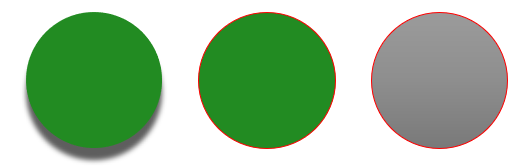

## **Introduzione**

Un tema di presentazione definisce un insieme coordinato di colori, caratteri, stili di sfondo, riempimenti, linee ed effetti. Gli oggetti consapevoli del tema fanno riferimento a queste definizioni condivise invece di memorizzare ogni proprietà visiva come valore fisso, così un cambiamento del tema può aggiornare molti oggetti contemporaneamente.

In Aspose.Slides, il tema a livello di presentazione è disponibile tramite [Presentation::get_MasterTheme](https://reference.aspose.com/slides/cpp/aspose.slides/presentation/get_mastertheme/). Una presentazione può anche contenere sovrascritture del tema a livelli inferiori. Un master può sovrascrivere il tema della presentazione tramite [MasterThemeManager::get_OverrideTheme](https://reference.aspose.com/slides/cpp/aspose.slides.theme/masterthememanager/get_overridetheme/), mentre un layout o una diapositiva individuale può utilizzare [IOverrideThemeManager::get_OverrideTheme](https://reference.aspose.com/slides/cpp/aspose.slides.theme/ioverridethememanager/get_overridetheme/). In pratica, il tema effettivo per una diapositiva è risolto attraverso questa catena di ereditarietà: tema della presentazione, sovrascrittura del master, sovrascrittura del layout e sovrascrittura della diapositiva.


Le sezioni seguenti mostrano i flussi di lavoro più comuni per i temi: ispezionare un tema, modificare colori e caratteri, copiare o applicare un tema, aggiornare gli stili di sfondo ed effetti, e leggere i valori effettivi dopo che l'ereditarietà e le sovrascritture sono state risolte.

## **Ispezionare un Tema**

L'oggetto [MasterTheme](https://reference.aspose.com/slides/cpp/aspose.slides.theme/mastertheme/) espone i metodi del tema [get_ColorScheme](https://reference.aspose.com/slides/cpp/aspose.slides.theme/mastertheme/get_colorscheme/), [get_FontScheme](https://reference.aspose.com/slides/cpp/aspose.slides.theme/mastertheme/get_fontscheme/), e [get_FormatScheme](https://reference.aspose.com/slides/cpp/aspose.slides.theme/mastertheme/get_formatscheme/). Ispezionare queste raccolte prima di modificarle è particolarmente utile quando una presentazione proviene da una fonte esterna perché il numero e il contenuto delle voci di stile possono variare.

Il seguente esempio legge le proprietà principali del tema e riporta quante stili di sfondo, riempimento, linea ed effetto sono memorizzati nel tema:

```cpp
#include <DOM/IColorFormat.h>
#include <DOM/IFonts.h>
#include <DOM/Presentation.h>
#include <DOM/Theme/IColorScheme.h>
#include <DOM/Theme/IEffectStyleCollection.h>
#include <DOM/Theme/IFillFormatCollection.h>
#include <DOM/Theme/IFontScheme.h>
#include <DOM/Theme/IFormatScheme.h>
#include <DOM/Theme/ILineFormatCollection.h>
#include <DOM/Theme/IMasterTheme.h>
#include <system/console.h>

using namespace Aspose::Slides;
using namespace System;

auto presentation = MakeObject<Presentation>(u"input.pptx");

auto theme = presentation->get_MasterTheme();
auto formatScheme = theme->get_FormatScheme();

Console::WriteLine(u"Theme name: {0}", theme->get_Name());
Console::WriteLine(u"Accent 1: {0}", theme->get_ColorScheme()->get_Accent1()->get_Color());
Console::WriteLine(u"Major Latin font: {0}", theme->get_FontScheme()->get_Major()->get_LatinFont()->get_FontName());
Console::WriteLine(u"Minor Latin font: {0}", theme->get_FontScheme()->get_Minor()->get_LatinFont()->get_FontName());
Console::WriteLine(u"Background fill styles: {0}", formatScheme->get_BackgroundFillStyles()->get_Count());
Console::WriteLine(u"Fill styles: {0}", formatScheme->get_FillStyles()->get_Count());
Console::WriteLine(u"Line styles: {0}", formatScheme->get_LineStyles()->get_Count());
Console::WriteLine(u"Effect styles: {0}", formatScheme->get_EffectStyles()->get_Count());
```

Se un file utilizza più master, non presumere che ogni diapositiva abbia lo stesso tema effettivo. Ispeziona il master associato alla diapositiva e utilizza il flusso di lavoro del tema effettivo mostrato più avanti in questo articolo quando potrebbero esserci sovrascritture di layout o diapositiva.

## **Modificare i Colori del Tema**

I riempimenti, le linee e il testo consapevoli del tema possono fare riferimento a un colore logico dall'enumerazione [SchemeColor](https://reference.aspose.com/slides/cpp/aspose.slides/schemecolor/). Quando modifichi la voce corrispondente nella [IColorScheme](https://reference.aspose.com/slides/cpp/aspose.slides.theme/icolorscheme/) del tema, tutti gli oggetti che fanno ancora riferimento a quel colore del tema sono risolti contro il nuovo valore. Gli oggetti che utilizzano un colore RGB diretto non vengono modificati da un aggiornamento del colore del tema.

Il seguente esempio end‑to‑end crea una forma che utilizza `Accent4`, cambia il colore `Accent4` del tema in rosso, salva la presentazione, la riapre e stampa il colore di riempimento effettivo:

```cpp
#include <DOM/FillType.h>
#include <DOM/IAutoShape.h>
#include <DOM/IColorFormat.h>
#include <DOM/IFillFormat.h>
#include <DOM/IFillFormatEffectiveData.h>
#include <DOM/IShapeCollection.h>
#include <DOM/ISlide.h>
#include <DOM/Presentation.h>
#include <DOM/SchemeColor.h>
#include <DOM/ShapeType.h>
#include <DOM/Theme/IColorScheme.h>
#include <DOM/Theme/IMasterTheme.h>
#include <Export/SaveFormat.h>
#include <drawing/color.h>
#include <system/console.h>

using namespace Aspose::Slides;
using namespace Aspose::Slides::Export;
using namespace System;
using namespace System::Drawing;

auto presentation = MakeObject<Presentation>();
auto slide = presentation->get_Slide(0);

auto shape = slide->get_Shapes()->AddAutoShape(ShapeType::Rectangle, 10.0f, 10.0f, 100.0f, 100.0f);
shape->get_FillFormat()->set_FillType(FillType::Solid);
shape->get_FillFormat()->get_SolidFillColor()->set_SchemeColor(SchemeColor::Accent4);

presentation->get_MasterTheme()->get_ColorScheme()->get_Accent4()->set_Color(Color::get_Red());
presentation->Save(u"theme-color.pptx", SaveFormat::Pptx);

auto savedPresentation = MakeObject<Presentation>(u"theme-color.pptx");
auto savedSlide = savedPresentation->get_Slide(0);
auto savedShape = savedSlide->get_Shape(0);
auto effectiveFill = savedShape->get_FillFormat()->GetEffective();
Console::WriteLine(u"Effective fill color: {0}", effectiveFill->get_SolidFillColor());
```

Poiché il rettangolo rimane collegato a `Accent4`, il suo colore visibile diventa rosso dopo che il tema è stato modificato. Se sostituisci il colore dello schema con un colore diretto sulla forma, le modifiche successive a `Accent4` non influenzeranno più quel riempimento.

### **Usare i Colori dalla Tavolozza Aggiuntiva**

PowerPoint deriva varianti più chiare e più scure da un colore del tema applicando trasformazioni di colore. Aspose.Slides espone queste trasformazioni tramite [ColorTransformOperation](https://reference.aspose.com/slides/cpp/aspose.slides/colortransformoperation/).


**1** - Colori principali del tema.  
**2** - Varianti più chiare e più scure prodotte dai colori principali del tema.

Il seguente esempio crea sei rettangoli basati su `Accent4`, applica trasformazioni di luminanza a cinque di essi e salva il risultato:

```cpp
#include <DOM/ColorTransformOperation.h>
#include <DOM/FillType.h>
#include <DOM/IAutoShape.h>
#include <DOM/IColorFormat.h>
#include <DOM/IColorOperationCollection.h>
#include <DOM/IFillFormat.h>
#include <DOM/IShapeCollection.h>
#include <DOM/ISlide.h>
#include <DOM/Presentation.h>
#include <DOM/SchemeColor.h>
#include <DOM/ShapeType.h>
#include <Export/SaveFormat.h>

using namespace Aspose::Slides;
using namespace Aspose::Slides::Export;
using namespace System;

auto presentation = MakeObject<Presentation>();
auto shapes = presentation->get_Slide(0)->get_Shapes();

auto shape1 = shapes->AddAutoShape(ShapeType::Rectangle, 10.0f, 10.0f, 50.0f, 50.0f);
auto fillFormat1 = shape1->get_FillFormat();
fillFormat1->set_FillType(FillType::Solid);
fillFormat1->get_SolidFillColor()->set_SchemeColor(SchemeColor::Accent4);

auto shape2 = shapes->AddAutoShape(ShapeType::Rectangle, 10.0f, 70.0f, 50.0f, 50.0f);
auto fillFormat2 = shape2->get_FillFormat();
auto solidFillColor2 = fillFormat2->get_SolidFillColor();
fillFormat2->set_FillType(FillType::Solid);
solidFillColor2->set_SchemeColor(SchemeColor::Accent4);
solidFillColor2->get_ColorTransform()->Add(ColorTransformOperation::MultiplyLuminance, 0.2f);
solidFillColor2->get_ColorTransform()->Add(ColorTransformOperation::AddLuminance, 0.8f);

auto shape3 = shapes->AddAutoShape(ShapeType::Rectangle, 10.0f, 130.0f, 50.0f, 50.0f);
auto fillFormat3 = shape3->get_FillFormat();
auto solidFillColor3 = fillFormat3->get_SolidFillColor();
fillFormat3->set_FillType(FillType::Solid);
solidFillColor3->set_SchemeColor(SchemeColor::Accent4);
solidFillColor3->get_ColorTransform()->Add(ColorTransformOperation::MultiplyLuminance, 0.4f);
solidFillColor3->get_ColorTransform()->Add(ColorTransformOperation::AddLuminance, 0.6f);

auto shape4 = shapes->AddAutoShape(ShapeType::Rectangle, 10.0f, 190.0f, 50.0f, 50.0f);
auto fillFormat4 = shape4->get_FillFormat();
auto solidFillColor4 = fillFormat4->get_SolidFillColor();
fillFormat4->set_FillType(FillType::Solid);
solidFillColor4->set_SchemeColor(SchemeColor::Accent4);
solidFillColor4->get_ColorTransform()->Add(ColorTransformOperation::MultiplyLuminance, 0.6f);
solidFillColor4->get_ColorTransform()->Add(ColorTransformOperation::AddLuminance, 0.4f);

auto shape5 = shapes->AddAutoShape(ShapeType::Rectangle, 10.0f, 250.0f, 50.0f, 50.0f);
auto fillFormat5 = shape5->get_FillFormat();
auto solidFillColor5 = fillFormat5->get_SolidFillColor();
fillFormat5->set_FillType(FillType::Solid);
solidFillColor5->set_SchemeColor(SchemeColor::Accent4);
solidFillColor5->get_ColorTransform()->Add(ColorTransformOperation::MultiplyLuminance, 0.75f);

auto shape6 = shapes->AddAutoShape(ShapeType::Rectangle, 10.0f, 310.0f, 50.0f, 50.0f);
auto fillFormat6 = shape6->get_FillFormat();
auto solidFillColor6 = fillFormat6->get_SolidFillColor();
fillFormat6->set_FillType(FillType::Solid);
solidFillColor6->set_SchemeColor(SchemeColor::Accent4);
solidFillColor6->get_ColorTransform()->Add(ColorTransformOperation::MultiplyLuminance, 0.5f);

presentation->Save(u"theme-color-palette.pptx", SaveFormat::Pptx);
```

Queste varianti rimangono basate sul colore del tema. Se `Accent4` cambia in seguito, i colori trasformati vengono ricalcolati dal nuovo valore `Accent4`.

### **Mappare i Valori `SchemeColor` negli Slot `IColorScheme`**

L'enumerazione [SchemeColor](https://reference.aspose.com/slides/cpp/aspose.slides/schemecolor/) utilizza `Text1`, `Background1`, `Text2` e `Background2`, mentre [IColorScheme](https://reference.aspose.com/slides/cpp/aspose.slides.theme/icolorscheme/) espone gli stessi slot del tema come `Dark1`, `Light1`, `Dark2` e `Light2`. La mappatura è fissa:

* `Text1` = `Dark1`
* `Background1` = `Light1`
* `Text2` = `Dark2`
* `Background2` = `Light2`

Questi sono nomi alternativi per gli stessi slot del tema; non sono valori convertiti dinamicamente da una forma all'altra.

## **Modificare i Caratteri del Tema**

Uno schema di caratteri del tema contiene un set di caratteri principale per le intestazioni e un set di caratteri secondario per il testo del corpo. I metodi [FontScheme::get_Major](https://reference.aspose.com/slides/cpp/aspose.slides.theme/fontscheme/get_major/) e [FontScheme::get_Minor](https://reference.aspose.com/slides/cpp/aspose.slides.theme/fontscheme/get_minor/) espongono tali set.

Gli identificatori di caratteri del tema compatibili con PowerPoint possono essere usati nella formattazione del testo:

* `+mn-lt` - Carattere corpo Latin (Carattere Latin Minore)
* `+mj-lt` - Carattere intestazione Latin (Carattere Latin Maggiore)
* `+mn-ea` - Carattere corpo East Asian (Carattere East Asian Minore)
* `+mj-ea` - Carattere intestazione East Asian (Carattere East Asian Maggiore)
* `+mn-cs` - Carattere corpo Complex Script (Carattere Complex Script Minore)
* `+mj-cs` - Carattere intestazione Complex Script (Carattere Complex Script Maggiore)

Il seguente esempio crea un'intestazione che utilizza il carattere Latin principale del tema e una riga di corpo che utilizza il carattere Latin secondario del tema. Poi modifica i caratteri del tema e salva il risultato:

```cpp
#include <DOM/Fonts/FontData.h>
#include <DOM/IAutoShape.h>
#include <DOM/IFonts.h>
#include <DOM/IParagraph.h>
#include <DOM/IParagraphCollection.h>
#include <DOM/IPortion.h>
#include <DOM/IPortionCollection.h>
#include <DOM/IPortionFormat.h>
#include <DOM/IShapeCollection.h>
#include <DOM/ISlide.h>
#include <DOM/ITextFrame.h>
#include <DOM/Presentation.h>
#include <DOM/ShapeType.h>
#include <DOM/Theme/IFontScheme.h>
#include <DOM/Theme/IMasterTheme.h>
#include <Export/SaveFormat.h>

using namespace Aspose::Slides;
using namespace Aspose::Slides::Export;
using namespace System;

auto presentation = MakeObject<Presentation>();
auto slide = presentation->get_Slide(0);

auto heading = slide->get_Shapes()->AddAutoShape(ShapeType::Rectangle, 40.0f, 40.0f, 500.0f, 60.0f);
heading->get_TextFrame()->set_Text(u"Theme heading");
heading->get_TextFrame()->get_Paragraph(0)->get_Portion(0)->get_PortionFormat()->set_LatinFont(MakeObject<FontData>(u"+mj-lt"));

auto body = slide->get_Shapes()->AddAutoShape(ShapeType::Rectangle, 40.0f, 120.0f, 500.0f, 60.0f);
body->get_TextFrame()->set_Text(u"Theme body text");
body->get_TextFrame()->get_Paragraph(0)->get_Portion(0)->get_PortionFormat()->set_LatinFont(MakeObject<FontData>(u"+mn-lt"));

presentation->get_MasterTheme()->get_FontScheme()->get_Major()->set_LatinFont(MakeObject<FontData>(u"Aptos Display"));
presentation->get_MasterTheme()->get_FontScheme()->get_Minor()->set_LatinFont(MakeObject<FontData>(u"Arial"));
presentation->Save(u"theme-fonts.pptx", SaveFormat::Pptx);
```

L'intestazione segue il carattere maggiore e il testo del corpo segue il carattere minore. Il testo che ha un nome di carattere esplicito invece di un identificatore del tema non cambierà automaticamente quando lo schema di caratteri del tema cambia.

Le collezioni di caratteri maggiore e minore possono anche contenere mappature di caratteri per sistemi di scrittura individuali, come cirillico, arabo, giapponese, georgiano e thaana. Per ispezionare, aggiungere, sostituire o rimuovere queste mappature, vedere [Script-Specific Theme Fonts](/slides/it/cpp/script-specific-font-mappings/).

{}
Per ulteriori informazioni sui caratteri della presentazione, vedere [PowerPoint Fonts](/slides/it/cpp/powerpoint-fonts/).
{}

### **Risolvere i Riferimenti ai Caratteri del Tema**

Durante l'ispezione del testo, [IFontData::get_FontName](https://reference.aspose.com/slides/cpp/aspose.slides/ifontdata/get_fontname/) può contenere un riferimento al tema come `+mn-lt` invece di un nome di famiglia di caratteri. Chiama [IFontData::GetFontName](https://reference.aspose.com/slides/cpp/aspose.slides/ifontdata/getfontname/) con il relativo [IThemeEffectiveData](https://reference.aspose.com/slides/cpp/aspose.slides.theme/ithemeeffectivedata/) per risolvere quel riferimento. I prefissi `+mj` e `+mn` selezionano i set di caratteri maggiori e minori; i suffissi `-lt`, `-ea` e `-cs` selezionano rispettivamente i caratteri Latin, East Asian e Complex Script.

Ottieni il tema efficace tramite [IThemeable::CreateThemeEffective](https://reference.aspose.com/slides/cpp/aspose.slides.theme/ithemeable/createthemeeffective/) sull'oggetto a cui si applica il tema del testo ispezionato. Per testo ordinario su una diapositiva, usa `slide->CreateThemeEffective()` in modo che il contesto includa il tema ereditato da quella diapositiva e le sovrascritture locali. Quando si ispeziona un layout o un master stesso, usa il proprio tema efficace. Non presumere che il tema del primo master si applichi a tutte le diapositive.

Il seguente esempio crea una porzione di testo che fa esplicitamente riferimento al carattere Latin minore. Inizializza lo schema di caratteri della diapositiva tramite [IOverrideTheme::InitFontSchemeFromInherited](https://reference.aspose.com/slides/cpp/aspose.slides.theme/ioverridetheme/initfontschemefrominherited/) e imposta le famiglie Latin maggiori e minori su `Arial` e `Calibri`, rendendo il risultato riproducibile senza un file di ingresso.

```cpp
#include <DOM/Fonts/FontData.h>
#include <DOM/IAutoShape.h>
#include <DOM/IFonts.h>
#include <DOM/IParagraph.h>
#include <DOM/IPortion.h>
#include <DOM/IPortionFormat.h>
#include <DOM/IShapeCollection.h>
#include <DOM/ISlide.h>
#include <DOM/ITextFrame.h>
#include <DOM/Presentation.h>
#include <DOM/ShapeType.h>
#include <DOM/Theme/IFontScheme.h>
#include <DOM/Theme/IOverrideTheme.h>
#include <DOM/Theme/IOverrideThemeManager.h>
#include <DOM/Theme/IThemeEffectiveData.h>
#include <system/console.h>

using namespace Aspose::Slides;
using namespace System;

auto presentation = MakeObject<Presentation>();
auto slide = presentation->get_Slide(0);

auto theme = slide->get_ThemeManager()->get_OverrideTheme();
theme->InitFontSchemeFromInherited();
theme->get_FontScheme()->get_Major()->set_LatinFont(MakeObject<FontData>(u"Arial"));
theme->get_FontScheme()->get_Minor()->set_LatinFont(MakeObject<FontData>(u"Calibri"));

auto shape = slide->get_Shapes()->AddAutoShape(ShapeType::Rectangle, 20.0f, 20.0f, 400.0f, 60.0f);
shape->get_TextFrame()->set_Text(u"Text using the minor theme font");

auto portion = shape->get_TextFrame()->get_Paragraph(0)->get_Portion(0);
portion->get_PortionFormat()->set_LatinFont(MakeObject<FontData>(u"+mn-lt"));

auto font = portion->get_PortionFormat()->get_LatinFont();
auto effectiveTheme = slide->CreateThemeEffective();
auto resolvedFontName = font->GetFontName(effectiveTheme);
Console::WriteLine(u"{0} -> {1}", font->get_FontName(), resolvedFontName);

auto explicitFont = MakeObject<FontData>(u"Verdana");
auto explicitFontName = explicitFont->GetFontName(effectiveTheme);
Console::WriteLine(u"{0} -> {1}", explicitFont->get_FontName(), explicitFontName);
```

L'output è `+mn-lt -> Calibri` seguito da `Verdana -> Verdana`. Il riferimento memorizzato rimane invariato, mentre un nome di famiglia esplicito è restituito così com'è. Se la porzione usasse `+mj-lt`, si risolverebbe in `Arial` in questo tema.

Risolvere un riferimento al tema identifica la famiglia di caratteri specificata dal tema. Non controlla la disponibilità del carattere né determina il file di caratteri effettivamente usato dopo la sostituzione o il fallback di glifi durante il rendering. Vedi [Font Selection Sequence](/slides/it/cpp/font-selection-sequence/) e [Font Substitution](/slides/it/cpp/font-substitution/) per questi passaggi separati.

## **Copiare o Applicare un Tema**

I flussi di lavoro seguenti risolvono diversi problemi legati al tema.

### **Applicare un Tema Esterno alle Diapositive Dipendenti da un Master**

Usa [IMasterSlide::ApplyExternalThemeToDependingSlides](https://reference.aspose.com/slides/cpp/aspose.slides/imasterslide/applyexternalthemetodependingslides/) quando hai un file di tema PowerPoint (`.thmx`) e vuoi riprogettare ogni diapositiva che dipende da un determinato master. Seleziona il master dalla raccolta [Presentation::get_Masters](https://reference.aspose.com/slides/cpp/aspose.slides/presentation/get_masters/), che implementa [IMasterSlideCollection](https://reference.aspose.com/slides/cpp/aspose.slides/imasterslidecollection/), e passa il percorso del file tema al metodo.

Il metodo esegue le seguenti operazioni:

1. Crea una nuova diapositiva master basata sul master selezionato.
1. Applica il tema esterno al nuovo master.
1. Assegna il nuovo master a tutte le diapositive che precedentemente dipendevano dal master selezionato.
1. Restituisce il nuovo [IMasterSlide](https://reference.aspose.com/slides/cpp/aspose.slides/imasterslide/).

Il seguente esempio applica un tema esterno alle diapositive che dipendono dal primo master e salva la presentazione:

```cpp
#include <DOM/IMasterSlide.h>
#include <DOM/Presentation.h>
#include <Export/SaveFormat.h>
#include <iostream>

using namespace Aspose::Slides;
using namespace Aspose::Slides::Export;
using namespace System;

auto presentation = MakeObject<Presentation>(u"presentation.pptx");
auto selectedMaster = presentation->get_Master(0);

auto themedMaster = selectedMaster->ApplyExternalThemeToDependingSlides(u"corporate-theme.thmx");
Console::WriteLine(u"Created master: {0}", themedMaster->get_Name());

presentation->Save(u"presentation-with-external-theme.pptx", SaveFormat::Pptx);
```

Un tema non valido, corrotto o non supportato può causare [PptxException](https://reference.aspose.com/slides/cpp/aspose.slides/pptxexception/) o una delle sue sottoclassi correlate al formato. Convalida i percorsi forniti dagli utenti, gestisci i fallimenti di accesso al file system e salva la presentazione solo dopo che il tema è stato applicato con successo.

Solo le diapositive che dipendevano dal master selezionato vengono riassegnate. Le diapositive associate ad altri master mantengono i loro master e temi esistenti. I colori, i caratteri, i riempimenti, le linee, gli sfondi e gli effetti consapevoli del tema sono risolti rispetto al tema esterno. I colori, i caratteri, i riempimenti e altre formattazioni esplicite assegnati direttamente possono rimanere invariati. Le sovrascritture a livello di layout e diapositiva possono anche avere la precedenza sui valori ereditati dal nuovo master.

Il tema può fare riferimento a caratteri non disponibili nell'ambiente di esecuzione. Per un rendering e un'esportazione coerenti, installa i caratteri richiesti, fornisci tramite [custom font sources](/slides/it/cpp/custom-font/), o configura [font substitution](/slides/it/cpp/font-substitution/).

Questo è un flusso di lavoro a livello di master diretto: il metodo accetta un percorso file a un file `.thmx` e non richiede la creazione manuale di sovrascritture del tema a livello di diapositiva o layout.

### **Applicare Temi Esterni Differenti in una Presentazione Multi‑Master**

Quando il master pertinente non è noto in anticipo, ottienilo da una diapositiva rappresentativa tramite [ISlide::get_LayoutSlide](https://reference.aspose.com/slides/cpp/aspose.slides/islide/get_layoutslide/) e [ILayoutSlide::get_MasterSlide](https://reference.aspose.com/slides/cpp/aspose.slides/ilayoutslide/get_masterslide/). Conserva i riferimenti ai master originali prima di applicare temi perché ogni chiamata crea un altro master nella presentazione.

Il seguente esempio utilizza diapositive di due sezioni per individuare i loro master e applica un tema esterno diverso a ciascun gruppo:

```cpp
#include <DOM/ILayoutSlide.h>
#include <DOM/IMasterSlide.h>
#include <DOM/Presentation.h>
#include <Export/SaveFormat.h>
#include <iostream>

using namespace Aspose::Slides;
using namespace Aspose::Slides::Export;
using namespace System;

auto presentation = MakeObject<Presentation>(u"multi-master-presentation.pptx");

if (presentation->get_Slides()->get_Count() < 5)
{
    std::cout << "The presentation does not contain the expected representative slides." << std::endl;
}
else
{
    auto firstGroupMaster = presentation->get_Slide(0)->get_LayoutSlide()->get_MasterSlide();
    auto secondGroupMaster = presentation->get_Slide(4)->get_LayoutSlide()->get_MasterSlide();

    if (firstGroupMaster->get_SlideId() == secondGroupMaster->get_SlideId())
    {
        std::cout << "The representative slides use the same master." << std::endl;
    }
    else
    {
        auto firstThemedMaster = firstGroupMaster->ApplyExternalThemeToDependingSlides(u"blue-theme.thmx");
        auto secondThemedMaster = secondGroupMaster->ApplyExternalThemeToDependingSlides(u"green-theme.thmx");

        Console::WriteLine(u"First themed master: {0}", firstThemedMaster->get_Name());
        Console::WriteLine(u"Second themed master: {0}", secondThemedMaster->get_Name());

        presentation->Save(u"multi-master-with-external-themes.pptx", SaveFormat::Pptx);
    }
}
```

La prima chiamata influisce solo sulle diapositive che dipendevano da `firstGroupMaster`, e la seconda chiamata influisce solo sulle diapositive che dipendevano da `secondGroupMaster`. Le diapositive appartenenti a qualsiasi altro master non sono ridisegnate.

### **Conservare un Tema di Origine Quando Si Spostano le Diapositive**

Se desideri spostare una diapositiva in un'altra presentazione e conservare il suo design originale, clona il master di origine nella presentazione di destinazione con [IMasterSlideCollection::AddClone](https://reference.aspose.com/slides/cpp/aspose.slides/imasterslidecollection/addclone/), quindi clona la diapositiva con [ISlideCollection::AddClone](https://reference.aspose.com/slides/cpp/aspose.slides/islidecollection/addclone/) e il master clonato. Questo trasporta insieme il master, i suoi layout e il tema associato.

```cpp
#include <DOM/ILayoutSlide.h>
#include <DOM/IMasterSlide.h>
#include <DOM/IMasterSlideCollection.h>
#include <DOM/ISlide.h>
#include <DOM/ISlideCollection.h>
#include <DOM/Presentation.h>
#include <Export/SaveFormat.h>

using namespace Aspose::Slides;
using namespace Aspose::Slides::Export;
using namespace System;

auto source = MakeObject<Presentation>(u"source-theme.pptx");
auto target = MakeObject<Presentation>(u"target.pptx");

auto sourceSlide = source->get_Slide(0);

auto sourceMaster = sourceSlide->get_LayoutSlide()->get_MasterSlide();
auto clonedMaster = target->get_Masters()->AddClone(sourceMaster);
target->get_Slides()->AddClone(sourceSlide, clonedMaster, true);

target->Save(u"theme-preserved.pptx", SaveFormat::Pptx);
```

Questo è il flusso di lavoro preferito quando la diapositiva di origine deve apparire identica nella destinazione. Clonare semplicemente il contenuto su un master di destinazione non correlato può modificare i colori, i caratteri, gli sfondi e gli effetti guidati dal tema.

### **Applicare i Valori del Tema a una Diapositiva Esistente**

Se la diapositiva di destinazione deve rimanere sul suo master e layout attuali, inizializza una sovrascrittura a livello di diapositiva dal tema di origine. I metodi [OverrideTheme::InitColorSchemeFrom](https://reference.aspose.com/slides/cpp/aspose.slides.theme/overridetheme/initcolorschemefrom/), [OverrideTheme::InitFontSchemeFrom](https://reference.aspose.com/slides/cpp/aspose.slides.theme/overridetheme/initfontschemefrom/) e [OverrideTheme::InitFormatSchemeFrom](https://reference.aspose.com/slides/cpp/aspose.slides.theme/overridetheme/initformatschemefrom/) copiano i tre componenti principali del tema nella sovrascrittura.

```cpp
#include <DOM/ISlide.h>
#include <DOM/Presentation.h>
#include <DOM/Theme/IOverrideTheme.h>
#include <DOM/Theme/IOverrideThemeManager.h>
#include <DOM/Theme/IMasterTheme.h>
#include <Export/SaveFormat.h>

using namespace Aspose::Slides;
using namespace Aspose::Slides::Export;
using namespace System;

auto source = MakeObject<Presentation>(u"source-theme.pptx");
auto target = MakeObject<Presentation>(u"target.pptx");
auto targetSlide = target->get_Slide(0);

auto overrideTheme = targetSlide->get_ThemeManager()->get_OverrideTheme();
overrideTheme->InitColorSchemeFrom(source->get_MasterTheme()->get_ColorScheme());
overrideTheme->InitFontSchemeFrom(source->get_MasterTheme()->get_FontScheme());
overrideTheme->InitFormatSchemeFrom(source->get_MasterTheme()->get_FormatScheme());

target->Save(u"theme-applied-to-slide.pptx", SaveFormat::Pptx);
```

Questo cambia il tema usato da quella diapositiva senza modificare il tema ereditato dalle altre diapositive. Per rimuovere la sovrascrittura locale e tornare ai valori ereditati, chiama [OverrideTheme::Clear](https://reference.aspose.com/slides/cpp/aspose.slides.theme/overridetheme/clear/).

### **Applicare una Sovrascrittura del Tema a un Layout**

Una sovrascrittura a livello di layout si applica alle diapositive che usano quel layout, a meno che una diapositiva specifica non abbia una propria sovrascrittura. Gli stessi metodi di inizializzazione possono essere usati tramite l'[IOverrideThemeManager](https://reference.aspose.com/slides/cpp/aspose.slides.theme/ioverridethememanager/) del layout:

```cpp
#include <DOM/ILayoutSlide.h>
#include <DOM/ISlide.h>
#include <DOM/Presentation.h>
#include <DOM/Theme/IOverrideTheme.h>
#include <DOM/Theme/IOverrideThemeManager.h>
#include <DOM/Theme/IMasterTheme.h>
#include <Export/SaveFormat.h>

using namespace Aspose::Slides;
using namespace Aspose::Slides::Export;
using namespace System;

auto source = MakeObject<Presentation>(u"source-theme.pptx");
auto target = MakeObject<Presentation>(u"target.pptx");
auto targetSlide = target->get_Slide(0);

auto targetLayout = targetSlide->get_LayoutSlide();
auto overrideTheme = targetLayout->get_ThemeManager()->get_OverrideTheme();
overrideTheme->InitColorSchemeFrom(source->get_MasterTheme()->get_ColorScheme());
overrideTheme->InitFontSchemeFrom(source->get_MasterTheme()->get_FontScheme());
overrideTheme->InitFormatSchemeFrom(source->get_MasterTheme()->get_FormatScheme());

target->Save(u"theme-applied-to-layout.pptx", SaveFormat::Pptx);
```

Usa un tema a livello di master o presentazione quando molti layout e diapositive devono condividere lo stesso design di base, una sovrascrittura di layout quando una famiglia di layout necessita di uno stile diverso, e una sovrascrittura di diapositiva solo per eccezioni reali. Sovrascritture eccessive a livello di diapositiva rendono più difficile prevedere i cambiamenti globali del tema successivi.

## **Aggiornare gli Stili di Sfondo del Tema**

I riempimenti di sfondo del tema sono memorizzati in [FormatScheme::get_BackgroundFillStyles](https://reference.aspose.com/slides/cpp/aspose.slides.theme/formatscheme/get_backgroundfillstyles/). PowerPoint può presentare più scelte di sfondo nella sua interfaccia rispetto al numero di definizioni di riempimento fisicamente memorizzate in questa raccolta perché l'interfaccia può combinare i riempimenti del tema con i colori del tema e altri riferimenti di stile.


Prima di utilizzare uno stile di sfondo, ispeziona la raccolta memorizzata e l'attuale [Background::get_StyleIndex](https://reference.aspose.com/slides/cpp/aspose.slides/background/get_styleindex/). `StyleIndex` usa `0` per nessun riempimento tematico; i valori positivi sono riferimenti a stili di sfondo tematici. Questo è diverso dall'indicizzare direttamente una raccolta C++ con `idx_get(0)`, dove `0` indica il primo elemento memorizzato. Non presumere che ogni presentazione contenga lo stesso numero di stili di riempimento di sfondo.

Il seguente esempio riporta il conteggio dei riempimenti di sfondo disponibili, assegna un riferimento di sfondo tematico al primo master e salva la presentazione:

```cpp
#include <DOM/BackgroundType.h>
#include <DOM/IBackground.h>
#include <DOM/IMasterSlide.h>
#include <DOM/Presentation.h>
#include <DOM/Theme/IFillFormatCollection.h>
#include <DOM/Theme/IFormatScheme.h>
#include <DOM/Theme/IMasterTheme.h>
#include <Export/SaveFormat.h>
#include <system/console.h>

using namespace Aspose::Slides;
using namespace Aspose::Slides::Export;
using namespace System;

auto presentation = MakeObject<Presentation>(u"input.pptx");

auto backgroundStyles = presentation->get_MasterTheme()->get_FormatScheme()->get_BackgroundFillStyles();
Console::WriteLine(u"Background fill styles: {0}", backgroundStyles->get_Count());

if (backgroundStyles->get_Count() > 0)
{
    auto masterSlide = presentation->get_Master(0);
    masterSlide->get_Background()->set_Type(BackgroundType::Themed);
    masterSlide->get_Background()->set_StyleIndex(1);

    presentation->Save(u"theme-background.pptx", SaveFormat::Pptx);
}
```

Il risultato visibile dipende dall'entrata del tema a cui fa riferimento il master e da eventuali sovrascritture di sfondo a livello di layout o diapositiva. Se una diapositiva utilizza il proprio sfondo, modificare solo lo sfondo del master potrebbe non modificare quella diapositiva. Usa [Background::GetEffective](https://reference.aspose.com/slides/cpp/aspose.slides/background/geteffective/) quando hai bisogno di conoscere lo sfondo finale dopo che l'ereditarietà è stata applicata.

{}
Non trattare `StyleIndex` come un indice di raccolta basato su zero. Evita anche di codificare rigidamente un numero di stile da un file e presumere che abbia la stessa aspetto in un altro file; le definizioni di stile del tema sono specifiche della presentazione.
{}

{}
Per la formattazione diretta dello sfondo e l'ereditarietà dello sfondo, vedere [Presentation Background](/slides/it/cpp/presentation-background/).
{}

## **Aggiornare gli Effetti del Tema**

Uno schema di formattazione del tema contiene raccolte separate di [FormatScheme::get_FillStyles](https://reference.aspose.com/slides/cpp/aspose.slides.theme/formatscheme/get_fillstyles/), [FormatScheme::get_LineStyles](https://reference.aspose.com/slides/cpp/aspose.slides.theme/formatscheme/get_linestyles/), e [FormatScheme::get_EffectStyles](https://reference.aspose.com/slides/cpp/aspose.slides.theme/formatscheme/get_effectstyles/). I temi tipici di Office contengono spesso tre voci di stile principali che corrispondono visivamente a formattazioni sottili, moderate e intense, ma il codice dovrebbe ispezionare ogni raccolta invece di presumere un conteggio fisso.


Quando accedi a queste raccolte in C++, l'indice della raccolta è basato su zero: `idx_get(0)` è il primo stile memorizzato e `idx_get(2)` è il terzo. Gli indici di riferimento di stile di una forma sono un concetto separato, esposto tramite [IShapeStyle](https://reference.aspose.com/slides/cpp/aspose.slides/ishapestyle/). Modificare uno stile del tema influenza le forme che fanno riferimento a quello stile del tema; le forme con formattazione diretta possono rimanere invariate.

Il seguente esempio verifica che le voci di stile richieste esistano, cambia il primo stile di linea, cambia il terzo stile di riempimento, abilita un'ombra esterna nel terzo stile di effetto e salva il risultato:

```cpp
#include <DOM/Effects/IOuterShadow.h>
#include <DOM/FillType.h>
#include <DOM/IColorFormat.h>
#include <DOM/IEffectFormat.h>
#include <DOM/IFillFormat.h>
#include <DOM/ILineFormat.h>
#include <DOM/Presentation.h>
#include <DOM/Theme/IEffectStyle.h>
#include <DOM/Theme/IEffectStyleCollection.h>
#include <DOM/Theme/IFillFormatCollection.h>
#include <DOM/Theme/IFormatScheme.h>
#include <DOM/Theme/ILineFormatCollection.h>
#include <DOM/Theme/IMasterTheme.h>
#include <Export/SaveFormat.h>
#include <drawing/color.h>
#include <system/console.h>

using namespace Aspose::Slides;
using namespace Aspose::Slides::Export;
using namespace System;
using namespace System::Drawing;

auto presentation = MakeObject<Presentation>(u"Subtle_Moderate_Intense.pptx");
auto formatScheme = presentation->get_MasterTheme()->get_FormatScheme();
auto lineStyles = formatScheme->get_LineStyles();
auto fillStyles = formatScheme->get_FillStyles();
auto effectStyles = formatScheme->get_EffectStyles();

if (lineStyles->get_Count() < 1 || fillStyles->get_Count() < 3 || effectStyles->get_Count() < 3)
{
    Console::WriteLine(u"The theme does not contain the style entries required by this example.");
}
else
{
    auto lineStyle = lineStyles->idx_get(0);
    lineStyle->get_FillFormat()->set_FillType(FillType::Solid);
    lineStyle->get_FillFormat()->get_SolidFillColor()->set_Color(Color::get_Red());

    auto fillStyle = fillStyles->idx_get(2);
    fillStyle->set_FillType(FillType::Solid);
    fillStyle->get_SolidFillColor()->set_Color(Color::get_ForestGreen());

    auto effectFormat = effectStyles->idx_get(2)->get_EffectFormat();
    effectFormat->EnableOuterShadowEffect();
    effectFormat->get_OuterShadowEffect()->set_Distance(10.0f);

    presentation->Save(u"theme-effects.pptx", SaveFormat::Pptx);
}
```

Per le forme che fanno riferimento a questi slot, il primo stile di linea del tema diventa rosso, il terzo stile di riempimento del tema diventa verde foresta solido, e il terzo stile di effetto ottiene un'ombra esterna con una distanza di 10 punti. Il risultato visivo esatto dipende ancora da quali slot di stile ogni forma fa riferimento e se la formattazione diretta sovrascrive il tema.



## **Selezionare Stili di Riempimento e Linea del Tema per una Forma**

Una forma può selezionare il proprio riempimento e contorno indipendentemente tramite [IShapeStyle::set_FillStyleIndex](https://reference.aspose.com/slides/cpp/aspose.slides/ishapestyle/set_fillstyleindex/) e [IShapeStyle::set_LineStyleIndex](https://reference.aspose.com/slides/cpp/aspose.slides/ishapestyle/set_linestyleindex/). Per entrambi i setter, l'indice `1` seleziona la prima voce nella corrispondente raccolta del tema (`idx_get(0)`), e l'indice `2` seleziona la seconda voce.

Il seguente esempio configura due stili di riempimento (oro e azzurro cielo) e due stili di linea (blu scuro a 6 pt e rosso scuro a 12 pt) nel tema predefinito di una nuova presentazione. Salva la diapositiva in tre fasi in modo da poter confrontare i risultati in PowerPoint.

```cpp
#include <DOM/FillType.h>
#include <DOM/IAutoShape.h>
#include <DOM/IColorFormat.h>
#include <DOM/IFillFormat.h>
#include <DOM/ILineFormat.h>
#include <DOM/IShapeCollection.h>
#include <DOM/IShapeStyle.h>
#include <DOM/ISlide.h>
#include <DOM/Presentation.h>
#include <DOM/ShapeType.h>
#include <DOM/Theme/IFillFormatCollection.h>
#include <DOM/Theme/IFormatScheme.h>
#include <DOM/Theme/ILineFormatCollection.h>
#include <DOM/Theme/IMasterTheme.h>
#include <Export/SaveFormat.h>
#include <drawing/color.h>

using namespace Aspose::Slides;
using namespace Aspose::Slides::Export;
using namespace System;
using namespace System::Drawing;

auto presentation = MakeObject<Presentation>();
auto styles = presentation->get_MasterTheme()->get_FormatScheme();

auto goldFill = styles->get_FillStyles()->idx_get(0);
goldFill->set_FillType(FillType::Solid);
goldFill->get_SolidFillColor()->set_Color(Color::get_Gold());
auto blueFill = styles->get_FillStyles()->idx_get(1);
blueFill->set_FillType(FillType::Solid);
blueFill->get_SolidFillColor()->set_Color(Color::get_SkyBlue());

auto thinLine = styles->get_LineStyles()->idx_get(0);
thinLine->get_FillFormat()->set_FillType(FillType::Solid);
thinLine->get_FillFormat()->get_SolidFillColor()->set_Color(Color::get_DarkBlue());
thinLine->set_Width(6.0);
auto thickLine = styles->get_LineStyles()->idx_get(1);
thickLine->get_FillFormat()->set_FillType(FillType::Solid);
thickLine->get_FillFormat()->get_SolidFillColor()->set_Color(Color::get_DarkRed());
thickLine->set_Width(12.0);

auto shapes = presentation->get_Slide(0)->get_Shapes();
auto left = shapes->AddAutoShape(ShapeType::Rectangle, 100, 205, 200, 130);
auto right = shapes->AddAutoShape(ShapeType::Rectangle, 420, 205, 200, 130);
auto leftStyle = left->get_ShapeStyle();
auto rightStyle = right->get_ShapeStyle();
leftStyle->set_FillStyleIndex(1);
rightStyle->set_FillStyleIndex(2);
leftStyle->set_LineStyleIndex(1);
rightStyle->set_LineStyleIndex(1);
presentation->Save(u"01-initial.pptx", SaveFormat::Pptx);

rightStyle->set_LineStyleIndex(2);
presentation->Save(u"02-line-changed.pptx", SaveFormat::Pptx);

goldFill->get_SolidFillColor()->set_Color(Color::get_SeaGreen());
presentation->Save(u"03-theme-changed.pptx", SaveFormat::Pptx);
```

| Stili iniziali | Modifica il contorno destro | Modifica il primo riempimento del tema |
|:---:|:---:|:---:|
|  |  |  |

Selezionare uno stile di linea diverso modifica solo il contorno del rettangolo destro. Modificare il primo riempimento del tema aggiorna ogni forma che lo utilizza. Qui, solo il rettangolo sinistro diventa verde.

Su una forma esistente, un colore di riempimento locale, un colore di linea o una larghezza di linea possono sovrascrivere quella parte dello stile del tema. Se la modifica di un indice di stile non ha alcun effetto visibile, controlla la [formattazione diretta](/slides/it/cpp/shape-formatting/) della forma.

## **Determinare se un Riempimento Solido Effettivo Utilizza un Colore del Tema**

Un riempimento può essere memorizzato direttamente su un oggetto o ereditato da un paragrafo, layout, master, stile del tema o un altro livello di formattazione. Chiama [IFillFormat::GetEffective](https://reference.aspose.com/slides/cpp/aspose.slides/ifillformat/geteffective/) per risolvere tale gerarchia in [IFillFormatEffectiveData](https://reference.aspose.com/slides/cpp/aspose.slides/ifillformateffectivedata/) immutabili. Controlla prima [IFillFormatEffectiveData::get_FillType](https://reference.aspose.com/slides/cpp/aspose.slides/ifillformateffectivedata/get_filltype/). Solo quando è `FillType::Solid` dovresti leggere le proprietà del riempimento solido.

Per un riempimento solido, [IFillFormatEffectiveData::get_SolidFillColor](https://reference.aspose.com/slides/cpp/aspose.slides/ifillformateffectivedata/get_solidfillcolor/) restituisce il valore RGB finale renderizzato dopo che sono state applicate l'ereditarietà, la ricerca nel tema e le trasformazioni di colore. [IFillFormatEffectiveData::get_SolidFillSchemeColor](https://reference.aspose.com/slides/cpp/aspose.slides/ifillformateffectivedata/get_solidfillschemecolor/) restituisce lo slot logico corrispondente di [SchemeColor](https://reference.aspose.com/slides/cpp/aspose.slides/schemecolor/), come `Text1` o `Accent6`. Un valore di `SchemeColor::NotDefined` indica che il riempimento solido efficace non si basa su un colore di schema. In un flusso di lavoro in cui i riempimenti sono colori del tema o colori RGB diretti, questo valore identifica un riempimento RGB diretto.

Non utilizzare il valore locale [IColorFormat::get_SchemeColor](https://reference.aspose.com/slides/cpp/aspose.slides/icolorformat/get_schemecolor/) da solo per classificare un riempimento. Per esempio, una porzione di testo può non avere un colore di schema definito localmente, quindi il suo valore locale è `NotDefined`, mentre il suo riempimento efficace eredita un colore del tema e si risolve in `Text1` o `Accent6`. Al contrario, `get_SolidFillSchemeColor` ti indica quale slot logico del tema ha prodotto il colore efficace, ma non ti dice se quello slot proviene dall'oggetto, paragrafo, layout, master o un altro livello della gerarchia di formattazione.

Il seguente esempio carica una presentazione, controlla sia i riempimenti delle forme sia i riempimenti delle porzioni di testo, stampa ogni valore RGB finale e il colore di schema associato, e segnala i riempimenti solidi che non seguiranno i cambiamenti del colore del tema:

```cpp
#include <DOM/FillType.h>
#include <DOM/IAutoShape.h>
#include <DOM/IColorFormat.h>
#include <DOM/IFillFormat.h>
#include <DOM/IFillFormatEffectiveData.h>
#include <DOM/IParagraph.h>
#include <DOM/IParagraphCollection.h>
#include <DOM/IPortion.h>
#include <DOM/IPortionCollection.h>
#include <DOM/IShape.h>
#include <DOM/ITextFrame.h>
#include <DOM/Presentation.h>
#include <DOM/SchemeColor.h>
#include <system/console.h>
#include <system/object_ext.h>
#include <system/string.h>

using namespace Aspose::Slides;
using namespace System;

auto auditFill = [](const String& objectName, const SharedPtr<IFillFormat>& localFill)
{
    auto effectiveFill = localFill->GetEffective();

    if (effectiveFill->get_FillType() != FillType::Solid)
    {
        Console::WriteLine(u"{0}: fill type = {1}; not a solid fill.", objectName, effectiveFill->get_FillType());
        return;
    }

    auto rgb = effectiveFill->get_SolidFillColor();
    auto effectiveSchemeColor = effectiveFill->get_SolidFillSchemeColor();
    auto localSchemeColor = localFill->get_SolidFillColor()->get_SchemeColor();

    Console::WriteLine(u"{0}: RGB = #{1:X2}{2:X2}{3:X2}", objectName, rgb.get_R(), rgb.get_G(), rgb.get_B());
    Console::WriteLine(u"{0}: local scheme = {1}, effective scheme = {2}", objectName, localSchemeColor, effectiveSchemeColor);

    if (effectiveSchemeColor == SchemeColor::NotDefined)
    {
        Console::WriteLine(u"{0}: direct RGB or another non-scheme fill; audit as theme-independent.", objectName);
    }
    else
    {
        Console::WriteLine(u"{0}: theme-dependent through {1}.", objectName, effectiveSchemeColor);
    }
};

auto presentation = MakeObject<Presentation>(u"input.pptx");

auto slideCount = presentation->get_Slides()->get_Count();
for (int32_t slideIndex = 0; slideIndex < slideCount; slideIndex++)
{
    auto slide = presentation->get_Slide(slideIndex);

    auto shapeCount = slide->get_Shapes()->get_Count();
    for (int32_t shapeIndex = 0; shapeIndex < shapeCount; shapeIndex++)
    {
        auto shape = slide->get_Shape(shapeIndex);
        auto shapeName = String::Format(u"Slide {0}, shape {1}", slideIndex + 1, shapeIndex + 1);
        auditFill(shapeName, shape->get_FillFormat());

        if (ObjectExt::Is<IAutoShape>(shape))
        {
            auto autoShape = ExplicitCast<IAutoShape>(shape);
            auto textFrame = autoShape->get_TextFrame();
            auto paragraphCount = textFrame->get_Paragraphs()->get_Count();
            for (int32_t paragraphIndex = 0; paragraphIndex < paragraphCount; paragraphIndex++)
            {
                auto paragraph = textFrame->get_Paragraph(paragraphIndex);

                auto portionCount = paragraph->get_Portions()->get_Count();
                for (int32_t portionIndex = 0; portionIndex < portionCount; portionIndex++)
                {
                    auto portion = paragraph->get_Portion(portionIndex);
                    auto portionName = String::Format(u"{0}, paragraph {1}, portion {2}", shapeName, paragraphIndex + 1, portionIndex + 1);
                    auditFill(portionName, portion->get_PortionFormat()->get_FillFormat());
                }
            }
        }
    }
}
```

Il ramo `NotDefined` fornisce un elenco di audit dei riempimenti solidi che non risponderanno ai cambiamenti negli slot di colore del tema. Rivedi quegli oggetti quando una presentazione deve seguire una nuova palette di brand. Il valore RGB segnalato mostra ancora l'aspetto attuale, mentre il valore di schema spiega se quell'aspetto è collegato al tema.

Gli oggetti di formato efficace sono istantanee. Dopo aver modificato il tema della presentazione, una sovrascrittura del tema o qualsiasi formattazione ereditata, chiama nuovamente `GetEffective` e leggi un nuovo oggetto `IFillFormatEffectiveData` prima di confrontare o segnalare i colori.

## **Leggere i Valori Effettivi del Tema**

Gli oggetti tema grezzi ti indicano cosa è definito a un certo livello. I valori effettivi ti indicano cosa utilizza effettivamente una diapositiva o una forma dopo che l'ereditarietà e le sovrascritture locali sono state risolte. Per una diapositiva, chiama [IThemeable::CreateThemeEffective](https://reference.aspose.com/slides/cpp/aspose.slides.theme/ithemeable/createthemeeffective/). Per uno sfondo, usa [Background::GetEffective](https://reference.aspose.com/slides/cpp/aspose.slides/background/geteffective/), e per un riempimento, usa [FillFormat::GetEffective](https://reference.aspose.com/slides/cpp/aspose.slides/fillformat/geteffective/).

Il seguente esempio legge il tema efficace, lo sfondo e il primo riempimento della forma da una diapositiva:

```cpp
#include <DOM/FillType.h>
#include <DOM/IBackground.h>
#include <DOM/IBackgroundEffectiveData.h>
#include <DOM/IFillFormat.h>
#include <DOM/IFillFormatEffectiveData.h>
#include <DOM/IFontsEffectiveData.h>
#include <DOM/IShape.h>
#include <DOM/IShapeCollection.h>
#include <DOM/ISlide.h>
#include <DOM/Presentation.h>
#include <DOM/Theme/IFontSchemeEffectiveData.h>
#include <DOM/Theme/IThemeEffectiveData.h>
#include <system/console.h>

using namespace Aspose::Slides;
using namespace System;

auto presentation = MakeObject<Presentation>(u"input.pptx");
auto slide = presentation->get_Slide(0);

auto effectiveTheme = slide->CreateThemeEffective();
auto effectiveBackground = slide->get_Background()->GetEffective();

Console::WriteLine(u"Effective major Latin font: {0}", effectiveTheme->get_FontScheme()->get_Major()->get_LatinFont()->get_FontName());
Console::WriteLine(u"Effective minor Latin font: {0}", effectiveTheme->get_FontScheme()->get_Minor()->get_LatinFont()->get_FontName());
Console::WriteLine(u"Effective background fill type: {0}", effectiveBackground->get_FillFormat()->get_FillType());

if (slide->get_Shapes()->get_Count() > 0)
{
    auto effectiveFill = slide->get_Shape(0)->get_FillFormat()->GetEffective();
    Console::WriteLine(u"First shape effective fill type: {0}", effectiveFill->get_FillType());
    if (effectiveFill->get_FillType() == FillType::Solid)
    {
        Console::WriteLine(u"First shape effective fill color: {0}", effectiveFill->get_SolidFillColor());
    }
}
```

Usa i dati effettivi per diagnosi di rendering, convalida e confronti. Se ispezioni solo [Presentation::get_MasterTheme](https://reference.aspose.com/slides/cpp/aspose.slides/presentation/get_mastertheme/), potresti perdere un master, layout, diapositiva o sovrascrittura di forma che modifica l'aspetto finale.

## **FAQ**

**L'applicazione di un tema esterno influisce su ogni diapositiva della presentazione?**

No. [IMasterSlide::ApplyExternalThemeToDependingSlides](https://reference.aspose.com/slides/cpp/aspose.slides/imasterslide/applyexternalthemetodependingslides/) riassegna solo le diapositive che dipendono dal master selezionato. Le diapositive che usano altri master mantengono i loro temi esistenti.

**Posso applicare un tema a una singola diapositiva senza cambiare il master?**

Sì. Usa il [IOverrideThemeManager](https://reference.aspose.com/slides/cpp/aspose.slides.theme/ioverridethememanager/) della diapositiva e inizializza il suo tema di sovrascrittura. La modifica rimane locale a quella diapositiva; le altre diapositive continuano a ereditare i loro temi esistenti.

**Qual è il modo più sicuro per trasferire un tema da una presentazione a un'altra?**

Quando sposti una diapositiva e preservi il suo aspetto di origine, clona il master di origine nella destinazione e clona la diapositiva con quel master usando [IMasterSlideCollection::AddClone](https://reference.aspose.com/slides/cpp/aspose.slides/imasterslidecollection/addclone/) e [ISlideCollection::AddClone](https://reference.aspose.com/slides/cpp/aspose.slides/islidecollection/addclone/). Questo mantiene insieme il master, i layout e il tema.

**Come posso vedere i valori effettivi dopo l'ereditarietà e le sovrascritture?**

Usa [IThemeable::CreateThemeEffective](https://reference.aspose.com/slides/cpp/aspose.slides.theme/ithemeable/createthemeeffective/) per il tema di una diapositiva o layout e i metodi corrispondenti di dati effettivi per gli oggetti di formato come [Background::GetEffective](https://reference.aspose.com/slides/cpp/aspose.slides/background/geteffective/) e [FillFormat::GetEffective](https://reference.aspose.com/slides/cpp/aspose.slides/fillformat/geteffective/). Queste API restituiscono i valori risolti dopo l'applicazione di ereditarietà e sovrascritture.