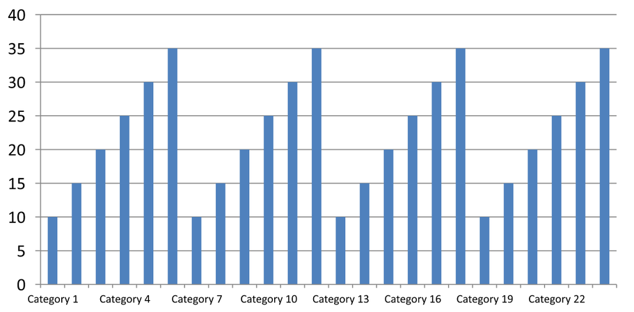

## **Panoramica**

Questo articolo spiega come personalizzare gli assi dei grafici con Aspose.Slides per Java. Copre i valori degli assi calcolati, lo scambio di righe e colonne del grafico, la visibilità dell'asse, gli intervalli delle etichette di categoria e dei segni di graduazione, le categorie di data e la formattazione, la rotazione del titolo, il posizionamento dell'asse, le unità di visualizzazione e la scala logaritmica.

## **Ottieni i valori massimi sull'asse verticale nei grafici**

Crea una [Presentazione](https://reference.aspose.com/slides/java/com.aspose.slides/presentation/) e aggiungi un grafico ad area con dati predefiniti. Chiama [validateChartLayout](https://reference.aspose.com/slides/java/com.aspose.slides/chart/#validateChartLayout--) prima di leggere i valori degli assi calcolati in modo che il layout del grafico sia aggiornato.

Leggi [getActualMaxValue](https://reference.aspose.com/slides/java/com.aspose.slides/axis/#getActualMaxValue--) e [getActualMinValue](https://reference.aspose.com/slides/java/com.aspose.slides/axis/#getActualMinValue--) per i limiti dell'asse, e [getActualMajorUnit](https://reference.aspose.com/slides/java/com.aspose.slides/axis/#getActualMajorUnit--) e [getActualMinorUnit](https://reference.aspose.com/slides/java/com.aspose.slides/axis/#getActualMinorUnit--) per gli intervalli dei segni di graduazione. [getActualMajorUnitScale](https://reference.aspose.com/slides/java/com.aspose.slides/axis/#getActualMajorUnitScale--) e [getActualMinorUnitScale](https://reference.aspose.com/slides/java/com.aspose.slides/axis/#getActualMinorUnitScale--) forniscono le scale di unità temporali, rilevanti per gli assi di data. L'esempio memorizza questi valori in variabili locali e salva il grafico.

```java
import com.aspose.slides.*;

Presentation presentation = new Presentation();
try {
    ISlide slide = presentation.getSlides().get_Item(0);

    IChart chart = slide.getShapes().addChart(ChartType.Area, 100, 100, 500, 350);
    chart.validateChartLayout();

    double maxValue = chart.getAxes().getVerticalAxis().getActualMaxValue();
    double minValue = chart.getAxes().getVerticalAxis().getActualMinValue();

    double majorUnit = chart.getAxes().getVerticalAxis().getActualMajorUnit();
    double minorUnit = chart.getAxes().getVerticalAxis().getActualMinorUnit();

    int majorUnitScale = chart.getAxes().getVerticalAxis().getActualMajorUnitScale();
    int minorUnitScale = chart.getAxes().getVerticalAxis().getActualMinorUnitScale();

    presentation.save("AxisValues_out.pptx", SaveFormat.Pptx);
} finally {
    presentation.dispose();
}
```

## **Scambia i dati tra gli assi**

Usa [switchRowColumn](https://reference.aspose.com/slides/java/com.aspose.slides/chartdata/#switchRowColumn--) per scambiare i ruoli di serie e categorie nei dati del grafico. Ogni precedente categoria diventa una serie e ogni precedente serie diventa una categoria. Questo cambia il modo in cui i dati sono raggruppati; non scambia gli assi orizzontale e verticale. L'esempio utilizza [setRange](https://reference.aspose.com/slides/java/com.aspose.slides/chartdata/#setRange-java.lang.String-) per associare i dati predefiniti a `Sheet1!A1:D5`, inclusa la riga di intestazione e la colonna delle categorie, prima di scambiare righe e colonne. Salva un grafico con quattro serie e tre categorie.

```java
import com.aspose.slides.*;

Presentation presentation = new Presentation();
try {
    ISlide slide = presentation.getSlides().get_Item(0);

    IChart chart = slide.getShapes().addChart(ChartType.ClusteredColumn, 100, 100, 400, 300);
    chart.getChartData().setRange("Sheet1!A1:D5");
    chart.getChartData().switchRowColumn();

    presentation.save("SwitchChartRowColumns_out.pptx", SaveFormat.Pptx);
} finally {
    presentation.dispose();
}
```

## **Inverti l'ordine di tracciamento di un asse**

Usa [setPlotOrderReversed](https://reference.aspose.com/slides/java/com.aspose.slides/axis/#setPlotOrderReversed-boolean-) per invertire un asse di categoria o di valore. Per esempio, un grafico a barre orizzontali può mostrare le fasi del progetto dall'alto verso il basso nello stesso ordine del foglio di lavoro: Pianificazione, Sviluppo, Test. L'inversione di un asse cambia la direzione di tracciamento; non ordina né riorganizza i dati del foglio di lavoro. In confronto, [switchRowColumn](https://reference.aspose.com/slides/java/com.aspose.slides/chartdata/#switchRowColumn--) scambia i ruoli di serie e categorie.

L'esempio seguente crea un grafico a barre orizzontali con tre fasi e una serie. Salva una presentazione con tre diapositive: ordine normale, categorie invertite e valori invertiti. Ogni copia utilizza lo stesso set di dati e solo un asse è invertito in ciascuna copia.

```java
import com.aspose.slides.*;

Presentation presentation = new Presentation();
try {
    ISlide slide = presentation.getSlides().get_Item(0);

    IChart chart = slide.getShapes().addChart(ChartType.ClusteredBar, 50, 40, 620, 320);
    chart.setLegend(false);

    chart.getChartData().getCategories().clear();
    chart.getChartData().getSeries().clear();

    IChartDataWorkbook workbook = chart.getChartData().getChartDataWorkbook();
    workbook.clear(0);

    IChartSeries series = chart.getChartData().getSeries().add(ChartType.ClusteredBar);
    String[] stages = { "Planning", "Development", "Testing" };
    int[] values = { 10, 30, 20 };
    for (int i = 0; i < stages.length; i++) {
        IChartDataCell categoryCell = workbook.getCell(0, i + 1, 0, stages[i]);
        chart.getChartData().getCategories().add(categoryCell);
        IChartDataCell valueCell = workbook.getCell(0, i + 1, 1, values[i]);
        series.getDataPoints().addDataPointForBarSeries(valueCell);
    }

    // Diapositiva 2: visualizza la prima categoria in alto.
    ISlide categorySlide = presentation.getSlides().addClone(slide);
    IChart categoryChart = (IChart)categorySlide.getShapes().get_Item(0);
    categoryChart.getAxes().getVerticalAxis().setPlotOrderReversed(true);
    // Mantieni l'asse dei valori orizzontale in basso.
    categoryChart.getAxes().getVerticalAxis().setCrossType(CrossesType.Maximum);

    // Diapositiva 3: inverte solo la scala numerica orizzontale.
    ISlide valueSlide = presentation.getSlides().addClone(slide);
    IChart valueChart = (IChart)valueSlide.getShapes().get_Item(0);
    valueChart.getAxes().getHorizontalAxis().setPlotOrderReversed(true);

    presentation.save("ReversedAxes.pptx", SaveFormat.Pptx);
} finally {
    presentation.dispose();
}
```

L'inversione di un asse può anche spostare l'asse perpendicolare sul lato opposto del grafico. [setCrossType](https://reference.aspose.com/slides/java/com.aspose.slides/axis/#setCrossType-int-) controlla dove l'altro asse incrocia l'asse in configurazione. Nella diapositiva 2, chiamandolo con `CrossesType.Maximum` sull'asse di categoria invertito, l'asse di valore orizzontale rimane in basso. Per un punto di incrocio specifico, usa [setCrossAt](https://reference.aspose.com/slides/java/com.aspose.slides/axis/#setCrossAt-float-). Controlla le impostazioni di incrocio quando cambi direzione, soprattutto se il grafico ha già un punto di incrocio personalizzato. Chiama `setPlotOrderReversed` con `false` per ripristinare la direzione di tracciamento normale; le impostazioni di incrocio sono separate.

| Ordine normale (diap. 1) | Categorie invertite (diap. 2) | Valori invertiti (diap. 3) |
| --- | --- | --- |
|  |  |  |
| Le categorie vanno dal basso verso l'alto; i valori aumentano da sinistra a destra. | Pianificazione, Sviluppo e Test vanno dall'alto verso il basso. I valori e l'ordine delle righe del foglio di lavoro rimangono invariati. | Le categorie mantengono il loro ordine normale; i valori aumentano da destra a sinistra. L'asse di categoria incrocia a zero a destra. |

## **Disattiva l'asse verticale per i grafici a linee**

Chiama [setVisible](https://reference.aspose.com/slides/java/com.aspose.slides/axis/#setVisible-boolean-) con `false` sull'asse verticale per nasconderlo. L'esempio crea un grafico a linee con dati predefiniti e lo salva con l'asse verticale nascosto.

```java
import com.aspose.slides.*;

Presentation presentation = new Presentation();
try {
    ISlide slide = presentation.getSlides().get_Item(0);

    IChart chart = slide.getShapes().addChart(ChartType.Line, 100, 100, 400, 300);
    chart.getAxes().getVerticalAxis().setVisible(false);

    presentation.save("HiddenVerticalAxis.pptx", SaveFormat.Pptx);
} finally {
    presentation.dispose();
}
```

## **Disattiva l'asse orizzontale per i grafici a linee**

Chiama [setVisible](https://reference.aspose.com/slides/java/com.aspose.slides/axis/#setVisible-boolean-) con `false` sull'asse orizzontale per nasconderlo. L'esempio crea un grafico a linee con dati predefiniti e lo salva con l'asse orizzontale nascosto.

```java
import com.aspose.slides.*;

Presentation presentation = new Presentation();
try {
    ISlide slide = presentation.getSlides().get_Item(0);

    IChart chart = slide.getShapes().addChart(ChartType.Line, 100, 100, 400, 300);
    chart.getAxes().getHorizontalAxis().setVisible(false);

    presentation.save("HiddenHorizontalAxis.pptx", SaveFormat.Pptx);
} finally {
    presentation.dispose();
}
```

## **Mostra o nascondi le linee della griglia del grafico**

Chiama [getShowMajorGridLines](https://reference.aspose.com/slides/java/com.aspose.slides/iaxis/#getShowMajorGridLines--) e [getShowMinorGridLines](https://reference.aspose.com/slides/java/com.aspose.slides/iaxis/#getShowMinorGridLines--) per verificare quali linee della griglia visualizza un asse. questi metodi restituiscono la visibilità corrente. Per mostrare le linee della griglia minori, usa [getMinorGridLinesFormat](https://reference.aspose.com/slides/java/com.aspose.slides/iaxis/#getMinorGridLinesFormat--) e imposta il riempimento della linea su un colore solido e visibile. Per nasconderle, imposta il riempimento su [FillType.NoFill](https://reference.aspose.com/slides/java/com.aspose.slides/filltype/#NoFill). Usa [getMajorGridLinesFormat](https://reference.aspose.com/slides/java/com.aspose.slides/iaxis/#getMajorGridLinesFormat--) per modificare il riempimento della linea delle griglie maggiori allo stesso modo. Cambiare il riempimento preserva la visibilità dell'asse e dei segni di graduazione.

L'asse verticale di questo grafico a colonne raggruppate mostra inizialmente solo le linee della griglia maggiori. L'esempio visualizza le linee della griglia minori in arancione scuro, poi le nasconde nuovamente prima di salvare la presentazione. Stampa la visibilità della griglia a ogni passaggio.

```java
import com.aspose.slides.*;
import java.awt.Color;

Presentation presentation = new Presentation();
try {
    ISlide slide = presentation.getSlides().get_Item(0);

    IChart chart = slide.getShapes().addChart(ChartType.ClusteredColumn, 30, 30, 660, 230);
    IAxis axis = chart.getAxes().getVerticalAxis();
    System.out.printf("Initial: major=%b, minor=%b%n", axis.getShowMajorGridLines(), axis.getShowMinorGridLines());

    ILineFillFormat minorFill = axis.getMinorGridLinesFormat().getLine().getFillFormat();
    minorFill.setFillType(FillType.Solid);
    minorFill.getSolidFillColor().setColor(new Color(255, 140, 0));
    System.out.printf("Enabled: minor=%b%n", axis.getShowMinorGridLines());

    minorFill.setFillType(FillType.NoFill);
    System.out.printf("Hidden: major=%b, minor=%b%n", axis.getShowMajorGridLines(), axis.getShowMinorGridLines());

    presentation.save("ChartGridlines.pptx", SaveFormat.Pptx);
} finally {
    presentation.dispose();
}
```

| Linee della griglia minori attive | Linee della griglia minori nascoste |
| --- | --- |
|  |  |

## **Modifica un asse di categoria**

Usa [setCategoryAxisType](https://reference.aspose.com/slides/java/com.aspose.slides/axis/#setCategoryAxisType-int-) per scegliere un asse di categoria data o testo. Questo esempio richiede `ExistingChart.pptx`, con un grafico come prima forma della prima diapositiva e celle di categoria contenenti valori di data numerici di Excel. Cambia l'asse orizzontale in un asse di data. Chiamando [setAutomaticMajorUnit](https://reference.aspose.com/slides/java/com.aspose.slides/axis/#setAutomaticMajorUnit-boolean-) con `false`, [setMajorUnit](https://reference.aspose.com/slides/java/com.aspose.slides/axis/#setMajorUnit-double-) con `1` e [setMajorUnitScale](https://reference.aspose.com/slides/java/com.aspose.slides/axis/#setMajorUnitScale-int-) con `TimeUnitType.Months` posiziona i segni maggiori a intervalli di un mese.

```java
import com.aspose.slides.*;

Presentation presentation = new Presentation("ExistingChart.pptx");
try {
    ISlide slide = presentation.getSlides().get_Item(0);

    IChart chart = (IChart) slide.getShapes().get_Item(0);
    chart.getAxes().getHorizontalAxis().setCategoryAxisType(CategoryAxisType.Date);
    chart.getAxes().getHorizontalAxis().setAutomaticMajorUnit(false);
    chart.getAxes().getHorizontalAxis().setMajorUnit(1);
    chart.getAxes().getHorizontalAxis().setMajorUnitScale(TimeUnitType.Months);

    presentation.save("ChangeChartCategoryAxis_out.pptx", SaveFormat.Pptx);
} finally {
    presentation.dispose();
}
```

### **Determina il tipo di asse di categoria dai dati**

Chiama [setCategoryAxisTypeAutomatically](https://reference.aspose.com/slides/java/com.aspose.slides/iaxis/#setCategoryAxisTypeAutomatically--) dopo aver popolato le categorie, poi leggi [getCategoryAxisType](https://reference.aspose.com/slides/java/com.aspose.slides/iaxis/#getCategoryAxisType--) per ispezionare la selezione. Questo è utile quando lo stesso grafico riceve etichette di testo o valori di data numerici. Il metodo determina il tipo quando viene chiamato; non abilita una modalità persistente che rivaluta modifiche successive dei dati. Richiamalo di nuovo dopo aver sostituito le categorie.

L'esempio seguente crea un grafico con categorie di testo e stampa `true` quando il tipo selezionato è `CategoryAxisType.Text`. Poi sostituisce i valori delle celle di categoria con date e chiama nuovamente il metodo, stampando `true` quando il tipo selezionato è `CategoryAxisType.Date`. Le date sono memorizzate come valori numerici OLE Automation, calcolati per queste date come il numero di giorni dal 30 dicembre 1899, anziché come stringhe di data. [setCustomNumberFormat](https://reference.aspose.com/slides/java/com.aspose.slides/ichartdatacell/#setCustomNumberFormat-java.lang.String-) controlla come quei valori sono visualizzati; non converte il testo in date numeriche. Per ulteriori informazioni sulle celle di categoria, vedi [Chart Workbook](/slides/it/java/chart-workbook/).

Usa la determinazione automatica quando l'input contiene categorie di testo o date numeriche, come in questo esempio. Per etichette numeriche ordinarie, categorie miste o dati vuoti, chiama esplicitamente [setCategoryAxisType](https://reference.aspose.com/slides/java/com.aspose.slides/iaxis/#setCategoryAxisType-int-) per corrispondere al significato previsto. I valori numerici da soli non stabiliscono che le categorie rappresentino date.

```java
import com.aspose.slides.*;
import java.time.LocalDate;

Presentation presentation = new Presentation();
try {
    ISlide slide = presentation.getSlides().get_Item(0);

    IChart chart = slide.getShapes().addChart(ChartType.ClusteredColumn, 30, 40, 660, 320);

    chart.getChartData().getCategories().clear();
    chart.getChartData().getSeries().clear();

    IChartDataWorkbook workbook = chart.getChartData().getChartDataWorkbook();
    workbook.clear(0);

    IChartDataCell seriesName = workbook.getCell(0, 0, 1, "Sales");
    IChartSeries series = chart.getChartData().getSeries().add(seriesName, chart.getType());
    String[] labels = { "First", "Second", "Third" };

    for (int i = 0; i < labels.length; i++) {
        IChartDataCell categoryCell = workbook.getCell(0, i + 1, 0, labels[i]);
        chart.getChartData().getCategories().add(categoryCell);

        IChartDataCell valueCell = workbook.getCell(0, i + 1, 1, (i + 1) * 10);
        series.getDataPoints().addDataPointForBarSeries(valueCell);
    }

    IAxis axis = chart.getAxes().getHorizontalAxis();
    axis.setCategoryAxisTypeAutomatically();
    System.out.println(axis.getCategoryAxisType() == CategoryAxisType.Text); // vero

    LocalDate baseDate = LocalDate.of(1899, 12, 30);
    LocalDate[] dates = { LocalDate.of(2026, 1, 1), LocalDate.of(2026, 1, 2), LocalDate.of(2026, 2, 1) };

    for (int i = 0; i < dates.length; i++) {
        IChartDataCell categoryCell = workbook.getCell(0, i + 1, 0);
        categoryCell.setValue((double)(dates[i].toEpochDay() - baseDate.toEpochDay()));
        categoryCell.setCustomNumberFormat("yyyy-mm-dd");
    }

    axis.setCategoryAxisTypeAutomatically();
    System.out.println(axis.getCategoryAxisType() == CategoryAxisType.Date); // vero

    presentation.save("AutomaticCategoryAxis.pptx", SaveFormat.Pptx);
} finally {
    presentation.dispose();
}
```

## **Controlla gli intervalli delle etichette dell'asse di categoria**

Quando un grafico ha molte categorie, riduci il numero di etichette dell'asse visibili senza rimuovere categorie o punti dati. Chiama [setAutomaticTickLabelSpacing](https://reference.aspose.com/slides/java/com.aspose.slides/iaxis/#setAutomaticTickLabelSpacing-boolean-) con `false`, poi passa l'intervallo di categoria desiderato a [setTickLabelSpacing](https://reference.aspose.com/slides/java/com.aspose.slides/iaxis/#setTickLabelSpacing-long-). Per le categorie di testo nel loro ordine normale, il conteggio inizia dalla prima categoria:

| Intervallo | Etichette visualizzate nell'esempio |
| --- | --- |
| `1` | Categoria 1, Categoria 2, Categoria 3, … Categoria 24 |
| `2` | Categoria 1, Categoria 3, Categoria 5, … Categoria 23 |
| `3` | Categoria 1, Categoria 4, Categoria 7, … Categoria 22 |

Un intervallo di `3` visualizza ogni terza etichetta, lasciando due etichette nascoste tra quelle visualizzate. Non rimuove le colonne corrispondenti. La spaziatura automatica sceglie un intervallo in base allo spazio disponibile; non visualizza necessariamente ogni etichetta.

I segni di graduazione hanno controlli separati. Chiama [setAutomaticTickMarksSpacing](https://reference.aspose.com/slides/java/com.aspose.slides/iaxis/#setAutomaticTickMarksSpacing-boolean-) con `false` e usa [setTickMarksSpacing](https://reference.aspose.com/slides/java/com.aspose.slides/iaxis/#setTickMarksSpacing-long-) per impostare il loro intervallo. Per esempio, `1` mantiene un segno di graduazione a ogni intervallo di categoria mentre le etichette appaiono solo ogni terza categoria. Usa [setMajorTickMark](https://reference.aspose.com/slides/java/com.aspose.slides/iaxis/#setMajorTickMark-int-) con uno stile visibile così da vedere il risultato. Richiamare nuovamente il setter automatico con `true` consente al grafico di scegliere di nuovo quell'intervallo.

L'esempio autonomo seguente crea 24 categorie e una serie, poi salva tre diapositive in `CategoryAxisIntervals.pptx`: spaziatura automatica, spaziatura manuale delle etichette con segni di graduazione indipendenti e spaziatura automatica ripristinata. Le due copie conservano i dati originali del grafico. Non è necessaria alcuna presentazione di input. Il testo dell'etichetta orizzontale rende evidente la differenza di densità.

```java
import com.aspose.slides.*;

Presentation presentation = new Presentation();
try {
    ISlide slide = presentation.getSlides().get_Item(0);

    IChart chart = slide.getShapes().addChart(ChartType.ClusteredColumn, 30, 40, 660, 320);

    chart.setLegend(false);
    chart.getChartData().getCategories().clear();
    chart.getChartData().getSeries().clear();

    IChartDataWorkbook workbook = chart.getChartData().getChartDataWorkbook();
    workbook.clear(0);

    IChartSeries series = chart.getChartData().getSeries().add(ChartType.ClusteredColumn);
    for (int i = 0; i < 24; i++) {
        IChartDataCell categoryCell = workbook.getCell(0, i + 1, 0, "Category " + (i + 1));
        chart.getChartData().getCategories().add(categoryCell);
        IChartDataCell valueCell = workbook.getCell(0, i + 1, 1, 10 + i % 6 * 5);
        series.getDataPoints().addDataPointForBarSeries(valueCell);
    }

    IAxis axis = chart.getAxes().getHorizontalAxis();
    axis.setCategoryAxisType(CategoryAxisType.Text);
    axis.getTextFormat().getTextBlockFormat().setRotationAngle(0);
    axis.getTextFormat().getPortionFormat().setFontHeight(12);
    axis.setMajorTickMark(TickMarkType.Outside);
    axis.setAutomaticTickLabelSpacing(true);
    axis.setAutomaticTickMarksSpacing(true);

    // Diapositiva 2: mostra ogni terza etichetta, ma mantieni un segno di graduazione per ogni categoria.
    ISlide manualSlide = presentation.getSlides().addClone(slide);
    IChart manualChart = (IChart)manualSlide.getShapes().get_Item(0);
    IAxis manualAxis = manualChart.getAxes().getHorizontalAxis();
    manualAxis.setAutomaticTickLabelSpacing(false);
    manualAxis.setTickLabelSpacing(3);
    manualAxis.setAutomaticTickMarksSpacing(false);
    manualAxis.setTickMarksSpacing(1);

    // Diapositiva 3: consenti al grafico di scegliere nuovamente entrambi gli intervalli.
    ISlide restoredSlide = presentation.getSlides().addClone(manualSlide);
    IChart restoredChart = (IChart)restoredSlide.getShapes().get_Item(0);
    restoredChart.getAxes().getHorizontalAxis().setAutomaticTickLabelSpacing(true);
    restoredChart.getAxes().getHorizontalAxis().setAutomaticTickMarksSpacing(true);

    presentation.save("CategoryAxisIntervals.pptx", SaveFormat.Pptx);
} finally {
    presentation.dispose();
}
```

**Spaziatura automatica (diap. 1):** In questa rappresentazione, ogni seconda etichetta di categoria è visualizzata e si avvolge su due righe. Il risultato automatico può variare in base alle dimensioni del grafico, ai caratteri e al renderer.


**Spaziatura manuale (diap. 2):** Ogni terza etichetta è visualizzata su una linea, mentre i segni di graduazione rimangono a ogni intervallo di categoria. Tutte le 24 colonne, incluse quelle senza etichette, rimangono visibili con gli stessi valori. La diapositiva 3 ripristina l'aspetto automatico mostrato sopra.



### **Scegli l'asse e l'intervallo corretti**

Usa questo intervallo di conteggio delle categorie per un asse di categoria di testo, come l'asse di categoria di un grafico a colonne, linee, aree o barre. In un grafico a colonne è l'asse orizzontale. In un grafico a barre orizzontali l'asse di categoria è verticale, quindi applica queste impostazioni all'asse restituito da [getVerticalAxis](https://reference.aspose.com/slides/java/com.aspose.slides/iaxesmanager/#getVerticalAxis--). La spaziatura dei segni di graduazione si applica anche a un asse di serie nei grafici che ne hanno uno.

Non usare la spaziatura delle etichette di categoria per impostare la scala numerica di un asse di valore. Su un asse di valore, [setMajorUnit](https://reference.aspose.com/slides/java/com.aspose.slides/iaxis/#setMajorUnit-double-) specifica una differenza di valori: per esempio, un'unità maggiore di `10` produce segni a 0, 10, 20 e così via quando l'asse parte da zero. Un intervallo di etichette di categoria di `3` conta invece le posizioni delle categorie, indipendentemente dai loro valori. I grafici a dispersione e a bolle usano assi di valore anziché un asse di categoria di testo. Per un asse di data, usa unità maggiori e scale temporali come descritto in [Modifica un asse di categoria](#modifica-un-asse-di-categoria).

## **Imposta il formato della data per i valori dell'asse di categoria**

L'esempio sostituisce i dati predefiniti del grafico con quattro valori annuali. Le date sono memorizzate come numeri seriali OLE Automation nel primo foglio di lavoro (indice `0`), calcolati come il numero di giorni dal 30 dicembre 1899 per queste date. Usa [setCategoryAxisType](https://reference.aspose.com/slides/java/com.aspose.slides/axis/#setCategoryAxisType-int-) con `CategoryAxisType.Date`, chiama [setNumberFormatLinkedToSource](https://reference.aspose.com/slides/java/com.aspose.slides/axis/#setNumberFormatLinkedToSource-boolean-) con `false` e passa `yyyy` a [setNumberFormat](https://reference.aspose.com/slides/java/com.aspose.slides/axis/#setNumberFormat-java.lang.String-) affinché le etichette di categoria mostrino gli anni a quattro cifre indipendentemente dalla formattazione delle celle.

```java
import com.aspose.slides.*;
import java.time.LocalDate;

Presentation presentation = new Presentation();
try {
    ISlide slide = presentation.getSlides().get_Item(0);

    IChart chart = slide.getShapes().addChart(ChartType.Line, 50, 50, 450, 300);

    chart.getChartData().getCategories().clear();
    chart.getChartData().getSeries().clear();

    IChartDataWorkbook workbook = chart.getChartData().getChartDataWorkbook();
    workbook.clear(0);

    LocalDate baseDate = LocalDate.of(1899, 12, 30);

    IChartSeries series = chart.getChartData().getSeries().add(ChartType.Line);
    for (int i = 0; i < 4; i++) {
        LocalDate date = LocalDate.of(2015 + i, 1, 1);
        IChartDataCell categoryCell = workbook.getCell(0, i + 1, 0, date.toEpochDay() - baseDate.toEpochDay());
        chart.getChartData().getCategories().add(categoryCell);

        IChartDataCell valueCell = workbook.getCell(0, i + 1, 1, i + 1);
        series.getDataPoints().addDataPointForLineSeries(valueCell);
    }

    chart.getAxes().getHorizontalAxis().setCategoryAxisType(CategoryAxisType.Date);
    chart.getAxes().getHorizontalAxis().setNumberFormatLinkedToSource(false);
    chart.getAxes().getHorizontalAxis().setNumberFormat("yyyy");

    presentation.save("DateAxisFormat.pptx", SaveFormat.Pptx);
} finally {
    presentation.dispose();
}
```

## **Imposta un angolo di rotazione per il titolo di un asse del grafico**

Chiama [setTitle](https://reference.aspose.com/slides/java/com.aspose.slides/axis/#setTitle-boolean-) con `true` sull'asse verticale, fornisci il testo del titolo e usa [setRotationAngle](https://reference.aspose.com/slides/java/com.aspose.slides/icharttextblockformat/#setRotationAngle-float-) per ruotare il titolo. L'angolo è misurato in gradi; questo esempio salva un grafico a colonne con il titolo dell'asse di valore ruotato di 90 gradi.

```java
import com.aspose.slides.*;

Presentation presentation = new Presentation();
try {
    ISlide slide = presentation.getSlides().get_Item(0);

    IChart chart = slide.getShapes().addChart(ChartType.ClusteredColumn, 50, 50, 450, 300);
    chart.getAxes().getVerticalAxis().setTitle(true);
    chart.getAxes().getVerticalAxis().getTitle().addTextFrameForOverriding("Value");
    chart.getAxes().getVerticalAxis().getTitle().getTextFormat().getTextBlockFormat().setRotationAngle(90);

    presentation.save("RotatedAxisTitle.pptx", SaveFormat.Pptx);
} finally {
    presentation.dispose();
}
```

## **Imposta la posizione dell'asse su un asse di categoria o di valore**

Usa [setAxisBetweenCategories](https://reference.aspose.com/slides/java/com.aspose.slides/axis/#setAxisBetweenCategories-boolean-) per controllare se l'asse di valore incrocia l'asse di categoria tra le categorie o sui segni di categoria. Questa impostazione si applica agli assi di categoria. L'esempio la imposta su `true` sull'asse di categoria orizzontale di un grafico a colonne e salva il risultato.

```java
import com.aspose.slides.*;

Presentation presentation = new Presentation();
try {
    ISlide slide = presentation.getSlides().get_Item(0);

    IChart chart = slide.getShapes().addChart(ChartType.ClusteredColumn, 50, 50, 450, 300);
    chart.getAxes().getHorizontalAxis().setAxisBetweenCategories(true);

    presentation.save("AxisBetweenCategories.pptx", SaveFormat.Pptx);
} finally {
    presentation.dispose();
}
```

## **Imposta l'unità di visualizzazione su un asse di valore del grafico**

Usa [setDisplayUnit](https://reference.aspose.com/slides/java/com.aspose.slides/axis/#setDisplayUnit-int-) per scalare le etichette di un asse di valore senza modificare i dati sottostanti. Con [DisplayUnitType](https://reference.aspose.com/slides/java/com.aspose.slides/displayunittype/) impostato su `Millions`, un valore di 60 000 000 viene visualizzato come 60. L'esempio crea un grafico a colonne e applica l'unità di visualizzazione milioni al suo asse verticale.

```java
import com.aspose.slides.*;

Presentation presentation = new Presentation();
try {
    ISlide slide = presentation.getSlides().get_Item(0);

    IChart chart = slide.getShapes().addChart(ChartType.ClusteredColumn, 50, 50, 450, 300);
    chart.getAxes().getVerticalAxis().setDisplayUnit(DisplayUnitType.Millions);

    presentation.save("Result.pptx", SaveFormat.Pptx);
} finally {
    presentation.dispose();
}
```

## **Configura un asse di valore logaritmico**

Un asse di valore logaritmico è utile quando i valori positivi coprono diversi ordini di grandezza. Per esempio, un servizio può ricevere 10, 100, 1 000, 10 000 e 100 000 richieste in cinque periodi. Su una scala lineare, i valori più piccoli appaiono molto vicini a zero. Una scala logaritmica rende più facile confrontare la crescita relativa: le distanze uguali rappresentano rapporti uguali anziché differenze uguali.

Chiama [setLogarithmic](https://reference.aspose.com/slides/java/com.aspose.slides/axis/#setLogarithmic-boolean-) con `true` sull'asse di valore e usa [setLogBase](https://reference.aspose.com/slides/java/com.aspose.slides/axis/#setLogBase-double-) per scegliere la base. Questo cambia il modo in cui i valori esistenti sono visualizzati; non modifica i dati né aggiunge una linea di tendenza logaritmica. Una linea di tendenza rappresenta una relazione adattata ai dati ed è una funzionalità separata.

### **Scegli l'asse di valore e la base**

Per un grafico a linee o a colonne, l'asse di valore è restituito da [getVerticalAxis](https://reference.aspose.com/slides/java/com.aspose.slides/iaxesmanager/#getVerticalAxis--). Per un grafico a barre orizzontali, è restituito da [getHorizontalAxis](https://reference.aspose.com/slides/java/com.aspose.slides/iaxesmanager/#getHorizontalAxis--). I grafici a dispersione e a bolle hanno due assi di valore, quindi scegli l'asse orizzontale per i valori X, l'asse verticale per i valori Y, o entrambi. Non applicare la scala logaritmica a un asse di categoria.

La base logaritmica predefinita è `10`. Per i grafici PPTX, usa una base compresa tra `2` e `1000`, inclusi; sono supportate anche basi frazionarie come `2.5`. Con base `10`, le potenze successive come 10, 100, 1 000 e 10 000 sono equidistanti.

### **Confronta la scala lineare e quella logaritmica**

L'esempio autonomo seguente crea un grafico a linee con i cinque conteggi di richieste nella prima diapositiva, poi clona quella diapositiva e abilita un asse di valore logaritmico base 10 nella seconda. Entrambe le diapositive conservano gli stessi dati.

```java
import com.aspose.slides.*;

Presentation presentation = new Presentation();
try {
    ISlide slide = presentation.getSlides().get_Item(0);

    IChart chart = slide.getShapes().addChart(ChartType.Line, 30, 40, 660, 200);

    chart.setLegend(false);

    chart.getChartData().getCategories().clear();
    chart.getChartData().getSeries().clear();

    IChartDataWorkbook workbook = chart.getChartData().getChartDataWorkbook();
    workbook.clear(0);

    IChartSeries series = chart.getChartData().getSeries().add(ChartType.Line);
    double[] values = { 10, 100, 1000, 10000, 100000 };

    for (int i = 0; i < values.length; i++) {
        IChartDataCell categoryCell = workbook.getCell(0, i + 1, 0, "Period " + (i + 1));
        chart.getChartData().getCategories().add(categoryCell);

        IChartDataCell valueCell = workbook.getCell(0, i + 1, 1, values[i]);
        series.getDataPoints().addDataPointForLineSeries(valueCell);
    }

    // Mantieni la prima diapositiva lineare e cambia solo la scala dell'asse dei valori della copia.
    ISlide logarithmicSlide = presentation.getSlides().addClone(slide);
    IChart logarithmicChart = (IChart)logarithmicSlide.getShapes().get_Item(0);
    IAxis valueAxis = logarithmicChart.getAxes().getVerticalAxis();
    valueAxis.setLogarithmic(true);
    valueAxis.setLogBase(10);

    presentation.save("LogarithmicAxis.pptx", SaveFormat.Pptx);
} finally {
    presentation.dispose();
}
```

**Scala lineare (diap. 1):** Distanze verticali uguali rappresentano differenze uguali nel conteggio delle richieste. Il valore più grande domina il grafico, rendendo difficili da distinguere i valori più piccoli.


**Scala logaritmica (diap. 2):** Distanze verticali uguali rappresentano rapporti uguali. Ogni periodo ha dieci volte più richieste del precedente, quindi i punti formano una linea in salita regolare sulla scala logaritmica base 10. Le etichette dell'asse mostrano comunque i conteggi originali.


### **Gestisci valori zero e negativi**

Una scala logaritmica può visualizzare solo valori strettamente positivi. Controlla i dati prima di abilitarla. Se zero o valori negativi sono significativi, mantieni una scala lineare o mostrali separatamente. Se escludere quei valori è appropriato per l'analisi, spiega l'omissione. Non sostituirli silenziosamente con numeri piccoli positivi, poiché ciò modifica il significato dei dati. Qualsiasi valore minimo o massimo configurato manualmente per un asse logaritmico deve essere anch'esso positivo.

## **FAQ**

**Come imposto il valore in cui un asse incrocia l'altro (incrocio degli assi)?**

Usa [setCrossType](https://reference.aspose.com/slides/java/com.aspose.slides/axis/#setCrossType-int-) per selezionare il comportamento di incrocio. Per specificare un valore numerico di incrocio, usa [setCrossAt](https://reference.aspose.com/slides/java/com.aspose.slides/axis/#setCrossAt-float-). Queste impostazioni ti consentono di spostare l'incrocio dell'asse a una linea di base adeguata.

**Come posso posizionare le etichette dei segni rispetto all'asse?**

Chiama [setTickLabelPosition](https://reference.aspose.com/slides/java/com.aspose.slides/axis/#setTickLabelPosition-int-) usando [TickLabelPositionType](https://reference.aspose.com/slides/java/com.aspose.slides/ticklabelpositiontype/): `Low`, `High`, `NextTo` o `None`. Per controllare i segni di graduazione stessi, usa [setMajorTickMark](https://reference.aspose.com/slides/java/com.aspose.slides/axis/#setMajorTickMark-int-) o [setMinorTickMark](https://reference.aspose.com/slides/java/com.aspose.slides/axis/#setMinorTickMark-int-); questi sono separati dal posizionamento delle etichette.