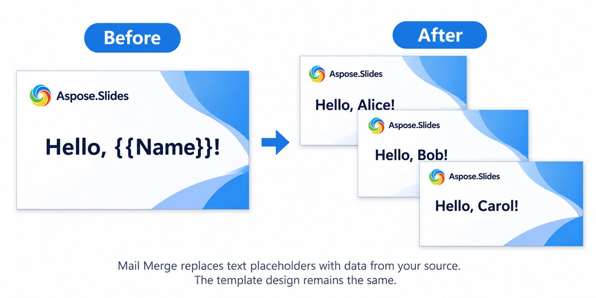

# Mail Merge nelle presentazioni PowerPoint

Aspose.Slides per .NET consente di generare automaticamente presentazioni PowerPoint utilizzando un modello e una fonte di dati. Mail Merge riempie i segnaposto del modello con i dati e crea o una presentazione singola contenente le diapositive modello ripetute per ogni set di dati, o una presentazione separata per ogni set di dati.

Questa funzionalità è utile per generare cataloghi di prodotti, presentazioni personalizzate, report, certificati, proposte, listini prezzi e altri documenti in cui la struttura della presentazione rimane invariata mentre il contenuto varia.




## Come funziona Mail Merge

Mail Merge utilizza una presentazione PowerPoint come modello e sostituisce i segnaposto con i valori provenienti da una fonte di dati.


Un segnaposto è un nome di campo racchiuso tra doppie parentesi graffe, ad esempio `{{title}}` o `{{price}}`. I segnaposto possono essere inseriti nel testo di forme, celle di tabelle, forme raggruppate e note del relatore.

- `Prodotto: {{title}}`
- `Prezzo: {{price}}`
- `Descrizione: {{description}}`

La prima riga della tabella contiene i valori del set di dati:

| Campo | Valore |
|---|---|
| title | Laptop X1 |
| price | $999 |
| description | 14-inch display, 16 GB RAM |

Mail Merge sostituisce i segnaposto con i valori corrispondenti, producendo una diapositiva con le informazioni effettive sul prodotto.

I nomi dei campi non fanno distinzione tra maiuscole e minuscole, quindi `{{title}}` e `{{Title}}` si riferiscono allo stesso campo.

Le seguenti regole si applicano durante la sostituzione dei segnaposto:

- I segnaposto vengono sostituiti nelle diapositive, comprese forme raggruppate e celle di tabelle, e nelle note del relatore.
- I segnaposto nelle diapositive master e di layout non vengono sostituiti.
- Un segnaposto il cui campo non è presente nel set di dati rimane invariato.
- Un valore campo vuoto sostituisce il suo segnaposto con una stringa vuota.
- Il testo inserito eredita la formattazione del primo carattere del segnaposto.
- I valori non devono contenere testo di segnaposto, poiché il testo inserito potrebbe essere nuovamente elaborato e sostituito da un altro campo.

La presentazione modello originale non viene modificata durante l'operazione di unione e deve contenere almeno una diapositiva.

## Origini dati supportate

Mail Merge supporta due modalità per fornire i dati:

- Creare una fonte di dati programmaticamente utilizzando `IMailMergeDataSource`.
- Leggere i dati da un file o stream CSV, XLSX, JSON o XML.

Il formato dei dati viene rilevato in base al contenuto, non all'estensione del file. Sono supportati anche stream che non supportano il seeking.

La fonte di dati deve contenere almeno un set di dati. Ogni set di dati rappresenta una copia del modello da riempire con i propri valori.

Se il contenuto dei dati non può essere riconosciuto come un formato supportato, viene sollevata `NotSupportedException`. Se il contenuto è riconosciuto ma non rispetta i requisiti del formato, viene sollevata `InvalidDataException`. Il messaggio dell'eccezione contiene la posizione dell'errore nei dati.

### JSON

La fonte dati JSON deve avere un oggetto radice contenente un array `sets`. Ogni elemento dell'array rappresenta un set di dati e deve contenere un array `fields`. Ogni campo deve avere una stringa `name` e una `value`.

La proprietà opzionale `version` deve essere "1.0", e la proprietà opzionale `type` di un campo deve essere "text". I nomi delle proprietà sono sensibili al maiuscolo/minuscolo. Le proprietà sconosciute vengono ignorate.

I dati JSON vengono letti come UTF-8, o come UTF-16 se i dati iniziano con un byte order mark (BOM).

L'esempio seguente contiene due set di dati:

```json
{
  "version": "1.0",
  "sets": [
    {
      "fields": [
        { "name": "title", "value": "Laptop X1" },
        { "name": "price", "value": "$999" }
      ]
    },
    {
      "fields": [
        { "name": "title", "value": "Tablet S2" },
        { "name": "price", "value": "$499" }
      ]
    }
  ]
}
```

### XML

La fonte dati XML deve avere un elemento radice `template` contenente l'elemento `sets`. Ogni elemento `set` contiene elementi `field`, e ogni campo deve contenere gli elementi `name` e `value`.

Un elemento `value` vuoto viene trattato come una stringa vuota. I nomi degli elementi sono sensibili al maiuscolo/minuscolo. Gli elementi e i commenti sconosciuti vengono ignorati. La codifica è determinata dalla dichiarazione XML. Le definizioni di tipo di documento (DTD) non sono consentite.

```xml
<?xml version="1.0" encoding="utf-8"?>
<template>
  <sets>
    <set>
      <field>
        <name>title</name>
        <value>Laptop X1</value>
      </field>
      <field>
        <name>price</name>
        <value>$999</value>
      </field>
    </set>
    <set>
      <field>
        <name>title</name>
        <value>Tablet S2</value>
      </field>
      <field>
        <name>price</name>
        <value>$499</value>
      </field>
    </set>
  </sets>
</template>
```

### CSV

CSV utilizza il punto e virgola come separatore di valori.

La prima riga contiene i nomi dei campi e termina al primo nome campo vuoto. Ogni riga successiva rappresenta un set di dati. I dati terminano alla prima riga vuota.

Vengono applicate le seguenti regole:

- I valori mancanti alla fine di una riga vengono trattati come stringhe vuote.
- I valori oltre i nomi di campo definiti vengono ignorati.
- Un valore contenente punto e virgola, virgolette o interruzione di riga deve essere racchiuso tra virgolette.
- Le virgolette all'interno di un valore tra virgolette devono essere raddoppiate.
- I dati vengono letti come UTF-8, o come UTF-16 se iniziano con un byte order mark (BOM).

Esempio:

```csv
title;price;description
Laptop X1;$999;"14"" display; 16 GB RAM"
Tablet S2;$499;
```

### XLSX

I dati XLSX vengono letti dal primo foglio di lavoro.

Il foglio di lavoro segue le stesse regole del CSV:

- La prima riga contiene i nomi dei campi e termina alla prima cella vuota.
- Ogni riga successiva rappresenta un set di dati.
- I dati terminano alla prima riga vuota.
- Le celle vuote vengono trattate come stringhe vuote.
- I valori numerici vengono convertiti in testo usando la cultura invariata.

## Creazione di una presentazione singola

Il metodo `MergeToSinglePresentation` crea una presentazione contenente una copia delle diapositive modello per ogni set di dati. Ogni copia viene riempita con i dati corrispondenti.

L'ordine dei set di dati determina l'ordine dei gruppi di diapositive nella presentazione risultante.

### Unire dati da un file

L'esempio seguente carica un modello e un file dati JSON, crea una presentazione singola contenente le diapositive per tutti i set di dati e salva il risultato.

```csharp
using Aspose.Slides;
using Aspose.Slides.MailMerge;

MailMergeProcessor mailMerge = new MailMergeProcessor();

using (Presentation template = new Presentation("template.pptx"))
using (IPresentation result = mailMerge.MergeToSinglePresentation(template, "products.json"))
{
    result.Save("catalog.pptx", SaveFormat.Pptx);
}
```

I dati possono anche essere letti da uno stream. Lo stream viene letto dalla sua posizione corrente e non viene chiuso dall'operazione di Mail Merge.

```csharp
using Aspose.Slides;
using Aspose.Slides.MailMerge;
using System.IO;

MailMergeProcessor mailMerge = new MailMergeProcessor();

using (Stream data = File.OpenRead("products.xml"))
using (Presentation template = new Presentation("template.pptx"))
using (IPresentation result = mailMerge.MergeToSinglePresentation(template, data))
{
    result.Save("catalog.pptx", SaveFormat.Pptx);
}
```

### Creazione di una fonte dati in codice

È possibile costruire una fonte di dati programmaticamente utilizzando `MailMergeDataSource` e `MailMergeDataSet`. Aggiungere un set di dati per ogni record e definire i suoi campi usando il metodo `AddText`.

```csharp
using Aspose.Slides;
using Aspose.Slides.MailMerge;

MailMergeDataSource source = new MailMergeDataSource();

IMailMergeDataSet laptop = source.AddDataSet();
laptop.AddText("title", "Laptop X1");
laptop.AddText("price", "$999");

IMailMergeDataSet tablet = source.AddDataSet();
tablet.AddText("title", "Tablet S2");
tablet.AddText("price", "$499");

MailMergeProcessor mailMerge = new MailMergeProcessor();

using (Presentation template = new Presentation("template.pptx"))
using (IPresentation result = mailMerge.MergeToSinglePresentation(template, source))
{
    result.Save("catalog.pptx", SaveFormat.Pptx);
}
```

In questo esempio, le diapositive modello vengono ripetute due volte: una per il laptop e una per il tablet. I segnaposto vengono riempiti usando i valori definiti in ogni set di dati.

## Creazione di più presentazioni

Se è necessaria una presentazione separata per ogni set di dati, utilizzare il metodo `MergeToMultiplePresentations`.

Il metodo elabora i set di dati uno per uno, crea una presentazione dal modello, la riempie con i dati correnti e passa la presentazione risultante a un handler.

L'handler viene invocato una volta per ogni set di dati, nell'ordine originale dei dati.

### Salvataggio di ogni presentazione

L'esempio seguente legge i dati da un file CSV e salva ogni presentazione generata come file separato.

```csharp
using Aspose.Slides;
using Aspose.Slides.MailMerge;

MailMergeProcessor mailMerge = new MailMergeProcessor();

using (Presentation template = new Presentation("template.pptx"))
{
    mailMerge.MergeToMultiplePresentations(
        template,
        "products.csv",
        (presentation, args) =>
        {
            presentation.Save(
                "product_" + (args.Index + 1) + ".pptx",
                SaveFormat.Pptx);
        });
}
```

La proprietà `args.Index` fornisce l'indice a base zero del set di dati corrente. Nell'esempio, viene usata per generare nomi file sequenziali a partire da `product_1.pptx`.

I dati possono anche essere letti da uno stream:

```csharp
using Aspose.Slides;
using Aspose.Slides.MailMerge;
using System.IO;

MailMergeProcessor mailMerge = new MailMergeProcessor();

using (Stream data = File.OpenRead("products.xlsx"))
using (Presentation template = new Presentation("template.pptx"))
{
    mailMerge.MergeToMultiplePresentations(
        template,
        data,
        (presentation, args) =>
        {
            presentation.Save(
                "product_" + (args.Index + 1) + ".pptx",
                SaveFormat.Pptx);
        });
}
```

### Uso dei valori del set di dati per nominare i file

L'handler riceve sia la presentazione generata sia le informazioni sul set di dati usato per crearla. È possibile utilizzare i valori del set di dati per costruire nomi file significativi.

Ad esempio, il codice seguente salva ogni presentazione usando il titolo del prodotto:

```csharp
using Aspose.Slides;
using Aspose.Slides.MailMerge;

MailMergeProcessor mailMerge = new MailMergeProcessor();

using (Presentation template = new Presentation("template.pptx"))
{
    mailMerge.MergeToMultiplePresentations(
        template,
        "products.json",
        (presentation, args) =>
        {
            string title = args.DataSet.GetText("title");
            string fileName = title != null
                ? title
                : "product_" + (args.Index + 1);

            presentation.Save(fileName + ".pptx", SaveFormat.Pptx);
        });
}
```

La proprietà `DataSet` restituisce il set di dati usato per riempire la presentazione corrente. Il metodo `GetText` recupera il valore di un campo specificato, o `null` se il campo non è presente.

Ciò consente di usare i valori dei dati per nominare i file, organizzare l'output o applicare elaborazioni aggiuntive nell'handler.

## Gestione delle presentazioni generate

`MergeToMultiplePresentations` utilizza il delegato `MailMergedPresentationHandler` per elaborare ogni presentazione generata.

L'handler riceve due argomenti:

- `presentation` — la presentazione creata dal modello e riempita con il set di dati corrente.
- `args` — informazioni sulla presentazione generata, incluso l'indice del set di dati e il set di dati stesso.

La presentazione generata è di proprietà dell'operazione di Mail Merge e viene eliminata subito dopo il ritorno dell'handler. Pertanto, è necessario salvarla o copiare i dati necessari all'interno dell'handler. Non conservare un riferimento ad essa dopo il ritorno dell'handler né eliminarla manualmente.

L'handler viene eseguito sul thread chiamante, una presentazione alla volta, nell'ordine dei set di dati. Solo una presentazione generata è mantenuta in memoria alla volta, rendendo questo approccio adatto all'elaborazione di grandi fonti di dati senza mantenere tutte le presentazioni generate in memoria simultaneamente.

Se l'handler solleva un'eccezione, l'operazione di Mail Merge si ferma e l'eccezione viene propagata al chiamante invariata. Le presentazioni già elaborate non sono influenzate e i set di dati rimanenti non vengono elaborati.

L'esempio seguente salva le presentazioni generate in una directory dedicata:

```csharp
using Aspose.Slides;
using Aspose.Slides.MailMerge;
using System.IO;

string outputFolder = "output";
Directory.CreateDirectory(outputFolder);

MailMergeProcessor mailMerge = new MailMergeProcessor();

using (Presentation template = new Presentation("template.pptx"))
{
    mailMerge.MergeToMultiplePresentations(
        template,
        "products.json",
        (presentation, args) =>
        {
            string path = Path.Combine(
                outputFolder,
                "product_" + (args.Index + 1) + ".pptx");

            presentation.Save(path, SaveFormat.Pptx);
        });
}
```

## Lavorare con i dati di Mail Merge

La classe `MailMergeDataSource` rappresenta una collezione ordinata di set di dati. Può essere usata per creare dati in codice, ispezionare il numero di set di dati e accedere a set di dati individuali per indice.

### Ottenere il numero di set di dati

La proprietà `Count` restituisce il numero di set di dati nella fonte.

```csharp
MailMergeDataSource source = new MailMergeDataSource();

source.AddDataSet().AddText("title", "Laptop X1");
source.AddDataSet().AddText("title", "Tablet S2");

Console.WriteLine("Presentations to create: " + source.Count);
```

### Accesso a un set di dati per indice

La proprietà `Item(int)` fornisce l'accesso a un set di dati all'indice specificato a base zero.

```csharp
MailMergeDataSource source = new MailMergeDataSource();

source.AddDataSet().AddText("title", "Laptop X1");
source.AddDataSet().AddText("title", "Tablet S2");

Console.WriteLine(source[1].GetText("title"));
```

Questo esempio recupera il titolo del secondo set di dati.

### Aggiungere campi di testo

Il metodo `AddText` aggiunge un campo di testo nominato a un set di dati. Il valore del campo sostituisce tutti i segnaposto corrispondenti nel modello.

```csharp
MailMergeDataSource source = new MailMergeDataSource();

IMailMergeDataSet dataSet = source.AddDataSet();
dataSet.AddText("title", "Laptop X1");
dataSet.AddText("subtitle", string.Empty);
```

Un valore vuoto rimuove il segnaposto corrispondente dal testo risultante. Se il campo non è aggiunto al set di dati, il segnaposto rimane invariato.

### Lettura di campi di testo

Il metodo `GetText` recupera il valore di un campo per nome. I nomi dei campi non fanno distinzione tra maiuscole e minuscole.

```csharp
IMailMergeDataSet dataSet = source[0];

string title = dataSet.GetText("title");
string price = dataSet.GetText("price");
```

Se il campo non esiste o il nome del campo specificato è `null`, `GetText` restituisce `null`.

## Riepilogo

Mail Merge in Aspose.Slides per .NET offre un modo pratico per generare presentazioni guidate dai dati a partire da un modello riutilizzabile.

Può essere usato per:

- Popolare i modelli di presentazione con valori provenienti da fonti di dati.
- Generare una presentazione singola contenente diapositive modello ripetute per più set di dati.
- Creare una presentazione separata per ogni set di dati.
- Leggere i dati da file o stream CSV, XLSX, JSON e XML.
- Costruire fonti di dati direttamente in codice.
- Elaborare e salvare le presentazioni generate in sequenza usando un handler.

Combinando modelli riutilizzabili con dati strutturati, è possibile automatizzare la creazione di un gran numero di presentazioni mantenendo separati il design del modello e la logica di elaborazione dei dati.

## Domande frequenti

### Posso utilizzare lo stesso segnaposto più volte in un modello?

Sì. Ogni occorrenza di un segnaposto con un nome campo corrispondente viene sostituita con il valore corrispondente dal set di dati corrente.

### I nomi dei campi sono sensibili al maiuscolo/minuscolo?

No. I nomi dei segnaposto e dei campi dati non fanno distinzione tra maiuscole e minuscole. Ad esempio, `{{title}}`, `{{Title}}` e `{{TITLE}}` si riferiscono allo stesso campo.

### Cosa succede se un campo è mancante in un set di dati?

Se il set di dati non contiene un campo a cui fa riferimento un segnaposto, quel segnaposto rimane invariato nella presentazione generata.

### Cosa succede se un campo ha un valore vuoto?

Un valore campo vuoto sostituisce il segnaposto con una stringa vuota. Il testo del segnaposto viene rimosso, lasciando nulla al suo posto.

### Posso preservare la formattazione di un segnaposto durante la sostituzione?

Il testo di sostituzione eredita la formattazione del primo carattere del segnaposto. Applicare la formattazione desiderata al testo del segnaposto nel modello prima di eseguire l'unione.

### Mail Merge sostituisce i segnaposto nelle diapositive master o di layout?

No. Mail Merge sostituisce i segnaposto nel contenuto supportato sulle diapositive della presentazione, incluse forme, forme raggruppate, celle di tabelle e note del relatore. I segnaposto su diapositive master e di layout non vengono sostituiti.

### La presentazione modello viene modificata durante l'unione?

No. Il modello originale non viene modificato dall'operazione di unione. Può essere riutilizzato per generare presentazioni dalla stessa o da diverse fonti di dati.

### Posso generare una presentazione separata per ogni set di dati?

Sì. Utilizzare `MergeToMultiplePresentations` e salvare ogni presentazione generata all'interno dell'handler. L'handler viene chiamato sequenzialmente per ogni set di dati.

### Posso combinare tutti i set di dati in una singola presentazione?

Sì. Utilizzare `MergeToSinglePresentation`. Crea una singola presentazione di output contenente una copia delle diapositive modello per ogni set di dati, nell'ordine della fonte dati.

### Posso usare una fonte di dati senza salvarla su file?

Sì. È possibile creare un `MailMergeDataSource` in codice, aggiungere set di dati e popolare i campi usando `AddText`. Questo è utile quando i dati sono già disponibili nell'applicazione.

### Mail Merge rileva il formato dei dati dall'estensione del file?

No. Il formato dei dati viene rilevato dal contenuto, quindi una fonte dati supportata non deve utilizzare un'estensione di file specifica.

### Posso leggere dati da uno stream che non supporta il seeking?

Sì. Mail Merge supporta stream non seekable.

### Cosa succede se la fonte dati è vuota o non contiene set di dati?

La fonte dati deve contenere almeno un set di dati. Assicurarsi che includa almeno un record prima di avviare l'operazione di unione.

### Cosa succede se la fonte dati ha un formato non valido?

Se il contenuto non viene riconosciuto come uno dei formati dati supportati, viene sollevata `NotSupportedException`. Se viene riconosciuto ma è malformato, viene sollevata `InvalidDataException`. Il messaggio dell'eccezione include informazioni sulla posizione dell'errore.

### Posso usare la presentazione generata dopo il ritorno dell'handler?

La presentazione passata all'handler `MergeToMultiplePresentations` è di proprietà di Mail Merge e viene eliminata dopo il ritorno dell'handler. Salvarla o copiare il contenuto necessario all'interno dell'handler, e non mantenerla né eliminarla manualmente.

### L'handler viene chiamato in parallelo?

No. Le presentazioni generate sono elaborate sequenzialmente, sul thread del chiamante. Solo una presentazione generata è mantenuta in memoria alla volta con questa operazione.

### Cosa succede se un'eccezione si verifica all'interno dell'handler?

L'operazione di unione si interrompe e l'eccezione viene propagata al chiamante invariata. Le presentazioni già elaborate non sono influenzate e i set di dati successivi non vengono elaborati.

### Posso usare i valori dei campi per generare i nomi dei file di output?

Sì. L'handler fornisce il set di dati corrente tramite i suoi argomenti. Utilizzare `GetText` per recuperare i campi e costruire un nome file per ogni presentazione generata. Assicurarsi che i valori siano validi per i nomi file nell'ambiente di destinazione.