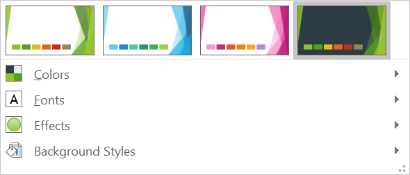

## **Introduzione**

Un tema di presentazione definisce un insieme coordinato di colori, caratteri, stili di sfondo, riempimenti, linee ed effetti. Gli oggetti sensibili al tema fanno riferimento a queste definizioni condivise invece di memorizzare ogni proprietà visiva come valore fisso, così una modifica del tema può aggiornare molti oggetti contemporaneamente.

In Aspose.Slides, il tema a livello di presentazione è disponibile tramite la proprietà [Presentation.MasterTheme](https://reference.aspose.com/slides/net/aspose.slides/presentation/mastertheme/). Una presentazione può anche contenere sovrascritture del tema a livelli inferiori. Un master può sovrascrivere il tema della presentazione tramite [MasterThemeManager.OverrideTheme](https://reference.aspose.com/slides/net/aspose.slides.theme/masterthememanager/overridetheme/), un layout può sovrascrivere il tema ereditato tramite [BaseOverrideThemeManager.OverrideTheme](https://reference.aspose.com/slides/net/aspose.slides.theme/baseoverridethememanager/overridetheme/), e una singola diapositiva può fare lo stesso. In pratica, il tema effettivo per una diapositiva è risolto attraverso questa catena di ereditarietà: tema della presentazione, sovrascrizione del master, sovrascrizione del layout e sovrascrizione della diapositiva.



Le sezioni seguenti mostrano i flussi di lavoro più comuni per i temi: ispezionare un tema, cambiare colori e caratteri, copiare o applicare un tema, aggiornare gli stili di sfondo ed effetti, e leggere i valori effettivi dopo che ereditarietà e sovrascritture sono state risolte.

## **Ispezionare un tema**

L'oggetto [MasterTheme](https://reference.aspose.com/slides/net/aspose.slides.theme/mastertheme/) espone la [ColorScheme](https://reference.aspose.com/slides/net/aspose.slides.theme/mastertheme/colorscheme/), la [FontScheme](https://reference.aspose.com/slides/net/aspose.slides.theme/mastertheme/fontscheme/) e la [FormatScheme](https://reference.aspose.com/slides/net/aspose.slides.theme/mastertheme/formatscheme/) del tema. Ispezionare queste collezioni prima di modificarle è particolarmente utile quando una presentazione proviene da una fonte esterna, perché il numero e il contenuto delle voci di stile possono variare.

L'esempio seguente legge le principali proprietà del tema e riporta quante impostazioni di sfondo, riempimento, linea ed effetto sono archiviate nel tema:

```csharp
using System;
using Aspose.Slides;

using var presentation = new Presentation("input.pptx");
var theme = presentation.MasterTheme;

Console.WriteLine($"Theme name: {theme.Name}");
Console.WriteLine($"Accent 1: {theme.ColorScheme.Accent1.Color}");
Console.WriteLine($"Major Latin font: {theme.FontScheme.Major.LatinFont.FontName}");
Console.WriteLine($"Minor Latin font: {theme.FontScheme.Minor.LatinFont.FontName}");
Console.WriteLine($"Background fill styles: {theme.FormatScheme.BackgroundFillStyles.Count}");
Console.WriteLine($"Fill styles: {theme.FormatScheme.FillStyles.Count}");
Console.WriteLine($"Line styles: {theme.FormatScheme.LineStyles.Count}");
Console.WriteLine($"Effect styles: {theme.FormatScheme.EffectStyles.Count}");
```

Se un file utilizza più master, non presumere che ogni diapositiva abbia lo stesso tema effettivo. Ispeziona il master associato alla diapositiva e usa il flusso di lavoro sul tema effettivo mostrato più avanti in questo articolo quando potrebbero essere presenti sovrascritture a livello di layout o diapositiva.

## **Modificare i colori del tema**

I riempimenti, le linee e il testo sensibili al tema possono fare riferimento a un colore logico della enumerazione [SchemeColor](https://reference.aspose.com/slides/net/aspose.slides/schemecolor/). Quando si cambia la voce corrispondente nella [IColorScheme](https://reference.aspose.com/slides/net/aspose.slides.theme/icolorscheme/) del tema, tutti gli oggetti che fanno ancora riferimento a quel colore del tema sono risolti contro il nuovo valore. Gli oggetti che usano un colore RGB diretto non vengono modificati da un aggiornamento del colore del tema.

L'esempio end‑to‑end seguente crea una forma che utilizza `Accent4`, cambia il colore `Accent4` del tema in rosso, salva la presentazione, la riapre e stampa il colore di riempimento effettivo:

```csharp
using System;
using System.Drawing;
using Aspose.Slides;
using Aspose.Slides.Export;

using var presentation = new Presentation();
var slide = presentation.Slides[0];

var shape = slide.Shapes.AddAutoShape(ShapeType.Rectangle, 10, 10, 100, 100);
shape.FillFormat.FillType = FillType.Solid;
shape.FillFormat.SolidFillColor.SchemeColor = SchemeColor.Accent4;

presentation.MasterTheme.ColorScheme.Accent4.Color = Color.Red;
presentation.Save("theme-color.pptx", SaveFormat.Pptx);

using var savedPresentation = new Presentation("theme-color.pptx");
var savedSlide = savedPresentation.Slides[0];
var savedShape = savedSlide.Shapes[0];
var effectiveFill = savedShape.FillFormat.GetEffective();
Console.WriteLine($"Effective fill color: {effectiveFill.SolidFillColor}");
```

Poiché il rettangolo rimane collegato a `Accent4`, il suo colore visibile diventa rosso dopo la modifica del tema. Se sostituisci il colore di schema con un colore diretto sulla forma, le modifiche successive a `Accent4` non influenzeranno più quel riempimento.

### **Utilizzare i colori dalla tavolozza aggiuntiva**

PowerPoint deriva varianti più chiare e più scure da un colore del tema applicando trasformazioni di colore. Aspose.Slides espone queste trasformazioni tramite [ColorTransformOperation](https://reference.aspose.com/slides/net/aspose.slides/colortransformoperation/).


**1** – colori principali del tema.

**2** – varianti più chiare e più scure prodotte dai colori principali del tema.

L'esempio seguente crea sei rettangoli basati su `Accent4`, applica trasformazioni di luminanza a cinque di essi e salva il risultato:

```csharp
using Aspose.Slides;
using Aspose.Slides.Export;

using var presentation = new Presentation();
var slide = presentation.Slides[0];

var shape1 = slide.Shapes.AddAutoShape(ShapeType.Rectangle, 10, 10, 50, 50);
shape1.FillFormat.FillType = FillType.Solid;
shape1.FillFormat.SolidFillColor.SchemeColor = SchemeColor.Accent4;

var shape2 = slide.Shapes.AddAutoShape(ShapeType.Rectangle, 10, 70, 50, 50);
shape2.FillFormat.FillType = FillType.Solid;
shape2.FillFormat.SolidFillColor.SchemeColor = SchemeColor.Accent4;
shape2.FillFormat.SolidFillColor.ColorTransform.Add(ColorTransformOperation.MultiplyLuminance, 0.2f);
shape2.FillFormat.SolidFillColor.ColorTransform.Add(ColorTransformOperation.AddLuminance, 0.8f);

var shape3 = slide.Shapes.AddAutoShape(ShapeType.Rectangle, 10, 130, 50, 50);
shape3.FillFormat.FillType = FillType.Solid;
shape3.FillFormat.SolidFillColor.SchemeColor = SchemeColor.Accent4;
shape3.FillFormat.SolidFillColor.ColorTransform.Add(ColorTransformOperation.MultiplyLuminance, 0.4f);
shape3.FillFormat.SolidFillColor.ColorTransform.Add(ColorTransformOperation.AddLuminance, 0.6f);

var shape4 = slide.Shapes.AddAutoShape(ShapeType.Rectangle, 10, 190, 50, 50);
shape4.FillFormat.FillType = FillType.Solid;
shape4.FillFormat.SolidFillColor.SchemeColor = SchemeColor.Accent4;
shape4.FillFormat.SolidFillColor.ColorTransform.Add(ColorTransformOperation.MultiplyLuminance, 0.6f);
shape4.FillFormat.SolidFillColor.ColorTransform.Add(ColorTransformOperation.AddLuminance, 0.4f);

var shape5 = slide.Shapes.AddAutoShape(ShapeType.Rectangle, 10, 250, 50, 50);
shape5.FillFormat.FillType = FillType.Solid;
shape5.FillFormat.SolidFillColor.SchemeColor = SchemeColor.Accent4;
shape5.FillFormat.SolidFillColor.ColorTransform.Add(ColorTransformOperation.MultiplyLuminance, 0.75f);

var shape6 = slide.Shapes.AddAutoShape(ShapeType.Rectangle, 10, 310, 50, 50);
shape6.FillFormat.FillType = FillType.Solid;
shape6.FillFormat.SolidFillColor.SchemeColor = SchemeColor.Accent4;
shape6.FillFormat.SolidFillColor.ColorTransform.Add(ColorTransformOperation.MultiplyLuminance, 0.5f);

presentation.Save("theme-color-palette.pptx", SaveFormat.Pptx);
```

Queste varianti rimangono basate sul colore del tema. Se `Accent4` cambia in seguito, i colori trasformati vengono ricalcolati dal nuovo valore `Accent4`.

### **Mappare i valori `SchemeColor` negli slot `IColorScheme`**

L'enumerazione [SchemeColor](https://reference.aspose.com/slides/net/aspose.slides/schemecolor/) utilizza `Text1`, `Background1`, `Text2` e `Background2`, mentre [IColorScheme](https://reference.aspose.com/slides/net/aspose.slides.theme/icolorscheme/) espone gli stessi slot del tema come `Dark1`, `Light1`, `Dark2` e `Light2`. La mappatura è fissa:

* `Text1` = `Dark1`
* `Background1` = `Light1`
* `Text2` = `Dark2`
* `Background2` = `Light2`

Questi sono nomi alternativi per gli stessi slot del tema; non sono valori convertiti dinamicamente da una forma all'altra.

## **Modificare i caratteri del tema**

Uno schema di caratteri del tema contiene un set di caratteri principale per i titoli e un set secondario per il corpo del testo. Le proprietà [FontScheme.Major](https://reference.aspose.com/slides/net/aspose.slides.theme/fontscheme/major/) e [FontScheme.Minor](https://reference.aspose.com/slides/net/aspose.slides.theme/fontscheme/minor/) espongono tali set.

Gli identificatori di caratteri del tema compatibili con PowerPoint possono essere usati nella formattazione del testo:

* `+mn-lt` – Carattere del corpo Latin (Minor Latin Font)
* `+mj-lt` – Carattere del titolo Latin (Major Latin Font)
* `+mn-ea` – Carattere del corpo East Asian (Minor East Asian Font)
* `+mj-ea` – Carattere del titolo East Asian (Major East Asian Font)
* `+mn-cs` – Carattere del corpo Complex Script (Minor Complex Script Font)
* `+mj-cs` – Carattere del titolo Complex Script (Major Complex Script Font)

L'esempio seguente crea un titolo che utilizza il carattere Latin principale del tema e una riga di corpo che utilizza il carattere Latin secondario del tema. Quindi modifica i caratteri del tema e salva il risultato:

```csharp
using Aspose.Slides;
using Aspose.Slides.Export;

using var presentation = new Presentation();
var slide = presentation.Slides[0];

var heading = slide.Shapes.AddAutoShape(ShapeType.Rectangle, 40, 40, 500, 60);
heading.TextFrame.Text = "Theme heading";
heading.TextFrame.Paragraphs[0].Portions[0].PortionFormat.LatinFont = new FontData("+mj-lt");

var body = slide.Shapes.AddAutoShape(ShapeType.Rectangle, 40, 120, 500, 60);
body.TextFrame.Text = "Theme body text";
body.TextFrame.Paragraphs[0].Portions[0].PortionFormat.LatinFont = new FontData("+mn-lt");

presentation.MasterTheme.FontScheme.Major.LatinFont = new FontData("Aptos Display");
presentation.MasterTheme.FontScheme.Minor.LatinFont = new FontData("Arial");

presentation.Save("theme-fonts.pptx", SaveFormat.Pptx);
```

Il titolo segue il carattere principale e il corpo segue il carattere secondario. Il testo che ha un nome di carattere esplicito invece di un identificatore del tema non cambierà automaticamente quando lo schema di caratteri del tema cambia.

Le collezioni di caratteri principali e secondari possono contenere anche mappature di caratteri per singoli sistemi di scrittura, come cirillico, arabo, giapponese, georgiano e thaana. Per ispezionare, aggiungere, sostituire o rimuovere queste mappature, vedere [Script‑Specific Theme Fonts](/slides/it/net/script-specific-font-mappings/).

{}
Per ulteriori informazioni sui caratteri di presentazione, vedere [PowerPoint Fonts](/slides/it/net/powerpoint-fonts/).
{}

### **Risolvere i riferimenti ai caratteri del tema**

Durante l'ispezione del testo, [IFontData.FontName](https://reference.aspose.com/slides/net/aspose.slides/ifontdata/fontname/) può contenere un riferimento al tema come `+mn-lt` invece del nome della famiglia di caratteri. Chiamare [IFontData.GetFontName](https://reference.aspose.com/slides/net/aspose.slides/ifontdata/getfontname/) con il relativo [IThemeEffectiveData](https://reference.aspose.com/slides/net/aspose.slides.theme/ithemeeffectivedata/) per risolvere quel riferimento. I prefissi `+mj` e `+mn` selezionano i set di caratteri principali e secondari; i suffissi `-lt`, `-ea` e `-cs` selezionano i rispettivi caratteri Latin, East Asian e Complex Script.

Ottenere il tema effettivo tramite [IThemeable.CreateThemeEffective](https://reference.aspose.com/slides/net/aspose.slides.theme/ithemeable/createthemeeffective/) sull'oggetto a cui si applica il tema del testo ispezionato. Per il testo ordinario su una diapositiva, usare `slide.CreateThemeEffective()` così il contesto include il tema ereditato da quella diapositiva e le sovrascritture locali. Quando si ispeziona un layout o un master, usare il proprio tema effettivo. Non presumere che il tema del primo master si applichi a tutte le diapositive.

L'esempio seguente crea una porzione di testo che fa esplicitamente riferimento al carattere Latin secondario. Inizializza lo schema di caratteri della diapositiva tramite [IOverrideTheme.InitFontSchemeFromInherited](https://reference.aspose.com/slides/net/aspose.slides.theme/ioverridetheme/initfontschemefrominherited/) e imposta le famiglie Latin principali e secondarie su `Arial` e `Calibri`, rendendo il risultato riproducibile senza un file di ingresso.

```csharp
using System;
using Aspose.Slides;

using var presentation = new Presentation();
var slide = presentation.Slides[0];

var theme = slide.ThemeManager.OverrideTheme;
theme.InitFontSchemeFromInherited();
theme.FontScheme.Major.LatinFont = new FontData("Arial");
theme.FontScheme.Minor.LatinFont = new FontData("Calibri");

var shape = slide.Shapes.AddAutoShape(ShapeType.Rectangle, 20, 20, 400, 60);
shape.TextFrame.Text = "Text using the minor theme font";

var portion = shape.TextFrame.Paragraphs[0].Portions[0];
portion.PortionFormat.LatinFont = new FontData("+mn-lt");

var font = portion.PortionFormat.LatinFont;
var effectiveTheme = slide.CreateThemeEffective();
Console.WriteLine($"{font.FontName} -> {font.GetFontName(effectiveTheme)}");

var explicitFont = new FontData("Verdana");
Console.WriteLine($"{explicitFont.FontName} -> {explicitFont.GetFontName(effectiveTheme)}");
```

L'output è `+mn-lt -> Calibri` seguito da `Verdana -> Verdana`. Il riferimento memorizzato rimane invariato, mentre un nome di famiglia esplicito è restituito così com'è. Se la porzione avesse usato `+mj-lt`, sarebbe stata risolta in `Arial` in questo tema.

Risolvere un riferimento al tema identifica la famiglia di caratteri specificata dal tema. Non verifica la disponibilità del carattere né determina il file di carattere effettivamente usato dopo la sostituzione o il fallback di glifi durante il rendering. Vedere [Font Selection Sequence](/slides/it/net/font-selection-sequence/) e [Font Substitution](/slides/it/net/font-substitution/) per quei passaggi separati.

## **Copiare o applicare un tema**

I flussi di lavoro seguenti risolvono diversi problemi legati al tema.

### **Applicare un tema esterno alle diapositive dipendenti da un master**

Usare [IMasterSlide.ApplyExternalThemeToDependingSlides](https://reference.aspose.com/slides/net/aspose.slides/imasterslide/applyexternalthemetodependingslides/) quando si dispone di un file tema PowerPoint (`.thmx`) e si desidera ridisegnare tutte le diapositive che dipendono da un determinato master. Selezionare il master dalla collezione [Presentation.Masters](https://reference.aspose.com/slides/net/aspose.slides/presentation/masters/), che implementa [IMasterSlideCollection](https://reference.aspose.com/slides/net/aspose.slides/imasterslidecollection/), e passare il percorso del file tema al metodo.

Il metodo esegue le seguenti operazioni:

1. Crea un nuovo master slide basato sul master selezionato.  
2. Applica il tema esterno al nuovo master.  
3. Assegna il nuovo master a tutte le diapositive che precedentemente dipendevano dal master selezionato.  
4. Restituisce il nuovo [IMasterSlide](https://reference.aspose.com/slides/net/aspose.slides/imasterslide/).

L'esempio seguente applica un tema esterno alle diapositive che dipendono dal primo master, salva la presentazione e riapre il risultato:

```csharp
using System;
using Aspose.Slides;
using Aspose.Slides.Export;

using var presentation = new Presentation("presentation.pptx");
var selectedMaster = presentation.Masters[0];

var themedMaster = selectedMaster.ApplyExternalThemeToDependingSlides("corporate-theme.thmx");
Console.WriteLine($"Created master: {themedMaster.Name}");

presentation.Save("presentation-with-external-theme.pptx", SaveFormat.Pptx);
```

Un tema non valido, corrotto o non supportato può generare una [PptxException](https://reference.aspose.com/slides/net/aspose.slides/pptxexception/) o una delle sue sottoclassi legate al formato. Convalidare i percorsi forniti dagli utenti, gestire i fallimenti di accesso al file system e salvare la presentazione solo dopo che il tema è stato applicato correttamente.

Solo le diapositive che dipendevano dal master selezionato vengono riassegnate. Le diapositive associate ad altri master mantengono i loro master e temi esistenti. I colori, i caratteri, i riempimenti, le linee, gli sfondi e gli effetti sensibili al tema sono risolti contro il tema esterno. I colori, i caratteri, i riempimenti e le altre formattazioni assegnate direttamente possono rimanere invariati. Le sovrascritture a livello di layout e diapositiva possono anche avere la precedenza sui valori ereditati dal nuovo master.

Il tema può fare riferimento a caratteri non disponibili nell'ambiente di runtime. Per una resa e un'esportazione coerenti, installare i caratteri richiesti, fornirli tramite [custom font sources](/slides/it/net/custom-font/), o configurare la [font substitution](/slides/it/net/font-substitution/).

Questo è un flusso di lavoro diretto a livello di master: il metodo accetta un percorso file a un file `.thmx` e non richiede la creazione manuale di sovrascritture di tema a livello di layout o diapositiva.

### **Applicare temi esterni diversi in una presentazione multi‑master**

Quando il master rilevante non è noto in anticipo, ottenerlo da una diapositiva rappresentativa tramite [ISlide.LayoutSlide](https://reference.aspose.com/slides/net/aspose.slides/islide/layoutslide/) e [ILayoutSlide.MasterSlide](https://reference.aspose.com/slides/net/aspose.slides/ilayoutslide/masterslide/). Conservare i riferimenti ai master originali prima di applicare qualsiasi tema perché ogni chiamata crea un altro master nella presentazione.

L'esempio seguente utilizza diapositive da due sezioni per individuare i loro master e applica un tema esterno diverso a ciascun gruppo:

```csharp
using System;
using Aspose.Slides;
using Aspose.Slides.Export;

using var presentation = new Presentation("multi-master-presentation.pptx");

if (presentation.Slides.Count < 5)
{
    Console.WriteLine("The presentation does not contain the expected representative slides.");
}
else
{
    var firstGroupMaster = presentation.Slides[0].LayoutSlide.MasterSlide;
    var secondGroupMaster = presentation.Slides[4].LayoutSlide.MasterSlide;

    if (ReferenceEquals(firstGroupMaster, secondGroupMaster))
    {
        Console.WriteLine("The representative slides use the same master.");
    }
    else
    {
        var firstThemedMaster = firstGroupMaster.ApplyExternalThemeToDependingSlides("blue-theme.thmx");
        var secondThemedMaster = secondGroupMaster.ApplyExternalThemeToDependingSlides("green-theme.thmx");

        Console.WriteLine($"First themed master: {firstThemedMaster.Name}");
        Console.WriteLine($"Second themed master: {secondThemedMaster.Name}");

        presentation.Save("multi-master-with-external-themes.pptx", SaveFormat.Pptx);
    }
}
```

La prima chiamata influisce solo sulle diapositive che dipendevano da `firstGroupMaster`, e la seconda solo su quelle che dipendevano da `secondGroupMaster`. Le diapositive appartenenti a qualsiasi altro master non vengono ridisegnate.

### **Conservare il tema di origine durante lo spostamento delle diapositive**

Se si desidera spostare una diapositiva in un'altra presentazione e conservare il suo design originale, clonare il master di origine nella presentazione di destinazione con [IMasterSlideCollection.AddClone](https://reference.aspose.com/slides/net/aspose.slides/imasterslidecollection/addclone/), quindi clonare la diapositiva con [ISlideCollection.AddClone](https://reference.aspose.com/slides/net/aspose.slides/islidecollection/addclone/) e il master clonato. Questo trasporta il master, i suoi layout e il tema associato insieme.

```csharp
using Aspose.Slides;
using Aspose.Slides.Export;

using var source = new Presentation("source-theme.pptx");
using var target = new Presentation("target.pptx");

var sourceSlide = source.Slides[0];

var sourceMaster = sourceSlide.LayoutSlide.MasterSlide;
var clonedMaster = target.Masters.AddClone(sourceMaster);
target.Slides.AddClone(sourceSlide, clonedMaster, true);

target.Save("theme-preserved.pptx", SaveFormat.Pptx);
```

Questo è il flusso di lavoro consigliato quando la diapositiva di origine deve apparire identica nella destinazione. Clonare semplicemente il contenuto su un master di destinazione non correlato può modificare i colori, i caratteri, gli sfondi e gli effetti guidati dal tema.

### **Applicare i valori del tema a una diapositiva esistente**

Se la diapositiva di destinazione deve rimanere sul proprio master e layout attuali, inizializzare una sovrascrizione a livello di diapositiva dal tema di origine. I metodi [OverrideTheme.InitColorSchemeFrom](https://reference.aspose.com/slides/net/aspose.slides.theme/overridetheme/initcolorschemefrom/), [OverrideTheme.InitFontSchemeFrom](https://reference.aspose.com/slides/net/aspose.slides.theme/overridetheme/initfontschemefrom/) e [OverrideTheme.InitFormatSchemeFrom](https://reference.aspose.com/slides/net/aspose.slides.theme/overridetheme/initformatschemefrom/) copiano i tre componenti principali del tema nella sovrascrittura.

```csharp
using Aspose.Slides;
using Aspose.Slides.Export;

using var source = new Presentation("source-theme.pptx");
using var target = new Presentation("target.pptx");

var targetSlide = target.Slides[0];
var overrideTheme = targetSlide.ThemeManager.OverrideTheme;
overrideTheme.InitColorSchemeFrom(source.MasterTheme.ColorScheme);
overrideTheme.InitFontSchemeFrom(source.MasterTheme.FontScheme);
overrideTheme.InitFormatSchemeFrom(source.MasterTheme.FormatScheme);

target.Save("theme-applied-to-slide.pptx", SaveFormat.Pptx);
```

Questo modifica il tema usato da quella diapositiva senza cambiare il tema ereditato dalle altre diapositive. Per rimuovere la sovrascrizione locale e tornare ai valori ereditati, chiamare [OverrideTheme.Clear](https://reference.aspose.com/slides/net/aspose.slides.theme/overridetheme/clear/).

### **Applicare una sovrascrizione del tema a un layout**

Una sovrascrizione a livello di layout si applica alle diapositive che usano quel layout, a meno che una diapositiva specifica non abbia una propria sovrascrizione. Gli stessi metodi di inizializzazione possono essere usati tramite il [LayoutSlideThemeManager](https://reference.aspose.com/slides/net/aspose.slides.theme/layoutslidethememanager/) del layout:

```csharp
using Aspose.Slides;
using Aspose.Slides.Export;

using var source = new Presentation("source-theme.pptx");
using var target = new Presentation("target.pptx");

var targetLayout = target.Slides[0].LayoutSlide;
var overrideTheme = targetLayout.ThemeManager.OverrideTheme;
overrideTheme.InitColorSchemeFrom(source.MasterTheme.ColorScheme);
overrideTheme.InitFontSchemeFrom(source.MasterTheme.FontScheme);
overrideTheme.InitFormatSchemeFrom(source.MasterTheme.FormatScheme);

target.Save("theme-applied-to-layout.pptx", SaveFormat.Pptx);
```

Usare un tema a livello di master o presentazione quando molti layout e diapositive dovrebbero condividere lo stesso design di base, una sovrascrizione di layout quando una famiglia di layout necessita di uno stile diverso, e una sovrascrizione di diapositiva solo per vere eccezioni. Sovrascritture eccessive a livello di diapositiva rendono più difficili da prevedere i cambiamenti globali del tema.

## **Aggiornare gli stili di sfondo del tema**

I riempimenti di sfondo del tema sono archiviati in [FormatScheme.BackgroundFillStyles](https://reference.aspose.com/slides/net/aspose.slides.theme/formatscheme/backgroundfillstyles/). PowerPoint può presentare più scelte di sfondo nella sua interfaccia rispetto al numero di definizioni di riempimento effettivamente memorizzate in questa collezione perché l'interfaccia può combinare i riempimenti del tema con i colori del tema e altri riferimenti di stile.


Prima di utilizzare uno stile di sfondo, ispezionare la collezione memorizzata e l'attuale [Background.StyleIndex](https://reference.aspose.com/slides/net/aspose.slides/background/styleindex/). `StyleIndex` usa `0` per nessun riempimento tematico; i valori positivi sono riferimenti a stili di sfondo tematici. Questo è diverso dall'indicizzazione diretta della collezione .NET, dove `[0]` indica il primo elemento memorizzato. Non supporre che ogni presentazione contenga lo stesso numero di stili di riempimento di sfondo.

L'esempio seguente riporta il conteggio dei riempimenti di sfondo disponibili, assegna un riferimento di sfondo tematico al primo master e salva la presentazione:

```csharp
using System;
using Aspose.Slides;
using Aspose.Slides.Export;

using var presentation = new Presentation("input.pptx");

var backgroundStyles = presentation.MasterTheme.FormatScheme.BackgroundFillStyles;
Console.WriteLine($"Background fill styles: {backgroundStyles.Count}");

if (backgroundStyles.Count == 0)
{
    throw new InvalidOperationException("The presentation theme does not contain background fill styles.");
}

presentation.Masters[0].Background.Type = BackgroundType.Themed;
presentation.Masters[0].Background.StyleIndex = 1;

presentation.Save("theme-background.pptx", SaveFormat.Pptx);
```

Il risultato visibile dipende dall'elemento di tema a cui fa riferimento il master e da eventuali sovrascritture di sfondo a livello di layout o diapositiva. Se una diapositiva utilizza il proprio sfondo, modificare solo lo sfondo del master potrebbe non cambiare quella diapositiva. Usare [Background.GetEffective](https://reference.aspose.com/slides/net/aspose.slides/background/geteffective/) quando è necessario conoscere lo sfondo finale dopo l'applicazione dell'ereditarietà.

{}
Non trattare `StyleIndex` come un indice di collezione basato su zero. Evita inoltre di codificare un numero di stile da un file e presumere che abbia la stessa apparenza in un altro file; le definizioni di stile del tema sono specifiche della presentazione.
{}

{}
Per la formattazione diretta dello sfondo e l'ereditarietà dello sfondo, vedere [Presentation Background](/slides/it/net/presentation-background/).
{}

## **Aggiornare gli effetti del tema**

Uno schema di formattazione del tema contiene collezioni separate di [FillStyles](https://reference.aspose.com/slides/net/aspose.slides.theme/formatscheme/fillstyles/), [LineStyles](https://reference.aspose.com/slides/net/aspose.slides.theme/formatscheme/linestyles/) e [EffectStyles](https://reference.aspose.com/slides/net/aspose.slides.theme/formatscheme/effectstyles/). I temi tipici di Office contengono spesso tre voci principali che corrispondono visivamente a formattazioni sottili, moderate e intense, ma il codice dovrebbe ispezionare ogni collezione invece di presumere un conteggio fisso.


Quando si accede a queste collezioni in C#, l'indice della collezione è basato su zero: `[0]` è il primo stile memorizzato e `[2]` è il terzo. Gli indici di riferimento di stile di una forma sono un concetto separato, esposto tramite [IShapeStyle](https://reference.aspose.com/slides/net/aspose.slides/ishapestyle/). Modificare uno stile del tema influisce sulle forme che fanno riferimento a quello stile; le forme con formattazione diretta possono rimanere inalterate.

L'esempio seguente verifica che le voci di stile richieste esistano, cambia il primo stile di linea, cambia il terzo stile di riempimento, abilita un'ombra esterna nel terzo stile di effetto e salva il risultato:

```csharp
using System;
using System.Drawing;
using Aspose.Slides;
using Aspose.Slides.Export;

using var presentation = new Presentation("Subtle_Moderate_Intense.pptx");
var formatScheme = presentation.MasterTheme.FormatScheme;

if (formatScheme.LineStyles.Count < 1 || formatScheme.FillStyles.Count < 3 || formatScheme.EffectStyles.Count < 3)
{
    throw new InvalidOperationException("The theme does not contain the style entries required by this example.");
}

formatScheme.LineStyles[0].FillFormat.FillType = FillType.Solid;
formatScheme.LineStyles[0].FillFormat.SolidFillColor.Color = Color.Red;
formatScheme.FillStyles[2].FillType = FillType.Solid;
formatScheme.FillStyles[2].SolidFillColor.Color = Color.ForestGreen;
formatScheme.EffectStyles[2].EffectFormat.EnableOuterShadowEffect();
formatScheme.EffectStyles[2].EffectFormat.OuterShadowEffect.Distance = 10f;

presentation.Save("theme-effects.pptx", SaveFormat.Pptx);
```

Per le forme che fanno riferimento a questi slot, il primo stile di linea del tema diventa rosso, il terzo stile di riempimento del tema diventa verde foresta solido, e il terzo stile di effetto ottiene un'ombra esterna con distanza di 10 punti. Il risultato visivo esatto dipende comunque da quali slot di stile ogni forma riferisce e se una formattazione diretta sovrascrive il tema.


## **Selezionare gli stili di riempimento e linea del tema per una forma**

Una forma può selezionare il proprio riempimento e contorno indipendentemente tramite [FillStyleIndex](https://reference.aspose.com/slides/net/aspose.slides/ishapestyle/fillstyleindex/) e [LineStyleIndex](https://reference.aspose.com/slides/net/aspose.slides/ishapestyle/linestyleindex/). Per entrambe le proprietà, l'indice `1` seleziona la prima voce nella collezione tematica corrispondente (`FillStyles[0]` o `LineStyles[0]`), e l'indice `2` seleziona la seconda voce.

L'esempio seguente imposta due stili di riempimento (oro e azzurro cielo) e due stili di linea (blu scuro a 6 pt e rosso scuro a 12 pt) nel tema predefinito di una nuova presentazione. Salva la diapositiva in tre fasi così è possibile confrontare i risultati in PowerPoint.

```csharp
using System.Drawing;
using Aspose.Slides;
using Aspose.Slides.Export;

using var presentation = new Presentation();
var styles = presentation.MasterTheme.FormatScheme;

var goldFill = styles.FillStyles[0];
goldFill.FillType = FillType.Solid;
goldFill.SolidFillColor.Color = Color.Gold;
var blueFill = styles.FillStyles[1];
blueFill.FillType = FillType.Solid;
blueFill.SolidFillColor.Color = Color.SkyBlue;

var thinLine = styles.LineStyles[0];
thinLine.FillFormat.FillType = FillType.Solid;
thinLine.FillFormat.SolidFillColor.Color = Color.DarkBlue;
thinLine.Width = 6;
var thickLine = styles.LineStyles[1];
thickLine.FillFormat.FillType = FillType.Solid;
thickLine.FillFormat.SolidFillColor.Color = Color.DarkRed;
thickLine.Width = 12;

var shapes = presentation.Slides[0].Shapes;
var left = shapes.AddAutoShape(ShapeType.Rectangle, 100, 205, 200, 130);
var right = shapes.AddAutoShape(ShapeType.Rectangle, 420, 205, 200, 130);
left.ShapeStyle.FillStyleIndex = 1;
right.ShapeStyle.FillStyleIndex = 2;
left.ShapeStyle.LineStyleIndex = 1;
right.ShapeStyle.LineStyleIndex = 1;
presentation.Save("01-initial.pptx", SaveFormat.Pptx);

right.ShapeStyle.LineStyleIndex = 2;
presentation.Save("02-line-changed.pptx", SaveFormat.Pptx);

goldFill.SolidFillColor.Color = Color.SeaGreen;
presentation.Save("03-theme-changed.pptx", SaveFormat.Pptx);
```

| Stili iniziali | Cambiare il contorno destro | Modificare il primo riempimento tematico |
|:---:|:---:|:---:|
|  |  |  |

Selezionare uno stile di linea diverso cambia solo il contorno del rettangolo destro. Modificare il primo riempimento tematico aggiorna ogni forma che lo utilizza. Qui, solo il rettangolo sinistro diventa verde.

Su una forma esistente, un colore di riempimento locale, colore della linea o spessore della linea può sovrascrivere quella parte dello stile tematico. Se cambiare un indice di stile non produce alcun effetto visivo, verificare la [formattazione diretta](/slides/it/net/shape-formatting/) della forma.

## **Determinare se un riempimento solido effettivo utilizza un colore del tema**

Un riempimento può essere memorizzato direttamente su un oggetto o ereditato da un paragrafo, layout, master, stile del tema o un altro livello di formattazione. Chiamare [IFillFormat.GetEffective](https://reference.aspose.com/slides/net/aspose.slides/ifillformat/geteffective/) per risolvere quella gerarchia in un [IFillFormatEffectiveData](https://reference.aspose.com/slides/net/aspose.slides/ifillformateffectivedata/) immutabile. Prima controllare [IFillFormatEffectiveData.FillType](https://reference.aspose.com/slides/net/aspose.slides/ifillformateffectivedata/filltype/). Solo quando è `FillType.Solid` si dovrebbero leggere le proprietà del riempimento solido.

Per un riempimento solido, [IFillFormatEffectiveData.SolidFillColor](https://reference.aspose.com/slides/net/aspose.slides/ifillformateffectivedata/solidfillcolor/) restituisce il valore RGB finale renderizzato dopo ereditarietà, ricerca del tema e trasformazioni di colore. [IFillFormatEffectiveData.SolidFillSchemeColor](https://reference.aspose.com/slides/net/aspose.slides/ifillformateffectivedata/solidfillschemecolor/) restituisce lo slot logico [SchemeColor](https://reference.aspose.com/slides/net/aspose.slides/schemecolor/) corrispondente, ad esempio `Text1` o `Accent6`. Un valore `SchemeColor.NotDefined` significa che il riempimento solido effettivo non si basa su un colore di schema. In un flusso di lavoro in cui i riempimenti sono o colori del tema o colori RGB diretti, questo valore identifica un riempimento RGB diretto.

Non usare il valore locale [IColorFormat.SchemeColor](https://reference.aspose.com/slides/net/aspose.slides/icolorformat/schemecolor/) da solo per classificare un riempimento. Per esempio, una porzione di testo può non avere un colore di schema definito localmente, quindi il suo valore locale è `NotDefined`, mentre il suo riempimento effettivo eredita un colore del tema e si risolve in `Text1` o `Accent6`. Al contrario, `SolidFillSchemeColor` indica quale slot logico del tema ha prodotto il colore effettivo, ma non dice da quale livello (oggetto, paragrafo, layout, master, ecc.) provenga.

L'esempio seguente carica una presentazione, controlla sia i riempimenti delle forme che quelli delle porzioni di testo, stampa ogni valore RGB finale e lo schema associato, e segnala i riempimenti solidi che non seguiranno le modifiche ai colori del tema:

```csharp
using System;
using Aspose.Slides;

using var presentation = new Presentation("input.pptx");

var slideCount = presentation.Slides.Count;
for (var slideIndex = 0; slideIndex < slideCount; slideIndex++)
{
    var slide = presentation.Slides[slideIndex];

    var shapeCount = slide.Shapes.Count;
    for (var shapeIndex = 0; shapeIndex < shapeCount; shapeIndex++)
    {
        var shape = slide.Shapes[shapeIndex];
        var shapeName = $"Slide {slideIndex + 1}, shape {shapeIndex + 1}";
        AuditFill(shapeName, shape.FillFormat);

        if (shape is IAutoShape autoShape)
        {
            var paragraphCount = autoShape.TextFrame.Paragraphs.Count;
            for (var paragraphIndex = 0; paragraphIndex < paragraphCount; paragraphIndex++)
            {
                var paragraph = autoShape.TextFrame.Paragraphs[paragraphIndex];

                var portionCount = paragraph.Portions.Count;
                for (var portionIndex = 0; portionIndex < portionCount; portionIndex++)
                {
                    var portion = paragraph.Portions[portionIndex];
                    var portionName = $"{shapeName}, paragraph {paragraphIndex + 1}, portion {portionIndex + 1}";
                    AuditFill(portionName, portion.PortionFormat.FillFormat);
                }
            }
        }
    }
}

static void AuditFill(string objectName, IFillFormat localFill)
{
    var effectiveFill = localFill.GetEffective();

    if (effectiveFill.FillType != FillType.Solid)
    {
        Console.WriteLine($"{objectName}: fill type = {effectiveFill.FillType}; not a solid fill.");
        return;
    }

    var rgb = effectiveFill.SolidFillColor;
    var effectiveSchemeColor = effectiveFill.SolidFillSchemeColor;
    var localSchemeColor = localFill.SolidFillColor.SchemeColor;

    Console.WriteLine($"{objectName}: RGB = #{rgb.R:X2}{rgb.G:X2}{rgb.B:X2}");
    Console.WriteLine($"{objectName}: local scheme = {localSchemeColor}, effective scheme = {effectiveSchemeColor}");

    if (effectiveSchemeColor == SchemeColor.NotDefined)
    {
        Console.WriteLine($"{objectName}: direct RGB or another non-scheme fill; audit as theme-independent.");
    }
    else
    {
        Console.WriteLine($"{objectName}: theme-dependent through {effectiveSchemeColor}.");
    }
}
```

Il ramo `NotDefined` fornisce un elenco di audit dei riempimenti solidi che non risponderanno a cambiamenti negli slot di colore del tema. Rivedere quegli oggetti quando una presentazione deve seguire una nuova tavolozza di brand. Il valore RGB riportato mostra comunque l'aspetto corrente, mentre il valore di schema spiega se quell'aspetto è collegato al tema.

Gli oggetti di formato efficace sono istantanee. Dopo aver cambiato il tema della presentazione, una sovrascrizione del tema o qualsiasi formattazione ereditata, chiamare nuovamente `GetEffective` e leggere un nuovo oggetto `IFillFormatEffectiveData` prima di confrontare o riportare i colori.

## **Leggere i valori del tema effettivo**

Gli oggetti tema grezzi indicano ciò che è definito a un determinato livello. I valori effettivi indicano ciò che una diapositiva o una forma usa realmente dopo che ereditarietà e sovrascritture locali sono state risolte. Per una diapositiva, chiamare [BaseOverrideThemeManager.CreateThemeEffective](https://reference.aspose.com/slides/net/aspose.slides.theme/baseoverridethememanager/createthemeeffective/). Per uno sfondo, usare [Background.GetEffective](https://reference.aspose.com/slides/net/aspose.slides/background/geteffective/), e per un riempimento, usare [FillFormat.GetEffective](https://reference.aspose.com/slides/net/aspose.slides/fillformat/geteffective/).

L'esempio seguente legge il tema effettivo, lo sfondo e il primo riempimento della forma da una diapositiva:

```csharp
using System;
using Aspose.Slides;

using var presentation = new Presentation("input.pptx");
var slide = presentation.Slides[0];

var effectiveTheme = slide.ThemeManager.CreateThemeEffective();
var effectiveBackground = slide.Background.GetEffective();

Console.WriteLine($"Effective major Latin font: {effectiveTheme.FontScheme.Major.LatinFont.FontName}");
Console.WriteLine($"Effective minor Latin font: {effectiveTheme.FontScheme.Minor.LatinFont.FontName}");
Console.WriteLine($"Effective background fill type: {effectiveBackground.FillFormat.FillType}");

if (slide.Shapes.Count > 0)
{
    var effectiveFill = slide.Shapes[0].FillFormat.GetEffective();
    Console.WriteLine($"First shape effective fill type: {effectiveFill.FillType}");
    if (effectiveFill.FillType == FillType.Solid)
    {
        Console.WriteLine($"First shape effective fill color: {effectiveFill.SolidFillColor}");
    }
}
```

Usare i dati effettivi per diagnostica di rendering, convalida e confronti. Se si ispeziona solo [Presentation.MasterTheme](https://reference.aspose.com/slides/net/aspose.slides/presentation/mastertheme/), si rischia di perdere un master, layout, diapositiva o sovrascrizione di forma che cambi l'aspetto finale.

## **FAQ**

**L'applicazione di un tema esterno influisce su ogni diapositiva della presentazione?**

No. [IMasterSlide.ApplyExternalThemeToDependingSlides](https://reference.aspose.com/slides/net/aspose.slides/imasterslide/applyexternalthemetodependingslides/) riassegna solo le diapositive che dipendono dal master selezionato. Le diapositive che usano altri master mantengono i loro temi esistenti.

**Posso applicare un tema a una singola diapositiva senza cambiare il master?**

Sì. Utilizzare il [SlideThemeManager](https://reference.aspose.com/slides/net/aspose.slides.theme/slidethememanager/) della diapositiva e inizializzare la sua sovrascrizione del tema. La modifica rimane locale a quella diapositiva; le altre diapositive continuano a ereditare i loro temi esistenti.

**Qual è il modo più sicuro per trasferire un tema da una presentazione all'altra?**

Quando si sposta una diapositiva e si preserva l'aspetto di origine, clonare il master di origine nella destinazione e clonare la diapositiva con quel master usando [IMasterSlideCollection.AddClone](https://reference.aspose.com/slides/net/aspose.slides/imasterslidecollection/addclone/) e [ISlideCollection.AddClone](https://reference.aspose.com/slides/net/aspose.slides/islidecollection/addclone/). Questo mantiene insieme master, layout e tema.

**Come posso vedere i valori effettivi dopo ereditarietà e sovrascritture?**

Usare [BaseOverrideThemeManager.CreateThemeEffective](https://reference.aspose.com/slides/net/aspose.slides.theme/baseoverridethememanager/createthemeeffective/) per una diapositiva o un tema di layout e i metodi corrispondenti di dati effettivi per oggetti di formato come [Background.GetEffective](https://reference.aspose.com/slides/net/aspose.slides/background/geteffective/) e [FillFormat.GetEffective](https://reference.aspose.com/slides/net/aspose.slides/fillformat/geteffective/). queste API restituiscono i valori risolti dopo che ereditarietà e sovrascritture sono state applicate.