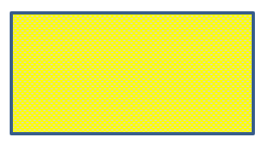

## **Introduzione**

Formatta le forme in PowerPoint regolando i loro contorni, i riempimenti e gli effetti. Aspose.Slides per Node.js tramite Java consente di controllare queste impostazioni in modo programmatico, inclusi trasparenza, rotazione e formattazione 3D.


Aspose.Slides per Node.js tramite Java fornisce classi e metodi che permettono di formattare le forme utilizzando le stesse opzioni disponibili in PowerPoint.

## **Formattare le linee**

Utilizza [Shape.getLineFormat](https://reference.aspose.com/slides/nodejs-java/aspose.slides/shape/#getLineFormat) per controllare il contorno di una forma. Questo esempio crea un rettangolo non riempito con un contorno blu tratteggiato. [LineFormat.setStyle](https://reference.aspose.com/slides/nodejs-java/aspose.slides/lineformat/#setStyle) seleziona una linea composta spessa‑sottile, mentre [LineFormat.setWidth](https://reference.aspose.com/slides/nodejs-java/aspose.slides/lineformat/#setWidth) imposta la larghezza a 7 punti e [LineFormat.setDashStyle](https://reference.aspose.com/slides/nodejs-java/aspose.slides/lineformat/#setDashStyle) seleziona il modello di tratteggio.

```javascript
const aspose = { slides: require("aspose.slides.via.java") };
const java = require("java");

let presentation = new aspose.slides.Presentation();
try {
    let slide = presentation.getSlides().get_Item(0);

    let shape = slide.getShapes().addAutoShape(aspose.slides.ShapeType.Rectangle, 50, 50, 150, 75);
    shape.getFillFormat().setFillType(java.newByte(aspose.slides.FillType.NoFill));
    shape.getLineFormat().setStyle(java.newByte(aspose.slides.LineStyle.ThickThin));
    shape.getLineFormat().setWidth(7);
    shape.getLineFormat().setDashStyle(java.newByte(aspose.slides.LineDashStyle.Dash));
    shape.getLineFormat().getFillFormat().setFillType(java.newByte(aspose.slides.FillType.Solid));
    shape.getLineFormat().getFillFormat().getSolidFillColor().setColor(java.getStaticFieldValue("java.awt.Color", "BLUE"));

    presentation.save("formatted_lines.pptx", aspose.slides.SaveFormat.Pptx);
} finally {
    presentation.dispose();
}
```

Il risultato:


### **Imposta modelli di tratteggio personalizzati per le linee**

Utilizza [LineFormat.setCustomDashPattern](https://reference.aspose.com/slides/nodejs-java/aspose.slides/lineformat/#setCustomDashPattern) quando gli stili di linea predefiniti non forniscono le lunghezze di tratto e di interruzione necessarie, ad esempio per contorni a marchio o diagrammi tecnici. L’assegnazione di un modello cambia automaticamente lo stile di tratteggio della linea in [LineDashStyle.Custom](https://reference.aspose.com/slides/nodejs-java/aspose.slides/linedashstyle/).

Gli elementi dell’array alternano lunghezze di tratto e di interruzione, iniziando con un tratto. Ogni valore è un multiplo della larghezza della linea: `[4, 2]` a una larghezza di 3 punti produce un tratto di 12 punti seguito da un’interruzione di 6 punti. Usa coppie di valori finiti e non negativi per definire segmenti completi di tratto‑interruzione. L’esempio utilizza valori positivi per mantenere visibili tutti i tratti e le interruzioni.

Questo esempio crea cinque linee blu della stessa lunghezza e con cap piatti. Le prime tre confrontano i modelli a una larghezza di 3 punti. La quarta ripete il primo modello a doppia larghezza, raddoppiando sia le lunghezze dei tratti sia delle interruzioni. La quinta passa da un modello personalizzato a una linea solida.

```javascript
const aspose = { slides: require("aspose.slides.via.java") };
const java = require("java");

let presentation = new aspose.slides.Presentation();
try {
    presentation.getSlideSize().setSize(600, 300, aspose.slides.SlideSizeScaleType.DoNotScale);
    let slide = presentation.getSlides().get_Item(0);

    let patterns = [
        [4, 2],
        [1, 2],
        [6, 2, 1, 2],
        [4, 2],
        [4, 2]
    ];

    for (let i = 0; i < patterns.length; i++) {
        let line = slide.getShapes().addAutoShape(aspose.slides.ShapeType.Line, 50, 50 + i * 50, 500, 0);
        line.getLineFormat().setWidth(i == 3 ? 6 : 3);
        line.getLineFormat().getFillFormat().setFillType(java.newByte(aspose.slides.FillType.Solid));
        line.getLineFormat().getFillFormat().getSolidFillColor().setColor(java.newInstanceSync("java.awt.Color", 0, 0, 139));
        line.getLineFormat().setCapStyle(java.newByte(aspose.slides.LineCapStyle.Flat));
        line.getLineFormat().setBeginArrowheadStyle(java.newByte(aspose.slides.LineArrowheadStyle.None));
        line.getLineFormat().setEndArrowheadStyle(java.newByte(aspose.slides.LineArrowheadStyle.None));
        let pattern = java.newArray("float", patterns[i]);
        line.getLineFormat().setCustomDashPattern(pattern);
    }

    // Riporta l'ultima linea a uno stile solido.
    slide.getShapes().get_Item(4).getLineFormat().setDashStyle(java.newByte(aspose.slides.LineDashStyle.Solid));

    presentation.save("custom_dash_patterns.pptx", aspose.slides.SaveFormat.Pptx);
} finally {
    presentation.dispose();
}
```

Per tornare a uno stile tratteggiato predefinito, passa [LineDashStyle.Dash](https://reference.aspose.com/slides/nodejs-java/aspose.slides/linedashstyle/) a [LineFormat.setDashStyle](https://reference.aspose.com/slides/nodejs-java/aspose.slides/lineformat/#setDashStyle). Lo stile selezionato controlla l’aspetto della linea.

Il risultato in PowerPoint, dall’alto verso il basso: **{4, 2}, 3 pt**; **{1, 2}, 3 pt**; **{6, 2, 1, 2}, 3 pt**; **{4, 2}, 6 pt**; e **Solid, 3 pt**.


### **Imposta i Cap estremi della linea**

Utilizza [LineFormat.setCapStyle](https://reference.aspose.com/slides/nodejs-java/aspose.slides/lineformat/#setCapStyle) per impostare le estremità di una linea aperta. La classe [LineCapStyle](https://reference.aspose.com/slides/nodejs-java/aspose.slides/linecapstyle/) fornisce tre stili di cap espliciti:

- `Flat`: il tratto si ferma al punto finale.
- `Round`: un cappuccio semicircolare si estende oltre il punto finale di metà larghezza della linea.
- `Square`: un cappuccio quadrato si estende oltre il punto finale di metà larghezza della linea.

La classe comprende anche `NotDefined`, che indica che non è stato assegnato esplicitamente alcun stile di cap.

I cap sono diversi dalle punte freccia, che aggiungono simboli alle estremità della linea, e dalle giunzioni, che controllano gli angoli tra i segmenti della linea. Questo esempio disabilita le punte freccia tramite [LineFormat.setBeginArrowheadStyle](https://reference.aspose.com/slides/nodejs-java/aspose.slides/lineformat/#setBeginArrowheadStyle) e [LineFormat.setEndArrowheadStyle](https://reference.aspose.com/slides/nodejs-java/aspose.slides/lineformat/#setEndArrowheadStyle) in modo che vengano confrontate solo le forme dei cap.

L’esempio seguente crea tre linee orizzontali altrimenti identiche, larghe 20 punti. Dall’alto verso il basso, usano rispettivamente cap piatti, rotondi e quadrati. Le loro estremità hanno le stesse coordinate orizzontali; i cap rotondi e quadrati si estendono di 10 punti oltre ciascuna estremità.

```javascript
const aspose = { slides: require("aspose.slides.via.java") };
const java = require("java");

let presentation = new aspose.slides.Presentation();
try {
    presentation.getSlideSize().setSize(500, 240, aspose.slides.SlideSizeScaleType.DoNotScale);
    let slide = presentation.getSlides().get_Item(0);

    let capStyles = [aspose.slides.LineCapStyle.Flat, aspose.slides.LineCapStyle.Round, aspose.slides.LineCapStyle.Square];

    for (let i = 0; i < capStyles.length; i++) {
        let line = slide.getShapes().addAutoShape(aspose.slides.ShapeType.Line, 100, 50 + i * 70, 300, 0);
        line.getLineFormat().setWidth(20);
        line.getLineFormat().getFillFormat().setFillType(java.newByte(aspose.slides.FillType.Solid));
        line.getLineFormat().getFillFormat().getSolidFillColor().setColor(java.newInstanceSync("java.awt.Color", 0, 0, 139));
        line.getLineFormat().setDashStyle(java.newByte(aspose.slides.LineDashStyle.Solid));
        line.getLineFormat().setCapStyle(java.newByte(capStyles[i]));
        line.getLineFormat().setBeginArrowheadStyle(java.newByte(aspose.slides.LineArrowheadStyle.None));
        line.getLineFormat().setEndArrowheadStyle(java.newByte(aspose.slides.LineArrowheadStyle.None));
    }

    presentation.save("line_caps.pptx", aspose.slides.SaveFormat.Pptx);
} finally {
    presentation.dispose();
}
```

Il risultato in PowerPoint, dall’alto verso il basso: **Flat**, **Round**, e **Square**.


## **Applicare effetti di schizzo alle linee della forma**

Un effetto di schizzo rende una linea della forma simile a una mano libera. Utilizza [Shape.getLineFormat](https://reference.aspose.com/slides/nodejs-java/aspose.slides/shape/#getLineFormat) per accedere alle impostazioni della linea, [LineFormat.getSketchFormat](https://reference.aspose.com/slides/nodejs-java/aspose.slides/lineformat/#getSketchFormat) per accedere alle impostazioni di schizzo e [SketchFormat.setSketchType](https://reference.aspose.com/slides/nodejs-java/aspose.slides/sketchformat/#setSketchType) per selezionare un valore dalla classe [LineSketchType](https://reference.aspose.com/slides/nodejs-java/aspose.slides/linesketchtype/).

Il codice JavaScript seguente mostra come applicare l’effetto [LineSketchType.Curved](https://reference.aspose.com/slides/nodejs-java/aspose.slides/linesketchtype/), leggere il valore assegnato esplicitamente e rimuovere l’effetto con [LineSketchType.None](https://reference.aspose.com/slides/nodejs-java/aspose.slides/linesketchtype/):

```javascript
const aspose = { slides: require("aspose.slides.via.java") };

let presentation = new aspose.slides.Presentation();
try {
    let slide = presentation.getSlides().get_Item(0);

    let shape = slide.getShapes().addAutoShape(aspose.slides.ShapeType.Rectangle, 50, 50, 200, 100);

    let sketchFormat = shape.getLineFormat().getSketchFormat();
    sketchFormat.setSketchType(aspose.slides.LineSketchType.Curved);
    let explicitSketchType = sketchFormat.getSketchType();
    console.log("Explicit sketch type: " + explicitSketchType);
    sketchFormat.setSketchType(aspose.slides.LineSketchType.None);
} finally {
    presentation.dispose();
}
```

Il valore restituito da [SketchFormat.getSketchType](https://reference.aspose.com/slides/nodejs-java/aspose.slides/sketchformat/#getSketchType) rappresenta l’impostazione assegnata direttamente alla forma. Se la formattazione della linea può essere ereditata da un tema, da una diapositiva master o da una diapositiva layout, utilizza [LineFormat.getEffective](https://reference.aspose.com/slides/nodejs-java/aspose.slides/lineformat/#getEffective), chiama `getSketchFormat` sull’oggetto restituito e quindi chiama il suo metodo `getSketchType`. Il valore effettivo riflette la formattazione effettivamente applicata dopo la risoluzione dell’eredità. Questo esempio richiede una presentazione esistente con almeno una forma nella prima diapositiva e stampa entrambi i valori:

```javascript
const aspose = { slides: require("aspose.slides.via.java") };

let presentation = new aspose.slides.Presentation("presentation.pptx");
try {
    let shape = presentation.getSlides().get_Item(0).getShapes().get_Item(0);

    let lineFormat = shape.getLineFormat();
    let explicitSketchType = lineFormat.getSketchFormat().getSketchType();
    let effectiveLineFormat = lineFormat.getEffective();
    let effectiveSketchType = effectiveLineFormat.getSketchFormat().getSketchType();

    console.log("Explicit sketch type: " + explicitSketchType);
    console.log("Effective sketch type: " + effectiveSketchType);
} finally {
    presentation.dispose();
}
```

## **Formattare gli stili di unione**

Ecco le tre opzioni di tipo di unione:

* Round
* Miter
* Bevel

Lo stile di unione controlla come due segmenti di contorno si incontrano in un angolo. Usa **Round** per angoli arrotondati, **Miter** per angoli appuntiti o **Bevel** per angoli smussati.


Questo esempio crea tre rettangoli neri con contorni blu larghi 15 punti. Utilizza [LineFormat.setJoinStyle](https://reference.aspose.com/slides/nodejs-java/aspose.slides/lineformat/#setJoinStyle) per applicare rispettivamente i valori miter, bevel e round di [LineJoinStyle](https://reference.aspose.com/slides/nodejs-java/aspose.slides/linejoinstyle/), al fine di confrontare come vengono disegnati gli angoli.

```javascript
const aspose = { slides: require("aspose.slides.via.java") };
const java = require("java");

let presentation = new aspose.slides.Presentation();
try {
    let slide = presentation.getSlides().get_Item(0);

    let miterShape = slide.getShapes().addAutoShape(aspose.slides.ShapeType.Rectangle, 20, 20, 150, 75);
    let bevelShape = slide.getShapes().addAutoShape(aspose.slides.ShapeType.Rectangle, 210, 20, 150, 75);
    let roundShape = slide.getShapes().addAutoShape(aspose.slides.ShapeType.Rectangle, 20, 135, 150, 75);

    miterShape.getFillFormat().setFillType(java.newByte(aspose.slides.FillType.Solid));
    miterShape.getFillFormat().getSolidFillColor().setColor(java.getStaticFieldValue("java.awt.Color", "BLACK"));
    bevelShape.getFillFormat().setFillType(java.newByte(aspose.slides.FillType.Solid));
    bevelShape.getFillFormat().getSolidFillColor().setColor(java.getStaticFieldValue("java.awt.Color", "BLACK"));
    roundShape.getFillFormat().setFillType(java.newByte(aspose.slides.FillType.Solid));
    roundShape.getFillFormat().getSolidFillColor().setColor(java.getStaticFieldValue("java.awt.Color", "BLACK"));

    miterShape.getLineFormat().setWidth(15);
    bevelShape.getLineFormat().setWidth(15);
    roundShape.getLineFormat().setWidth(15);

    miterShape.getLineFormat().getFillFormat().setFillType(java.newByte(aspose.slides.FillType.Solid));
    miterShape.getLineFormat().getFillFormat().getSolidFillColor().setColor(java.getStaticFieldValue("java.awt.Color", "BLUE"));
    bevelShape.getLineFormat().getFillFormat().setFillType(java.newByte(aspose.slides.FillType.Solid));
    bevelShape.getLineFormat().getFillFormat().getSolidFillColor().setColor(java.getStaticFieldValue("java.awt.Color", "BLUE"));
    roundShape.getLineFormat().getFillFormat().setFillType(java.newByte(aspose.slides.FillType.Solid));
    roundShape.getLineFormat().getFillFormat().getSolidFillColor().setColor(java.getStaticFieldValue("java.awt.Color", "BLUE"));

    miterShape.getLineFormat().setJoinStyle(java.newByte(aspose.slides.LineJoinStyle.Miter));
    bevelShape.getLineFormat().setJoinStyle(java.newByte(aspose.slides.LineJoinStyle.Bevel));
    roundShape.getLineFormat().setJoinStyle(java.newByte(aspose.slides.LineJoinStyle.Round));

    miterShape.getTextFrame().setText("Miter Join Style");
    bevelShape.getTextFrame().setText("Bevel Join Style");
    roundShape.getTextFrame().setText("Round Join Style");

    presentation.save("join_styles.pptx", aspose.slides.SaveFormat.Pptx);
} finally {
    presentation.dispose();
}
```

### **Limita le unioni a cuneo negli angoli affilati**

Utilizza [LineFormat.setMiterLimit](https://reference.aspose.com/slides/nodejs-java/aspose.slides/lineformat/#setMiterLimit) con [LineFormat.setJoinStyle](https://reference.aspose.com/slides/nodejs-java/aspose.slides/lineformat/#setJoinStyle) impostato su [LineJoinStyle.Miter](https://reference.aspose.com/slides/nodejs-java/aspose.slides/linejoinstyle/) per limitare quanto un angolo affilato possa estendersi.

Il limite è un rapporto tra la distanza tra gli angoli interno ed esterno dell’unione e la larghezza della linea. Ad esempio, un valore di `8` consente una lunghezza della cuneo fino a otto volte la larghezza della linea; non è una misura in punti. Se l’angolo dovesse superare il limite, PowerPoint utilizza un’unione smussata in quell’angolo. Un limite più grande permette punte più acute. L’impostazione influisce solo sulle unioni a cuneo e non ha alcun effetto visibile quando l’angolo rimane entro entrambi i limiti.

Questo esempio crea due triangoli non riempiti identici con contorni larghi 20 punti. Il triangolo sinistro usa un limite di `2`, quello destro di `8`. Ogni triangolo è largo 80 punti e alto 160 punti, dando al suo angolo superiore un rapporto lunghezza‑cuneo‑larghezza‑linea di circa `4.12`. Di conseguenza, PowerPoint smussa l’apice sinistro e conserva quello destro.

```javascript
const aspose = { slides: require("aspose.slides.via.java") };
const java = require("java");

let presentation = new aspose.slides.Presentation();
try {
    presentation.getSlideSize().setSize(500, 320, aspose.slides.SlideSizeScaleType.DoNotScale);
    let slide = presentation.getSlides().get_Item(0);

    let miterLimits = [2, 8];

    for (let i = 0; i < miterLimits.length; i++) {
        let triangle = slide.getShapes().addAutoShape(aspose.slides.ShapeType.Triangle, 90 + i * 240, 110, 80, 160);
        triangle.getFillFormat().setFillType(java.newByte(aspose.slides.FillType.NoFill));
        triangle.getLineFormat().setWidth(20);
        triangle.getLineFormat().getFillFormat().setFillType(java.newByte(aspose.slides.FillType.Solid));
        triangle.getLineFormat().getFillFormat().getSolidFillColor().setColor(java.newInstanceSync("java.awt.Color", 0, 0, 139));
        triangle.getLineFormat().setJoinStyle(java.newByte(aspose.slides.LineJoinStyle.Miter));
        triangle.getLineFormat().setMiterLimit(java.newFloat(miterLimits[i]));
    }

    presentation.save("miter_limits.pptx", aspose.slides.SaveFormat.Pptx);
} finally {
    presentation.dispose();
}
```

Il risultato in PowerPoint: **Miter limit 2** a sinistra e **miter limit 8** a destra.


## **Riempimento sfumato**

Un riempimento sfumato sfuma i colori su una forma. Questo esempio riempie un'ellisse con una sfumatura lineare a 45 gradi dal rosso al viola usando [FillFormat.getGradientFormat](https://reference.aspose.com/slides/nodejs-java/aspose.slides/fillformat/#getGradientFormat). Il metodo [GradientStopCollection.addPresetColor](https://reference.aspose.com/slides/nodejs-java/aspose.slides/gradientstopcollection/#addPresetColor) posiziona le fermate di colore a 0 e 1, l’inizio e la fine della sfumatura. Cancellare le fermate esistenti garantisce che vengano usati solo questi due colori.

```javascript
const aspose = { slides: require("aspose.slides.via.java") };
const java = require("java");

let presentation = new aspose.slides.Presentation();
try {
    let slide = presentation.getSlides().get_Item(0);

    let shape = slide.getShapes().addAutoShape(aspose.slides.ShapeType.Ellipse, 50, 50, 150, 75);
    shape.getFillFormat().setFillType(java.newByte(aspose.slides.FillType.Gradient));
    shape.getFillFormat().getGradientFormat().setGradientShape(java.newByte(aspose.slides.GradientShape.Linear));
    shape.getFillFormat().getGradientFormat().setLinearGradientAngle(45);
    shape.getFillFormat().getGradientFormat().getGradientStops().clear();
    shape.getFillFormat().getGradientFormat().getGradientStops().addPresetColor(1.0, aspose.slides.PresetColor.Purple);
    shape.getFillFormat().getGradientFormat().getGradientStops().addPresetColor(0.0, aspose.slides.PresetColor.Red);

    presentation.save("gradient_fill.pptx", aspose.slides.SaveFormat.Pptx);
} finally {
    presentation.dispose();
}
```

Il risultato:


Se una sfumatura appare diversa in un’immagine esportata rispetto a PowerPoint, consulta [Choose a Gradient Rendering Style](/slides/it/nodejs-java/convert-powerpoint-to-png/#choose-a-gradient-rendering-style). Puoi selezionare uno stile di rendering senza modificare la sfumatura memorizzata nella presentazione.

### **Imposta l’angolo della sfumatura lineare**

Utilizza [GradientFormat.setLinearGradientAngle](https://reference.aspose.com/slides/nodejs-java/aspose.slides/gradientformat/#setLinearGradientAngle) per controllare l’orientamento di un riempimento [GradientShape.Linear](https://reference.aspose.com/slides/nodejs-java/aspose.slides/gradientshape/). L’angolo è misurato in gradi e aumenta in senso orario: `0` va da sinistra a destra, `90` dall’alto al basso, `180` da destra a sinistra e `270` dal basso all’alto. Sono supportati angoli frazionari. Angoli finiti al di fuori di `[0, 360)` vengono normalizzati a una rivoluzione; per esempio, `-45` diventa `315` e `360` diventa `0`.

Questo esempio crea sei rettangoli con fermate rosse, verdi e blu identiche nelle posizioni `0`, `0.5` e `1`. La scala è disabilitata così l’angolo può essere confrontato indipendentemente dalle proporzioni dei rettangoli. Gli angoli, da sinistra a destra, sono `0`, `45` e `90` nella prima riga, e `135`, `180` e `270` nella seconda riga.

```javascript
const aspose = { slides: require("aspose.slides.via.java") };
const java = require("java");

let presentation = new aspose.slides.Presentation();
try {
    presentation.getSlideSize().setSize(720, 400, aspose.slides.SlideSizeScaleType.DoNotScale);
    let slide = presentation.getSlides().get_Item(0);

    let angles = [0, 45, 90, 135, 180, 270];

    for (let i = 0; i < angles.length; i++) {
        let x = 30 + (i % 3) * 230;
        let y = 30 + Math.floor(i / 3) * 190;

        let shape = slide.getShapes().addAutoShape(aspose.slides.ShapeType.Rectangle, x, y, 200, 150);
        shape.getLineFormat().getFillFormat().setFillType(java.newByte(aspose.slides.FillType.NoFill));
        shape.getFillFormat().setFillType(java.newByte(aspose.slides.FillType.Gradient));

        let gradient = shape.getFillFormat().getGradientFormat();
        gradient.setGradientShape(java.newByte(aspose.slides.GradientShape.Linear));
        gradient.getGradientStops().clear();
        gradient.getGradientStops().add(0, java.getStaticFieldValue("java.awt.Color", "RED"));
        gradient.getGradientStops().add(java.newFloat(0.5), java.getStaticFieldValue("java.awt.Color", "GREEN"));
        gradient.getGradientStops().add(1, java.getStaticFieldValue("java.awt.Color", "BLUE"));
        gradient.setLinearGradientScaled(java.newByte(aspose.slides.NullableBool.False));
        gradient.setLinearGradientAngle(angles[i]);
    }

    presentation.save("linear_gradient_angles.pptx", aspose.slides.SaveFormat.Pptx);
} finally {
    presentation.dispose();
}
```

Il risultato in PowerPoint:


### **Scala una sfumatura lineare con la forma**

[GradientFormat.setLinearGradientScaled](https://reference.aspose.com/slides/nodejs-java/aspose.slides/gradientformat/#setLinearGradientScaled) accetta un valore [NullableBool](https://reference.aspose.com/slides/nodejs-java/aspose.slides/nullablebool/). Impostalo esplicitamente su `False` per mantenere l’angolo geometrico della sfumatura mentre le proporzioni della forma cambiano, o su `True` per scalare la sfumatura con larghezza e altezza della forma. Con la scala abilitata, l’angolo visibile può differire dall’angolo assegnato su una forma non quadrata.

L’esempio seguente utilizza un angolo di `45` gradi e le stesse fermate di colore dell’esempio di confronto angolo. La colonna sinistra usa `False`; la colonna destra usa `True`. Ogni colonna contiene un rettangolo largo sopra un rettangolo alto. Entrambe iniziano con le stesse dimensioni larghe; la modifica di larghezza e altezza del secondo rettangolo dimostra come il riempimento risponde al ridimensionamento senza cambiare le impostazioni della sfumatura.

```javascript
const aspose = { slides: require("aspose.slides.via.java") };
const java = require("java");

let presentation = new aspose.slides.Presentation();
try {
    presentation.getSlideSize().setSize(720, 460, aspose.slides.SlideSizeScaleType.DoNotScale);
    let slide = presentation.getSlides().get_Item(0);

    let scalingOptions = [aspose.slides.NullableBool.False, aspose.slides.NullableBool.True];

    for (let column = 0; column < scalingOptions.length; column++) {
        for (let row = 0; row < 2; row++) {
            let x = 30 + column * 360;
            let y = row == 0 ? 30 : 150;

            let shape = slide.getShapes().addAutoShape(aspose.slides.ShapeType.Rectangle, x, y, 300, 90);
            shape.getLineFormat().getFillFormat().setFillType(java.newByte(aspose.slides.FillType.NoFill));
            shape.getFillFormat().setFillType(java.newByte(aspose.slides.FillType.Gradient));

            let gradient = shape.getFillFormat().getGradientFormat();
            gradient.setGradientShape(java.newByte(aspose.slides.GradientShape.Linear));
            gradient.getGradientStops().clear();
            gradient.getGradientStops().add(0, java.getStaticFieldValue("java.awt.Color", "RED"));
            gradient.getGradientStops().add(java.newFloat(0.5), java.getStaticFieldValue("java.awt.Color", "GREEN"));
            gradient.getGradientStops().add(1, java.getStaticFieldValue("java.awt.Color", "BLUE"));
            gradient.setLinearGradientAngle(45);
            gradient.setLinearGradientScaled(java.newByte(scalingOptions[column]));

            if (row == 1) {
                shape.setWidth(90);
                shape.setHeight(280);
            }
        }
    }

    presentation.save("linear_gradient_scaling.pptx", aspose.slides.SaveFormat.Pptx);
} finally {
    presentation.dispose();
}
```

Il risultato in PowerPoint, con scala disabilitata a sinistra e abilitata a destra:


Con la scala disabilitata, le bande di colore diagonali mantengono la stessa orientazione in entrambi i rettangoli. Con la scala abilitata, le bande si allungano con le proporzioni della forma. Questo aiuta a riprodurre la sfumatura di un modello quando si adatta una forma a dimensioni diverse. Su un quadrato, l’attivazione della scala non modifica l’aspetto di questa sfumatura a `45` gradi.

Entrambi i parametri di angolo e scala si applicano alle sfumature lineari. Non controllano i riempimenti [GradientShape.Radial o GradientShape.Rectangle](https://reference.aspose.com/slides/nodejs-java/aspose.slides/gradientshape/).

### **Combina l’angolo con la direzione della sfumatura**

[GradientFormat.setGradientDirection](https://reference.aspose.com/slides/nodejs-java/aspose.slides/gradientformat/#setGradientDirection) seleziona uno stile di sfumatura dalla classe [GradientDirection](https://reference.aspose.com/slides/nodejs-java/aspose.slides/gradientdirection/); non è un sostituto di un angolo numerico. Per una sfumatura lineare, gli stili d’angolo possono modificare l’area su cui i colori sono distribuiti senza cambiare l’angolo assegnato tramite [setLinearGradientAngle](https://reference.aspose.com/slides/nodejs-java/aspose.slides/gradientformat/#setLinearGradientAngle). Mantieni la direzione invariata quando confronti angoli o scala.

L’esempio seguente applica le stesse impostazioni in ordine opposto. I due rettangoli hanno lo stesso aspetto: assegnare la direzione prima o dopo l’angolo non cambia il risultato.

```javascript
const aspose = { slides: require("aspose.slides.via.java") };
const java = require("java");

let presentation = new aspose.slides.Presentation();
try {
    let slide = presentation.getSlides().get_Item(0);

    for (let i = 0; i < 2; i++) {
        let shape = slide.getShapes().addAutoShape(aspose.slides.ShapeType.Rectangle, 30, 30 + i * 140, 320, 100);
        shape.getLineFormat().getFillFormat().setFillType(java.newByte(aspose.slides.FillType.NoFill));
        shape.getFillFormat().setFillType(java.newByte(aspose.slides.FillType.Gradient));

        let gradient = shape.getFillFormat().getGradientFormat();
        gradient.setGradientShape(java.newByte(aspose.slides.GradientShape.Linear));
        gradient.getGradientStops().clear();
        gradient.getGradientStops().add(0, java.getStaticFieldValue("java.awt.Color", "RED"));
        gradient.getGradientStops().add(java.newFloat(0.5), java.getStaticFieldValue("java.awt.Color", "GREEN"));
        gradient.getGradientStops().add(1, java.getStaticFieldValue("java.awt.Color", "BLUE"));
        gradient.setLinearGradientScaled(java.newByte(aspose.slides.NullableBool.True));

        if (i == 0) {
            gradient.setGradientDirection(aspose.slides.GradientDirection.FromCorner1);
            gradient.setLinearGradientAngle(30);
        } else {
            gradient.setLinearGradientAngle(30);
            gradient.setGradientDirection(aspose.slides.GradientDirection.FromCorner1);
        }
    }

    presentation.save("linear_gradient_direction.pptx", aspose.slides.SaveFormat.Pptx);
} finally {
    presentation.dispose();
}
```

## **Riempimento a trama**

Un riempimento a trama applica un disegno a due colori, come punti, strisce o scacchi. Questo esempio utilizza [PatternFormat.setPatternStyle](https://reference.aspose.com/slides/nodejs-java/aspose.slides/patternformat/#setPatternStyle) per selezionare un motivo a graticcia. [PatternFormat.getBackColor](https://reference.aspose.com/slides/nodejs-java/aspose.slides/patternformat/#getBackColor) fornisce lo sfondo grigio chiaro, e [PatternFormat.getForeColor](https://reference.aspose.com/slides/nodejs-java/aspose.slides/patternformat/#getForeColor) fornisce il colore giallo del motivo.

```javascript
const aspose = { slides: require("aspose.slides.via.java") };
const java = require("java");

let presentation = new aspose.slides.Presentation();
try {
    let slide = presentation.getSlides().get_Item(0);

    let shape = slide.getShapes().addAutoShape(aspose.slides.ShapeType.Rectangle, 50, 50, 150, 75);
    shape.getFillFormat().setFillType(java.newByte(aspose.slides.FillType.Pattern));
    shape.getFillFormat().getPatternFormat().setPatternStyle(java.newByte(aspose.slides.PatternStyle.Trellis));
    shape.getFillFormat().getPatternFormat().getBackColor().setColor(java.getStaticFieldValue("java.awt.Color", "LIGHT_GRAY"));
    shape.getFillFormat().getPatternFormat().getForeColor().setColor(java.getStaticFieldValue("java.awt.Color", "YELLOW"));

    presentation.save("pattern_fill.pptx", aspose.slides.SaveFormat.Pptx);
} finally {
    presentation.dispose();
}
```

Il risultato:



## **Riempimento immagine**

Un riempimento immagine utilizza un’immagine all’interno di una forma. Questo esempio richiede un’immagine locale e utilizza [Images.fromFile](https://reference.aspose.com/slides/nodejs-java/aspose.slides/images/#fromFile) per caricarla nella collezione di immagini della presentazione. Impostare [PictureFillFormat.setPictureFillMode](https://reference.aspose.com/slides/nodejs-java/aspose.slides/picturefillformat/#setPictureFillMode) sulla modalità a piastrelle ripete l’immagine all’interno del rettangolo. L’immagine di origine utilizzata è mostrata di seguito:


```javascript
const aspose = { slides: require("aspose.slides.via.java") };
const java = require("java");

let presentation = new aspose.slides.Presentation();
try {
    let slide = presentation.getSlides().get_Item(0);

    let shape = slide.getShapes().addAutoShape(aspose.slides.ShapeType.Rectangle, 50, 50, 255, 130);
    shape.getFillFormat().setFillType(java.newByte(aspose.slides.FillType.Picture));
    shape.getFillFormat().getPictureFillFormat().setPictureFillMode(aspose.slides.PictureFillMode.Tile);

    let image = aspose.slides.Images.fromFile("lotus.png");
    let picture;
    try {
        picture = presentation.getImages().addImage(image);
    } finally {
        image.dispose();
    }
    shape.getFillFormat().getPictureFillFormat().getPicture().setImage(picture);

    presentation.save("picture_fill.pptx", aspose.slides.SaveFormat.Pptx);
} finally {
    presentation.dispose();
}
```

Il risultato:


### **Affianca immagine come texture**

Se desideri impostare un’immagine a piastrelle come texture e personalizzare il comportamento di piastrellatura, puoi utilizzare i seguenti metodi della classe [PictureFillFormat](https://reference.aspose.com/slides/nodejs-java/aspose.slides/picturefillformat/):

- [setPictureFillMode](https://reference.aspose.com/slides/nodejs-java/aspose.slides/picturefillformat/#setPictureFillMode): Imposta la modalità di riempimento immagine — `Tile` o `Stretch`.
- [setTileAlignment](https://reference.aspose.com/slides/nodejs-java/aspose.slides/picturefillformat/#setTileAlignment): Specifica l’allineamento delle piastrelle all’interno della forma.
- [setTileFlip](https://reference.aspose.com/slides/nodejs-java/aspose.slides/picturefillformat/#setTileFlip): Controlla se la piastrella è ribaltata orizzontalmente, verticalmente o in entrambe le direzioni.
- [setTileOffsetX](https://reference.aspose.com/slides/nodejs-java/aspose.slides/picturefillformat/#setTileOffsetX): Imposta lo scostamento orizzontale della piastrella (in punti) dall’origine della forma.
- [setTileOffsetY](https://reference.aspose.com/slides/nodejs-java/aspose.slides/picturefillformat/#setTileOffsetY): Imposta lo scostamento verticale della piastrella (in punti) dall’origine della forma.
- [setTileScaleX](https://reference.aspose.com/slides/nodejs-java/aspose.slides/picturefillformat/#setTileScaleX): Definisce la scala orizzontale della piastrella in percentuale.
- [setTileScaleY](https://reference.aspose.com/slides/nodejs-java/aspose.slides/picturefillformat/#setTileScaleY): Definisce la scala verticale della piastrella in percentuale.

Questo esempio richiede un’immagine locale e configura [PictureFillFormat](https://reference.aspose.com/slides/nodejs-java/aspose.slides/picturefillformat/) per ripeterla al 50 % della sua dimensione originale. Gli offset di −32 punti spostano le piastrelle orizzontalmente e verticalmente; l’allineamento in basso‑destra e il ribaltamento in entrambe le direzioni determinano come viene disposta la texture ripetuta.

```javascript
const aspose = { slides: require("aspose.slides.via.java") };
const java = require("java");

let presentation = new aspose.slides.Presentation();
try {
    let firstSlide = presentation.getSlides().get_Item(0);

    let shape = firstSlide.getShapes().addAutoShape(aspose.slides.ShapeType.Rectangle, 50, 50, 190, 95);
    shape.getFillFormat().setFillType(java.newByte(aspose.slides.FillType.Picture));

    let sourceImage = aspose.slides.Images.fromFile("lotus.png");
    let presentationImage;
    try {
        presentationImage = presentation.getImages().addImage(sourceImage);
    } finally {
        sourceImage.dispose();
    }

    let pictureFillFormat = shape.getFillFormat().getPictureFillFormat();
    pictureFillFormat.getPicture().setImage(presentationImage);
    pictureFillFormat.setPictureFillMode(aspose.slides.PictureFillMode.Tile);
    pictureFillFormat.setTileOffsetX(-32);
    pictureFillFormat.setTileOffsetY(-32);
    pictureFillFormat.setTileScaleX(50);
    pictureFillFormat.setTileScaleY(50);
    pictureFillFormat.setTileAlignment(java.newByte(aspose.slides.RectangleAlignment.BottomRight));
    pictureFillFormat.setTileFlip(aspose.slides.TileFlip.FlipBoth);

    presentation.save("tile.pptx", aspose.slides.SaveFormat.Pptx);
} finally {
    presentation.dispose();
}
```

Il risultato:


## **Riempimento a colore solido**

Un riempimento solido assegna alla forma un unico colore uniforme. Questo esempio utilizza [FillFormat.setFillType](https://reference.aspose.com/slides/nodejs-java/aspose.slides/fillformat/#setFillType) per selezionare la modalità di riempimento solido e assegna il giallo tramite [FillFormat.getSolidFillColor](https://reference.aspose.com/slides/nodejs-java/aspose.slides/fillformat/#getSolidFillColor), quindi salva il rettangolo in una presentazione.

```javascript
const aspose = { slides: require("aspose.slides.via.java") };
const java = require("java");

let presentation = new aspose.slides.Presentation();
try {
    let slide = presentation.getSlides().get_Item(0);

    let shape = slide.getShapes().addAutoShape(aspose.slides.ShapeType.Rectangle, 50, 50, 150, 75);
    shape.getFillFormat().setFillType(java.newByte(aspose.slides.FillType.Solid));
    shape.getFillFormat().getSolidFillColor().setColor(java.getStaticFieldValue("java.awt.Color", "YELLOW"));

    presentation.save("solid_color_fill.pptx", aspose.slides.SaveFormat.Pptx);
} finally {
    presentation.dispose();
}
```

Il risultato:


## **Usare lo sfondo della diapositiva come riempimento della forma**

Utilizza [AutoShape.setUseBackgroundFill](https://reference.aspose.com/slides/nodejs-java/aspose.slides/autoshape/#setUseBackgroundFill) quando una forma deve corrispondere allo sfondo della diapositiva, ad esempio in un modello di presentazione. Usa [FillFormat.setFillType](https://reference.aspose.com/slides/nodejs-java/aspose.slides/fillformat/#setFillType) per selezionare prima [FillType.NotDefined](https://reference.aspose.com/slides/nodejs-java/aspose.slides/filltype/) e rimuovere eventuali riempimenti espliciti. Con questa combinazione, la forma utilizza lo sfondo della diapositiva invece del suo riempimento di stile. Abilitare il flag da solo non rimuove un riempimento esplicito esistente.

Ciò differisce da [FillType.NoFill](https://reference.aspose.com/slides/nodejs-java/aspose.slides/filltype/): il riempimento di sfondo copre gli oggetti dietro la forma con l’area corrispondente dello sfondo della diapositiva, mentre nessun riempimento lascia visibili quegli oggetti. Una sfumatura rimane allineata con la diapositiva anziché ricominciare all’interno di ogni forma.

L’esempio seguente crea uno sfondo master ereditato dalla diapositiva e posiziona una banda magenta dietro tre rettangoli. Il rettangolo sinistro usa lo sfondo, il rettangolo centrale non ha riempimento e quello destro passa da uno sfondo a un riempimento arancione esplicito.

```javascript
const aspose = { slides: require("aspose.slides.via.java") };
const java = require("java");

let presentation = new aspose.slides.Presentation();
try {
    presentation.getSlideSize().setSize(720, 400, aspose.slides.SlideSizeScaleType.DoNotScale);
    let slide = presentation.getSlides().get_Item(0);

    // Eredita la sfumatura dal master.
    slide.getBackground().setType(java.newByte(aspose.slides.BackgroundType.NotDefined));
    slide.getLayoutSlide().getBackground().setType(java.newByte(aspose.slides.BackgroundType.NotDefined));
    let background = slide.getLayoutSlide().getMasterSlide().getBackground();
    background.setType(java.newByte(aspose.slides.BackgroundType.OwnBackground));
    background.getFillFormat().setFillType(java.newByte(aspose.slides.FillType.Gradient));
    let gradient = background.getFillFormat().getGradientFormat();
    gradient.setGradientShape(java.newByte(aspose.slides.GradientShape.Linear));
    gradient.setLinearGradientAngle(0);
    gradient.getGradientStops().clear();
    gradient.getGradientStops().add(0, java.newInstanceSync("java.awt.Color", 0, 0, 139));
    gradient.getGradientStops().add(1, java.newInstanceSync("java.awt.Color", 135, 206, 250));

    // Aggiungi questo oggetto per primo così appare dietro i rettangoli.
    let band = slide.getShapes().addAutoShape(aspose.slides.ShapeType.Rectangle, 25, 150, 670, 100);
    band.getFillFormat().setFillType(java.newByte(aspose.slides.FillType.Solid));
    band.getFillFormat().getSolidFillColor().setColor(java.getStaticFieldValue("java.awt.Color", "MAGENTA"));
    band.getLineFormat().getFillFormat().setFillType(java.newByte(aspose.slides.FillType.NoFill));

    let backgroundShape = slide.getShapes().addAutoShape(aspose.slides.ShapeType.Rectangle, 50, 100, 160, 200);
    backgroundShape.getFillFormat().setFillType(java.newByte(aspose.slides.FillType.NotDefined));
    backgroundShape.setUseBackgroundFill(true);

    let noFillShape = slide.getShapes().addAutoShape(aspose.slides.ShapeType.Rectangle, 280, 100, 160, 200);
    noFillShape.getFillFormat().setFillType(java.newByte(aspose.slides.FillType.NoFill));

    let explicitShape = slide.getShapes().addAutoShape(aspose.slides.ShapeType.Rectangle, 510, 100, 160, 200);
    explicitShape.getFillFormat().setFillType(java.newByte(aspose.slides.FillType.NotDefined));
    explicitShape.setUseBackgroundFill(true);

    // Disabilita il riempimento di sfondo prima di applicare un riempimento esplicito.
    explicitShape.setUseBackgroundFill(false);
    explicitShape.getFillFormat().setFillType(java.newByte(aspose.slides.FillType.Solid));
    explicitShape.getFillFormat().getSolidFillColor().setColor(java.newInstanceSync("java.awt.Color", 255, 165, 0));

    presentation.save("background_fill.pptx", aspose.slides.SaveFormat.Pptx);
} finally {
    presentation.dispose();
}
```

Il risultato, da sinistra a destra: **background fill**, **no fill**, e **explicit fill**. La banda magenta è nascosta dai rettangoli sinistro e destro ma rimane visibile attraverso quello centrale.


Lo stesso comportamento si applica a uno sfondo definito direttamente sulla diapositiva o ereditato da un layout. La forma utilizza lo sfondo risolto della diapositiva; l’esempio lascia sia lo sfondo della diapositiva sia quello del layout non definiti affinché il master lo fornisca.

## **Impostare la trasparenza**

Per un riempimento solido, il componente alfa del colore controlla l’opacità: 0 è completamente trasparente e 255 è completamente opaco. Questo esempio utilizza un valore alfa di 128 per un rettangolo giallo, rendendolo circa 50 % trasparente così il rettangolo sottostante rimane visibile. Il colore è assegnato tramite [FillFormat.getSolidFillColor](https://reference.aspose.com/slides/nodejs-java/aspose.slides/fillformat/#getSolidFillColor).

```javascript
const aspose = { slides: require("aspose.slides.via.java") };
const java = require("java");

let presentation = new aspose.slides.Presentation();
try {
    let slide = presentation.getSlides().get_Item(0);

    let solidShape = slide.getShapes().addAutoShape(aspose.slides.ShapeType.Rectangle, 50, 50, 150, 75);

    let transparentShape = slide.getShapes().addAutoShape(aspose.slides.ShapeType.Rectangle, 80, 80, 150, 75);
    transparentShape.getFillFormat().setFillType(java.newByte(aspose.slides.FillType.Solid));
    transparentShape.getFillFormat().getSolidFillColor().setColor(java.newInstanceSync("java.awt.Color", 255, 255, 0, 128));

    presentation.save("shape_transparency.pptx", aspose.slides.SaveFormat.Pptx);
} finally {
    presentation.dispose();
}
```

Il risultato:


## **Ruotare le forme**

Utilizza [Shape.setRotation](https://reference.aspose.com/slides/nodejs-java/aspose.slides/shape/#setRotation) per ruotare una forma nel piano della diapositiva. L’angolo è misurato in gradi; questo esempio ruota un rettangolo di 5 gradi in senso orario e salva la presentazione.

```javascript
const aspose = { slides: require("aspose.slides.via.java") };

let presentation = new aspose.slides.Presentation();
try {
    let slide = presentation.getSlides().get_Item(0);

    let shape = slide.getShapes().addAutoShape(aspose.slides.ShapeType.Rectangle, 50, 50, 150, 75);
    shape.setRotation(5);

    presentation.save("shape_rotation.pptx", aspose.slides.SaveFormat.Pptx);
} finally {
    presentation.dispose();
}
```

Il risultato:


## **Aggiungere effetti di smusso 3D**

Utilizza [Shape.getThreeDFormat](https://reference.aspose.com/slides/nodejs-java/aspose.slides/shape/#getThreeDFormat) per dare profondità e bordi smussati a una forma. Questo esempio crea un’ellisse verde con un contorno arancione, utilizza [ThreeDFormat.setDepth](https://reference.aspose.com/slides/nodejs-java/aspose.slides/threedformat/#setDepth) per impostare la profondità a 4 punti e applica uno smusso superiore circolare con larghezza e altezza di 6 punti tramite [ThreeDFormat.getBevelTop](https://reference.aspose.com/slides/nodejs-java/aspose.slides/threedformat/#getBevelTop). Una telecamera ortografica frontale e un'illuminazione a tre punti rendono visibile lo smusso.

```javascript
const aspose = { slides: require("aspose.slides.via.java") };
const java = require("java");

let presentation = new aspose.slides.Presentation();
try {
    let slide = presentation.getSlides().get_Item(0);

    let shape = slide.getShapes().addAutoShape(aspose.slides.ShapeType.Ellipse, 50, 50, 100, 100);
    shape.getFillFormat().setFillType(java.newByte(aspose.slides.FillType.Solid));
    shape.getFillFormat().getSolidFillColor().setColor(java.newInstanceSync("java.awt.Color", 0, 128, 0));
    shape.getLineFormat().getFillFormat().setFillType(java.newByte(aspose.slides.FillType.Solid));
    shape.getLineFormat().getFillFormat().getSolidFillColor().setColor(java.newInstanceSync("java.awt.Color", 255, 165, 0));
    shape.getLineFormat().setWidth(2.0);
    shape.getThreeDFormat().setDepth(4);
    shape.getThreeDFormat().getBevelTop().setBevelType(aspose.slides.BevelPresetType.Circle);
    shape.getThreeDFormat().getBevelTop().setHeight(6);
    shape.getThreeDFormat().getBevelTop().setWidth(6);
    shape.getThreeDFormat().getCamera().setCameraType(aspose.slides.CameraPresetType.OrthographicFront);
    shape.getThreeDFormat().getLightRig().setLightType(aspose.slides.LightRigPresetType.ThreePt);
    shape.getThreeDFormat().getLightRig().setDirection(aspose.slides.LightingDirection.Top);

    presentation.save("3D_bevel_effect.pptx", aspose.slides.SaveFormat.Pptx);
} finally {
    presentation.dispose();
}
```

Il risultato:


## **Aggiungere effetti di rotazione 3D**

La vista 3D di una forma è controllata dalle impostazioni della telecamera. Questo esempio utilizza [Camera.setRotation](https://reference.aspose.com/slides/nodejs-java/aspose.slides/camera/#setRotation) con angoli di latitudine, longitudine e rivoluzione di 40, 35 e 20 gradi, rispettivamente. Seleziona una telecamera isometrica tramite [Camera.setCameraType](https://reference.aspose.com/slides/nodejs-java/aspose.slides/camera/#setCameraType) e un’illuminazione bilanciata tramite [LightRig.setLightType](https://reference.aspose.com/slides/nodejs-java/aspose.slides/lightrig/#setLightType), quindi salva il rettangolo formattato.

```javascript
const aspose = { slides: require("aspose.slides.via.java") };

let presentation = new aspose.slides.Presentation();
try {
    let slide = presentation.getSlides().get_Item(0);

    let autoShape = slide.getShapes().addAutoShape(aspose.slides.ShapeType.Rectangle, 50, 50, 150, 75);
    autoShape.getTextFrame().setText("Hello, Aspose!");
    autoShape.getThreeDFormat().getCamera().setCameraType(aspose.slides.CameraPresetType.IsometricLeftUp);
    autoShape.getThreeDFormat().getCamera().setRotation(40, 35, 20);
    autoShape.getThreeDFormat().getLightRig().setLightType(aspose.slides.LightRigPresetType.Balanced);

    presentation.save("3D_rotation_effect.pptx", aspose.slides.SaveFormat.Pptx);
} finally {
    presentation.dispose();
}
```

Il risultato:


## **Controllare il rendering in bianco e nero per le forme**

Il metodo [Shape.setBlackWhiteMode](https://reference.aspose.com/slides/nodejs-java/aspose.slides/shape/#setBlackWhiteMode) specifica come una singola forma viene renderizzata quando una presentazione è visualizzata o elaborata in modalità bianco e nero. Non abilita la visualizzazione in bianco e nero da solo e non modifica il riempimento, la linea o altra formattazione della forma in modalità colore normale.

Usa un valore della classe [BlackWhiteMode](https://reference.aspose.com/slides/nodejs-java/aspose.slides/blackwhitemode/) per selezionare il comportamento desiderato. Per esempio, `Automatic` lascia all’applicazione di rendering la scelta della conversione, `Gray` e `LightGray` usano una colorazione grigia, `BlackWhite` utilizza solo nero e bianco, `Black` e `White` forzano un colore unico, `Color` conserva la colorazione normale, e `Hidden` omette la forma in modalità bianco e nero. `NotDefined` significa che non è stato assegnato alcun modo a livello di forma.

Questo esempio crea un rettangolo arancione e utilizza [Shape.setBlackWhiteMode](https://reference.aspose.com/slides/nodejs-java/aspose.slides/shape/#setBlackWhiteMode) per selezionare la colorazione grigia. La forma salvata mantiene il riempimento arancione per la visualizzazione a colori normale e richiede la colorazione grigia alle applicazioni che rispettano le impostazioni di visualizzazione in bianco e nero:

```javascript
const aspose = { slides: require("aspose.slides.via.java") };
const java = require("java");

let presentation = new aspose.slides.Presentation();
try {
    let slide = presentation.getSlides().get_Item(0);

    let shape = slide.getShapes().addAutoShape(aspose.slides.ShapeType.Rectangle, 50, 50, 200, 100);
    shape.getFillFormat().setFillType(java.newByte(aspose.slides.FillType.Solid));
    shape.getFillFormat().getSolidFillColor().setColor(java.newInstanceSync("java.awt.Color", 255, 165, 0));
    shape.setBlackWhiteMode(java.newByte(aspose.slides.BlackWhiteMode.Gray));

    presentation.save("shape_black_white_mode.pptx", aspose.slides.SaveFormat.Pptx);
} finally {
    presentation.dispose();
}
```

In modalità colore normale, il rettangolo mantiene il riempimento arancione. In un flusso di lavoro a visualizzazione in bianco e nero, utilizza la colorazione grigia perché il suo modo è impostato su `Gray`. Questo consente di preservare una diapositiva a colori completa definendo al contempo un aspetto distinto per la stampa, l’anteprima o altri flussi di lavoro che rispettano le impostazioni di visualizzazione in bianco e nero della presentazione.

## **Ripristinare la formattazione**

Utilizza [Slide.reset](https://reference.aspose.com/slides/nodejs-java/aspose.slides/slide/#reset) per ripristinare la posizione, le dimensioni e la formattazione dei segnaposto della diapositiva dai corrispondenti segnaposto del layout. Questo esempio richiede una presentazione esistente con segnaposto collegati al layout e ripristina ogni diapositiva prima di salvare. Le forme senza segnaposto corrispondente nel layout non vengono ripristinate.

```javascript
const aspose = { slides: require("aspose.slides.via.java") };

let presentation = new aspose.slides.Presentation("sample.pptx");
try {
    for (let i = 0; i < presentation.getSlides().size(); i++) {
        let slide = presentation.getSlides().get_Item(i);
        slide.reset();
    }

    presentation.save("reset_formatting.pptx", aspose.slides.SaveFormat.Pptx);
} finally {
    presentation.dispose();
}
```

## **FAQ**

**La formattazione delle forme influisce sulla dimensione finale del file della presentazione?**

Colori, stili di linea e impostazioni degli effetti aggiungono generalmente pochi dati rispetto a immagini e media incorporati. I riempimenti immagine possono aumentare la dimensione del file poiché le loro immagini sono memorizzate nella presentazione.

**Come posso individuare forme su una diapositiva che condividono una formattazione identica per raggrupparle?**

Confronta le proprietà chiave di formattazione di ciascuna forma — riempimento, linea e impostazioni degli effetti. Se tutti i valori corrispondono, tratta i loro stili come identici e raggruppa logicamente quelle forme, semplificando la gestione successiva degli stili.

**Posso salvare un set di stili di forma personalizzati in un file separato per riutilizzarlo in altre presentazioni?**

Sì. Memorizza forme di esempio con gli stili desiderati in un modello di diapositiva o in un file modello .POTX. Quando crei una nuova presentazione, apri il modello, clona le forme stilizzate necessarie e riapplica la loro formattazione dove richiesto.