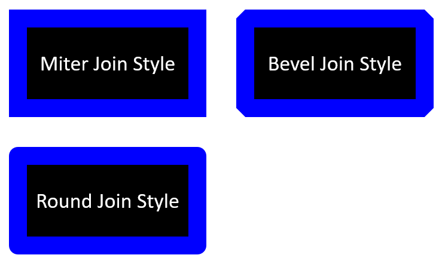

## **Introduzione**

In PowerPoint, è possibile aggiungere forme alle diapositive. Poiché le forme sono composte da linee, è possibile formattarle modificando o applicando effetti ai loro contorni. Inoltre, è possibile formattare le forme specificando impostazioni che controllano come vengono riempiti i loro interni.


Aspose.Slides for Node.js via Java fornisce classi e metodi che consentono di formattare le forme utilizzando le stesse opzioni disponibili in PowerPoint.

## **Formattare le linee**

Utilizzando Aspose.Slides, è possibile specificare uno stile di linea personalizzato per una forma. I passaggi seguenti descrivono la procedura:

1. Crea un'istanza della classe [Presentation](https://reference.aspose.com/slides/nodejs-java/aspose.slides/presentation/).
1. Ottieni un riferimento a una diapositiva per indice.
1. Aggiungi un'[AutoShape](https://reference.aspose.com/slides/nodejs-java/aspose.slides/autoshape/) alla diapositiva.
1. Imposta lo [stile della linea](https://reference.aspose.com/slides/nodejs-java/aspose.slides/linestyle/) della forma.
1. Imposta la larghezza della linea.
1. Imposta lo [stile tratteggiato](https://reference.aspose.com/slides/nodejs-java/aspose.slides/linedashstyle/) della linea.
1. Imposta il colore della linea per la forma.
1. Salva la presentazione modificata come file PPTX.

Il codice seguente mostra come formattare un `AutoShape` rettangolare:

```js
var aspose = aspose || {};
aspose.slides = require("aspose.slides.via.java");
const java = require("java");

// Istanzia la classe Presentation che rappresenta un file di presentazione.
let presentation = new aspose.slides.Presentation();
try {
    // Recupera la prima diapositiva.
    let slide = presentation.getSlides().get_Item(0);

    // Aggiungi una forma automatica di tipo Rettangolo.
    let shape = slide.getShapes().addAutoShape(aspose.slides.ShapeType.Rectangle, 50, 150, 150, 75);

    // Rimuovi il riempimento dalla forma rettangolo.
    shape.getFillFormat().setFillType(java.newByte(aspose.slides.FillType.NoFill));

    // Applica la formattazione alle linee del rettangolo.
    shape.getLineFormat().setStyle(java.newByte(aspose.slides.LineStyle.ThickThin));
    shape.getLineFormat().setWidth(7);
    shape.getLineFormat().setDashStyle(java.newByte(aspose.slides.LineDashStyle.Dash));

    // Imposta il colore per la linea del rettangolo.
    shape.getLineFormat().getFillFormat().setFillType(java.newByte(aspose.slides.FillType.Solid));
    shape.getLineFormat().getFillFormat().getSolidFillColor().setColor(java.getStaticFieldValue("java.awt.Color", "BLUE"));

    // Salva il file PPTX su disco.
    presentation.save("formatted_lines.pptx", aspose.slides.SaveFormat.Pptx);
} finally {
    presentation.dispose();
}
```

Il risultato:


## **Applicare effetti schizzo alle linee della forma**

Un effetto schizzo rende la linea di una forma simile a un disegno a mano. Usa [Shape.getLineFormat](https://reference.aspose.com/slides/nodejs-java/aspose.slides/shape/) per accedere alle impostazioni della linea, [LineFormat.getSketchFormat](https://reference.aspose.com/slides/nodejs-java/aspose.slides/lineformat/) per accedere alle impostazioni dello schizzo e [SketchFormat.setSketchType](https://reference.aspose.com/slides/nodejs-java/aspose.slides/sketchformat/) per selezionare un valore dall'enumerazione [LineSketchType](https://reference.aspose.com/slides/nodejs-java/aspose.slides/linesketchtype/).

Il codice JavaScript seguente mostra come applicare l'effetto [LineSketchType.Curved](https://reference.aspose.com/slides/nodejs-java/aspose.slides/linesketchtype/) leggere il valore assegnato esplicitamente e rimuovere l'effetto con [LineSketchType.None](https://reference.aspose.com/slides/nodejs-java/aspose.slides/linesketchtype/):

```js
var aspose = aspose || {};
aspose.slides = require("aspose.slides.via.java");

let presentation = new aspose.slides.Presentation();
try {
    let slide = presentation.getSlides().get_Item(0);
    let shape = slide.getShapes().addAutoShape(aspose.slides.ShapeType.Rectangle, 50, 50, 200, 100);

    // Accedi al formato linea della forma e al suo formato schizzo.
    let sketchFormat = shape.getLineFormat().getSketchFormat();

    // Applica un effetto schizzo.
    sketchFormat.setSketchType(aspose.slides.LineSketchType.Curved);

    // Leggi l'effetto schizzo assegnato direttamente alla forma.
    let explicitSketchType = sketchFormat.getSketchType();
    console.log("Explicit sketch type: " + explicitSketchType);

    // Rimuovi l'effetto schizzo.
    sketchFormat.setSketchType(aspose.slides.LineSketchType.None);
} finally {
    presentation.dispose();
}
```

Il valore restituito da [SketchFormat.getSketchType](https://reference.aspose.com/slides/nodejs-java/aspose.slides/sketchformat/) rappresenta l'impostazione assegnata direttamente alla forma. Se la formattazione della linea può essere ereditata da un tema, diapositiva master o diapositiva layout, usa [LineFormat.getEffective](https://reference.aspose.com/slides/nodejs-java/aspose.slides/lineformat/), chiama `getSketchFormat` sull'oggetto restituito e poi chiama il suo metodo `getSketchType`. Il valore effettivo riflette la formattazione che viene realmente applicata dopo la risoluzione dell'eredità:

```js
var aspose = aspose || {};
aspose.slides = require("aspose.slides.via.java");

let presentation = new aspose.slides.Presentation("presentation.pptx");
try {
    let shape = presentation.getSlides().get_Item(0).getShapes().get_Item(0);
    let lineFormat = shape.getLineFormat();

    let explicitSketchType = lineFormat.getSketchFormat().getSketchType();
    let effectiveLineFormat = lineFormat.getEffective();
    let effectiveSketchType = effectiveLineFormat.getSketchFormat().getSketchType();

    console.log("Explicit sketch type: " + explicitSketchType);
    console.log("Effective sketch type: " + effectiveSketchType);
} finally {
    presentation.dispose();
}
```

## **Formattare gli stili di giunzione**

Ecco le tre opzioni di tipo di giunzione:

* Rotondo
* Miter
* Bevel

Per impostazione predefinita, quando PowerPoint unisce due linee ad un angolo (ad esempio all'angolo di una forma), utilizza l'impostazione **Rotondo**. Tuttavia, se stai disegnando una forma con angoli acuti, potresti preferire l'opzione **Miter**.



Il codice JavaScript seguente dimostra come sono stati creati tre rettangoli (come mostrato nell'immagine sopra) utilizzando le impostazioni di tipo di giunzione Miter, Bevel e Rotondo:

```js
var aspose = aspose || {};
aspose.slides = require("aspose.slides.via.java");
const java = require("java");

// Istanzia la classe Presentation che rappresenta un file di presentazione.
let presentation = new aspose.slides.Presentation();
try {
    // Recupera la prima diapositiva.
    let slide = presentation.getSlides().get_Item(0);

    // Aggiungi tre forme automatiche di tipo Rettangolo.
    let shape1 = slide.getShapes().addAutoShape(aspose.slides.ShapeType.Rectangle, 20, 20, 150, 75);
    let shape2 = slide.getShapes().addAutoShape(aspose.slides.ShapeType.Rectangle, 210, 20, 150, 75);
    let shape3 = slide.getShapes().addAutoShape(aspose.slides.ShapeType.Rectangle, 20, 135, 150, 75);

    // Imposta il colore di riempimento per ogni forma rettangolare.
    shape1.getFillFormat().setFillType(java.newByte(aspose.slides.FillType.Solid));
    shape1.getFillFormat().getSolidFillColor().setColor(java.getStaticFieldValue("java.awt.Color", "BLACK"));
    shape2.getFillFormat().setFillType(java.newByte(aspose.slides.FillType.Solid));
    shape2.getFillFormat().getSolidFillColor().setColor(java.getStaticFieldValue("java.awt.Color", "BLACK"));
    shape3.getFillFormat().setFillType(java.newByte(aspose.slides.FillType.Solid));
    shape3.getFillFormat().getSolidFillColor().setColor(java.getStaticFieldValue("java.awt.Color", "BLACK"));

    // Imposta la larghezza della linea.
    shape1.getLineFormat().setWidth(15);
    shape2.getLineFormat().setWidth(15);
    shape3.getLineFormat().setWidth(15);

    // Imposta il colore per la linea di ciascun rettangolo.
    shape1.getLineFormat().getFillFormat().setFillType(java.newByte(aspose.slides.FillType.Solid));
    shape1.getLineFormat().getFillFormat().getSolidFillColor().setColor(java.getStaticFieldValue("java.awt.Color", "BLUE"));
    shape2.getLineFormat().getFillFormat().setFillType(java.newByte(aspose.slides.FillType.Solid));
    shape2.getLineFormat().getFillFormat().getSolidFillColor().setColor(java.getStaticFieldValue("java.awt.Color", "BLUE"));
    shape3.getLineFormat().getFillFormat().setFillType(java.newByte(aspose.slides.FillType.Solid));
    shape3.getLineFormat().getFillFormat().getSolidFillColor().setColor(java.getStaticFieldValue("java.awt.Color", "BLUE"));

    // Imposta lo stile di giunzione.
    shape1.getLineFormat().setJoinStyle(java.newByte(aspose.slides.LineJoinStyle.Miter));
    shape2.getLineFormat().setJoinStyle(java.newByte(aspose.slides.LineJoinStyle.Bevel));
    shape3.getLineFormat().setJoinStyle(java.newByte(aspose.slides.LineJoinStyle.Round));

    // Aggiungi testo a ciascun rettangolo.
    shape1.getTextFrame().setText("Miter Join Style");
    shape2.getTextFrame().setText("Bevel Join Style");
    shape3.getTextFrame().setText("Round Join Style");

    // Salva il file PPTX su disco.
    presentation.save("join_styles.pptx", aspose.slides.SaveFormat.Pptx);
} finally {
    presentation.dispose();
}
```

## **Riempimento gradiente**

In PowerPoint, il Riempimento gradiente è un'opzione di formattazione che consente di applicare una sfumatura continua di colori a una forma. Ad esempio, è possibile applicare due o più colori in modo che uno sfumi gradualmente nell'altro.

Ecco come applicare un riempimento gradiente a una forma utilizzando Aspose.Slides:

1. Crea un'istanza della classe [Presentation](https://reference.aspose.com/slides/nodejs-java/aspose.slides/presentation/).
1. Ottieni un riferimento a una diapositiva per indice.
1. Aggiungi un'[AutoShape](https://reference.aspose.com/slides/nodejs-java/aspose.slides/autoshape/) alla diapositiva.
1. Imposta il [FillType](https://reference.aspose.com/slides/nodejs-java/aspose.slides/filltype/) della forma su `Gradient`.
1. Aggiungi i due colori preferiti con posizioni definite usando i metodi `add` della raccolta di stop del gradiente esposta dalla classe [GradientFormat](https://reference.aspose.com/slides/nodejs-java/aspose.slides/gradientformat/).
1. Salva la presentazione modificata come file PPTX.

```js
var aspose = aspose || {};
aspose.slides = require("aspose.slides.via.java");
const java = require("java");

// Istanzia la classe Presentation che rappresenta un file di presentazione.
let presentation = new aspose.slides.Presentation();
try {
    // Recupera la prima diapositiva.
    let slide = presentation.getSlides().get_Item(0);

    // Aggiungi una forma automatica di tipo Ellisse.
    let shape = slide.getShapes().addAutoShape(aspose.slides.ShapeType.Ellipse, 50, 50, 150, 75);

    // Applica la formattazione a gradiente all'ellisse.
    shape.getFillFormat().setFillType(java.newByte(aspose.slides.FillType.Gradient));
    shape.getFillFormat().getGradientFormat().setGradientShape(java.newByte(aspose.slides.GradientShape.Linear));

    // Imposta la direzione del gradiente.
    shape.getFillFormat().getGradientFormat().setGradientDirection(aspose.slides.GradientDirection.FromCorner2);

    // Aggiungi due fermate di gradiente.
    shape.getFillFormat().getGradientFormat().getGradientStops().addPresetColor(1.0, aspose.slides.PresetColor.Purple);
    shape.getFillFormat().getGradientFormat().getGradientStops().addPresetColor(0, aspose.slides.PresetColor.Red);

    // Salva il file PPTX su disco.
    presentation.save("gradient_fill.pptx", aspose.slides.SaveFormat.Pptx);
} finally {
    presentation.dispose();
}
```


Se un gradiente appare diverso in un'immagine esportata rispetto a PowerPoint, consulta [Scegli uno stile di rendering del gradiente](/slides/it/nodejs-java/convert-powerpoint-to-png/#choose-a-gradient-rendering-style). È possibile selezionare uno stile di rendering senza modificare il riempimento gradiente memorizzato nella presentazione.

## **Riempimento con motivo**

In PowerPoint, il Riempimento con motivo è un'opzione di formattazione che consente di applicare un design a due colori — come punti, strisce, trame incrociate o scacchi — a una forma. È possibile scegliere colori personalizzati per il primo piano e lo sfondo del motivo.

Aspose.Slides fornisce oltre 45 stili di motivo predefiniti che è possibile applicare alle forme per migliorare l'aspetto visivo delle presentazioni. Anche dopo aver selezionato un motivo predefinito, è ancora possibile specificare i colori esatti da utilizzare.

Ecco come applicare un riempimento a motivo a una forma utilizzando Aspose.Slides:

1. Crea un'istanza della classe [Presentation](https://reference.aspose.com/slides/nodejs-java/aspose.slides/presentation/).
1. Ottieni un riferimento a una diapositiva per indice.
1. Aggiungi un'[AutoShape](https://reference.aspose.com/slides/nodejs-java/aspose.slides/autoshape/) alla diapositiva.
1. Imposta il [FillType](https://reference.aspose.com/slides/nodejs-java/aspose.slides/filltype/) della forma su `Pattern`.
1. Scegli uno stile di motivo dalle opzioni predefinite.
1. Imposta il [Colore di sfondo](https://reference.aspose.com/slides/nodejs-java/aspose.slides/patternformat/#getBackColor--) del motivo.
1. Imposta il [Colore di primo piano](https://reference.aspose.com/slides/nodejs-java/aspose.slides/patternformat/#getForeColor--) del motivo.
1. Salva la presentazione modificata come file PPTX.

```js
var aspose = aspose || {};
aspose.slides = require("aspose.slides.via.java");
const java = require("java");

// Istanzia la classe Presentation che rappresenta un file di presentazione.
let presentation = new aspose.slides.Presentation();
try {
    // Recupera la prima diapositiva.
    let slide = presentation.getSlides().get_Item(0);

    // Aggiungi una forma automatica di tipo Rectangle.
    let shape = slide.getShapes().addAutoShape(aspose.slides.ShapeType.Rectangle, 50, 50, 150, 75);

    // Imposta il tipo di riempimento su Pattern.
    shape.getFillFormat().setFillType(java.newByte(aspose.slides.FillType.Pattern));

    // Imposta lo stile del motivo.
    shape.getFillFormat().getPatternFormat().setPatternStyle(java.newByte(aspose.slides.PatternStyle.Trellis));

    // Imposta i colori di sfondo e primo piano del motivo.
    shape.getFillFormat().getPatternFormat().getBackColor().setColor(java.getStaticFieldValue("java.awt.Color", "LIGHT_GRAY"));
    shape.getFillFormat().getPatternFormat().getForeColor().setColor(java.getStaticFieldValue("java.awt.Color", "YELLOW"));

    // Salva il file PPTX su disco.
    presentation.save("pattern_fill.pptx", aspose.slides.SaveFormat.Pptx);
} finally {
    presentation.dispose();
}
```


## **Riempimento immagine**

In PowerPoint, il Riempimento immagine è un'opzione di formattazione che consente di inserire un'immagine all'interno di una forma, utilizzando effettivamente l'immagine come sfondo della forma.

Ecco come utilizzare Aspose.Slides per applicare un riempimento immagine a una forma:

1. Crea un'istanza della classe [Presentation](https://reference.aspose.com/slides/nodejs-java/aspose.slides/presentation/).
1. Ottieni un riferimento a una diapositiva per indice.
1. Aggiungi un'[AutoShape](https://reference.aspose.com/slides/nodejs-java/aspose.slides/autoshape/) alla diapositiva.
1. Imposta il [FillType](https://reference.aspose.com/slides/nodejs-java/aspose.slides/filltype/) della forma su `Picture`.
1. Imposta la modalità di riempimento immagine su `Tile` (o un'altra modalità preferita).
1. Crea un oggetto [PPImage](https://reference.aspose.com/slides/nodejs-java/aspose.slides/ppimage/) dall'immagine che desideri utilizzare.
1. Passa l'immagine al metodo `ISlidesPicture.setImage`.
1. Salva la presentazione modificata come file PPTX.

Supponiamo di avere un file "lotus.png" con l'immagine seguente:


Il codice JavaScript seguente mostra come riempire una forma con l'immagine:

```js
var aspose = aspose || {};
aspose.slides = require("aspose.slides.via.java");
const java = require("java");

// Istanzia la classe Presentation che rappresenta un file di presentazione.
let presentation = new aspose.slides.Presentation();
try {
    // Recupera la prima diapositiva.
    let slide = presentation.getSlides().get_Item(0);

    // Aggiungi una forma automatica di tipo Rectangle.
    let shape = slide.getShapes().addAutoShape(aspose.slides.ShapeType.Rectangle, 50, 50, 255, 130);
    
    // Imposta il tipo di riempimento su Picture.
    shape.getFillFormat().setFillType(java.newByte(aspose.slides.FillType.Picture));

    // Imposta la modalità di riempimento immagine.
    shape.getFillFormat().getPictureFillFormat().setPictureFillMode(aspose.slides.PictureFillMode.Tile);

    // Carica un'immagine e aggiungila alle risorse della presentazione.
    let image = aspose.slides.Images.fromFile("lotus.png");
    let picture = presentation.getImages().addImage(image);
    image.dispose();

    // Imposta l'immagine.
    shape.getFillFormat().getPictureFillFormat().getPicture().setImage(picture);

    // Salva il file PPTX su disco.
    presentation.save("picture_fill.pptx", aspose.slides.SaveFormat.Pptx);
} finally {
    presentation.dispose();
}
```


### **Usa immagine a piastrellatura come texture**

Se desideri impostare un'immagine a piastrellatura come texture e personalizzare il comportamento della piastrellatura, puoi utilizzare i seguenti metodi della classe [PictureFillFormat](https://reference.aspose.com/slides/nodejs-java/aspose.slides/picturefillformat/):

- [setPictureFillMode](https://reference.aspose.com/slides/nodejs-java/aspose.slides/picturefillformat/#setPictureFillMode): Imposta la modalità di riempimento immagine — `Tile` o `Stretch`.
- [setTileAlignment](https://reference.aspose.com/slides/nodejs-java/aspose.slides/picturefillformat/#setTileAlignment): Specifica l'allineamento delle piastrelle all'interno della forma.
- [setTileFlip](https://reference.aspose.com/slides/nodejs-java/aspose.slides/picturefillformat/#setTileFlip): Controlla se la piastrella è capovolta orizzontalmente, verticalmente o in entrambi i modi.
- [setTileOffsetX](https://reference.aspose.com/slides/nodejs-java/aspose.slides/picturefillformat/#setTileOffsetX): Imposta lo spostamento orizzontale della piastrella (in punti) dall'origine della forma.
- [setTileOffsetY](https://reference.aspose.com/slides/nodejs-java/aspose.slides/picturefillformat/#setTileOffsetY): Imposta lo spostamento verticale della piastrella (in punti) dall'origine della forma.
- [setTileScaleX](https://reference.aspose.com/slides/nodejs-java/aspose.slides/picturefillformat/#setTileScaleX): Definisce la scala orizzontale della piastrella in percentuale.
- [setTileScaleY](https://reference.aspose.com/slides/nodejs-java/aspose.slides/picturefillformat/#setTileScaleY): Definisce la scala verticale della piastrella in percentuale.

```js
var aspose = aspose || {};
aspose.slides = require("aspose.slides.via.java");
const java = require("java");

// Istanzia la classe Presentation che rappresenta un file di presentazione.
let presentation = new aspose.slides.Presentation();
try {
    // Recupera la prima diapositiva.
    let firstSlide = presentation.getSlides().get_Item(0);

    // Aggiungi una forma automatica rettangolare.
    let shape = firstSlide.getShapes().addAutoShape(aspose.slides.ShapeType.Rectangle, 50, 50, 190, 95);

    // Imposta il tipo di riempimento della forma su Picture.
    shape.getFillFormat().setFillType(java.newByte(aspose.slides.FillType.Picture));

    // Carica l'immagine e aggiungila alle risorse della presentazione.
    let sourceImage = aspose.slides.Images.fromFile("lotus.png");
    let presentationImage = presentation.getImages().addImage(sourceImage);
    sourceImage.dispose();

    // Assegna l'immagine alla forma.
    let pictureFillFormat = shape.getFillFormat().getPictureFillFormat();
    pictureFillFormat.getPicture().setImage(presentationImage);

    // Configura la modalità di riempimento immagine e le proprietà di piastrellatura.
    pictureFillFormat.setPictureFillMode(aspose.slides.PictureFillMode.Tile);
    pictureFillFormat.setTileOffsetX(-32);
    pictureFillFormat.setTileOffsetY(-32);
    pictureFillFormat.setTileScaleX(50);
    pictureFillFormat.setTileScaleY(50);
    pictureFillFormat.setTileAlignment(java.newByte(aspose.slides.RectangleAlignment.BottomRight));
    pictureFillFormat.setTileFlip(aspose.slides.TileFlip.FlipBoth);

    // Salva il file PPTX su disco.
    presentation.save("tile.pptx", aspose.slides.SaveFormat.Pptx);
} finally {
    presentation.dispose();
}
```


## **Riempimento a colore solido**

In PowerPoint, il Riempimento a colore solido è un'opzione di formattazione che riempie una forma con un unico colore uniforme. Questo colore di sfondo semplice viene applicato senza alcuna sfumatura, texture o motivo.

Per applicare un riempimento a colore solido a una forma utilizzando Aspose.Slides, segui questi passaggi:

1. Crea un'istanza della classe [Presentation](https://reference.aspose.com/slides/nodejs-java/aspose.slides/presentation/).
1. Ottieni un riferimento a una diapositiva per indice.
1. Aggiungi un'[AutoShape](https://reference.aspose.com/slides/nodejs-java/aspose.slides/autoshape/) alla diapositiva.
1. Imposta il [FillType](https://reference.aspose.com/slides/nodejs-java/aspose.slides/filltype/) della forma su `Solid`.
1. Assegna il colore di riempimento preferito alla forma.
1. Salva la presentazione modificata come file PPTX.

```js
var aspose = aspose || {};
aspose.slides = require("aspose.slides.via.java");
const java = require("java");

// Istanzia la classe Presentation che rappresenta un file di presentazione.
let presentation = new aspose.slides.Presentation();
try {
    // Recupera la prima diapositiva.
    let slide = presentation.getSlides().get_Item(0);

    // Aggiungi una forma automatica di tipo Rectangle.
    let shape = slide.getShapes().addAutoShape(aspose.slides.ShapeType.Rectangle, 50, 50, 150, 75);

    // Imposta il tipo di riempimento su Solid.
    shape.getFillFormat().setFillType(java.newByte(aspose.slides.FillType.Solid));

    // Imposta il colore di riempimento.
    shape.getFillFormat().getSolidFillColor().setColor(java.getStaticFieldValue("java.awt.Color", "YELLOW"));

    // Salva il file PPTX su disco.
    presentation.save("solid_color_fill.pptx", aspose.slides.SaveFormat.Pptx);
} finally {
    presentation.dispose();
}
```


## **Impostare la trasparenza**

In PowerPoint, quando si applica un riempimento a colore solido, gradiente, immagine o texture a forme, è possibile impostare anche un livello di trasparenza per controllare l'opacità del riempimento. Un valore di trasparenza più alto rende la forma più trasparente, consentendo al background o agli oggetti sottostanti di essere parzialmente visibili.

Aspose.Slides consente di impostare il livello di trasparenza regolando il valore alfa nel colore utilizzato per il riempimento. Ecco come fare:

1. Crea un'istanza della classe [Presentation](https://reference.aspose.com/slides/nodejs-java/aspose.slides/presentation/).
1. Ottieni un riferimento a una diapositiva per indice.
1. Aggiungi un'[AutoShape](https://reference.aspose.com/slides/nodejs-java/aspose.slides/autoshape/) alla diapositiva.
1. Imposta il [FillType](https://reference.aspose.com/slides/nodejs-java/aspose.slides/filltype/) della forma su `Solid`.
1. Usa `Color` per definire un colore con trasparenza (il componente `alpha` controlla la trasparenza).
1. Salva la presentazione.

```js
var aspose = aspose || {};
aspose.slides = require("aspose.slides.via.java");
const java = require("java");

// Istanzia la classe Presentation che rappresenta un file di presentazione.
let presentation = new aspose.slides.Presentation();
try {
    // Recupera la prima diapositiva.
    let slide = presentation.getSlides().get_Item(0);

    // Aggiungi una forma automatica rettangolare solida.
    let solidShape = slide.getShapes().addAutoShape(aspose.slides.ShapeType.Rectangle, 50, 50, 150, 75);

    // Aggiungi una forma automatica rettangolare trasparente sopra la forma solida.
    let transparentShape = slide.getShapes().addAutoShape(aspose.slides.ShapeType.Rectangle, 80, 80, 150, 75);
    transparentShape.getFillFormat().setFillType(java.newByte(aspose.slides.FillType.Solid));
    transparentShape.getFillFormat().getSolidFillColor().setColor(java.newInstanceSync("java.awt.Color", 255, 255, 0, 204));

    // Salva il file PPTX su disco.
    presentation.save("shape_transparency.pptx", aspose.slides.SaveFormat.Pptx);
} finally {
    presentation.dispose();
}
```


## **Ruotare le forme**

Aspose.Slides consente di ruotare le forme nelle presentazioni PowerPoint. Questo può essere utile quando si posizionano elementi visivi con esigenze specifiche di allineamento o design.

Per ruotare una forma su una diapositiva, segui questi passaggi:

1. Crea un'istanza della classe [Presentation](https://reference.aspose.com/slides/nodejs-java/aspose.slides/presentation/).
1. Ottieni un riferimento a una diapositiva per indice.
1. Aggiungi un'[AutoShape](https://reference.aspose.com/slides/nodejs-java/aspose.slides/autoshape/) alla diapositiva.
1. Imposta la proprietà di rotazione della forma sull'angolo desiderato.
1. Salva la presentazione.

```js
var aspose = aspose || {};
aspose.slides = require("aspose.slides.via.java");

// Istanzia la classe Presentation che rappresenta un file di presentazione.
let presentation = new aspose.slides.Presentation();
try {
    // Recupera la prima diapositiva.
    let slide = presentation.getSlides().get_Item(0);

    // Aggiungi una forma automatica di tipo Rectangle.
    let shape = slide.getShapes().addAutoShape(aspose.slides.ShapeType.Rectangle, 50, 50, 150, 75);

    // Ruota la forma di 5 gradi.
    shape.setRotation(5);

    // Salva il file PPTX su disco.
    presentation.save("shape_rotation.pptx", aspose.slides.SaveFormat.Pptx);
} finally {
    presentation.dispose();
}
```


## **Aggiungere effetti di smusso 3D**

Aspose.Slides consente di applicare effetti di smusso 3D alle forme configurando le loro proprietà [ThreeDFormat](https://reference.aspose.com/slides/nodejs-java/aspose.slides/threedformat/).

Per aggiungere effetti di smusso 3D a una forma, segui questi passaggi:

1. Istanzia la classe [Presentation](https://reference.aspose.com/slides/nodejs-java/aspose.slides/presentation/).
1. Ottieni un riferimento a una diapositiva per indice.
1. Aggiungi un'[AutoShape](https://reference.aspose.com/slides/nodejs-java/aspose.slides/autoshape/) alla diapositiva.
1. Configura il [ThreeDFormat](https://reference.aspose.com/slides/nodejs-java/aspose.slides/threedformat/) della forma per definire le impostazioni di smusso.
1. Salva la presentazione.

```js
var aspose = aspose || {};
aspose.slides = require("aspose.slides.via.java");
const java = require("java");

// Crea un'istanza della classe Presentation.
let presentation = new aspose.slides.Presentation();
try {
    let slide = presentation.getSlides().get_Item(0);

    // Aggiungi una forma alla diapositiva.
    let shape = slide.getShapes().addAutoShape(aspose.slides.ShapeType.Ellipse, 50, 50, 100, 100);
    shape.getFillFormat().setFillType(java.newByte(aspose.slides.FillType.Solid));
    shape.getFillFormat().getSolidFillColor().setColor(java.getStaticFieldValue("java.awt.Color", "GREEN"));
    shape.getLineFormat().getFillFormat().setFillType(java.newByte(aspose.slides.FillType.Solid));
    shape.getLineFormat().getFillFormat().getSolidFillColor().setColor(java.getStaticFieldValue("java.awt.Color", "ORANGE"));
    shape.getLineFormat().setWidth(2.0);

    // Imposta le proprietà ThreeDFormat della forma.
    shape.getThreeDFormat().setDepth(4);
    shape.getThreeDFormat().getBevelTop().setBevelType(aspose.slides.BevelPresetType.Circle);
    shape.getThreeDFormat().getBevelTop().setHeight(6);
    shape.getThreeDFormat().getBevelTop().setWidth(6);
    shape.getThreeDFormat().getCamera().setCameraType(aspose.slides.CameraPresetType.OrthographicFront);
    shape.getThreeDFormat().getLightRig().setLightType(aspose.slides.LightRigPresetType.ThreePt);
    shape.getThreeDFormat().getLightRig().setDirection(aspose.slides.LightingDirection.Top);

    // Salva la presentazione come file PPTX.
    presentation.save("3D_bevel_effect.pptx", aspose.slides.SaveFormat.Pptx);
} finally {
    presentation.dispose();
}
```


## **Aggiungere effetti di rotazione 3D**

Aspose.Slides consente di applicare effetti di rotazione 3D alle forme configurando le loro proprietà [ThreeDFormat](https://reference.aspose.com/slides/nodejs-java/aspose.slides/threedformat/).

Per applicare una rotazione 3D a una forma:

1. Crea un'istanza della classe [Presentation](https://reference.aspose.com/slides/nodejs-java/aspose.slides/presentation/).
1. Ottieni un riferimento a una diapositiva per indice.
1. Aggiungi un'[AutoShape](https://reference.aspose.com/slides/nodejs-java/aspose.slides/autoshape/) alla diapositiva.
1. Usa i metodi [setCameraType](https://reference.aspose.com/slides/nodejs-java/aspose.slides/camera/#setCameraType) e [setLightType](https://reference.aspose.com/slides/nodejs-java/aspose.slides/lightrig/#setLightType) per definire la rotazione 3D.
1. Salva la presentazione.

```js
var aspose = aspose || {};
aspose.slides = require("aspose.slides.via.java");

// Crea un'istanza della classe Presentation.
let presentation = new aspose.slides.Presentation();
try {
    let slide = presentation.getSlides().get_Item(0);

    let autoShape = slide.getShapes().addAutoShape(aspose.slides.ShapeType.Rectangle, 50, 50, 150, 75);
    autoShape.getTextFrame().setText("Hello, Aspose!");

    autoShape.getThreeDFormat().setDepth(6);
    autoShape.getThreeDFormat().getCamera().setRotation(40, 35, 20);
    autoShape.getThreeDFormat().getCamera().setCameraType(aspose.slides.CameraPresetType.IsometricLeftUp);
    autoShape.getThreeDFormat().getLightRig().setLightType(aspose.slides.LightRigPresetType.Balanced);

    // Salva la presentazione come file PPTX.
    presentation.save("3D_rotation_effect.pptx", aspose.slides.SaveFormat.Pptx);
} finally {
    presentation.dispose();
}
```


## **Controllare il rendering in bianco e nero per le forme**

Il metodo [Shape.setBlackWhiteMode](https://reference.aspose.com/slides/nodejs-java/aspose.slides/shape/#setBlackWhiteMode) specifica come viene renderizzata una singola forma quando una presentazione viene visualizzata o elaborata in modalità bianco e nero. Non attiva la visualizzazione in bianco e nero da solo e non modifica il riempimento, la linea o altre formattazioni della forma in modalità a colori normale.

Usa un valore dell'enumerazione [BlackWhiteMode](https://reference.aspose.com/slides/nodejs-java/aspose.slides/blackwhitemode/) per selezionare il comportamento desiderato. Ad esempio, `Automatic` consente all'applicazione di rendering di scegliere la conversione, `Gray` e `LightGray` usano la colorazione grigia, `BlackWhite` utilizza solo il nero e il bianco, `Black` e `White` forzano un colore unico, `Color` preserva la colorazione normale, e `Hidden` omette la forma nella modalità bianco e nero. `NotDefined` indica che nessuna modalità a livello di forma è assegnata.

Il codice JavaScript seguente crea una forma colorata e la fa apparire grigia nella modalità di visualizzazione bianco e nero:

```js
var aspose = aspose || {};
aspose.slides = require("aspose.slides.via.java");
const java = require("java");

let presentation = new aspose.slides.Presentation();
try {
    let slide = presentation.getSlides().get_Item(0);

    let shape = slide.getShapes().addAutoShape(aspose.slides.ShapeType.Rectangle, 50, 50, 200, 100);
    shape.getFillFormat().setFillType(java.newByte(aspose.slides.FillType.Solid));
    shape.getFillFormat().getSolidFillColor().setColor(java.getStaticFieldValue("java.awt.Color", "ORANGE"));

    // Mantieni il riempimento arancione in modalità colore, ma rendi la forma con colorazione grigia in modalità bianco e nero.
    shape.setBlackWhiteMode(java.newByte(aspose.slides.BlackWhiteMode.Gray));

    presentation.save("shape_black_white_mode.pptx", aspose.slides.SaveFormat.Pptx);
} finally {
    presentation.dispose();
}
```

In modalità colore normale, il rettangolo mantiene il riempimento arancione. In un flusso di lavoro di visualizzazione bianco e nero, usa la colorazione grigia perché la sua modalità è impostata su `Gray`. Questo ti consente di preservare una diapositiva a colori completa definendo al contempo un aspetto distinto per la stampa, l'anteprima o altri flussi di lavoro che rispettano le impostazioni di visualizzazione bianco e nero della presentazione.

## **Ripristinare la formattazione**

Il codice JavaScript seguente mostra come ripristinare la formattazione di una diapositiva e riportare la posizione, le dimensioni e la formattazione di tutte le forme con segnaposti sul [LayoutSlide](https://reference.aspose.com/slides/nodejs-java/aspose.slides/layoutslide/) alle impostazioni predefinite:

```js
var aspose = aspose || {};
aspose.slides = require("aspose.slides.via.java");

let presentation = new aspose.slides.Presentation("sample.pptx");
try {
    for (let i = 0; i < presentation.getSlides().size(); i++) {
        let slide = presentation.getSlides().get_Item(i);
        // Reimposta ogni forma sulla diapositiva che ha un segnaposto nel layout.
        slide.reset();
    }
    presentation.save("reset_formatting.pptx", aspose.slides.SaveFormat.Pptx);
} finally {
    presentation.dispose();
}
```

## **FAQ**

**Il formato delle forme influisce sulla dimensione finale del file della presentazione?**

Solo in minima parte. Le immagini e i media incorporati occupano la maggior parte dello spazio del file, mentre i parametri delle forme come colori, effetti e gradienti sono memorizzati come metadati e aggiungono praticamente nessuna dimensione extra.

**Come posso individuare le forme su una diapositiva che condividono la stessa formattazione per raggrupparle?**

Confronta le proprietà chiave di formattazione di ciascuna forma — impostazioni di riempimento, linea ed effetto. Se tutti i valori corrispondenti coincidono, considera i loro stili come identici e raggruppa logicamente quelle forme, semplificando la gestione degli stili in seguito.

**Posso salvare un insieme di stili di forma personalizzati in un file separato per riutilizzarli in altre presentazioni?**

Sì. Memorizza forme di esempio con gli stili desiderati in un set di diapositive modello o in un file modello .POTX. Quando crei una nuova presentazione, apri il modello, clona le forme con lo stile di cui hai bisogno e riapplica la loro formattazione dove necessario.