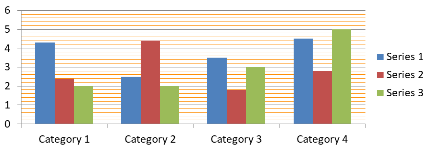

## **Panoramica**

Questo articolo spiega come personalizzare gli assi dei grafici con Aspose.Slides per Python tramite Java. Copre i valori calcolati degli assi, lo scambio di righe e colonne del grafico, la visibilità degli assi, gli intervalli delle etichette di categoria e dei segni di suddivisione, le categorie di data e la loro formattazione, la rotazione del titolo, il posizionamento dell'asse, le unità di visualizzazione e la scala logaritmica.

## **Ottenere i valori massimi sull'asse verticale di un grafico**

Crea una [Presentation](https://reference.aspose.com/slides/python-java/aspose.slides/presentation/) e aggiungi un grafico ad area con dati predefiniti. Chiama [validateChartLayout](https://reference.aspose.com/slides/python-java/aspose.slides/chart/#validateChartLayout) prima di leggere i valori calcolati dell'asse in modo che il layout del grafico sia aggiornato.

Leggi [getActualMaxValue](https://reference.aspose.com/slides/python-java/aspose.slides/axis/#getActualMaxValue) e [getActualMinValue](https://reference.aspose.com/slides/python-java/aspose.slides/axis/#getActualMinValue) per i limiti dell'asse, e [getActualMajorUnit](https://reference.aspose.com/slides/python-java/aspose.slides/axis/#getActualMajorUnit) e [getActualMinorUnit](https://reference.aspose.com/slides/python-java/aspose.slides/axis/#getActualMinorUnit) per gli intervalli dei segni di suddivisione. [getActualMajorUnitScale](https://reference.aspose.com/slides/python-java/aspose.slides/axis/#getActualMajorUnitScale) e [getActualMinorUnitScale](https://reference.aspose.com/slides/python-java/aspose.slides/axis/#getActualMinorUnitScale) forniscono scale di unità temporali, rilevanti per gli assi di data. L'esempio memorizza questi valori in variabili locali e salva il grafico.

```python
import jpype
import asposeslides

if not jpype.isJVMStarted():
    jpype.startJVM()

from asposeslides.api import Presentation, ChartType, SaveFormat

presentation = Presentation()
try:
    slide = presentation.getSlides().get_Item(0)

    chart = slide.getShapes().addChart(ChartType.Area, 100, 100, 500, 350)
    chart.validateChartLayout()

    max_value = chart.getAxes().getVerticalAxis().getActualMaxValue()
    min_value = chart.getAxes().getVerticalAxis().getActualMinValue()

    major_unit = chart.getAxes().getVerticalAxis().getActualMajorUnit()
    minor_unit = chart.getAxes().getVerticalAxis().getActualMinorUnit()

    major_unit_scale = chart.getAxes().getVerticalAxis().getActualMajorUnitScale()
    minor_unit_scale = chart.getAxes().getVerticalAxis().getActualMinorUnitScale()

    presentation.save("AxisValues_out.pptx", SaveFormat.Pptx)
finally:
    presentation.dispose()
```

## **Scambiare i dati tra gli assi**

Usa [switchRowColumn](https://reference.aspose.com/slides/python-java/aspose.slides/chartdata/#switchRowColumn) per scambiare i ruoli di serie e categorie nei dati del grafico. Ogni precedente categoria diventa una serie, e ogni precedente serie diventa una categoria. Questo cambia il modo in cui i dati sono raggruppati; non scambia gli assi orizzontale e verticale. L'esempio utilizza [setRange](https://reference.aspose.com/slides/python-java/aspose.slides/chartdata/#setRange) per collegare i dati predefiniti a `Sheet1!A1:D5`, includendo la riga di intestazione e la colonna delle categorie, prima di scambiare righe e colonne. Salva un grafico con quattro serie e tre categorie.

```python
import jpype
import asposeslides

if not jpype.isJVMStarted():
    jpype.startJVM()

from asposeslides.api import Presentation, ChartType, SaveFormat

presentation = Presentation()
try:
    slide = presentation.getSlides().get_Item(0)

    chart = slide.getShapes().addChart(ChartType.ClusteredColumn, 100, 100, 400, 300)
    chart.getChartData().setRange("Sheet1!A1:D5")
    chart.getChartData().switchRowColumn()

    presentation.save("SwitchChartRowColumns_out.pptx", SaveFormat.Pptx)
finally:
    presentation.dispose()
```

## **Invertire l'ordine di tracciamento di un asse**

Usa [setPlotOrderReversed](https://reference.aspose.com/slides/python-java/aspose.slides/axis/#setPlotOrderReversed) per invertire un asse di categoria o di valore. Ad esempio, un grafico a barre orizzontale può mostrare le fasi di progetto dall'alto verso il basso nello stesso ordine del foglio di lavoro: Planning, Development, Testing. L'inversione di un asse cambia la direzione di tracciamento; non ordina né riarrangia i dati della cartella di lavoro. In confronto, [switchRowColumn](https://reference.aspose.com/slides/python-java/aspose.slides/chartdata/#switchRowColumn) scambia i ruoli di serie e categorie.

L'esempio seguente crea un grafico a barre orizzontale con tre fasi e una serie. Salva una presentazione con tre diapositive: ordine normale, categorie invertite e valori invertiti. Ogni copia utilizza lo stesso set di dati e solo un asse è invertito in ciascuna copia.

```python
import jpype
import asposeslides

if not jpype.isJVMStarted():
    jpype.startJVM()

from asposeslides.api import Presentation, ChartType, CrossesType, SaveFormat

presentation = Presentation()
try:
    slide = presentation.getSlides().get_Item(0)

    chart = slide.getShapes().addChart(ChartType.ClusteredBar, 50, 40, 620, 320)
    chart.setLegend(False)

    chart.getChartData().getCategories().clear()
    chart.getChartData().getSeries().clear()

    workbook = chart.getChartData().getChartDataWorkbook()
    workbook.clear(0)

    series = chart.getChartData().getSeries().add(ChartType.ClusteredBar)
    stages = ["Planning", "Development", "Testing"]
    values = [10, 30, 20]
    for i, stage in enumerate(stages):
        category_cell = workbook.getCell(0, i + 1, 0, stage)
        chart.getChartData().getCategories().add(category_cell)
        value_cell = workbook.getCell(0, i + 1, 1, float(values[i]))
        series.getDataPoints().addDataPointForBarSeries(value_cell)

    # Diapositiva 2: visualizza la prima categoria in alto.
    category_slide = presentation.getSlides().addClone(slide)
    category_chart = category_slide.getShapes().get_Item(0)
    category_chart.getAxes().getVerticalAxis().setPlotOrderReversed(True)
    # Mantieni l'asse dei valori orizzontale in basso.
    category_chart.getAxes().getVerticalAxis().setCrossType(CrossesType.Maximum)

    # Diapositiva 3: inverte solo la scala numerica orizzontale.
    value_slide = presentation.getSlides().addClone(slide)
    value_chart = value_slide.getShapes().get_Item(0)
    value_chart.getAxes().getHorizontalAxis().setPlotOrderReversed(True)

    presentation.save("ReversedAxes.pptx", SaveFormat.Pptx)
finally:
    presentation.dispose()
```

Invertire un asse può anche spostare l'asse perpendicolare sul lato opposto del grafico. [setCrossType](https://reference.aspose.com/slides/python-java/aspose.slides/axis/#setCrossType) controlla dove l'altro asse incrocia l'asse configurato. Nella diapositiva 2, chiamandolo con [CrossesType.Maximum](https://reference.aspose.com/slides/python-java/aspose.slides/crossestype/#Maximum) sull'asse di categoria invertito si mantiene l'asse di valore orizzontale in basso. Per un punto di incrocio specifico, usa [setCrossAt](https://reference.aspose.com/slides/python-java/aspose.slides/axis/#setCrossAt). Verifica le impostazioni di incrocio quando cambi direzione, specialmente se il grafico ha già un punto di incrocio personalizzato. Chiama [setPlotOrderReversed](https://reference.aspose.com/slides/python-java/aspose.slides/axis/#setPlotOrderReversed) con `False` per ripristinare la direzione di tracciamento normale; le impostazioni di incrocio sono separate.

| Ordine normale (diapositiva 1) | Categorie invertite (diapositiva 2) | Valori invertiti (diapositiva 3) |
| --- | --- | --- |
|  |  |  |
| Le categorie vanno dal basso verso l'alto; i valori aumentano da sinistra a destra. | Planning, Development e Testing vanno dall'alto verso il basso. I valori e l'ordine delle righe del foglio di lavoro rimangono invariati. | Le categorie mantengono il loro ordine normale; i valori aumentano da destra verso sinistra. L'asse di categoria incrocia a zero a destra. |

## **Disabilitare l'asse verticale per i grafici a linee**

Chiama [setVisible](https://reference.aspose.com/slides/python-java/aspose.slides/axis/#setVisible) con `False` sull'asse verticale per nasconderlo. L'esempio crea un grafico a linee con dati predefiniti e lo salva con l'asse verticale nascosto.

```python
import jpype
import asposeslides

if not jpype.isJVMStarted():
    jpype.startJVM()

from asposeslides.api import Presentation, ChartType, SaveFormat

presentation = Presentation()
try:
    slide = presentation.getSlides().get_Item(0)

    chart = slide.getShapes().addChart(ChartType.Line, 100, 100, 400, 300)
    chart.getAxes().getVerticalAxis().setVisible(False)

    presentation.save("HiddenVerticalAxis.pptx", SaveFormat.Pptx)
finally:
    presentation.dispose()
```

## **Disabilitare l'asse orizzontale per i grafici a linee**

Chiama [setVisible](https://reference.aspose.com/slides/python-java/aspose.slides/axis/#setVisible) con `False` sull'asse orizzontale per nasconderlo. L'esempio crea un grafico a linee con dati predefiniti e lo salva con l'asse orizzontale nascosto.

```python
import jpype
import asposeslides

if not jpype.isJVMStarted():
    jpype.startJVM()

from asposeslides.api import Presentation, ChartType, SaveFormat

presentation = Presentation()
try:
    slide = presentation.getSlides().get_Item(0)

    chart = slide.getShapes().addChart(ChartType.Line, 100, 100, 400, 300)
    chart.getAxes().getHorizontalAxis().setVisible(False)

    presentation.save("HiddenHorizontalAxis.pptx", SaveFormat.Pptx)
finally:
    presentation.dispose()
```

## **Mostrare o nascondere le linee della griglia del grafico**

Chiama [getShowMajorGridLines](https://reference.aspose.com/slides/python-java/aspose.slides/axis/#getShowMajorGridLines) e [getShowMinorGridLines](https://reference.aspose.com/slides/python-java/aspose.slides/axis/#getShowMinorGridLines) per verificare quali linee della griglia visualizza un asse. Per mostrare le linee della griglia minori, usa [getMinorGridLinesFormat](https://reference.aspose.com/slides/python-java/aspose.slides/axis/#getMinorGridLinesFormat) e imposta il riempimento della linea a un colore solido e visibile. Per nasconderle, imposta il riempimento su [FillType.NoFill](https://reference.aspose.com/slides/python-java/aspose.slides/filltype/#NoFill). Usa [getMajorGridLinesFormat](https://reference.aspose.com/slides/python-java/aspose.slides/axis/#getMajorGridLinesFormat) per modificare il riempimento della linea per le linee della griglia principali allo stesso modo. Cambiare il riempimento preserva la visibilità dell'asse e i segni di suddivisione.

L'asse verticale di questo grafico a colonne raggruppate mostra inizialmente solo le linee della griglia principali. L'esempio visualizza le linee della griglia minori in arancione scuro, poi le nasconde nuovamente prima di salvare la presentazione. Stampa la visibilità delle linee della griglia ad ogni passaggio.

```python
import jpype
import asposeslides

if not jpype.isJVMStarted():
    jpype.startJVM()

from asposeslides.api import ChartType, FillType, Presentation, SaveFormat

Color = jpype.JClass("java.awt.Color")

presentation = Presentation()
try:
    slide = presentation.getSlides().get_Item(0)

    chart = slide.getShapes().addChart(ChartType.ClusteredColumn, 30, 30, 660, 230)
    axis = chart.getAxes().getVerticalAxis()
    print(f"Initial: major={axis.getShowMajorGridLines()}, minor={axis.getShowMinorGridLines()}")

    minor_fill = axis.getMinorGridLinesFormat().getLine().getFillFormat()
    minor_fill.setFillType(FillType.Solid)
    minor_fill.getSolidFillColor().setColor(Color(255, 140, 0))
    print(f"Enabled: minor={axis.getShowMinorGridLines()}")

    minor_fill.setFillType(FillType.NoFill)
    print(f"Hidden: major={axis.getShowMajorGridLines()}, minor={axis.getShowMinorGridLines()}")

    presentation.save("ChartGridlines.pptx", SaveFormat.Pptx)
finally:
    presentation.dispose()
```

| Linee della griglia minori abilitate | Linee della griglia minori nascoste |
| --- | --- |
|  |  |

## **Modificare un asse di categoria**

Usa [setCategoryAxisType](https://reference.aspose.com/slides/python-java/aspose.slides/axis/#setCategoryAxisType) per scegliere un asse di categoria data o di testo. Questo esempio richiede `ExistingChart.pptx`, con un grafico come prima forma nella prima diapositiva e celle di categoria contenenti valori di data numerici di Excel. Cambia l'asse orizzontale in un asse di data. Chiamando [setAutomaticMajorUnit](https://reference.aspose.com/slides/python-java/aspose.slides/axis/#setAutomaticMajorUnit) con `False`, [setMajorUnit](https://reference.aspose.com/slides/python-java/aspose.slides/axis/#setMajorUnit) con `1` e [setMajorUnitScale](https://reference.aspose.com/slides/python-java/aspose.slides/axis/#setMajorUnitScale) con [TimeUnitType.Months](https://reference.aspose.com/slides/python-java/aspose.slides/timeunittype/#Months), si posizionano i segni principali a intervalli di un mese.

```python
import jpype
import asposeslides

if not jpype.isJVMStarted():
    jpype.startJVM()

from asposeslides.api import Presentation, SaveFormat, CategoryAxisType, TimeUnitType

presentation = Presentation("ExistingChart.pptx")
try:
    slide = presentation.getSlides().get_Item(0)

    chart = slide.getShapes().get_Item(0)
    chart.getAxes().getHorizontalAxis().setCategoryAxisType(CategoryAxisType.Date)
    chart.getAxes().getHorizontalAxis().setAutomaticMajorUnit(False)
    chart.getAxes().getHorizontalAxis().setMajorUnit(1)
    chart.getAxes().getHorizontalAxis().setMajorUnitScale(TimeUnitType.Months)

    presentation.save("ChangeChartCategoryAxis_out.pptx", SaveFormat.Pptx)
finally:
    presentation.dispose()
```

### **Determinare il tipo di asse di categoria dai dati**

Chiama [setCategoryAxisTypeAutomatically](https://reference.aspose.com/slides/python-java/aspose.slides/axis/#setCategoryAxisTypeAutomatically) dopo aver popolato le categorie, poi leggi [getCategoryAxisType](https://reference.aspose.com/slides/python-java/aspose.slides/axis/#getCategoryAxisType) per ispezionare la selezione. Questo è utile quando lo stesso grafico riceve etichette di testo o valori di data numerici. Il metodo determina il tipo al momento della chiamata; non abilita una modalità persistente che ricalcola i cambiamenti dei dati successivi. Richiamalo nuovamente dopo la sostituzione delle categorie.

L'esempio seguente crea un grafico con categorie di testo e stampa `True` quando il tipo selezionato è [CategoryAxisType.Text](https://reference.aspose.com/slides/python-java/aspose.slides/categoryaxistype/#Text). Poi sostituisce i valori delle celle di categoria con date e chiama nuovamente il metodo, stampando `True` quando il tipo selezionato è [CategoryAxisType.Date](https://reference.aspose.com/slides/python-java/aspose.slides/categoryaxistype/#Date). Le date sono memorizzate come valori numerici OLE Automation, calcolati per queste date come il numero di giorni dal 30 dicembre 1899, anziché come stringhe di data. [setCustomNumberFormat](https://reference.aspose.com/slides/python-java/aspose.slides/chartdatacell/#setCustomNumberFormat) controlla come questi valori sono visualizzati; non converte il testo in date numeriche. Per ulteriori informazioni sulle celle di categoria, vedi [Chart Workbook](/slides/it/python-java/chart-workbook/).

Usa la determinazione automatica quando l'input è noto per contenere categorie di testo o date numeriche, come in questo esempio. Per etichette numeriche ordinarie, categorie miste o dati vuoti, chiama esplicitamente [setCategoryAxisType](https://reference.aspose.com/slides/python-java/aspose.slides/axis/#setCategoryAxisType) per corrispondere al significato desiderato. I valori numerici da soli non stabiliscono che le categorie rappresentino date.

```python
from datetime import date

import jpype
import asposeslides

if not jpype.isJVMStarted():
    jpype.startJVM()

from asposeslides.api import Presentation, ChartType, CategoryAxisType, SaveFormat

presentation = Presentation()
try:
    slide = presentation.getSlides().get_Item(0)

    chart = slide.getShapes().addChart(ChartType.ClusteredColumn, 30, 40, 660, 320)

    chart.getChartData().getCategories().clear()
    chart.getChartData().getSeries().clear()

    workbook = chart.getChartData().getChartDataWorkbook()
    workbook.clear(0)

    series_name = workbook.getCell(0, 0, 1, "Sales")
    series = chart.getChartData().getSeries().add(series_name, chart.getType())
    labels = ["First", "Second", "Third"]

    for i, label in enumerate(labels):
        category_cell = workbook.getCell(0, i + 1, 0, label)
        chart.getChartData().getCategories().add(category_cell)

        value_cell = workbook.getCell(0, i + 1, 1, float((i + 1) * 10))
        series.getDataPoints().addDataPointForBarSeries(value_cell)

    axis = chart.getAxes().getHorizontalAxis()
    axis.setCategoryAxisTypeAutomatically()
    print(axis.getCategoryAxisType() == CategoryAxisType.Text)  # Vero

    base_date = date(1899, 12, 30)
    dates = [date(2026, 1, 1), date(2026, 1, 2), date(2026, 2, 1)]

    for i, category_date in enumerate(dates):
        category_cell = workbook.getCell(0, i + 1, 0)
        category_cell.setValue(float((category_date - base_date).days))
        category_cell.setCustomNumberFormat("yyyy-mm-dd")

    axis.setCategoryAxisTypeAutomatically()
    print(axis.getCategoryAxisType() == CategoryAxisType.Date)  # Vero

    presentation.save("AutomaticCategoryAxis.pptx", SaveFormat.Pptx)
finally:
    presentation.dispose()
```

## **Controllare gli intervalli delle etichette dell'asse di categoria**

Quando un grafico ha molte categorie, riduci il numero di etichette dell'asse visibili senza rimuovere categorie o punti dati. Chiama [setAutomaticTickLabelSpacing](https://reference.aspose.com/slides/python-java/aspose.slides/axis/#setAutomaticTickLabelSpacing) con `False`, poi passa l'intervallo di categoria desiderato a [setTickLabelSpacing](https://reference.aspose.com/slides/python-java/aspose.slides/axis/#setTickLabelSpacing). Per categorie di testo nel loro ordine normale, il conteggio inizia dalla prima categoria:

| Intervallo | Etichette visualizzate nell'esempio |
| --- | --- |
| `1` | Categoria 1, Categoria 2, Categoria 3, ... Categoria 24 |
| `2` | Categoria 1, Categoria 3, Categoria 5, ... Categoria 23 |
| `3` | Categoria 1, Categoria 4, Categoria 7, ... Categoria 22 |

Un intervallo di `3` visualizza ogni terza etichetta, lasciando due etichette nascoste tra quelle visualizzate. Non rimuove le colonne corrispondenti. La spaziatura automatica sceglie un intervallo in base allo spazio disponibile; non visualizza necessariamente ogni etichetta.

I segni di suddivisione hanno controlli separati. Chiama [setAutomaticTickMarksSpacing](https://reference.aspose.com/slides/python-java/aspose.slides/axis/#setAutomaticTickMarksSpacing) con `False` e usa [setTickMarksSpacing](https://reference.aspose.com/slides/python-java/aspose.slides/axis/#setTickMarksSpacing) per impostare il loro intervallo. Per esempio, `1` mantiene un segno di suddivisione a ogni intervallo di categoria mentre le etichette appaiono solo ogni terza categoria. Usa [setMajorTickMark](https://reference.aspose.com/slides/python-java/aspose.slides/axis/#setMajorTickMark) con uno stile visibile così da vedere il risultato. Richiamare nuovamente uno dei setter di spaziatura automatica con `True` consente al grafico di scegliere nuovamente quell'intervallo.

L'esempio autonomo seguente crea 24 categorie e una serie, poi salva tre diapositive in `CategoryAxisIntervals.pptx`: spaziatura automatica, spaziatura manuale delle etichette con segni di suddivisione indipendenti e spaziatura automatica ripristinata. Le due copie conservano i dati originali del grafico. Non è necessaria alcuna presentazione di input. Il testo delle etichette orizzontali rende evidente la differenza di densità.

```python
import jpype
import asposeslides

if not jpype.isJVMStarted():
    jpype.startJVM()

from asposeslides.api import Presentation, ChartType, SaveFormat, CategoryAxisType, TickMarkType

presentation = Presentation()
try:
    slide = presentation.getSlides().get_Item(0)

    chart = slide.getShapes().addChart(ChartType.ClusteredColumn, 30, 40, 660, 320)

    chart.setLegend(False)
    chart.getChartData().getCategories().clear()
    chart.getChartData().getSeries().clear()

    workbook = chart.getChartData().getChartDataWorkbook()
    workbook.clear(0)

    series = chart.getChartData().getSeries().add(ChartType.ClusteredColumn)
    for i in range(24):
        category_cell = workbook.getCell(0, i + 1, 0, f"Category {i + 1}")
        chart.getChartData().getCategories().add(category_cell)
        value_cell = workbook.getCell(0, i + 1, 1, float(10 + i % 6 * 5))
        series.getDataPoints().addDataPointForBarSeries(value_cell)

    axis = chart.getAxes().getHorizontalAxis()
    axis.setCategoryAxisType(CategoryAxisType.Text)
    axis.getTextFormat().getTextBlockFormat().setRotationAngle(0)
    axis.getTextFormat().getPortionFormat().setFontHeight(12)
    axis.setMajorTickMark(TickMarkType.Outside)
    axis.setAutomaticTickLabelSpacing(True)
    axis.setAutomaticTickMarksSpacing(True)

    # Diapositiva 2: mostra ogni terza etichetta, ma conserva un segno di suddivisione per ogni categoria.
    manual_slide = presentation.getSlides().addClone(slide)
    manual_chart = manual_slide.getShapes().get_Item(0)
    manual_axis = manual_chart.getAxes().getHorizontalAxis()
    manual_axis.setAutomaticTickLabelSpacing(False)
    manual_axis.setTickLabelSpacing(3)
    manual_axis.setAutomaticTickMarksSpacing(False)
    manual_axis.setTickMarksSpacing(1)

    # Diapositiva 3: lascia che il grafico scelga nuovamente entrambi gli intervalli.
    restored_slide = presentation.getSlides().addClone(manual_slide)
    restored_chart = restored_slide.getShapes().get_Item(0)
    restored_chart.getAxes().getHorizontalAxis().setAutomaticTickLabelSpacing(True)
    restored_chart.getAxes().getHorizontalAxis().setAutomaticTickMarksSpacing(True)

    presentation.save("CategoryAxisIntervals.pptx", SaveFormat.Pptx)
finally:
    presentation.dispose()
```

**Spaziatura automatica (diapositiva 1):** In questa resa, ogni seconda etichetta di categoria è visualizzata e avvolta su due linee. Il risultato automatico può variare con la dimensione del grafico, i font e il renderizzatore.


**Spaziatura manuale (diapositiva 2):** Ogni terza etichetta è visualizzata su una linea, mentre i segni di suddivisione rimangono a ogni intervallo di categoria. Tutte le 24 colonne, incluse quelle senza etichette, rimangono visibili con gli stessi valori. La diapositiva 3 ripristina l'aspetto automatico mostrato sopra.


### **Scegliere l'asse e l'intervallo corretti**

Usa questo intervallo di conteggio delle categorie per un asse di categoria di testo, come l'asse di categoria di un grafico a colonne, linee, aree o barre. In un grafico a colonne, è l'asse orizzontale. In un grafico a barre orizzontali, l'asse di categoria è verticale, quindi applica queste impostazioni all'asse restituito da [getVerticalAxis](https://reference.aspose.com/slides/python-java/aspose.slides/axesmanager/#getVerticalAxis). La spaziatura dei segni di suddivisione si applica anche a un asse di serie nei grafici che ne hanno uno.

Non usare la spaziatura delle etichette di categoria per impostare la scala numerica di un asse di valore. Su un asse di valore, [setMajorUnit](https://reference.aspose.com/slides/python-java/aspose.slides/axis/#setMajorUnit) specifica una differenza di valori: ad esempio, un'unità principale di `10` produce segni a 0, 10, 20, ecc. quando l'asse inizia da zero. Un intervallo di etichette di categoria di `3` conta invece le posizioni delle categorie, indipendentemente dai loro valori dati. I grafici a dispersione e a bolle utilizzano assi di valore anziché un asse di categoria di testo. Per un asse di data, usa unità principali e scale basate sul tempo come descritto in [Change a Category Axis](#change-a-category-axis).

## **Impostare il formato data per i valori dell'asse di categoria**

L'esempio sostituisce i dati predefiniti del grafico con quattro valori annuali. Le date sono archiviate come numeri seriali OLE Automation nel primo foglio di lavoro (indice `0`), calcolati come numero di giorni dal 30 dicembre 1899 per queste date. Usa [setCategoryAxisType](https://reference.aspose.com/slides/python-java/aspose.slides/axis/#setCategoryAxisType) con [CategoryAxisType.Date](https://reference.aspose.com/slides/python-java/aspose.slides/categoryaxistype/#Date), chiama [setNumberFormatLinkedToSource](https://reference.aspose.com/slides/python-java/aspose.slides/axis/#setNumberFormatLinkedToSource) con `False` e passa `yyyy` a [setNumberFormat](https://reference.aspose.com/slides/python-java/aspose.slides/axis/#setNumberFormat) affinché le etichette di categoria mostrino gli anni a quattro cifre indipendentemente dalla formattazione della cella.

```python
from datetime import date

import jpype
import asposeslides

if not jpype.isJVMStarted():
    jpype.startJVM()

from asposeslides.api import Presentation, ChartType, SaveFormat, CategoryAxisType

presentation = Presentation()
try:
    slide = presentation.getSlides().get_Item(0)

    chart = slide.getShapes().addChart(ChartType.Line, 50, 50, 450, 300)

    chart.getChartData().getCategories().clear()
    chart.getChartData().getSeries().clear()

    workbook = chart.getChartData().getChartDataWorkbook()
    workbook.clear(0)

    base_date = date(1899, 12, 30)

    series = chart.getChartData().getSeries().add(ChartType.Line)
    for i in range(4):
        category_date = date(2015 + i, 1, 1)
        category_value = float((category_date - base_date).days)
        category_cell = workbook.getCell(0, i + 1, 0, category_value)
        chart.getChartData().getCategories().add(category_cell)

        value_cell = workbook.getCell(0, i + 1, 1, float(i + 1))
        series.getDataPoints().addDataPointForLineSeries(value_cell)

    chart.getAxes().getHorizontalAxis().setCategoryAxisType(CategoryAxisType.Date)
    chart.getAxes().getHorizontalAxis().setNumberFormatLinkedToSource(False)
    chart.getAxes().getHorizontalAxis().setNumberFormat("yyyy")

    presentation.save("DateAxisFormat.pptx", SaveFormat.Pptx)
finally:
    presentation.dispose()
```

## **Impostare un angolo di rotazione per il titolo dell'asse del grafico**

Chiama [setTitle](https://reference.aspose.com/slides/python-java/aspose.slides/axis/#setTitle) con `True` sull'asse verticale, fornisci il testo del titolo e imposta l'angolo di rotazione nella formattazione del blocco di testo del titolo. L'angolo è misurato in gradi; questo esempio salva un grafico a colonne con il titolo dell'asse di valore ruotato di 90 gradi.

```python
import jpype
import asposeslides

if not jpype.isJVMStarted():
    jpype.startJVM()

from asposeslides.api import Presentation, ChartType, SaveFormat

presentation = Presentation()
try:
    slide = presentation.getSlides().get_Item(0)

    chart = slide.getShapes().addChart(ChartType.ClusteredColumn, 50, 50, 450, 300)
    chart.getAxes().getVerticalAxis().setTitle(True)
    chart.getAxes().getVerticalAxis().getTitle().addTextFrameForOverriding("Value")
    chart.getAxes().getVerticalAxis().getTitle().getTextFormat().getTextBlockFormat().setRotationAngle(90)

    presentation.save("RotatedAxisTitle.pptx", SaveFormat.Pptx)
finally:
    presentation.dispose()
```

## **Impostare la posizione dell'asse su un asse di categoria o di valore**

Usa [setAxisBetweenCategories](https://reference.aspose.com/slides/python-java/aspose.slides/axis/#setAxisBetweenCategories) per controllare se l'asse di valore incrocia l'asse di categoria tra le categorie o sui segni di suddivisione della categoria. Questa impostazione si applica agli assi di categoria. L'esempio lo imposta a `True` sull'asse di categoria orizzontale di un grafico a colonne e salva il risultato.

```python
import jpype
import asposeslides

if not jpype.isJVMStarted():
    jpype.startJVM()

from asposeslides.api import Presentation, ChartType, SaveFormat

presentation = Presentation()
try:
    slide = presentation.getSlides().get_Item(0)

    chart = slide.getShapes().addChart(ChartType.ClusteredColumn, 50, 50, 450, 300)
    chart.getAxes().getHorizontalAxis().setAxisBetweenCategories(True)

    presentation.save("AxisBetweenCategories.pptx", SaveFormat.Pptx)
finally:
    presentation.dispose()
```

## **Impostare l'unità di visualizzazione su un asse di valore del grafico**

Usa [setDisplayUnit](https://reference.aspose.com/slides/python-java/aspose.slides/axis/#setDisplayUnit) per ridimensionare le etichette su un asse di valore senza modificare i dati sottostanti. Con [DisplayUnitType](https://reference.aspose.com/slides/python-java/aspose.slides/displayunittype/) impostato su `Millions`, un valore di 60.000.000 viene visualizzato come 60. L'esempio crea un grafico a colonne e applica l'unità di visualizzazione milioni al suo asse verticale.

```python
import jpype
import asposeslides

if not jpype.isJVMStarted():
    jpype.startJVM()

from asposeslides.api import Presentation, ChartType, SaveFormat, DisplayUnitType

presentation = Presentation()
try:
    slide = presentation.getSlides().get_Item(0)

    chart = slide.getShapes().addChart(ChartType.ClusteredColumn, 50, 50, 450, 300)
    chart.getAxes().getVerticalAxis().setDisplayUnit(DisplayUnitType.Millions)

    presentation.save("Result.pptx", SaveFormat.Pptx)
finally:
    presentation.dispose()
```

## **Configurare un asse di valore logaritmico**

Un asse di valore logaritmico è utile quando i valori positivi coprono diversi ordini di grandezza. Ad esempio, un servizio potrebbe ricevere 10, 100, 1.000, 10.000 e 100.000 richieste su cinque periodi. Su una scala lineare, i valori più piccoli appaiono molto vicini vicino allo zero. Una scala logaritmica rende più facile confrontare la loro crescita relativa: distanze uguali rappresentano rapporti uguali anziché differenze uguali.

Chiama [setLogarithmic](https://reference.aspose.com/slides/python-java/aspose.slides/axis/#setLogarithmic) con `True` sull'asse di valore e usa [setLogBase](https://reference.aspose.com/slides/python-java/aspose.slides/axis/#setLogBase) per scegliere la base. Questo cambia il modo in cui i valori esistenti sono visualizzati; non modifica i dati né aggiunge una linea di tendenza logaritmica. Una linea di tendenza rappresenta una relazione adattata ai dati ed è una funzione separata.

### **Scegliere l'asse di valore e la base**

Per un grafico a linee o a colonne, l'asse di valore è restituito da [getVerticalAxis](https://reference.aspose.com/slides/python-java/aspose.slides/axesmanager/#getVerticalAxis). Per un grafico a barre orizzontali, è restituito da [getHorizontalAxis](https://reference.aspose.com/slides/python-java/aspose.slides/axesmanager/#getHorizontalAxis). I grafici a dispersione e a bolle hanno due assi di valore, quindi scegli l'asse orizzontale per i valori X, l'asse verticale per i valori Y, o entrambi. Non applicare la scala logaritmica a un asse di categoria.

La base logaritmica predefinita è `10`. Per i grafici PPTX, usa una base da `2` a `1000`, inclusi; sono supportate anche basi frazionarie come `2.5`. Con base `10`, le potenze successive come 10, 100, 1.000 e 10.000 sono equidistanti.

### **Confrontare la scala lineare e logaritmica**

L'esempio autonomo seguente crea un grafico a linee con i cinque conteggi di richieste sulla prima diapositiva, poi clona quella diapositiva e abilita un asse di valore logaritmico base-10 sulla seconda. Entrambe le diapositive conservano gli stessi dati.

```python
import jpype
import asposeslides

if not jpype.isJVMStarted():
    jpype.startJVM()

from asposeslides.api import Presentation, ChartType, SaveFormat

presentation = Presentation()
try:
    slide = presentation.getSlides().get_Item(0)

    chart = slide.getShapes().addChart(ChartType.Line, 30, 40, 660, 200)

    chart.setLegend(False)

    chart.getChartData().getCategories().clear()
    chart.getChartData().getSeries().clear()

    workbook = chart.getChartData().getChartDataWorkbook()
    workbook.clear(0)

    series = chart.getChartData().getSeries().add(ChartType.Line)
    values = [10, 100, 1000, 10000, 100000]

    for i, value in enumerate(values):
        category_cell = workbook.getCell(0, i + 1, 0, f"Period {i + 1}")
        chart.getChartData().getCategories().add(category_cell)

        value_cell = workbook.getCell(0, i + 1, 1, float(value))
        series.getDataPoints().addDataPointForLineSeries(value_cell)

    # Mantieni la prima diapositiva lineare e modifica solo la scala dell'asse dei valori della copia.
    logarithmic_slide = presentation.getSlides().addClone(slide)
    logarithmic_chart = logarithmic_slide.getShapes().get_Item(0)
    value_axis = logarithmic_chart.getAxes().getVerticalAxis()
    value_axis.setLogarithmic(True)
    value_axis.setLogBase(10)

    presentation.save("LogarithmicAxis.pptx", SaveFormat.Pptx)
finally:
    presentation.dispose()
```

**Scala lineare (diapositiva 1):** Le distanze verticali uguali rappresentano differenze uguali nei conteggi delle richieste. Il valore più grande domina il grafico, rendendo difficili da distinguere i valori più piccoli.


**Scala logaritmica (diapositiva 2):** Le distanze verticali uguali rappresentano rapporti uguali. Ogni periodo ha dieci volte più richieste del precedente, quindi i punti formano una linea retta crescente sulla scala base-10. Le etichette dell'asse mostrano ancora i conteggi originali delle richieste.


### **Gestire valori zero e negativi**

Una scala logaritmica può visualizzare solo valori strettamente positivi. Controlla i dati prima di abilitarla. Se i valori zero o negativi sono significativi, mantieni una scala lineare o mostrali separatamente. Se escludere tali valori è appropriato per l'analisi, spiega l'omissione. Non sostituirli silenziosamente con numeri piccoli positivi, poiché ciò cambia il significato dei dati. Qualsiasi minimo o massimo configurato manualmente per un asse logaritmico deve essere anch'esso positivo.

## **Domande frequenti**

**Come imposto il valore in cui un asse incrocia l'altro (incrocio assi)?**

Usa [setCrossType](https://reference.aspose.com/slides/python-java/aspose.slides/axis/#setCrossType) per selezionare il comportamento di incrocio. Per specificare un valore numerico di incrocio, usa [setCrossAt](https://reference.aspose.com/slides/python-java/aspose.slides/axis/#setCrossAt). Queste impostazioni ti consentono di spostare l'incrocio dell'asse su una linea di base adeguata.

**Come posso posizionare le etichette dei segni di suddivisione rispetto all'asse?**

Chiama [setTickLabelPosition](https://reference.aspose.com/slides/python-java/aspose.slides/axis/#setTickLabelPosition) usando [TickLabelPositionType](https://reference.aspose.com/slides/python-java/aspose.slides/ticklabelpositiontype/): `Low`, `High`, `NextTo` o `None`. Per controllare i segni di suddivisione stessi, usa [setMajorTickMark](https://reference.aspose.com/slides/python-java/aspose.slides/axis/#setMajorTickMark) o [setMinorTickMark](https://reference.aspose.com/slides/python-java/aspose.slides/axis/#setMinorTickMark); questi sono separati dal posizionamento delle etichette.