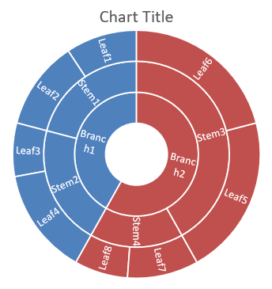

## **Panoramica**

Questo articolo fornisce una guida completa su come creare e personalizzare i grafici utilizzando Aspose.Slides per Python via Java. Imparerai come aggiungere programmaticamente un grafico a una diapositiva, popolarlo con i dati e applicare varie opzioni di formattazione per soddisfare i tuoi requisiti di design specifici. Nel corso dell'articolo, esempi di codice dettagliati illustrano ogni passaggio, dall'inizializzazione della presentazione e dell'oggetto grafico alla configurazione delle serie, degli assi e delle leggende. Seguendo questa guida, otterrai una solida comprensione di come integrare la generazione dinamica di grafici nelle tue applicazioni Python, semplificando il processo di creazione di presentazioni basate sui dati.

## **Crea un grafico**

I grafici aiutano le persone a visualizzare rapidamente i dati e a ottenere approfondimenti che potrebbero non essere immediatamente evidenti da una tabella o un foglio di calcolo.

**Perché creare grafici?**

* aggregare, condensare o riassumere grandi quantità di dati in una singola diapositiva di una presentazione;  
* rivelare modelli e tendenze nei dati;  
* dedurre la direzione e il momentum dei dati nel tempo o rispetto a una specifica unità di misura;  
* identificare outlier, aberrazioni, deviazioni, errori e dati non sensati;  
* comunicare o presentare dati complessi.

In PowerPoint, puoi creare grafici tramite la funzione *Inserisci*, che fornisce modelli per progettare molti tipi di grafici. Utilizzando Aspose.Slides, puoi creare sia grafici regolari (basati su tipi di grafico popolari) sia grafici personalizzati.

{}
Utilizza l'enumerazione [ChartType](https://reference.aspose.com/slides/python-java/aspose.slides/charttype/) nel pacchetto [asposeslides.api](https://reference.aspose.com/slides/python-java/aspose.slides/). I valori in questa enumerazione corrispondono a diversi tipi di grafico.
{}

### **Crea grafici a colonne raggruppate**

Questo esempio utilizza [addChart](https://reference.aspose.com/slides/python-java/aspose.slides/shapecollection/#addChart) per creare un grafico a colonne raggruppate che confronta due serie su tre categorie. Le serie utilizzano riempimenti rosso e verde, e le etichette individuali mostrano i nomi delle categorie, i nomi delle serie e i valori. L'indice del foglio di lavoro 0 si riferisce al primo foglio nella cartella di lavoro incorporata del grafico.

```python
import jpype
import asposeslides

if not jpype.isJVMStarted():
    jpype.startJVM()

from asposeslides.api import ChartType, FillType, NullableBool, Presentation, SaveFormat

Color = jpype.JClass("java.awt.Color")

presentation = Presentation()
try:
    slide = presentation.getSlides().get_Item(0)

    chart = slide.getShapes().addChart(ChartType.ClusteredColumn, 20, 20, 500, 300)

    chart.getChartTitle().addTextFrameForOverriding("Sample Title")
    chart.getChartTitle().getTextFrameForOverriding().getTextFrameFormat().setCenterText(NullableBool.True_)
    chart.getChartTitle().setHeight(20)
    chart.setTitle(True)

    workbook = chart.getChartData().getChartDataWorkbook()
    worksheet_index = 0

    chart.getChartData().getSeries().clear()
    chart.getChartData().getCategories().clear()

    series_name_cell = workbook.getCell(worksheet_index, 0, 1, "Series 1")
    chart.getChartData().getSeries().add(series_name_cell, chart.getType())
    series_name_cell = workbook.getCell(worksheet_index, 0, 2, "Series 2")
    chart.getChartData().getSeries().add(series_name_cell, chart.getType())

    category_cell = workbook.getCell(worksheet_index, 1, 0, "Category 1")
    chart.getChartData().getCategories().add(category_cell)
    category_cell = workbook.getCell(worksheet_index, 2, 0, "Category 2")
    chart.getChartData().getCategories().add(category_cell)
    category_cell = workbook.getCell(worksheet_index, 3, 0, "Category 3")
    chart.getChartData().getCategories().add(category_cell)

    series = chart.getChartData().getSeries().get_Item(0)

    value_cell = workbook.getCell(worksheet_index, 1, 1, 20)
    series.getDataPoints().addDataPointForBarSeries(value_cell)
    value_cell = workbook.getCell(worksheet_index, 2, 1, 50)
    series.getDataPoints().addDataPointForBarSeries(value_cell)
    value_cell = workbook.getCell(worksheet_index, 3, 1, 30)
    series.getDataPoints().addDataPointForBarSeries(value_cell)

    series.getFormat().getFill().setFillType(FillType.Solid)
    series.getFormat().getFill().getSolidFillColor().setColor(Color.RED)

    series = chart.getChartData().getSeries().get_Item(1)

    value_cell = workbook.getCell(worksheet_index, 1, 2, 30)
    series.getDataPoints().addDataPointForBarSeries(value_cell)
    value_cell = workbook.getCell(worksheet_index, 2, 2, 10)
    series.getDataPoints().addDataPointForBarSeries(value_cell)
    value_cell = workbook.getCell(worksheet_index, 3, 2, 60)
    series.getDataPoints().addDataPointForBarSeries(value_cell)

    series.getFormat().getFill().setFillType(FillType.Solid)
    color = Color(0, 128, 0)
    series.getFormat().getFill().getSolidFillColor().setColor(color)

    label = series.getDataPoints().get_Item(0).getLabel()
    label.getDataLabelFormat().setShowCategoryName(True)

    label = series.getDataPoints().get_Item(1).getLabel()
    label.getDataLabelFormat().setShowSeriesName(True)

    label = series.getDataPoints().get_Item(2).getLabel()
    label.getDataLabelFormat().setShowValue(True)
    label.getDataLabelFormat().setShowSeriesName(True)
    label.getDataLabelFormat().setSeparator("/")

    presentation.save("AsposeChart.pptx", SaveFormat.Pptx)
finally:
    presentation.dispose()
```

Il risultato:


### **Crea grafici a dispersione**

I grafici a dispersione (conosciuti anche come scatter plot o grafici x-y) sono spesso usati per verificare la presenza di pattern o dimostrare correlazioni tra due variabili.

Use a scatter chart when:

* Hai dati numerici accoppiati.  
* Hai due variabili che si abbinano bene.  
* Vuoi determinare se le due variabili sono correlate.  
* Hai una variabile indipendente che ha più valori per una variabile dipendente.

Questo esempio traccia due insiemi di valori x-y. La prima serie utilizza linee rette con marcatori a stella, mentre la seconda utilizza linee lisce con marcatori a cerchio; entrambe usano una dimensione del marcatore di 10, configurata con [setSize](https://reference.aspose.com/slides/python-java/aspose.slides/marker/#setSize). Il metodo [setSymbol](https://reference.aspose.com/slides/python-java/aspose.slides/marker/#setSymbol) controlla la forma del marcatore.

```python
import jpype
import asposeslides

if not jpype.isJVMStarted():
    jpype.startJVM()

from asposeslides.api import ChartType, MarkerStyleType, Presentation, SaveFormat

presentation = Presentation()
try:
    slide = presentation.getSlides().get_Item(0)

    chart = slide.getShapes().addChart(ChartType.ScatterWithSmoothLines, 20, 20, 500, 300)

    workbook = chart.getChartData().getChartDataWorkbook()
    worksheet_index = 0

    chart.getChartData().getSeries().clear()

    series_name_cell = workbook.getCell(worksheet_index, 1, 1, "Series 1")
    chart.getChartData().getSeries().add(series_name_cell, chart.getType())
    series_name_cell = workbook.getCell(worksheet_index, 1, 3, "Series 2")
    chart.getChartData().getSeries().add(series_name_cell, chart.getType())

    series = chart.getChartData().getSeries().get_Item(0)

    x_value_cell = workbook.getCell(worksheet_index, 2, 1, 1)
    y_value_cell = workbook.getCell(worksheet_index, 2, 2, 3)
    series.getDataPoints().addDataPointForScatterSeries(x_value_cell, y_value_cell)

    x_value_cell = workbook.getCell(worksheet_index, 3, 1, 2)
    y_value_cell = workbook.getCell(worksheet_index, 3, 2, 10)
    series.getDataPoints().addDataPointForScatterSeries(x_value_cell, y_value_cell)

    series.setType(ChartType.ScatterWithStraightLinesAndMarkers)

    series.getMarker().setSize(10)
    series.getMarker().setSymbol(MarkerStyleType.Star)

    series = chart.getChartData().getSeries().get_Item(1)

    x_value_cell = workbook.getCell(worksheet_index, 2, 3, 5)
    y_value_cell = workbook.getCell(worksheet_index, 2, 4, 2)
    series.getDataPoints().addDataPointForScatterSeries(x_value_cell, y_value_cell)

    x_value_cell = workbook.getCell(worksheet_index, 3, 3, 3)
    y_value_cell = workbook.getCell(worksheet_index, 3, 4, 1)
    series.getDataPoints().addDataPointForScatterSeries(x_value_cell, y_value_cell)

    x_value_cell = workbook.getCell(worksheet_index, 4, 3, 2)
    y_value_cell = workbook.getCell(worksheet_index, 4, 4, 2)
    series.getDataPoints().addDataPointForScatterSeries(x_value_cell, y_value_cell)

    x_value_cell = workbook.getCell(worksheet_index, 5, 3, 5)
    y_value_cell = workbook.getCell(worksheet_index, 5, 4, 1)
    series.getDataPoints().addDataPointForScatterSeries(x_value_cell, y_value_cell)

    series.getMarker().setSize(10)
    series.getMarker().setSymbol(MarkerStyleType.Circle)

    presentation.save("AsposeChart.pptx", SaveFormat.Pptx)
finally:
    presentation.dispose()
```

Il risultato:


### **Crea grafici a torta**

I grafici a torta sono ideali per mostrare la relazione parte-tutto nei dati, soprattutto quando i dati contengono etichette categoriche con valori numerici. Tuttavia, se i tuoi dati contengono molte parti o etichette, potresti considerare l'uso di un grafico a barre.

Questo esempio crea un grafico a torta con tre valori trimestrali. Ogni fetta ha un riempimento e un bordo personalizzati, e le etichette mostrano diverse combinazioni di valori, percentuali e informazioni sulla serie. Il metodo [setFirstSliceAngle](https://reference.aspose.com/slides/python-java/aspose.slides/chartseriesgroup/#setFirstSliceAngle) imposta la prima fetta per iniziare a 180 gradi.

```python
import jpype
import asposeslides

if not jpype.isJVMStarted():
    jpype.startJVM()

from asposeslides.api import ChartType, FillType, LineDashStyle, LineStyle, NullableBool, Presentation, SaveFormat

Color = jpype.JClass("java.awt.Color")

presentation = Presentation()
try:
    slide = presentation.getSlides().get_Item(0)

    chart = slide.getShapes().addChart(ChartType.Pie, 20, 20, 500, 300)

    chart.getChartTitle().addTextFrameForOverriding("Sample Title")
    chart.getChartTitle().getTextFrameForOverriding().getTextFrameFormat().setCenterText(NullableBool.True_)
    chart.getChartTitle().setHeight(20)
    chart.setTitle(True)

    chart.getChartData().getSeries().get_Item(0).getLabels().getDefaultDataLabelFormat().setShowValue(True)

    workbook = chart.getChartData().getChartDataWorkbook()
    worksheet_index = 0

    chart.getChartData().getSeries().clear()
    chart.getChartData().getCategories().clear()

    category_cell = workbook.getCell(0, 1, 0, "1st Qtr")
    chart.getChartData().getCategories().add(category_cell)
    category_cell = workbook.getCell(0, 2, 0, "2nd Qtr")
    chart.getChartData().getCategories().add(category_cell)
    category_cell = workbook.getCell(0, 3, 0, "3rd Qtr")
    chart.getChartData().getCategories().add(category_cell)

    series_name_cell = workbook.getCell(0, 0, 1, "Series 1")
    series = chart.getChartData().getSeries().add(series_name_cell, chart.getType())

    value_cell = workbook.getCell(worksheet_index, 1, 1, 20)
    series.getDataPoints().addDataPointForPieSeries(value_cell)
    value_cell = workbook.getCell(worksheet_index, 2, 1, 50)
    series.getDataPoints().addDataPointForPieSeries(value_cell)
    value_cell = workbook.getCell(worksheet_index, 3, 1, 30)
    series.getDataPoints().addDataPointForPieSeries(value_cell)

    chart.getChartData().getSeriesGroups().get_Item(0).setColorVaried(True)

    first_slice = series.getDataPoints().get_Item(0)
    first_slice.getFormat().getFill().setFillType(FillType.Solid)
    first_slice.getFormat().getFill().getSolidFillColor().setColor(Color.CYAN)

    first_slice.getFormat().getLine().getFillFormat().setFillType(FillType.Solid)
    first_slice.getFormat().getLine().getFillFormat().getSolidFillColor().setColor(Color.GRAY)
    first_slice.getFormat().getLine().setWidth(3.0)
    first_slice.getFormat().getLine().setStyle(LineStyle.ThinThick)
    first_slice.getFormat().getLine().setDashStyle(LineDashStyle.LargeDash)

    second_slice = series.getDataPoints().get_Item(1)
    second_slice.getFormat().setFillType(FillType.Solid)
    color = Color(165, 42, 42)
    second_slice.getFormat().getFill().getSolidFillColor().setColor(color)

    second_slice.getFormat().getLine().getFillFormat().setFillType(FillType.Solid)
    second_slice.getFormat().getLine().getFillFormat().getSolidFillColor().setColor(Color.BLUE)
    second_slice.getFormat().getLine().setWidth(3.0)
    second_slice.getFormat().getLine().setStyle(LineStyle.Single)
    second_slice.getFormat().getLine().setDashStyle(LineDashStyle.LargeDashDot)

    third_slice = series.getDataPoints().get_Item(2)
    third_slice.getFormat().setFillType(FillType.Solid)
    color = Color(255, 127, 80)
    third_slice.getFormat().getFill().getSolidFillColor().setColor(color)

    third_slice.getFormat().getLine().getFillFormat().setFillType(FillType.Solid)
    third_slice.getFormat().getLine().getFillFormat().getSolidFillColor().setColor(Color.RED)
    third_slice.getFormat().getLine().setWidth(2.0)
    third_slice.getFormat().getLine().setStyle(LineStyle.ThinThin)
    third_slice.getFormat().getLine().setDashStyle(LineDashStyle.LargeDashDotDot)

    first_label = series.getDataPoints().get_Item(0).getLabel()
    first_label.getDataLabelFormat().setShowValue(True)

    second_label = series.getDataPoints().get_Item(1).getLabel()
    second_label.getDataLabelFormat().setShowValue(True)
    second_label.getDataLabelFormat().setShowLegendKey(True)
    second_label.getDataLabelFormat().setShowPercentage(True)

    third_label = series.getDataPoints().get_Item(2).getLabel()
    third_label.getDataLabelFormat().setShowSeriesName(True)
    third_label.getDataLabelFormat().setShowPercentage(True)

    series.getLabels().getDefaultDataLabelFormat().setShowLeaderLines(True)

    chart.getChartData().getSeriesGroups().get_Item(0).setFirstSliceAngle(180)

    presentation.save("PieChart.pptx", SaveFormat.Pptx)
finally:
    presentation.dispose()
```

Il risultato:


Per migliorare la leggibilità delle etichette esterne alla torta, vedi [Format Leader Lines](/slides/it/python-java/chart-data-label/#format-leader-lines) per un esempio che posiziona le etichette e personalizza il colore, la larghezza, la trasparenza e lo stile tratteggiato delle linee.

### **Crea grafici a linee**

I grafici a linee (conosciuti anche come grafici a linee) sono ideali nelle situazioni in cui vuoi mostrare variazioni di valore nel tempo. Utilizzando un grafico a linee, puoi confrontare una grande quantità di dati contemporaneamente, monitorare cambiamenti e tendenze nel tempo, evidenziare anomalie nelle serie di dati, e altro.

Questo esempio utilizza [addChart](https://reference.aspose.com/slides/python-java/aspose.slides/shapecollection/#addChart) per creare un grafico a linee con le serie e le categorie predefinite, quindi salva la presentazione come PPTX.

```python
import jpype
import asposeslides

if not jpype.isJVMStarted():
    jpype.startJVM()

from asposeslides.api import ChartType, Presentation, SaveFormat

presentation = Presentation()
try:
    slide = presentation.getSlides().get_Item(0)

    line_chart = slide.getShapes().addChart(ChartType.Line, 20, 20, 500, 300)

    presentation.save("line_chart.pptx", SaveFormat.Pptx)
finally:
    presentation.dispose()
```

Per impostazione predefinita, i punti su un grafico a linee sono collegati da linee continue e rette. Se desideri che i punti siano collegati da linee tratteggiate, chiama [setDashStyle](https://reference.aspose.com/slides/python-java/aspose.slides/lineformat/#setDashStyle) con un valore da [LineDashStyle](https://reference.aspose.com/slides/python-java/aspose.slides/linedashstyle/):

```python
import jpype
import asposeslides

if not jpype.isJVMStarted():
    jpype.startJVM()

from asposeslides.api import ChartType, LineDashStyle, Presentation

presentation = Presentation()
try:
    slide = presentation.getSlides().get_Item(0)

    line_chart = slide.getShapes().addChart(ChartType.Line, 20, 20, 500, 300)

    for series in line_chart.getChartData().getSeries():
        series.getFormat().getLine().setDashStyle(LineDashStyle.Dash)
finally:
    presentation.dispose()
```

Il risultato:


### **Crea grafici a mappa ad albero**

I grafici a mappa ad albero sono ideali per dati di vendita quando vuoi mostrare la dimensione relativa delle categorie di dati e attirare rapidamente l'attenzione sugli elementi che contribuiscono maggiormente all'interno di ciascuna categoria.

Questo esempio crea una mappa ad albero con otto foglie raggruppate in quattro tronchi e due rami. Il metodo [setGroupingItem](https://reference.aspose.com/slides/python-java/aspose.slides/chartcategorylevelsmanager/#setGroupingItem) assegna i tronchi al livello di raggruppamento 1 e i rami al livello 2. I valori determinano le dimensioni relative dei rettangoli, mentre le etichette di categoria e le etichette genitore sovrapposte identificano la gerarchia.

```python
import jpype
import asposeslides

if not jpype.isJVMStarted():
    jpype.startJVM()

from asposeslides.api import ChartType, ParentLabelLayoutType, Presentation, SaveFormat

presentation = Presentation()
try:
    slide = presentation.getSlides().get_Item(0)

    chart = slide.getShapes().addChart(ChartType.Treemap, 20, 20, 500, 300)

    chart.getChartData().getCategories().clear()
    chart.getChartData().getSeries().clear()

    workbook = chart.getChartData().getChartDataWorkbook()
    workbook.clear(0)

    # Ramo 1
    category_cell = workbook.getCell(0, "C1", "Leaf1")
    leaf = chart.getChartData().getCategories().add(category_cell)
    leaf.getGroupingLevels().setGroupingItem(1, "Stem1")
    leaf.getGroupingLevels().setGroupingItem(2, "Branch1")

    category_cell = workbook.getCell(0, "C2", "Leaf2")
    chart.getChartData().getCategories().add(category_cell)

    category_cell = workbook.getCell(0, "C3", "Leaf3")
    leaf = chart.getChartData().getCategories().add(category_cell)
    leaf.getGroupingLevels().setGroupingItem(1, "Stem2")

    category_cell = workbook.getCell(0, "C4", "Leaf4")
    chart.getChartData().getCategories().add(category_cell)

    # Ramo 2
    category_cell = workbook.getCell(0, "C5", "Leaf5")
    leaf = chart.getChartData().getCategories().add(category_cell)
    leaf.getGroupingLevels().setGroupingItem(1, "Stem3")
    leaf.getGroupingLevels().setGroupingItem(2, "Branch2")

    category_cell = workbook.getCell(0, "C6", "Leaf6")
    chart.getChartData().getCategories().add(category_cell)

    category_cell = workbook.getCell(0, "C7", "Leaf7")
    leaf = chart.getChartData().getCategories().add(category_cell)
    leaf.getGroupingLevels().setGroupingItem(1, "Stem4")

    category_cell = workbook.getCell(0, "C8", "Leaf8")
    chart.getChartData().getCategories().add(category_cell)

    series = chart.getChartData().getSeries().add(ChartType.Treemap)
    series.getLabels().getDefaultDataLabelFormat().setShowCategoryName(True)
    value_cell = workbook.getCell(0, "D1", 4)
    series.getDataPoints().addDataPointForTreemapSeries(value_cell)
    value_cell = workbook.getCell(0, "D2", 5)
    series.getDataPoints().addDataPointForTreemapSeries(value_cell)
    value_cell = workbook.getCell(0, "D3", 3)
    series.getDataPoints().addDataPointForTreemapSeries(value_cell)
    value_cell = workbook.getCell(0, "D4", 6)
    series.getDataPoints().addDataPointForTreemapSeries(value_cell)
    value_cell = workbook.getCell(0, "D5", 9)
    series.getDataPoints().addDataPointForTreemapSeries(value_cell)
    value_cell = workbook.getCell(0, "D6", 9)
    series.getDataPoints().addDataPointForTreemapSeries(value_cell)
    value_cell = workbook.getCell(0, "D7", 4)
    series.getDataPoints().addDataPointForTreemapSeries(value_cell)
    value_cell = workbook.getCell(0, "D8", 3)
    series.getDataPoints().addDataPointForTreemapSeries(value_cell)

    series.setParentLabelLayout(ParentLabelLayoutType.Overlapping)

    presentation.save("Treemap.pptx", SaveFormat.Pptx)
finally:
    presentation.dispose()
```

Il risultato:


### **Crea grafici a cascata**

Un grafico a cascata mostra come le variazioni positive e negative contribuiscono a un valore finale. Ad esempio, una ripartizione del profitto può iniziare con i ricavi, sottrarre i costi e aggiungere altri redditi. Le colonne di variazione si posizionano tra i valori in corso precedenti e nuovi, mentre le colonne totali si estendono da zero al valore accumulato.

| Categoria | Valore cartella di lavoro | Tipo colonna |
| --- | ---: | --- |
| Ricavi | 1000 | Incremento |
| Costo delle vendite | -400 | Decremento |
| Profitto lordo | 600 | Totale intermedio |
| Spese operative | -200 | Decremento |
| Altri redditi | 50 | Incremento |
| Profitto netto | 450 | Totale finale |

Per contrassegnare un punto come totale intermedio o finale, chiama il suo metodo [setSetAsTotal](https://reference.aspose.com/slides/python-java/aspose.slides/chartdatapoint/#setSetAsTotal) con `True`. Fornisci l'effettivo importo accumulato nella cella del workbook di quel punto: `600` per il profitto lordo (`1000 - 400`) e `450` per il profitto netto (`600 - 200 + 50`). Il metodo contrassegna la colonna come totale; non calcola né popola il valore della cella. Non utilizzare zero come segnaposto né fornire un'altra variazione per un punto totale. Una colonna totale visualizza il valore accumulato senza aggiungerlo nuovamente al valore in corso.

Questo esempio completo in Python crea un grafico usando il membro `Waterfall` di [ChartType](https://reference.aspose.com/slides/python-java/aspose.slides/charttype/), cancella i dati predefiniti e riempie la cartella di lavoro incorporata. L'indice del foglio di lavoro `0` seleziona il primo foglio; la colonna A contiene i nomi delle categorie e la colonna B contiene i valori. Ogni cella valore è aggiunta con [addDataPointForWaterfallSeries](https://reference.aspose.com/slides/python-java/aspose.slides/chartdatapointcollection/#addDataPointForWaterfallSeries). Gli indici dei punti basati su zero `2` e `5` identificano i totali intermedi e finali. Chiamare [setShowValue](https://reference.aspose.com/slides/python-java/aspose.slides/datalabelformat/#setShowValue) con `True` visualizza gli importi sulle colonne. Non è richiesta alcuna presentazione o cartella di lavoro di input.

```python
import jpype
import asposeslides

if not jpype.isJVMStarted():
    jpype.startJVM()

from asposeslides.api import ChartType, Presentation, SaveFormat

presentation = Presentation()
try:
    slide = presentation.getSlides().get_Item(0)

    chart = slide.getShapes().addChart(ChartType.Waterfall, 20, 20, 680, 200)

    chart.setTitle(True)
    chart.getChartTitle().addTextFrameForOverriding("Profit breakdown (USD thousands)")
    chart.getChartTitle().setOverlay(False)
    chart.setLegend(False)

    chart.getChartData().getSeries().clear()
    chart.getChartData().getCategories().clear()

    workbook = chart.getChartData().getChartDataWorkbook()
    worksheet_index = 0

    workbook.clear(worksheet_index)

    series_name_cell = workbook.getCell(worksheet_index, 0, 1, "Profit")
    series = chart.getChartData().getSeries().add(series_name_cell, ChartType.Waterfall)
    categories = ["Revenue", "Cost of sales", "Gross profit", "Operating expenses", "Other income", "Net profit"]
    values = [1000, -400, 600, -200, 50, 450]

    for i in range(len(categories)):
        category_cell = workbook.getCell(worksheet_index, i + 1, 0, categories[i])
        chart.getChartData().getCategories().add(category_cell)
        value_cell = workbook.getCell(worksheet_index, i + 1, 1, values[i])
        series.getDataPoints().addDataPointForWaterfallSeries(value_cell)

    # Il terzo e il sesto punto rappresentano totali, non variazioni aggiuntive.
    series.getDataPoints().get_Item(2).setSetAsTotal(True)
    series.getDataPoints().get_Item(5).setSetAsTotal(True)
    series.setShowConnectorLines(True)
    series.getLabels().getDefaultDataLabelFormat().setShowValue(True)

    presentation.save("WaterfallChart.pptx", SaveFormat.Pptx)
finally:
    presentation.dispose()
```

Chiama il metodo a livello di serie [setShowConnectorLines](https://reference.aspose.com/slides/python-java/aspose.slides/chartseries/#setShowConnectorLines) con `True` per mostrare le linee che collegano le colonne consecutive e rendere più facile seguire il valore in corso. Per nascondere queste linee, sostituisci la chiamata al metodo nell'esempio con `series.setShowConnectorLines(False)` prima di salvare. Questo cambia solo la visibilità della linea, non i dati o i totali.

La presentazione salvata mostra un profitto lordo di 600 e un profitto netto di 450, con entrambi i totali tratti da zero:


### **Crea grafici azionari**

I grafici azionari sono usati per visualizzare dati finanziari come prezzi di apertura, massimo, minimo e chiusura, aiutando ad analizzare tendenze di mercato e volatilità. Offrono informazioni essenziali sulle performance delle azioni, supportando investitori e analisti nelle decisioni.

Questo esempio crea un grafico open-high-low-close con quattro serie in quell'ordine e tre categorie. Il metodo [setUpDownBars](https://reference.aspose.com/slides/python-java/aspose.slides/updownbarsmanager/#setUpDownBars) abilita le barre su/giù, e [getHiLowLinesFormat](https://reference.aspose.com/slides/python-java/aspose.slides/chartseriesgroup/#getHiLowLinesFormat) controlla le linee alto-basso che mostrano gli intervalli di prezzo, mentre le linee delle serie individuali e le linee di griglia orizzontali minori sono nascoste.

Il gestore restituito da [getUpDownBars](https://reference.aspose.com/slides/python-java/aspose.slides/chartseriesgroup/#getUpDownBars) espone oggetti di formattazione separati tramite [getUpBarsFormat](https://reference.aspose.com/slides/python-java/aspose.slides/updownbarsmanager/#getUpBarsFormat) e [getDownBarsFormat](https://reference.aspose.com/slides/python-java/aspose.slides/updownbarsmanager/#getDownBarsFormat). Usa i metodi [getFill](https://reference.aspose.com/slides/python-java/aspose.slides/format/#getFill) e [getLine](https://reference.aspose.com/slides/python-java/aspose.slides/format/#getLine) di ciascun oggetto per impostare indipendentemente il riempimento e il contorno. Questo esempio usa barre verdi con contorni verde scuro per gli intervalli in rialzo e barre arancione-rossa con contorni rosso scuro per gli intervalli in ribasso.

Fornisci valori numerici per tutte e quattro le serie in ogni categoria, con High e Low che racchiudono Open e Close. Le barre confrontano Close con Open **all'interno della stessa categoria**, non con la categoria precedente: A scende da 72 a 25, mentre B sale da 25 a 38 e C sale da 38 a 50. Valori di Open e Close uguali non producono alcun intervallo visibile. Le barre su/giù coprono Open–Close; le linee alto-basso coprono Low–High. Queste barre appartengono al gruppo di serie e non sono serie di grafico a barre ordinario.

Questa formattazione funziona anche con i grafici [Line and LineWithMarkers](https://reference.aspose.com/slides/python-java/aspose.slides/charttype/) che contengono almeno due serie nello stesso gruppo e valori numerici corrispondenti per ogni categoria. Per questi grafici a linee non impilati, le barre su/giù confrontano la prima e l'ultima serie: un valore finale più alto produce una barra su, e un valore finale più basso produce una barra giù. Invertire quelle serie inverte la classificazione. L'esempio qui sotto usa [OpenHighLowClose](https://reference.aspose.com/slides/python-java/aspose.slides/charttype/); non presumere che altre varianti di stock, linee impilate o 3D usino la stessa disposizione dei dati o interpretazione dell'intervallo.

```python
import jpype
import asposeslides

if not jpype.isJVMStarted():
    jpype.startJVM()

from asposeslides.api import ChartType, FillType, Presentation, SaveFormat

Color = jpype.JClass("java.awt.Color")

presentation = Presentation()
try:
    slide = presentation.getSlides().get_Item(0)

    chart = slide.getShapes().addChart(ChartType.OpenHighLowClose, 20, 20, 500, 150, False)

    workbook = chart.getChartData().getChartDataWorkbook()

    category_cell = workbook.getCell(0, 1, 0, "A")
    chart.getChartData().getCategories().add(category_cell)
    category_cell = workbook.getCell(0, 2, 0, "B")
    chart.getChartData().getCategories().add(category_cell)
    category_cell = workbook.getCell(0, 3, 0, "C")
    chart.getChartData().getCategories().add(category_cell)

    series_name_cell = workbook.getCell(0, 0, 1, "Open")
    chart.getChartData().getSeries().add(series_name_cell, ChartType.OpenHighLowClose)
    series_name_cell = workbook.getCell(0, 0, 2, "High")
    chart.getChartData().getSeries().add(series_name_cell, ChartType.OpenHighLowClose)
    series_name_cell = workbook.getCell(0, 0, 3, "Low")
    chart.getChartData().getSeries().add(series_name_cell, ChartType.OpenHighLowClose)
    series_name_cell = workbook.getCell(0, 0, 4, "Close")
    chart.getChartData().getSeries().add(series_name_cell, ChartType.OpenHighLowClose)

    series = chart.getChartData().getSeries().get_Item(0)
    value_cell = workbook.getCell(0, 1, 1, 72)
    series.getDataPoints().addDataPointForStockSeries(value_cell)
    value_cell = workbook.getCell(0, 2, 1, 25)
    series.getDataPoints().addDataPointForStockSeries(value_cell)
    value_cell = workbook.getCell(0, 3, 1, 38)
    series.getDataPoints().addDataPointForStockSeries(value_cell)

    series = chart.getChartData().getSeries().get_Item(1)
    value_cell = workbook.getCell(0, 1, 2, 172)
    series.getDataPoints().addDataPointForStockSeries(value_cell)
    value_cell = workbook.getCell(0, 2, 2, 57)
    series.getDataPoints().addDataPointForStockSeries(value_cell)
    value_cell = workbook.getCell(0, 3, 2, 57)
    series.getDataPoints().addDataPointForStockSeries(value_cell)

    series = chart.getChartData().getSeries().get_Item(2)
    value_cell = workbook.getCell(0, 1, 3, 12)
    series.getDataPoints().addDataPointForStockSeries(value_cell)
    value_cell = workbook.getCell(0, 2, 3, 12)
    series.getDataPoints().addDataPointForStockSeries(value_cell)
    value_cell = workbook.getCell(0, 3, 3, 13)
    series.getDataPoints().addDataPointForStockSeries(value_cell)

    series = chart.getChartData().getSeries().get_Item(3)
    value_cell = workbook.getCell(0, 1, 4, 25)
    series.getDataPoints().addDataPointForStockSeries(value_cell)
    value_cell = workbook.getCell(0, 2, 4, 38)
    series.getDataPoints().addDataPointForStockSeries(value_cell)
    value_cell = workbook.getCell(0, 3, 4, 50)
    series.getDataPoints().addDataPointForStockSeries(value_cell)

    up_down_bars = chart.getChartData().getSeriesGroups().get_Item(0).getUpDownBars()
    up_down_bars.setUpDownBars(True)

    up_down_bars.getUpBarsFormat().getFill().setFillType(FillType.Solid)
    up_fill_color = Color(50, 205, 50)
    up_down_bars.getUpBarsFormat().getFill().getSolidFillColor().setColor(up_fill_color)
    up_down_bars.getUpBarsFormat().getLine().getFillFormat().setFillType(FillType.Solid)
    up_line_color = Color(0, 100, 0)
    up_down_bars.getUpBarsFormat().getLine().getFillFormat().getSolidFillColor().setColor(up_line_color)
    up_down_bars.getUpBarsFormat().getLine().setWidth(2)

    up_down_bars.getDownBarsFormat().getFill().setFillType(FillType.Solid)
    down_fill_color = Color(255, 69, 0)
    up_down_bars.getDownBarsFormat().getFill().getSolidFillColor().setColor(down_fill_color)
    up_down_bars.getDownBarsFormat().getLine().getFillFormat().setFillType(FillType.Solid)
    down_line_color = Color(139, 0, 0)
    up_down_bars.getDownBarsFormat().getLine().getFillFormat().getSolidFillColor().setColor(down_line_color)
    up_down_bars.getDownBarsFormat().getLine().setWidth(2)
    chart.getChartData().getSeriesGroups().get_Item(0).getHiLowLinesFormat().getLine().getFillFormat().setFillType(FillType.Solid)

    for stock_series in chart.getChartData().getSeries():
        stock_series.getFormat().getLine().getFillFormat().setFillType(FillType.NoFill)

    chart.getAxes().getVerticalAxis().getMinorGridLinesFormat().getLine().getFillFormat().setFillType(FillType.NoFill)

    presentation.save("Stock-chart.pptx", SaveFormat.Pptx)
finally:
    presentation.dispose()
```

Il risultato, esportato da PowerPoint:


### **Crea grafici a scatola e baffi**

I grafici a scatola e baffi sono usati per visualizzare la distribuzione dei dati riassumendo misure statistiche chiave, come la mediana, i quartili e i potenziali outlier. Sono particolarmente utili nell'analisi esplorativa dei dati e negli studi statistici per comprendere rapidamente la variabilità dei dati e identificare eventuali anomalie.

Questo esempio crea un grafico a scatola e baffi da sei valori. Il metodo [setQuartileMethod](https://reference.aspose.com/slides/python-java/aspose.slides/chartseries/#setQuartileMethod) seleziona il calcolo dei quartili esclusivo. L'esempio abilita anche linee della media, marcatori della media, punti interni e punti outlier.

```python
import jpype
import asposeslides

if not jpype.isJVMStarted():
    jpype.startJVM()

from asposeslides.api import ChartType, Presentation, QuartileMethodType, SaveFormat

presentation = Presentation()
try:
    slide = presentation.getSlides().get_Item(0)

    chart = slide.getShapes().addChart(ChartType.BoxAndWhisker, 20, 20, 500, 300)

    chart.getChartData().getCategories().clear()
    chart.getChartData().getSeries().clear()

    workbook = chart.getChartData().getChartDataWorkbook()
    workbook.clear(0)

    category_cell = workbook.getCell(0, "A1", "Category 1")
    chart.getChartData().getCategories().add(category_cell)
    category_cell = workbook.getCell(0, "A2", "Category 2")
    chart.getChartData().getCategories().add(category_cell)
    category_cell = workbook.getCell(0, "A3", "Category 3")
    chart.getChartData().getCategories().add(category_cell)
    category_cell = workbook.getCell(0, "A4", "Category 4")
    chart.getChartData().getCategories().add(category_cell)
    category_cell = workbook.getCell(0, "A5", "Category 5")
    chart.getChartData().getCategories().add(category_cell)
    category_cell = workbook.getCell(0, "A6", "Category 6")
    chart.getChartData().getCategories().add(category_cell)

    series = chart.getChartData().getSeries().add(ChartType.BoxAndWhisker)

    series.setQuartileMethod(QuartileMethodType.Exclusive)
    series.setShowMeanLine(True)
    series.setShowMeanMarkers(True)
    series.setShowInnerPoints(True)
    series.setShowOutlierPoints(True)

    value_cell = workbook.getCell(0, "B1", 15)
    series.getDataPoints().addDataPointForBoxAndWhiskerSeries(value_cell)
    value_cell = workbook.getCell(0, "B2", 41)
    series.getDataPoints().addDataPointForBoxAndWhiskerSeries(value_cell)
    value_cell = workbook.getCell(0, "B3", 16)
    series.getDataPoints().addDataPointForBoxAndWhiskerSeries(value_cell)
    value_cell = workbook.getCell(0, "B4", 10)
    series.getDataPoints().addDataPointForBoxAndWhiskerSeries(value_cell)
    value_cell = workbook.getCell(0, "B5", 23)
    series.getDataPoints().addDataPointForBoxAndWhiskerSeries(value_cell)
    value_cell = workbook.getCell(0, "B6", 16)
    series.getDataPoints().addDataPointForBoxAndWhiskerSeries(value_cell)

    presentation.save("BoxAndWhisker.pptx", SaveFormat.Pptx)
finally:
    presentation.dispose()
```

### **Crea grafici a imbuto**

I grafici a imbuto sono usati per visualizzare processi che coinvolgono fasi sequenziali, dove il volume dei dati diminuisce man mano che avanza da una fase alla successiva. Sono particolarmente utili per analizzare i tassi di conversione, identificare colli di bottiglia e monitorare l'efficienza dei processi di vendita o marketing.

Questo esempio utilizza [addChart](https://reference.aspose.com/slides/python-java/aspose.slides/shapecollection/#addChart) per aggiungere un grafico a imbuto alla prima diapositiva di una presentazione esistente. Sostituisce i dati predefiniti con sei categorie e valori da 50 a 500, quindi salva la presentazione aggiornata. La presentazione di input deve contenere almeno una diapositiva.

```python
import jpype
import asposeslides

if not jpype.isJVMStarted():
    jpype.startJVM()

from asposeslides.api import ChartType, Presentation, SaveFormat

presentation = Presentation("test.pptx")
try:
    slide = presentation.getSlides().get_Item(0)

    chart = slide.getShapes().addChart(ChartType.Funnel, 50, 50, 500, 400)

    chart.getChartData().getCategories().clear()
    chart.getChartData().getSeries().clear()

    workbook = chart.getChartData().getChartDataWorkbook()
    workbook.clear(0)

    category_cell = workbook.getCell(0, "A1", "Category 1")
    chart.getChartData().getCategories().add(category_cell)
    category_cell = workbook.getCell(0, "A2", "Category 2")
    chart.getChartData().getCategories().add(category_cell)
    category_cell = workbook.getCell(0, "A3", "Category 3")
    chart.getChartData().getCategories().add(category_cell)
    category_cell = workbook.getCell(0, "A4", "Category 4")
    chart.getChartData().getCategories().add(category_cell)
    category_cell = workbook.getCell(0, "A5", "Category 5")
    chart.getChartData().getCategories().add(category_cell)
    category_cell = workbook.getCell(0, "A6", "Category 6")
    chart.getChartData().getCategories().add(category_cell)

    series = chart.getChartData().getSeries().add(ChartType.Funnel)

    value_cell = workbook.getCell(0, "B1", 50)
    series.getDataPoints().addDataPointForFunnelSeries(value_cell)
    value_cell = workbook.getCell(0, "B2", 100)
    series.getDataPoints().addDataPointForFunnelSeries(value_cell)
    value_cell = workbook.getCell(0, "B3", 200)
    series.getDataPoints().addDataPointForFunnelSeries(value_cell)
    value_cell = workbook.getCell(0, "B4", 300)
    series.getDataPoints().addDataPointForFunnelSeries(value_cell)
    value_cell = workbook.getCell(0, "B5", 400)
    series.getDataPoints().addDataPointForFunnelSeries(value_cell)
    value_cell = workbook.getCell(0, "B6", 500)
    series.getDataPoints().addDataPointForFunnelSeries(value_cell)

    presentation.save("Funnel.pptx", SaveFormat.Pptx)
finally:
    presentation.dispose()
```

Il risultato:


### **Crea grafici Sunburst**

I grafici Sunburst sono usati per visualizzare dati gerarchici, mostrando i livelli come anelli concentrici. Aiutano a illustrare le relazioni parte-tutto e sono ideali per rappresentare categorie annidate e sotto-categorie in un formato chiaro e compatto.

Questo esempio crea un grafico Sunburst con otto foglie raggruppate in quattro tronchi e due rami. Il metodo [setGroupingItem](https://reference.aspose.com/slides/python-java/aspose.slides/chartcategorylevelsmanager/#setGroupingItem) assegna i tronchi al livello di raggruppamento 1 e i rami al livello 2. Le etichette di categoria identificano i segmenti, e i valori determinano le loro dimensioni relative.

```python
import jpype
import asposeslides

if not jpype.isJVMStarted():
    jpype.startJVM()

from asposeslides.api import ChartType, Presentation, SaveFormat

presentation = Presentation()
try:
    slide = presentation.getSlides().get_Item(0)

    chart = slide.getShapes().addChart(ChartType.Sunburst, 20, 20, 500, 300)

    chart.getChartData().getCategories().clear()
    chart.getChartData().getSeries().clear()

    workbook = chart.getChartData().getChartDataWorkbook()
    workbook.clear(0)

    # Ramo 1
    category_cell = workbook.getCell(0, "C1", "Leaf1")
    leaf = chart.getChartData().getCategories().add(category_cell)
    leaf.getGroupingLevels().setGroupingItem(1, "Stem1")
    leaf.getGroupingLevels().setGroupingItem(2, "Branch1")

    category_cell = workbook.getCell(0, "C2", "Leaf2")
    chart.getChartData().getCategories().add(category_cell)

    category_cell = workbook.getCell(0, "C3", "Leaf3")
    leaf = chart.getChartData().getCategories().add(category_cell)
    leaf.getGroupingLevels().setGroupingItem(1, "Stem2")

    category_cell = workbook.getCell(0, "C4", "Leaf4")
    chart.getChartData().getCategories().add(category_cell)

    # Ramo 2
    category_cell = workbook.getCell(0, "C5", "Leaf5")
    leaf = chart.getChartData().getCategories().add(category_cell)
    leaf.getGroupingLevels().setGroupingItem(1, "Stem3")
    leaf.getGroupingLevels().setGroupingItem(2, "Branch2")

    category_cell = workbook.getCell(0, "C6", "Leaf6")
    chart.getChartData().getCategories().add(category_cell)

    category_cell = workbook.getCell(0, "C7", "Leaf7")
    leaf = chart.getChartData().getCategories().add(category_cell)
    leaf.getGroupingLevels().setGroupingItem(1, "Stem4")

    category_cell = workbook.getCell(0, "C8", "Leaf8")
    chart.getChartData().getCategories().add(category_cell)

    series = chart.getChartData().getSeries().add(ChartType.Sunburst)
    series.getLabels().getDefaultDataLabelFormat().setShowCategoryName(True)
    value_cell = workbook.getCell(0, "D1", 4)
    series.getDataPoints().addDataPointForSunburstSeries(value_cell)
    value_cell = workbook.getCell(0, "D2", 5)
    series.getDataPoints().addDataPointForSunburstSeries(value_cell)
    value_cell = workbook.getCell(0, "D3", 3)
    series.getDataPoints().addDataPointForSunburstSeries(value_cell)
    value_cell = workbook.getCell(0, "D4", 6)
    series.getDataPoints().addDataPointForSunburstSeries(value_cell)
    value_cell = workbook.getCell(0, "D5", 9)
    series.getDataPoints().addDataPointForSunburstSeries(value_cell)
    value_cell = workbook.getCell(0, "D6", 9)
    series.getDataPoints().addDataPointForSunburstSeries(value_cell)
    value_cell = workbook.getCell(0, "D7", 4)
    series.getDataPoints().addDataPointForSunburstSeries(value_cell)
    value_cell = workbook.getCell(0, "D8", 3)
    series.getDataPoints().addDataPointForSunburstSeries(value_cell)

    presentation.save("Sunburst.pptx", SaveFormat.Pptx)
finally:
    presentation.dispose()
```

Il risultato:



### **Crea grafici istogramma**

I grafici istogramma mostrano come i valori numerici sono distribuiti across intervalli (bin). Per report mensili sui tempi di elaborazione degli ordini, usa la stessa larghezza del bin e soglie per mantenere gli intervalli coerenti e facilitare il confronto delle distribuzioni.

Chiama [setAggregationType](https://reference.aspose.com/slides/python-java/aspose.slides/axis/#setAggregationType) sull'asse orizzontale con una modalità da [AxisAggregationType](https://reference.aspose.com/slides/python-java/aspose.slides/axisaggregationtype/). [setBinWidth](https://reference.aspose.com/slides/python-java/aspose.slides/axis/#setBinWidth) si applica solo a `ByBinWidth`; [setNumberOfBins](https://reference.aspose.com/slides/python-java/aspose.slides/axis/#setNumberOfBins) si applica solo a `ByNumberOfBins`. Usa `Automatic` per lasciare che il grafico scelga i bin.

#### **Usa una larghezza fissa del bin**

Questo esempio raggruppa i tempi di elaborazione in intervalli di 10 minuti, con bin separati per tempi ≤ 10 minuti e > 40 minuti. Abilita questi bin con [setUnderflowBin](https://reference.aspose.com/slides/python-java/aspose.slides/axis/#setUnderflowBin) e [setOverflowBin](https://reference.aspose.com/slides/python-java/aspose.slides/axis/#setOverflowBin). Quando fornisci soglie esplicite tramite [setUnderflowBin](https://reference.aspose.com/slides/python-java/aspose.slides/axis/#setUnderflowBin) e [setOverflowBin](https://reference.aspose.com/slides/python-java/aspose.slides/axis/#setOverflowBin), chiama [setAutomaticUnderflowBin](https://reference.aspose.com/slides/python-java/aspose.slides/axis/#setAutomaticUnderflowBin) e [setAutomaticOverflowBin](https://reference.aspose.com/slides/python-java/aspose.slides/axis/#setAutomaticOverflowBin) con `False`.

```python
import jpype
import asposeslides

if not jpype.isJVMStarted():
    jpype.startJVM()

from asposeslides.api import AxisAggregationType, ChartType, Presentation, SaveFormat

presentation = Presentation()
try:
    slide = presentation.getSlides().get_Item(0)

    chart = slide.getShapes().addChart(ChartType.Histogram, 20, 20, 680, 200)

    chart.setLegend(False)
    chart.setTitle(False)

    chart.getChartData().getCategories().clear()
    chart.getChartData().getSeries().clear()

    workbook = chart.getChartData().getChartDataWorkbook()
    workbook.clear(0)

    series = chart.getChartData().getSeries().add(ChartType.Histogram)
    values = [5, 10, 10, 11, 15, 20, 20, 21, 25, 30, 30, 31, 35, 40, 40, 41, 50]
    for i, value in enumerate(values):
        value_cell = workbook.getCell(0, i, 0, float(value))
        series.getDataPoints().addDataPointForHistogramSeries(value_cell)

    axis = chart.getAxes().getHorizontalAxis()
    axis.setAggregationType(AxisAggregationType.ByBinWidth)
    axis.setBinWidth(10.0)
    axis.setUnderflowBin(True)
    axis.setAutomaticUnderflowBin(False)
    axis.setUnderflowBin(10.0)
    axis.setOverflowBin(True)
    axis.setAutomaticOverflowBin(False)
    axis.setOverflowBin(40.0)

    presentation.save("Histogram-bin-width.pptx", SaveFormat.Pptx)
finally:
    presentation.dispose()
```

La presentazione visualizzata in PowerPoint mostra conteggi dei bin di **3, 4, 4, 4 e 2**. Il bin di sottoflusso include `5, 10, 10`, quindi la sua soglia è inclusiva. Il bin di sovraccarico include solo `41, 50`, quindi la sua soglia è esclusiva; entrambi i valori uguali a `40` rimangono nell'intervallo precedente. I bin interni contengono valori maggiori della loro soglia inferiore e minori o uguali alla loro soglia superiore.


#### **Specificare il numero di bin**

Per un livello di dettaglio fisso invece di intervalli fissi, richiedi cinque bin per gli stessi dati. Questo esempio lascia i bin di sottoflusso e sovraccarico disabilitati. Il grafico determina la larghezza dai dati, quindi i confini possono cambiare tra i report.

```python
import jpype
import asposeslides

if not jpype.isJVMStarted():
    jpype.startJVM()

from asposeslides.api import AxisAggregationType, ChartType, Presentation, SaveFormat

presentation = Presentation()
try:
    slide = presentation.getSlides().get_Item(0)

    chart = slide.getShapes().addChart(ChartType.Histogram, 20, 20, 680, 200)

    chart.setLegend(False)
    chart.setTitle(False)

    chart.getChartData().getCategories().clear()
    chart.getChartData().getSeries().clear()

    workbook = chart.getChartData().getChartDataWorkbook()
    workbook.clear(0)

    series = chart.getChartData().getSeries().add(ChartType.Histogram)
    values = [5, 10, 10, 11, 15, 20, 20, 21, 25, 30, 30, 31, 35, 40, 40, 41, 50]
    for i, value in enumerate(values):
        value_cell = workbook.getCell(0, i, 0, float(value))
        series.getDataPoints().addDataPointForHistogramSeries(value_cell)

    axis = chart.getAxes().getHorizontalAxis()
    axis.setAggregationType(AxisAggregationType.ByNumberOfBins)
    axis.setNumberOfBins(5)

    presentation.save("Histogram-bin-count.pptx", SaveFormat.Pptx)
finally:
    presentation.dispose()
```

I cinque bin hanno conteggi di **4, 4, 4, 4 e 1**. Confronta questa distribuzione con il risultato a larghezza fissa sopra: i valori di input sono identici, ma i confini differiscono.


### **Crea grafici radar**

I grafici radar sono usati per visualizzare dati multivariati in un formato bidimensionale, consentendo un facile confronto di diverse variabili simultaneamente. Sono particolarmente utili per identificare pattern, punti di forza e debolezze su più metriche di performance o attributi.

Questo esempio utilizza [addChart](https://reference.aspose.com/slides/python-java/aspose.slides/shapecollection/#addChart) per creare un grafico radar con le serie e le categorie predefinite, quindi salva la presentazione come PPTX.

```python
import jpype
import asposeslides

if not jpype.isJVMStarted():
    jpype.startJVM()

from asposeslides.api import ChartType, Presentation, SaveFormat

presentation = Presentation()
try:
    slide = presentation.getSlides().get_Item(0)

    slide.getShapes().addChart(ChartType.Radar, 20, 20, 500, 300)

    presentation.save("Radar-chart.pptx", SaveFormat.Pptx)
finally:
    presentation.dispose()
```

Il risultato:


### **Crea grafici multi-categoria**

I grafici multi-categoria sono usati per visualizzare dati che coinvolgono più di un raggruppamento categorico, permettendo di confrontare valori su più dimensioni simultaneamente. Sono particolarmente utili quando è necessario analizzare tendenze e relazioni all'interno di set di dati complessi e multilivello.

Questo esempio crea un grafico a colonne raggruppate con otto categorie disposte in quattro coppie. Il metodo [setGroupingItem](https://reference.aspose.com/slides/python-java/aspose.slides/chartcategorylevelsmanager/#setGroupingItem) assegna a ogni coppia un'etichetta condivisa al livello di raggruppamento 1, producendo un asse di categoria con etichette sia individuali sia di gruppo.

```python
import jpype
import asposeslides

if not jpype.isJVMStarted():
    jpype.startJVM()

from asposeslides.api import ChartType, Presentation, SaveFormat

presentation = Presentation()
try:
    slide = presentation.getSlides().get_Item(0)

    chart = slide.getShapes().addChart(ChartType.ClusteredColumn, 20, 20, 500, 300)

    chart.getChartData().getSeries().clear()
    chart.getChartData().getCategories().clear()

    workbook = chart.getChartData().getChartDataWorkbook()
    workbook.clear(0)

    worksheet_index = 0

    category_cell = workbook.getCell(0, "c2", "A")
    category = chart.getChartData().getCategories().add(category_cell)
    category.getGroupingLevels().setGroupingItem(1, "Group1")
    category_cell = workbook.getCell(0, "c3", "B")
    category = chart.getChartData().getCategories().add(category_cell)

    category_cell = workbook.getCell(0, "c4", "C")
    category = chart.getChartData().getCategories().add(category_cell)
    category.getGroupingLevels().setGroupingItem(1, "Group2")
    category_cell = workbook.getCell(0, "c5", "D")
    category = chart.getChartData().getCategories().add(category_cell)

    category_cell = workbook.getCell(0, "c6", "E")
    category = chart.getChartData().getCategories().add(category_cell)
    category.getGroupingLevels().setGroupingItem(1, "Group3")
    category_cell = workbook.getCell(0, "c7", "F")
    category = chart.getChartData().getCategories().add(category_cell)

    category_cell = workbook.getCell(0, "c8", "G")
    category = chart.getChartData().getCategories().add(category_cell)
    category.getGroupingLevels().setGroupingItem(1, "Group4")
    category_cell = workbook.getCell(0, "c9", "H")
    category = chart.getChartData().getCategories().add(category_cell)

    series_name_cell = workbook.getCell(0, "D1", "Series 1")
    series = chart.getChartData().getSeries().add(series_name_cell, ChartType.ClusteredColumn)

    value_cell = workbook.getCell(worksheet_index, "D2", 10)
    series.getDataPoints().addDataPointForBarSeries(value_cell)
    value_cell = workbook.getCell(worksheet_index, "D3", 20)
    series.getDataPoints().addDataPointForBarSeries(value_cell)
    value_cell = workbook.getCell(worksheet_index, "D4", 30)
    series.getDataPoints().addDataPointForBarSeries(value_cell)
    value_cell = workbook.getCell(worksheet_index, "D5", 40)
    series.getDataPoints().addDataPointForBarSeries(value_cell)
    value_cell = workbook.getCell(worksheet_index, "D6", 50)
    series.getDataPoints().addDataPointForBarSeries(value_cell)
    value_cell = workbook.getCell(worksheet_index, "D7", 60)
    series.getDataPoints().addDataPointForBarSeries(value_cell)
    value_cell = workbook.getCell(worksheet_index, "D8", 70)
    series.getDataPoints().addDataPointForBarSeries(value_cell)
    value_cell = workbook.getCell(worksheet_index, "D9", 80)
    series.getDataPoints().addDataPointForBarSeries(value_cell)

    presentation.save("AsposeChart.pptx", SaveFormat.Pptx)
finally:
    presentation.dispose()
```

Il risultato:


#### **Rimuovere un'etichetta di trimestre**

Scarica [quarters.pptx](quarters.pptx) e posizionalo nella directory di lavoro. Il suo grafico mostra nove mesi e una singola serie di vendite con valori da 10 a 18. Sull'asse di categoria, Q1 copre gennaio-marzo, Q2 aprile-giugno, Q3 luglio-settembre.

Aprile è la quarta categoria (indice 3) e contiene l'etichetta Q2. Usa [getGroupingLevels](https://reference.aspose.com/slides/python-java/aspose.slides/chartcategory/#getGroupingLevels) per accedere ai livelli di raggruppamento di aprile, quindi chiama [deleteGroupingItem](https://reference.aspose.com/slides/python-java/aspose.slides/chartcategorylevelsmanager/#deleteGroupingItem) con livello 1 per rimuovere la sua etichetta di trimestre. Il livello 0 rappresenta il mese stesso e non può essere rimosso con questo metodo.

```python
import jpype
import asposeslides

if not jpype.isJVMStarted():
    jpype.startJVM()

from asposeslides.api import Presentation, SaveFormat

presentation = Presentation("quarters.pptx")
try:
    chart = presentation.getSlides().get_Item(0).getShapes().get_Item(0)
    april = chart.getChartData().getCategories().get_Item(3)
    april.getGroupingLevels().deleteGroupingItem(1)

    presentation.save("quarters-updated.pptx", SaveFormat.Pptx)
finally:
    presentation.dispose()

reopened = Presentation("quarters-updated.pptx")
try:
    chart = reopened.getSlides().get_Item(0).getShapes().get_Item(0)
    data = chart.getChartData()
    
    points = data.getSeries().get_Item(0).getDataPoints()
    print(", ".join(str(month.getAsCell().getValue()) for month in data.getCategories()))
    print(", ".join(str(point.getValue().getData()) for point in points))
finally:
    reopened.dispose()
```

Dopo aver riaperto il grafico, l'esempio stampa i mesi originali (`Jan, Feb, Mar, Apr, May, Jun, Jul, Aug, Sep`) e i valori di vendita (`10.0, 11.0, 12.0, 13.0, 14.0, 15.0, 16.0, 17.0, 18.0`) nello stesso ordine. Apri `quarters-updated.pptx` in PowerPoint per confrontare le etichette dell'asse. L'etichetta Q2 e il confine di gruppo prima di aprile scompaiono, quindi Q1 copre gennaio-giugno. Q3 inizia ancora a luglio.


### **Crea grafici mappa**

I grafici mappa sono usati per visualizzare dati geografici mappando informazioni a posizioni specifiche come paesi, stati o città. Sono particolarmente utili per analizzare tendenze regionali, dati demografici e distribuzioni spaziali in modo chiaro e visivamente coinvolgente.

Questo esempio utilizza [addChart](https://reference.aspose.com/slides/python-java/aspose.slides/shapecollection/#addChart) per creare un grafico mappa con i dati geografici predefiniti e lo salva per la visualizzazione in PowerPoint.

```python
import jpype
import asposeslides

if not jpype.isJVMStarted():
    jpype.startJVM()

from asposeslides.api import ChartType, Presentation, SaveFormat

presentation = Presentation()
try:
    slide = presentation.getSlides().get_Item(0)

    chart = slide.getShapes().addChart(ChartType.Map, 20, 20, 500, 300)

    presentation.save("mapChart.pptx", SaveFormat.Pptx)
finally:
    presentation.dispose()
```

Il risultato:


{}
L'immagine sopra mostra la presentazione salvata aperta in PowerPoint. Aspose.Slides scrive correttamente il grafico mappa e i suoi dati, ma non disegna i grafici mappa da solo: quando una diapositiva che ne contiene uno è renderizzata in un'immagine o convertita in PDF o SVG, l'area del grafico risulta vuota. Le altre forme sulla stessa diapositiva non sono influenzate.
{}

### **Crea grafici combinati**

Un grafico combinato (o combo chart) combina due o più tipi di grafico in un unico diagramma. Questo grafico ti consente di evidenziare, confrontare o esaminare differenze tra due o più set di dati, aiutandoti a identificare le relazioni tra essi.


Questo esempio combina due serie di colonne raggruppate con una serie a linee su quattro categorie. Le colonne usano l'asse verticale primario, mentre [setPlotOnSecondAxis](https://reference.aspose.com/slides/python-java/aspose.slides/chartseries/#setPlotOnSecondAxis) posiziona la linea su un asse verticale secondario a destra. Le funzioni di supporto configurano titolo, legenda, etichette degli assi e linee della griglia.

```python
import jpype
import asposeslides

if not jpype.isJVMStarted():
    jpype.startJVM()

from asposeslides.api import AxisPositionType, ChartType, CrossesType, FillType, LegendPositionType, NullableBool, Presentation, SaveFormat

Color = jpype.JClass("java.awt.Color")

def create_combo_chart():
    presentation = Presentation()
    slide = presentation.getSlides().get_Item(0)
    try:
        chart = create_chart_with_first_series(slide)

        add_second_series_to_chart(chart)
        add_third_series_to_chart(chart)

        set_primary_axes_format(chart)
        set_secondary_axes_format(chart)

        presentation.save("combo-chart.pptx", SaveFormat.Pptx)
    finally:
        presentation.dispose()

def create_chart_with_first_series(slide):
    chart = slide.getShapes().addChart(ChartType.ClusteredColumn, 50, 50, 600, 400)

    # Imposta il titolo del grafico.
    chart.setTitle(True)
    chart.getChartTitle().addTextFrameForOverriding("Chart Title")
    chart.getChartTitle().setOverlay(False)
    title_paragraph = chart.getChartTitle().getTextFrameForOverriding().getParagraphs().get_Item(0)
    title_format = title_paragraph.getParagraphFormat().getDefaultPortionFormat()
    title_format.setFontBold(NullableBool.False_)
    title_format.setFontHeight(18.0)

    # Imposta la legenda del grafico.
    chart.getLegend().setPosition(LegendPositionType.Bottom)
    chart.getLegend().getTextFormat().getPortionFormat().setFontHeight(12.0)

    # Elimina le serie e le categorie generate di default.
    chart.getChartData().getSeries().clear()
    chart.getChartData().getCategories().clear()

    worksheet_index = 0
    workbook = chart.getChartData().getChartDataWorkbook()

    # Aggiungi nuove categorie.
    cell = workbook.getCell(worksheet_index, 1, 0, "Category 1")
    chart.getChartData().getCategories().add(cell)
    cell = workbook.getCell(worksheet_index, 2, 0, "Category 2")
    chart.getChartData().getCategories().add(cell)
    cell = workbook.getCell(worksheet_index, 3, 0, "Category 3")
    chart.getChartData().getCategories().add(cell)
    cell = workbook.getCell(worksheet_index, 4, 0, "Category 4")
    chart.getChartData().getCategories().add(cell)

    # Aggiungi la prima serie.
    series_name_cell = workbook.getCell(worksheet_index, 0, 1, "Series 1")
    series = chart.getChartData().getSeries().add(series_name_cell, chart.getType())

    series.getParentSeriesGroup().setOverlap(jpype.JByte(-25))
    series.getParentSeriesGroup().setGapWidth(220)

    cell = workbook.getCell(worksheet_index, 1, 1, 4.3)
    series.getDataPoints().addDataPointForBarSeries(cell)
    cell = workbook.getCell(worksheet_index, 2, 1, 2.5)
    series.getDataPoints().addDataPointForBarSeries(cell)
    cell = workbook.getCell(worksheet_index, 3, 1, 3.5)
    series.getDataPoints().addDataPointForBarSeries(cell)
    cell = workbook.getCell(worksheet_index, 4, 1, 4.5)
    series.getDataPoints().addDataPointForBarSeries(cell)

    return chart

def add_second_series_to_chart(chart):
    workbook = chart.getChartData().getChartDataWorkbook()
    worksheet_index = 0

    series_name_cell = workbook.getCell(worksheet_index, 0, 2, "Series 2")
    series = chart.getChartData().getSeries().add(series_name_cell, ChartType.ClusteredColumn)

    series.getParentSeriesGroup().setOverlap(jpype.JByte(-25))
    series.getParentSeriesGroup().setGapWidth(220)

    cell = workbook.getCell(worksheet_index, 1, 2, 2.4)
    series.getDataPoints().addDataPointForBarSeries(cell)
    cell = workbook.getCell(worksheet_index, 2, 2, 4.4)
    series.getDataPoints().addDataPointForBarSeries(cell)
    cell = workbook.getCell(worksheet_index, 3, 2, 1.8)
    series.getDataPoints().addDataPointForBarSeries(cell)
    cell = workbook.getCell(worksheet_index, 4, 2, 2.8)
    series.getDataPoints().addDataPointForBarSeries(cell)

def add_third_series_to_chart(chart):
    workbook = chart.getChartData().getChartDataWorkbook()
    worksheet_index = 0

    series_name_cell = workbook.getCell(worksheet_index, 0, 3, "Series 3")
    series = chart.getChartData().getSeries().add(series_name_cell, ChartType.Line)

    cell = workbook.getCell(worksheet_index, 1, 3, 2.0)
    series.getDataPoints().addDataPointForLineSeries(cell)
    cell = workbook.getCell(worksheet_index, 2, 3, 2.0)
    series.getDataPoints().addDataPointForLineSeries(cell)
    cell = workbook.getCell(worksheet_index, 3, 3, 3.0)
    series.getDataPoints().addDataPointForLineSeries(cell)
    cell = workbook.getCell(worksheet_index, 4, 3, 5.0)
    series.getDataPoints().addDataPointForLineSeries(cell)

    series.setPlotOnSecondAxis(True)

def set_primary_axes_format(chart):
    # Imposta l'asse orizzontale.
    horizontal_axis = chart.getAxes().getHorizontalAxis()
    horizontal_axis.getTextFormat().getPortionFormat().setFontHeight(12.0)
    horizontal_axis.getFormat().getLine().getFillFormat().setFillType(FillType.NoFill)

    set_axis_title(horizontal_axis, "X Axis")

    # Imposta l'asse verticale.
    vertical_axis = chart.getAxes().getVerticalAxis()
    vertical_axis.getTextFormat().getPortionFormat().setFontHeight(12.0)
    vertical_axis.getFormat().getLine().getFillFormat().setFillType(FillType.NoFill)

    set_axis_title(vertical_axis, "Y Axis 1")

    # Imposta il colore delle linee della griglia verticale principale.
    major_grid_lines_format = vertical_axis.getMajorGridLinesFormat().getLine().getFillFormat()
    major_grid_lines_format.setFillType(FillType.Solid)
    color = Color(217, 217, 217)
    major_grid_lines_format.getSolidFillColor().setColor(color)

def set_secondary_axes_format(chart):
    # Imposta l'asse orizzontale secondario.
    secondary_horizontal_axis = chart.getAxes().getSecondaryHorizontalAxis()
    secondary_horizontal_axis.setPosition(AxisPositionType.Bottom)
    secondary_horizontal_axis.setCrossType(CrossesType.Maximum)
    secondary_horizontal_axis.setVisible(False)
    secondary_horizontal_axis.getMajorGridLinesFormat().getLine().getFillFormat().setFillType(FillType.NoFill)
    secondary_horizontal_axis.getMinorGridLinesFormat().getLine().getFillFormat().setFillType(FillType.NoFill)

    # Imposta l'asse verticale secondario.
    secondary_vertical_axis = chart.getAxes().getSecondaryVerticalAxis()
    secondary_vertical_axis.setPosition(AxisPositionType.Right)
    secondary_vertical_axis.getTextFormat().getPortionFormat().setFontHeight(12.0)
    secondary_vertical_axis.getFormat().getLine().getFillFormat().setFillType(FillType.NoFill)
    secondary_vertical_axis.getMajorGridLinesFormat().getLine().getFillFormat().setFillType(FillType.NoFill)
    secondary_vertical_axis.getMinorGridLinesFormat().getLine().getFillFormat().setFillType(FillType.NoFill)

    set_axis_title(secondary_vertical_axis, "Y Axis 2")

def set_axis_title(axis, axis_title):
    axis.setTitle(True)
    axis.getTitle().setOverlay(False)
    title_paragraph = axis.getTitle().addTextFrameForOverriding(axis_title).getParagraphs().get_Item(0)
    title_format = title_paragraph.getParagraphFormat().getDefaultPortionFormat()
    title_format.setFontBold(NullableBool.False_)
    title_format.setFontHeight(12.0)

create_combo_chart()
```

## **Aggiorna i grafici**

Aspose.Slides per Python via Java consente di aggiornare i grafici PowerPoint modificando i dati del grafico, la formattazione e lo stile. Questa funzionalità semplifica il processo di mantenere le presentazioni aggiornate con contenuti dinamici e garantisce che i grafici riflettano accuratamente i dati correnti e gli standard visivi.

Questo esempio aggiorna il grafico denominato "My chart" nella prima diapositiva di una presentazione esistente. Richiede due serie di colonna con tre punti dati ciascuna, con etichette di categoria nella colonna A e nomi delle serie nella prima riga del primo foglio di lavoro. L'esempio utilizza [getCell](https://reference.aspose.com/slides/python-java/aspose.slides/chartdataworkbook/#getCell) per modificare le celle del workbook, aggiorna i valori delle serie, aggiunge una terza serie e cambia il grafico in cilindri raggruppati tramite [setType](https://reference.aspose.com/slides/python-java/aspose.slides/chart/#setType).

```python
import jpype
import asposeslides

if not jpype.isJVMStarted():
    jpype.startJVM()

from asposeslides.api import Chart, ChartType, Presentation, SaveFormat

chart_name = "My chart"

presentation = Presentation("ExistingChart.pptx")
try:
    slide = presentation.getSlides().get_Item(0)

    for shape in slide.getShapes():
        if isinstance(shape, Chart) and chart_name == shape.getName():
            chart = shape
            worksheet_index = 0

            workbook = chart.getChartData().getChartDataWorkbook()

            workbook.getCell(worksheet_index, 1, 0, "Modified Category 1")
            workbook.getCell(worksheet_index, 2, 0, "Modified Category 2")

            series = chart.getChartData().getSeries().get_Item(0)

            workbook.getCell(worksheet_index, 0, 1, "New_Series 1")
            series.getDataPoints().get_Item(0).getValue().setData(90)
            series.getDataPoints().get_Item(1).getValue().setData(123)
            series.getDataPoints().get_Item(2).getValue().setData(44)

            series = chart.getChartData().getSeries().get_Item(1)

            workbook.getCell(worksheet_index, 0, 2, "New_Series 2")
            series.getDataPoints().get_Item(0).getValue().setData(23)
            series.getDataPoints().get_Item(1).getValue().setData(67)
            series.getDataPoints().get_Item(2).getValue().setData(99)

            series_name_cell = workbook.getCell(worksheet_index, 0, 3, "Series 3")
            series = chart.getChartData().getSeries().add(series_name_cell, chart.getType())

            value_cell = workbook.getCell(worksheet_index, 1, 3, 20)
            series.getDataPoints().addDataPointForBarSeries(value_cell)
            value_cell = workbook.getCell(worksheet_index, 2, 3, 50)
            series.getDataPoints().addDataPointForBarSeries(value_cell)
            value_cell = workbook.getCell(worksheet_index, 3, 3, 30)
            series.getDataPoints().addDataPointForBarSeries(value_cell)

            chart.setType(ChartType.ClusteredCylinder)

    presentation.save("AsposeChartModified.pptx", SaveFormat.Pptx)
finally:
    presentation.dispose()
```

## **Imposta l'intervallo dati per un grafico**

Per esaminare l'intervallo già utilizzato da un grafico esistente, vedi [Retrieve a Chart's Data Range](/slides/it/python-java/chart-workbook/#retrieve-a-charts-data-range).

Aspose.Slides per Python via Java offre la flessibilità di definire un intervallo dati specifico da un foglio di lavoro come origine per i dati del tuo grafico. Ciò significa che puoi mappare direttamente una porzione del tuo foglio di lavoro al grafico, permettendoti di controllare quali celle contribuiscono alle serie e alle categorie del grafico. Di conseguenza, puoi aggiornare e sincronizzare facilmente i tuoi grafici con le più recenti modifiche dei dati nel foglio di lavoro, garantendo che le tue presentazioni PowerPoint riflettano informazioni attuali e accurate.

Questo esempio utilizza [setRange](https://reference.aspose.com/slides/python-java/aspose.slides/chartdata/#setRange) per impostare l'origine dati del grafico denominato "My chart" nella prima diapositiva di una presentazione esistente a `Sheet1!A1:B4`. Il workbook del grafico deve contenere quel foglio e un intervallo popolato con un'intestazione di serie nella prima riga, etichette di categoria nella colonna A e tre valori nella colonna B.

```python
import jpype
import asposeslides

if not jpype.isJVMStarted():
    jpype.startJVM()

from asposeslides.api import Chart, Presentation, SaveFormat

chart_name = "My chart"

presentation = Presentation("ExistingChart.pptx")
try:
    slide = presentation.getSlides().get_Item(0)

    for shape in slide.getShapes():
        if isinstance(shape, Chart) and chart_name == shape.getName():
            chart = shape
            chart.getChartData().setRange("Sheet1!A1:B4")

    presentation.save("SetDataRange.pptx", SaveFormat.Pptx)
finally:
    presentation.dispose()
```

## **Usa marcatori predefiniti nei grafici**

Quando si usano i marcatori predefiniti nei grafici, ogni serie del grafico ottiene automaticamente un simbolo di marcatore predefinito diverso.

Questo esempio utilizza [addChart](https://reference.aspose.com/slides/python-java/aspose.slides/shapecollection/#addChart) per creare un grafico con due serie a linee e una legenda. Le impostazioni del marcatore accessed through [getMarker](https://reference.aspose.com/slides/python-java/aspose.slides/chartseries/#getMarker) mantengono i simboli di marcatore assegnati automaticamente. La prima serie include un valore negativo e un valore mancante, rappresentato da `None`, mentre la seconda ha un valore per ogni categoria.

```python
import jpype
import asposeslides

if not jpype.isJVMStarted():
    jpype.startJVM()

from asposeslides.api import ChartType, Presentation, SaveFormat

presentation = Presentation()
try:
    slide = presentation.getSlides().get_Item(0)

    chart = slide.getShapes().addChart(ChartType.LineWithMarkers, 10, 10, 400, 400)

    chart.getChartData().getSeries().clear()
    chart.getChartData().getCategories().clear()

    workbook = chart.getChartData().getChartDataWorkbook()

    series_name_cell = workbook.getCell(0, 0, 1, "Series 1")
    series = chart.getChartData().getSeries().add(series_name_cell, chart.getType())

    category_cell = workbook.getCell(0, 1, 0, "C1")
    chart.getChartData().getCategories().add(category_cell)
    value_cell = workbook.getCell(0, 1, 1, 24)
    series.getDataPoints().addDataPointForLineSeries(value_cell)

    category_cell = workbook.getCell(0, 2, 0, "C2")
    chart.getChartData().getCategories().add(category_cell)
    value_cell = workbook.getCell(0, 2, 1, 23)
    series.getDataPoints().addDataPointForLineSeries(value_cell)

    category_cell = workbook.getCell(0, 3, 0, "C3")
    chart.getChartData().getCategories().add(category_cell)
    value_cell = workbook.getCell(0, 3, 1, -10)
    series.getDataPoints().addDataPointForLineSeries(value_cell)

    category_cell = workbook.getCell(0, 4, 0, "C4")
    chart.getChartData().getCategories().add(category_cell)
    value_cell = workbook.getCell(0, 4, 1, None)
    series.getDataPoints().addDataPointForLineSeries(value_cell)

    series_name_cell = workbook.getCell(0, 0, 2, "Series 2")
    second_series = chart.getChartData().getSeries().add(series_name_cell, chart.getType())

    value_cell = workbook.getCell(0, 1, 2, 30)
    second_series.getDataPoints().addDataPointForLineSeries(value_cell)
    value_cell = workbook.getCell(0, 2, 2, 10)
    second_series.getDataPoints().addDataPointForLineSeries(value_cell)
    value_cell = workbook.getCell(0, 3, 2, 60)
    second_series.getDataPoints().addDataPointForLineSeries(value_cell)
    value_cell = workbook.getCell(0, 4, 2, 40)
    second_series.getDataPoints().addDataPointForLineSeries(value_cell)

    chart.setLegend(True)
    chart.getLegend().setOverlay(False)

    presentation.save("DefaultMarkersInChart.pptx", SaveFormat.Pptx)
finally:
    presentation.dispose()
```

## **FAQ**

**Quali tipi di grafico sono supportati da Aspose.Slides per Python via Java?**

Aspose.Slides per Python via Java supporta un'ampia gamma di tipi di grafico, tra cui barre, linee, torta, area, dispersione, istogramma, radar e molti altri. Questa flessibilità ti permette di scegliere il tipo di grafico più appropriato per le tue esigenze di visualizzazione dei dati.

**Come aggiungere un nuovo grafico a una diapositiva?**

Per aggiungere un grafico, devi prima creare un'istanza della classe [Presentation](https://reference.aspose.com/slides/python-java/aspose.slides/presentation/) , recuperare la diapositiva desiderata usando il suo indice, e poi chiamare il metodo per aggiungere un grafico, specificando il tipo di grafico e i dati iniziali. Questo processo integra il grafico direttamente nella tua presentazione.

**Come posso aggiornare i dati visualizzati in un grafico?**

Puoi aggiornare i dati di un grafico accedendo al suo workbook dei dati ([ChartDataWorkbook](https://reference.aspose.com/slides/python-java/aspose.slides/chartdataworkbook/)), cancellando eventuali serie e categorie predefinite, e aggiungendo i tuoi dati personalizzati. Questo ti permette di aggiornare programmaticamente il grafico per riflettere gli ultimi dati.

**È possibile personalizzare l'aspetto del grafico?**

Sì, Aspose.Slides per Python via Java offre ampie opzioni di personalizzazione. Puoi modificare colori, caratteri, etichette, legende e altri elementi di formattazione per adattare l'aspetto del grafico ai tuoi requisiti di design specifici.