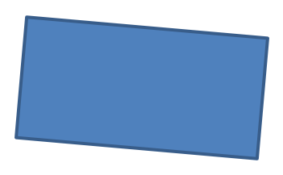

## **Introduzione**

Formatta le forme in PowerPoint regolando i loro contorni, riempimenti e effetti. Aspose.Slides per Python via Java ti consente di controllare queste impostazioni tramite codice, inclusi trasparenza, rotazione e formattazione 3D.


Aspose.Slides per Python via Java fornisce classi e metodi che ti permettono di formattare le forme usando le stesse opzioni disponibili in PowerPoint.

## **Formattare le linee**

Usa [Shape.getLineFormat](https://reference.aspose.com/slides/python-java/aspose.slides/shape/#getLineFormat) per controllare il contorno di una forma. Questo esempio crea un rettangolo senza riempimento con un contorno blu tratteggiato. [LineFormat.setStyle](https://reference.aspose.com/slides/python-java/aspose.slides/lineformat/#setStyle) seleziona una linea composita spessa-sottile, mentre [LineFormat.setWidth](https://reference.aspose.com/slides/python-java/aspose.slides/lineformat/#setWidth) imposta la sua larghezza a 7 punti e [LineFormat.setDashStyle](https://reference.aspose.com/slides/python-java/aspose.slides/lineformat/#setDashStyle) seleziona il modello di tratteggio.

```python
import jpype
import asposeslides

if not jpype.isJVMStarted():
    jpype.startJVM()

from asposeslides.api import FillType, LineDashStyle, LineStyle, Presentation, SaveFormat, ShapeType
from java.awt import Color

presentation = Presentation()
try:
    slide = presentation.getSlides().get_Item(0)

    shape = slide.getShapes().addAutoShape(ShapeType.Rectangle, 50, 50, 150, 75)
    shape.getFillFormat().setFillType(FillType.NoFill)
    shape.getLineFormat().setStyle(LineStyle.ThickThin)
    shape.getLineFormat().setWidth(7)
    shape.getLineFormat().setDashStyle(LineDashStyle.Dash)
    shape.getLineFormat().getFillFormat().setFillType(FillType.Solid)
    shape.getLineFormat().getFillFormat().getSolidFillColor().setColor(Color.BLUE)

    presentation.save("formatted_lines.pptx", SaveFormat.Pptx)
finally:
    presentation.dispose()
```

Il risultato:


### **Imposta modelli di tratto personalizzati per le linee**

Usa [LineFormat.setCustomDashPattern](https://reference.aspose.com/slides/python-java/aspose.slides/lineformat/#setCustomDashPattern) quando gli stili di linea predefiniti non forniscono le lunghezze di tratto e spazi di cui hai bisogno, ad esempio per contorni aziendali o diagrammi tecnici. L'assegnazione di un modello cambia automaticamente lo stile di tratto della linea in [LineDashStyle.Custom](https://reference.aspose.com/slides/python-java/aspose.slides/linedashstyle/).

Gli elementi dell'array alternano tra lunghezze di tratto e di spazio, iniziando con un tratto. Ogni valore è un multiplo della larghezza della linea: `[4, 2]` a una larghezza di 3 punti produce un tratto di 12 punti seguito da uno spazio di 6 punti. Usa coppie di valori finiti e non negativi per definire segmenti completi di tratto‑spazio. L'esempio usa valori positivi per mantenere visibili tutti i tratti e gli spazi.

Questo esempio crea cinque linee blu con la stessa lunghezza e estremità piatte. Le prime tre confrontano i modelli a una larghezza di 3 punti. La quarta ripete il primo modello al doppio della larghezza, raddoppiando sia i tratti sia gli spazi. La quinta passa da un modello personalizzato a una linea continua.

```python
import jpype
import asposeslides

if not jpype.isJVMStarted():
    jpype.startJVM()

from asposeslides.api import FillType, LineArrowheadStyle, LineCapStyle, LineDashStyle, Presentation, SaveFormat, ShapeType, SlideSizeScaleType
from java.awt import Color

presentation = Presentation()
try:
    presentation.getSlideSize().setSize(600, 300, SlideSizeScaleType.DoNotScale)
    slide = presentation.getSlides().get_Item(0)

    patterns = [
        [4, 2],
        [1, 2],
        [6, 2, 1, 2],
        [4, 2],
        [4, 2]
    ]

    for i, pattern in enumerate(patterns):
        line = slide.getShapes().addAutoShape(ShapeType.Line, 50, 50 + i * 50, 500, 0)
        line.getLineFormat().setWidth(6 if i == 3 else 3)
        line.getLineFormat().getFillFormat().setFillType(FillType.Solid)
        color = Color(0, 0, 139)
        line.getLineFormat().getFillFormat().getSolidFillColor().setColor(color)
        line.getLineFormat().setCapStyle(LineCapStyle.Flat)
        line.getLineFormat().setBeginArrowheadStyle(LineArrowheadStyle.None_)
        line.getLineFormat().setEndArrowheadStyle(LineArrowheadStyle.None_)
        line.getLineFormat().setCustomDashPattern(jpype.JArray(jpype.JFloat)(pattern))

    # Restituisci l'ultima linea a uno stile solido.
    slide.getShapes().get_Item(4).getLineFormat().setDashStyle(LineDashStyle.Solid)

    presentation.save("custom_dash_patterns.pptx", SaveFormat.Pptx)
finally:
    presentation.dispose()
```

Per tornare a uno stile tratteggiato predefinito invece, passa [LineDashStyle.Dash](https://reference.aspose.com/slides/python-java/aspose.slides/linedashstyle/) a [LineFormat.setDashStyle](https://reference.aspose.com/slides/python-java/aspose.slides/lineformat/#setDashStyle). Lo stile selezionato controlla l'aspetto della linea.

Il risultato in PowerPoint, dall'alto verso il basso: **{4, 2}, 3 pt**; **{1, 2}, 3 pt**; **{6, 2, 1, 2}, 3 pt**; **{4, 2}, 6 pt**; e **Solid, 3 pt**.


### **Imposta i cappucci delle linee**

Usa [LineFormat.setCapStyle](https://reference.aspose.com/slides/python-java/aspose.slides/lineformat/#setCapStyle) per impostare le estremità di una linea aperta. La classe [LineCapStyle](https://reference.aspose.com/slides/python-java/aspose.slides/linecapstyle/) fornisce tre stili di cappuccio espliciti:

- `Flat`: Il tratto si ferma al punto finale.
- `Round`: Un cappuccio semicircolare si estende oltre il punto finale di metà larghezza della linea.
- `Square`: Un cappuccio quadrato si estende oltre il punto finale di metà larghezza della linea.

La classe include anche `NotDefined`, che significa che non è stato assegnato alcun stile di cappuccio.

I cappucci sono diversi dalle punte di freccia, che aggiungono simboli alle estremità della linea, e dalle giunzioni, che controllano gli angoli tra i segmenti di linea. Questo esempio disabilita le punte di freccia tramite [LineFormat.setBeginArrowheadStyle](https://reference.aspose.com/slides/python-java/aspose.slides/lineformat/#setBeginArrowheadStyle) e [LineFormat.setEndArrowheadStyle](https://reference.aspose.com/slides/python-java/aspose.slides/lineformat/#setEndArrowheadStyle) in modo che vengano confrontati solo i cappucci.

L'esempio seguente crea tre linee orizzontali altrimenti identiche, larghe 20 punti. Dall'alto verso il basso, usano rispettivamente cappucci flat, round e square. Le loro estremità hanno le stesse coordinate orizzontali; i cappucci round e square si estendono per 10 punti oltre ogni estremità.

```python
import jpype
import asposeslides

if not jpype.isJVMStarted():
    jpype.startJVM()

from asposeslides.api import FillType, LineArrowheadStyle, LineCapStyle, LineDashStyle, Presentation, SaveFormat, ShapeType, SlideSizeScaleType
from java.awt import Color

presentation = Presentation()
try:
    presentation.getSlideSize().setSize(500, 240, SlideSizeScaleType.DoNotScale)
    slide = presentation.getSlides().get_Item(0)

    cap_styles = [LineCapStyle.Flat, LineCapStyle.Round, LineCapStyle.Square]

    for i, cap_style in enumerate(cap_styles):
        line = slide.getShapes().addAutoShape(ShapeType.Line, 100, 50 + i * 70, 300, 0)
        line.getLineFormat().setWidth(20)
        line.getLineFormat().getFillFormat().setFillType(FillType.Solid)
        color = Color(0, 0, 139)
        line.getLineFormat().getFillFormat().getSolidFillColor().setColor(color)
        line.getLineFormat().setDashStyle(LineDashStyle.Solid)
        line.getLineFormat().setCapStyle(cap_style)
        line.getLineFormat().setBeginArrowheadStyle(LineArrowheadStyle.None_)
        line.getLineFormat().setEndArrowheadStyle(LineArrowheadStyle.None_)

    presentation.save("line_caps.pptx", SaveFormat.Pptx)
finally:
    presentation.dispose()
```

Il risultato in PowerPoint, dall'alto verso il basso: **Flat**, **Round** e **Square**.


## **Applicare gli effetti di schizzo alle linee della forma**

Un effetto di schizzo rende la linea di una forma simile a un disegno a mano. Usa [Shape.getLineFormat](https://reference.aspose.com/slides/python-java/aspose.slides/shape/#getLineFormat) per accedere alle impostazioni della linea, [LineFormat.getSketchFormat](https://reference.aspose.com/slides/python-java/aspose.slides/lineformat/#getSketchFormat) per accedere alle impostazioni di schizzo e [SketchFormat.setSketchType](https://reference.aspose.com/slides/python-java/aspose.slides/sketchformat/#setSketchType) per selezionare un valore dalla classe [LineSketchType](https://reference.aspose.com/slides/python-java/aspose.slides/linesketchtype/).

Il codice Python seguente mostra come applicare un effetto [LineSketchType.Curved](https://reference.aspose.com/slides/python-java/aspose.slides/linesketchtype/), leggere il valore assegnato esplicitamente e rimuovere l'effetto con [LineSketchType.None_](https://reference.aspose.com/slides/python-java/aspose.slides/linesketchtype/):

```python
import jpype
import asposeslides

if not jpype.isJVMStarted():
    jpype.startJVM()

from asposeslides.api import LineSketchType, Presentation, ShapeType

presentation = Presentation()
try:
    slide = presentation.getSlides().get_Item(0)

    shape = slide.getShapes().addAutoShape(ShapeType.Rectangle, 50, 50, 200, 100)

    sketch_format = shape.getLineFormat().getSketchFormat()
    sketch_format.setSketchType(LineSketchType.Curved)
    explicit_sketch_type = sketch_format.getSketchType()
    print("Explicit sketch type:", explicit_sketch_type)
    sketch_format.setSketchType(LineSketchType.None_)
finally:
    presentation.dispose()
```

Il valore restituito da [SketchFormat.getSketchType](https://reference.aspose.com/slides/python-java/aspose.slides/sketchformat/#getSketchType) rappresenta l'impostazione assegnata direttamente alla forma. Se la formattazione della linea può essere ereditata da un tema, da una diapositiva master o da una diapositiva layout, usa [LineFormat.getEffective](https://reference.aspose.com/slides/python-java/aspose.slides/lineformat/#getEffective) e leggi il tipo di schizzo dalla formattazione della linea effettiva restituita, come mostrato di seguito. Il valore effettivo riflette la formattazione realmente applicata dopo la risoluzione dell'ereditarietà. Questo esempio richiede una presentazione esistente con almeno una forma nella prima diapositiva e stampa entrambi i valori:

```python
import jpype
import asposeslides

if not jpype.isJVMStarted():
    jpype.startJVM()

from asposeslides.api import Presentation

presentation = Presentation("presentation.pptx")
try:
    shape = presentation.getSlides().get_Item(0).getShapes().get_Item(0)

    line_format = shape.getLineFormat()
    explicit_sketch_type = line_format.getSketchFormat().getSketchType()
    effective_line_format = line_format.getEffective()
    effective_sketch_type = effective_line_format.getSketchFormat().getSketchType()

    print("Explicit sketch type:", explicit_sketch_type)
    print("Effective sketch type:", effective_sketch_type)
finally:
    presentation.dispose()
```

## **Formattare gli stili di giunzione**

Ecco le tre opzioni di tipo di giunzione:

* Round
* Miter
* Bevel

Lo stile di giunzione controlla come due segmenti di contorno si incontrano a un angolo. Usa **Round** per angoli arrotondati, **Miter** per angoli affilati o **Bevel** per angoli smussati.


Questo esempio crea tre rettangoli neri con contorni blu larghi 15 punti. Usa [LineFormat.setJoinStyle](https://reference.aspose.com/slides/python-java/aspose.slides/lineformat/#setJoinStyle) per impostare rispettivamente i valori miter, bevel e round di [LineJoinStyle](https://reference.aspose.com/slides/python-java/aspose.slides/linejoinstyle/), per confrontare come vengono disegnati gli angoli.

```python
import jpype
import asposeslides

if not jpype.isJVMStarted():
    jpype.startJVM()

from asposeslides.api import FillType, LineJoinStyle, Presentation, SaveFormat, ShapeType
from java.awt import Color

presentation = Presentation()
try:
    slide = presentation.getSlides().get_Item(0)

    miter_shape = slide.getShapes().addAutoShape(ShapeType.Rectangle, 20, 20, 150, 75)
    bevel_shape = slide.getShapes().addAutoShape(ShapeType.Rectangle, 210, 20, 150, 75)
    round_shape = slide.getShapes().addAutoShape(ShapeType.Rectangle, 20, 135, 150, 75)

    miter_shape.getFillFormat().setFillType(FillType.Solid)
    miter_shape.getFillFormat().getSolidFillColor().setColor(Color.BLACK)
    bevel_shape.getFillFormat().setFillType(FillType.Solid)
    bevel_shape.getFillFormat().getSolidFillColor().setColor(Color.BLACK)
    round_shape.getFillFormat().setFillType(FillType.Solid)
    round_shape.getFillFormat().getSolidFillColor().setColor(Color.BLACK)

    miter_shape.getLineFormat().setWidth(15)
    bevel_shape.getLineFormat().setWidth(15)
    round_shape.getLineFormat().setWidth(15)

    miter_shape.getLineFormat().getFillFormat().setFillType(FillType.Solid)
    miter_shape.getLineFormat().getFillFormat().getSolidFillColor().setColor(Color.BLUE)
    bevel_shape.getLineFormat().getFillFormat().setFillType(FillType.Solid)
    bevel_shape.getLineFormat().getFillFormat().getSolidFillColor().setColor(Color.BLUE)
    round_shape.getLineFormat().getFillFormat().setFillType(FillType.Solid)
    round_shape.getLineFormat().getFillFormat().getSolidFillColor().setColor(Color.BLUE)

    miter_shape.getLineFormat().setJoinStyle(LineJoinStyle.Miter)
    bevel_shape.getLineFormat().setJoinStyle(LineJoinStyle.Bevel)
    round_shape.getLineFormat().setJoinStyle(LineJoinStyle.Round)

    miter_shape.getTextFrame().setText("Miter Join Style")
    bevel_shape.getTextFrame().setText("Bevel Join Style")
    round_shape.getTextFrame().setText("Round Join Style")

    presentation.save("join_styles.pptx", SaveFormat.Pptx)
finally:
    presentation.dispose()
```

### **Limita le giunzioni a spigolo nei corner affilati**

Usa [LineFormat.setMiterLimit](https://reference.aspose.com/slides/python-java/aspose.slides/lineformat/#setMiterLimit) con [LineFormat.setJoinStyle](https://reference.aspose.com/slides/python-java/aspose.slides/lineformat/#setJoinStyle) impostato su [LineJoinStyle.Miter](https://reference.aspose.com/slides/python-java/aspose.slides/linejoinstyle/) per limitare quanto può estendersi un angolo affilato.

Il limite è un rapporto tra la distanza tra gli angoli interno ed esterno della giunzione e la larghezza della linea. Ad esempio, un valore di `8` consente una lunghezza di spigolo fino a otto volte la larghezza della linea; non è una misura in punti. Se l'angolo superasse il limite, PowerPoint utilizza una giunzione smussata in quel punto. Un limite più alto permette punte più affilate. L'impostazione influisce solo sulle giunzioni a spigolo e non ha effetto visivo quando l'angolo rimane entro entrambi i limiti.

Questo esempio crea due triangoli identici senza riempimento, con contorni larghi 20 punti. Il triangolo sinistro usa un limite di `2`, quello destro di `8`. Ogni triangolo è largo 80 punti e alto 160 punti, dando al suo angolo superiore un rapporto lunghezza‑spigolo‑larghezza della linea di circa `4.12`. Di conseguenza, PowerPoint smussa il vertice sinistro e conserva quello destro.

```python
import jpype
import asposeslides

if not jpype.isJVMStarted():
    jpype.startJVM()

from asposeslides.api import FillType, LineJoinStyle, Presentation, SaveFormat, ShapeType, SlideSizeScaleType
from java.awt import Color

presentation = Presentation()
try:
    presentation.getSlideSize().setSize(500, 320, SlideSizeScaleType.DoNotScale)
    slide = presentation.getSlides().get_Item(0)

    miter_limits = [2.0, 8.0]

    for i, miter_limit in enumerate(miter_limits):
        triangle = slide.getShapes().addAutoShape(ShapeType.Triangle, 90 + i * 240, 110, 80, 160)
        triangle.getFillFormat().setFillType(FillType.NoFill)
        triangle.getLineFormat().setWidth(20)
        triangle.getLineFormat().getFillFormat().setFillType(FillType.Solid)
        color = Color(0, 0, 139)
        triangle.getLineFormat().getFillFormat().getSolidFillColor().setColor(color)
        triangle.getLineFormat().setJoinStyle(LineJoinStyle.Miter)
        triangle.getLineFormat().setMiterLimit(miter_limit)

    presentation.save("miter_limits.pptx", SaveFormat.Pptx)
finally:
    presentation.dispose()
```

Il risultato in PowerPoint: **Limite di spigolo 2** a sinistra e **limite di spigolo 8** a destra.


## **Riempimento a gradiente**

Un riempimento a gradiente mescola i colori lungo una forma. Questo esempio riempie un'ellisse con un gradiente lineare a 45 gradi dal rosso al viola usando [FillFormat.getGradientFormat](https://reference.aspose.com/slides/python-java/aspose.slides/fillformat/#getGradientFormat). Il metodo [GradientStopCollection.addPresetColor](https://reference.aspose.com/slides/python-java/aspose.slides/gradientstopcollection/#addPresetColor) posiziona le fermate di colore a 0 e 1, l'inizio e la fine del gradiente. La cancellazione delle fermate esistenti garantisce che vengano usati solo questi due colori.

```python
import jpype
import asposeslides

if not jpype.isJVMStarted():
    jpype.startJVM()

from asposeslides.api import FillType, GradientShape, Presentation, PresetColor, SaveFormat, ShapeType
from java.awt import Color

presentation = Presentation()
try:
    slide = presentation.getSlides().get_Item(0)

    shape = slide.getShapes().addAutoShape(ShapeType.Ellipse, 50, 50, 150, 75)
    shape.getFillFormat().setFillType(FillType.Gradient)
    shape.getFillFormat().getGradientFormat().setGradientShape(GradientShape.Linear)
    shape.getFillFormat().getGradientFormat().setLinearGradientAngle(45)
    shape.getFillFormat().getGradientFormat().getGradientStops().clear()
    shape.getFillFormat().getGradientFormat().getGradientStops().addPresetColor(1.0, PresetColor.Purple)
    shape.getFillFormat().getGradientFormat().getGradientStops().addPresetColor(0.0, PresetColor.Red)

    presentation.save("gradient_fill.pptx", SaveFormat.Pptx)
finally:
    presentation.dispose()
```

Il risultato:


Se un gradiente appare diverso in un'immagine esportata rispetto a PowerPoint, consulta [Choose a Gradient Rendering Style](/slides/it/python-java/convert-powerpoint-to-png/#choose-a-gradient-rendering-style). Puoi selezionare uno stile di rendering senza modificare il gradiente salvato nella presentazione.

### **Imposta l'angolo del gradiente lineare**

Usa [GradientFormat.setLinearGradientAngle](https://reference.aspose.com/slides/python-java/aspose.slides/gradientformat/#setLinearGradientAngle) per controllare l'orientamento di un riempimento [GradientShape.Linear](https://reference.aspose.com/slides/python-java/aspose.slides/gradientshape/). L'angolo è misurato in gradi e aumenta in senso orario: `0` va da sinistra a destra, `90` dall'alto verso il basso, `180` da destra a sinistra e `270` dal basso verso l'alto. Sono supportati angoli frazionari. Angoli finiti al di fuori dell'intervallo `[0, 360)` vengono normalizzati a una rivoluzione; per esempio, `-45` diventa `315` e `360` diventa `0`.

Questo esempio crea sei rettangoli con fermate di colore rosso, verde e blu identiche nelle posizioni `0`, `0.5` e `1`. La scalatura è disabilitata in modo che l'angolo possa essere confrontato indipendentemente dalle proporzioni dei rettangoli. Gli angoli, da sinistra a destra, sono `0`, `45` e `90` nella prima riga, e `135`, `180` e `270` nella seconda riga.

```python
import jpype
import asposeslides

if not jpype.isJVMStarted():
    jpype.startJVM()

from asposeslides.api import FillType, GradientShape, NullableBool, Presentation, SaveFormat, ShapeType, SlideSizeScaleType
from java.awt import Color

presentation = Presentation()
try:
    presentation.getSlideSize().setSize(720, 400, SlideSizeScaleType.DoNotScale)
    slide = presentation.getSlides().get_Item(0)

    angles = [0, 45, 90, 135, 180, 270]

    for i, angle in enumerate(angles):
        x = 30 + (i % 3) * 230
        y = 30 + (i // 3) * 190

        shape = slide.getShapes().addAutoShape(ShapeType.Rectangle, x, y, 200, 150)
        shape.getLineFormat().getFillFormat().setFillType(FillType.NoFill)
        shape.getFillFormat().setFillType(FillType.Gradient)

        gradient = shape.getFillFormat().getGradientFormat()
        gradient.setGradientShape(GradientShape.Linear)
        gradient.getGradientStops().clear()
        gradient.getGradientStops().add(0, Color.RED)
        gradient.getGradientStops().add(0.5, Color.GREEN)
        gradient.getGradientStops().add(1, Color.BLUE)
        gradient.setLinearGradientScaled(NullableBool.False_)
        gradient.setLinearGradientAngle(angle)

    presentation.save("linear_gradient_angles.pptx", SaveFormat.Pptx)
finally:
    presentation.dispose()
```

Il risultato in PowerPoint:


### **Scala un gradiente lineare con la forma**

[GradientFormat.setLinearGradientScaled](https://reference.aspose.com/slides/python-java/aspose.slides/gradientformat/#setLinearGradientScaled) accetta un valore [NullableBool](https://reference.aspose.com/slides/python-java/aspose.slides/nullablebool/). Impostalo esplicitamente su `False_` per mantenere l'angolo geometrico del gradiente quando le proporzioni della forma cambiano, o su `True_` per scalare il gradiente con la larghezza e l'altezza della forma. Con la scalatura abilitata, l'angolo visibile può differire dall'angolo assegnato su una forma non quadrata.

L'esempio seguente usa un angolo di `45` gradi e le stesse fermate di colore dell'esempio di confronto degli angoli. La colonna di sinistra usa `False_`; la colonna di destra usa `True_`. Ogni colonna contiene un rettangolo largo sopra un rettangolo alto. Entrambe partono con le stesse dimensioni larghe; modificare larghezza e altezza del secondo rettangolo dimostra come il riempimento risponde al ridimensionamento senza cambiare le impostazioni del gradiente.

```python
import jpype
import asposeslides

if not jpype.isJVMStarted():
    jpype.startJVM()

from asposeslides.api import FillType, GradientShape, NullableBool, Presentation, SaveFormat, ShapeType, SlideSizeScaleType
from java.awt import Color

presentation = Presentation()
try:
    presentation.getSlideSize().setSize(720, 460, SlideSizeScaleType.DoNotScale)
    slide = presentation.getSlides().get_Item(0)

    scaling_options = [NullableBool.False_, NullableBool.True_]

    for column, scaled in enumerate(scaling_options):
        for row in range(2):
            x = 30 + column * 360
            y = 30 if row == 0 else 150

            shape = slide.getShapes().addAutoShape(ShapeType.Rectangle, x, y, 300, 90)
            shape.getLineFormat().getFillFormat().setFillType(FillType.NoFill)
            shape.getFillFormat().setFillType(FillType.Gradient)

            gradient = shape.getFillFormat().getGradientFormat()
            gradient.setGradientShape(GradientShape.Linear)
            gradient.getGradientStops().clear()
            gradient.getGradientStops().add(0, Color.RED)
            gradient.getGradientStops().add(0.5, Color.GREEN)
            gradient.getGradientStops().add(1, Color.BLUE)
            gradient.setLinearGradientAngle(45)
            gradient.setLinearGradientScaled(scaled)

            if row == 1:
                shape.setWidth(90)
                shape.setHeight(280)

    presentation.save("linear_gradient_scaling.pptx", SaveFormat.Pptx)
finally:
    presentation.dispose()
```

Il risultato in PowerPoint, con la scalatura disabilitata a sinistra e abilitata a destra:


Con la scalatura disabilitata, le bande di colore diagonali mantengono la stessa orientazione in entrambi i rettangoli. Con la scalatura abilitata, le bande si allungano con le proporzioni della forma. Questo aiuta a ricreare il gradiente di un modello quando la forma viene adattata a una dimensione diversa. Su un quadrato, abilitare la scalatura non cambia l'aspetto di questo gradiente a `45` gradi.

Sia l'angolo sia le impostazioni di scalatura si applicano ai gradienti lineari. Non controllano i riempimenti [GradientShape.Radial o GradientShape.Rectangle](https://reference.aspose.com/slides/python-java/aspose.slides/gradientshape/).

### **Combina l'angolo con la direzione del gradiente**

[GradientFormat.setGradientDirection](https://reference.aspose.com/slides/python-java/aspose.slides/gradientformat/#setGradientDirection) seleziona uno stile di gradiente dalla classe [GradientDirection](https://reference.aspose.com/slides/python-java/aspose.slides/gradientdirection/); non è un sostituto per un angolo numerico. Per un gradiente lineare, gli stili d'angolo possono modificare l'area su cui i colori sono distribuiti senza cambiare l'angolo assegnato tramite [setLinearGradientAngle](https://reference.aspose.com/slides/python-java/aspose.slides/gradientformat/#setLinearGradientAngle). Mantieni la direzione invariata quando confronti angoli o scalature.

L'esempio seguente applica le stesse impostazioni in ordine inverso. I due rettangoli hanno lo stesso aspetto: assegnare la direzione prima o dopo l'angolo non cambia il risultato.

```python
import jpype
import asposeslides

if not jpype.isJVMStarted():
    jpype.startJVM()

from asposeslides.api import FillType, GradientDirection, GradientShape, NullableBool, Presentation, SaveFormat, ShapeType
from java.awt import Color

presentation = Presentation()
try:
    slide = presentation.getSlides().get_Item(0)

    for i in range(2):
        shape = slide.getShapes().addAutoShape(ShapeType.Rectangle, 30, 30 + i * 140, 320, 100)
        shape.getLineFormat().getFillFormat().setFillType(FillType.NoFill)
        shape.getFillFormat().setFillType(FillType.Gradient)

        gradient = shape.getFillFormat().getGradientFormat()
        gradient.setGradientShape(GradientShape.Linear)
        gradient.getGradientStops().clear()
        gradient.getGradientStops().add(0, Color.RED)
        gradient.getGradientStops().add(0.5, Color.GREEN)
        gradient.getGradientStops().add(1, Color.BLUE)
        gradient.setLinearGradientScaled(NullableBool.True_)

        if i == 0:
            gradient.setGradientDirection(GradientDirection.FromCorner1)
            gradient.setLinearGradientAngle(30)
        else:
            gradient.setLinearGradientAngle(30)
            gradient.setGradientDirection(GradientDirection.FromCorner1)

    presentation.save("linear_gradient_direction.pptx", SaveFormat.Pptx)
finally:
    presentation.dispose()
```

## **Riempimento a motivo**

Un riempimento a motivo applica un disegno bicolore, come punti, strisce o quadretti. Questo esempio usa [PatternFormat.setPatternStyle](https://reference.aspose.com/slides/python-java/aspose.slides/patternformat/#setPatternStyle) per selezionare un motivo reticolato. [PatternFormat.getBackColor](https://reference.aspose.com/slides/python-java/aspose.slides/patternformat/#getBackColor) fornisce lo sfondo grigio chiaro, e [PatternFormat.getForeColor](https://reference.aspose.com/slides/python-java/aspose.slides/patternformat/#getForeColor) fornisce il colore giallo del motivo.

```python
import jpype
import asposeslides

if not jpype.isJVMStarted():
    jpype.startJVM()

from asposeslides.api import FillType, PatternStyle, Presentation, SaveFormat, ShapeType
from java.awt import Color

presentation = Presentation()
try:
    slide = presentation.getSlides().get_Item(0)

    shape = slide.getShapes().addAutoShape(ShapeType.Rectangle, 50, 50, 150, 75)
    shape.getFillFormat().setFillType(FillType.Pattern)
    shape.getFillFormat().getPatternFormat().setPatternStyle(PatternStyle.Trellis)
    shape.getFillFormat().getPatternFormat().getBackColor().setColor(Color.LIGHT_GRAY)
    shape.getFillFormat().getPatternFormat().getForeColor().setColor(Color.YELLOW)

    presentation.save("pattern_fill.pptx", SaveFormat.Pptx)
finally:
    presentation.dispose()
```

Il risultato:


## **Riempimento immagine**

Un riempimento immagine utilizza un'immagine all'interno di una forma. Questo esempio richiede un'immagine locale e usa [Images.fromFile](https://reference.aspose.com/slides/python-java/aspose.slides/images/#fromFile) per caricarla nella raccolta di immagini della presentazione. Impostare [PictureFillFormat.setPictureFillMode](https://reference.aspose.com/slides/python-java/aspose.slides/picturefillformat/#setPictureFillMode) sulla modalità a mattoncini ripete l'immagine all'interno del rettangolo. L'immagine di origine usata qui è mostrata sotto:


```python
import jpype
import asposeslides

if not jpype.isJVMStarted():
    jpype.startJVM()

from asposeslides.api import FillType, Images, PictureFillMode, Presentation, SaveFormat, ShapeType

presentation = Presentation()
try:
    slide = presentation.getSlides().get_Item(0)

    shape = slide.getShapes().addAutoShape(ShapeType.Rectangle, 50, 50, 255, 130)
    shape.getFillFormat().setFillType(FillType.Picture)
    shape.getFillFormat().getPictureFillFormat().setPictureFillMode(PictureFillMode.Tile)

    image = Images.fromFile("lotus.png")
    try:
        picture = presentation.getImages().addImage(image)
    finally:
        image.dispose()
    shape.getFillFormat().getPictureFillFormat().getPicture().setImage(picture)

    presentation.save("picture_fill.pptx", SaveFormat.Pptx)
finally:
    presentation.dispose()
```

Il risultato:


### **Affianca immagine come texture**

Se desideri impostare un'immagine a mattoncini come texture e personalizzare il comportamento di mattonatura, puoi usare i seguenti metodi della classe [PictureFillFormat](https://reference.aspose.com/slides/python-java/aspose.slides/picturefillformat/):

- [setPictureFillMode](https://reference.aspose.com/slides/python-java/aspose.slides/picturefillformat/#setPictureFillMode): Imposta la modalità di riempimento immagine—`Tile` o `Stretch`.
- [setTileAlignment](https://reference.aspose.com/slides/python-java/aspose.slides/picturefillformat/#setTileAlignment): Specifica l'allineamento dei mattoni all'interno della forma.
- [setTileFlip](https://reference.aspose.com/slides/python-java/aspose.slides/picturefillformat/#setTileFlip): Controlla se il mattone è capovolto orizzontalmente, verticalmente o in entrambi i versi.
- [setTileOffsetX](https://reference.aspose.com/slides/python-java/aspose.slides/picturefillformat/#setTileOffsetX): Imposta lo spostamento orizzontale del mattone (in punti) dall'origine della forma.
- [setTileOffsetY](https://reference.aspose.com/slides/python-java/aspose.slides/picturefillformat/#setTileOffsetY): Imposta lo spostamento verticale del mattone (in punti) dall'origine della forma.
- [setTileScaleX](https://reference.aspose.com/slides/python-java/aspose.slides/picturefillformat/#setTileScaleX): Definisce la scala orizzontale del mattone come percentuale.
- [setTileScaleY](https://reference.aspose.com/slides/python-java/aspose.slides/picturefillformat/#setTileScaleY): Definisce la scala verticale del mattone come percentuale.

Questo esempio richiede un'immagine locale e configura [PictureFillFormat](https://reference.aspose.com/slides/python-java/aspose.slides/picturefillformat/) per ripeterla al 50 % della sua dimensione originale. Spostamenti di −32 punti spostano i mattoni orizzontalmente e verticalmente; l'allineamento in basso a destra e il ribaltamento in entrambe le direzioni determinano come la texture ripetuta è disposta.

```python
import jpype
import asposeslides

if not jpype.isJVMStarted():
    jpype.startJVM()

from asposeslides.api import FillType, Images, PictureFillMode, Presentation, RectangleAlignment, SaveFormat, ShapeType, TileFlip

presentation = Presentation()
try:
    first_slide = presentation.getSlides().get_Item(0)

    shape = first_slide.getShapes().addAutoShape(ShapeType.Rectangle, 50, 50, 190, 95)
    shape.getFillFormat().setFillType(FillType.Picture)

    source_image = Images.fromFile("lotus.png")
    try:
        presentation_image = presentation.getImages().addImage(source_image)
    finally:
        source_image.dispose()

    picture_fill_format = shape.getFillFormat().getPictureFillFormat()
    picture_fill_format.getPicture().setImage(presentation_image)
    picture_fill_format.setPictureFillMode(PictureFillMode.Tile)
    picture_fill_format.setTileOffsetX(-32)
    picture_fill_format.setTileOffsetY(-32)
    picture_fill_format.setTileScaleX(50)
    picture_fill_format.setTileScaleY(50)
    picture_fill_format.setTileAlignment(RectangleAlignment.BottomRight)
    picture_fill_format.setTileFlip(TileFlip.FlipBoth)

    presentation.save("tile.pptx", SaveFormat.Pptx)
finally:
    presentation.dispose()
```

Il risultato:


## **Riempimento a colore solido**

Un riempimento solido assegna alla forma un unico colore uniforme. Questo esempio usa [FillFormat.setFillType](https://reference.aspose.com/slides/python-java/aspose.slides/fillformat/#setFillType) per impostare la modalità di riempimento solido e assegna il giallo tramite [FillFormat.getSolidFillColor](https://reference.aspose.com/slides/python-java/aspose.slides/fillformat/#getSolidFillColor), quindi salva il rettangolo in una presentazione.

```python
import jpype
import asposeslides

if not jpype.isJVMStarted():
    jpype.startJVM()

from asposeslides.api import FillType, Presentation, SaveFormat, ShapeType
from java.awt import Color

presentation = Presentation()
try:
    slide = presentation.getSlides().get_Item(0)

    shape = slide.getShapes().addAutoShape(ShapeType.Rectangle, 50, 50, 150, 75)
    shape.getFillFormat().setFillType(FillType.Solid)
    shape.getFillFormat().getSolidFillColor().setColor(Color.YELLOW)

    presentation.save("solid_color_fill.pptx", SaveFormat.Pptx)
finally:
    presentation.dispose()
```

Il risultato:


### **Copia i colori preservando i riferimenti al tema**

Usa [ColorFormat.copyFrom](https://reference.aspose.com/slides/python-java/aspose.slides/colorformat/#copyFrom) per copiare una definizione di colore, includendo il tipo di colore, il riferimento al tema e le trasformazioni. Questo è utile quando si trasferisce un colore di riempimento tra forme che devono continuare a seguire il tema della presentazione. Il metodo copia solo il colore: non copia il tipo di riempimento, il contorno o altra formattazione della forma. Imposta esplicitamente il tipo di riempimento della destinazione con [FillFormat.setFillType](https://reference.aspose.com/slides/python-java/aspose.slides/fillformat/#setFillType).

Questo esempio crea tre rettangoli, da sinistra a destra: la sorgente, una copia sensibile al tema e una copia RGB fissa. La sorgente usa [ColorFormat.setSchemeColor](https://reference.aspose.com/slides/python-java/aspose.slides/colorformat/#setSchemeColor) per fare riferimento al primo colore di accento e aggiunge una tinta tramite [ColorOperationCollection.add](https://reference.aspose.com/slides/python-java/aspose.slides/coloroperationcollection/#add). La copia RGB usa il colore di riempimento effettivo della sorgente, quindi tutti e tre inizialmente appaiono identici. Chiamare [ColorFormat.setColor](https://reference.aspose.com/slides/python-java/aspose.slides/colorformat/#setColor) imposta un valore RGB fisso e cancella eventuali trasformazioni di colore esistenti.

```python
import jpype
import asposeslides

if not jpype.isJVMStarted():
    jpype.startJVM()

from asposeslides.api import ColorTransformOperation, FillType, ImageFormat, Presentation, SaveFormat, SchemeColor, ShapeType, SlideSizeScaleType
from java.awt import Color

presentation = Presentation()
try:
    presentation.getSlideSize().setSize(660, 220, SlideSizeScaleType.DoNotScale)
    slide = presentation.getSlides().get_Item(0)

    accent_color = Color(65, 105, 225)
    presentation.getMasterTheme().getColorScheme().getAccent1().setColor(accent_color)

    source = slide.getShapes().addAutoShape(ShapeType.Rectangle, 30, 40, 180, 140)
    theme_copy = slide.getShapes().addAutoShape(ShapeType.Rectangle, 240, 40, 180, 140)
    rgb_copy = slide.getShapes().addAutoShape(ShapeType.Rectangle, 450, 40, 180, 140)

    for shape in (source, theme_copy, rgb_copy):
        shape.getFillFormat().setFillType(FillType.Solid)
        shape.getLineFormat().getFillFormat().setFillType(FillType.NoFill)

    source_color = source.getFillFormat().getSolidFillColor()
    source_color.setSchemeColor(SchemeColor.Accent1)
    source_color.getColorTransform().add(ColorTransformOperation.Tint, 0.75)

    theme_copy.getFillFormat().getSolidFillColor().copyFrom(source_color)
    rgb_copy.getFillFormat().getSolidFillColor().setColor(source.getFillFormat().getEffective().getSolidFillColor())

    before = slide.getImage(1.0, 1.0)
    try:
        before.save("color-copy-before.png", ImageFormat.Png)
    finally:
        before.dispose()

    # I riferimenti al tema seguono il nuovo colore di accento; il valore RGB fisso no.
    accent_color = Color(255, 69, 0)
    presentation.getMasterTheme().getColorScheme().getAccent1().setColor(accent_color)

    after = slide.getImage(1.0, 1.0)
    try:
        after.save("color-copy-after.png", ImageFormat.Png)
    finally:
        after.dispose()
    presentation.save("copied_colors.pptx", SaveFormat.Pptx)
finally:
    presentation.dispose()
```

Prima della modifica del tema, tutti e tre i riempimenti corrispondono:


Dopo la modifica del tema, la sorgente e la copia sensibile al tema seguono il nuovo colore di accento e conservano la loro tinta. La copia RGB fissa rimane blu:


La definizione copiata è indipendente dalla sorgente. Modificare successivamente il riferimento al tema della sorgente, assegnare un altro colore o aggiungere o rimuovere le sue trasformazioni non cambia la destinazione. Una modifica del tema influisce comunque su entrambe le forme perché ciascuna fa riferimento indipendentemente allo stesso colore del tema.

Salvare e riaprire il PPTX preserva il tipo di colore copiato restituito da [ColorFormat.getColorType](https://reference.aspose.com/slides/python-java/aspose.slides/colorformat/#getColorType), il riferimento al tema e la collezione di trasformazioni restituita da [ColorFormat.getColorTransform](https://reference.aspose.com/slides/python-java/aspose.slides/colorformat/#getColorTransform); non appiattisce la definizione in RGB.

Quando si copia tra contesti tematici diversi, come presentazioni con palette di accento differenti, il riferimento copiato viene risolto rispetto al tema della destinazione. Lo stesso riferimento e le stesse trasformazioni possono quindi produrre un colore visibile diverso. Consulta [Presentation Theme](/slides/it/python-java/presentation-theme/) per ulteriori informazioni sulla configurazione dei colori del tema.

## **Usa lo sfondo della diapositiva come riempimento della forma**

Usa [AutoShape.setUseBackgroundFill](https://reference.aspose.com/slides/python-java/aspose.slides/autoshape/#setUseBackgroundFill) quando una forma deve corrispondere allo sfondo della diapositiva, ad esempio in un modello di presentazione. Imposta il tipo di riempimento con [FillFormat.setFillType](https://reference.aspose.com/slides/python-java/aspose.slides/fillformat/#setFillType) su [FillType.NotDefined](https://reference.aspose.com/slides/python-java/aspose.slides/filltype/) prima per rimuovere qualsiasi riempimento esplicito. Con questa combinazione, la forma usa lo sfondo della diapositiva invece del suo riempimento di stile. L'attivazione del flag da sola non rimuove un riempimento esplicito esistente.

Questo differisce da [FillType.NoFill](https://reference.aspose.com/slides/python-java/aspose.slides/filltype/): il riempimento di sfondo copre gli oggetti dietro la forma con l'area corrispondente dello sfondo della diapositiva, mentre nessun riempimento lascia visibili quegli oggetti. Un gradiente rimane allineato alla diapositiva anziché ricominciare all'interno di ciascuna forma.

L'esempio seguente crea uno sfondo master ereditato dalla diapositiva e posiziona una banda magenta dietro tre rettangoli. Il rettangolo sinistro usa lo sfondo, il rettangolo centrale non ha riempimento e quello destro passa dal riempimento di sfondo a un riempimento arancione esplicito.

```python
import jpype
import asposeslides

if not jpype.isJVMStarted():
    jpype.startJVM()

from asposeslides.api import BackgroundType, FillType, GradientShape, Presentation, SaveFormat, ShapeType, SlideSizeScaleType
from java.awt import Color

presentation = Presentation()
try:
    presentation.getSlideSize().setSize(720, 400, SlideSizeScaleType.DoNotScale)
    slide = presentation.getSlides().get_Item(0)

    # Eredita il gradiente dal master.
    slide.getBackground().setType(BackgroundType.NotDefined)
    slide.getLayoutSlide().getBackground().setType(BackgroundType.NotDefined)
    background = slide.getLayoutSlide().getMasterSlide().getBackground()
    background.setType(BackgroundType.OwnBackground)
    background.getFillFormat().setFillType(FillType.Gradient)
    gradient = background.getFillFormat().getGradientFormat()
    gradient.setGradientShape(GradientShape.Linear)
    gradient.setLinearGradientAngle(0)
    gradient.getGradientStops().clear()
    color = Color(0, 0, 139)
    gradient.getGradientStops().add(0, color)
    color = Color(135, 206, 250)
    gradient.getGradientStops().add(1, color)

    # Aggiungi questo oggetto per primo così appare dietro i rettangoli.
    band = slide.getShapes().addAutoShape(ShapeType.Rectangle, 25, 150, 670, 100)
    band.getFillFormat().setFillType(FillType.Solid)
    band.getFillFormat().getSolidFillColor().setColor(Color.MAGENTA)
    band.getLineFormat().getFillFormat().setFillType(FillType.NoFill)

    background_shape = slide.getShapes().addAutoShape(ShapeType.Rectangle, 50, 100, 160, 200)
    background_shape.getFillFormat().setFillType(FillType.NotDefined)
    background_shape.setUseBackgroundFill(True)

    no_fill_shape = slide.getShapes().addAutoShape(ShapeType.Rectangle, 280, 100, 160, 200)
    no_fill_shape.getFillFormat().setFillType(FillType.NoFill)

    explicit_shape = slide.getShapes().addAutoShape(ShapeType.Rectangle, 510, 100, 160, 200)
    explicit_shape.getFillFormat().setFillType(FillType.NotDefined)
    explicit_shape.setUseBackgroundFill(True)

    # Disabilita il riempimento di sfondo prima di applicare un riempimento esplicito.
    explicit_shape.setUseBackgroundFill(False)
    explicit_shape.getFillFormat().setFillType(FillType.Solid)
    color = Color(255, 165, 0)
    explicit_shape.getFillFormat().getSolidFillColor().setColor(color)

    presentation.save("background_fill.pptx", SaveFormat.Pptx)
finally:
    presentation.dispose()
```

Il risultato, da sinistra a destra: **riempimento di sfondo**, **senza riempimento** e **riempimento esplicito**. La banda magenta è nascosta dai rettangoli sinistro e destro ma rimane visibile attraverso quello centrale.


Il medesimo comportamento si applica a uno sfondo definito direttamente sulla diapositiva o ereditato da un layout. La forma usa lo sfondo risolto della diapositiva; l'esempio lascia sia lo sfondo della diapositiva sia quello del layout non definiti in modo che il master lo fornisca.

## **Imposta trasparenza**

Per un riempimento solido, il componente alfa del colore controlla l'opacità: 0 è completamente trasparente e 255 è completamente opaco. Questo esempio usa un valore alfa di 128 per un rettangolo giallo, rendendolo circa 50 % trasparente così che il rettangolo sottostante rimanga visibile. Il colore è assegnato tramite [FillFormat.getSolidFillColor](https://reference.aspose.com/slides/python-java/aspose.slides/fillformat/#getSolidFillColor).

```python
import jpype
import asposeslides

if not jpype.isJVMStarted():
    jpype.startJVM()

from asposeslides.api import FillType, Presentation, SaveFormat, ShapeType
from java.awt import Color

presentation = Presentation()
try:
    slide = presentation.getSlides().get_Item(0)

    solid_shape = slide.getShapes().addAutoShape(ShapeType.Rectangle, 50, 50, 150, 75)

    transparent_shape = slide.getShapes().addAutoShape(ShapeType.Rectangle, 80, 80, 150, 75)
    transparent_shape.getFillFormat().setFillType(FillType.Solid)
    color = Color(255, 255, 0, 128)
    transparent_shape.getFillFormat().getSolidFillColor().setColor(color)

    presentation.save("shape_transparency.pptx", SaveFormat.Pptx)
finally:
    presentation.dispose()
```

Il risultato:


## **Ruota le forme**

Usa [Shape.setRotation](https://reference.aspose.com/slides/python-java/aspose.slides/shape/#setRotation) per ruotare una forma nel piano della diapositiva. L'angolo è misurato in gradi; questo esempio ruota un rettangolo di 5 gradi in senso orario e salva la presentazione.

```python
import jpype
import asposeslides

if not jpype.isJVMStarted():
    jpype.startJVM()

from asposeslides.api import Presentation, SaveFormat, ShapeType

presentation = Presentation()
try:
    slide = presentation.getSlides().get_Item(0)

    shape = slide.getShapes().addAutoShape(ShapeType.Rectangle, 50, 50, 150, 75)
    shape.setRotation(5)

    presentation.save("shape_rotation.pptx", SaveFormat.Pptx)
finally:
    presentation.dispose()
```

Il risultato:



## **Aggiungi effetti di smussatura 3D**

Usa [Shape.getThreeDFormat](https://reference.aspose.com/slides/python-java/aspose.slides/shape/#getThreeDFormat) per dare a una forma profondità e spigoli smussati. Questo esempio crea un'ellisse verde con un contorno arancione, usa [ThreeDFormat.setDepth](https://reference.aspose.com/slides/python-java/aspose.slides/threedformat/#setDepth) per impostare la profondità a 4 punti e applica una smussatura superiore circolare con larghezza e altezza di 6 punti tramite [ThreeDFormat.getBevelTop](https://reference.aspose.com/slides/python-java/aspose.slides/threedformat/#getBevelTop). Una telecamera ortografica frontale e un'illuminazione a tre punti rendono visibile la smussatura.

```python
import jpype
import asposeslides

if not jpype.isJVMStarted():
    jpype.startJVM()

from asposeslides.api import BevelPresetType, CameraPresetType, FillType, LightRigPresetType, LightingDirection, Presentation, SaveFormat, ShapeType
from java.awt import Color

presentation = Presentation()
try:
    slide = presentation.getSlides().get_Item(0)

    shape = slide.getShapes().addAutoShape(ShapeType.Ellipse, 50, 50, 100, 100)
    shape.getFillFormat().setFillType(FillType.Solid)
    color = Color(0, 128, 0)
    shape.getFillFormat().getSolidFillColor().setColor(color)
    shape.getLineFormat().getFillFormat().setFillType(FillType.Solid)
    color = Color(255, 165, 0)
    shape.getLineFormat().getFillFormat().getSolidFillColor().setColor(color)
    shape.getLineFormat().setWidth(2.0)
    shape.getThreeDFormat().setDepth(4)
    shape.getThreeDFormat().getBevelTop().setBevelType(BevelPresetType.Circle)
    shape.getThreeDFormat().getBevelTop().setHeight(6)
    shape.getThreeDFormat().getBevelTop().setWidth(6)
    shape.getThreeDFormat().getCamera().setCameraType(CameraPresetType.OrthographicFront)
    shape.getThreeDFormat().getLightRig().setLightType(LightRigPresetType.ThreePt)
    shape.getThreeDFormat().getLightRig().setDirection(LightingDirection.Top)

    presentation.save("3D_bevel_effect.pptx", SaveFormat.Pptx)
finally:
    presentation.dispose()
```

Il risultato:


## **Aggiungi effetti di rotazione 3D**

La vista 3D di una forma è controllata dalle impostazioni della telecamera. Questo esempio usa [Camera.setRotation](https://reference.aspose.com/slides/python-java/aspose.slides/camera/#setRotation) con angoli di latitudine, longitudine e rivoluzione di 40, 35 e 20 gradi, rispettivamente. Seleziona una telecamera isometrica tramite [Camera.setCameraType](https://reference.aspose.com/slides/python-java/aspose.slides/camera/#setCameraType) e un'illuminazione bilanciata tramite [LightRig.setLightType](https://reference.aspose.com/slides/python-java/aspose.slides/lightrig/#setLightType), poi salva il rettangolo formattato.

```python
import jpype
import asposeslides

if not jpype.isJVMStarted():
    jpype.startJVM()

from asposeslides.api import CameraPresetType, LightRigPresetType, Presentation, SaveFormat, ShapeType

presentation = Presentation()
try:
    slide = presentation.getSlides().get_Item(0)

    auto_shape = slide.getShapes().addAutoShape(ShapeType.Rectangle, 50, 50, 150, 75)
    auto_shape.getTextFrame().setText("Hello, Aspose!")
    auto_shape.getThreeDFormat().getCamera().setCameraType(CameraPresetType.IsometricLeftUp)
    auto_shape.getThreeDFormat().getCamera().setRotation(40, 35, 20)
    auto_shape.getThreeDFormat().getLightRig().setLightType(LightRigPresetType.Balanced)

    presentation.save("3D_rotation_effect.pptx", SaveFormat.Pptx)
finally:
    presentation.dispose()
```

Il risultato:


## **Controlla il rendering in bianco e nero per le forme**

Il metodo [Shape.setBlackWhiteMode](https://reference.aspose.com/slides/python-java/aspose.slides/shape/#setBlackWhiteMode) specifica come una singola forma viene renderizzata quando una presentazione viene visualizzata o elaborata in modalità bianco e nero. Non abilita di per sé la visualizzazione in bianco e nero e non modifica il riempimento, il contorno o altra formattazione della forma in modalità a colori normali.

Usa un valore della classe [BlackWhiteMode](https://reference.aspose.com/slides/python-java/aspose.slides/blackwhitemode/) per selezionare il comportamento desiderato. Ad esempio, `Automatic` lascia all'applicazione di rendering scegliere la conversione, `Gray` e `LightGray` usano una colorazione grigia, `BlackWhite` usa solo nero e bianco, `Black` e `White` forzano un singolo colore, `Color` preserva la colorazione normale, e `Hidden` omette la forma in modalità bianco e nero. `NotDefined` significa che nessuna modalità a livello di forma è assegnata.

Questo esempio crea un rettangolo arancione e usa [Shape.setBlackWhiteMode](https://reference.aspose.com/slides/python-java/aspose.slides/shape/#setBlackWhiteMode) per impostare la modalità su grigio. La forma salvata mantiene il riempimento arancione per la visualizzazione a colori normali e richiede una colorazione grigia dalle applicazioni che rispettano le impostazioni di visualizzazione in bianco e nero:

```python
import jpype
import asposeslides

if not jpype.isJVMStarted():
    jpype.startJVM()

from asposeslides.api import BlackWhiteMode, FillType, Presentation, SaveFormat, ShapeType
from java.awt import Color

presentation = Presentation()
try:
    slide = presentation.getSlides().get_Item(0)

    shape = slide.getShapes().addAutoShape(ShapeType.Rectangle, 50, 50, 200, 100)
    shape.getFillFormat().setFillType(FillType.Solid)
    color = Color(255, 165, 0)
    shape.getFillFormat().getSolidFillColor().setColor(color)
    shape.setBlackWhiteMode(BlackWhiteMode.Gray)

    presentation.save("shape_black_white_mode.pptx", SaveFormat.Pptx)
finally:
    presentation.dispose()
```

In modalità a colori normale, il rettangolo mantiene il riempimento arancione. In un flusso di lavoro di visualizzazione in bianco e nero, utilizza la colorazione grigia perché la sua modalità è impostata su `Gray`. Questo ti consente di preservare una diapositiva a colori completi definendo un aspetto distinto per la stampa, l'anteprima o altri flussi di lavoro che rispettano le impostazioni di visualizzazione in bianco e nero della presentazione.

## **Ripristina la formattazione**

Usa [Slide.reset](https://reference.aspose.com/slides/python-java/aspose.slides/slide/#reset) per ripristinare la posizione, le dimensioni e la formattazione dei segnaposto della diapositiva dai corrispondenti segnaposto del layout. Questo esempio richiede una presentazione esistente con segnaposto collegati al layout e ripristina ogni diapositiva prima di salvare. Le forme senza segnaposto corrispondente nel layout non vengono ripristinate.

```python
import jpype
import asposeslides

if not jpype.isJVMStarted():
    jpype.startJVM()

from asposeslides.api import Presentation, SaveFormat

presentation = Presentation("sample.pptx")
try:
    for slide in presentation.getSlides():
        slide.reset()

    presentation.save("reset_formatting.pptx", SaveFormat.Pptx)
finally:
    presentation.dispose()
```

## **FAQ**

**La formattazione delle forme influisce sulla dimensione finale del file della presentazione?**

I colori, gli stili di linea e le impostazioni degli effetti aggiungono generalmente pochi dati rispetto a immagini e media incorporati. I riempimenti immagine possono aumentare la dimensione del file perché le loro immagini sono archiviate nella presentazione.

**Come posso rilevare le forme in una diapositiva che condividono una formattazione identica in modo da raggrupparle?**

Confronta le principali proprietà di formattazione di ciascuna forma—riempimento, linea e impostazioni degli effetti. Se tutti i valori corrispondenti coincidono, considera i loro stili come identici e raggruppa logicamente quelle forme, semplificando la gestione successiva degli stili.

**Posso salvare un insieme di stili di forma personalizzati in un file separato per riutilizzarlo in altre presentazioni?**

Sì. Memorizza forme di esempio con gli stili desiderati in un modello di diapositiva o in un file modello .POTX. Quando crei una nuova presentazione, apri il modello, clona le forme stilizzate di cui hai bisogno e riapplica la loro formattazione dove necessario.