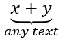

## **Panoramica**

PowerPoint memorizza le equazioni come Office Math Markup Language (OMML). Con Aspose.Slides per Python via .NET, è possibile creare lo stesso tipo di contenuto matematico in modo programmatico: frazioni, radicali, funzioni, limiti, operatori N-ari, matrici, array e blocchi matematici formattati.

In PowerPoint, gli utenti normalmente aggiungono le equazioni da **Insert > Equation**:


Il risultato è del testo matematico modificabile sulla diapositiva:


Aspose.Slides costruisce quel testo matematico attraverso tre oggetti principali:

- Una forma matematica, creata con [add_math_shape](https://reference.aspose.com/slides/python-net/aspose.slides/shapecollection/add_math_shape/), è la forma che contiene l'equazione.
- [MathPortion](https://reference.aspose.com/slides/python-net/aspose.slides.mathtext/mathportion/) memorizza il contenuto matematico all'interno del riquadro di testo della forma.
- [MathParagraph](https://reference.aspose.com/slides/python-net/aspose.slides.mathtext/mathparagraph/) contiene uno o più oggetti [MathBlock](https://reference.aspose.com/slides/python-net/aspose.slides.mathtext/mathblock/).

La maggior parte degli esempi seguenti utilizza [MathematicalText](https://reference.aspose.com/slides/python-net/aspose.slides.mathtext/mathematicaltext/) e i metodi fluenti di [IMathElement](https://reference.aspose.com/slides/python-net/aspose.slides.mathtext/imathelement/) per mantenere il codice breve e leggibile.

Per scenari di esportazione MathML, vedere [Esporta equazioni matematiche da presentazioni in Python via .NET](/slides/it/python-net/exporting-math-equations/).

## **Crea un'equazione**

Questo esempio utilizza [add_math_shape](https://reference.aspose.com/slides/python-net/aspose.slides/shapecollection/add_math_shape/) per creare una forma matematica e aggiunge il teorema di Pitagora:


```py
import aspose.slides as slides
import aspose.slides.mathtext as math

with slides.Presentation() as presentation:
    slide = presentation.slides[0]

    math_shape = slide.shapes.add_math_shape(20, 20, 700, 120)
    math_paragraph = math_shape.text_frame.paragraphs[0].portions[0].math_paragraph

    equation = (
        math.MathematicalText("c")
        .set_superscript("2")
        .join("=")
        .join(math.MathematicalText("a").set_superscript("2"))
        .join("+")
        .join(math.MathematicalText("b").set_superscript("2"))
    )

    math_paragraph.add(equation)

    presentation.save("pythagorean-theorem.pptx", slides.export.SaveFormat.PPTX)
```

{}
[add_math_shape](https://reference.aspose.com/slides/python-net/aspose.slides/shapecollection/add_math_shape/) crea una forma che contiene già un paragrafo matematico. Accedi al primo [MathPortion](https://reference.aspose.com/slides/python-net/aspose.slides.mathtext/mathportion/), ottieni il suo [math_paragraph](https://reference.aspose.com/slides/python-net/aspose.slides.mathtext/mathportion/math_paragraph/), e aggiungi blocchi matematici o elementi matematici.
{}

## **Aggiungi frazioni**

Usa [divide](https://reference.aspose.com/slides/python-net/aspose.slides.mathtext/imathelement/divide/) per creare una frazione. Puoi scegliere uno stile di frazione con [MathFractionTypes](https://reference.aspose.com/slides/python-net/aspose.slides.mathtext/mathfractiontypes/).


```py
import aspose.slides as slides
import aspose.slides.mathtext as math

with slides.Presentation() as presentation:
    slide = presentation.slides[0]

    math_shape = slide.shapes.add_math_shape(20, 20, 700, 100)
    math_paragraph = math_shape.text_frame.paragraphs[0].portions[0].math_paragraph

    fraction = math.MathematicalText("1").divide("x", math.MathFractionTypes.SKEWED)

    math_paragraph.add(math.MathBlock(fraction))

    presentation.save("fraction.pptx", slides.export.SaveFormat.PPTX)
```

Per una frazione impilata, usa [MathFractionTypes.BAR](https://reference.aspose.com/slides/python-net/aspose.slides.mathtext/mathfractiontypes/):

```py
import aspose.slides.mathtext as math

stacked_fraction = math.MathematicalText("x + 1").divide("y - 1", math.MathFractionTypes.BAR)
```

## **Aggiungi radicali**

Usa [radical](https://reference.aspose.com/slides/python-net/aspose.slides.mathtext/imathelement/radical/) per creare una radice quadrata, una radice cubica o un'altra radice. L'elemento corrente diventa la base e l'argomento diventa il grado.


```py
import aspose.slides as slides
import aspose.slides.mathtext as math

with slides.Presentation() as presentation:
    slide = presentation.slides[0]

    math_shape = slide.shapes.add_math_shape(20, 20, 700, 100)
    math_paragraph = math_shape.text_frame.paragraphs[0].portions[0].math_paragraph

    radical = math.MathematicalText("x").radical("n")

    math_paragraph.add(math.MathBlock(radical))

    presentation.save("radical.pptx", slides.export.SaveFormat.PPTX)
```

## **Aggiungi funzioni e limiti**

Usa [as_argument_of_function](https://reference.aspose.com/slides/python-net/aspose.slides.mathtext/imathelement/as_argument_of_function/) o [function](https://reference.aspose.com/slides/python-net/aspose.slides.mathtext/imathelement/function/) per funzioni come `sin(x)`, `log(x)`, o nomi di funzioni personalizzate. Per i limiti, inserisci `lim` in un [MathLimit](https://reference.aspose.com/slides/python-net/aspose.slides.mathtext/mathlimit/) o usa [set_lower_limit](https://reference.aspose.com/slides/python-net/aspose.slides.mathtext/imathelement/set_lower_limit/).


```py
import aspose.slides as slides
import aspose.slides.mathtext as math

with slides.Presentation() as presentation:
    slide = presentation.slides[0]

    math_shape = slide.shapes.add_math_shape(20, 20, 700, 100)
    math_paragraph = math_shape.text_frame.paragraphs[0].portions[0].math_paragraph

    limit = (
        math.MathematicalText("lim")
        .set_lower_limit("x\u2192\u221E")
        .function("x")
    )

    math_paragraph.add(math.MathBlock(limit))

    presentation.save("functions-and-limits.pptx", slides.export.SaveFormat.PPTX)
```

Per un nome di funzione personalizzato, rendi il nome della funzione l'elemento corrente e chiama [function](https://reference.aspose.com/slides/python-net/aspose.slides.mathtext/imathelement/function/) con il suo argomento:

```py
import aspose.slides.mathtext as math

custom_function = math.MathematicalText("f").function("x + 1")
```

## **Aggiungi operatori N-ari e integrali**

Usa [nary](https://reference.aspose.com/slides/python-net/aspose.slides.mathtext/imathelement/nary/) per somme, unioni, intersezioni e altri operatori grandi. Usa [integral](https://reference.aspose.com/slides/python-net/aspose.slides.mathtext/imathelement/integral/) per gli integrali. Entrambi i metodi consentono di impostare i limiti inferiori e superiori.


```py
import aspose.slides as slides
import aspose.slides.mathtext as math

with slides.Presentation() as presentation:
    slide = presentation.slides[0]

    math_shape = slide.shapes.add_math_shape(20, 20, 700, 120)
    math_paragraph = math_shape.text_frame.paragraphs[0].portions[0].math_paragraph

    summation_base = (
        math.MathematicalText("x")
        .set_superscript("k")
        .join(math.MathematicalText("a").set_superscript("n-k"))
    )

    summation = summation_base.nary(math.MathNaryOperatorTypes.SUMMATION, "k=0", "n")

    math_paragraph.add(math.MathBlock(summation))

    presentation.save("nary-operators.pptx", slides.export.SaveFormat.PPTX)
```

Gli operatori N-ari sono per operatori grandi con limiti opzionali. Gli operatori semplici come `+`, `-` e `=` sono solitamente aggiunti come [MathematicalText](https://reference.aspose.com/slides/python-net/aspose.slides.mathtext/mathematicaltext/) e uniti nell'espressione.

Per un integrale, usa [integral](https://reference.aspose.com/slides/python-net/aspose.slides.mathtext/imathelement/integral/):

```py
import aspose.slides.mathtext as math

integral_base = math.MathematicalText("x").join(math.MathematicalText("dx").to_box())
integral = integral_base.integral(math.MathIntegralTypes.SIMPLE, "0", "1")
```

## **Aggiungi matrici**

Usa [MathMatrix](https://reference.aspose.com/slides/python-net/aspose.slides.mathtext/mathmatrix/) per righe e colonne. Le matrici non includono parentesi per impostazione predefinita, quindi racchiudi la matrice quando hai bisogno di parentesi tonde, quadre o graffe.


```py
import aspose.slides as slides
import aspose.slides.mathtext as math

with slides.Presentation() as presentation:
    slide = presentation.slides[0]

    math_shape = slide.shapes.add_math_shape(20, 20, 700, 120)
    math_paragraph = math_shape.text_frame.paragraphs[0].portions[0].math_paragraph

    matrix = math.MathMatrix(2, 3)

    # Una matrice non ha parentesi proprie, quindi racchiudila tra parentesi tonde.
    math_paragraph.add(math.MathBlock(matrix.enclose("(", ")")))

    presentation.save("matrix.pptx", slides.export.SaveFormat.PPTX)
```

{}
`MathMatrix` costruisce la griglia di righe e colonne, imposta gli spazi tra di esse e allinea le colonne, ma Aspose.Slides per Python via .NET non espone un accessor per una singola cella della matrice. Una matrice creata nel codice mantiene quindi celle vuote; le celle di una matrice proveniente da una presentazione esistente possono essere lette con `get_children`. Usa un array di equazioni quando hai bisogno di riempire le righe dal codice.
{}

## **Aggiungi array di equazioni**

Usa [to_math_array](https://reference.aspose.com/slides/python-net/aspose.slides.mathtext/imathelement/to_math_array/) quando hai bisogno di equazioni allineate o di una pila verticale di espressioni.


```py
import aspose.slides as slides
import aspose.slides.mathtext as math

with slides.Presentation() as presentation:
    slide = presentation.slides[0]

    math_shape = slide.shapes.add_math_shape(20, 20, 700, 140)
    math_paragraph = math_shape.text_frame.paragraphs[0].portions[0].math_paragraph

    equation_array = (
        math.MathematicalText("x")
        .join("y")
        .to_math_array()
    )

    math_paragraph.add(math.MathBlock(equation_array))

    presentation.save("equation-array.pptx", slides.export.SaveFormat.PPTX)
```

## **Aggiungi funzioni trigonometriche**

Usa [as_argument_of_function](https://reference.aspose.com/slides/python-net/aspose.slides.mathtext/imathelement/as_argument_of_function/) quando l'argomento è l'elemento corrente e il nome della funzione è noto.


```py
import aspose.slides as slides
import aspose.slides.mathtext as math

with slides.Presentation() as presentation:
    slide = presentation.slides[0]

    math_shape = slide.shapes.add_math_shape(20, 20, 700, 100)
    math_paragraph = math_shape.text_frame.paragraphs[0].portions[0].math_paragraph

    cosine = math.MathematicalText("2x").as_argument_of_function(
        math.MathFunctionsOfOneArgument.COS
    )

    math_paragraph.add(math.MathBlock(cosine))

    presentation.save("trigonometric-function.pptx", slides.export.SaveFormat.PPTX)
```

## **Aggiungi pedici e apici**

Usa gli assistenti per pedice e apice per indici e potenze. Quando gli indici devono apparire sul lato sinistro della base, usa [set_sub_superscript_on_the_left](https://reference.aspose.com/slides/python-net/aspose.slides.mathtext/imathelement/set_sub_superscript_on_the_left/).


```py
import aspose.slides as slides
import aspose.slides.mathtext as math

with slides.Presentation() as presentation:
    slide = presentation.slides[0]

    math_shape = slide.shapes.add_math_shape(20, 20, 700, 100)
    math_paragraph = math_shape.text_frame.paragraphs[0].portions[0].math_paragraph

    scripts = math.MathematicalText("Y").set_sub_superscript_on_the_left("1", "n")

    math_paragraph.add(math.MathBlock(scripts))

    presentation.save("subscript-superscript.pptx", slides.export.SaveFormat.PPTX)
```

## **Aggiungi delimitatori**

Usa [enclose](https://reference.aspose.com/slides/python-net/aspose.slides.mathtext/imathelement/enclose/) per inserire un'espressione all'interno di delimitatori. Puoi anche impostare un carattere separatore per espressioni delimitate che contengono più elementi.


```py
import aspose.slides as slides
import aspose.slides.mathtext as math

with slides.Presentation() as presentation:
    slide = presentation.slides[0]

    math_shape = slide.shapes.add_math_shape(20, 20, 700, 100)
    math_paragraph = math_shape.text_frame.paragraphs[0].portions[0].math_paragraph

    delimiter = (
        math.MathematicalText("x")
        .join("y")
        .join("z")
        .enclose("<", ">")
    )
    delimiter.separator_character = "|"

    math_paragraph.add(math.MathBlock(delimiter))

    presentation.save("delimiters.pptx", slides.export.SaveFormat.PPTX)
```

### **Dimensione e allineamento dei delimitatori**

Imposta [grow_to_match_operand_height](https://reference.aspose.com/slides/python-net/aspose.slides.mathtext/imathdelimiter/grow_to_match_operand_height/) su `True` per far crescere le parentesi intorno a un operando alto, o su `False` per mantenerle alla dimensione normale. [delimiter_shape](https://reference.aspose.com/slides/python-net/aspose.slides.mathtext/imathdelimiter/delimiter_shape/) accetta uno dei due valori [MathDelimiterShape](https://reference.aspose.com/slides/python-net/aspose.slides.mathtext/mathdelimitershape/). `CENTERED` centra le parentesi sull'asse matematico, che attraversa il centro del segno di uguaglianza. `MATCH` le allinea al contenuto racchiuso. Entrambe le impostazioni influenzano solo i delimitatori. L'espressione interna rimane invariata.

L'esempio inserisce una frazione nell'esponente di `x` in modo che l'espressione si estenda più sopra la linea di base rispetto a sotto. Tutte e quattro le equazioni usano le stesse parentesi e impostazioni di carattere.

```python
import aspose.slides as slides
import aspose.slides.mathtext as math


def add_expression(slide, left, top, grow, shape):
    fraction = math.MathematicalText("a + b").divide("c + d")
    power = math.MathematicalText("x").set_superscript(fraction)
    delimiter = power.enclose("(", ")")
    delimiter.grow_to_match_operand_height = grow
    delimiter.delimiter_shape = shape

    math_shape = slide.shapes.add_math_shape(left, top, 300, 100)
    portion = math_shape.text_frame.paragraphs[0].portions[0]
    portion.portion_format.font_height = 32
    equation = math.MathematicalText("y = ").join(delimiter)
    portion.math_paragraph.add(equation)


with slides.Presentation() as presentation:
    slide = presentation.slides[0]
    add_expression(slide, 20, 20, True, math.MathDelimiterShape.CENTERED)
    add_expression(slide, 350, 20, True, math.MathDelimiterShape.MATCH)
    add_expression(slide, 20, 140, False, math.MathDelimiterShape.CENTERED)
    add_expression(slide, 350, 140, False, math.MathDelimiterShape.MATCH)

    presentation.save("delimiter-sizing.pptx", slides.export.SaveFormat.PPTX)
```

In PowerPoint, confronta le righe per vedere l'effetto della crescita. Nella riga superiore, le parentesi crescono per racchiudere l'esponente e appaiono simili per entrambe le forme. Nella riga inferiore, la crescita è disattivata. Le parentesi più piccole a sinistra (`CENTERED`) si allineano con il segno di uguale, mentre quelle a destra (`MATCH`) si posizionano più in alto attorno all'espressione.


## **Aggiungi una casella con bordo**

Usa [to_border_box](https://reference.aspose.com/slides/python-net/aspose.slides.mathtext/imathelement/to_border_box/) quando l'equazione stessa dovrebbe essere incorniciata.


```py
import aspose.slides as slides
import aspose.slides.mathtext as math

with slides.Presentation() as presentation:
    slide = presentation.slides[0]

    math_shape = slide.shapes.add_math_shape(20, 20, 700, 100)
    math_paragraph = math_shape.text_frame.paragraphs[0].portions[0].math_paragraph

    boxed_equation = (
        math.MathematicalText("a")
        .set_superscript("2")
        .join("=")
        .join(math.MathematicalText("b").set_superscript("2"))
        .join("+")
        .join(math.MathematicalText("c").set_superscript("2"))
        .to_border_box()
    )

    math_paragraph.add(math.MathBlock(boxed_equation))

    presentation.save("border-box.pptx", slides.export.SaveFormat.PPTX)
```

## **Raggruppa termini**

Usa [group](https://reference.aspose.com/slides/python-net/aspose.slides.mathtext/imathelement/group/) per posizionare un carattere di raggruppamento sopra o sotto un'espressione. Aggiungi un limite per etichettare i termini raggruppati.



```py
import aspose.slides as slides
import aspose.slides.mathtext as math

with slides.Presentation() as presentation:
    slide = presentation.slides[0]

    math_shape = slide.shapes.add_math_shape(20, 20, 700, 120)
    math_paragraph = math_shape.text_frame.paragraphs[0].portions[0].math_paragraph

    grouped = (
        math.MathematicalText("x + y")
        .group(chr(0x23DF), math.MathTopBotPositions.BOTTOM, math.MathTopBotPositions.TOP)
        .set_lower_limit("any text")
    )

    math_paragraph.add(math.MathBlock(grouped))

    presentation.save("grouped-terms.pptx", slides.export.SaveFormat.PPTX)
```

## **Formatta elementi matematici**

Usa gli assistenti di formattazione solo dove chiariscono la formula. Per esempio, [overbar](https://reference.aspose.com/slides/python-net/aspose.slides.mathtext/imathelement/overbar/) posiziona una barra sopra un elemento matematico.


```py
import aspose.slides as slides
import aspose.slides.mathtext as math

with slides.Presentation() as presentation:
    slide = presentation.slides[0]

    math_shape = slide.shapes.add_math_shape(20, 20, 700, 100)
    math_paragraph = math_shape.text_frame.paragraphs[0].portions[0].math_paragraph

    overbar = math.MathematicalText("ABC").overbar()

    math_paragraph.add(math.MathBlock(overbar))

    presentation.save("overbar.pptx", slides.export.SaveFormat.PPTX)
```

### **Formatta testo in un'equazione esistente**

Per formattare il testo in tutta un'equazione esistente, attraversa l'albero degli elementi di ogni blocco matematico. [IMathElement.get_children](https://reference.aspose.com/slides/python-net/aspose.slides.mathtext/imathelement/get_children/) restituisce solo i figli immediati, quindi chiamalo ricorsivamente per raggiungere il testo all'interno di frazioni, esponenti, radicali e altre strutture annidate. Controlla l'elemento corrente così come i suoi figli per includere l'elemento iniziale quando è [MathematicalText](https://reference.aspose.com/slides/python-net/aspose.slides.mathtext/mathematicaltext/).

Questo esempio assume che `input.pptx` contenga un'equazione come `z = xᵢ / ∛y`, con una frazione che contiene un pedice nel numeratore e un radicale nel denominatore. Elaborare solo gli elementi di primo livello del blocco farebbe perdere il testo all'interno della frazione. L'esempio trova le porzioni matematiche nei riquadri di testo delle diapositive, accede ai loro blocchi tramite [MathPortion.math_paragraph](https://reference.aspose.com/slides/python-net/aspose.slides.mathtext/mathportion/math_paragraph/), e imposta [font_height](https://reference.aspose.com/slides/python-net/aspose.slides/baseportionformat/font_height/) a 28 punti attraverso la proprietà [format](https://reference.aspose.com/slides/python-net/aspose.slides.mathtext/mathematicaltext/format/) di ogni elemento di testo.

```py
import aspose.slides as slides
import aspose.slides.mathtext as math


def format_math_text(element):
    if isinstance(element, math.MathematicalText):
        element.format.font_height = 28

    for child in element.get_children():
        format_math_text(child)


with slides.Presentation("input.pptx") as presentation:
    for slide in presentation.slides:
        for shape in slide.shapes:
            if not isinstance(shape, slides.AutoShape) or shape.text_frame is None:
                continue

            for paragraph in shape.text_frame.paragraphs:
                for portion in paragraph.portions:
                    if isinstance(portion, math.MathPortion):
                        for block in portion.math_paragraph:
                            format_math_text(block)

    presentation.save("formatted-equations.pptx", slides.export.SaveFormat.PPTX)
```

La presentazione salvata contiene la formattazione del testo aggiornata a ogni livello di ciascuna equazione elaborata, preservando il suo contenuto testuale e la struttura matematica.

## **Riferimento rapido**

| Attività | Main API |
| --- | --- |
| Crea testo matematico | [MathematicalText](https://reference.aspose.com/slides/python-net/aspose.slides.mathtext/mathematicaltext/) |
| Combina elementi | [IMathElement.join](https://reference.aspose.com/slides/python-net/aspose.slides.mathtext/imathelement/join/) |
| Crea frazioni | [IMathElement.divide](https://reference.aspose.com/slides/python-net/aspose.slides.mathtext/imathelement/divide/) |
| Aggiungi apice o pedice | [set_superscript](https://reference.aspose.com/slides/python-net/aspose.slides.mathtext/imathelement/set_superscript/), [set_subscript](https://reference.aspose.com/slides/python-net/aspose.slides.mathtext/imathelement/set_subscript/) |
| Aggiungi funzioni | [function](https://reference.aspose.com/slides/python-net/aspose.slides.mathtext/imathelement/function/), [as_argument_of_function](https://reference.aspose.com/slides/python-net/aspose.slides.mathtext/imathelement/as_argument_of_function/) |
| Aggiungi radicali | [radical](https://reference.aspose.com/slides/python-net/aspose.slides.mathtext/imathelement/radical/) |
| Aggiungi limiti | [set_lower_limit](https://reference.aspose.com/slides/python-net/aspose.slides.mathtext/imathelement/set_lower_limit/), [set_upper_limit](https://reference.aspose.com/slides/python-net/aspose.slides.mathtext/imathelement/set_upper_limit/) |
| Aggiungi script a sinistra | [set_sub_superscript_on_the_left](https://reference.aspose.com/slides/python-net/aspose.slides.mathtext/imathelement/set_sub_superscript_on_the_left/) |
| Aggiungi sommatorie e integrali | [nary](https://reference.aspose.com/slides/python-net/aspose.slides.mathtext/imathelement/nary/), [integral](https://reference.aspose.com/slides/python-net/aspose.slides.mathtext/imathelement/integral/) |
| Aggiungi matrici | [MathMatrix](https://reference.aspose.com/slides/python-net/aspose.slides.mathtext/mathmatrix/) |
| Aggiungi array di equazioni | [to_math_array](https://reference.aspose.com/slides/python-net/aspose.slides.mathtext/imathelement/to_math_array/) |
| Aggiungi delimitatori | [enclose](https://reference.aspose.com/slides/python-net/aspose.slides.mathtext/imathelement/enclose/) |
| Aggiungi barre e bordi | [overbar](https://reference.aspose.com/slides/python-net/aspose.slides.mathtext/imathelement/overbar/), [to_border_box](https://reference.aspose.com/slides/python-net/aspose.slides.mathtext/imathelement/to_border_box/) |
| Raggruppa termini | [group](https://reference.aspose.com/slides/python-net/aspose.slides.mathtext/imathelement/group/) |

## **Domande frequenti**

**Posso modificare un'equazione PowerPoint esistente?**

Sì. Apri la presentazione, trova la forma che contiene un [MathPortion](https://reference.aspose.com/slides/python-net/aspose.slides.mathtext/mathportion/), ottieni il suo [math_paragraph](https://reference.aspose.com/slides/python-net/aspose.slides.mathtext/mathportion/math_paragraph/), e aggiorna i blocchi matematici in quel paragrafo.

**Le equazioni vengono salvate come matematica di PowerPoint modificabile?**

Sì. Quando salvi in PPTX, Aspose.Slides scrive l'equazione come contenuto Office Math modificabile.

**Posso esportare le equazioni in LaTeX?**

Sì. Ottieni il [MathParagraph](https://reference.aspose.com/slides/python-net/aspose.slides.mathtext/mathparagraph/) dell'equazione dal suo [MathPortion](https://reference.aspose.com/slides/python-net/aspose.slides.mathtext/mathportion/), e chiama [MathParagraph.to_latex](https://reference.aspose.com/slides/python-net/aspose.slides.mathtext/mathparagraph/to_latex/) per esportarlo direttamente. Per un esempio completo, vedere [Esporta equazioni matematiche da presentazioni in Python via .NET](/slides/it/python-net/exporting-math-equations/#export-math-equations-to-latex).