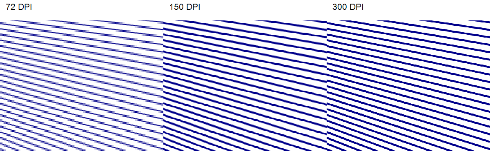

## **概要**

SVG はスケーラブルな XML ベースの画像形式で、Web パブリッシング、スライドビューア、アクセシビリティ ワークフロー、そして自動ポストプロセッシングに適しています。Aspose.Slides for Android via Java は各スライドを個別の SVG ファイルにエクスポートし、テキスト、フォント、画像、SVG 要素の書き出し方法を制御できます。

エクスポートされた SVG をコンパクトにしたい、ブラウザ間で予測可能にしたい、あるいはインタラクティブに使用したい場合は **[SVGOptions](https://reference.aspose.com/slides/androidjava/com.aspose.slides/svgoptions/)** を使用してください。

## **スライドを SVG としてエクスポートする**

**[Presentation](https://reference.aspose.com/slides/androidjava/com.aspose.slides/presentation/)** を作成し、スライドを選択して **[ISlide.writeAsSvg](https://reference.aspose.com/slides/androidjava/com.aspose.slides/islide/#writeAsSvg-java.io.OutputStream-)** でストリームに書き込みます。次の例はプレゼンテーション内のすべてのスライドを個別の SVG ファイルとしてエクスポートします。

```java
Presentation presentation = new Presentation("presentation.pptx");
try {
    for (ISlide slide : presentation.getSlides()) {
        String outputFileName = String.format("slide-%d.svg", slide.getSlideNumber());

        try (FileOutputStream svgStream = new FileOutputStream(outputFileName)) {
            slide.writeAsSvg(svgStream);
        }
    }
} finally {
    presentation.dispose();
}
```

ファイル名はループインデックスではなく **[ISlide.getSlideNumber](https://reference.aspose.com/slides/androidjava/com.aspose.slides/islide/#getSlideNumber--)** を使用します。また、スライドビューアや Web ページで特定の形状だけが必要な場合は **[IShape.writeAsSvg](https://reference.aspose.com/slides/androidjava/com.aspose.slides/ishape/#writeAsSvg-java.io.OutputStream-)** を使用して個別のシェイプをエクスポートできます。

## **SVG 出力の構成**

**[SVGOptions](https://reference.aspose.com/slides/androidjava/com.aspose.slides/svgoptions/)** は SVG のレンダリングを制御します。テキストフレームの場合、**[SVGOptions.setUseFrameSize](https://reference.aspose.com/slides/androidjava/com.aspose.slides/svgoptions/#setUseFrameSize-boolean-)** はテキストフレームを描画領域に含め、**[SVGOptions.setUseFrameRotation](https://reference.aspose.com/slides/androidjava/com.aspose.slides/svgoptions/#setUseFrameRotation-boolean-)** はフレーム回転の適用を決定します。テキストをリガチャなしでレンダリングする必要がある場合は **[SVGOptions.setDisableFontLigatures](https://reference.aspose.com/slides/androidjava/com.aspose.slides/svgoptions/#setDisableFontLigatures-boolean-)** を `true` に設定してください。

```java
Presentation presentation = new Presentation("presentation.pptx");
try {
    SVGOptions svgOptions = new SVGOptions();
    svgOptions.setDisableFontLigatures(true);
    svgOptions.setUseFrameSize(true);
    svgOptions.setUseFrameRotation(false);

    ISlide slide = presentation.getSlides().get_Item(0);
    try (FileOutputStream svgStream = new FileOutputStream("slide-with-custom-options.svg")) {
        slide.writeAsSvg(svgStream, svgOptions);
    }
} finally {
    presentation.dispose();
}
```

## **矢じりでの線端クロッピングの制御**

SVG 1.1 には矢じりの下で線を止めるためのマーカーインセット設定がありません。デフォルトでは Aspose.Slides はエクスポートされた線を短くし、ストロークがマーカーを突き抜けないようにします。**[SVGOptions.setDisableLineEndCropping](https://reference.aspose.com/slides/androidjava/com.aspose.slides/svgoptions/#setDisableLineEndCropping-boolean-)** に `true` を渡すと、ストロークが元の終点まで描画されます。この設定は SVG 出力にのみ影響し、スライド上の線の位置と長さは変わりません。

例では三角形とダイヤモンドの矢じりを幅 2 ポイントと 10 ポイントの線に描画しています。クロッピングオプションだけを変更して同じスライドを 2 回エクスポートします。

```java
import com.aspose.slides.*;
import android.graphics.Color;
import java.io.FileOutputStream;

Presentation presentation = new Presentation();
try {
    ISlide slide = presentation.getSlides().get_Item(0);
    int y = 40;

    for (byte style : new byte[] { LineArrowheadStyle.Triangle, LineArrowheadStyle.Diamond }) {
        for (int width : new int[] { 2, 10 }) {
            IAutoShape line = slide.getShapes().addAutoShape(ShapeType.Line, 40, y, 200, 0);
            ILineFormat format = line.getLineFormat();
            format.getFillFormat().setFillType(FillType.Solid);
            format.getFillFormat().getSolidFillColor().setColor(Color.rgb(0, 0, 139));
            format.setWidth(width);
            format.setEndArrowheadStyle(style);
            y += 50;
        }
    }

    SVGOptions options = new SVGOptions();
    options.setDisableLineEndCropping(false);
    try (FileOutputStream cropped = new FileOutputStream("cropped.svg")) {
        slide.writeAsSvg(cropped, options);
    }

    options.setDisableLineEndCropping(true);
    try (FileOutputStream uncropped = new FileOutputStream("uncropped.svg")) {
        slide.writeAsSvg(uncropped, options);
    }
} finally {
    presentation.dispose();
}
```

比較では 10 ポイントの線上の三角形矢じりが示されています。クロッピング有効時は先端が鋭く、無効時はストロークがマーカーの斜辺を突き抜けて平らな端になります。


例の他の線では、2 ポイントの三角形では突き抜けたストロークが目立ちにくく、塗りつぶしダイヤモンドは幅の違いにかかわらずストロークの端を覆います。

## **テキストとフォントの制御**

スライドを SVG にエクスポートする際に、テキストをテキストとして残すかベクタ画像に変換するか、外部フォントをどのように含めるか（または参照するか）を制御できます。以下のオプションは、視覚的一貫性、テキスト選択、フォント依存性のバランスを取るのに役立ちます。

### **すべてのテキストをベクトル化する**

**[SVGOptions.setVectorizeText](https://reference.aspose.com/slides/androidjava/com.aspose.slides/svgoptions/#setVectorizeText-boolean-)** を `true` に設定すると、すべてのスライドテキストがベクタ画像として書き込まれます。これによりフォント依存がなくなり、ブラウザ間での見た目が安定しますが、テキストは SVG テキストとして選択・検索できなくなります。

```java
Presentation presentation = new Presentation("presentation.pptx");
try {
    SVGOptions svgOptions = new SVGOptions();
    svgOptions.setVectorizeText(true);

    ISlide slide = presentation.getSlides().get_Item(0);
    try (FileOutputStream svgStream = new FileOutputStream("slide-with-vectorized-text.svg")) {
        slide.writeAsSvg(svgStream, svgOptions);
    }
} finally {
    presentation.dispose();
}
```

### **外部フォントの取り扱い方法を選択する**

**[SVGOptions.setExternalFontsHandling](https://reference.aspose.com/slides/androidjava/com.aspose.slides/svgoptions/#setExternalFontsHandling-int-)** は **[SvgExternalFontsHandling](https://reference.aspose.com/slides/androidjava/com.aspose.slides/svgexternalfontshandling/)** の値を使用します。フォントファイルへのリンクだけを保持したい場合は **[SvgExternalFontsHandling.AddLinksToFontFiles](https://reference.aspose.com/slides/androidjava/com.aspose.slides/svgexternalfontshandling/)**、SVG にフォントデータを埋め込みたい場合は **[SvgExternalFontsHandling.Embed](https://reference.aspose.com/slides/androidjava/com.aspose.slides/svgexternalfontshandling/)**、外部フォントを使用するテキストだけを画像化したい場合は **[SvgExternalFontsHandling.Vectorize](https://reference.aspose.com/slides/androidjava/com.aspose.slides/svgexternalfontshandling/)** を選択します。埋め込む前にフォントのライセンスを必ず確認してください。

```java
Presentation presentation = new Presentation("presentation.pptx");
try {
    ISlide slide = presentation.getSlides().get_Item(0);

    SVGOptions linkedFontsOptions = new SVGOptions();
    linkedFontsOptions.setExternalFontsHandling(SvgExternalFontsHandling.AddLinksToFontFiles);
    try (FileOutputStream linkedFontsStream = new FileOutputStream("slide-with-font-links.svg")) {
        slide.writeAsSvg(linkedFontsStream, linkedFontsOptions);
    }

    SVGOptions embeddedFontsOptions = new SVGOptions();
    embeddedFontsOptions.setExternalFontsHandling(SvgExternalFontsHandling.Embed);
    try (FileOutputStream embeddedFontsStream = new FileOutputStream("slide-with-embedded-fonts.svg")) {
        slide.writeAsSvg(embeddedFontsStream, embeddedFontsOptions);
    }

    SVGOptions vectorizedExternalFontsOptions = new SVGOptions();
    vectorizedExternalFontsOptions.setExternalFontsHandling(SvgExternalFontsHandling.Vectorize);
    try (FileOutputStream vectorizedExternalFontsStream = new FileOutputStream("slide-with-vectorized-external-fonts.svg")) {
        slide.writeAsSvg(vectorizedExternalFontsStream, vectorizedExternalFontsOptions);
    }
} finally {
    presentation.dispose();
}
```

## **埋め込み画像サイズの削減**

**[SVGOptions.setPicturesCompression](https://reference.aspose.com/slides/androidjava/com.aspose.slides/svgoptions/#setPicturesCompression-int-)** を使用して埋め込み画像の解像度を下げ、**[SVGOptions.setDeletePicturesCroppedAreas](https://reference.aspose.com/slides/androidjava/com.aspose.slides/svgoptions/#setDeletePicturesCroppedAreas-boolean-)** でトリミングされた元領域を除外し、**[SVGOptions.setJpegQuality](https://reference.aspose.com/slides/androidjava/com.aspose.slides/svgoptions/#setJpegQuality-int-)** で JPEG エンコード品質を制御します。これらの設定は画像の忠実度や保持データと引き換えにファイルサイズを削減します。

```java
Presentation presentation = new Presentation("presentation.pptx");
try {
    SVGOptions svgOptions = new SVGOptions();
    svgOptions.setPicturesCompression(PicturesCompression.Dpi150);
    svgOptions.setDeletePicturesCroppedAreas(true);
    svgOptions.setJpegQuality(80);

    ISlide slide = presentation.getSlides().get_Item(0);
    try (FileOutputStream svgStream = new FileOutputStream("compressed-slide.svg")) {
        slide.writeAsSvg(svgStream, svgOptions);
    }
} finally {
    presentation.dispose();
}
```

## **メタファイルのラスタリゼーション解像度の制御**

**[SVGOptions.setMetafileRasterizationDpi](https://reference.aspose.com/slides/androidjava/com.aspose.slides/svgoptions/#setMetafileRasterizationDpi-int-)** は SVG エクスポート時にメタファイルをラスタライズする下限解像度を設定します。EMF や WMF 画像をラスタライズする際のディテールとファイルサイズのバランスに使用します。SVG 全体の DPI を決定したり、スライド上のすべてのオブジェクトをラスタ画像に強制したりはしません。

**[metafile-rasterization.pptx](metafile-rasterization.pptx)** をダウンロードしてください。このプレゼンテーションには斜め線が密に配置された EMF 画像が含まれています。以下の例は **[ISlide.writeAsSvg](https://reference.aspose.com/slides/androidjava/com.aspose.slides/islide/#writeAsSvg-java.io.OutputStream-com.aspose.slides.ISVGOptions-)** を使って最初のスライドを 3 つのラスタリゼーション解像度でエクスポートします。他のエクスポート設定はすべて同一に保ち、結果を比較できるようにしています。

```java
import com.aspose.slides.PicturesCompression;
import com.aspose.slides.Presentation;
import com.aspose.slides.SVGOptions;
import java.io.FileOutputStream;

Presentation presentation = new Presentation("metafile-rasterization.pptx");
try {
    for (int dpi : new int[] { 72, 150, 300 }) {
        SVGOptions svgOptions = new SVGOptions();
        svgOptions.setMetafileRasterizationDpi(dpi);
        svgOptions.setPicturesCompression(PicturesCompression.Dpi330);
        svgOptions.setJpegQuality(90);

        String outputFileName = String.format("slide-%d.svg", dpi);
        try (FileOutputStream svgStream = new FileOutputStream(outputFileName)) {
            presentation.getSlides().get_Item(0).writeAsSvg(svgStream, svgOptions);
        }
    }
} finally {
    presentation.dispose();
}
```

出力では EMF がそれぞれの SVG に埋め込まれた PNG に変換されています。以下の測定値は提供されたプレゼンテーションに基づくもので、DPI をピクセル寸法に変換する一般的な式ではありません。

| メタファイル ラスタリゼーション DPI | 埋め込み PNG のサイズ | SVG ファイルサイズ (バイト) |
| --- | --- | --- |
| 72 | 1196 × 596 | 170,221 |
| 150 | 2492 × 1242 | 423,149 |
| 300 | 4983 × 2483 | 1,027,169 |

下の比較では、同一領域の埋め込みラスタを同じ拡大表示サイズで示しています。72 DPI では斜線にピクセル化が目立ち、解像度が上がるにつれてエッジが滑らかになり、SVG ファイルは大きくなります。値を上げてもすべてのディテールが改善されるわけでも、すべてのエクスポート画像が変わるわけでもありません。



**[SVGOptions.setPicturesCompression](https://reference.aspose.com/slides/androidjava/com.aspose.slides/svgoptions/#setPicturesCompression-int-)** は画像解像度の削減を制御し、メタファイルラスタリゼーション解像度の変更効果を隠すことがあります。**[SVGOptions.setJpegQuality](https://reference.aspose.com/slides/androidjava/com.aspose.slides/svgoptions/#setJpegQuality-int-)** は JPEG エンコード品質を制御し、メタファイルラスタリゼーション解像度には影響しません。

## **シェイプとテキストに安定した ID を割り当てる**

**[ISvgShapeFormattingController](https://reference.aspose.com/slides/androidjava/com.aspose.slides/isvgshapeformattingcontroller/)** を使用して各 SVG シェイプに **[ISvgShape.setId](https://reference.aspose.com/slides/androidjava/com.aspose.slides/isvgshape/#setId-java.lang.String-)** を設定します。テキストの `tspan` 要素にも **[ISvgTSpan.setId](https://reference.aspose.com/slides/androidjava/com.aspose.slides/isvgtspan/#setId-java.lang.String-)** を設定したい場合は **[ISvgShapeAndTextFormattingController](https://reference.aspose.com/slides/androidjava/com.aspose.slides/isvgshapeandtextformattingcontroller/)** を実装します。どちらのコントローラも **[SVGOptions.setShapeFormattingController](https://reference.aspose.com/slides/androidjava/com.aspose.slides/svgoptions/#setShapeFormattingController-com.aspose.slides.ISvgShapeFormattingController-)** で設定できます。

以下のコントローラは **[IShape.getOfficeInteropShapeId](https://reference.aspose.com/slides/androidjava/com.aspose.slides/ishape/#getOfficeInteropShapeId--)** を使用します。この ID はシェイプの存続期間中安定しており、テキストスパンには再利用可能なカウンタを使用します。これにより、変更されていないプレゼンテーションのポストプロセッシングに適した ID が生成されます。

```java
class StableSvgIdController implements ISvgShapeAndTextFormattingController {
    private String currentShapeId = "";
    private int textSpanIndex;

    public void formatShape(ISvgShape svgShape, IShape shape) {
        currentShapeId = String.format("shape-%d", shape.getOfficeInteropShapeId());
        textSpanIndex = 0;
        svgShape.setId(currentShapeId);
    }

    public void formatText(ISvgTSpan svgTSpan, IPortion portion, ITextFrame textFrame) {
        svgTSpan.setId(String.format("%s-text-%d", currentShapeId, textSpanIndex++));
    }
}

Presentation presentation = new Presentation("presentation.pptx");
try {
    SVGOptions svgOptions = new SVGOptions();
    svgOptions.setShapeFormattingController(new StableSvgIdController());

    ISlide slide = presentation.getSlides().get_Item(0);
    try (FileOutputStream svgStream = new FileOutputStream("slide-with-stable-ids.svg")) {
        slide.writeAsSvg(svgStream, svgOptions);
    }
} finally {
    presentation.dispose();
}
```

## **SVG イベントハンドラの追加**

**[ISvgShapeFormattingController](https://reference.aspose.com/slides/androidjava/com.aspose.slides/isvgshapeformattingcontroller/)** 内で **[ISvgShape.setEventHandler](https://reference.aspose.com/slides/androidjava/com.aspose.slides/isvgshape/#setEventHandler-int-java.lang.String-)** に **[SvgEvent](https://reference.aspose.com/slides/androidjava/com.aspose.slides/svgevent/)** の値を渡すと、エクスポートされたシェイプに JavaScript イベントハンドラを追加できます。コントローラは **[SVGOptions.setShapeFormattingController](https://reference.aspose.com/slides/androidjava/com.aspose.slides/svgoptions/#setShapeFormattingController-com.aspose.slides.ISvgShapeFormattingController-)** で設定し、結果をホストするページまたは SVG ドキュメント内で JavaScript 関数を定義します。

```java
class SvgEventController implements ISvgShapeFormattingController {
    public void formatShape(ISvgShape svgShape, IShape shape) {
        if ("ActionButton".equals(shape.getName())) {
            svgShape.setId("action-button");
            svgShape.setEventHandler(SvgEvent.OnClick, "handleShapeClick(event)");
        }
    }
}

Presentation presentation = new Presentation("presentation.pptx");
try {
    SVGOptions svgOptions = new SVGOptions();
    svgOptions.setShapeFormattingController(new SvgEventController());

    ISlide slide = presentation.getSlides().get_Item(0);
    try (FileOutputStream svgStream = new FileOutputStream("interactive-slide.svg")) {
        slide.writeAsSvg(svgStream, svgOptions);
    }
} finally {
    presentation.dispose();
}
```

ホストページはハンドラが参照する JavaScript 関数を定義できます。ID とイベントハンドラを割り当てることで、スライドビューア、アクセシビリティ拡張、その他のインタラクティブ SVG ワークフローが可能になります。

## **FAQ**

**[SVGOptions.setVectorizeText](https://reference.aspose.com/slides/androidjava/com.aspose.slides/svgoptions/#setVectorizeText-boolean-) を使用すべきタイミングは、[SvgExternalFontsHandling.Vectorize](https://reference.aspose.com/slides/androidjava/com.aspose.slides/svgexternalfontshandling/) の代わりはいつですか？**

すべてのテキストをフォントに依存しないようにしたい場合は **[SVGOptions.setVectorizeText](https://reference.aspose.com/slides/androidjava/com.aspose.slides/svgoptions/#setVectorizeText-boolean-)** を使用します。外部フォントを使用するテキストだけを画像化したい場合は **[SvgExternalFontsHandling.Vectorize](https://reference.aspose.com/slides/androidjava/com.aspose.slides/svgexternalfontshandling/)** を使用してください。

**SVG を小さくする最良の方法は何ですか？**

まず埋め込み画像を圧縮し、トリミングされた画像領域を削除し、環境が提供できる場合はリンクされたフォントファイルを選択してください。画像解像度の低下、JPEG 品質の低下、テキストのベクトル化はそれぞれ品質とサイズのトレードオフが異なるため、結果を必ずテストしてください。

**エクスポート後に SVG 要素を変更できますか？**

はい。フォーマッティングコントローラで ID を割り当てた後、ポストプロセッシングツールやブラウザスクリプトで該当する SVG 要素を選択して変更できます。