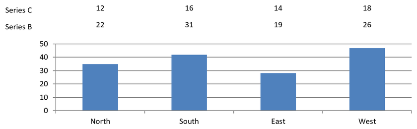

## **概要**

データ ラベルはチャートの系列や個々のデータ ポイントに関する情報を表示し、読者が値を識別しチャートを理解できるようにします。本記事では、値の書式設定、パーセンテージの表示、ラベル テキストの取得、軸の最大値を超えるラベルの制御、カテゴリ 軸ラベルの間隔調整、円グラフラベルの配置方法について説明します。

## **表示されているデータ ラベルの数**

プレゼンテーションを公開する前に、表示が有効になっているデータ ラベルの数を確認するには、[getCountOfVisibleDataLabels](https://reference.aspose.com/slides/androidjava/com.aspose.slides/idatalabelcollection/#getCountOfVisibleDataLabels--) を使用します。[getCount](https://reference.aspose.com/slides/androidjava/com.aspose.slides/idatalabelcollection/#getCount--) がコレクション内のラベル総数を返すのとは異なり、シリーズのデフォルト設定と個々のラベル設定を考慮します。

この例では、1 つの系列と 3 つのデータ ポイントを持つ縦棒グラフを作成します。系列のラベル コレクションは [getLabels](https://reference.aspose.com/slides/androidjava/com.aspose.slides/ichartseries/#getLabels--) を介して取得し、設定の変更に伴う表示ラベル数を **0, 3, 2, 3** と出力します。総数は **3** のままです。

```java
import com.aspose.slides.*;

Presentation presentation = new Presentation();
try {
    ISlide slide = presentation.getSlides().get_Item(0);

    IChart chart = slide.getShapes().addChart(ChartType.ClusteredColumn, 50, 50, 500, 300);

    chart.getChartData().getSeries().clear();
    chart.getChartData().getCategories().clear();

    IChartDataWorkbook workbook = chart.getChartData().getChartDataWorkbook();
    IChartDataCell seriesCell = workbook.getCell(0, 0, 1, "Values");
    IChartSeries series = chart.getChartData().getSeries().add(seriesCell, chart.getType());

    for (int i = 0; i < 3; i++) {
        IChartDataCell categoryCell = workbook.getCell(0, i + 1, 0, "Category " + (i + 1));
        chart.getChartData().getCategories().add(categoryCell);
        IChartDataCell valueCell = workbook.getCell(0, i + 1, 1, (i + 1) * 10);
        series.getDataPoints().addDataPointForBarSeries(valueCell);
    }

    IDataLabelCollection labels = series.getLabels();
    System.out.println("Total: " + labels.getCount() + "; visible: " + labels.getCountOfVisibleDataLabels()); // 合計: 3; 表示: 0

    labels.getDefaultDataLabelFormat().setShowValue(true);
    System.out.println("Visible: " + labels.getCountOfVisibleDataLabels()); // 表示: 3

    labels.get_Item(1).getDataLabelFormat().setShowValue(false);
    System.out.println("Visible: " + labels.getCountOfVisibleDataLabels()); // 表示: 2

    labels.get_Item(1).getDataLabelFormat().setShowLegendKey(true);
    System.out.println("Visible: " + labels.getCountOfVisibleDataLabels()); // 表示: 3
} finally {
    presentation.dispose();
}
```

系列の [getDefaultDataLabelFormat](https://reference.aspose.com/slides/androidjava/com.aspose.slides/idatalabelcollection/#getDefaultDataLabelFormat--) は既定の設定を提供します。`true` を [setShowValue](https://reference.aspose.com/slides/androidjava/com.aspose.slides/idatalabelformat/#setShowValue-boolean-) に渡すと、3 つすべてのラベルに値が表示されます。1 つのラベルの [getDataLabelFormat](https://reference.aspose.com/slides/androidjava/com.aspose.slides/idatalabel/#getDataLabelFormat--) で `false` を渡すと、そのラベルだけ設定が上書きされます。`true` を [setShowLegendKey](https://reference.aspose.com/slides/androidjava/com.aspose.slides/idatalabelformat/#setShowLegendKey-boolean-) に渡すと、値は非表示のままですがラベルが再び表示対象になります。

表示されているラベルの数は可視設定を反映します。ラベルが重なっているか、クリップされているか、レンダリングされたチャートで読めるかは測定しません。

## **チャート データ ラベルの数値精度の設定**

[setNumberFormatOfValues](https://reference.aspose.com/slides/androidjava/com.aspose.slides/ichartseries/#setNumberFormatOfValues-java.lang.String-) を使用して系列の値の書式を設定します。この例では、デフォルト データの折れ線グラフを作成し、データ テーブルを表示し、最初の系列に値ラベルを有効にします。書式 `#,##0.00` は千位区切りと小数点以下 2 桁を表示しますが、基になる値は変更しません。

```java
import com.aspose.slides.*;

Presentation presentation = new Presentation();
try {
    ISlide slide = presentation.getSlides().get_Item(0);

    IChart chart = slide.getShapes().addChart(ChartType.Line, 50, 50, 450, 300);
    chart.setDataTable(true);

    IChartSeries series = chart.getChartData().getSeries().get_Item(0);
    series.setNumberFormatOfValues("#,##0.00");
    series.getLabels().getDefaultDataLabelFormat().setShowValue(true);

    presentation.save("PrecisionOfDatalabels_out.pptx", SaveFormat.Pptx);
} finally {
    presentation.dispose();
}
```

チャートに埋め込まれたブックレットの数値セルの書式設定については、[Set Custom Number Formats for Workbook Cells](/slides/ja/androidjava/chart-workbook/#set-custom-number-formats-for-workbook-cells) を参照してください。この例は、元のセルの書式に従いながら数値を保持したままラベルが表示される様子も示しています。

## **ラベルとしてパーセンテージを表示**

積み上げ縦棒グラフでは、各値をカテゴリ合計に対するパーセンテージに換算し、[getTextFrameForOverriding](https://reference.aspose.com/slides/androidjava/com.aspose.slides/ioverridabletext/#getTextFrameForOverriding--) が返すテキスト フレームにテキストを割り当てます。この例は既定のチャート データを使用し、8 ポイント フォントで小数点以下 2 桁のパーセンテージを表示します。合計が 0 のカテゴリは除外し、除算エラーを防止します。チャート データが変わった場合はカスタム ラベル テキストを再計算してください。

```java
import com.aspose.slides.*;
import java.util.Locale;

Presentation presentation = new Presentation();
try {
    ISlide slide = presentation.getSlides().get_Item(0);

    IChart chart = slide.getShapes().addChart(ChartType.StackedColumn, 20, 20, 400, 400);

    double[] categoryTotals = new double[chart.getChartData().getCategories().size()];
    for (int k = 0; k < chart.getChartData().getCategories().size(); k++) {
        for (int i = 0; i < chart.getChartData().getSeries().size(); i++) {
            IChartSeries series = chart.getChartData().getSeries().get_Item(i);
            Number pointValue = (Number) series.getDataPoints().get_Item(k).getValue().getData();
            categoryTotals[k] += pointValue.doubleValue();
        }
    }

    for (int x = 0; x < chart.getChartData().getSeries().size(); x++) {
        IChartSeries series = chart.getChartData().getSeries().get_Item(x);
        series.getLabels().getDefaultDataLabelFormat().setShowLegendKey(false);

        for (int j = 0; j < series.getDataPoints().size(); j++) {
            IDataLabel label = series.getDataPoints().get_Item(j).getLabel();
            if (categoryTotals[j] == 0) {
                continue;
            }

            Number pointValue = (Number) series.getDataPoints().get_Item(j).getValue().getData();
            double dataPointPercent = (pointValue.doubleValue() / categoryTotals[j]) * 100;

            IPortion portion = new Portion();
            portion.setText(String.format(Locale.US, "%.2f %%", dataPointPercent));
            portion.getPortionFormat().setFontHeight(8f);

            label.getTextFrameForOverriding().setText("");
            IParagraph paragraph = label.getTextFrameForOverriding().getParagraphs().get_Item(0);
            paragraph.getPortions().add(portion);

            label.getDataLabelFormat().setShowValue(true);
            label.getDataLabelFormat().setShowSeriesName(false);
            label.getDataLabelFormat().setShowPercentage(false);
            label.getDataLabelFormat().setShowLegendKey(false);
            label.getDataLabelFormat().setShowCategoryName(false);
            label.getDataLabelFormat().setShowBubbleSize(false);
        }
    }

    presentation.save("DisplayPercentageAsLabels_out.pptx", SaveFormat.Pptx);
} finally {
    presentation.dispose();
}
```

## **チャート データ ラベルにパーセンテージ記号を設定**

値が分数で格納されている場合、[setNumberFormat](https://reference.aspose.com/slides/androidjava/com.aspose.slides/idatalabelformat/#setNumberFormat-java.lang.String-) を使用してパーセンテージで表示します。[setNumberFormatLinkedToSource](https://reference.aspose.com/slides/androidjava/com.aspose.slides/idatalabelformat/#setNumberFormatLinkedToSource-boolean-) に `false` を渡すと、ソース セルとは独立したラベル書式が適用されます。

この例では、4 つのカテゴリにわたる赤と青の系列で 100% 積み上げ縦棒グラフを作成します。各ペアの値は合計が 1 になるようにしています。ラベル書式 `0.0%` は 0.30 を 30.0% と表示し、縦軸は小数点以下 2 桁を使用します。両系列とも白色の 10 ポイント ラベル テキストを使用しています。

```java
import com.aspose.slides.*;
import android.graphics.Color;

Presentation presentation = new Presentation();
try {
    ISlide slide = presentation.getSlides().get_Item(0);

    IChart chart = slide.getShapes().addChart(ChartType.PercentsStackedColumn, 20, 20, 500, 400);

    chart.getAxes().getVerticalAxis().setNumberFormatLinkedToSource(false);
    chart.getAxes().getVerticalAxis().setNumberFormat("0.00%");

    chart.getChartData().getSeries().clear();
    chart.getChartData().getCategories().clear();

    IChartDataWorkbook workbook = chart.getChartData().getChartDataWorkbook();
    int worksheetIndex = 0;
    for (int i = 0; i < 4; i++) {
        IChartDataCell categoryCell = workbook.getCell(worksheetIndex, i + 1, 0, "Category " + (i + 1));
        chart.getChartData().getCategories().add(categoryCell);
    }

    String[] seriesNames = { "Reds", "Blues" };
    int[] seriesColors = { Color.RED, Color.BLUE };
    double[][] values = { { 0.30, 0.50, 0.80, 0.65 }, { 0.70, 0.50, 0.20, 0.35 } };

    for (int i = 0; i < seriesNames.length; i++) {
        IChartDataCell seriesCell = workbook.getCell(worksheetIndex, 0, i + 1, seriesNames[i]);
        IChartSeries series = chart.getChartData().getSeries().add(seriesCell, chart.getType());
        for (int j = 0; j < 4; j++) {
            IChartDataCell valueCell = workbook.getCell(worksheetIndex, j + 1, i + 1, values[i][j]);
            series.getDataPoints().addDataPointForBarSeries(valueCell);
        }

        series.getFormat().getFill().setFillType(FillType.Solid);
        series.getFormat().getFill().getSolidFillColor().setColor(seriesColors[i]);

        IDataLabelFormat labelFormat = series.getLabels().getDefaultDataLabelFormat();
        labelFormat.setShowValue(true);
        labelFormat.setNumberFormatLinkedToSource(false);
        labelFormat.setNumberFormat("0.0%");
        labelFormat.getTextFormat().getPortionFormat().setFontHeight(10);
        labelFormat.getTextFormat().getPortionFormat().getFillFormat().setFillType(FillType.Solid);
        labelFormat.getTextFormat().getPortionFormat().getFillFormat().getSolidFillColor().setColor(Color.WHITE);
    }

    presentation.save("SetDataLabelsPercentageSign_out.pptx", SaveFormat.Pptx);
} finally {
    presentation.dispose();
}
```

## **データ ラベルの実際のテキストを取得**

[getActualLabelText](https://reference.aspose.com/slides/androidjava/com.aspose.slides/idatalabel/#getActualLabelText--) を使用して、データ ラベルの設定から生成されたテキストを取得します。レポート用ラベル抽出、プレゼンテーション コンテンツ検索、生成チャートの検証に便利です。下の例では、既定の [data label format](https://reference.aspose.com/slides/androidjava/com.aspose.slides/idatalabelformat/) がカテゴリ名、系列名、値を組み合わせています。あるポイントは値をパーセンテージで書式設定し、別のポイントは [getTextFrameForOverriding](https://reference.aspose.com/slides/androidjava/com.aspose.slides/ioverridabletext/#getTextFrameForOverriding--) から取得したカスタム テキストを使用しています。

```java
import com.aspose.slides.*;

Presentation presentation = new Presentation();
try {
    ISlide slide = presentation.getSlides().get_Item(0);

    IChart chart = slide.getShapes().addChart(ChartType.ClusteredColumn, 20, 20, 500, 300);

    chart.getChartData().getSeries().clear();
    chart.getChartData().getCategories().clear();

    IChartDataWorkbook workbook = chart.getChartData().getChartDataWorkbook();
    IChartDataCell firstCategoryCell = workbook.getCell(0, 1, 0, "Q1");
    chart.getChartData().getCategories().add(firstCategoryCell);
    IChartDataCell secondCategoryCell = workbook.getCell(0, 2, 0, "Q2");
    chart.getChartData().getCategories().add(secondCategoryCell);

    IChartDataCell northSeriesCell = workbook.getCell(0, 0, 1, "North");
    IChartSeries north = chart.getChartData().getSeries().add(northSeriesCell, chart.getType());
    IChartDataCell northFirstValueCell = workbook.getCell(0, 1, 1, 0.25);
    north.getDataPoints().addDataPointForBarSeries(northFirstValueCell);
    IChartDataCell northSecondValueCell = workbook.getCell(0, 2, 1, 0.75);
    north.getDataPoints().addDataPointForBarSeries(northSecondValueCell);

    IChartDataCell southSeriesCell = workbook.getCell(0, 0, 2, "South");
    IChartSeries south = chart.getChartData().getSeries().add(southSeriesCell, chart.getType());
    IChartDataCell southFirstValueCell = workbook.getCell(0, 1, 2, 0.40);
    south.getDataPoints().addDataPointForBarSeries(southFirstValueCell);
    IChartDataCell southSecondValueCell = workbook.getCell(0, 2, 2, 0.60);
    south.getDataPoints().addDataPointForBarSeries(southSecondValueCell);

    for (IChartSeries series : chart.getChartData().getSeries()) {
        IDataLabelFormat format = series.getLabels().getDefaultDataLabelFormat();
        format.setShowCategoryName(true);
        format.setShowSeriesName(true);
        format.setShowValue(true);
    }

    north.getLabels().get_Item(1).getDataLabelFormat().setNumberFormatLinkedToSource(false);
    north.getLabels().get_Item(1).getDataLabelFormat().setNumberFormat("0%");
    south.getLabels().get_Item(0).getTextFrameForOverriding().setText("Reviewed");

    for (IChartSeries series : chart.getChartData().getSeries()) {
        for (IChartDataPoint point : series.getDataPoints()) {
            IDataLabel label = point.getLabel();
            if (!label.isVisible()) {
                continue;
            }

            System.out.println("Value: " + point.getValue().getData() + "; label: " + label.getActualLabelText());
        }
    }
} finally {
    presentation.dispose();
}
```

データ ポイントに格納されている数値は `0.75` のままで、ラベルが `75%` とカテゴリ名と系列名を併せて表示していても同様です。カスタム テキストは生成されたラベル テキストを上書きします。[getActualLabelText](https://reference.aspose.com/slides/androidjava/com.aspose.slides/idatalabel/#getActualLabelText--) はどちらの場合でも結果のラベル文字列を返します。表示対象のみを抽出したい場合は、上記のように [isVisible](https://reference.aspose.com/slides/androidjava/com.aspose.slides/idatalabel/#isVisible--) を別途確認してください。

## **軸の最大値を超えるデータ ラベルの制御**

軸範囲を手動で制限すると、一部のデータ ポイントが最大値を超えることがあります。[setShowDataLabelsOverMaximum](https://reference.aspose.com/slides/androidjava/com.aspose.slides/ichart/#setShowDataLabelsOverMaximum-boolean-) を使用して、これらのデータ ラベルを表示するかどうかを制御します。この設定はラベルの可視性を変更しますが、軸範囲や基になるデータ値は変更しません。

以下の例では、値が 60 と 120 の 2D クラスタ化縦棒グラフを作成します。垂直軸で `false` を [setAutomaticMaxValue](https://reference.aspose.com/slides/androidjava/com.aspose.slides/iaxis/#setAutomaticMaxValue-boolean-) に渡し、[setMaxValue](https://reference.aspose.com/slides/androidjava/com.aspose.slides/iaxis/#setMaxValue-double-) で最大値を 100 に設定します。最初のスライドは最大値を超えるラベルを許可し、コピーしたスライドはそれを無効にします。両方のスライドは `DataLabelsOverMaximum.pptx` として保存されます。

[setShowValue](https://reference.aspose.com/slides/androidjava/com.aspose.slides/idatalabelformat/#setShowValue-boolean-) で値ラベルを有効にします。チャート レベルの設定だけでは値の表示は行われず、個別ラベルの非表示設定も上書きされません。この例では系列全体の値を有効にし、[setPosition](https://reference.aspose.com/slides/androidjava/com.aspose.slides/idatalabelformat/#setPosition-int-) を使用して各列の外端にラベルを配置しています。

```java
import com.aspose.slides.*;

Presentation presentation = new Presentation();
try {
    ISlide slide = presentation.getSlides().get_Item(0);

    IChart chart = slide.getShapes().addChart(ChartType.ClusteredColumn, 50, 50, 600, 400);
    chart.setLegend(false);

    chart.getChartData().getSeries().clear();
    chart.getChartData().getCategories().clear();

    IChartDataWorkbook workbook = chart.getChartData().getChartDataWorkbook();

    IChartDataCell firstCategory = workbook.getCell(0, 1, 0, "Within range");
    IChartDataCell secondCategory = workbook.getCell(0, 2, 0, "Above maximum");

    chart.getChartData().getCategories().add(firstCategory);
    chart.getChartData().getCategories().add(secondCategory);

    IChartDataCell seriesName = workbook.getCell(0, 0, 1, "Values");
    IChartSeries series = chart.getChartData().getSeries().add(seriesName, chart.getType());

    IChartDataCell firstValue = workbook.getCell(0, 1, 1, 60);
    IChartDataCell secondValue = workbook.getCell(0, 2, 1, 120);

    series.getDataPoints().addDataPointForBarSeries(firstValue);
    series.getDataPoints().addDataPointForBarSeries(secondValue);

    series.getLabels().getDefaultDataLabelFormat().setShowValue(true);
    series.getLabels().getDefaultDataLabelFormat().setPosition(LegendDataLabelPosition.OutsideEnd);

    chart.getAxes().getVerticalAxis().setAutomaticMaxValue(false);
    chart.getAxes().getVerticalAxis().setMaxValue(100);
    chart.setShowDataLabelsOverMaximum(true);

    ISlide secondSlide = presentation.getSlides().addClone(slide);
    IChart secondChart = (IChart) secondSlide.getShapes().get_Item(0);
    secondChart.setShowDataLabelsOverMaximum(false);

    presentation.save("DataLabelsOverMaximum.pptx", SaveFormat.Pptx);
} finally {
    presentation.dispose();
}
```

以下の画像は Microsoft PowerPoint でレンダリングした保存済みスライドを示します。`true` の場合、ラベル **120** が上端で可視になり、`false` の場合は非表示になります。ラベル **60** は常に可視で、軸の最大値は **100** のまま、2 番目のデータ ポイントはどちらの場合も **120** のままです。

| setShowDataLabelsOverMaximum(true) | setShowDataLabelsOverMaximum(false) |
| --- | --- |
|  |  |

{}
この例では、値軸を持つ 2D 縦棒グラフを使用しています。値軸を持たない円グラフやドーナツ グラフなどのチャートでは、このように軸の最大値で制限することはできません。
{}

## **軸からのラベル距離の設定**

[setLabelOffset](https://reference.aspose.com/slides/androidjava/com.aspose.slides/iaxis/#setLabelOffset-int-) を使用してカテゴリ軸ラベルと軸との間隔を制御します。値は軸ラベルの最大フォント サイズのパーセンテージです。この例ではクラスタ化縦棒グラフを作成し、横軸ラベルのオフセットを 500 に設定します。この設定は個々のデータ ポイントに付随するラベルではなく、カテゴリ軸ラベルに影響します。

```java
import com.aspose.slides.*;

Presentation presentation = new Presentation();
try {
    ISlide slide = presentation.getSlides().get_Item(0);

    IChart chart = slide.getShapes().addChart(ChartType.ClusteredColumn, 20, 20, 500, 300);
    chart.getAxes().getHorizontalAxis().setLabelOffset(500);

    presentation.save("SetCategoryAxisLabelDistance_out.pptx", SaveFormat.Pptx);
} finally {
    presentation.dispose();
}
```

## **ラベル位置の調整**

円グラフでは、データ ラベルの位置を調整して間隔を広げ、リーダー ラインの配置余地を確保します。

この例では、最初のデータ ポイントの値を表示し、ラベルをスライスの外側に配置し、[setX](https://reference.aspose.com/slides/androidjava/com.aspose.slides/ilayoutable/#setX-float-) と [setY](https://reference.aspose.com/slides/androidjava/com.aspose.slides/ilayoutable/#setY-float-) を使用して水平・垂直オフセットを調整します。これらのオフセットはそれぞれチャートの幅と高さの比率で指定します。

```java
import com.aspose.slides.*;

Presentation presentation = new Presentation();
try {
    ISlide slide = presentation.getSlides().get_Item(0);

    IChart chart = slide.getShapes().addChart(ChartType.Pie, 50, 50, 200, 200);
    IChartSeriesCollection series = chart.getChartData().getSeries();

    IDataLabel label = series.get_Item(0).getLabels().get_Item(0);
    label.getDataLabelFormat().setShowValue(true);
    label.getDataLabelFormat().setPosition(LegendDataLabelPosition.OutsideEnd);
    label.setX(0.71f);
    label.setY(0.04f);

    presentation.save("presentation.pptx", SaveFormat.Pptx);
} finally {
    presentation.dispose();
}
```


## **リーダー ラインの書式設定**

円グラフのラベルがスライスの外側に配置されている場合、リーダー ラインは各値と正しいスライスを結びつけるのに役立ちます。対照的な色とやや太めの線にすると接続が見やすくなり、透明度と破線スタイルを組み合わせると視覚的に控えめに保てます。

[getLeaderLinesFormat](https://reference.aspose.com/slides/androidjava/com.aspose.slides/idatalabelcollection/#getLeaderLinesFormat--) を使用して、系列のデータ ラベル コレクション レベルでリーダー ラインの書式を設定します。`series.getLabels().getLeaderLinesFormat().getLine()` の設定は個々のラベルではなくコレクション全体に適用されます。

この例では、既定データの円グラフを作成し、スライスの外側に値を表示し、[setShowLeaderLines](https://reference.aspose.com/slides/androidjava/com.aspose.slides/idatalabelformat/#setShowLeaderLines-boolean-) を有効にします。チャートの幅と高さの比率で表した [setX](https://reference.aspose.com/slides/androidjava/com.aspose.slides/ilayoutable/#setX-float-) と [setY](https://reference.aspose.com/slides/androidjava/com.aspose.slides/ilayoutable/#setY-float-) のオフセットで、2 つのラベルをスライスから遠ざけます。入力プレゼンテーションは必要ありません。

線の [getFillFormat](https://reference.aspose.com/slides/androidjava/com.aspose.slides/ilineformat/#getFillFormat--) は、255 のうち 191 のアルファ値を持つ実体の青色を設定し、約 25% の透明度を実現します。[setWidth](https://reference.aspose.com/slides/androidjava/com.aspose.slides/ilineformat/#setWidth-double-) で太さを 2 ポイントに設定し、[setDashStyle](https://reference.aspose.com/slides/androidjava/com.aspose.slides/ilineformat/#setDashStyle-byte-) で破線にします。

```java
import com.aspose.slides.*;
import android.graphics.Color;

Presentation presentation = new Presentation();
try {
    ISlide slide = presentation.getSlides().get_Item(0);

    IChart chart = slide.getShapes().addChart(ChartType.Pie, 80, 50, 560, 400);
    chart.setLegend(false);

    IChartSeries series = chart.getChartData().getSeries().get_Item(0);

    IDataLabelFormat labelFormat = series.getLabels().getDefaultDataLabelFormat();
    labelFormat.setShowValue(true);
    labelFormat.setPosition(LegendDataLabelPosition.OutsideEnd);
    labelFormat.setShowLeaderLines(true);

    // 2つのラベルをスライスから遠く離すように移動します。
    series.getLabels().get_Item(0).setX(0.10f);
    series.getLabels().get_Item(0).setY(-0.05f);
    series.getLabels().get_Item(1).setX(-0.10f);
    series.getLabels().get_Item(1).setY(0.05f);

    ILineFormat line = series.getLabels().getLeaderLinesFormat().getLine();
    line.getFillFormat().setFillType(FillType.Solid);
    line.getFillFormat().getSolidFillColor().setColor(Color.argb(191, 30, 90, 160));
    line.setWidth(2);
    line.setDashStyle(LineDashStyle.Dash);

    presentation.save("FormattedLeaderLines.pptx", SaveFormat.Pptx);
} finally {
    presentation.dispose();
}
```

リーダー ラインを有効にしても、すべてのラベルに線が表示されるわけではありません。可視性はラベルの配置とチャートのレイアウト 動作に依存します。この例では、位置をずらした 2 つのラベルにリーダー ラインが表示され、スライスに近いラベルは不要となります。

以下の画像は Aspose.Slides でレンダリングした保存済み `FormattedLeaderLines.pptx` を示しています。


## **柱状グラフの上に複数行のデータ ラベルを追加**

この例では、プロット領域の上に 2 行のデータ ラベルがある柱状グラフを作成します。Series A は可視列を表示し、Series B と Series C が追加ラベルを提供します。これらの列は塗りつぶしと輪郭を削除して非表示にします。[ChartSeriesGroup.setOverlap](https://reference.aspose.com/slides/androidjava/com.aspose.slides/chartseriesgroup/#setOverlap-byte-) メソッドにより、3 つの系列すべてが同じカテゴリ中心に揃えられます。

[ChartPlotArea](https://reference.aspose.com/slides/androidjava/com.aspose.slides/chartplotarea/) の設定でラベル 行のスペースが確保されます。[Chart.validateChartLayout](https://reference.aspose.com/slides/androidjava/com.aspose.slides/chart/#validateChartLayout--) がデフォルト位置を計算した後、[DataLabel.setX](https://reference.aspose.com/slides/androidjava/com.aspose.slides/datalabel/#setX-float-) と [DataLabel.setY](https://reference.aspose.com/slides/androidjava/com.aspose.slides/datalabel/#setY-float-) が水平位置を保持し、垂直オフセットでラベルを 2 行に配置します。数値は系列値にリンクされたデータ ラベルのままで、行見出しだけが別個のテキスト シェイプです。

```java
import com.aspose.slides.*;
import android.graphics.Color;

Presentation presentation = new Presentation();
try {
    ISlide slide = presentation.getSlides().get_Item(0);

    IChart chart = slide.getShapes().addChart(ChartType.ClusteredColumn, 40, 40, 640, 200);
    chart.setTitle(false);
    chart.setLegend(false);
    chart.getTextFormat().getPortionFormat().setFontHeight(12);

    chart.getChartData().getSeries().clear();
    chart.getChartData().getCategories().clear();

    IChartDataWorkbook workbook = chart.getChartData().getChartDataWorkbook();
    workbook.clear(0);

    String[] categories = {"North", "South", "East", "West"};
    String[] seriesNames = {"Series A", "Series B", "Series C"};
    double[][] seriesValues = {
            {35, 42, 28, 47},
            {22, 31, 19, 26},
            {12, 16, 14, 18}
    };

    for (int categoryIndex = 0; categoryIndex < categories.length; categoryIndex++) {
        IChartDataCell categoryCell = workbook.getCell(0, categoryIndex + 1, 0, categories[categoryIndex]);
        chart.getChartData().getCategories().add(categoryCell);
    }

    for (int seriesIndex = 0; seriesIndex < seriesNames.length; seriesIndex++) {
        IChartDataCell seriesCell = workbook.getCell(0, 0, seriesIndex + 1, seriesNames[seriesIndex]);
        IChartSeries series = chart.getChartData().getSeries().add(seriesCell, ChartType.ClusteredColumn);

        for (int categoryIndex = 0; categoryIndex < categories.length; categoryIndex++) {
            IChartDataCell valueCell = workbook.getCell(0, categoryIndex + 1, seriesIndex + 1, seriesValues[seriesIndex][categoryIndex]);
            series.getDataPoints().addDataPointForBarSeries(valueCell);
        }

        if (seriesIndex > 0) {
            // B と C の列を非表示にしますが、データ ラベルは保持します。
            series.getFormat().getFill().setFillType(FillType.NoFill);
            series.getFormat().getLine().getFillFormat().setFillType(FillType.NoFill);
            series.getLabels().getDefaultDataLabelFormat().setShowValue(true);
            series.getLabels().getDefaultDataLabelFormat().getTextFormat().getPortionFormat().setFontHeight(12);
            IFillFormat labelFill = series.getLabels().getDefaultDataLabelFormat().getTextFormat().getPortionFormat().getFillFormat();
            labelFill.setFillType(FillType.Solid);
            labelFill.getSolidFillColor().setColor(Color.BLACK);
            series.getLabels().getDefaultDataLabelFormat().setPosition(LegendDataLabelPosition.InsideBase);
        }
    }

    // すべての3つの系列を同じカテゴリ中心に揃えます。
    chart.getChartData().getSeries().get_Item(0).getParentSeriesGroup().setOverlap((byte) 100);

    // このコンパクトな例のために目盛線を減らします。
    chart.getAxes().getVerticalAxis().setAutomaticMajorUnit(false);
    chart.getAxes().getVerticalAxis().setMajorUnit(10);

    // プロット上部にデータ ラベル用の 2 行分のスペースを確保します。
    chart.getPlotArea().setLayoutTargetType(LayoutTargetType.Inner);
    chart.getPlotArea().setX(0.15f);
    chart.getPlotArea().setY(0.32f);
    chart.getPlotArea().setWidth(0.80f);
    chart.getPlotArea().setHeight(0.48f);
    chart.validateChartLayout();

    for (int seriesIndex = 1; seriesIndex < seriesNames.length; seriesIndex++) {
        IChartSeries series = chart.getChartData().getSeries().get_Item(seriesIndex);
        float rowTop = seriesIndex == 1 ? 0.15f : 0.03f;

        for (int categoryIndex = 0; categoryIndex < categories.length; categoryIndex++) {
            IDataLabel dataLabel = series.getDataPoints().get_Item(categoryIndex).getLabel();
            // デフォルトの水平位置を保持します。Y は以下からのオフセットです。
            // デフォルト ラベル位置で、チャート高さの比率で表されます。
            dataLabel.setX(0);
            dataLabel.setY(rowTop - dataLabel.getActualY() / chart.getHeight());
        }

        // 行見出しだけが別個のテキスト シェイプです。
        IAutoShape rowHeading = slide.getShapes().addAutoShape(ShapeType.Rectangle, chart.getX(), chart.getY() + rowTop * chart.getHeight(), 85, 18);
        rowHeading.getFillFormat().setFillType(FillType.NoFill);
        rowHeading.getLineFormat().getFillFormat().setFillType(FillType.NoFill);
        rowHeading.addTextFrame(seriesNames[seriesIndex]);
        rowHeading.getTextFrame().getTextFrameFormat().setMarginTop(0);
        rowHeading.getTextFrame().getTextFrameFormat().setMarginBottom(0);
        IPortionFormat headingFormat = rowHeading.getTextFrame().getParagraphs().get_Item(0).getPortions().get_Item(0).getPortionFormat();
        headingFormat.setFontHeight(12);
        headingFormat.getFillFormat().setFillType(FillType.Solid);
        headingFormat.getFillFormat().getSolidFillColor().setColor(Color.BLACK);
    }

    presentation.save("multiple-rows-of-labels.pptx", SaveFormat.Pptx);
} finally {
    presentation.dispose();
}
```



## **FAQ**

**密集したチャートでデータ ラベルが重なるのを防ぐにはどうすればよいですか？**

自動ラベル配置、リーダー ライン、フォント サイズの縮小を組み合わせます。必要に応じて一部のフィールド（例: カテゴリ）を非表示にするか、極端な値や重要ポイントのラベルのみを表示します。

**ゼロ、負、または空の値に対してのみラベルを無効にするにはどうすればよいですか？**

ラベルを有効にする前にデータ ポイントをフィルタリングし、0、負の値、または欠損値については定義したルールに従って表示をオフにします。

**PDF/画像にエクスポートするときにラベルのスタイルを一貫させるにはどうすればよいですか？**

フォント ファミリーとサイズを明示的に設定し、レンダリング環境にフォントが存在することを確認してフォールバックを防止します。