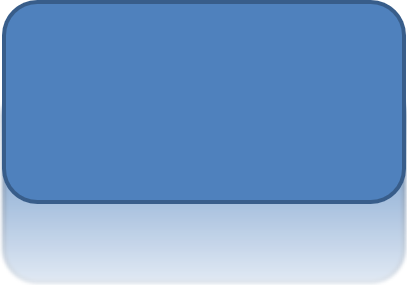

## **はじめに**

PowerPoint のエフェクトは形状を目立たせるために使用できますが、[塗りつぶし](/slides/ja/cpp/shape-formatting/#gradient-fill) やアウトラインとは異なります。PowerPoint のエフェクトを使用すると、形状にリアルな反射を作成したり、形状のグローを広げたりすることができます。


PowerPoint は、形状に適用できる 6 つのエフェクトを提供します。1 つまたは複数のエフェクトを形状に適用できます。

エフェクトの組み合わせの中には、他よりも見栄えが良いものがあります。このため、PowerPoint には **プリセット** オプションがあります。プリセットオプションは、組み合わせて使用すると見栄えが良いことが分かっている 2 つ以上のエフェクトの組み合わせです。プリセットを選択すれば、さまざまなエフェクトをテストしたり組み合わせたりして最適な組み合わせを探す手間が省けます。

Aspose.Slides は、PowerPoint プレゼンテーションの形状に同じエフェクトを適用できるように、[EffectFormat](https://reference.aspose.com/slides/cpp/aspose.slides/effectformat/) クラスのプロパティおよびメソッドを提供します。

## **影エフェクトの適用**

Aspose.Slides for C++ は、形状に対して外側と内側の影をサポートしています。影の色、方向、距離、ぼかし半径をカスタマイズしてプレゼンテーションのデザインに合わせることができます。

### **外側の影の適用**

外側の影を使用すると、カードやパネルがスライドの背景に対して際立ちます。影は形状のエッジの外側まで広がり、形状がスライド上に浮き上がっているように見せます。影の色、方向、距離、ぼかし半径を調整して、テンプレートの照明やスタイルに合わせます。

この C++ コードは、長方形に [外側の影エフェクト](https://reference.aspose.com/slides/cpp/aspose.slides/effectformat/get_outershadoweffect/) を適用する方法を示します:
```cpp
#include <DOM/Effects/IOuterShadow.h>
#include <DOM/IAutoShape.h>
#include <DOM/IColorFormat.h>
#include <DOM/IEffectFormat.h>
#include <DOM/IShapeCollection.h>
#include <DOM/ISlide.h>
#include <DOM/Presentation.h>
#include <DOM/ShapeType.h>
#include <Export/SaveFormat.h>
#include <drawing/color.h>

using namespace Aspose::Slides;
using namespace Aspose::Slides::Export;
using namespace System::Drawing;

auto presentation = System::MakeObject<Presentation>();
auto slide = presentation->get_Slide(0);

auto shape = slide->get_Shapes()->AddAutoShape(ShapeType::RoundCornerRectangle, 20.0f, 20.0f, 200.0f, 100.0f);
auto effectFormat = shape->get_EffectFormat();
effectFormat->EnableOuterShadowEffect();
auto outerShadowEffect = effectFormat->get_OuterShadowEffect();
outerShadowEffect->get_ShadowColor()->set_Color(Color::get_DarkGray());
outerShadowEffect->set_Distance(10);
outerShadowEffect->set_Direction(45.0f);

presentation->Save(u"shadow_effect.pptx", SaveFormat::Pptx);
```


### **内側の影の適用**

テンプレートのビジュアルスタイルを再現する際は、内側の影を使用してカードやパネルにくぼんだ外観を付けます。外側の影は形状の外側に広がり、浮き上がって見えるのに対し、内側の影はエッジの内部を陰影付けします。

まず [EnableInnerShadowEffect](https://reference.aspose.com/slides/cpp/aspose.slides/effectformat/enableinnershadoweffect/) を呼び出し、次に [InnerShadowEffect](https://reference.aspose.com/slides/cpp/aspose.slides/effectformat/get_innershadoweffect/) を設定します。ぼかし半径の値を大きくすると、エッジがよりソフトになります。

この C++ の例は、淡い青色のカードに濃い灰色の内側の影を付け、PPTX ファイルとして保存します:
```cpp
#include <DOM/Effects/IInnerShadow.h>
#include <DOM/IAutoShape.h>
#include <DOM/IColorFormat.h>
#include <DOM/IEffectFormat.h>
#include <DOM/IFillFormat.h>
#include <DOM/ILineFormat.h>
#include <DOM/IShapeCollection.h>
#include <DOM/ISlide.h>
#include <DOM/Presentation.h>
#include <DOM/FillType.h>
#include <DOM/ShapeType.h>
#include <Export/SaveFormat.h>
#include <drawing/color.h>

using namespace Aspose::Slides;
using namespace Aspose::Slides::Export;
using namespace System::Drawing;

auto presentation = System::MakeObject<Presentation>();
auto slide = presentation->get_Slide(0);

auto shape = slide->get_Shapes()->AddAutoShape(ShapeType::Rectangle, 20.0f, 20.0f, 200.0f, 100.0f);
shape->get_FillFormat()->set_FillType(FillType::Solid);
shape->get_FillFormat()->get_SolidFillColor()->set_Color(Color::get_LightBlue());
shape->get_LineFormat()->get_FillFormat()->set_FillType(FillType::NoFill);

shape->get_EffectFormat()->EnableInnerShadowEffect();
auto shadow = shape->get_EffectFormat()->get_InnerShadowEffect();
shadow->get_ShadowColor()->set_Color(Color::get_DimGray());
shadow->set_Direction(225);
shadow->set_Distance(7);
shadow->set_BlurRadius(6);

presentation->Save(u"inner_shadow_effect.pptx", SaveFormat::Pptx);
```


内側の影を削除するには、シェイプのエフェクトフォーマットで [DisableInnerShadowEffect](https://reference.aspose.com/slides/cpp/aspose.slides/effectformat/disableinnershadoweffect/) を呼び出します。

### **プリセット影の適用、変更、削除**

まず [EnablePresetShadowEffect](https://reference.aspose.com/slides/cpp/aspose.slides/ieffectformat/enablepresetshadoweffect/) を呼び出し、[set_Preset](https://reference.aspose.com/slides/cpp/aspose.slides.effects/ipresetshadow/set_preset/) を使用して [PresetShadowType](https://reference.aspose.com/slides/cpp/aspose.slides/presetshadowtype/) を選択します。同じシェイプでスタイルを切り替えるには、プリセットを変更します。塗りつぶしとアウトラインを保持したまま影を削除するには、[DisablePresetShadowEffect](https://reference.aspose.com/slides/cpp/aspose.slides/ieffectformat/disablepresetshadoweffect/) を呼び出します。

この例では、各段階で長方形のコピーを保持します。両方の影は 10 ポイントずつオフセットされています。方向 225° は最初の影を長方形の上方左側に配置し、45° は2番目の影を下方右側に配置します。

```cpp
#include <DOM/Effects/IPresetShadow.h>
#include <DOM/FillType.h>
#include <DOM/IAutoShape.h>
#include <DOM/IColorFormat.h>
#include <DOM/IEffectFormat.h>
#include <DOM/IFillFormat.h>
#include <DOM/ILineFormat.h>
#include <DOM/IParagraph.h>
#include <DOM/IParagraphFormat.h>
#include <DOM/IPortionFormat.h>
#include <DOM/IShapeCollection.h>
#include <DOM/ISlide.h>
#include <DOM/ISlideSize.h>
#include <DOM/ITextFrame.h>
#include <DOM/Presentation.h>
#include <DOM/PresetShadowType.h>
#include <DOM/ShapeType.h>
#include <DOM/SlideSizeScaleType.h>
#include <Export/SaveFormat.h>
#include <drawing/color.h>
#include <system/enum.h>

using namespace Aspose::Slides;
using namespace Aspose::Slides::Export;
using namespace System::Drawing;

auto presentation = System::MakeObject<Presentation>();
presentation->get_SlideSize()->SetSize(800, 120, SlideSizeScaleType::DoNotScale);
auto shapes = presentation->get_Slide(0)->get_Shapes();

auto shape = shapes->AddAutoShape(ShapeType::Rectangle, 15, 30, 170, 60);
shape->get_FillFormat()->set_FillType(FillType::Solid);
shape->get_FillFormat()->get_SolidFillColor()->set_Color(Color::get_SteelBlue());
auto outline = shape->get_LineFormat()->get_FillFormat();
outline->set_FillType(FillType::Solid);
outline->get_SolidFillColor()->set_Color(Color::get_DarkBlue());
auto textFrame = shape->get_TextFrame();
textFrame->set_Text(u"No shadow");
textFrame->get_Paragraph(0)->get_ParagraphFormat()->get_DefaultPortionFormat()->set_FontHeight(14);
shapes->AddClone(shape);

shape->set_X(shape->get_X() + 200);
auto effectFormat = shape->get_EffectFormat();
effectFormat->EnablePresetShadowEffect();
auto shadow = effectFormat->get_PresetShadowEffect();
shadow->set_Preset(PresetShadowType::TopLeftDropShadow);
shadow->set_Distance(10);
shadow->set_Direction(225);
textFrame->set_Text(System::Enum<PresetShadowType>::GetName(shadow->get_Preset()));
shapes->AddClone(shape);

shape->set_X(shape->get_X() + 200);
shadow->set_Preset(PresetShadowType::BottomRightDropShadow);
shadow->set_Direction(45);
textFrame->set_Text(System::Enum<PresetShadowType>::GetName(shadow->get_Preset()));
shapes->AddClone(shape);

shape->set_X(shape->get_X() + 200);
effectFormat->DisablePresetShadowEffect();
textFrame->set_Text(u"No shadow");

presentation->Save(u"preset_shadows.pptx", SaveFormat::Pptx);
```

| 元 | 最初のプリセット | 2番目のプリセット | 削除後 |
| :---: | :---: | :---: | :---: |
|  |  |  |  |

## **反射エフェクトの適用**

Aspose.Slides for C++ で反射エフェクトを適用するには、形状に鏡のような反射を追加し、距離・透明度・サイズなどのパラメータを調整します。このエフェクトは、形状により洗練された外観を与えることでプレゼンテーションの美しさを高めます。シンプルなコードで簡単に実装でき、複数の要素に素早く適用して一貫したデザインを実現できます。

この C++ コードは、シェイプに [反射エフェクト](https://reference.aspose.com/slides/cpp/aspose.slides/effectformat/get_reflectioneffect/) を適用する方法を示します:
```cpp
#include <DOM/Effects/IReflection.h>
#include <DOM/IAutoShape.h>
#include <DOM/IEffectFormat.h>
#include <DOM/IShapeCollection.h>
#include <DOM/ISlide.h>
#include <DOM/Presentation.h>
#include <DOM/RectangleAlignment.h>
#include <DOM/ShapeType.h>
#include <Export/SaveFormat.h>

using namespace Aspose::Slides;
using namespace Aspose::Slides::Export;

auto presentation = System::MakeObject<Presentation>();
auto slide = presentation->get_Slide(0);

auto shape = slide->get_Shapes()->AddAutoShape(ShapeType::RoundCornerRectangle, 20.0f, 20.0f, 200.0f, 100.0f);
auto effectFormat = shape->get_EffectFormat();
effectFormat->EnableReflectionEffect();
auto reflectionEffect = effectFormat->get_ReflectionEffect();
reflectionEffect->set_RectangleAlign(RectangleAlignment::Bottom);
reflectionEffect->set_Direction(90.0f);
reflectionEffect->set_Distance(40);
reflectionEffect->set_BlurRadius(2);

presentation->Save(u"reflection_effect.pptx", SaveFormat::Pptx);
```



## **グローエフェクトの適用**

Aspose.Slides for C++ でシェイプにグローエフェクトを適用するには、形状の周囲に柔らかく光るオーラを加え、色やサイズなどのプロパティを調整します。このエフェクトは形状を際立たせ、プレゼンテーションに魅力的で目を引くビジュアル要素を追加します。最小限のコードで簡単に実装でき、スライド全体の見栄えを向上させます。

この C++ コードは、シェイプに [グローエフェクト](https://reference.aspose.com/slides/cpp/aspose.slides/effectformat/get_gloweffect/) を適用する方法を示します:
```cpp
#include <DOM/Effects/IGlow.h>
#include <DOM/IAutoShape.h>
#include <DOM/IColorFormat.h>
#include <DOM/IEffectFormat.h>
#include <DOM/IShapeCollection.h>
#include <DOM/ISlide.h>
#include <DOM/Presentation.h>
#include <DOM/ShapeType.h>
#include <Export/SaveFormat.h>
#include <drawing/color.h>

using namespace Aspose::Slides;
using namespace Aspose::Slides::Export;
using namespace System::Drawing;

auto presentation = System::MakeObject<Presentation>();
auto slide = presentation->get_Slide(0);

auto shape = slide->get_Shapes()->AddAutoShape(ShapeType::RoundCornerRectangle, 20.0f, 20.0f, 200.0f, 100.0f);
auto effectFormat = shape->get_EffectFormat();
effectFormat->EnableGlowEffect();
auto glowEffect = effectFormat->get_GlowEffect();
glowEffect->get_Color()->set_Color(Color::get_Magenta());
glowEffect->set_Radius(15);

presentation->Save(u"glow_effect.pptx", SaveFormat::Pptx);
```


## **ソフトエッジエフェクトの適用**

Aspose.Slides for C++ でソフトエッジエフェクトを適用するには、形状のエッジ周辺に滑らかでぼやけた遷移を作成します。このエフェクトは、より控えめで洗練された外観を加え、柔らかい外観が必要なデザインに最適です。半径などのパラメータを簡単に調整して、プレゼンテーション内のさまざまな形状に希望の効果を実現できます。

この C++ コードは、シェイプに [ソフトエッジ](https://reference.aspose.com/slides/cpp/aspose.slides/effectformat/get_softedgeeffect/) を適用する方法を示します:
```cpp
#include <DOM/Effects/ISoftEdge.h>
#include <DOM/IAutoShape.h>
#include <DOM/IEffectFormat.h>
#include <DOM/IShapeCollection.h>
#include <DOM/ISlide.h>
#include <DOM/Presentation.h>
#include <DOM/ShapeType.h>
#include <Export/SaveFormat.h>

using namespace Aspose::Slides;
using namespace Aspose::Slides::Export;

auto presentation = System::MakeObject<Presentation>();
auto slide = presentation->get_Slide(0);

auto shape = slide->get_Shapes()->AddAutoShape(ShapeType::RoundCornerRectangle, 20.0f, 20.0f, 200.0f, 150.0f);
auto effectFormat = shape->get_EffectFormat();
effectFormat->EnableSoftEdgeEffect();
auto softEdgeEffect = effectFormat->get_SoftEdgeEffect();
softEdgeEffect->set_Radius(8);

presentation->Save(u"soft_edges_effect.pptx", SaveFormat::Pptx);
```


## **ブラーエフェクトの適用**

シェイプブラーを使用すると、シェイプを編集可能なまま塗りつぶしとアウトラインをソフトにできます。シェイプのエフェクトフォーマットで [SetBlurEffect](https://reference.aspose.com/slides/cpp/aspose.slides/ieffectformat/setblureffect/) を呼び出します。半径はポイント（1/72 インチ）で測定され、負の値は使用できず、値が大きいほど強いぼかしになります。半径を 0 にすると外観は変わりません。

[Grow](https://reference.aspose.com/slides/cpp/aspose.slides.effects/iblur/get_grow/) 設定はエフェクトの可視範囲を制御します。`false` の場合、ブラーは元の描画範囲（アウトラインを含む）にクリップされます。`true` の場合、ブラーはその範囲を超えて拡張できます。どちらの設定もシェイプの位置やサイズは変更しません。

以下の比較は、全体で同じ塗りつぶし、アウトライン、シェイプのサイズを使用しています。上段は `grow = false`、下段は `grow = true` を使用しています。


この C++ の例は、オレンジ色の長方形に濃い青のアウトラインを付け、5 ポイントのブラーを適用し、次に [SetBlurEffect](https://reference.aspose.com/slides/cpp/aspose.slides/ieffectformat/setblureffect/) を再度呼び出して 15 ポイントのブラーに更新します。両方のブラー状態を保存し、続いて [DisableBlurEffect](https://reference.aspose.com/slides/cpp/aspose.slides/ieffectformat/disableblureffect/) を呼び出してブラーなしのシェイプを保存します。
```cpp
#include <DOM/IAutoShape.h>
#include <DOM/IColorFormat.h>
#include <DOM/IEffectFormat.h>
#include <DOM/IFillFormat.h>
#include <DOM/ILineFormat.h>
#include <DOM/IShapeCollection.h>
#include <DOM/ISlide.h>
#include <DOM/Presentation.h>
#include <DOM/FillType.h>
#include <DOM/ShapeType.h>
#include <Export/SaveFormat.h>
#include <drawing/color.h>

using namespace Aspose::Slides;
using namespace Aspose::Slides::Export;
using namespace System::Drawing;

auto presentation = System::MakeObject<Presentation>();
auto slide = presentation->get_Slide(0);

auto shape = slide->get_Shapes()->AddAutoShape(ShapeType::Rectangle, 100.0f, 80.0f, 160.0f, 100.0f);
shape->get_FillFormat()->set_FillType(FillType::Solid);
shape->get_FillFormat()->get_SolidFillColor()->set_Color(Color::get_Orange());
shape->get_LineFormat()->get_FillFormat()->set_FillType(FillType::Solid);
shape->get_LineFormat()->get_FillFormat()->get_SolidFillColor()->set_Color(Color::get_DarkBlue());
shape->get_LineFormat()->set_Width(8);

shape->get_EffectFormat()->SetBlurEffect(5, false);
presentation->Save(u"shape_blur_5.pptx", SaveFormat::Pptx);

shape->get_EffectFormat()->SetBlurEffect(15, true);
presentation->Save(u"shape_blur_15.pptx", SaveFormat::Pptx);

shape->get_EffectFormat()->DisableBlurEffect();
presentation->Save(u"shape_blur_removed.pptx", SaveFormat::Pptx);
```

シェイプブラーは塗りつぶしとアウトラインの両方に影響します。ソフトエッジエフェクトはシェイプのエッジをフェードさせますが、シャドウブラーは影だけをソフトにします。画像変換エフェクトは画像コンテンツに対して作用しますが、この例はシェイプを画像に変換せず、シェイプのエフェクトフォーマットに直接ブラーを適用しています。

## **よくある質問**

**同じシェイプに複数のエフェクトを適用できますか？**

はい、影、反射、グローなどの異なるエフェクトを単一のシェイプに組み合わせて、より動的な外観を作成できます。

**どのようなシェイプにエフェクトを適用できますか？**

自動図形、グラフ、テーブル、画像、SmartArt オブジェクト、OLE オブジェクトなど、さまざまなシェイプにエフェクトを適用できます。

**グループ化したシェイプにエフェクトを適用できますか？**

はい、グループ化したシェイプにもエフェクトを適用できます。エフェクトはグループ全体に適用されます。