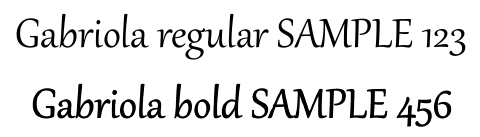

## **概要**

JavaでPowerPointプレゼンテーション（PPT、PPTX、ODPなど）をPDF形式に変換すると、異なるデバイス間での互換性やプレゼンテーションのレイアウトと書式設定を保持するなど、さまざまな利点があります。本ガイドでは、プレゼンテーションをPDFドキュメントに変換する方法、画像品質を制御するさまざまなオプションの使用、非表示スライドの含め方、PDFファイルへのパスワード保護、フォント置換の検出、特定のスライドの選択変換、そして出力ドキュメントにコンプライアンス基準を適用する方法を示します。

## **PowerPointからPDFへの変換**

Aspose.Slides を使用すると、次の形式のプレゼンテーションを PDF に変換できます。

* **PPT**
* **PPTX**
* **ODP**

プレゼンテーションを PDF に変換するには、ファイル名を引数として [Presentation](https://reference.aspose.com/slides/java/com.aspose.slides/presentation/) クラスに渡し、[save](https://reference.aspose.com/slides/java/com.aspose.slides/presentation/#save-java.lang.String-int-) メソッドでプレゼンテーションを PDF として保存します。[Presentation](https://reference.aspose.com/slides/java/com.aspose.slides/presentation/) クラスは、通常プレゼンテーションを PDF に変換するために使用される [save](https://reference.aspose.com/slides/java/com.aspose.slides/presentation/#save-java.lang.String-int-) メソッドを公開しています。

{}
Aspose.Slides for Java は、出力ドキュメントに API 情報とバージョン番号を挿入します。たとえば、プレゼンテーションを PDF に変換する際、Aspose.Slides は Application フィールドに「*Aspose.Slides*」を、PDF Producer フィールドに「*Aspose.Slides v XX.XX*」形式の値を設定します。**注意** Aspose.Slides に対してこの情報を変更または削除するよう指示することはできません。
{}

Aspose.Slides では、次の変換が可能です：

* プレゼンテーション全体を PDF に変換
* プレゼンテーションの特定のスライドを PDF に変換

Aspose.Slides はプレゼンテーションを PDF にエクスポートし、生成された PDF が元のプレゼンテーションと非常に近いことを保証します。変換時に要素と属性が正確にレンダリングされ、以下が含まれます：

* 画像
* テキスト ボックスと図形
* テキストの書式設定
* 段落の書式設定
* ハイパーリンク
* ヘッダーとフッター
* 箇条書き
* 表

## **PowerPointをPDFに変換**

標準的な PowerPoint から PDF への変換プロセスはデフォルトオプションを使用します。この場合、Aspose.Slides は最適な設定と最高品質レベルで提供されたプレゼンテーションを PDF に変換しようとします。

以下の例は、プレゼンテーションを読み込み、デフォルトのエクスポート設定で表示されているすべてのスライドを PDF に保存します。

```java
import com.aspose.slides.*;

Presentation presentation = new Presentation("PowerPoint.ppt");
try {
    presentation.save("PPT-to-PDF.pdf", SaveFormat.Pdf);
} finally {
    presentation.dispose();
}
```

{}
Aspose は、プレゼンテーションから PDF への変換プロセスを示す無料のオンライン [**PowerPointからPDFへのコンバータ**](https://products.aspose.app/slides/conversion/ppt-to-pdf) を提供しています。このコンバータでテストを実行し、ここで説明した手順を実際に試すことができます。
{}

## **オプション付きでPowerPointをPDFに変換**

Aspose.Slides は、[PdfOptions](https://reference.aspose.com/slides/java/com.aspose.slides/pdfoptions/) クラスのプロパティとしてカスタムオプションを提供し、結果の PDF をカスタマイズしたり、パスワードで PDF をロックしたり、変換プロセスの進行方法を指定したりできます。

### **カスタムオプションでPowerPointをPDFに変換**

カスタム変換オプションを使用すると、ラスタ画像の品質設定を指定したり、メタファイルの処理方法を決めたり、テキストの圧縮レベルを設定したり、画像の DPI を構成したり、その他さまざまな設定が可能です。

以下の例は、PDF 1.5 にエクスポートし、JPEG 品質を 90、画像解像度を 300 DPI、メタファイルを PNG として保存し、Flate テキスト圧縮を使用します。

```java
import com.aspose.slides.*;

PdfOptions pdfOptions = new PdfOptions();
pdfOptions.setJpegQuality((byte)90);
pdfOptions.setSufficientResolution(300);
pdfOptions.setSaveMetafilesAsPng(true);
pdfOptions.setTextCompression(PdfTextCompression.Flate);
pdfOptions.setCompliance(PdfCompliance.Pdf15);

Presentation presentation = new Presentation("PowerPoint.pptx");

try {
    presentation.save("PowerPoint-to-PDF.pdf", SaveFormat.Pdf, pdfOptions);
} finally {
    presentation.dispose();
}
```

### **画像圧縮の自動選択**

プレゼンテーションに多数の写真やスクリーンショットが含まれている場合、エクスポートされた PDF のサイズを縮小すると、メール送信やダウンロードが容易になります。[PdfOptions.setBestImagesCompressionRatio](https://reference.aspose.com/slides/java/com.aspose.slides/pdfoptions/#setBestImagesCompressionRatio-boolean-) を `true` で呼び出すと、PDF エクスポート時に各画像に最適な圧縮アルゴリズムが自動的に選択されます。

以下の例は、既存のプレゼンテーションを読み込み、自動画像圧縮選択を有効にし、PDF ドキュメントとして保存します。他の PDF エクスポート設定はすべてデフォルト値のままです。

```java
import com.aspose.slides.PdfOptions;
import com.aspose.slides.Presentation;
import com.aspose.slides.SaveFormat;

PdfOptions pdfOptions = new PdfOptions();
pdfOptions.setBestImagesCompressionRatio(true);

Presentation presentation = new Presentation("image-heavy.pptx");
try {
    presentation.save("image-heavy.pdf", SaveFormat.Pdf, pdfOptions);
} finally {
    presentation.dispose();
}
```

このオプションは各画像に対して圧縮アルゴリズムを選択します。[setJpegQuality](https://reference.aspose.com/slides/java/com.aspose.slides/pdfoptions/#setJpegQuality-byte-) に渡す値を下げると JPEG 画像の品質が低下し、[setSufficientResolution](https://reference.aspose.com/slides/java/com.aspose.slides/pdfoptions/#setSufficientResolution-float-) に渡す値を下げると画像が低解像度にダウンサンプリングされ、詳細が減少します。自動圧縮選択を有効にしても、これらの設定自体は下げられません。

画像圧縮アルゴリズムの選択には追加の処理時間とメモリが必要です。サイズ削減はプレゼンテーションの画像やエクスポート設定に依存し、すべてのプレゼンテーションで一定の削減が保証されるわけではありません。

### **埋め込みOLEファイルをPDF添付ファイルとして保持**

プレゼンテーションに埋め込みの Excel ワークブックが含まれている場合、PDF の受取人がスライドを閲覧できるだけでなく、ワークブックのデータにもアクセスできるようにしたいことがあります。[setIncludeOleData](https://reference.aspose.com/slides/java/com.aspose.slides/pdfoptions/#setIncludeOleData-boolean-) を `true` で呼び出すと、埋め込み OLE ファイルが結果の PDF の添付ファイルとして保持されます。

デフォルト値は `false` です。OLE オブジェクトのプレビュー画像またはアイコンは PDF ページに描画されますが、埋め込みファイルは添付ファイルとして含まれません。オプションを `true` に設定すると、ファイルデータも添付されます。プレビューは視覚的な表現のままで、添付ファイルにより受取人は埋め込みファイルを個別に開いたり保存したりできます。OLE オブジェクトは PDF ページ上でインタラクティブな Excel ワークシートにはなりません。

以下の例は、既に埋め込み Excel ワークブックを含むプレゼンテーションを読み込み、ワークブックを添付した状態で PDF にエクスポートします。

```java
import com.aspose.slides.*;

PdfOptions pdfOptions = new PdfOptions();
pdfOptions.setIncludeOleData(true);

Presentation presentation = new Presentation("presentation.pptx");
try {
    presentation.save("presentation.pdf", SaveFormat.Pdf, pdfOptions);
} finally {
    presentation.dispose();
}
```

結果を確認するには：

1. Adobe Acrobat Reader など、ファイル添付をサポートするビューアでエクスポートした PDF を開きます。
2. ビューアの **Attachments** パネルを開き、埋め込みワークブックを探します。
3. 添付ファイルを保存し、Excel で開いてデータを確認するか、ビューアが許可すれば直接開きます。PDF ページ上のプレビューは添付ファイルとは別です。

{}
PDF/A 標準は添付ファイルに対して制限を課しています。PDF/A-1 は埋め込みファイルを禁止し、PDF/A-2 は PDF/A 添付ファイルのみを許可し、PDF/A-3 は Excel ワークブックを含むその他のファイルタイプを許可します。これらは標準の要件であり、Aspose.Slides 特有の制限ではありません。この例はデフォルトの PDF コンプライアンス設定を使用しており、PDF/A エクスポートは示していません。
{}

### **非表示スライドを含めてPowerPointをPDFに変換**

プレゼンテーションに非表示スライドが含まれる場合、[PdfOptions](https://reference.aspose.com/slides/java/com.aspose.slides/pdfoptions/) クラスの [setShowHiddenSlides](https://reference.aspose.com/slides/java/com.aspose.slides/pdfoptions/#setShowHiddenSlides-boolean-) メソッドを使用して、非表示スライドを結果の PDF のページとして含めることができます。

以下の例は、非表示スライドを含めてプレゼンテーションを PDF にエクスポートします。

```java
import com.aspose.slides.*;

Presentation presentation = new Presentation("PowerPoint.pptx");
try {
    PdfOptions pdfOptions = new PdfOptions();
    pdfOptions.setShowHiddenSlides(true);

    presentation.save("PowerPoint-to-PDF.pdf", SaveFormat.Pdf, pdfOptions);
} finally {
    presentation.dispose();
}
```

### **パスワード保護されたPDFにPowerPointを変換**

以下の例は、開く際に `password` というパスワードが必要な PDF にプレゼンテーションをエクスポートします。アクセス権限では印刷が許可されており、高品質印刷も可能です。

```java
import com.aspose.slides.*;

Presentation presentation = new Presentation("PowerPoint.pptx");
try {
    PdfOptions pdfOptions = new PdfOptions();
    pdfOptions.setPassword("password");
    pdfOptions.setAccessPermissions(PdfAccessPermissions.PrintDocument | PdfAccessPermissions.HighQualityPrint);

    presentation.save("PPTX-to-PDF.pdf", SaveFormat.Pdf, pdfOptions);
} finally {
    presentation.dispose();
}
```

### **フォント置換の検出**

Aspose.Slides は、[PdfOptions](https://reference.aspose.com/slides/java/com.aspose.slides/pdfoptions/) クラスの下にある [setWarningCallback](https://reference.aspose.com/slides/java/com.aspose.slides/saveoptions/#setWarningCallback-com.aspose.slides.IWarningCallback-) メソッドを提供し、プレゼンテーションから PDF への変換プロセス中にフォント置換を検出できるようにします。

以下の例は、プレゼンテーションを PDF にエクスポートし、フォント置換の警告をコンソールに出力します。利用できないフォントが置換された場合にのみ警告が出力されます。

```java
import com.aspose.slides.*;

class FontSubstitutionHandler implements IWarningCallback {
    public int warning(IWarningInfo warning) {
        if (warning.getWarningType() == WarningType.DataLoss && warning.getDescription().startsWith("Font will be substituted")) {
            System.out.println("Font substitution warning: " + warning.getDescription());
        }
        return ReturnAction.Continue;
    }
}

PdfOptions pdfOptions = new PdfOptions();
pdfOptions.setWarningCallback(new FontSubstitutionHandler());

Presentation presentation = new Presentation("sample.pptx");
try {
    presentation.save("output.pdf", SaveFormat.Pdf, pdfOptions);
} finally {
    presentation.dispose();
}
```

{}
フォント置換の詳細については、[フォント置換](/slides/ja/java/font-substitution/) 記事をご覧ください。
{} 

### **専用の太字書体を持たないフォントの処理**

プレゼンテーションは、フォントに専用の太字書体がなくてもテキストに太字書式を適用できます。その場合、合成太字により通常の字形が人工的に太くなり、テキストは太字として表示されます。PDF でそのテキストが重すぎる、あるいは意図した外観と異なる場合は、[PdfOptions.setRasterizeUnsupportedFontStyles](https://reference.aspose.com/slides/java/com.aspose.slides/pdfoptions/#setRasterizeUnsupportedFontStyles-boolean-) を `true` で呼び出してみてください。このオプションは、PDF エクスポート時に影響を受けたテキストをビットマップとしてレンダリングし、特定のフォントの外観を改善できます。デフォルト値は `false` です。

サンプルのプレゼンテーションには、通常のテキストが入ったテキストボックスと、同じフォント（専用の太字書体がない）に太字書式が適用されたテキストボックスの 2 つが含まれています。以下の例は、プレゼンテーションを読み込み、サポートされていないフォントスタイルのラスタライズを有効にし、PDF にエクスポートします。

```java
import com.aspose.slides.PdfOptions;
import com.aspose.slides.Presentation;
import com.aspose.slides.SaveFormat;

PdfOptions pdfOptions = new PdfOptions();
pdfOptions.setRasterizeUnsupportedFontStyles(true);

Presentation presentation = new Presentation("unsupported-bold.pptx");
try {
    presentation.save("rasterized.pdf", SaveFormat.Pdf, pdfOptions);
} finally {
    presentation.dispose();
}
```

以下のプレビューは、オプションが無効の場合と有効の場合の出力を示しています。この例では、オプションが無効な場合、太字テキストの線が太くなります。オプションを有効にすると、線が細くなり、通常のテキストは変わりません。設定を選択する前に結果を比較してください。

| オプション無効 (`false`、デフォルト) | オプション有効 (`true`) |
|---|---|
|  |  |

この例では、オプションを有効にすると太字テキストのみがビットマップに変換されます。そのため OCR なしでは選択、コピー、検索ができず、800% ズーム時にエッジが柔らかく表示されます。通常のテキストは検索可能なままです。オプションが無効な場合、両方の文字列はテキストとして残ります。

このオプションは、フォントに専用の太字書体がない場合に太字として書式設定されたテキストをラスタライズします。[フォント置換](/slides/ja/java/font-substitution/) は、元のフォントが利用できないときに別のフォントを選択します。

## **PowerPointから選択したスライドをPDFに変換**

以下の例は、プレゼンテーションからスライド 1 と 3 を PDF にエクスポートします。この配列のスライド番号は 1 から始まり、入力プレゼンテーションは少なくとも 3 スライドを含んでいる必要があります。

```java
import com.aspose.slides.*;

Presentation presentation = new Presentation("PowerPoint.pptx");
try {
    int[] slides = { 1, 3 };
    presentation.save("PPTX-to-PDF.pdf", slides, SaveFormat.Pdf);
} finally {
    presentation.dispose();
}
```

## **カスタムスライドサイズでPowerPointをPDFに変換**

以下の例は、プレゼンテーションの最初のスライドを、スライドサイズ 612 × 792 ポイント（8.5 × 11 インチ）の新しいプレゼンテーションにコピーします。スライド内容をフィットさせるようにスケーリングし、単一のスライドを PDF にエクスポートします。

```java
import com.aspose.slides.*;

float slideWidth = 612;
float slideHeight = 792;

Presentation presentation = new Presentation("SelectedSlides.pptx");
Presentation resizedPresentation = new Presentation();

try {
    resizedPresentation.getSlideSize().setSize(slideWidth, slideHeight, SlideSizeScaleType.EnsureFit);
    
    ISlide slide = presentation.getSlides().get_Item(0);
    resizedPresentation.getSlides().insertClone(0, slide);

    // 新しいプレゼンテーションで作成された空のスライドを削除します。
    resizedPresentation.getSlides().removeAt(1);

    resizedPresentation.save("PDF_with_custom_slide_size.pdf", SaveFormat.Pdf);
} finally {
    resizedPresentation.dispose();
    presentation.dispose();
}
```

## **ノートスライドビューでPowerPointをPDFに変換**

以下の例は、プレゼンテーションを PDF にエクスポートし、各スライドのスピーカーノートをスライドの下に配置します。スピーカーノートを含むプレゼンテーションを使用して結果をご確認ください。

```java
import com.aspose.slides.*;

Presentation presentation = new Presentation("SelectedSlides.pptx");
try {
    NotesCommentsLayoutingOptions notesOptions = new NotesCommentsLayoutingOptions();
    notesOptions.setNotesPosition(NotesPositions.BottomFull);
    
    PdfOptions pdfOptions = new PdfOptions();
    pdfOptions.setSlidesLayoutOptions(notesOptions);

    presentation.save("PDF_with_notes.pdf", SaveFormat.Pdf, pdfOptions);
} finally {
    presentation.dispose();
}
```

## **PDF のアクセシビリティとコンプライアンス基準**

Aspose.Slides は、[Web Content Accessibility Guidelines (**WCAG**)](https://www.w3.org/TR/WCAG-TECHS/pdf.html) に準拠した変換手順を使用できます。PowerPoint ドキュメントを PDF にエクスポートする際には、**PDF/A1a**、**PDF/A1b**、**PDF/UA** のいずれかのコンプライアンス基準を使用できます。

このコードは、異なるコンプライアンス基準に基づいて複数の PDF を生成する PowerPoint から PDF への変換プロセスを示しています。

```java
import com.aspose.slides.*;

Presentation presentation = new Presentation("pres.pptx");
try {
    PdfOptions pdfOptions = new PdfOptions();

    pdfOptions.setCompliance(PdfCompliance.PdfA1a);
    presentation.save("pres-a1a-compliance.pdf", SaveFormat.Pdf, pdfOptions);

    pdfOptions.setCompliance(PdfCompliance.PdfA1b);
    presentation.save("pres-a1b-compliance.pdf", SaveFormat.Pdf, pdfOptions);

    pdfOptions.setCompliance(PdfCompliance.PdfUa);
    presentation.save("pres-ua-compliance.pdf", SaveFormat.Pdf, pdfOptions);
} finally {
    presentation.dispose();
}
```

{}
Aspose.Slides は PDF 変換操作をサポートし、PDF ファイルを一般的なファイル形式に変換できます。[PDF to HTML](https://products.aspose.com/slides/java/conversion/pdf-to-html/)、[PDF to image](https://products.aspose.com/slides/java/conversion/pdf-to-image/)、[PDF to JPG](https://products.aspose.com/slides/java/conversion/pdf-to-jpg/)、[PDF to PNG](https://products.aspose.com/slides/java/conversion/pdf-to-png/) の変換を実行できます。また、[PDF to SVG](https://products.aspose.com/slides/java/conversion/pdf-to-svg/)、[PDF to TIFF](https://products.aspose.com/slides/java/conversion/pdf-to-tiff/)、[PDF to XML](https://products.aspose.com/slides/java/conversion/pdf-to-xml/) など、専門的な形式への PDF 変換操作もサポートされています。
{}

> **注意:** PDF/UA にエクスポートする際、Aspose.Slides は SmartArt、チャート、数式などの複雑なグラフィックを単一の図として扱います。個々のパス要素は別個のコンテンツとして保持されず、アーティファクトとしてマークされることがあり、代替テキストは全体の図に対してのみ提供されます。

## **よくある質問**

**複数の PowerPoint ファイルを一括で PDF に変換できますか？**

はい、Aspose.Slides は複数の PPT または PPTX ファイルを PDF にバッチ変換することをサポートしています。ファイルを順に処理し、プログラムで変換プロセスを適用できます。

**変換された PDF にパスワード保護を設定できますか？**

はい。[PdfOptions](https://reference.aspose.com/slides/java/com.aspose.slides/pdfoptions/) クラスを使用して、変換プロセス中にパスワードを設定し、アクセス権限を定義できます。

**PDF に非表示スライドを含めるにはどうすればよいですか？**

[PdfOptions](https://reference.aspose.com/slides/java/com.aspose.slides/pdfoptions/) クラスで [setShowHiddenSlides](https://reference.aspose.com/slides/java/com.aspose.slides/pdfoptions/#setShowHiddenSlides-boolean-) を `true` で呼び出すと、結果の PDF に非表示スライドが含まれます。

**Aspose.Slides は PDF の高画質画像を維持できますか？**

はい、[PdfOptions](https://reference.aspose.com/slides/java/com.aspose.slides/pdfoptions/) クラスの [setJpegQuality](https://reference.aspose.com/slides/java/com.aspose.slides/pdfoptions/#setJpegQuality-byte-) や [setSufficientResolution](https://reference.aspose.com/slides/java/com.aspose.slides/pdfoptions/#setSufficientResolution-float-) などのメソッドを使用して画像品質を制御し、PDF 内の画像を高品質に保つことができます。

**Aspose.Slides は PDF/A コンプライアンス標準をサポートしていますか？**

はい、Aspose.Slides は [various standards](https://reference.aspose.com/slides/java/com.aspose.slides/pdfcompliance/)（PDF/A1a、PDF/A1b、PDF/UA を含む）に準拠した PDF のエクスポートを可能にし、文書がアクセシビリティとアーカイブ要件を満たすようにします。

## **追加リソース**

- [Aspose.Slides for Java ドキュメント](/slides/ja/java/)
- [Aspose.Slides for Java API リファレンス](https://reference.aspose.com/slides/java/)
- [Aspose 無料オンラインコンバーター](https://products.aspose.app/slides/conversion)