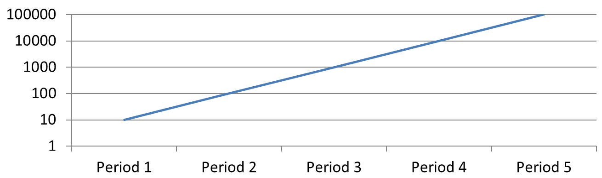

## **概要**

この記事では、Aspose.Slides for Java を使用してチャート軸をカスタマイズする方法を説明します。計算された軸の値、チャートの行と列の入れ替え、軸の表示/非表示、カテゴリ ラベルと目盛り間隔、日付カテゴリと書式設定、タイトルの回転、軸の配置、表示単位、対数スケーリングについて解説します。

## **チャートの垂直軸の最大値を取得する**

デフォルト データでエリア チャートを追加した [Presentation](https://reference.aspose.com/slides/java/com.aspose.slides/presentation/) を作成します。計算された軸値を読み取る前に、チャート レイアウトが最新になるように [validateChartLayout](https://reference.aspose.com/slides/java/com.aspose.slides/chart/#validateChartLayout--) を呼び出します。

軸の上限と下限を取得するには [getActualMaxValue](https://reference.aspose.com/slides/java/com.aspose.slides/axis/#getActualMaxValue--) と [getActualMinValue](https://reference.aspose.com/slides/java/com.aspose.slides/axis/#getActualMinValue--) を使用し、目盛り間隔は [getActualMajorUnit](https://reference.aspose.com/slides/java/com.aspose.slides/axis/#getActualMajorUnit--) と [getActualMinorUnit](https://reference.aspose.com/slides/java/com.aspose.slides/axis/#getActualMinorUnit--) を使用します。[getActualMajorUnitScale](https://reference.aspose.com/slides/java/com.aspose.slides/axis/#getActualMajorUnitScale--) と [getActualMinorUnitScale](https://reference.aspose.com/slides/java/com.aspose.slides/axis/#getActualMinorUnitScale--) は日時軸に関連する時間単位スケールを提供します。この例ではこれらの値をローカル変数に保存し、チャートを保存します。

```java
import com.aspose.slides.*;

Presentation presentation = new Presentation();
try {
    ISlide slide = presentation.getSlides().get_Item(0);

    IChart chart = slide.getShapes().addChart(ChartType.Area, 100, 100, 500, 350);
    chart.validateChartLayout();

    double maxValue = chart.getAxes().getVerticalAxis().getActualMaxValue();
    double minValue = chart.getAxes().getVerticalAxis().getActualMinValue();

    double majorUnit = chart.getAxes().getVerticalAxis().getActualMajorUnit();
    double minorUnit = chart.getAxes().getVerticalAxis().getActualMinorUnit();

    int majorUnitScale = chart.getAxes().getVerticalAxis().getActualMajorUnitScale();
    int minorUnitScale = chart.getAxes().getVerticalAxis().getActualMinorUnitScale();

    presentation.save("AxisValues_out.pptx", SaveFormat.Pptx);
} finally {
    presentation.dispose();
}
```

## **軸間のデータを入れ替える**

[swapRowColumn](https://reference.aspose.com/slides/java/com.aspose.slides/chartdata/#switchRowColumn--) を使用して、チャート データ内の系列とカテゴリの役割を入れ替えます。元のカテゴリは系列になり、元の系列はカテゴリになります。これはデータのグループ化方法を変更しますが、水平軸と垂直軸を入れ替えるものではありません。この例では [setRange](https://reference.aspose.com/slides/java/com.aspose.slides/chartdata/#setRange-java.lang.String-) を使用してデフォルト データを `Sheet1!A1:D5`（ヘッダー行とカテゴリ列を含む）にバインドし、行と列を入れ替える前に設定します。結果として 4 系列と 3 カテゴリのチャートが保存されます。

```java
import com.aspose.slides.*;

Presentation presentation = new Presentation();
try {
    ISlide slide = presentation.getSlides().get_Item(0);

    IChart chart = slide.getShapes().addChart(ChartType.ClusteredColumn, 100, 100, 400, 300);
    chart.getChartData().setRange("Sheet1!A1:D5");
    chart.getChartData().switchRowColumn();

    presentation.save("SwitchChartRowColumns_out.pptx", SaveFormat.Pptx);
} finally {
    presentation.dispose();
}
```

## **軸のプロット順序を逆にする**

[setPlotOrderReversed](https://reference.aspose.com/slides/java/com.aspose.slides/axis/#setPlotOrderReversed-boolean-) を使用してカテゴリ軸または値軸の順序を逆にします。たとえば、水平棒グラフでプロジェクトの段階をワークシートと同じ順序（計画、開発、テスト）で上から下へ表示できます。軸を逆にするとプロット方向が変わりますが、ワークブック データの並び替えや再配置は行われません。一方、[switchRowColumn](https://reference.aspose.com/slides/java/com.aspose.slides/chartdata/#switchRowColumn--) は系列とカテゴリの役割を入れ替えます。

以下の例は、3 つの段階と 1 系列の水平棒グラフを作成します。3 つのスライド（通常順序、カテゴリ逆順、値逆順）を保存します。各コピーは同じデータセットを使用し、各コピーで 1 本の軸のみが逆になります。

```java
import com.aspose.slides.*;

Presentation presentation = new Presentation();
try {
    ISlide slide = presentation.getSlides().get_Item(0);

    IChart chart = slide.getShapes().addChart(ChartType.ClusteredBar, 50, 40, 620, 320);
    chart.setLegend(false);

    chart.getChartData().getCategories().clear();
    chart.getChartData().getSeries().clear();

    IChartDataWorkbook workbook = chart.getChartData().getChartDataWorkbook();
    workbook.clear(0);

    IChartSeries series = chart.getChartData().getSeries().add(ChartType.ClusteredBar);
    String[] stages = { "Planning", "Development", "Testing" };
    int[] values = { 10, 30, 20 };
    for (int i = 0; i < stages.length; i++) {
        IChartDataCell categoryCell = workbook.getCell(0, i + 1, 0, stages[i]);
        chart.getChartData().getCategories().add(categoryCell);
        IChartDataCell valueCell = workbook.getCell(0, i + 1, 1, values[i]);
        series.getDataPoints().addDataPointForBarSeries(valueCell);
    }

    // スライド 2: 最初のカテゴリを上に表示します。
    ISlide categorySlide = presentation.getSlides().addClone(slide);
    IChart categoryChart = (IChart)categorySlide.getShapes().get_Item(0);
    categoryChart.getAxes().getVerticalAxis().setPlotOrderReversed(true);
    // 水平値軸を下部に保持します。
    categoryChart.getAxes().getVerticalAxis().setCrossType(CrossesType.Maximum);

    // スライド 3: 水平数値スケールのみを逆にします。
    ISlide valueSlide = presentation.getSlides().addClone(slide);
    IChart valueChart = (IChart)valueSlide.getShapes().get_Item(0);
    valueChart.getAxes().getHorizontalAxis().setPlotOrderReversed(true);

    presentation.save("ReversedAxes.pptx", SaveFormat.Pptx);
} finally {
    presentation.dispose();
}
```

軸を逆にすると、直交する軸をプロットの反対側に移動することもできます。[setCrossType](https://reference.aspose.com/slides/java/com.aspose.slides/axis/#setCrossType-int-) は、設定対象の軸に対して他の軸がどこで交差するかを制御します。スライド 2 では、逆転したカテゴリ軸に対して `CrossesType.Maximum` を使用すると、水平値軸が下部に保持されます。特定の交差点を設定するには [setCrossAt](https://reference.aspose.com/slides/java/com.aspose.slides/axis/#setCrossAt-float-) を使用します。方向を変更する際は、特にカスタム交差点が設定されている場合に交差設定を確認してください。`setPlotOrderReversed` を `false` で呼び出すと通常のプロット方向に戻ります。交差設定は別個です。

| 通常の順序（スライド 1） | カテゴリが反転した順序（スライド 2） | 値が反転した順序（スライド 3） |
| --- | --- | --- |
|  |  |  |
| カテゴリは下から上へ、値は左から右へ増加します。 | 計画、開発、テストが上から下へ。値とワークブックの行順序は変更されません。 | カテゴリは通常順序のまま、値は右から左へ増加。カテゴリ軸は右側のゼロで交差します。 |

## **折れ線グラフの垂直軸を非表示にする**

垂直軸に対して `false` を指定して [setVisible](https://reference.aspose.com/slides/java/com.aspose.slides/axis/#setVisible-boolean-) を呼び出し、軸を非表示にします。この例ではデフォルト データの折れ線グラフを作成し、垂直軸を非表示にして保存します。

```java
import com.aspose.slides.*;

Presentation presentation = new Presentation();
try {
    ISlide slide = presentation.getSlides().get_Item(0);

    IChart chart = slide.getShapes().addChart(ChartType.Line, 100, 100, 400, 300);
    chart.getAxes().getVerticalAxis().setVisible(false);

    presentation.save("HiddenVerticalAxis.pptx", SaveFormat.Pptx);
} finally {
    presentation.dispose();
}
```

## **折れ線グラフの水平軸を非表示にする**

水平軸に対して `false` を指定して [setVisible](https://reference.aspose.com/slides/java/com.aspose.slides/axis/#setVisible-boolean-) を呼び出し、軸を非表示にします。この例ではデフォルト データの折れ線グラフを作成し、水平軸を非表示にして保存します。

```java
import com.aspose.slides.*;

Presentation presentation = new Presentation();
try {
    ISlide slide = presentation.getSlides().get_Item(0);

    IChart chart = slide.getShapes().addChart(ChartType.Line, 100, 100, 400, 300);
    chart.getAxes().getHorizontalAxis().setVisible(false);

    presentation.save("HiddenHorizontalAxis.pptx", SaveFormat.Pptx);
} finally {
    presentation.dispose();
}
```

## **チャートのグリッド線を表示または非表示にする**

[getShowMajorGridLines](https://reference.aspose.com/slides/java/com.aspose.slides/iaxis/#getShowMajorGridLines--) と [getShowMinorGridLines](https://reference.aspose.com/slides/java/com.aspose.slides/iaxis/#getShowMinorGridLines--) を呼び出して、軸が表示しているグリッド線を確認します。これらのメソッドは現在の可視状態を返します。マイナー グリッド線を表示するには [getMinorGridLinesFormat](https://reference.aspose.com/slides/java/com.aspose.slides/iaxis/#getMinorGridLinesFormat--) を取得し、線の塗りを実線で可視カラーに設定します。非表示にするには塗りを [FillType.NoFill](https://reference.aspose.com/slides/java/com.aspose.slides/filltype/#NoFill) に設定します。メジャー グリッド線の塗りも同様に [getMajorGridLinesFormat](https://reference.aspose.com/slides/java/com.aspose.slides/iaxis/#getMajorGridLinesFormat--) で変更できます。塗りを変更しても軸の可視性や目盛りは保持されます。

このクラスター化列チャートの垂直軸は最初、メジャー グリッド線のみが表示されています。例ではマイナー グリッド線を濃いオレンジで表示し、保存前に再び非表示にします。各ステップでグリッド線の可視性を出力します。

```java
import com.aspose.slides.*;
import java.awt.Color;

Presentation presentation = new Presentation();
try {
    ISlide slide = presentation.getSlides().get_Item(0);

    IChart chart = slide.getShapes().addChart(ChartType.ClusteredColumn, 30, 30, 660, 230);
    IAxis axis = chart.getAxes().getVerticalAxis();
    System.out.printf("Initial: major=%b, minor=%b%n", axis.getShowMajorGridLines(), axis.getShowMinorGridLines());

    ILineFillFormat minorFill = axis.getMinorGridLinesFormat().getLine().getFillFormat();
    minorFill.setFillType(FillType.Solid);
    minorFill.getSolidFillColor().setColor(new Color(255, 140, 0));
    System.out.printf("Enabled: minor=%b%n", axis.getShowMinorGridLines());

    minorFill.setFillType(FillType.NoFill);
    System.out.printf("Hidden: major=%b, minor=%b%n", axis.getShowMajorGridLines(), axis.getShowMinorGridLines());

    presentation.save("ChartGridlines.pptx", SaveFormat.Pptx);
} finally {
    presentation.dispose();
}
```

| マイナー グリッドラインが有効 | マイナー グリッドラインが非表示 |
| --- | --- |
|  |  |

## **カテゴリ軸を変更する**

[setCategoryAxisType](https://reference.aspose.com/slides/java/com.aspose.slides/axis/#setCategoryAxisType-int-) を使用して、日付軸またはテキスト軸を選択します。この例では `ExistingChart.pptx` が必要で、最初のスライドの最初のシェイプとしてチャートが配置され、カテゴリ セルには数値の Excel 日付が格納されています。水平軸を日付軸に変更します。[setAutomaticMajorUnit](https://reference.aspose.com/slides/java/com.aspose.slides/axis/#setAutomaticMajorUnit-boolean-) を `false`、[setMajorUnit](https://reference.aspose.com/slides/java/com.aspose.slides/axis/#setMajorUnit-double-) を `1`、[setMajorUnitScale](https://reference.aspose.com/slides/java/com.aspose.slides/axis/#setMajorUnitScale-int-) を `TimeUnitType.Months` に設定すると、主要目盛りが 1 か月間隔になります。

```java
import com.aspose.slides.*;

Presentation presentation = new Presentation("ExistingChart.pptx");
try {
    ISlide slide = presentation.getSlides().get_Item(0);

    IChart chart = (IChart) slide.getShapes().get_Item(0);
    chart.getAxes().getHorizontalAxis().setCategoryAxisType(CategoryAxisType.Date);
    chart.getAxes().getHorizontalAxis().setAutomaticMajorUnit(false);
    chart.getAxes().getHorizontalAxis().setMajorUnit(1);
    chart.getAxes().getHorizontalAxis().setMajorUnitScale(TimeUnitType.Months);

    presentation.save("ChangeChartCategoryAxis_out.pptx", SaveFormat.Pptx);
} finally {
    presentation.dispose();
}
```

### **データからカテゴリ軸のタイプを判定する**

カテゴリを設定した後に [setCategoryAxisTypeAutomatically](https://reference.aspose.com/slides/java/com.aspose.slides/iaxis/#setCategoryAxisTypeAutomatically--) を呼び出し、続いて [getCategoryAxisType](https://reference.aspose.com/slides/java/com.aspose.slides/iaxis/#getCategoryAxisType--) で選択されたタイプを確認します。これは、同じチャートがテキスト ラベルまたは数値の日付を受け取る場合に便利です。このメソッドは呼び出し時点でタイプを決定し、その後のデータ変更を再評価する永続モードは有効になりません。カテゴリを置き換えた後に再度呼び出してください。

以下の例はテキストカテゴリのチャートを作成し、選択されたタイプが `CategoryAxisType.Text` の場合に `true` を出力します。その後、カテゴリ セルの値を日付に置き換えてメソッドを再度呼び出し、選択されたタイプが `CategoryAxisType.Date` の場合に `true` を出力します。日付は数値の OLE Automation 値として格納され、1899 年 12 月 30 日からの経過日数として計算されます。表示形式は [setCustomNumberFormat](https://reference.aspose.com/slides/java/com.aspose.slides/ichartdatacell/#setCustomNumberFormat-java.lang.String-) で制御でき、テキストを数値日付に変換するものではありません。カテゴリ セルの詳細は [Chart Workbook](/slides/ja/java/chart-workbook/) を参照してください。

自動判定は、入力がテキスト カテゴリまたは数値日付であることが分かっている場合に使用します。通常の数値ラベル、混合カテゴリ、または空データの場合は、意図した意味に合わせて明示的に [setCategoryAxisType](https://reference.aspose.com/slides/java/com.aspose.slides/iaxis/#setCategoryAxisType-int-) を呼び出してください。数値だけではカテゴリが日付であることは決定できません。

```java
import com.aspose.slides.*;
import java.time.LocalDate;

Presentation presentation = new Presentation();
try {
    ISlide slide = presentation.getSlides().get_Item(0);

    IChart chart = slide.getShapes().addChart(ChartType.ClusteredColumn, 30, 40, 660, 320);

    chart.getChartData().getCategories().clear();
    chart.getChartData().getSeries().clear();

    IChartDataWorkbook workbook = chart.getChartData().getChartDataWorkbook();
    workbook.clear(0);

    IChartDataCell seriesName = workbook.getCell(0, 0, 1, "Sales");
    IChartSeries series = chart.getChartData().getSeries().add(seriesName, chart.getType());
    String[] labels = { "First", "Second", "Third" };

    for (int i = 0; i < labels.length; i++) {
        IChartDataCell categoryCell = workbook.getCell(0, i + 1, 0, labels[i]);
        chart.getChartData().getCategories().add(categoryCell);

        IChartDataCell valueCell = workbook.getCell(0, i + 1, 1, (i + 1) * 10);
        series.getDataPoints().addDataPointForBarSeries(valueCell);
    }

    IAxis axis = chart.getAxes().getHorizontalAxis();
    axis.setCategoryAxisTypeAutomatically();
    System.out.println(axis.getCategoryAxisType() == CategoryAxisType.Text); // true

    LocalDate baseDate = LocalDate.of(1899, 12, 30);
    LocalDate[] dates = { LocalDate.of(2026, 1, 1), LocalDate.of(2026, 1, 2), LocalDate.of(2026, 2, 1) };

    for (int i = 0; i < dates.length; i++) {
        IChartDataCell categoryCell = workbook.getCell(0, i + 1, 0);
        categoryCell.setValue((double)(dates[i].toEpochDay() - baseDate.toEpochDay()));
        categoryCell.setCustomNumberFormat("yyyy-mm-dd");
    }

    axis.setCategoryAxisTypeAutomatically();
    System.out.println(axis.getCategoryAxisType() == CategoryAxisType.Date); // true

    presentation.save("AutomaticCategoryAxis.pptx", SaveFormat.Pptx);
} finally {
    presentation.dispose();
}
```

## **カテゴリ軸ラベル間隔を制御する**

チャートに多数のカテゴリがある場合、カテゴリやデータポイントを削除せずに表示ラベル数を減らします。まず [setAutomaticTickLabelSpacing](https://reference.aspose.com/slides/java/com.aspose.slides/iaxis/#setAutomaticTickLabelSpacing-boolean-) に `false` を設定し、続いて希望するカテゴリ間隔を [setTickLabelSpacing](https://reference.aspose.com/slides/java/com.aspose.slides/iaxis/#setTickLabelSpacing-long-) に渡します。テキストカテゴリが通常順序の場合、カウントは最初のカテゴリから開始します。

| 間隔 | 例で表示されるラベル |
| --- | --- |
| `1` | Category 1, Category 2, Category 3, … Category 24 |
| `2` | Category 1, Category 3, Category 5, … Category 23 |
| `3` | Category 1, Category 4, Category 7, … Category 22 |

`3` の間隔は 3 つ目ごとにラベルを表示し、表示されたラベルの間に 2 つのラベルが非表示になります。対応する列は削除されません。自動間隔は利用可能なスペースに基づいて決定され、必ずしもすべてのラベルを表示するわけではありません。

目盛り自体も別個に制御できます。[setAutomaticTickMarksSpacing](https://reference.aspose.com/slides/java/com.aspose.slides/iaxis/#setAutomaticTickMarksSpacing-boolean-) に `false` を設定し、[setTickMarksSpacing](https://reference.aspose.com/slides/java/com.aspose.slides/iaxis/#setTickMarksSpacing-long-) で間隔を設定します。たとえば `1` は各カテゴリ間隔に目盛りを残しながら、ラベルは 3 カテゴリごとに表示します。目に見えるスタイルで [setMajorTickMark](https://reference.aspose.com/slides/java/com.aspose.slides/iaxis/#setMajorTickMark-int-) を使用してください。自動間隔設定に `true` を再度設定すれば、チャートが間隔を自動選択します。

以下の自己完結型例は 24 個のカテゴリと 1 系列を作成し、`CategoryAxisIntervals.pptx` に 3 つのスライドを保存します：自動間隔、ラベル間隔の手動設定（目盛りは独立）、自動間隔に復元。2 つのコピーは元のチャート データを保持します。入力プレゼンテーションは不要です。水平ラベル テキストが密度の違いを見やすくします。

```java
import com.aspose.slides.*;

Presentation presentation = new Presentation();
try {
    ISlide slide = presentation.getSlides().get_Item(0);

    IChart chart = slide.getShapes().addChart(ChartType.ClusteredColumn, 30, 40, 660, 320);

    chart.setLegend(false);
    chart.getChartData().getCategories().clear();
    chart.getChartData().getSeries().clear();

    IChartDataWorkbook workbook = chart.getChartData().getChartDataWorkbook();
    workbook.clear(0);

    IChartSeries series = chart.getChartData().getSeries().add(ChartType.ClusteredColumn);
    for (int i = 0; i < 24; i++) {
        IChartDataCell categoryCell = workbook.getCell(0, i + 1, 0, "Category " + (i + 1));
        chart.getChartData().getCategories().add(categoryCell);
        IChartDataCell valueCell = workbook.getCell(0, i + 1, 1, 10 + i % 6 * 5);
        series.getDataPoints().addDataPointForBarSeries(valueCell);
    }

    IAxis axis = chart.getAxes().getHorizontalAxis();
    axis.setCategoryAxisType(CategoryAxisType.Text);
    axis.getTextFormat().getTextBlockFormat().setRotationAngle(0);
    axis.getTextFormat().getPortionFormat().setFontHeight(12);
    axis.setMajorTickMark(TickMarkType.Outside);
    axis.setAutomaticTickLabelSpacing(true);
    axis.setAutomaticTickMarksSpacing(true);

    // スライド 2: 3番目ごとのラベルを表示し、各カテゴリに目盛りは残します。
    ISlide manualSlide = presentation.getSlides().addClone(slide);
    IChart manualChart = (IChart)manualSlide.getShapes().get_Item(0);
    IAxis manualAxis = manualChart.getAxes().getHorizontalAxis();
    manualAxis.setAutomaticTickLabelSpacing(false);
    manualAxis.setTickLabelSpacing(3);
    manualAxis.setAutomaticTickMarksSpacing(false);
    manualAxis.setTickMarksSpacing(1);

    // スライド 3: チャートに両方の間隔を再度選択させます。
    ISlide restoredSlide = presentation.getSlides().addClone(manualSlide);
    IChart restoredChart = (IChart)restoredSlide.getShapes().get_Item(0);
    restoredChart.getAxes().getHorizontalAxis().setAutomaticTickLabelSpacing(true);
    restoredChart.getAxes().getHorizontalAxis().setAutomaticTickMarksSpacing(true);

    presentation.save("CategoryAxisIntervals.pptx", SaveFormat.Pptx);
} finally {
    presentation.dispose();
}
```

**自動間隔（スライド 1）:** このレンダリングでは 2 番目ごとのカテゴリ ラベルが表示され、2 行に折り返されます。自動結果はチャートのサイズ、フォント、レンダラによって変わります。


**手動間隔（スライド 2）:** 3 つ目ごとのラベルが 1 行に表示され、目盛りはすべてのカテゴリ間隔に残ります。ラベルがない列も同じ値で表示されたままです。スライド 3 は上記の自動外観に復元します。


### **正しい軸と間隔を選択する**

テキスト カテゴリ軸（列、折れ線、エリア、棒グラフのカテゴリ軸）にこのカテゴリ数間隔を使用します。列グラフでは水平軸、水平棒グラフではカテゴリ軸が垂直になるため、[getVerticalAxis](https://reference.aspose.com/slides/java/com.aspose.slides/iaxesmanager/#getVerticalAxis--) が返す軸にこの設定を適用します。目盛り間隔は、シリーズ軸を持つチャートのシリーズ軸にも適用できます。

カテゴリ ラベル間隔を使用して値軸の数値スケールを設定しないでください。値軸では [setMajorUnit](https://reference.aspose.com/slides/java/com.aspose.slides/iaxis/#setMajorUnit-double-) が数値の差を指定します。たとえば `10` のメジャー ユニットは軸が 0 から開始する場合に 0、10、20… と目盛りを配置します。`3` のカテゴリ ラベル間隔はデータ値に関係なくカテゴリ位置をカウントします。散布図やバブルチャートはテキスト カテゴリ軸ではなく値軸を使用します。日付軸の場合は、[Change a Category Axis](#change-a-category-axis) で説明した時間ベースのメジャー ユニットとスケールを使用してください。

## **カテゴリ軸値の日時形式を設定する**

この例ではデフォルトのチャート データを 4 つの年次値に置き換えます。日時は最初のワークシート（インデックス `0`）に OLE Automation のシリアル番号として格納され、1899 年 12 月 30 日からの経過日数で計算されます。[setCategoryAxisType](https://reference.aspose.com/slides/java/com.aspose.slides/axis/#setCategoryAxisType-int-) に `CategoryAxisType.Date`、[setNumberFormatLinkedToSource](https://reference.aspose.com/slides/java/com.aspose.slides/axis/#setNumberFormatLinkedToSource-boolean-) に `false`、そして `yyyy` を [setNumberFormat](https://reference.aspose.com/slides/java/com.aspose.slides/axis/#setNumberFormat-java.lang.String-) に渡すことで、セルの書式設定に関係なくカテゴリ ラベルに 4 桁の年が表示されます。

```java
import com.aspose.slides.*;
import java.time.LocalDate;

Presentation presentation = new Presentation();
try {
    ISlide slide = presentation.getSlides().get_Item(0);

    IChart chart = slide.getShapes().addChart(ChartType.Line, 50, 50, 450, 300);

    chart.getChartData().getCategories().clear();
    chart.getChartData().getSeries().clear();

    IChartDataWorkbook workbook = chart.getChartData().getChartDataWorkbook();
    workbook.clear(0);

    LocalDate baseDate = LocalDate.of(1899, 12, 30);

    IChartSeries series = chart.getChartData().getSeries().add(ChartType.Line);
    for (int i = 0; i < 4; i++) {
        LocalDate date = LocalDate.of(2015 + i, 1, 1);
        IChartDataCell categoryCell = workbook.getCell(0, i + 1, 0, date.toEpochDay() - baseDate.toEpochDay());
        chart.getChartData().getCategories().add(categoryCell);

        IChartDataCell valueCell = workbook.getCell(0, i + 1, 1, i + 1);
        series.getDataPoints().addDataPointForLineSeries(valueCell);
    }

    chart.getAxes().getHorizontalAxis().setCategoryAxisType(CategoryAxisType.Date);
    chart.getAxes().getHorizontalAxis().setNumberFormatLinkedToSource(false);
    chart.getAxes().getHorizontalAxis().setNumberFormat("yyyy");

    presentation.save("DateAxisFormat.pptx", SaveFormat.Pptx);
} finally {
    presentation.dispose();
}
```

## **チャート軸タイトルの回転角度を設定する**

垂直軸に対して `true` を渡して [setTitle](https://reference.aspose.com/slides/java/com.aspose.slides/axis/#setTitle-boolean-) を呼び出し、タイトル テキストを設定し、[setRotationAngle](https://reference.aspose.com/slides/java/com.aspose.slides/icharttextblockformat/#setRotationAngle-float-) でタイトルを回転させます。角度は度で測定されます。この例では値軸タイトルを 90 度回転させた列チャートを保存します。

```java
import com.aspose.slides.*;

Presentation presentation = new Presentation();
try {
    ISlide slide = presentation.getSlides().get_Item(0);

    IChart chart = slide.getShapes().addChart(ChartType.ClusteredColumn, 50, 50, 450, 300);
    chart.getAxes().getVerticalAxis().setTitle(true);
    chart.getAxes().getVerticalAxis().getTitle().addTextFrameForOverriding("Value");
    chart.getAxes().getVerticalAxis().getTitle().getTextFormat().getTextBlockFormat().setRotationAngle(90);

    presentation.save("RotatedAxisTitle.pptx", SaveFormat.Pptx);
} finally {
    presentation.dispose();
}
```

## **カテゴリ軸または値軸の軸位置を設定する**

[setAxisBetweenCategories](https://reference.aspose.com/slides/java/com.aspose.slides/axis/#setAxisBetweenCategories-boolean-) を使用して、値軸がカテゴリ軸の間（カテゴリ間）またはカテゴリ目盛り上で交差するかを制御します。この設定はカテゴリ軸に適用されます。この例では列チャートの水平カテゴリ軸に対して `true` を設定し、結果を保存します。

```java
import com.aspose.slides.*;

Presentation presentation = new Presentation();
try {
    ISlide slide = presentation.getSlides().get_Item(0);

    IChart chart = slide.getShapes().addChart(ChartType.ClusteredColumn, 50, 50, 450, 300);
    chart.getAxes().getHorizontalAxis().setAxisBetweenCategories(true);

    presentation.save("AxisBetweenCategories.pptx", SaveFormat.Pptx);
} finally {
    presentation.dispose();
}
```

## **チャート値軸の表示単位を設定する**

[setDisplayUnit](https://reference.aspose.com/slides/java/com.aspose.slides/axis/#setDisplayUnit-int-) を使用して、基になるデータを変更せずに値軸のラベルを拡大縮小します。[DisplayUnitType](https://reference.aspose.com/slides/java/com.aspose.slides/displayunittype/) を `Millions` に設定すると、60,000,000 の値が 60 と表示されます。この例では列チャートを作成し、垂直軸にミリオン表示単位を適用します。

```java
import com.aspose.slides.*;

Presentation presentation = new Presentation();
try {
    ISlide slide = presentation.getSlides().get_Item(0);

    IChart chart = slide.getShapes().addChart(ChartType.ClusteredColumn, 50, 50, 450, 300);
    chart.getAxes().getVerticalAxis().setDisplayUnit(DisplayUnitType.Millions);

    presentation.save("Result.pptx", SaveFormat.Pptx);
} finally {
    presentation.dispose();
}
```

## **対数値軸を構成する**

対数値軸は、正の値が数桁のオーダーにわたる場合に有用です。たとえば、あるサービスが 5 期間で 10、100、1,000、10,000、100,000 件のリクエストを受け取るとします。線形スケールでは小さい値がゼロ付近に密集して表示されます。対数スケールは、等間隔が等比率を表すため、相対的な増加を比較しやすくなります。

値軸に対して `true` を渡して [setLogarithmic](https://reference.aspose.com/slides/java/com.aspose.slides/axis/#setLogarithmic-boolean-) を呼び出し、[setLogBase](https://reference.aspose.com/slides/java/com.aspose.slides/axis/#setLogBase-double-) で基数を選択します。これにより既存の値の表示方法が変わりますが、データ自体や対数トレンドラインは追加されません。トレンドラインはデータのフィット関係を表す別機能です。

### **値軸と基数を選択する**

折れ線または列チャートの場合、値軸は [getVerticalAxis](https://reference.aspose.com/slides/java/com.aspose.slides/iaxesmanager/#getVerticalAxis--) が返します。水平棒チャートの場合は [getHorizontalAxis](https://reference.aspose.com/slides/java/com.aspose.slides/iaxesmanager/#getHorizontalAxis--) が返します。散布図やバブルチャートは 2 つの値軸を持つため、X 値用に水平軸、Y 値用に垂直軸、または両方を選択します。カテゴリ軸に対して対数スケーリングを適用しないでください。

デフォルトの対数基数は `10` です。PPTX チャートでは `2` から `1000`（含む）の基数が使用でき、`2.5` のような小数基数もサポートされています。基数 `10` の場合、10、100、1,000、10,000 といった連続したべき乗が等間隔になります。

### **線形スケールと対数スケールの比較**

以下の自己完結型例は、最初のスライドに 5 つのリクエスト数を持つ折れ線チャートを作成し、そのスライドを複製して 2 番目のスライドで基数 10 の対数値軸を有効にします。両方のスライドは同じデータを保持します。

```java
import com.aspose.slides.*;

Presentation presentation = new Presentation();
try {
    ISlide slide = presentation.getSlides().get_Item(0);

    IChart chart = slide.getShapes().addChart(ChartType.Line, 30, 40, 660, 200);

    chart.setLegend(false);

    chart.getChartData().getCategories().clear();
    chart.getChartData().getSeries().clear();

    IChartDataWorkbook workbook = chart.getChartData().getChartDataWorkbook();
    workbook.clear(0);

    IChartSeries series = chart.getChartData().getSeries().add(ChartType.Line);
    double[] values = { 10, 100, 1000, 10000, 100000 };

    for (int i = 0; i < values.length; i++) {
        IChartDataCell categoryCell = workbook.getCell(0, i + 1, 0, "Period " + (i + 1));
        chart.getChartData().getCategories().add(categoryCell);

        IChartDataCell valueCell = workbook.getCell(0, i + 1, 1, values[i]);
        series.getDataPoints().addDataPointForLineSeries(valueCell);
    }

    // 最初のスライドは線形のままにし、コピーの値軸スケールだけを変更します。
    ISlide logarithmicSlide = presentation.getSlides().addClone(slide);
    IChart logarithmicChart = (IChart)logarithmicSlide.getShapes().get_Item(0);
    IAxis valueAxis = logarithmicChart.getAxes().getVerticalAxis();
    valueAxis.setLogarithmic(true);
    valueAxis.setLogBase(10);

    presentation.save("LogarithmicAxis.pptx", SaveFormat.Pptx);
} finally {
    presentation.dispose();
}
```

**線形スケール（スライド 1）:** 等しい垂直距離はリクエスト数の等しい差を表します。最大値がチャートを支配し、より小さい値が区別しにくくなります。


**対数スケール（スライド 2）:** 等しい垂直距離は等しい比率を表します。各期間のリクエスト数は前の期間の 10 倍になるため、基数 10 のスケールでは直線的に上昇する線になります。軸ラベルは元のリクエスト数をそのまま表示します。



### **ゼロおよび負の値の取り扱い**

対数スケールは正の値のみを表示できます。有効にする前にデータを確認してください。ゼロや負の値が意味を持つ場合は、線形スケールを維持するか、別途表示してください。分析上それらの値を除外する場合は、除外した理由を説明してください。小さな正の数に静かに置き換えることは、データの意味を変えるため行わないでください。対数軸の手動で設定した最小値または最大値も正である必要があります。

## **FAQ**

**軸が他の軸と交差する位置（軸交差）をどのように設定しますか？**

[setCrossType](https://reference.aspose.com/slides/java/com.aspose.slides/axis/#setCrossType-int-) を使用して交差動作を選択します。数値の交差位置を指定するには [setCrossAt](https://reference.aspose.com/slides/java/com.aspose.slides/axis/#setCrossAt-float-) を使用します。これらの設定により、軸交差点を適切な基準線に移動できます。

**目盛りラベルを軸に対してどのように配置しますか？**

[setTickLabelPosition](https://reference.aspose.com/slides/java/com.aspose.slides/axis/#setTickLabelPosition-int-) を使用し、[TickLabelPositionType](https://reference.aspose.com/slides/java/com.aspose.slides/ticklabelpositiontype/) の `Low`、`High`、`NextTo`、`None` のいずれかを指定します。目盛りそのものを制御するには、[setMajorTickMark](https://reference.aspose.com/slides/java/com.aspose.slides/axis/#setMajorTickMark-int-) または [setMinorTickMark](https://reference.aspose.com/slides/java/com.aspose.slides/axis/#setMinorTickMark-int-) を使用します。これらはラベル配置とは別個です。