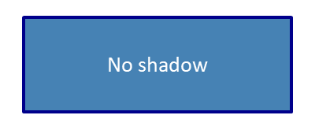

## **導入**

PowerPoint のエフェクトは図形を目立たせるために使用できますが、[塗りつぶし](/slides/ja/php-java/shape-formatting/#gradient-fill)や輪郭とは異なります。PowerPoint のエフェクトを使用すると、図形にリアルな反射を作成したり、図形のグローを広げたりすることができます。


PowerPoint には図形に適用できる 6 つのエフェクトが用意されています。1 つまたは複数のエフェクトを図形に適用できます。

エフェクトの組み合わせによっては、他よりも見栄えが良くなります。そのため、PowerPoint では **Preset** の下にオプションが用意されています。Preset オプションは、見栄えが良いとされる 2 つ以上のエフェクトの組み合わせです。これにより、プリセットを選択するだけで、さまざまなエフェクトをテストしたり組み合わせたりする手間を省き、適切な組み合わせをすぐに得られます。

Aspose.Slides は [EffectFormat](https://reference.aspose.com/slides/php-java/aspose.slides/effectformat/) クラスのプロパティおよびメソッドを提供しており、PowerPoint プレゼンテーションの図形に同じエフェクトを適用できます。

## **影エフェクトの適用**

Aspose.Slides for PHP via Java は、図形に対する外部影と内部影をサポートしています。色、方向、距離、ぼかし半径をカスタマイズして、プレゼンテーションのデザインに合わせることができます。

### **外部影の適用**

外部影を使用すると、カードやパネルがスライドの背景から際立ちます。影は図形のエッジの外側まで広がり、図形がスライド上に浮き上がっているように見えます。色、方向、距離、ぼかし半径を調整して、テンプレートの照明やスタイルに合わせます。

この PHP コードは、矩形に[outer shadow effect](https://reference.aspose.com/slides/php-java/aspose.slides/effectformat/#getOuterShadowEffect)を適用する方法を示しています：

```php
use aspose\slides\Presentation;
use aspose\slides\SaveFormat;
use aspose\slides\ShapeType;

$presentation = new Presentation();
try {
    $slide = $presentation->getSlides()->get_Item(0);

    $shape = $slide->getShapes()->addAutoShape(ShapeType::RoundCornerRectangle, 20, 20, 200, 100);
    $shape->getEffectFormat()->enableOuterShadowEffect();
    $shadowColor = new Java("java.awt.Color", 169, 169, 169);
    $shape->getEffectFormat()->getOuterShadowEffect()->getShadowColor()->setColor($shadowColor);
    $shape->getEffectFormat()->getOuterShadowEffect()->setDistance(10);
    $shape->getEffectFormat()->getOuterShadowEffect()->setDirection(45);

    $presentation->save("shadow_effect.pptx", SaveFormat::Pptx);
} finally {
    $presentation->dispose();
}
```


#### **図形が回転したときの影の方向の制御**

既定では、外部影は図形とともに回転します。回転角度が異なる図形でも同じ方向から照らされたように見せるには、`false` を指定して[setRotateShadowWithShape](https://reference.aspose.com/slides/php-java/aspose.slides/outershadow/#setRotateShadowWithShape)を呼び出し、[setDirection](https://reference.aspose.com/slides/php-java/aspose.slides/outershadow/#setDirection)を使用して影の方向を同じにします。

この例では、右方向に 42 ポイントオフセットした灰色の影を持つ青い矢印を 2 本作成します (0°)。その後、スライドを複製し、両方の矢印を時計回りに 90° 回転させます。

```php
use aspose\slides\FillType;
use aspose\slides\Presentation;
use aspose\slides\SaveFormat;
use aspose\slides\ShapeType;

$presentation = new Presentation();
try {
    $before = $presentation->getSlides()->get_Item(0);
    
    $left = $before->getShapes()->addAutoShape(ShapeType::RightArrow, 55, 130, 110, 60);
    $left->getFillFormat()->setFillType(FillType::Solid);
    $fillColor = new Java("java.awt.Color", 70, 130, 180);
    $left->getFillFormat()->getSolidFillColor()->setColor($fillColor);
    $left->getLineFormat()->getFillFormat()->setFillType(FillType::NoFill);

    $left->getEffectFormat()->enableOuterShadowEffect();
    $shadow = $left->getEffectFormat()->getOuterShadowEffect();
    $shadow->getShadowColor()->setColor(java("java.awt.Color")->GRAY);
    $shadow->setDirection(0);
    $shadow->setDistance(42);
    $shadow->setBlurRadius(0);
    $shadow->setRotateShadowWithShape(true);

    $right = $before->getShapes()->addClone($left);
    $right->setX(395);
    $right->getEffectFormat()->getOuterShadowEffect()->setRotateShadowWithShape(false);

    $after = $presentation->getSlides()->addClone($before);
    foreach ($after->getShapes()->toArray() as $arrow) {
        $arrow->setRotation(90);
    }

    $presentation->save("arrow_shadows.pptx", SaveFormat::Pptx);
} finally {
    $presentation->dispose();
}
```

2 枚目のスライドでは、左側の矢印の影は下向きに落ち、右側の矢印の影は依然として右向きです。設定された方向は両方の影で 0° のままです。


### **内部影の適用**

テンプレートのビジュアルスタイルを再現する際は、内部影を使用してカードやパネルにくぼんだ外観を与えます。外部影は図形の外側に広がり、浮き上がって見えるのに対し、内部影はエッジの内側に影を付けます。

まず[enableInnerShadowEffect](https://reference.aspose.com/slides/php-java/aspose.slides/effectformat/#enableInnerShadowEffect)を呼び出し、続いて[getInnerShadowEffect](https://reference.aspose.com/slides/php-java/aspose.slides/effectformat/#getInnerShadowEffect)が返す影を設定します。ぼかし半径の値が大きいほど、エッジが柔らかくなります。

この PHP の例は、淡い青色のカードに濃い灰色の内部影を付け、PPTX ファイルとして保存します。影の方向は 225 度、距離は 7 ポイント、ぼかし半径は 6 ポイントです。

```php
use aspose\slides\FillType;
use aspose\slides\Presentation;
use aspose\slides\SaveFormat;
use aspose\slides\ShapeType;

$presentation = new Presentation();
try {
    $slide = $presentation->getSlides()->get_Item(0);

    $shape = $slide->getShapes()->addAutoShape(ShapeType::Rectangle, 20, 20, 200, 100);
    $shape->getFillFormat()->setFillType(FillType::Solid);
    $fillColor = new Java("java.awt.Color", 173, 216, 230);
    $shape->getFillFormat()->getSolidFillColor()->setColor($fillColor);
    $shape->getLineFormat()->getFillFormat()->setFillType(FillType::NoFill);

    $shape->getEffectFormat()->enableInnerShadowEffect();
    $shadow = $shape->getEffectFormat()->getInnerShadowEffect();
    $shadowColor = new Java("java.awt.Color", 105, 105, 105);
    $shadow->getShadowColor()->setColor($shadowColor);
    $shadow->setDirection(225);
    $shadow->setDistance(7);
    $shadow->setBlurRadius(6);

    $presentation->save("inner_shadow_effect.pptx", SaveFormat::Pptx);
} finally {
    $presentation->dispose();
}
```


内部影を削除するには、図形の EffectFormat で[disableInnerShadowEffect](https://reference.aspose.com/slides/php-java/aspose.slides/effectformat/#disableInnerShadowEffect)を呼び出します。

### **プリセット影の適用、変更、削除**

プリセット影を有効にするには[enablePresetShadowEffect](https://reference.aspose.com/slides/php-java/aspose.slides/effectformat/#enablePresetShadowEffect)を呼び出します。[setPreset](https://reference.aspose.com/slides/php-java/aspose.slides/presetshadow/#setPreset)を使用して[PresetShadowType](https://reference.aspose.com/slides/php-java/aspose.slides/presetshadowtype/) を選択するか、同じ図形の別のスタイルに切り替えます。影を削除しつつ塗りつぶしと輪郭は保持するには[disablePresetShadowEffect](https://reference.aspose.com/slides/php-java/aspose.slides/effectformat/#disablePresetShadowEffect)を呼び出します。

この PHP の例は、最初の 3 段階ごとに矩形をクローンし、1 つのスライド上で 4 段階を横に並べて比較できるようにします。両方の影は 10 ポイントオフセットしています。方向が 225° の場合、最初の影は矩形の左上に、45° の場合、2 番目の影は右下に配置されます。

```php
use aspose\slides\FillType;
use aspose\slides\Presentation;
use aspose\slides\PresetShadowType;
use aspose\slides\SaveFormat;
use aspose\slides\ShapeType;
use aspose\slides\SlideSizeScaleType;

$presentation = new Presentation();
try {
    $presentation->getSlideSize()->setSize(800, 120, SlideSizeScaleType::DoNotScale);
    $shapes = $presentation->getSlides()->get_Item(0)->getShapes();

    $shape = $shapes->addAutoShape(ShapeType::Rectangle, 15, 30, 170, 60);
    $shape->getFillFormat()->setFillType(FillType::Solid);
    $fillColor = new Java("java.awt.Color", 70, 130, 180);
    $shape->getFillFormat()->getSolidFillColor()->setColor($fillColor);
    $lineFill = $shape->getLineFormat()->getFillFormat();
    $lineFill->setFillType(FillType::Solid);
    $lineColor = new Java("java.awt.Color", 0, 0, 139);
    $lineFill->getSolidFillColor()->setColor($lineColor);
    $shape->getTextFrame()->setText("No shadow");
    $paragraph = $shape->getTextFrame()->getParagraphs()->get_Item(0);
    $paragraph->getParagraphFormat()->getDefaultPortionFormat()->setFontHeight(14);
    $shapes->addClone($shape);

    $shape->setX(215);
    $effects = $shape->getEffectFormat();
    $effects->enablePresetShadowEffect();
    $shadow = $effects->getPresetShadowEffect();
    $shadow->setPreset(PresetShadowType::TopLeftDropShadow);
    $shadow->setDistance(10);
    $shadow->setDirection(225);
    $shape->getTextFrame()->setText("TopLeftDropShadow");
    $shapes->addClone($shape);

    $shape->setX(415);
    $shadow->setPreset(PresetShadowType::BottomRightDropShadow);
    $shadow->setDirection(45);
    $shape->getTextFrame()->setText("BottomRightDropShadow");
    $shapes->addClone($shape);

    $shape->setX(615);
    $effects->disablePresetShadowEffect();
    $shape->getTextFrame()->setText("No shadow");

    $presentation->save("preset_shadows.pptx", SaveFormat::Pptx);
} finally {
    $presentation->dispose();
}
```

| 元の状態 | 最初のプリセット | 2 番目のプリセット | 削除後 |
| :---: | :---: | :---: | :---: |
|  |  |  |  |

## **反射エフェクトの適用**

Aspose.Slides for PHP via Java で反射エフェクトを適用するには、図形に鏡面のような反射を追加し、距離、透明度、サイズなどのパラメータを調整します。このエフェクトは、図形に洗練された外観を与え、プレゼンテーションの美しさを高めます。シンプルなコードで簡単に実装でき、複数の要素に素早く適用して統一したデザインを実現できます。

この PHP コードは、図形に[反射効果](https://reference.aspose.com/slides/php-java/aspose.slides/effectformat/#getReflectionEffect)を適用する方法を示しています：

```php
use aspose\slides\Presentation;
use aspose\slides\RectangleAlignment;
use aspose\slides\SaveFormat;
use aspose\slides\ShapeType;

$presentation = new Presentation();
try {
    $slide = $presentation->getSlides()->get_Item(0);

    $shape = $slide->getShapes()->addAutoShape(ShapeType::RoundCornerRectangle, 20, 20, 200, 100);
    $shape->getEffectFormat()->enableReflectionEffect();
    $shape->getEffectFormat()->getReflectionEffect()->setRectangleAlign(RectangleAlignment::Bottom);
    $shape->getEffectFormat()->getReflectionEffect()->setDirection(90);
    $shape->getEffectFormat()->getReflectionEffect()->setDistance(40);
    $shape->getEffectFormat()->getReflectionEffect()->setBlurRadius(2);

    $presentation->save("reflection_effect.pptx", SaveFormat::Pptx);
} finally {
    $presentation->dispose();
}
```


## **グローエフェクトの適用**

Aspose.Slides for PHP via Java で図形にグローエフェクトを適用するには、図形の周囲に柔らかく光るオーラを追加し、色やサイズなどのプロパティを調整します。このエフェクトは図形を際立たせ、プレゼンテーションに魅力的で目を引くビジュアル要素を加えます。最小限のコードで簡単に実装でき、スライド全体の見た目を向上させます。

この PHP コードは、図形に[グロー効果](https://reference.aspose.com/slides/php-java/aspose.slides/effectformat/#getGlowEffect)を適用する方法を示しています：

```php
use aspose\slides\Presentation;
use aspose\slides\SaveFormat;
use aspose\slides\ShapeType;

$presentation = new Presentation();
try {
    $slide = $presentation->getSlides()->get_Item(0);

    $shape = $slide->getShapes()->addAutoShape(ShapeType::RoundCornerRectangle, 20, 20, 200, 100);
    $shape->getEffectFormat()->enableGlowEffect();
    $shape->getEffectFormat()->getGlowEffect()->getColor()->setColor(java("java.awt.Color")->MAGENTA);
    $shape->getEffectFormat()->getGlowEffect()->setRadius(15);

    $presentation->save("glow_effect.pptx", SaveFormat::Pptx);
} finally {
    $presentation->dispose();
}
```


## **ソフトエッジエフェクトの適用**

Aspose.Slides for PHP via Java でソフトエッジエフェクトを適用すると、図形のエッジ周辺に滑らかでぼかされたトランジションを作成できます。このエフェクトは、より微妙で洗練された外観を加え、やさしく柔らかい見た目が必要なデザインに最適です。半径などのパラメータを簡単に調整して、プレゼンテーション内のさまざまな図形に目的の効果を得られます。

この PHP の例は、図形に[ソフトエッジ効果](https://reference.aspose.com/slides/php-java/aspose.slides/effectformat/#getSoftEdgeEffect)を適用する方法を示しています：

```php
use aspose\slides\Presentation;
use aspose\slides\SaveFormat;
use aspose\slides\ShapeType;

$presentation = new Presentation();
try {
    $slide = $presentation->getSlides()->get_Item(0);

    $shape = $slide->getShapes()->addAutoShape(ShapeType::RoundCornerRectangle, 20, 20, 200, 150);
    $shape->getEffectFormat()->enableSoftEdgeEffect();
    $shape->getEffectFormat()->getSoftEdgeEffect()->setRadius(8);

    $presentation->save("soft_edges_effect.pptx", SaveFormat::Pptx);
} finally {
    $presentation->dispose();
}
```


## **ぼかしエフェクトの適用**

形状のぼかしを使用すると、図形を編集可能なまま塗りつぶしと輪郭を柔らかくできます。図形の EffectFormat で[setBlurEffect](https://reference.aspose.com/slides/php-java/aspose.slides/effectformat/#setBlurEffect)を呼び出します。半径はポイント（1/72 インチ）で測定され、負の値は使用できず、値が大きいほど強いぼかしになります。半径を 0 にすると外観は変わりません。

[getGrow](https://reference.aspose.com/slides/php-java/aspose.slides/blur/#getGrow) 設定はエフェクトの可視領域を制御します。`false` の場合、ぼかしは元の描画領域（輪郭を含む）にクリップされます。`true` の場合、ぼかしはその領域を超えて広がることができます。どちらの設定も図形の位置やサイズは変更しません。

以下の比較は、全体で同じ塗りつぶし、輪郭、図形サイズを使用しています。上段は `grow = false`、下段は `grow = true` を使用しています。


この PHP の例は、オレンジ色の矩形に濃い青の輪郭を付け、5 ポイントのぼかしを適用し、次に再度[setBlurEffect](https://reference.aspose.com/slides/php-java/aspose.slides/effectformat/#setBlurEffect)を呼び出して 15 ポイントのぼかしに更新します。両方のぼかし状態を保存し、続いて[disableBlurEffect](https://reference.aspose.com/slides/php-java/aspose.slides/effectformat/#disableBlurEffect)を呼び出してぼかしなしの図形を保存します。

```php
use aspose\slides\FillType;
use aspose\slides\Presentation;
use aspose\slides\SaveFormat;
use aspose\slides\ShapeType;

$presentation = new Presentation();
try {
    $slide = $presentation->getSlides()->get_Item(0);

    $shape = $slide->getShapes()->addAutoShape(ShapeType::Rectangle, 100, 80, 160, 100);
    $shape->getFillFormat()->setFillType(FillType::Solid);
    $fillColor = new Java("java.awt.Color", 255, 165, 0);
    $shape->getFillFormat()->getSolidFillColor()->setColor($fillColor);
    $shape->getLineFormat()->getFillFormat()->setFillType(FillType::Solid);
    $lineColor = new Java("java.awt.Color", 0, 0, 139);
    $shape->getLineFormat()->getFillFormat()->getSolidFillColor()->setColor($lineColor);
    $shape->getLineFormat()->setWidth(8);

    $shape->getEffectFormat()->setBlurEffect(5, false);
    $presentation->save("shape_blur_5.pptx", SaveFormat::Pptx);

    $shape->getEffectFormat()->setBlurEffect(15, true);
    $presentation->save("shape_blur_15.pptx", SaveFormat::Pptx);

    $shape->getEffectFormat()->disableBlurEffect();
    $presentation->save("shape_blur_removed.pptx", SaveFormat::Pptx);
} finally {
    $presentation->dispose();
}
```

形状のぼかしは塗りつぶしと輪郭の両方に影響します。ソフトエッジエフェクトは図形のエッジをフェードさせ、影のぼかしは影だけを柔らかくします。画像変換エフェクトは画像コンテンツに対して動作しますが、この例は図形を画像に変換せず、直接図形の EffectFormat にぼかしを適用しています。

## **FAQ**

**同じ図形に複数のエフェクトを適用できますか？**

はい、影、反射、グローなど、異なるエフェクトを組み合わせて単一の図形に適用し、よりダイナミックな外観にすることができます。

**どの図形にエフェクトを適用できますか？**

自動図形、チャート、テーブル、画像、SmartArt オブジェクト、OLE オブジェクトなど、さまざまな図形にエフェクトを適用できます。

**グループ化された図形にエフェクトを適用できますか？**

はい、グループ化された図形にもエフェクトを適用できます。そのエフェクトはグループ全体に適用されます。