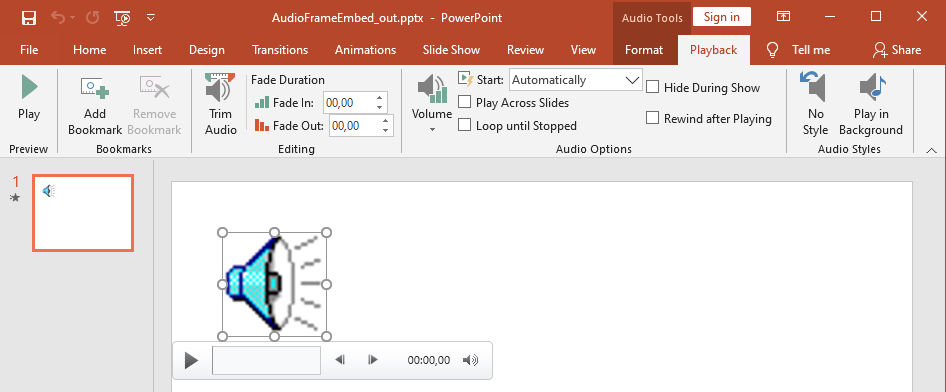

## **概要**

オーディオフレームを使用すると、スライド上でサウンドを再生できます。Aspose.Slides for Python via Java を使用すると、オーディオクリップを埋め込み、それを表す画像を選択し、再生を調整し、キャプションを添付できます。また、スライド遷移に割り当てられたサウンドを取得することもできます。

## **オーディオフレームの作成**

`audio.wav` のバイトをプレゼンテーションのオーディオコレクションに追加し、次に [addAudioFrameEmbedded](https://reference.aspose.com/slides/python-java/aspose.slides/shapecollection/#addAudioFrameEmbedded) を使用して最初のスライドにローカルオーディオクリップを埋め込みます。最初の 2 つの座標はフレームをスライド上に配置し、次の 2 つの値は幅と高さをポイント単位で設定します。この例では [setPlayMode](https://reference.aspose.com/slides/python-java/aspose.slides/audioframe/#setPlayMode) を呼び出してクリップを自動的に開始し、[setVolume](https://reference.aspose.com/slides/python-java/aspose.slides/audioframe/#setVolume) を呼び出して大音量のプリセットを選択します。

```python
from pathlib import Path

import jpype
import asposeslides

if not jpype.isJVMStarted():
    jpype.startJVM()

from asposeslides.api import AudioPlayModePreset, AudioVolumeMode, Presentation, SaveFormat

presentation = Presentation()
try:
    slide = presentation.getSlides().get_Item(0)

    audio_data = Path("audio.wav").read_bytes()
    java_audio_data = jpype.JArray(jpype.JByte)(audio_data)
    audio = presentation.getAudios().addAudio(java_audio_data)
    audio_frame = slide.getShapes().addAudioFrameEmbedded(50, 150, 100, 100, audio)

    audio_frame.setPlayMode(AudioPlayModePreset.Auto)
    audio_frame.setVolume(AudioVolumeMode.Loud)

    presentation.save("AudioFrameEmbed_out.pptx", SaveFormat.Pptx)
finally:
    presentation.dispose()
```
## **オーディオフレームのサムネイルの変更**

デフォルトでは、オーディオフレームはスピーカーアイコンを表示します。カスタムサムネイルを表示するには、[addImage](https://reference.aspose.com/slides/python-java/aspose.slides/imagecollection/#addImage) でプレゼンテーションに画像を追加し、[setImage](https://reference.aspose.com/slides/python-java/aspose.slides/picture/#setImage) でフレームの画像に設定します。この例では、埋め込みオーディオクリップのサムネイルとして JPEG を使用しています。

```python
from pathlib import Path

import jpype
import asposeslides

if not jpype.isJVMStarted():
    jpype.startJVM()

from asposeslides.api import Images, Presentation, SaveFormat

presentation = Presentation()
try:
    slide = presentation.getSlides().get_Item(0)

    audio_data = Path("audio.wav").read_bytes()
    java_audio_data = jpype.JArray(jpype.JByte)(audio_data)
    audio = presentation.getAudios().addAudio(java_audio_data)
    audio_frame = slide.getShapes().addAudioFrameEmbedded(150, 100, 50, 50, audio)

    image = Images.fromFile("eagle.jpeg")
    try:
        picture = presentation.getImages().addImage(image)
    finally:
        image.dispose()

    audio_frame.getPictureFormat().getPicture().setImage(picture)

    presentation.save("example_out.pptx", SaveFormat.Pptx)
finally:
    presentation.dispose()
```
## **オーディオ再生オプションの変更**

PowerPoint の **Audio Options** コントロールは、クリップの開始タイミング、音量、およびスライドショー中の動作を決定します。



| PowerPoint control | Aspose.Slides for Python via Java method |
| --- | --- |
| 開始 | [setPlayMode](https://reference.aspose.com/slides/python-java/aspose.slides/audioframe/#setPlayMode) |
| 音量プリセット | [setVolume](https://reference.aspose.com/slides/python-java/aspose.slides/audioframe/#setVolume) |
| スライド間で再生 | [setPlayAcrossSlides](https://reference.aspose.com/slides/python-java/aspose.slides/audioframe/#setPlayAcrossSlides) |
| 停止までループ | [setPlayLoopMode](https://reference.aspose.com/slides/python-java/aspose.slides/audioframe/#setPlayLoopMode) |
| ショー中に非表示 | [setHideAtShowing](https://reference.aspose.com/slides/python-java/aspose.slides/audioframe/#setHideAtShowing) |
| 再生後に巻き戻し | [setRewindAudio](https://reference.aspose.com/slides/python-java/aspose.slides/audioframe/#setRewindAudio) |
| フェードイン | [setFadeInDuration](https://reference.aspose.com/slides/python-java/aspose.slides/audioframe/#setFadeInDuration) |
| フェードアウト | [setFadeOutDuration](https://reference.aspose.com/slides/python-java/aspose.slides/audioframe/#setFadeOutDuration) |
| オーディオ開始位置のトリミング | [setTrimFromStart](https://reference.aspose.com/slides/python-java/aspose.slides/audioframe/#setTrimFromStart) |
| オーディオ終了位置のトリミング | [setTrimFromEnd](https://reference.aspose.com/slides/python-java/aspose.slides/audioframe/#setTrimFromEnd) |
| 音量スライダー | [setVolumeValue](https://reference.aspose.com/slides/python-java/aspose.slides/audioframe/#setVolumeValue) |

この例では、最初のスライドの最初のオーディオフレームを取得し、[setPlayMode](https://reference.aspose.com/slides/python-java/aspose.slides/audioframe/#setPlayMode) を呼び出してクリック時に再生を開始し、低音量プリセットを選択します。ループを無効にした状態でクリップはスライド間で再生し続けます。アイコンはショー中に非表示のままで、再生後にクリップは巻き戻されます。

```python
import jpype
import asposeslides

if not jpype.isJVMStarted():
    jpype.startJVM()

from asposeslides.api import AudioFrame, AudioPlayModePreset, AudioVolumeMode, Presentation, SaveFormat

presentation = Presentation("AudioFrameEmbed_out.pptx")
try:
    slide = presentation.getSlides().get_Item(0)

    audio_frame = next((shape for shape in slide.getShapes() if isinstance(shape, AudioFrame)), None)
    if audio_frame is not None:
        # クリック時に再生、低音量で、スライド全体に跨がり、ループしない。
        audio_frame.setPlayMode(AudioPlayModePreset.OnClick)
        audio_frame.setVolume(AudioVolumeMode.Low)
        audio_frame.setPlayAcrossSlides(True)
        audio_frame.setPlayLoopMode(False)
        # スライドショー中にフレームを非表示にし、再生後に巻き戻す。
        audio_frame.setHideAtShowing(True)
        audio_frame.setRewindAudio(True)

        presentation.save("AudioFrameEmbed_changed.pptx", SaveFormat.Pptx)
    else:
        print("The first slide has no audio frame.")
finally:
    presentation.dispose()
```
3.5 秒を超えるクリップの場合、この例では最初の 1.5 秒と最後の 2 秒をスキップします。[setTrimFromEnd](https://reference.aspose.com/slides/python-java/aspose.slides/audioframe/#setTrimFromEnd) はクリップの末尾から除外する時間を指定します。PowerPoint に表示される終了時刻を取得するには、フルクリップの長さからそのオフセットを引きます。トリミングされたクリップは 200 ミリ秒でフェードインし、500 ミリ秒でフェードアウトします。すべての 4 つのメソッドはミリ秒単位の値を受け取ります。

```python
from pathlib import Path

import jpype
import asposeslides

if not jpype.isJVMStarted():
    jpype.startJVM()

from asposeslides.api import Presentation, SaveFormat

presentation = Presentation()
try:
    slide = presentation.getSlides().get_Item(0)

    audio_data = Path("audio.wav").read_bytes()
    java_audio_data = jpype.JArray(jpype.JByte)(audio_data)
    audio = presentation.getAudios().addAudio(java_audio_data)
    audio_frame = slide.getShapes().addAudioFrameEmbedded(50, 50, 100, 100, audio)

    # 開始から 1.5 秒、終了から 2 秒をトリミングします。
    audio_frame.setTrimFromStart(1500.0)
    audio_frame.setTrimFromEnd(2000.0)
    # フェードインを 200 ミリ秒、フェードアウトを 500 ミリ秒に設定します。
    audio_frame.setFadeInDuration(200.0)
    audio_frame.setFadeOutDuration(500.0)

    presentation.save("AudioFrameTrimFade_out.pptx", SaveFormat.Pptx)
finally:
    presentation.dispose()
```
再生音量を特定のパーセンテージに設定するには、[setVolumeValue](https://reference.aspose.com/slides/python-java/aspose.slides/audioframe/#setVolumeValue) を使用します。この例では、最初のスライドの最初のオーディオフレームの音量を 85% に設定しています。

```python
import jpype
import asposeslides

if not jpype.isJVMStarted():
    jpype.startJVM()

from asposeslides.api import AudioFrame, Presentation, SaveFormat

presentation = Presentation("AudioFrameEmbed_out.pptx")
try:
    slide = presentation.getSlides().get_Item(0)

    audio_frame = next((shape for shape in slide.getShapes() if isinstance(shape, AudioFrame)), None)
    if audio_frame is not None:
        audio_frame.setVolumeValue(85.0)
        presentation.save("AudioFrameValue_out.pptx", SaveFormat.Pptx)
    else:
        print("The first slide has no audio frame.")
finally:
    presentation.dispose()
```
## **オーディオキャプションの管理**

各オーディオフレームは、[getCaptionTracks](https://reference.aspose.com/slides/python-java/aspose.slides/audioframe/#getCaptionTracks) を通じてキャプショントラックにアクセスできます。コレクションを使用して、クリップに WebVTT キャプションを添付したり、既存のトラックをエクスポートしたり、削除したりできます。

### **オーディオキャプションの追加**

この例では、最初のスライドにオーディオクリップを埋め込み、[add](https://reference.aspose.com/slides/python-java/aspose.slides/captionscollection/#add) を使用してローカルの WebVTT トラックを添付します。最初の引数はトラックラベルを提供し、2 番目の引数はタイムコード付きキャプションが含まれるファイルを指定します。

```python
from pathlib import Path

import jpype
import asposeslides

if not jpype.isJVMStarted():
    jpype.startJVM()

from asposeslides.api import Presentation, SaveFormat

presentation = Presentation()
try:
    slide = presentation.getSlides().get_Item(0)

    audio_data = Path("audio.wav").read_bytes()
    java_audio_data = jpype.JArray(jpype.JByte)(audio_data)
    audio = presentation.getAudios().addAudio(java_audio_data)
    audio_frame = slide.getShapes().addAudioFrameEmbedded(10, 10, 50, 50, audio)

    # WebVTT ファイルから新しいキャプショントラックを追加します。
    audio_frame.getCaptionTracks().add("English", "track.vtt")

    presentation.save("audio_with_captions.pptx", SaveFormat.Pptx)
finally:
    presentation.dispose()
```
### **オーディオキャプションの抽出**

この例では、最初のスライドのオーディオフレームに添付された各キャプショントラックをエクスポートします。[getBinaryData](https://reference.aspose.com/slides/python-java/aspose.slides/captions/#getBinaryData) が返すバイト列を WebVTT ファイルに書き込み、[getCaptionId](https://reference.aspose.com/slides/python-java/aspose.slides/captions/#getCaptionId) が返す識別子をファイル名として使用することで、各トラックが別々の出力になります。

```python
from pathlib import Path

import jpype
import asposeslides

if not jpype.isJVMStarted():
    jpype.startJVM()

from asposeslides.api import AudioFrame, Presentation

presentation = Presentation("audio_with_captions.pptx")
try:
    slide = presentation.getSlides().get_Item(0)

    for shape in slide.getShapes():
        if isinstance(shape, AudioFrame):
            for caption_track in shape.getCaptionTracks():
                # キャプショントラックを .vtt ファイルとして保存します。
                file_path = Path(f"{caption_track.getCaptionId()}.vtt")
                caption_data = bytes(caption_track.getBinaryData())
                file_path.write_bytes(caption_data)
finally:
    presentation.dispose()
```
### **オーディオキャプションの削除**

[remove](https://reference.aspose.com/slides/python-java/aspose.slides/captionscollection/#remove) または [removeAt](https://reference.aspose.com/slides/python-java/aspose.slides/captionscollection/#removeAt) を使用して個々のトラックを削除します。この例では、[clear](https://reference.aspose.com/slides/python-java/aspose.slides/captionscollection/#clear) を使用して最初のスライドの最初のオーディオフレームからすべてのキャプションを削除し、クリップは保持します。

```python
import jpype
import asposeslides

if not jpype.isJVMStarted():
    jpype.startJVM()

from asposeslides.api import AudioFrame, Presentation, SaveFormat

presentation = Presentation("audio_with_captions.pptx")
try:
    slide = presentation.getSlides().get_Item(0)

    audio_frame = next((shape for shape in slide.getShapes() if isinstance(shape, AudioFrame)), None)
    if audio_frame is not None:
        audio_frame.getCaptionTracks().clear()
        presentation.save("audio_without_captions.pptx", SaveFormat.Pptx)
    else:
        print("The first slide has no audio frame.")
finally:
    presentation.dispose()
```
### **オーディオキャプション内の行の検索**

最初のスライドのオーディオキャプション内の行を見つけるには、メモリ内で [getDataAsString](https://reference.aspose.com/slides/python-java/aspose.slides/captions/#getDataAsString) が返すテキストを検索します。プレーンテキストの WebVTT キューでは、タイミング行に `-->` が含まれ、次にキャプション行が続き、空行でキューが終了します。この例では、トラックラベルと “café” を含む各キャプション行を出力します。

```python
import jpype
import asposeslides

if not jpype.isJVMStarted():
    jpype.startJVM()

from asposeslides.api import AudioFrame, Presentation

presentation = Presentation("audio_with_captions.pptx")
try:
    slide = presentation.getSlides().get_Item(0)

    for shape in slide.getShapes():
        if not isinstance(shape, AudioFrame):
            continue
        for track in shape.getCaptionTracks():
            in_cue = False
            captions = str(track.getDataAsString())
            for line in captions.splitlines():
                if not line:
                    in_cue = False
                elif "-->" in line:
                    in_cue = True
                elif in_cue and "café" in line.casefold():
                    print(f"{track.getLabel()}: {line}")
finally:
    presentation.dispose()
```
## **オーディオの抽出**

スライド遷移には独自のサウンドを設定できます。取得するには、スライド遷移で [getSound](https://reference.aspose.com/slides/python-java/aspose.slides/slideshowtransition/#getSound) を呼び出します。この例では、[getBinaryData](https://reference.aspose.com/slides/python-java/aspose.slides/audio/#getBinaryData) が返すバイト数にアクセスし、バイト数を出力します。最初のスライドに遷移サウンドがない場合は、代わりにメッセージを出力します。

```python
import jpype
import asposeslides

if not jpype.isJVMStarted():
    jpype.startJVM()

from asposeslides.api import Presentation

presentation = Presentation("AudioSlide.pptx")
try:
    slide = presentation.getSlides().get_Item(0)
    
    transition = slide.getSlideShowTransition()
    sound = transition.getSound()
    if sound is not None:
        audio_data = sound.getBinaryData()
        print(f"Transition sound: {len(audio_data)} bytes.")
    else:
        print("The slide transition has no sound.")
finally:
    presentation.dispose()
```
## **FAQ**

**同じオーディオクリップを複数のスライドで再利用できますか（重複せずに）？**

はい。クリップをプレゼンテーションの [audio collection](https://reference.aspose.com/slides/python-java/aspose.slides/presentation/#getAudios) に一度追加し、各スライドで同じオーディオオブジェクトを [addAudioFrameEmbedded](https://reference.aspose.com/slides/python-java/aspose.slides/shapecollection/#addAudioFrameEmbedded) に渡すだけです。

**既存のオーディオフレームのサウンドを置き換えることはできますか？**

はい。リンクされたサウンドの場合は、[setLinkPathLong](https://reference.aspose.com/slides/python-java/aspose.slides/audioframe/#setLinkPathLong) を使用して置換ファイルを指定します。埋め込みサウンドの場合は、プレゼンテーションのオーディオコレクションから別のクリップを [setEmbeddedAudio](https://reference.aspose.com/slides/python-java/aspose.slides/audioframe/#setEmbeddedAudio) で選択します。どちらの方法でも既存のフレームは保持されます。

**トリミングはプレゼンテーションに保存されているオーディオデータを変更しますか？**

いいえ。[setTrimFromStart](https://reference.aspose.com/slides/python-java/aspose.slides/audioframe/#setTrimFromStart) と [setTrimFromEnd](https://reference.aspose.com/slides/python-java/aspose.slides/audioframe/#setTrimFromEnd) は再生範囲を設定するだけです。完全なクリップは依然として [getEmbeddedAudio](https://reference.aspose.com/slides/python-java/aspose.slides/audioframe/#getEmbeddedAudio) で取得できます。