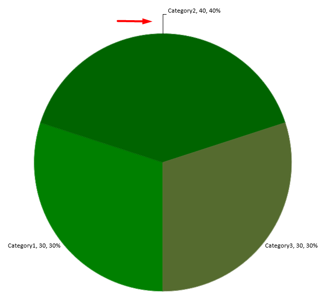

## **イントロダクション**

データ ラベルはチャートの系列や個々のデータ ポイントに関する情報を表示し、読者が値を特定しチャートを理解するのに役立ちます。本記事では、値の書式設定、パーセンテージの表示、ラベル テキストの取得、軸の最大値を超えるラベルの制御、カテゴリ軸ラベルの間隔調整、円グラフ ラベルの位置設定方法について説明します。

## **チャート データ ラベルでデータの精度を設定する**

シリーズの値の書式設定には [number_format_of_values](https://reference.aspose.com/slides/python-net/aspose.slides.charts/chartseries/number_format_of_values/) を使用します。この例では、デフォルト データで折れ線グラフを作成し、データ テーブルを表示し、最初のシリーズの値ラベルを有効にします。書式 `#,##0.00` は桁区切りと小数点以下 2 桁を表示しますが、基になる値は変更しません。

```python
import aspose.slides as slides
import aspose.slides.charts as charts

with slides.Presentation() as presentation:
    slide = presentation.slides[0]

    chart = slide.shapes.add_chart(charts.ChartType.LINE, 50, 50, 450, 300)
    chart.has_data_table = True

    series = chart.chart_data.series[0]
    series.number_format_of_values = "#,##0.00"
    series.labels.default_data_label_format.show_value = True

    presentation.save("PrecisionOfDatalabels_out.pptx", slides.export.SaveFormat.PPTX)
```

## **ラベルとしてパーセンテージを表示する**

積み上げ縦棒グラフの場合、各値をそのカテゴリ合計に対するパーセンテージとして計算し、テキストを [text_frame_for_overriding](https://reference.aspose.com/slides/python-net/aspose.slides.charts/datalabel/text_frame_for_overriding/) に割り当てます。この例はデフォルトのチャート データを使用し、8 ポイント フォントで小数点以下 2 桁のパーセンテージを表示します。合計が 0 のカテゴリは除外してゼロ除算を回避します。チャート データが変更された場合は、カスタム ラベル テキストを再計算してください。

```python
import aspose.slides as slides
import aspose.slides.charts as charts

with slides.Presentation() as presentation:
    slide = presentation.slides[0]

    chart = slide.shapes.add_chart(charts.ChartType.STACKED_COLUMN, 20, 20, 400, 400)

    category_totals = [0.0] * len(chart.chart_data.categories)
    for k in range(len(chart.chart_data.categories)):
        for series in chart.chart_data.series:
            point_value = float(series.data_points[k].value.data)
            category_totals[k] += point_value

    for series in chart.chart_data.series:
        series.labels.default_data_label_format.show_legend_key = False

        for j in range(len(series.data_points)):
            label = series.data_points[j].label
            if category_totals[j] == 0:
                continue

            point_value = float(series.data_points[j].value.data)
            data_point_percent = point_value / category_totals[j] * 100

            portion = slides.Portion()
            portion.text = f"{data_point_percent:.2f} %"
            portion.portion_format.font_height = 8

            label.text_frame_for_overriding.text = ""

            paragraph = label.text_frame_for_overriding.paragraphs[0]
            paragraph.portions.add(portion)

            label.data_label_format.show_value = True
            label.data_label_format.show_series_name = False
            label.data_label_format.show_percentage = False
            label.data_label_format.show_legend_key = False
            label.data_label_format.show_category_name = False
            label.data_label_format.show_bubble_size = False

    presentation.save("DisplayPercentageAsLabels_out.pptx", slides.export.SaveFormat.PPTX)
```

## **チャート データ ラベルにパーセンテージ記号を設定する**

値が分数で格納されている場合は、[number_format](https://reference.aspose.com/slides/python-net/aspose.slides.charts/datalabelformat/number_format/) を使用してパーセンテージを表示します。ラベルの書式を元データとは独立させるには、[is_number_format_linked_to_source](https://reference.aspose.com/slides/python-net/aspose.slides.charts/datalabelformat/is_number_format_linked_to_source/) を `False` に設定します。

この例では、4 つのカテゴリに対して赤と青の系列を持つ 100% 積み上げ縦棒グラフを作成します。各ペアの値の合計は 1 です。ラベル書式 `0.0%` は 0.30 を 30.0% と表示し、縦軸は小数点以下 2 桁を使用します。両系列とも白色の 10 ポイント ラベル テキストを使用します。

```python
import aspose.slides as slides
import aspose.slides.charts as charts
import aspose.pydrawing as drawing

with slides.Presentation() as presentation:
    slide = presentation.slides[0]

    chart = slide.shapes.add_chart(charts.ChartType.PERCENTS_STACKED_COLUMN, 20, 20, 500, 400)

    chart.axes.vertical_axis.is_number_format_linked_to_source = False
    chart.axes.vertical_axis.number_format = "0.00%"

    chart.chart_data.series.clear()
    chart.chart_data.categories.clear()

    workbook = chart.chart_data.chart_data_workbook
    worksheet_index = 0
    for i in range(4):
        category_cell = workbook.get_cell(worksheet_index, i + 1, 0, f"Category {i + 1}")
        chart.chart_data.categories.add(category_cell)

    series_names = ["Reds", "Blues"]
    series_colors = [drawing.Color.red, drawing.Color.blue]
    values = [[0.30, 0.50, 0.80, 0.65], [0.70, 0.50, 0.20, 0.35]]

    for i in range(len(series_names)):
        series_cell = workbook.get_cell(worksheet_index, 0, i + 1, series_names[i])
        series = chart.chart_data.series.add(series_cell, chart.type)
        for j in range(4):
            value_cell = workbook.get_cell(worksheet_index, j + 1, i + 1, values[i][j])
            series.data_points.add_data_point_for_bar_series(value_cell)

        series.format.fill.fill_type = slides.FillType.SOLID
        series.format.fill.solid_fill_color.color = series_colors[i]

        label_format = series.labels.default_data_label_format
        label_format.show_value = True
        label_format.is_number_format_linked_to_source = False
        label_format.number_format = "0.0%"
        label_format.text_format.portion_format.font_height = 10
        label_format.text_format.portion_format.fill_format.fill_type = slides.FillType.SOLID
        label_format.text_format.portion_format.fill_format.solid_fill_color.color = drawing.Color.white

    presentation.save("SetDataLabelsPercentageSign_out.pptx", slides.export.SaveFormat.PPTX)
```

## **データ ラベルの実際のテキストを取得する**

[data label の設定で生成されたテキストを取得するには [get_actual_label_text](https://reference.aspose.com/slides/python-net/aspose.slides.charts/datalabel/get_actual_label_text/) を使用します。これは、レポート用にラベルを抽出したり、プレゼンテーション コンテンツを検索したり、生成されたチャートを検証したりする際に便利です。以下の例では、デフォルトの [data label format](https://reference.aspose.com/slides/python-net/aspose.slides.charts/datalabelformat/) がカテゴリ名、系列名、値を組み合わせています。1 つのポイントは値をパーセンテージとして書式設定し、別のポイントは [text_frame_for_overriding](https://reference.aspose.com/slides/python-net/aspose.slides.charts/datalabel/text_frame_for_overriding/) からのカスタム テキストを使用します。

```python
import aspose.slides as slides
import aspose.slides.charts as charts

with slides.Presentation() as presentation:
    slide = presentation.slides[0]

    chart = slide.shapes.add_chart(charts.ChartType.CLUSTERED_COLUMN, 20, 20, 500, 300)

    chart.chart_data.series.clear()
    chart.chart_data.categories.clear()

    workbook = chart.chart_data.chart_data_workbook
    for i, category_name in enumerate(["Q1", "Q2"]):
        category_cell = workbook.get_cell(0, i + 1, 0, category_name)
        chart.chart_data.categories.add(category_cell)

    north_cell = workbook.get_cell(0, 0, 1, "North")
    north = chart.chart_data.series.add(north_cell, chart.type)
    for i, value in enumerate([0.25, 0.75]):
        value_cell = workbook.get_cell(0, i + 1, 1, value)
        north.data_points.add_data_point_for_bar_series(value_cell)

    south_cell = workbook.get_cell(0, 0, 2, "South")
    south = chart.chart_data.series.add(south_cell, chart.type)
    for i, value in enumerate([0.40, 0.60]):
        value_cell = workbook.get_cell(0, i + 1, 2, value)
        south.data_points.add_data_point_for_bar_series(value_cell)

    for series in chart.chart_data.series:
        label_format = series.labels.default_data_label_format
        label_format.show_category_name = True
        label_format.show_series_name = True
        label_format.show_value = True

    north.labels[1].data_label_format.is_number_format_linked_to_source = False
    north.labels[1].data_label_format.number_format = "0%"
    south.labels[0].text_frame_for_overriding.text = "Reviewed"

    for series in chart.chart_data.series:
        for point in series.data_points:
            label = point.label
            if not label.is_visible:
                continue

            label_text = label.get_actual_label_text()
            print(f"Value: {point.value.data}; label: {label_text}")
```

データ ポイントに格納されている数値は `0.75` のままで、ラベルには `75%` とカテゴリ名・系列名が併記されます。カスタム テキストは生成されたラベル テキストを置き換えます。[get_actual_label_text](https://reference.aspose.com/slides/python-net/aspose.slides.charts/datalabel/get_actual_label_text/) はいずれの場合でも結果のラベル文字列を返します。表示されているラベルだけを抽出したい場合は、上記のように [is_visible](https://reference.aspose.com/slides/python-net/aspose.slides.charts/datalabel/is_visible/) を別途確認してください。

## **軸の最大値を超えるデータ ラベルを制御する**

軸の範囲を手動で制限すると、一部のデータ ポイントが最大値を超えることがあります。[show_data_labels_over_maximum](https://reference.aspose.com/slides/python-net/aspose.slides.charts/chart/show_data_labels_over_maximum/) を使用して、これらのデータ ラベルを表示するかどうかを制御します。この設定はラベルの表示・非表示を変更しますが、軸の範囲や基になるデータ値は変更しません。

以下の例では、値が 60 と 120 の 2D クラスタ化縦棒グラフを作成し、縦軸の [is_automatic_max_value](https://reference.aspose.com/slides/python-net/aspose.slides.charts/axis/is_automatic_max_value/) を `False`、[max_value](https://reference.aspose.com/slides/python-net/aspose.slides.charts/axis/max_value/) を 100 に設定します。最初のスライドは最大値を超えるラベルを許可し、コピーしたスライドはそれを無効化します。両スライドは `DataLabelsOverMaximum.pptx` に保存されます。

[value ラベルは [show_value](https://reference.aspose.com/slides/python-net/aspose.slides.charts/datalabelformat/show_value/) で有効にします。このチャート レベルの設定だけでは個別ラベルの表示を上書きできません。この例では、系列全体の値ラベルを有効にし、[position](https://reference.aspose.com/slides/python-net/aspose.slides.charts/datalabelformat/position/) を使用して各列の外側端にラベルを配置します。

```python
import aspose.slides as slides
import aspose.slides.charts as charts

with slides.Presentation() as presentation:
    slide = presentation.slides[0]

    chart = slide.shapes.add_chart(charts.ChartType.CLUSTERED_COLUMN, 50, 50, 600, 400)
    chart.has_legend = False

    chart.chart_data.series.clear()
    chart.chart_data.categories.clear()

    workbook = chart.chart_data.chart_data_workbook

    first_category = workbook.get_cell(0, 1, 0, "Within range")
    second_category = workbook.get_cell(0, 2, 0, "Above maximum")

    chart.chart_data.categories.add(first_category)
    chart.chart_data.categories.add(second_category)

    series_name = workbook.get_cell(0, 0, 1, "Values")
    series = chart.chart_data.series.add(series_name, chart.type)

    first_value = workbook.get_cell(0, 1, 1, 60)
    second_value = workbook.get_cell(0, 2, 1, 120)

    series.data_points.add_data_point_for_bar_series(first_value)
    series.data_points.add_data_point_for_bar_series(second_value)

    series.labels.default_data_label_format.show_value = True
    series.labels.default_data_label_format.position = charts.LegendDataLabelPosition.OUTSIDE_END

    chart.axes.vertical_axis.is_automatic_max_value = False
    chart.axes.vertical_axis.max_value = 100
    chart.show_data_labels_over_maximum = True

    second_slide = presentation.slides.add_clone(slide)
    second_chart = second_slide.shapes[0]
    second_chart.show_data_labels_over_maximum = False

    presentation.save("DataLabelsOverMaximum.pptx", slides.export.SaveFormat.PPTX)
```

以下の画像は Microsoft PowerPoint でレンダリングされた保存済みスライドを示します。`True` の場合、ラベル **120** が上端に表示され、`False` の場合は非表示になります。ラベル **60** は常に表示され、軸の最大値は **100** のままで、2 番目のデータ ポイントは両方の場合で **120** のままです。

| show_data_labels_over_maximum = True | show_data_labels_over_maximum = False |
| --- | --- |
|  |  |

{}
この例は値軸を持つ 2D 縦棒グラフを使用しています。円グラフやドーナツ グラフなど、値軸を持たないチャートにはこのように軸の最大値を制限する概念がありません。
{}

## **軸からのラベル間隔を設定する**

[label_offset](https://reference.aspose.com/slides/python-net/aspose.slides.charts/axis/label_offset/) を使用して、カテゴリ軸ラベルと軸との距離を制御します。値は軸ラベルの最大フォント サイズのパーセンテージです。この例ではクラスタ化縦棒グラフを作成し、水平軸ラベルのオフセットを 500 に設定します。この設定は個々のデータ ポイントに付随するラベルではなく、カテゴリ軸ラベルに影響します。

```python
import aspose.slides as slides
import aspose.slides.charts as charts

with slides.Presentation() as presentation:
    slide = presentation.slides[0]

    chart = slide.shapes.add_chart(charts.ChartType.CLUSTERED_COLUMN, 20, 20, 500, 300)
    chart.axes.horizontal_axis.label_offset = 500

    presentation.save("SetCategoryAxisLabelDistance_out.pptx", slides.export.SaveFormat.PPTX)
```

## **ラベル位置の調整**

円グラフでは、データ ラベルの位置を調整して間隔を広げ、リーダー ラインの余白を確保します。

この例では最初のデータ ポイントの値を表示し、ラベルをスライスの外側に配置し、[x](https://reference.aspose.com/slides/python-net/aspose.slides.charts/datalabel/x/) と [y](https://reference.aspose.com/slides/python-net/aspose.slides.charts/datalabel/y/) オフセットを調整します。これらのオフセットはそれぞれチャートの幅と高さの比率で指定します。

```python
import aspose.slides as slides
import aspose.slides.charts as charts

with slides.Presentation() as presentation:
    slide = presentation.slides[0]

    chart = slide.shapes.add_chart(charts.ChartType.PIE, 50, 50, 200, 200)
    series = chart.chart_data.series

    label = series[0].labels[0]
    label.data_label_format.show_value = True
    label.data_label_format.position = charts.LegendDataLabelPosition.OUTSIDE_END
    label.x = 0.71
    label.y = 0.04

    presentation.save("presentation.pptx", slides.export.SaveFormat.PPTX)
```



## **リーダー ラインの書式設定**

円グラフのラベルがスライスの外側にある場合、リーダー ラインは各値と正しいスライスを結び付けるのに役立ちます。コントラストのある色とやや太めの線は視認性を高め、透明度と破線スタイルは視覚的な目立ちすぎを防ぎます。

シリーズのデータ ラベルコレクション レベルでリーダー ラインをフォーマットするには、[leader_lines_format](https://reference.aspose.com/slides/python-net/aspose.slides.charts/datalabelcollection/leader_lines_format/) を使用します。`series.labels.leader_lines_format.line` の設定は個々のラベルではなくコレクション全体に適用されます。

この例はデフォルト データの円グラフを作成し、スライスの外側に値を表示し、[show_leader_lines](https://reference.aspose.com/slides/python-net/aspose.slides.charts/datalabelformat/show_leader_lines/) を有効にします。2 つのラベルを [x](https://reference.aspose.com/slides/python-net/aspose.slides.charts/datalabel/x/) と [y](https://reference.aspose.com/slides/python-net/aspose.slides.charts/datalabel/y/) オフセットでスライスから遠ざけます。入力プレゼンテーションは必要ありません。

ラインの [fill_format](https://reference.aspose.com/slides/python-net/aspose.slides/lineformat/fill_format/) では、α 値 191（255 中の約 25%）の不透明度を持つソリッド ブルーを設定します。[width](https://reference.aspose.com/slides/python-net/aspose.slides/lineformat/width/) で太さを 2 ポイントに、[dash_style](https://reference.aspose.com/slides/python-net/aspose.slides/lineformat/dash_style/) で破線に設定します。

```python
import aspose.slides as slides
import aspose.slides.charts as charts
import aspose.pydrawing as drawing

with slides.Presentation() as presentation:
    slide = presentation.slides[0]

    chart = slide.shapes.add_chart(charts.ChartType.PIE, 80, 50, 560, 400)
    chart.has_legend = False

    series = chart.chart_data.series[0]

    label_format = series.labels.default_data_label_format
    label_format.show_value = True
    label_format.position = charts.LegendDataLabelPosition.OUTSIDE_END
    label_format.show_leader_lines = True

    # ラベルを2つ、スライスからさらに離す
    series.labels[0].x = 0.10
    series.labels[0].y = -0.05
    series.labels[1].x = -0.10
    series.labels[1].y = 0.05

    line = series.labels.leader_lines_format.line
    line.fill_format.fill_type = slides.FillType.SOLID
    line.fill_format.solid_fill_color.color = drawing.Color.from_argb(191, 30, 90, 160)
    line.width = 2
    line.dash_style = slides.LineDashStyle.DASH

    presentation.save("FormattedLeaderLines.pptx", slides.export.SaveFormat.PPTX)
```

リーダー ラインを有効にしても、すべてのラベルに線が表示されるわけではありません。表示はラベルの配置とチャートのレイアウト 動作に依存します。この例では、離れた位置にある 2 つのラベルにのみリーダー ラインが表示され、スライスに近いラベルは不要です。

以下の画像は Aspose.Slides でレンダリングされた保存済み `FormattedLeaderLines.pptx` を示します。


## **列グラフの上に複数行のデータ ラベルを追加する**

この例では、プロット領域の上に 2 行のデータ ラベルを持つ列グラフを作成します。Series A は可視列を表示し、Series B と Series C が追加ラベルを提供します。これらの列は塗りつぶしと輪郭を削除して非表示にします。[overlap](https://reference.aspose.com/slides/python-net/aspose.slides.charts/chartseriesgroup/overlap/) プロパティにより、3 つの系列すべてが同じカテゴリ中心に整列します。

[plot_area](https://reference.aspose.com/slides/python-net/aspose.slides.charts/chart/plot_area/) 設定でラベル行用のスペースを確保します。[validate_chart_layout](https://reference.aspose.com/slides/python-net/aspose.slides.charts/chart/validate_chart_layout/) がデフォルト位置を計算した後、[x](https://reference.aspose.com/slides/python-net/aspose.slides.charts/datalabel/x/) と [y](https://reference.aspose.com/slides/python-net/aspose.slides.charts/datalabel/y/) が水平位置を保持し、垂直オフセットでラベルを 2 行に配置します。数値は系列値にリンクされたデータ ラベルのままで、行見出しだけが別個のテキスト シェイプです。

```python
import aspose.slides as slides
import aspose.slides.charts as charts
import aspose.pydrawing as drawing

with slides.Presentation() as presentation:
    slide = presentation.slides[0]

    chart = slide.shapes.add_chart(charts.ChartType.CLUSTERED_COLUMN, 40, 40, 640, 200)
    chart.has_title = False
    chart.has_legend = False
    chart.text_format.portion_format.font_height = 12

    chart.chart_data.series.clear()
    chart.chart_data.categories.clear()

    workbook = chart.chart_data.chart_data_workbook
    workbook.clear(0)

    categories = ["North", "South", "East", "West"]
    series_names = ["Series A", "Series B", "Series C"]
    series_values = [
        [35, 42, 28, 47],
        [22, 31, 19, 26],
        [12, 16, 14, 18]
    ]

    for category_index, category_name in enumerate(categories):
        category_cell = workbook.get_cell(0, category_index + 1, 0, category_name)
        chart.chart_data.categories.add(category_cell)

    for series_index, series_name in enumerate(series_names):
        series_cell = workbook.get_cell(0, 0, series_index + 1, series_name)
        series = chart.chart_data.series.add(series_cell, charts.ChartType.CLUSTERED_COLUMN)

        for category_index in range(len(categories)):
            value_cell = workbook.get_cell(0, category_index + 1, series_index + 1, series_values[series_index][category_index])
            series.data_points.add_data_point_for_bar_series(value_cell)

        if series_index > 0:
            # B と C の列を非表示にするが、データ ラベルは保持する。
            series.format.fill.fill_type = slides.FillType.NO_FILL
            series.format.line.fill_format.fill_type = slides.FillType.NO_FILL
            label_format = series.labels.default_data_label_format
            label_format.show_value = True
            label_format.text_format.portion_format.font_height = 12
            label_fill = label_format.text_format.portion_format.fill_format
            label_fill.fill_type = slides.FillType.SOLID
            label_fill.solid_fill_color.color = drawing.Color.black
            label_format.position = charts.LegendDataLabelPosition.INSIDE_BASE

    # 3 つの系列すべてを同じカテゴリ中心に揃える。
    chart.chart_data.series[0].parent_series_group.overlap = 100

    # このコンパクトな例ではグリッド線を少なくする。
    chart.axes.vertical_axis.is_automatic_major_unit = False
    chart.axes.vertical_axis.major_unit = 10

    # プロット上部にデータ ラベル用の 2 行分のスペースを確保する。
    chart.plot_area.layout_target_type = charts.LayoutTargetType.INNER
    chart.plot_area.x = 0.15
    chart.plot_area.y = 0.32
    chart.plot_area.width = 0.80
    chart.plot_area.height = 0.48
    chart.validate_chart_layout()

    for series_index in range(1, len(series_names)):
        series = chart.chart_data.series[series_index]
        row_top = 0.15 if series_index == 1 else 0.03

        for category_index in range(len(categories)):
            data_label = series.data_points[category_index].label
            # デフォルトの水平位置を保持する。Y は以下からのオフセットです
            # デフォルトのラベル位置で、チャート高の割合で表されます。
            data_label.x = 0
            data_label.y = row_top - data_label.actual_y / chart.height

        # 行見出しだけが別個のテキスト シェイプです。
        row_heading = slide.shapes.add_auto_shape(slides.ShapeType.RECTANGLE, chart.x, chart.y + row_top * chart.height, 85, 18)
        row_heading.fill_format.fill_type = slides.FillType.NO_FILL
        row_heading.line_format.fill_format.fill_type = slides.FillType.NO_FILL
        row_heading.add_text_frame(series_names[series_index])
        row_heading.text_frame.text_frame_format.margin_top = 0
        row_heading.text_frame.text_frame_format.margin_bottom = 0
        heading_format = row_heading.text_frame.paragraphs[0].portions[0].portion_format
        heading_format.font_height = 12
        heading_format.fill_format.fill_type = slides.FillType.SOLID
        heading_format.fill_format.solid_fill_color.color = drawing.Color.black

    presentation.save("multiple-rows-of-labels.pptx", slides.export.SaveFormat.PPTX)
```


## **よくある質問**

**密集したチャートでデータ ラベルが重なるのを防ぐにはどうすればよいですか？**

自動ラベル配置、リーダー ライン、フォント サイズの縮小を組み合わせます。必要に応じて一部の項目（例: カテゴリ）を非表示にするか、極端な値や重要ポイントだけにラベルを表示します。

**ゼロ、負、または空の値に対してだけラベルを無効にするには？**

ラベルを有効にする前にデータ ポイントをフィルタリングし、0、負の値、または欠損値に対して表示をオフにするルールを設定します。

**PDF/画像にエクスポートする際にラベルのスタイルを一貫させるには？**

フォント ファミリとサイズを明示的に設定し、レンダリング環境にフォントが存在することを確認してフォールバックを防止します。