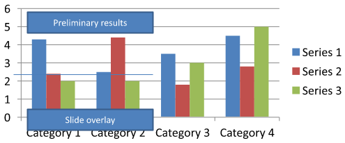

## **概要**

この記事では、Aspose.Slides を使用して PowerPoint プレゼンテーション内のチャートの書式設定方法を説明します。軸、グリッド線、タイトル、凡例、プロット領域、壁の塗りつぶしなど、重要なチャート要素をカスタマイズして、チャート データの外観と可読性を向上させる方法を示します。

また、チャート テキストのフォント プロパティの設定、チャート データへの事前定義数値書式の適用、チャート領域の角を丸める有効化方法も実演します。これらの例を通じて、プレゼンテーション内のチャートの視覚スタイルとデータ表示の両方を制御する方法が分かります。

## **チャート エンティティの書式設定**

[Chart](https://reference.aspose.com/slides/python-net/aspose.slides.charts/chart/) を使用して、チャート タイトル、軸、グリッド線、凡例、プロット領域の書式を設定します。この例では、マーカー付きの折れ線グラフをデフォルト データで作成し、値軸とカテゴリ軸にそれぞれ別々のテキストと線のスタイルを適用します。フォント サイズと線幅はポイント単位で指定され、カテゴリ ラベルは 45 度回転します。

値軸はソース セルとは独立して [number_format](https://reference.aspose.com/slides/python-net/aspose.slides.charts/axis/number_format/) を使用します。スケールは -2 から 15 までで、主要間隔は 2、次要間隔は 0.5 です。この例では、パーセンテージ書式と [display_unit](https://reference.aspose.com/slides/python-net/aspose.slides.charts/axis/display_unit/) を千単位に設定した組み合わせも示していますので、データの意味と規模に合わせて調整してください。凡例は [overlay](https://reference.aspose.com/slides/python-net/aspose.slides.charts/legend/overlay/) が無効になっているため、プロット領域の外側に配置されます。背面壁と床の塗りつぶしは [back_wall](https://reference.aspose.com/slides/python-net/aspose.slides.charts/chart/back_wall/) と [floor](https://reference.aspose.com/slides/python-net/aspose.slides.charts/chart/floor/) で構成されますが、これらの表面は 3D チャートでのみ表示されます。

```python
import aspose.slides.charts as charts
import aspose.slides as slides

with slides.Presentation() as presentation:

    slide = presentation.slides[0]

    chart = slide.shapes.add_chart(charts.ChartType.LINE_WITH_MARKERS, 50, 50, 500, 400)

    chart.has_title = True
    chart.chart_title.add_text_frame_for_overriding("")
    chart_title = chart.chart_title.text_frame_for_overriding.paragraphs[0].portions[0]
    chart_title.text = "Sample Chart"
    chart_title.portion_format.fill_format.fill_type = slides.FillType.SOLID
    chart_title.portion_format.fill_format.solid_fill_color.color = slides.Color.gray
    chart_title.portion_format.font_height = 20
    chart_title.portion_format.font_bold = slides.NullableBool.TRUE
    chart_title.portion_format.font_italic = slides.NullableBool.TRUE

    chart.axes.vertical_axis.major_grid_lines_format.line.fill_format.fill_type = slides.FillType.SOLID
    chart.axes.vertical_axis.major_grid_lines_format.line.fill_format.solid_fill_color.color = slides.Color.blue
    chart.axes.vertical_axis.major_grid_lines_format.line.width = 5
    chart.axes.vertical_axis.major_grid_lines_format.line.dash_style = slides.LineDashStyle.DASH_DOT

    chart.axes.vertical_axis.minor_grid_lines_format.line.fill_format.fill_type = slides.FillType.SOLID
    chart.axes.vertical_axis.minor_grid_lines_format.line.fill_format.solid_fill_color.color = slides.Color.red
    chart.axes.vertical_axis.minor_grid_lines_format.line.width = 3

    chart.axes.vertical_axis.is_number_format_linked_to_source = False
    chart.axes.vertical_axis.display_unit = charts.DisplayUnitType.THOUSANDS
    chart.axes.vertical_axis.number_format = "0.0%"

    chart.axes.vertical_axis.is_automatic_major_unit = False
    chart.axes.vertical_axis.is_automatic_max_value = False
    chart.axes.vertical_axis.is_automatic_minor_unit = False
    chart.axes.vertical_axis.is_automatic_min_value = False

    chart.axes.vertical_axis.max_value = 15
    chart.axes.vertical_axis.min_value = -2
    chart.axes.vertical_axis.minor_unit = 0.5
    chart.axes.vertical_axis.major_unit = 2.0

    vertical_axis_portion_format = chart.axes.vertical_axis.text_format.portion_format
    vertical_axis_portion_format.font_bold = slides.NullableBool.TRUE
    vertical_axis_portion_format.font_height = 16
    vertical_axis_portion_format.font_italic = slides.NullableBool.TRUE
    vertical_axis_portion_format.fill_format.fill_type = slides.FillType.SOLID
    vertical_axis_portion_format.fill_format.solid_fill_color.color = slides.Color.dark_green
    vertical_axis_portion_format.latin_font = slides.FontData("Times New Roman")

    chart.axes.vertical_axis.has_title = True
    chart.axes.vertical_axis.title.add_text_frame_for_overriding("")
    vertical_axis_title = chart.axes.vertical_axis.title.text_frame_for_overriding.paragraphs[0].portions[0]
    vertical_axis_title.text = "Primary Axis"
    vertical_axis_title.portion_format.fill_format.fill_type = slides.FillType.SOLID
    vertical_axis_title.portion_format.fill_format.solid_fill_color.color = slides.Color.gray
    vertical_axis_title.portion_format.font_height = 20
    vertical_axis_title.portion_format.font_bold = slides.NullableBool.TRUE
    vertical_axis_title.portion_format.font_italic = slides.NullableBool.TRUE

    chart.axes.horizontal_axis.major_grid_lines_format.line.fill_format.fill_type = slides.FillType.SOLID
    chart.axes.horizontal_axis.major_grid_lines_format.line.fill_format.solid_fill_color.color = slides.Color.green
    chart.axes.horizontal_axis.major_grid_lines_format.line.width = 5

    chart.axes.horizontal_axis.minor_grid_lines_format.line.fill_format.fill_type = slides.FillType.SOLID
    chart.axes.horizontal_axis.minor_grid_lines_format.line.fill_format.solid_fill_color.color = slides.Color.yellow
    chart.axes.horizontal_axis.minor_grid_lines_format.line.width = 3

    horizontal_axis_portion_format = chart.axes.horizontal_axis.text_format.portion_format
    horizontal_axis_portion_format.font_bold = slides.NullableBool.TRUE
    horizontal_axis_portion_format.font_height = 16
    horizontal_axis_portion_format.font_italic = slides.NullableBool.TRUE
    horizontal_axis_portion_format.fill_format.fill_type = slides.FillType.SOLID
    horizontal_axis_portion_format.fill_format.solid_fill_color.color = slides.Color.blue
    horizontal_axis_portion_format.latin_font = slides.FontData("Arial")

    chart.axes.horizontal_axis.has_title = True
    chart.axes.horizontal_axis.title.add_text_frame_for_overriding("")

    horizontal_axis_title = chart.axes.horizontal_axis.title.text_frame_for_overriding.paragraphs[0].portions[0]
    horizontal_axis_title.text = "Sample Category"
    horizontal_axis_title.portion_format.fill_format.fill_type = slides.FillType.SOLID
    horizontal_axis_title.portion_format.fill_format.solid_fill_color.color = slides.Color.gray
    horizontal_axis_title.portion_format.font_height = 20
    horizontal_axis_title.portion_format.font_bold = slides.NullableBool.TRUE
    horizontal_axis_title.portion_format.font_italic = slides.NullableBool.TRUE

    chart.axes.horizontal_axis.tick_label_position = charts.TickLabelPositionType.LOW

    chart.axes.horizontal_axis.tick_label_rotation_angle = 45

    legend_portion_format = chart.legend.text_format.portion_format
    legend_portion_format.font_bold = slides.NullableBool.TRUE
    legend_portion_format.font_height = 16
    legend_portion_format.font_italic = slides.NullableBool.TRUE
    legend_portion_format.fill_format.fill_type = slides.FillType.SOLID
    legend_portion_format.fill_format.solid_fill_color.color = slides.Color.dark_red

    chart.legend.overlay = False

    chart.back_wall.thickness = 1
    chart.back_wall.format.fill.fill_type = slides.FillType.SOLID
    chart.back_wall.format.fill.solid_fill_color.color = slides.Color.orange

    chart.floor.format.fill.fill_type = slides.FillType.SOLID
    chart.floor.format.fill.solid_fill_color.color = slides.Color.red

    chart.plot_area.format.fill.fill_type = slides.FillType.SOLID
    chart.plot_area.format.fill.solid_fill_color.color = slides.Color.light_cyan

    presentation.save("FormattedChart.pptx", slides.export.SaveFormat.PPTX)
```

## **チャートのフォント プロパティの設定**

[Chart.text_format](https://reference.aspose.com/slides/python-net/aspose.slides.charts/chart/text_format/) を使用して、チャート テキストのデフォルト フォント サイズを設定します。この例では、20 ポイント フォントの集合棒グラフを作成し、[show_value](https://reference.aspose.com/slides/python-net/aspose.slides.charts/datalabelformat/show_value/) を使用して最初の系列の値ラベルを有効にしています。個別に明示的なフォント設定を持つテキスト要素は、チャートのデフォルト設定を上書きできます。

```python
import aspose.slides.charts as charts
import aspose.slides as slides

with slides.Presentation() as presentation:
    slide = presentation.slides[0]

    chart = slide.shapes.add_chart(charts.ChartType.CLUSTERED_COLUMN, 100, 100, 500, 400)
    chart.text_format.portion_format.font_height = 20
    chart.chart_data.series[0].labels.default_data_label_format.show_value = True

    presentation.save("ChartFontProperties.pptx", slides.export.SaveFormat.PPTX)
```

## **数値書式の設定**

[ChartDataCell.preset_number_format](https://reference.aspose.com/slides/python-net/aspose.slides.charts/chartdatacell/preset_number_format/) を使用して、チャート ワークブック セルに組み込みの数値書式を適用します。この例では、デフォルトのセルベース データを持つ集合棒グラフを作成し、各系列の値セルに書式インデックス 10（`0.00%`）を適用しています。これにより、基になる数値は変更せずにワークブックでの表示が変わります。たとえば、0.25 は 25.00% と表示されます。軸とデータ ラベルの書式は個別に設定できます。

```python
import aspose.slides.charts as charts
import aspose.slides as slides

with slides.Presentation() as presentation:
    slide = presentation.slides[0]

    chart = slide.shapes.add_chart(charts.ChartType.CLUSTERED_COLUMN, 50, 50, 500, 400)

    for series in chart.chart_data.series:
        for data_point in series.data_points:
            data_point.value.as_cell.preset_number_format = 10  # 0.00%

    presentation.save("PresetNumberFormat.pptx", slides.export.SaveFormat.PPTX)
```

以下の表は、英語（米国）ロケール向けの代表的な Excel 書式を示す組み込み数値書式インデックスです。正確な書式文字列と表示はアプリケーションやロケールによって異なる場合があり、特に通貨や日付では差異があります。一部の Excel 書式は OOXML 標準のデフォルトとは異なることがあります（詳細は [Microsoft の数値書式実装ノート](https://learn.microsoft.com/en-us/openspecs/office_standards/ms-oi29500/17d11129-219b-4e2c-88db-45844d21e528) を参照）。

| インデックス | 書式 |
| --- | --- |
| 0 | `General` |
| 1 | `0` |
| 2 | `0.00` |
| 3 | `#,##0` |
| 4 | `#,##0.00` |
| 5 | `"$"#,##0_);("$"#,##0)` |
| 6 | `"$"#,##0_);[Red]("$"#,##0)` |
| 7 | `"$"#,##0.00_);("$"#,##0.00)` |
| 8 | `"$"#,##0.00_);[Red]("$"#,##0.00)` |
| 9 | `0%` |
| 10 | `0.00%` |
| 11 | `0.00E+00` |
| 12 | `# ?/?` |
| 13 | `# ??/??` |
| 14 | `m/d/yyyy` |
| 15 | `d-mmm-yy` |
| 16 | `d-mmm` |
| 17 | `mmm-yy` |
| 18 | `h:mm AM/PM` |
| 19 | `h:mm:ss AM/PM` |
| 20 | `h:mm` |
| 21 | `h:mm:ss` |
| 22 | `m/d/yyyy h:mm` |
| 37 | `#,##0_);(#,##0)` |
| 38 | `#,##0_);[Red](#,##0)` |
| 39 | `#,##0.00_);(#,##0.00)` |
| 40 | `#,##0.00_);[Red](#,##0.00)` |
| 41 | `_(* #,##0_);_(* (#,##0);_(* "-"_);_(@_)` |
| 42 | `_("$"* #,##0_);_("$"* (#,##0);_("$"* "-"_);_(@_)` |
| 43 | `_(* #,##0.00_);_(* (#,##0.00);_(* "-"??_);_(@_)` |
| 44 | `_("$"* #,##0.00_);_("$"* (#,##0.00);_("$"* "-"??_);_(@_)` |
| 45 | `mm:ss` |
| 46 | `[h]:mm:ss` |
| 47 | `mm:ss.0` |
| 48 | `##0.0E+0` |
| 49 | `@` |

## **チャート領域の角を丸める設定**

[Chart.has_rounded_corners](https://reference.aspose.com/slides/python-net/aspose.slides.charts/chart/has_rounded_corners/) を有効にして、チャート領域の角を丸めます。この例では、集合棒グラフを作成し、[line_format](https://reference.aspose.com/slides/python-net/aspose.slides/shape/line_format/) を使用してアウトラインに単色のグレーと単一線スタイルを設定した後、プレゼンテーションを保存します。

```python
import aspose.slides.charts as charts
import aspose.slides as slides

with slides.Presentation() as presentation:
    slide = presentation.slides[0]

    chart = slide.shapes.add_chart(charts.ChartType.CLUSTERED_COLUMN, 20, 100, 600, 400)
    chart.line_format.fill_format.fill_type = slides.FillType.SOLID
    chart.line_format.fill_format.solid_fill_color.color = slides.Color.gray
    chart.line_format.style = slides.LineStyle.SINGLE
    chart.has_rounded_corners = True

    presentation.save("RoundedBorders.pptx", slides.export.SaveFormat.PPTX)
```

## **既存のチャート注釈の編集**

チャートには、レポートのステータスを説明するテキスト注釈などのカスタム図形を含めることができます。これらの図形は [Chart.user_shapes](https://reference.aspose.com/slides/python-net/aspose.slides.charts/chart/user_shapes/) で取得します。その [shapes](https://reference.aspose.com/slides/python-net/aspose.slides/groupshape/shapes/) コレクションには、チャートが所有する図形が含まれます。

チャート上に配置された普通のテキスト ボックスはスライドに属し、たとえチャートの一部のように見えても同様です。[Slide.shapes](https://reference.aspose.com/slides/python-net/aspose.slides/baseslide/shapes/) を反復処理すると、チャートと普通のスライド図形が見つかりますが、チャート内部の個々の図形は列挙されません。チャート タイトルやデータ ラベルは別個のチャート要素であり、このコレクションのカスタム注釈ではありません。

[chart-annotations.pptx](chart-annotations.pptx) をダウンロードしてアプリケーションの作業ディレクトリに配置してください。最初のスライドには、"Preliminary results" という非グループ化注釈、チャートが所有する線、"Slide overlay" という普通のスライド テキスト ボックスが含まれています。この例では、そのスライド上の最初のチャートを見つけ、レポートが公開準備完了になったときに注釈を "Final results" に変更します。コレクションが空でないことを確認し、`None` でなく期待するテキストを含む [AutoShape](https://reference.aspose.com/slides/python-net/aspose.slides/autoshape/) と [text_frame](https://reference.aspose.com/slides/python-net/aspose.slides/autoshape/text_frame/) をのみ編集します。

```python
import aspose.slides as slides
import aspose.slides.charts as charts

with slides.Presentation("chart-annotations.pptx") as presentation:
    slide = presentation.slides[0]
    chart = next((shape for shape in slide.shapes if isinstance(shape, charts.Chart)), None)

    if chart is None or len(chart.user_shapes.shapes) == 0:
        print("No chart or chart-owned shapes found.")
    else:
        updated = False
        for shape in chart.user_shapes.shapes:
            if isinstance(shape, slides.AutoShape) and shape.text_frame is not None:
                if shape.text_frame.text == "Preliminary results":
                    shape.text_frame.text = "Final results"
                    updated = True
                    break

        if updated:
            presentation.save("chart-annotations-updated.pptx", slides.export.SaveFormat.PPTX)
        else:
            print("No matching text annotation found.")
```

線とスライド テキスト ボックスは変更されません。以下の画像は、入力と保存後に再度開いた結果を示しています。

| 編集前 | 編集後 |
| --- | --- |
|  |  |

{}
この例はトップレベルのチャート所有図形のみを検査します。注釈が [GroupShape](https://reference.aspose.com/slides/python-net/aspose.slides/groupshape/) 内にある場合は、そのグループの [shapes](https://reference.aspose.com/slides/python-net/aspose.slides/groupshape/shapes/) コレクションも検査してください。入れ子になったグループについては同様に再帰的に処理し、子図形のテキストチェックを適用します。グループ自体はコンテナであり、テキスト ボックスとして扱わないでください。
{}

## **FAQ**

**列/エリアの塗りつぶしを半透明にし、境界線は不透明のままにできますか？**

はい。塗りつぶしの透明度とアウトラインは別々に設定できます。これにより、密集したビジュアル化においてグリッドとデータの可読性を向上させることができます。

**データラベルが重なった場合、どう対処すればよいですか？**

フォント サイズを小さくする、必須でないラベル要素（たとえばカテゴリ）を無効化する、ラベル位置を調整する、必要に応じて選択ポイントのみにラベルを表示する、または "value + legend" 形式に切り替えるなどの方法があります。

**系列にグラデーションやパターン塗りを適用できますか？**

はい。系列は単色、グラデーション、パターン塗りをサポートしています。実務ではグラデーションは控えめに使用し、グリッドやテキストとのコントラストが低下する組み合わせは避けてください。