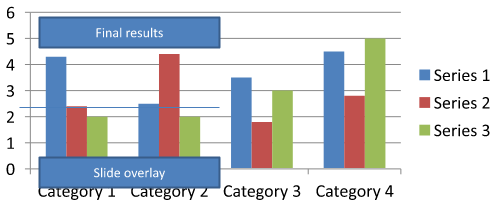

## **개요**

이 문서는 Aspose.Slides를 사용하여 PowerPoint 프레젠테이션에서 차트를 서식 지정하는 방법을 설명합니다. 차트 데이터의 외관과 가독성을 향상시키기 위해 축, 눈금선, 제목, 범례, 플롯 영역 및 벽 채우기와 같은 주요 차트 요소를 사용자 정의하는 방법을 보여 줍니다.

또한 차트 텍스트에 대한 글꼴 속성을 설정하고, 차트 데이터에 사전 정의된 숫자 형식을 적용하며, 차트 영역에 둥근 모서리를 활성화하는 방법을 보여 줍니다. 이러한 예제들을 통해 프레젠테이션의 차트 시각 스타일과 데이터 표시를 모두 제어하는 방법을 확인할 수 있습니다.

## **차트 엔티티 서식 지정**

차트 제목, 축, 눈금선, 범례 및 플롯 영역을 서식 지정하려면 [IChart](https://reference.aspose.com/slides/androidjava/com.aspose.slides/ichart/)을 사용합니다. 이 예제는 마커와 기본 데이터를 포함한 꺾은선형 차트를 만든 다음 값 축과 범주 축에 개별 텍스트 및 선 스타일을 적용합니다. 글꼴 크기와 선 두께는 포인트 단위로 지정되며, 범주 레이블은 45도 회전됩니다.

값 축은 소스 셀과 무관하게 [setNumberFormat](https://reference.aspose.com/slides/androidjava/com.aspose.slides/iaxis/#setNumberFormat-java.lang.String-)을 사용합니다. 스케일은 -2에서 15까지이며 주요 간격은 2, 보조 간격은 0.5입니다. 이 예제는 또한 퍼센트 서식을 [setDisplayUnit](https://reference.aspose.com/slides/androidjava/com.aspose.slides/iaxis/#setDisplayUnit-int-)과 함께 천 단위로 설정하여 결합하므로 데이터의 의미와 크기에 맞게 이러한 설정을 조정하십시오. 범례는 [setOverlay](https://reference.aspose.com/slides/androidjava/com.aspose.slides/ilegend/#setOverlay-boolean-)를 `false` 로 호출했기 때문에 플롯 영역 밖에 배치됩니다. 백월 및 바닥 채우기는 [getBackWall](https://reference.aspose.com/slides/androidjava/com.aspose.slides/ichart/#getBackWall--) 및 [getFloor](https://reference.aspose.com/slides/androidjava/com.aspose.slides/ichart/#getFloor--)을 통해 구성되지만, 이러한 표면은 3D 차트에서만 표시됩니다.

```java
import com.aspose.slides.*;
import android.graphics.Color;

Presentation presentation = new Presentation();
try {
    ISlide slide = presentation.getSlides().get_Item(0);

    IChart chart = slide.getShapes().addChart(ChartType.LineWithMarkers, 50, 50, 500, 400);

    chart.setTitle(true);
    chart.getChartTitle().addTextFrameForOverriding("");
    IPortion chartTitle = chart.getChartTitle().getTextFrameForOverriding().getParagraphs().get_Item(0).getPortions().get_Item(0);
    chartTitle.setText("Sample Chart");
    chartTitle.getPortionFormat().getFillFormat().setFillType(FillType.Solid);
    chartTitle.getPortionFormat().getFillFormat().getSolidFillColor().setColor(Color.GRAY);
    chartTitle.getPortionFormat().setFontHeight(20);
    chartTitle.getPortionFormat().setFontBold(NullableBool.True);
    chartTitle.getPortionFormat().setFontItalic(NullableBool.True);

    chart.getAxes().getVerticalAxis().getMajorGridLinesFormat().getLine().getFillFormat().setFillType(FillType.Solid);
    chart.getAxes().getVerticalAxis().getMajorGridLinesFormat().getLine().getFillFormat().getSolidFillColor().setColor(Color.BLUE);
    chart.getAxes().getVerticalAxis().getMajorGridLinesFormat().getLine().setWidth(5);
    chart.getAxes().getVerticalAxis().getMajorGridLinesFormat().getLine().setDashStyle(LineDashStyle.DashDot);

    chart.getAxes().getVerticalAxis().getMinorGridLinesFormat().getLine().getFillFormat().setFillType(FillType.Solid);
    chart.getAxes().getVerticalAxis().getMinorGridLinesFormat().getLine().getFillFormat().getSolidFillColor().setColor(Color.RED);
    chart.getAxes().getVerticalAxis().getMinorGridLinesFormat().getLine().setWidth(3);

    chart.getAxes().getVerticalAxis().setNumberFormatLinkedToSource(false);
    chart.getAxes().getVerticalAxis().setDisplayUnit(DisplayUnitType.Thousands);
    chart.getAxes().getVerticalAxis().setNumberFormat("0.0%");

    chart.getAxes().getVerticalAxis().setAutomaticMajorUnit(false);
    chart.getAxes().getVerticalAxis().setAutomaticMaxValue(false);
    chart.getAxes().getVerticalAxis().setAutomaticMinorUnit(false);
    chart.getAxes().getVerticalAxis().setAutomaticMinValue(false);

    chart.getAxes().getVerticalAxis().setMaxValue(15f);
    chart.getAxes().getVerticalAxis().setMinValue(-2f);
    chart.getAxes().getVerticalAxis().setMinorUnit(0.5f);
    chart.getAxes().getVerticalAxis().setMajorUnit(2.0f);

    IChartPortionFormat valueAxisText = chart.getAxes().getVerticalAxis().getTextFormat().getPortionFormat();
    valueAxisText.setFontBold(NullableBool.True);
    valueAxisText.setFontHeight(16);
    valueAxisText.setFontItalic(NullableBool.True);
    valueAxisText.getFillFormat().setFillType(FillType.Solid);
    valueAxisText.getFillFormat().getSolidFillColor().setPresetColor(PresetColor.DarkGreen);
    valueAxisText.setLatinFont(new FontData("Times New Roman"));

    chart.getAxes().getVerticalAxis().setTitle(true);
    chart.getAxes().getVerticalAxis().getTitle().addTextFrameForOverriding("");
    IPortion valueAxisTitle = chart.getAxes().getVerticalAxis().getTitle().getTextFrameForOverriding().getParagraphs().get_Item(0).getPortions().get_Item(0);
    valueAxisTitle.setText("Primary Axis");
    valueAxisTitle.getPortionFormat().getFillFormat().setFillType(FillType.Solid);
    valueAxisTitle.getPortionFormat().getFillFormat().getSolidFillColor().setColor(Color.GRAY);
    valueAxisTitle.getPortionFormat().setFontHeight(20);
    valueAxisTitle.getPortionFormat().setFontBold(NullableBool.True);
    valueAxisTitle.getPortionFormat().setFontItalic(NullableBool.True);

    chart.getAxes().getHorizontalAxis().getMajorGridLinesFormat().getLine().getFillFormat().setFillType(FillType.Solid);
    chart.getAxes().getHorizontalAxis().getMajorGridLinesFormat().getLine().getFillFormat().getSolidFillColor().setColor(Color.rgb(0, 128, 0));
    chart.getAxes().getHorizontalAxis().getMajorGridLinesFormat().getLine().setWidth(5);

    chart.getAxes().getHorizontalAxis().getMinorGridLinesFormat().getLine().getFillFormat().setFillType(FillType.Solid);
    chart.getAxes().getHorizontalAxis().getMinorGridLinesFormat().getLine().getFillFormat().getSolidFillColor().setColor(Color.YELLOW);
    chart.getAxes().getHorizontalAxis().getMinorGridLinesFormat().getLine().setWidth(3);

    IChartPortionFormat categoryAxisText = chart.getAxes().getHorizontalAxis().getTextFormat().getPortionFormat();
    categoryAxisText.setFontBold(NullableBool.True);
    categoryAxisText.setFontHeight(16);
    categoryAxisText.setFontItalic(NullableBool.True);
    categoryAxisText.getFillFormat().setFillType(FillType.Solid);
    categoryAxisText.getFillFormat().getSolidFillColor().setColor(Color.BLUE);
    categoryAxisText.setLatinFont(new FontData("Arial"));

    chart.getAxes().getHorizontalAxis().setTitle(true);
    chart.getAxes().getHorizontalAxis().getTitle().addTextFrameForOverriding("");

    IPortion categoryAxisTitle = chart.getAxes().getHorizontalAxis().getTitle().getTextFrameForOverriding().getParagraphs().get_Item(0).getPortions().get_Item(0);
    categoryAxisTitle.setText("Sample Category");
    categoryAxisTitle.getPortionFormat().getFillFormat().setFillType(FillType.Solid);
    categoryAxisTitle.getPortionFormat().getFillFormat().getSolidFillColor().setColor(Color.GRAY);
    categoryAxisTitle.getPortionFormat().setFontHeight(20);
    categoryAxisTitle.getPortionFormat().setFontBold(NullableBool.True);
    categoryAxisTitle.getPortionFormat().setFontItalic(NullableBool.True);

    chart.getAxes().getHorizontalAxis().setTickLabelPosition(TickLabelPositionType.Low);
    chart.getAxes().getHorizontalAxis().setTickLabelRotationAngle(45);

    IChartPortionFormat legendText = chart.getLegend().getTextFormat().getPortionFormat();
    legendText.setFontBold(NullableBool.True);
    legendText.setFontHeight(16);
    legendText.setFontItalic(NullableBool.True);
    legendText.getFillFormat().setFillType(FillType.Solid);
    legendText.getFillFormat().getSolidFillColor().setPresetColor(PresetColor.DarkRed);

    chart.getLegend().setOverlay(false);

    chart.getBackWall().setThickness(1);
    chart.getBackWall().getFormat().getFill().setFillType(FillType.Solid);
    chart.getBackWall().getFormat().getFill().getSolidFillColor().setColor(Color.rgb(255, 165, 0));

    chart.getFloor().getFormat().getFill().setFillType(FillType.Solid);
    chart.getFloor().getFormat().getFill().getSolidFillColor().setColor(Color.RED);

    chart.getPlotArea().getFormat().getFill().setFillType(FillType.Solid);
    chart.getPlotArea().getFormat().getFill().getSolidFillColor().setPresetColor(PresetColor.LightCyan);

    presentation.save("FormattedChart_out.pptx", SaveFormat.Pptx);
} finally {
    presentation.dispose();
}
```

## **차트에 대한 글꼴 속성 설정**

차트 텍스트의 기본 글꼴 크기는 [Chart.getTextFormat](https://reference.aspose.com/slides/androidjava/com.aspose.slides/chart/#getTextFormat--)을 통해 설정합니다. 이 예제는 20포인트 글꼴을 사용한 클러스터된 열 차트를 만든 다음 [setShowValue](https://reference.aspose.com/slides/androidjava/com.aspose.slides/idatalabelformat/#setShowValue-boolean-)를 통해 첫 번째 시리즈에 값 레이블을 활성화합니다. 자체 명시적 글꼴 설정이 있는 텍스트 요소는 차트 기본값을 재정의할 수 있습니다.

```java
import com.aspose.slides.*;

Presentation presentation = new Presentation();
try {
    ISlide slide = presentation.getSlides().get_Item(0);

    IChart chart = slide.getShapes().addChart(ChartType.ClusteredColumn, 100, 100, 500, 400);
    chart.getTextFormat().getPortionFormat().setFontHeight(20);
    chart.getChartData().getSeries().get_Item(0).getLabels().getDefaultDataLabelFormat().setShowValue(true);

    presentation.save("FontPropertiesForChart.pptx", SaveFormat.Pptx);
} finally {
    presentation.dispose();
}
```

## **숫자 형식 설정**

[IChartDataCell.setPresetNumberFormat](https://reference.aspose.com/slides/androidjava/com.aspose.slides/ichartdatacell/#setPresetNumberFormat-byte-)을 사용하여 차트 워크북 셀에 내장 숫자 형식을 적용합니다. 이 예제는 기본 셀 기반 데이터를 사용한 클러스터된 열 차트를 만든 다음 각 시리즈 값 셀에 형식 인덱스 10(`0.00%`)을 적용합니다. 이렇게 하면 기본 숫자는 변경되지 않으면서 워크북에 표시되는 값이 변합니다; 예를 들어 0.25는 25.00%로 표시됩니다. 축 및 데이터 레이블 형식은 별도로 구성할 수 있습니다.

```java
import com.aspose.slides.*;

Presentation presentation = new Presentation();
try {
    ISlide slide = presentation.getSlides().get_Item(0);

    IChart chart = slide.getShapes().addChart(ChartType.ClusteredColumn, 50, 50, 500, 400);
    IChartSeriesCollection series = chart.getChartData().getSeries();

    for (IChartSeries chartSeries : series)
    {
        for (IChartDataPoint dataPoint : chartSeries.getDataPoints())
        {
            dataPoint.getValue().getAsCell().setPresetNumberFormat((byte) 10); // 0.00%
        }
    }

    presentation.save("PresetNumberFormat_out.pptx", SaveFormat.Pptx);
} finally {
    presentation.dispose();
}
```

다음 표는 미국 영어 로케일에 대한 대표적인 Excel 형식과 함께 내장 숫자 형식 인덱스를 나열합니다. 정확한 형식 문자열 및 표시 방식은 응용 프로그램 및 로케일에 따라 다를 수 있으며, 특히 통화와 날짜 형식에 차이가 있습니다. 일부 Excel 형식은 OOXML 표준의 기본값과 다르며, 이는 [Microsoft의 숫자 형식 구현 노트](https://learn.microsoft.com/en-us/openspecs/office_standards/ms-oi29500/17d11129-219b-4e2c-88db-45844d21e528)에서 설명합니다.

| 인덱스 | 형식 |
| --- | --- |
| 0 | `General` |
| 1 | `0` |
| 2 | `0.00` |
| 3 | `#,##0` |
| 4 | `#,##0.00` |
| 5 | `"$"#,##0_);("$"#,##0)` |
| 6 | `"$"#,##0_);[Red]("$"#,##0)` |
| 7 | `"$"#,##0.00_);("$"#,##0.00)` |
| 8 | `"$"#,##0.00_);[Red]("$"#,##0.00)` |
| 9 | `0%` |
| 10 | `0.00%` |
| 11 | `0.00E+00` |
| 12 | `# ?/?` |
| 13 | `# ??/??` |
| 14 | `m/d/yyyy` |
| 15 | `d-mmm-yy` |
| 16 | `d-mmm` |
| 17 | `mmm-yy` |
| 18 | `h:mm AM/PM` |
| 19 | `h:mm:ss AM/PM` |
| 20 | `h:mm` |
| 21 | `h:mm:ss` |
| 22 | `m/d/yyyy h:mm` |
| 37 | `#,##0_);(#,##0)` |
| 38 | `#,##0_);[Red](#,##0)` |
| 39 | `#,##0.00_);(#,##0.00)` |
| 40 | `#,##0.00_);[Red](#,##0.00)` |
| 41 | `_(* #,##0_);_(* (#,##0);_(* "-"_);_(@_)` |
| 42 | `_("$"* #,##0_);_("$"* (#,##0);_("$"* "-"_);_(@_)` |
| 43 | `_(* #,##0.00_);_(* (#,##0.00);_(* "-"??_);_(@_)` |
| 44 | `_("$"* #,##0.00_);_("$"* (#,##0.00);_("$"* "-"??_);_(@_)` |
| 45 | `mm:ss` |
| 46 | `[h]:mm:ss` |
| 47 | `mm:ss.0` |
| 48 | `##0.0E+0` |
| 49 | `@` |

## **차트 영역 둥근 모서리 설정**

[IChart.setRoundedCorners](https://reference.aspose.com/slides/androidjava/com.aspose.slides/ichart/#setRoundedCorners-boolean-)에 `true` 를 전달하여 차트 영역의 모서리를 둥글게 합니다. 이 예제는 클러스터된 열 차트를 만든 다음 [getLineFormat](https://reference.aspose.com/slides/androidjava/com.aspose.slides/ishape/#getLineFormat--)을 사용해 외곽선에 단색 회색과 단일 선 스타일을 적용하고 프레젠테이션을 저장합니다.

```java
import com.aspose.slides.*;
import android.graphics.Color;

Presentation presentation = new Presentation();
try {
    ISlide slide = presentation.getSlides().get_Item(0);

    IChart chart = slide.getShapes().addChart(ChartType.ClusteredColumn, 20, 100, 600, 400);
    chart.getLineFormat().getFillFormat().setFillType(FillType.Solid);
    chart.getLineFormat().getFillFormat().getSolidFillColor().setColor(Color.GRAY);
    chart.getLineFormat().setStyle(LineStyle.Single);
    chart.setRoundedCorners(true);

    presentation.save("out.pptx", SaveFormat.Pptx);
} finally {
    presentation.dispose();
}
```

## **기존 차트 주석 편집**

차트에는 보고서 상태를 설명하는 텍스트 주석과 같은 사용자 정의 도형을 포함할 수 있습니다. 이러한 도형은 [IChart.getUserShapes](https://reference.aspose.com/slides/androidjava/com.aspose.slides/ichart/#getUserShapes--)를 통해 액세스할 수 있으며, 이는 차트 API 레퍼런스의 [Chart.getUserShapes](https://reference.aspose.com/slides/androidjava/com.aspose.slides/chart/#getUserShapes--)에도 나와 있습니다. [getShapes](https://reference.aspose.com/slides/androidjava/com.aspose.slides/igroupshape/#getShapes--)가 반환하는 컬렉션에는 차트가 소유한 도형이 들어 있습니다.

차트 위에 배치된 일반 텍스트 상자는 차트의 일부처럼 보여도 슬라이드에 속합니다. [Slide.getShapes](https://reference.aspose.com/slides/androidjava/com.aspose.slides/baseslide/#getShapes--)를 반복하면 차트와 일반 슬라이드 도형을 찾을 수 있지만 차트 내부의 개별 도형은 열거되지 않습니다. 차트 제목과 데이터 레이블은 별개의 차트 요소이며 이 컬렉션의 사용자 정의 주석이 아닙니다.

[chart-annotations.pptx](chart-annotations.pptx)를 다운로드하여 애플리케이션 작업 디렉터리에 배치합니다. 첫 번째 슬라이드에는 "Preliminary results"라는 그룹화되지 않은 주석과 차트 소유 라인, 그리고 "Slide overlay"라는 일반 슬라이드 텍스트 상자가 있는 차트가 포함되어 있습니다. 예제는 해당 슬라이드에서 첫 번째 차트를 찾아 보고서를 게시할 준비가 되었을 때 주석을 "Final results"로 변경합니다. 컬렉션이 비어 있는지 확인하고, [IAutoShape](https://reference.aspose.com/slides/androidjava/com.aspose.slides/iautoshape/) 중에서 [getTextFrame](https://reference.aspose.com/slides/androidjava/com.aspose.slides/iautoshape/#getTextFrame--)이 반환하는 널이 아닌 텍스트 프레임을 가지고 기대 텍스트와 일치하는 경우에만 편집합니다.

```java
import com.aspose.slides.*;

Presentation presentation = new Presentation("chart-annotations.pptx");
try {
    ISlide slide = presentation.getSlides().get_Item(0);

    IChart chart = null;
    for (IShape shape : slide.getShapes()) {
        if (shape instanceof IChart) {
            chart = (IChart) shape;
            break;
        }
    }

    if (chart == null || chart.getUserShapes().getShapes().size() == 0) {
        System.out.println("No chart or chart-owned shapes found.");
        return;
    }

    boolean updated = false;
    for (IShape shape : chart.getUserShapes().getShapes()) {
        if (shape instanceof IAutoShape) {
            IAutoShape annotation = (IAutoShape) shape;
            if (annotation.getTextFrame() != null && "Preliminary results".equals(annotation.getTextFrame().getText())) {
                annotation.getTextFrame().setText("Final results");
                updated = true;
                break;
            }
        }
    }

    if (updated) {
        presentation.save("chart-annotations-updated.pptx", SaveFormat.Pptx);
    } else {
        System.out.println("No matching text annotation found.");
    }
} finally {
    presentation.dispose();
}
```

선과 슬라이드 텍스트 상자는 변경되지 않은 채로 남습니다. 다음 이미지들은 입력 파일과 저장 후 다시 연 결과를 보여 줍니다:

| 편집 전 | 편집 후 |
| --- | --- |
|  |  |

{}
예제는 최상위 차트 소유 도형만 검사합니다. 주석이 [IGroupShape](https://reference.aspose.com/slides/androidjava/com.aspose.slides/igroupshape/) 내부에 있는 경우 해당 그룹의 [getShapes](https://reference.aspose.com/slides/androidjava/com.aspose.slides/igroupshape/#getShapes--) 컬렉션도 검사합니다. 중첩된 그룹에 대해 재귀적으로 반복하면서 자식 도형에 동일한 텍스트 검사를 적용합니다. 그룹 자체는 컨테이너이며 텍스트 상자로 취급하지 마십시오.
{}

## **자주 묻는 질문**

**열/영역에 반투명 채우기를 적용하면서 테두리를 불투명하게 유지할 수 있나요?**

예. 채우기 투명도와 외곽선은 별도로 설정됩니다. 이는 복잡한 시각화에서 격자와 데이터의 가독성을 높이는 데 유용합니다.

**데이터 레이블이 겹칠 때 어떻게 처리할 수 있나요?**

글꼴 크기를 줄이고, 불필요한 레이블 요소(예: 범주)를 비활성화하며, 레이블 위치를 조정하고, 필요에 따라 선택된 포인트에만 레이블을 표시하거나 형식을 "값 + 범례"로 전환하십시오.

**시리즈에 그라디언트 또는 패턴 채우기를 적용할 수 있나요?**

예. 시리즈는 단색, 그라디언트, 패턴 채우기를 모두 지원합니다. 실제로는 그라디언트를 적게 사용하고 격자와 텍스트와의 대비를 감소시키는 조합은 피하십시오.